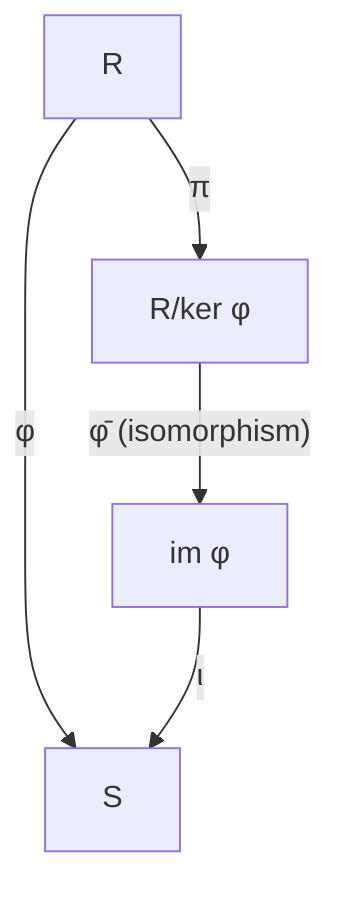
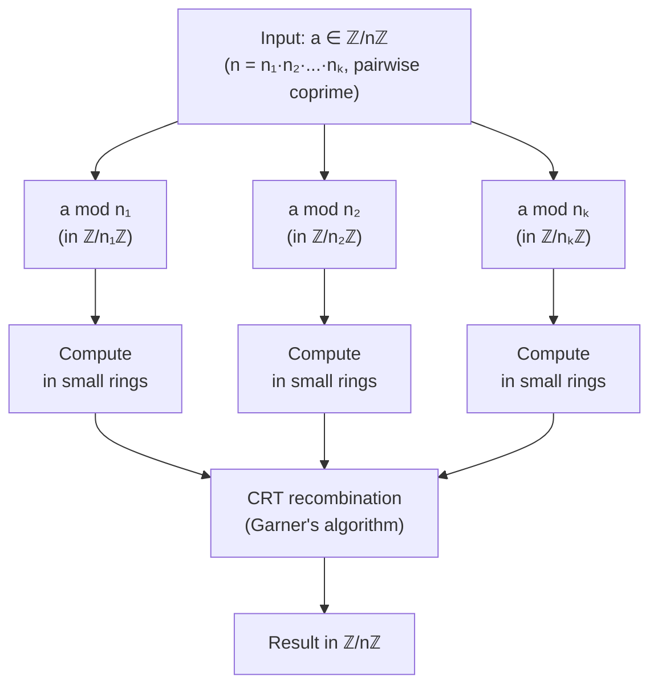

# Lesson 2: Rings, Ideals, and Quotient Structures

## 1. First-Principles Intuition & Invariants

The concept of a group distills the essence of symmetry into a single binary operation, but the mathematical structures we encounter most naturally — the integers, polynomial expressions, matrices, continuous functions — carry two interlocking operations rather than one. Addition and multiplication coexist in these systems, and their interaction generates an entirely richer architecture. Ring theory is the formal study of this two-operation world, and it stands as one of the central pillars of modern algebra, connecting number theory, algebraic geometry, coding theory, and cryptography through a unified axiomatic language.

Before stating the axioms, it is worth pausing on intuition. The integers $\mathbb{Z}$ form the archetypal ring: you can add, subtract, and multiply any two integers and remain inside $\mathbb{Z}$. Division, however, is not always possible — $7/3 \notin \mathbb{Z}$ — and this failure of division is not a defect to be patched but rather the structural feature that gives ring theory its depth. The obstruction to division is encoded in the concept of ideals, and the act of "forcing" divisibility relationships to hold is precisely what quotient rings accomplish. This three-part drama — rings as ambient structures, ideals as the distinguished subsets, and quotient rings as the collapsed structures built from them — constitutes the narrative arc of this lesson.

### The Ring Axioms

A **ring** is a set $R$ equipped with two binary operations, written $+$ (addition) and $\cdot$ (multiplication), satisfying the following axioms. Under addition, $(R, +)$ must be an abelian group: addition is associative, there exists an additive identity $0 \in R$ such that $a + 0 = a$ for all $a \in R$, every element $a$ has an additive inverse $-a$, and addition is commutative. Under multiplication, $\cdot$ must be associative: $(ab)c = a(bc)$ for all $a, b, c \in R$. Finally, multiplication must distribute over addition from both sides:

$$a(b + c) = ab + ac \qquad \text{and} \qquad (b + c)a = ba + ca.$$

This formulation makes no requirement that multiplication be commutative, nor that a multiplicative identity exist. When a multiplicative identity $1 \in R$ does exist satisfying $1 \cdot a = a \cdot 1 = a$ for all $a$, we call $R$ a **ring with unity** (or unital ring). When multiplication is commutative, $R$ is a **commutative ring**. The vast majority of rings in classical algebra — $\mathbb{Z}$, $\mathbb{Q}$, $\mathbb{R}$, $\mathbb{C}$, polynomial rings $k[x]$, and modular arithmetic $\mathbb{Z}/n\mathbb{Z}$ — are commutative rings with unity, and this is the primary setting for this lesson. Matrix rings over a field provide the canonical example of a noncommutative ring with unity, while the even integers $2\mathbb{Z}$ form a commutative ring without unity.

A few elementary consequences follow immediately from the axioms. For any $a \in R$, we have $0 \cdot a = 0$. To see this, note that $0 \cdot a = (0 + 0) \cdot a = 0 \cdot a + 0 \cdot a$ by distributivity, and subtracting $0 \cdot a$ from both sides gives $0 \cdot a = 0$. Similarly, $(-1) \cdot a = -a$ when unity exists, since $a + (-1) \cdot a = 1 \cdot a + (-1) \cdot a = (1 + (-1)) \cdot a = 0 \cdot a = 0$.

### Subrings

A subset $S \subseteq R$ is a **subring** if it is itself a ring under the operations inherited from $R$. By the subring criterion, $S$ is a subring if and only if $S$ is nonempty, closed under subtraction (so $a, b \in S \Rightarrow a - b \in S$), and closed under multiplication (so $a, b \in S \Rightarrow ab \in S$). The closure under subtraction subsumes both additive closure and the existence of additive inverses. For instance, $\mathbb{Z}$ is a subring of $\mathbb{Q}$, which is a subring of $\mathbb{R}$, which is a subring of $\mathbb{C}$. The Gaussian integers $\mathbb{Z}[i] = \{a + bi : a, b \in \mathbb{Z}\}$ form a subring of $\mathbb{C}$: if $\alpha = a + bi$ and $\beta = c + di$, then $\alpha - \beta = (a-c) + (b-d)i$ and $\alpha\beta = (ac - bd) + (ad + bc)i$, both of which lie in $\mathbb{Z}[i]$.

### Integral Domains and Zero Divisors

One of the central distinctions among rings concerns the behavior of zero. An element $a \in R$ is a **zero divisor** if $a \neq 0$ and there exists some nonzero $b \in R$ with $ab = 0$. In $\mathbb{Z}/6\mathbb{Z}$, for example, $2 \cdot 3 = 6 \equiv 0$, so both $2$ and $3$ are zero divisors. Zero divisors are precisely the obstruction to cancellation: if $ab = ac$ and $a$ is not a zero divisor, we can conclude $b = c$; if $a$ is a zero divisor, the implication fails.

A commutative ring with unity in which no zero divisors exist is called an **integral domain**. The defining property $ab = 0 \Rightarrow a = 0 \text{ or } b = 0$ captures the irreducibility of zero — it cannot be written as a product of nonzero elements. The integers $\mathbb{Z}$, any field, polynomial rings $k[x]$ over a field, and the Gaussian integers $\mathbb{Z}[i]$ are all integral domains. The key computational payoff of the integral domain property is the **cancellation law**: if $a \neq 0$ and $ab = ac$ in an integral domain, then $b = c$.

A **field** is an integral domain in which every nonzero element has a multiplicative inverse. Fields are rings where division is always possible among nonzero elements: $\mathbb{Q}$, $\mathbb{R}$, $\mathbb{C}$, and $\mathbb{Z}/p\mathbb{Z}$ for prime $p$ are the fundamental examples. Every finite integral domain is a field — a fact worth proving explicitly. Suppose $D$ is a finite integral domain and let $a \in D$ be nonzero. Consider the multiplication map $\mu_a : D \to D$ defined by $\mu_a(x) = ax$. Because $D$ has no zero divisors, $\mu_a$ is injective: if $ax = ay$ then $a(x - y) = 0$ forces $x = y$. An injective function on a finite set is surjective, so there exists some $b \in D$ with $ab = 1$, giving $a$ an inverse. Therefore $D$ is a field.

### Ideals: The Kernel of Ring Theory

The ideal is to ring theory what the normal subgroup is to group theory. It is the structure needed to form quotient rings, and its definition emerges naturally from asking what subsets $I \subseteq R$ allow us to form a well-defined quotient ring $R/I$ using cosets $a + I$.

A nonempty subset $I \subseteq R$ is a **left ideal** if $I$ is closed under addition and absorbs left multiplication from $R$: for all $r \in R$ and $a \in I$, we require $ra \in I$. A **right ideal** requires $ar \in I$ instead. A **two-sided ideal** (what we simply call an ideal in the commutative setting) satisfies both conditions simultaneously. In a commutative ring these three notions coincide, and we work with this case. Concisely, $I$ is an ideal of $R$ if:

$$a, b \in I \Rightarrow a - b \in I, \qquad r \in R,\, a \in I \Rightarrow ra \in I.$$

The absorption condition $ra \in I$ is what distinguishes an ideal from a mere subring. Consider $\mathbb{Z}$ and the subset $n\mathbb{Z} = \{nk : k \in \mathbb{Z}\}$ of multiples of $n$. This is an ideal: differences of multiples of $n$ are multiples of $n$, and any integer times a multiple of $n$ is a multiple of $n$. Crucially, $n\mathbb{Z}$ is not merely a subring but absorbs all of $\mathbb{Z}$ under multiplication. In fact, every ideal of $\mathbb{Z}$ is of this form — we prove this shortly.

The two trivial ideals of any ring $R$ are $\{0\}$ (the zero ideal) and $R$ itself. A ring whose only ideals are these two trivial ones is a **simple ring**. Every field is simple: if $I$ is a nonzero ideal of a field $F$ and $a \in I$ is nonzero, then $1 = a^{-1} \cdot a \in I$ by absorption, and so $r = r \cdot 1 \in I$ for every $r \in F$, giving $I = F$.

The **principal ideal** generated by an element $a \in R$ is defined as:

$$\langle a \rangle = (a) = \{ra : r \in R\} = aR.$$

This is the smallest ideal containing $a$, and it captures the notion of "multiples of $a$ in $R$." In $\mathbb{Z}$, we have $(n) = n\mathbb{Z}$, the multiples of $n$. In $\mathbb{R}[x]$, the polynomial ring, $(x^2 + 1)$ consists of all polynomials divisible by $x^2 + 1$. More generally, the ideal generated by a finite set $\{a_1, \ldots, a_k\}$ is:

$$\langle a_1, \ldots, a_k \rangle = \left\{ \sum_{i=1}^k r_i a_i : r_i \in R \right\}.$$

A ring $R$ in which every ideal is principal is a **principal ideal domain (PID)** when $R$ is also an integral domain. The integers $\mathbb{Z}$ form a PID: given an ideal $I \subseteq \mathbb{Z}$, if $I = \{0\}$ then $I = (0)$; otherwise, let $d$ be the smallest positive element of $I$. For any $a \in I$, divide with remainder to write $a = dq + r$ with $0 \le r < d$. Since $r = a - dq \in I$ and $d$ is minimal positive, we must have $r = 0$, so $a = dq \in d\mathbb{Z}$. Therefore $I = (d)$. Similarly, polynomial rings $k[x]$ over a field $k$ are PIDs, by an identical division algorithm argument using polynomial degree in place of integer magnitude.

### Prime and Maximal Ideals

Among all ideals, two classes carry special structural significance: prime ideals and maximal ideals. Their definitions encode, at the ideal level, exactly the properties that make prime numbers and irreducible polynomials so fundamental.

A proper ideal $\mathfrak{p} \subsetneq R$ is a **prime ideal** if whenever $ab \in \mathfrak{p}$, then $a \in \mathfrak{p}$ or $b \in \mathfrak{p}$. This mirrors the defining property of prime numbers: if $p \mid ab$ then $p \mid a$ or $p \mid b$. In $\mathbb{Z}$, the ideal $(p)$ is prime if and only if $p$ is a prime number. For if $p$ is prime and $ab \in (p)$, then $p \mid ab$, hence $p \mid a$ or $p \mid b$, so $a \in (p)$ or $b \in (p)$. Conversely, if $p = mn$ with $1 < m, n < p$, then $mn \in (p)$ but $m \notin (p)$ and $n \notin (p)$, so $(p)$ is not prime.

A proper ideal $\mathfrak{m} \subsetneq R$ is a **maximal ideal** if no ideal $J$ satisfies $\mathfrak{m} \subsetneq J \subsetneq R$ — it is maximal among proper ideals. In $\mathbb{Z}$, the ideal $(p)$ is maximal if and only if $p$ is prime, because $\mathbb{Z}/(p) \cong \mathbb{Z}/p\mathbb{Z}$ is a field. This suggests the general connection:

**Theorem (Characterization via Quotients).** Let $R$ be a commutative ring with unity and $I$ a proper ideal. Then:
- $I$ is a prime ideal if and only if $R/I$ is an integral domain.
- $I$ is a maximal ideal if and only if $R/I$ is a field.

We prove both characterizations. For the first: $I$ is prime if and only if for all $a, b \in R$, $ab \in I \Rightarrow a \in I$ or $b \in I$, which translates directly to: $(a + I)(b + I) = 0 + I$ in $R/I$ implies $a + I = 0 + I$ or $b + I = 0 + I$. This is exactly the statement that $R/I$ has no zero divisors, i.e., $R/I$ is an integral domain.

For the second: suppose $I$ is maximal and let $a + I \neq 0 + I$ in $R/I$, so $a \notin I$. The ideal generated by $I$ and $a$ is $I + (a) = \{i + ra : i \in I, r \in R\}$, and since $I \subsetneq I + (a)$ (as $a \in I + (a)$ but $a \notin I$), maximality forces $I + (a) = R$. Hence there exist $i \in I$ and $r \in R$ with $i + ra = 1$. In $R/I$ this gives $(r + I)(a + I) = 1 + I$, so $a + I$ has multiplicative inverse $r + I$. Since every nonzero element is invertible, $R/I$ is a field. Conversely, if $R/I$ is a field, it is simple, and the correspondence between ideals of $R/I$ and ideals of $R$ containing $I$ means $I$ must be maximal.

Since every field is an integral domain, every maximal ideal is prime. The converse fails: in $\mathbb{Z}$, the zero ideal $(0)$ is prime (since $\mathbb{Z}/(0) \cong \mathbb{Z}$ is an integral domain) but not maximal. In $\mathbb{Z}[x]$, the ideal $(x)$ is prime (since $\mathbb{Z}[x]/(x) \cong \mathbb{Z}$ is an integral domain) but not maximal.

## 2. Core Architecture & Mechanics

### Quotient Rings: The Construction

Given a ring $R$ and an ideal $I$, the **quotient ring** $R/I$ is defined as the set of cosets $\{a + I : a \in R\}$ with operations:

$$(a + I) + (b + I) = (a + b) + I, \qquad (a + I)(b + I) = (ab) + I.$$

The additive structure is simply the quotient of the abelian group $(R, +)$ by the subgroup $(I, +)$, which is always well-defined. The key point is that the multiplicative operation is also well-defined precisely because $I$ is an ideal, not merely a subgroup. If $a + I = a' + I$ and $b + I = b' + I$, then $a' = a + s$ and $b' = b + t$ for some $s, t \in I$. Computing:

$$a'b' = (a + s)(b + t) = ab + at + sb + st.$$

Since $t \in I$ and $s \in I$, the absorption property gives $at \in I$ and $sb \in I$, and since $s, t \in I$ implies $st \in I$ (closure), we get $a'b' - ab = at + sb + st \in I$, so $a'b' + I = ab + I$. The multiplication is therefore independent of coset representatives, and $R/I$ is a ring.

The structure of several fundamental quotient rings illuminates the construction vividly:

**Example: $\mathbb{Z}/(n)$.** The quotient ring $\mathbb{Z}/n\mathbb{Z}$ has elements $\{0, 1, 2, \ldots, n-1\}$ (residue classes modulo $n$) with addition and multiplication performed modulo $n$. When $n = p$ is prime, $(p)$ is maximal and $\mathbb{Z}/p\mathbb{Z} = \mathbb{F}_p$ is a field. When $n = 6$, the ideal $(6)$ is neither prime nor maximal — $\mathbb{Z}/6\mathbb{Z}$ has zero divisors $2 \cdot 3 = 0$ and is neither a domain nor a field.

**Example: $\mathbb{R}[x]/(x^2 + 1)$.** Since $x^2 + 1$ has no real roots, it is irreducible over $\mathbb{R}$, and the ideal $(x^2 + 1)$ is maximal in $\mathbb{R}[x]$. The quotient ring $\mathbb{R}[x]/(x^2 + 1)$ is therefore a field. Every polynomial $f(x) \in \mathbb{R}[x]$ can be divided by $x^2 + 1$ to give a unique remainder of degree at most 1: $f(x) = q(x)(x^2 + 1) + (ax + b)$, so every coset is represented by a unique linear polynomial $ax + b$. Writing $\theta = x + (x^2 + 1)$ for the coset of $x$, we have $\theta^2 = x^2 + (x^2+1) = -1 + (x^2+1)$, since $x^2 + 1 \equiv 0$. The field $\mathbb{R}[x]/(x^2+1)$ is therefore $\{a + b\theta : a, b \in \mathbb{R},\, \theta^2 = -1\} \cong \mathbb{C}$. This construction makes precise the sense in which $\mathbb{C}$ is obtained from $\mathbb{R}$ by "adjoining a root of $x^2 + 1$."

**Example: $\mathbb{F}_2[x]/(x^8 + x^4 + x^3 + x + 1)$.** This quotient ring is the finite field $\mathbb{F}_{2^8}$, the fundamental arithmetic arena of the AES block cipher. The polynomial $p(x) = x^8 + x^4 + x^3 + x + 1$ is irreducible over $\mathbb{F}_2$, so $(p(x))$ is a maximal ideal in $\mathbb{F}_2[x]$ and the quotient is a field with $2^8 = 256$ elements. Each element is a coset represented by a polynomial of degree at most 7 with coefficients in $\{0, 1\}$, hence uniquely identified with an 8-bit byte. Multiplication in AES is exactly multiplication of polynomials modulo $p(x)$, and the multiplicative inverse operation at the heart of the AES S-box computes the inverse in this field. The quotient ring construction is not an abstraction here but a live computational primitive.

### Ring Homomorphisms

A **ring homomorphism** from $R$ to $S$ is a function $\phi : R \to S$ preserving both operations:

$$\phi(a + b) = \phi(a) + \phi(b), \qquad \phi(ab) = \phi(a)\phi(b), \qquad \phi(1_R) = 1_S.$$

The third condition (preservation of unity) is imposed for unital rings and prevents pathological cases like the zero map into a nonzero ring.

The **kernel** of $\phi$ is $\ker\phi = \{a \in R : \phi(a) = 0\}$, and the **image** is $\text{im}\,\phi = \{\phi(a) : a \in R\}$. The kernel is always an ideal: if $\phi(a) = \phi(b) = 0$ then $\phi(a-b) = 0$, and for any $r \in R$, $\phi(ra) = \phi(r)\phi(a) = \phi(r) \cdot 0 = 0$. The image is a subring of $S$. A ring homomorphism is injective if and only if $\ker\phi = \{0\}$, by exactly the same argument as for groups.

The **First Isomorphism Theorem for Rings** states that for any ring homomorphism $\phi : R \to S$:

$$R/\ker\phi \cong \text{im}\,\phi.$$

The proof is constructive. Define $\bar{\phi} : R/\ker\phi \to \text{im}\,\phi$ by $\bar{\phi}(a + \ker\phi) = \phi(a)$. This is well-defined because if $a + \ker\phi = b + \ker\phi$ then $a - b \in \ker\phi$, so $\phi(a-b) = 0$ and $\phi(a) = \phi(b)$. The map $\bar{\phi}$ preserves addition and multiplication because $\phi$ does. It is surjective onto $\text{im}\,\phi$ by definition and injective because $\bar{\phi}(a + \ker\phi) = 0$ means $\phi(a) = 0$, so $a \in \ker\phi$ and $a + \ker\phi = 0 + \ker\phi$.

The natural ring homomorphism $\pi : R \to R/I$ defined by $\pi(a) = a + I$ is called the **canonical projection** (or quotient map). It is surjective with kernel exactly $I$, and the First Isomorphism Theorem recovers $R/\ker\pi = R/I \cong R/I$, confirming consistency.

The following diagram captures the logical flow from ring to quotient ring:

### The Correspondence Theorem

The ideal structure of a quotient ring $R/I$ is completely determined by the ideals of $R$ that contain $I$. The **Correspondence Theorem** states that there is a bijection between ideals $J$ of $R$ satisfying $I \subseteq J \subseteq R$ and ideals $\bar{J} = J/I$ of $R/I$, given by $J \mapsto J/I = \{j + I : j \in J\}$. This bijection preserves containment, primality, and maximality: $J$ is prime in $R$ if and only if $J/I$ is prime in $R/I$; $J$ is maximal in $R$ if and only if $J/I$ is maximal in $R/I$. The practical implication is that studying the ideal structure of complicated rings can often be reduced to studying quotients where computations are simpler.

### The Chinese Remainder Theorem

The Chinese Remainder Theorem (CRT) is one of the most computationally powerful structural theorems in ring theory. It asserts that when a ring decomposes into "coprime" pieces, the ring itself decomposes into a direct product, reducing computations to smaller and simpler factors simultaneously.

**Theorem (Chinese Remainder Theorem for Rings).** Let $R$ be a commutative ring with unity, and let $I_1, I_2, \ldots, I_k$ be ideals of $R$ that are pairwise **comaximal** (meaning $I_i + I_j = R$ for all $i \neq j$). Then the canonical ring homomorphism:

$$\phi : R \longrightarrow R/I_1 \times R/I_2 \times \cdots \times R/I_k, \qquad \phi(a) = (a + I_1,\, a + I_2,\, \ldots,\, a + I_k)$$

is surjective with kernel $I_1 \cap I_2 \cap \cdots \cap I_k$. Moreover, when the ideals are pairwise comaximal, $I_1 \cap I_2 \cap \cdots \cap I_k = I_1 I_2 \cdots I_k$, and therefore:

$$R / (I_1 I_2 \cdots I_k) \cong R/I_1 \times R/I_2 \times \cdots \times R/I_k.$$

We prove the case $k = 2$ in full, since the general case follows by induction. The map $\phi : R \to R/I_1 \times R/I_2$ defined by $\phi(a) = (a + I_1, a + I_2)$ is a ring homomorphism because each component is the composition of $a$ with a canonical projection. Its kernel is $\{a \in R : a \in I_1 \text{ and } a \in I_2\} = I_1 \cap I_2$.

For surjectivity, take any $(b_1 + I_1, b_2 + I_2) \in R/I_1 \times R/I_2$. Since $I_1 + I_2 = R$, there exist $e_1 \in I_1$ and $e_2 \in I_2$ with $e_1 + e_2 = 1$. Set $a = b_1 e_2 + b_2 e_1$. Then:

$$a - b_1 = b_1 e_2 + b_2 e_1 - b_1 = b_1(e_2 - 1) + b_2 e_1 = -b_1 e_1 + b_2 e_1 = (b_2 - b_1)e_1 \in I_1,$$

so $a \equiv b_1 \pmod{I_1}$. By symmetry, $a - b_2 = b_1 e_2 + b_2 e_1 - b_2 = (b_1 - b_2)e_2 \in I_2$, so $a \equiv b_2 \pmod{I_2}$. Therefore $\phi(a) = (b_1 + I_1, b_2 + I_2)$, and $\phi$ is surjective. By the First Isomorphism Theorem, $R/(I_1 \cap I_2) \cong R/I_1 \times R/I_2$.

It remains to show $I_1 \cap I_2 = I_1 I_2$ when $I_1 + I_2 = R$. Since $I_1 I_2 \subseteq I_1 \cap I_2$ always (every product of elements from $I_1$ and $I_2$ lies in both), we need the reverse inclusion. If $a \in I_1 \cap I_2$ and $e_1 \in I_1$, $e_2 \in I_2$ with $e_1 + e_2 = 1$, then $a = a \cdot 1 = a(e_1 + e_2) = ae_1 + ae_2$. Since $a \in I_2$ and $e_1 \in I_1$, $ae_1 \in I_1 I_2$. Since $a \in I_1$ and $e_2 \in I_2$, $ae_2 \in I_1 I_2$. Therefore $a \in I_1 I_2$, completing the proof.

**The classical integer case.** In $\mathbb{Z}$, two ideals $(m)$ and $(n)$ are comaximal if and only if $\gcd(m, n) = 1$: since $(m) + (n) = (\gcd(m,n))$, comaximality means $\gcd(m,n) = 1$. The CRT for $\mathbb{Z}$ therefore states: if $n_1, n_2, \ldots, n_k$ are pairwise coprime integers and $n = n_1 n_2 \cdots n_k$, then:

$$\mathbb{Z}/n\mathbb{Z} \cong \mathbb{Z}/n_1\mathbb{Z} \times \mathbb{Z}/n_2\mathbb{Z} \times \cdots \times \mathbb{Z}/n_k\mathbb{Z}.$$

This is an isomorphism of rings. As a concrete example, $\mathbb{Z}/15\mathbb{Z} \cong \mathbb{Z}/3\mathbb{Z} \times \mathbb{Z}/5\mathbb{Z}$ because $\gcd(3, 5) = 1$. To solve the system $x \equiv 2 \pmod{3}$, $x \equiv 3 \pmod{5}$, we follow the constructive proof: find $e_1 \in (3)$ and $e_2 \in (5)$ with $e_1 + e_2 = 1$. Indeed $10 + (-9) = 1$, so $e_2 = 10 \in (5)$ and $e_1 = -9 \in (3)$. The solution is:

$$x = b_1 e_2 + b_2 e_1 = 2 \cdot 10 + 3 \cdot (-9) = 20 - 27 = -7 \equiv 8 \pmod{15}.$$

Verify: $8 = 2 \cdot 3 + 2 \equiv 2 \pmod{3}$ ✓ and $8 = 1 \cdot 5 + 3 \equiv 3 \pmod{5}$ ✓. The unique solution modulo 15 is $x = 8$.

The computational architecture of the CRT is captured in the following flow, which shows how a single computation in $\mathbb{Z}/n\mathbb{Z}$ decomposes into parallel computations in smaller rings:

This decomposition structure underlies RSA and many other cryptographic protocols. Computing modular exponentiation $a^e \pmod{n}$ where $n = pq$ is a product of two primes can be done by computing $a^e \pmod{p}$ and $a^e \pmod{q}$ separately — each in roughly half the bit-length — and recombining via CRT, achieving a speedup by a factor of roughly 4 in practice (since modular operations scale quadratically in bit-length).

### Euclidean Domains, PIDs, and UFDs: The Divisibility Hierarchy

The deepest structural results in elementary ring theory concern how well-behaved divisibility and factorization are. Three nested classes of integral domains form the core hierarchy:

$$\text{Euclidean Domains} \subset \text{PIDs} \subset \text{UFDs} \subset \text{Integral Domains}.$$

A **Euclidean domain** is an integral domain $R$ equipped with a Euclidean function $\nu : R \setminus \{0\} \to \mathbb{Z}_{\ge 0}$ such that for any $a, b \in R$ with $b \neq 0$, there exist $q, r \in R$ with $a = bq + r$ and either $r = 0$ or $\nu(r) < \nu(b)$. In $\mathbb{Z}$, $\nu(n) = |n|$; in $k[x]$, $\nu(f) = \deg(f)$; in $\mathbb{Z}[i]$, $\nu(\alpha) = |\alpha|^2 = a^2 + b^2$. The division algorithm enables a Euclidean algorithm for GCD computation, and the existence of GCDs is what forces every ideal to be principal.

**Theorem.** Every Euclidean domain is a PID.

**Proof.** Let $R$ be a Euclidean domain with Euclidean function $\nu$, and let $I \subseteq R$ be a nonzero ideal. Among all nonzero elements of $I$, choose $d$ with $\nu(d)$ minimal. We claim $I = (d)$. Certainly $(d) \subseteq I$ since $I$ is an ideal. For the reverse inclusion, take any $a \in I$ and perform division: write $a = dq + r$ with $r = 0$ or $\nu(r) < \nu(d)$. Since $r = a - dq \in I$ and $\nu(d)$ is minimal among nonzero elements of $I$, we cannot have $r \neq 0$. Therefore $r = 0$ and $a = dq \in (d)$. Hence $I = (d)$. $\square$

A **unique factorization domain (UFD)** is an integral domain in which every nonzero non-unit element factors as a product of irreducibles, and this factorization is unique up to order and unit multiples. Every PID is a UFD — this requires more machinery (specifically, that in a PID, irreducibles and primes coincide, and every ascending chain of ideals stabilizes) — but the converse fails: $\mathbb{Z}[x]$ is a UFD (by Gauss's theorem) but not a PID, since the ideal $(2, x)$ is not principal. The ring $\mathbb{Z}[\sqrt{-5}]$ is an integral domain that is not a UFD: the element $6$ factors both as $2 \cdot 3$ and as $(1 + \sqrt{-5})(1 - \sqrt{-5})$, two genuinely distinct factorizations into irreducibles.

## 3. High-Performance Optimization & Failure Modes

### Computational Efficiency in Quotient Ring Arithmetic

Working effectively inside quotient rings demands internalizing where algorithms become expensive and where they admit sharp optimizations. The central operation in a quotient ring $R/I$ is **reduction modulo $I$**: given an element $a \in R$, find its canonical representative in $R/I$. For $\mathbb{Z}/n\mathbb{Z}$, this is a single division with remainder. For polynomial quotient rings $k[x]/(p(x))$, this is polynomial division, which costs $O(d)$ multiplications in $k$ where $d = \deg(p)$.

Multiplication in $\mathbb{F}_{2^8}$ (and by extension, any $\mathbb{F}_{2^k}$) merits particular attention because it appears in the innermost loops of AES encryption and must be maximally efficient. Multiplication of two degree-$\le 7$ binary polynomials produces a polynomial of degree $\le 14$, which must then be reduced modulo the degree-8 irreducible $p(x)$. This reduction, in software, is typically implemented using a **carry-less multiplication** followed by bitwise XOR-based reduction. The key insight is that over $\mathbb{F}_2$, addition is XOR and there are no carries — polynomial addition costs exactly one XOR per coefficient. Multiplication by $x$ (the **xtime** operation in AES terminology) shifts the byte one bit left and conditionally XORs with $p(x)$ when the high bit overflows, reducing modulo $p(x)$ in a single conditional XOR. Any multiplication by a constant in $\mathbb{F}_{2^8}$ can then be decomposed into a sequence of xtime operations and XORs by writing the multiplier in binary.

### The Ideal Membership and Coset Computation Problem

A subtle failure mode in applied ring theory is conflating element membership in an ideal with coset equality. Two elements $a, b \in R$ represent the same coset in $R/I$ — that is, $a + I = b + I$ — if and only if $a - b \in I$. Computing this for principal ideals $(f)$ in a polynomial ring is a polynomial divisibility test. For ideals with more generators, this is the **ideal membership problem**: given $a \in R$ and an ideal $I = \langle f_1, \ldots, f_k \rangle$, determine whether $a \in I$. In polynomial rings $k[x_1, \ldots, x_n]$ in multiple variables, this requires a **Gröbner basis** computation (via Buchberger's algorithm), because the naive generators of $I$ do not support division with remainder in multiple variables. This is the central computational challenge of computational algebraic geometry and has worst-case doubly exponential complexity in the number of variables — a genuine performance cliff that practitioners in automated theorem proving and symbolic computation must navigate carefully.

### Failure Mode: Noncomaximal Ideals in CRT

The CRT decomposition fails decisively when ideals are not comaximal. Consider $\mathbb{Z}/(4)$ and $\mathbb{Z}/(6)$: the ideals $(4)$ and $(6)$ in $\mathbb{Z}$ satisfy $(4) + (6) = (\gcd(4,6)) = (2) \neq \mathbb{Z}$, so they are not comaximal. The map $\mathbb{Z}/12\mathbb{Z} \to \mathbb{Z}/4\mathbb{Z} \times \mathbb{Z}/6\mathbb{Z}$ cannot be an isomorphism: $|\mathbb{Z}/12\mathbb{Z}| = 12$, while $|\mathbb{Z}/4\mathbb{Z} \times \mathbb{Z}/6\mathbb{Z}| = 24$. The correct statement involves the intersection rather than the product: $\mathbb{Z}/\text{lcm}(4,6)\mathbb{Z} = \mathbb{Z}/12\mathbb{Z}$ embeds into $\mathbb{Z}/4\mathbb{Z} \times \mathbb{Z}/6\mathbb{Z}$ as a proper subring, and the image is $\{(a \bmod 4, b \bmod 6) : a \equiv b \pmod{2}\}$ — a constrained subproduct. Applications in cryptography that rely on CRT recombination (e.g., RSA-CRT) must verify primality or coprimality preconditions before applying the theorem.

### Failure Mode: Nilpotent Elements and Nonreduced Rings

An element $a \in R$ is **nilpotent** if $a^n = 0$ for some positive integer $n$. Nilpotent elements are always zero divisors when $n > 1$ (since $a \cdot a^{n-1} = 0$ and neither need be zero), and their presence signals that the ring is "degenerate" in a precise sense. In $\mathbb{Z}/4\mathbb{Z}$, the element $2$ satisfies $2^2 = 4 \equiv 0$, so $2$ is nilpotent. The set of all nilpotent elements of a ring forms an ideal called the **nilradical** $\mathfrak{N}(R)$:

$$\mathfrak{N}(R) = \{a \in R : a^n = 0 \text{ for some } n \ge 1\}.$$

That this set is closed under addition requires a binomial argument: if $a^m = 0$ and $b^n = 0$, then $(a + b)^{m+n} = \sum_{k=0}^{m+n} \binom{m+n}{k} a^k b^{m+n-k}$. For each $k \ge m$, $a^k = 0$; for each $k < m$, we have $m + n - k > n$, so $b^{m+n-k} = 0$. Every term vanishes, so $a + b$ is nilpotent. Closure under ring multiplication is immediate: if $a^n = 0$ then $(ra)^n = r^n a^n = 0$.

The nilradical has a beautiful characterization: $\mathfrak{N}(R)$ equals the intersection of all prime ideals of $R$. This follows from two inclusions. First, every nilpotent element lies in every prime ideal: if $a^n = 0 \in \mathfrak{p}$ and $\mathfrak{p}$ is prime, then $a \in \mathfrak{p}$ (by applying the prime condition $n$ times). Second, if $a$ is not nilpotent, one can construct a prime ideal avoiding $a$ using Zorn's lemma, so $a \notin \mathfrak{N}(R)$. The quotient $R/\mathfrak{N}(R)$ has trivial nilradical and is called a **reduced ring**. Schemes in algebraic geometry are built from rings, and the distinction between a ring $R$ and its reduction $R/\mathfrak{N}(R)$ corresponds geometrically to discarding nilpotent "fuzz" and working with the underlying variety.

For practitioners in computer algebra systems (SageMath, Macaulay2, Magma), the working rule is: always test whether the ring you are computing in is reduced before attempting factorization algorithms, since algorithms for unique factorization domains assume no zero divisors. Computing in $\mathbb{Z}/n\mathbb{Z}$ where $n$ is not squarefree introduces nilpotent elements (e.g., $p \bmod p^2$) that cause standard factoring heuristics to fail silently.

### The Jacobson Radical and Local Rings

Beyond the nilradical lies the **Jacobson radical** $J(R)$, defined as the intersection of all maximal ideals of $R$. While $\mathfrak{N}(R) \subseteq J(R)$ always holds, the two can differ: in $\mathbb{Z}$, $J(\mathbb{Z}) = \bigcap_{p \text{ prime}} (p) = \{0\}$ (since no nonzero integer is divisible by every prime), while $\mathfrak{N}(\mathbb{Z}) = \{0\}$ as well, so they coincide. In $\mathbb{Z}/4\mathbb{Z}$, the maximal ideal is $(2)/4\mathbb{Z} = \{0, 2\}$, so $J(\mathbb{Z}/4\mathbb{Z}) = \{0, 2\}$, while $\mathfrak{N}(\mathbb{Z}/4\mathbb{Z}) = \{0, 2\}$ as well, since $2^2 = 0$. The Jacobson radical captures "quasi-nilpotent" behavior: $a \in J(R)$ if and only if $1 - ra$ is a unit for every $r \in R$.

A ring with a unique maximal ideal is called a **local ring**. Local rings arise throughout algebraic geometry (rings of functions defined near a point) and number theory ($p$-adic integers $\mathbb{Z}_p$, power series rings $k[[x]]$). In a local ring $(R, \mathfrak{m})$, the Jacobson radical equals $\mathfrak{m}$, and an element is a unit if and only if it does not lie in $\mathfrak{m}$. This makes local rings computationally tractable for many problems: invertibility testing is simply ideal membership testing.

### Optimization via Prime Decomposition of Ideals

In a Dedekind domain (a Noetherian integrally closed integral domain of Krull dimension 1, of which rings of integers of number fields are the paradigm case), every nonzero ideal factors uniquely as a product of prime ideals:

$$I = \mathfrak{p}_1^{e_1} \mathfrak{p}_2^{e_2} \cdots \mathfrak{p}_k^{e_k}.$$

This is the ideal-theoretic recovery of unique factorization in settings where element-level unique factorization fails. In $\mathbb{Z}[\sqrt{-5}]$, the element $6$ does not factor uniquely as a product of irreducible elements, but the ideal $(6)$ factors uniquely as:

$$(6) = (2, 1 + \sqrt{-5})^2 (3, 1 + \sqrt{-5})(3, 1 - \sqrt{-5}),$$

four prime ideal factors (where $(2, 1+\sqrt{-5})$ is the unique prime above 2, and the two factors above 3 are distinct and conjugate). The apparent failure of unique factorization in elements is resolved at the ideal level, and this insight was the historical genesis of ideal theory — Kummer introduced "ideal numbers" and Dedekind formalized them as ideals precisely to restore unique factorization in cyclotomic rings needed for attempts on Fermat's Last Theorem.

The CRT for Dedekind domains states that if $I = \mathfrak{p}_1^{e_1} \cdots \mathfrak{p}_k^{e_k}$ is the prime factorization of $I$, then:

$$R/I \cong R/\mathfrak{p}_1^{e_1} \times R/\mathfrak{p}_2^{e_2} \times \cdots \times R/\mathfrak{p}_k^{e_k},$$

because distinct prime power ideals in a Dedekind domain are comaximal. Computing in $R/I$ efficiently therefore reduces to computing in each prime power quotient $R/\mathfrak{p}_i^{e_i}$ separately, applying local ring methods, and then recombining. This is exactly the computational structure of algorithms in algebraic number theory packages such as PARI/GP and FLINT for solving systems of linear congruences over rings of integers in number fields.

The takeaway for the working algebraist is a hierarchy of increasingly refined structures: integral domains guarantee cancellation, PIDs guarantee principal ideals and GCD-based computation, Euclidean domains support explicit division algorithms, and Dedekind domains restore unique factorization at the ideal level. Matching the problem to the right level of this hierarchy is not a matter of elegance but of correctness — algorithms that assume unique factorization of elements will produce wrong answers in $\mathbb{Z}[\sqrt{-5}]$ and must be replaced by ideal-theoretic analogues.
