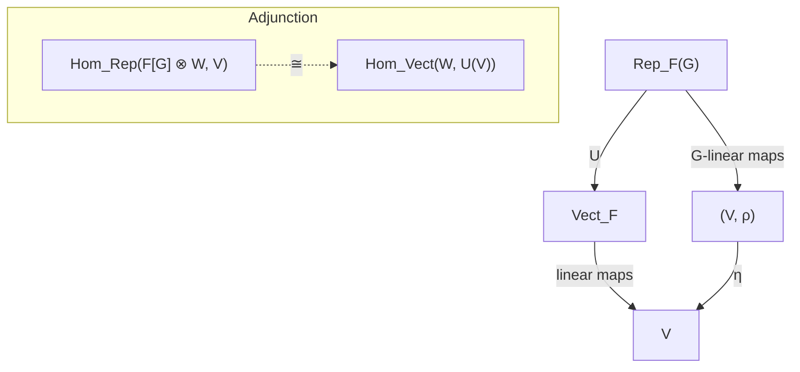

# Lesson 6: Representation Theory & Category-Theoretic Perspectives

## 1. First-Principles Intuition & Invariants

### The Central Question: What Does a Group *Do*?

Abstract algebra earns its power by stripping objects down to their essential relational structure, but this very abstraction creates a practical tension: a group defined by generators and relations is often difficult to compute with directly. Representation theory resolves this tension by asking a deceptively simple question — given an abstract group $G$, in what ways can it *act* on a concrete, well-understood space? The answer reorganizes the entire theory of finite groups around linear algebra, one of the most computational branches of mathematics, and in doing so connects group theory to harmonic analysis, quantum mechanics, number theory, and the internal structure of algorithms on symmetric data.

The foundational move is to replace the abstract group with a homomorphism into a group of matrices. A **representation** of a group $G$ over a field $\mathbb{F}$ is a group homomorphism

$$\rho: G \to \mathrm{GL}(V)$$

where $V$ is a finite-dimensional $\mathbb{F}$-vector space and $\mathrm{GL}(V)$ denotes the group of invertible linear transformations of $V$. The integer $n = \dim_\mathbb{F} V$ is the **degree** or **dimension** of the representation. When a basis is chosen for $V$, each group element $g \in G$ is assigned an invertible $n \times n$ matrix $\rho(g)$ such that $\rho(gh) = \rho(g)\rho(h)$ for all $g, h \in G$, and $\rho(e) = I_n$. The group axioms enforce precisely the conditions that make this assignment a homomorphism: associativity becomes matrix associativity, and the inverse maps to the matrix inverse.

Before developing the theory, it is worth anchoring this abstraction in a canonical example. Let $G = S_3$, the symmetric group on three letters, with elements $\{e, (12), (13), (23), (123), (132)\}$. The defining action of $S_3$ on the set $\{1, 2, 3\}$ yields a **permutation representation**: each permutation $\sigma$ maps to the $3 \times 3$ permutation matrix $\rho(\sigma)$ whose $(i,j)$-entry is $1$ if $\sigma(j) = i$ and $0$ otherwise. For instance,

$$\rho\bigl((12)\bigr) = \begin{pmatrix} 0 & 1 & 0 \\ 1 & 0 & 0 \\ 0 & 0 & 1 \end{pmatrix}, \qquad \rho\bigl((123)\bigr) = \begin{pmatrix} 0 & 0 & 1 \\ 1 & 0 & 0 \\ 0 & 1 & 0 \end{pmatrix}.$$

One immediately verifies that $\rho\bigl((12)\bigr)\rho\bigl((123)\bigr) = \rho\bigl((12)(123)\bigr) = \rho\bigl((132)\bigr)$, confirming the homomorphism property. This three-dimensional representation, however, is *reducible*: the vector $v_0 = (1,1,1)^T$ is fixed by every $\rho(\sigma)$, so the one-dimensional subspace $\mathbb{F}\cdot v_0$ is an *invariant subspace*, and the representation decomposes into smaller, irreducible pieces. Understanding that decomposition — classifying the irreducible constituents and reconstructing any representation from them — is the central project of representation theory.

### Subrepresentations, Irreducibility, and the Problem of Decomposition

A **subrepresentation** of $(\rho, V)$ is a subspace $W \subseteq V$ satisfying $\rho(g)W \subseteq W$ for all $g \in G$; equivalently, $W$ is a *$G$-invariant subspace*. The representation is **irreducible** if $V \neq 0$ and its only $G$-invariant subspaces are $\{0\}$ and $V$ itself. Irreducible representations are the atoms of the theory: every representation over an algebraically closed field of characteristic zero decomposes into a direct sum of irreducibles, and the irreducibles are classified by a finite amount of data.

The question of semisimplicity — whether every representation decomposes as a direct sum of irreducibles — is answered for finite groups by one of the foundational theorems of the subject.

**Theorem (Maschke, 1898).** Let $G$ be a finite group and let $\mathbb{F}$ be a field whose characteristic does not divide $|G|$. Then every representation of $G$ over $\mathbb{F}$ is completely reducible: for every $G$-invariant subspace $W \subseteq V$, there exists a complementary $G$-invariant subspace $W' \subseteq V$ such that $V = W \oplus W'$.

The proof constructs a $G$-equivariant projection $\pi: V \to W$ explicitly, which is both the core mechanism and the key to understanding why the characteristic restriction is necessary. Begin with an arbitrary linear projection $p: V \to W$ (which exists because $W$ is a subspace, so it has a linear complement). This $p$ need not be $G$-equivariant. We *average* it over the group: define

$$\pi = \frac{1}{|G|} \sum_{g \in G} \rho(g) \circ p \circ \rho(g)^{-1}.$$

We verify that $\pi$ maps $V$ into $W$. For any $v \in V$, $\rho(g)^{-1}v \in V$, so $p\bigl(\rho(g)^{-1}v\bigr) \in W$ (since $p$ projects onto $W$), and then $\rho(g)\bigl(p(\rho(g)^{-1}v)\bigr) \in \rho(g)W \subseteq W$ (since $W$ is $G$-invariant). The sum of elements of $W$ lies in $W$, and dividing by $|G|$ preserves this, so $\pi(v) \in W$ for all $v$.

We verify that $\pi$ restricts to the identity on $W$. For $w \in W$, $\rho(g)^{-1}w \in W$ (by $G$-invariance), so $p\bigl(\rho(g)^{-1}w\bigr) = \rho(g)^{-1}w$ (since $p$ is the identity on $W$), and thus $\rho(g)\bigl(p(\rho(g)^{-1}w)\bigr) = w$. Averaging $w$ over $|G|$ terms gives $\pi(w) = w$.

We verify that $\pi$ is $G$-equivariant. For any $h \in G$:

$$\pi \circ \rho(h) = \frac{1}{|G|} \sum_{g \in G} \rho(g) \circ p \circ \rho(g)^{-1} \circ \rho(h) = \frac{1}{|G|} \sum_{g \in G} \rho(g) \circ p \circ \rho(g^{-1}h).$$

Substituting $g' = g h^{-1}$, so $g = g'h$ and $g^{-1}h = {g'}^{-1}$, the sum becomes

$$\frac{1}{|G|} \sum_{g' \in G} \rho(g'h) \circ p \circ \rho({g'}^{-1}) = \frac{1}{|G|} \sum_{g' \in G} \rho(g') \circ \rho(h) \circ p \circ \rho({g'}^{-1}) \cdot \frac{1}{\ldots}$$

We instead note the cleaner route: since left-multiplication by $h$ permutes the elements of $G$,

$$\rho(h) \circ \pi = \frac{1}{|G|} \sum_{g \in G} \rho(h) \circ \rho(g) \circ p \circ \rho(g)^{-1} = \frac{1}{|G|} \sum_{g \in G} \rho(hg) \circ p \circ \rho(g)^{-1}.$$

Setting $g'' = hg$, so $g = h^{-1}g''$ and $\rho(g)^{-1} = \rho(g'')^{-1}\rho(h)$:

$$\rho(h) \circ \pi = \frac{1}{|G|} \sum_{g'' \in G} \rho(g'') \circ p \circ \rho(g'')^{-1} \circ \rho(h) = \pi \circ \rho(h).$$

The kernel $W' = \ker \pi$ is therefore a $G$-invariant subspace (if $w' \in W'$ then $\pi(\rho(h)w') = \rho(h)\pi(w') = 0$, so $\rho(h)w' \in W'$), and since $\pi$ is a projection onto $W$, we have $V = W \oplus W'$. This completes the proof.

The characteristic restriction is essential. If $\mathrm{char}(\mathbb{F})$ divides $|G|$, then $|G|^{-1}$ does not exist, and the averaging argument fails. Indeed, over $\mathbb{F}_p$ with $p \mid |G|$, there exist representations that are not completely reducible — the theory of **modular representations** (developed by Brauer) is significantly more subtle.

### Schur's Lemma: The Fundamental Rigidity Theorem

Having established that representations decompose, we need to understand when two representations, or two irreducible components, can interact. The answer is given by a theorem so foundational that it underlies virtually every classification result in representation theory.

**Theorem (Schur's Lemma).** Let $(\rho_1, V_1)$ and $(\rho_2, V_2)$ be irreducible representations of $G$ over a field $\mathbb{F}$, and let $\phi: V_1 \to V_2$ be a $G$-equivariant linear map (a **morphism of representations**, also called a **$G$-linear map** or **intertwining operator**), meaning $\phi \circ \rho_1(g) = \rho_2(g) \circ \phi$ for all $g \in G$. Then:

(i) Either $\phi = 0$ or $\phi$ is an isomorphism.

(ii) If $\mathbb{F}$ is algebraically closed and $V_1 = V_2 = V$, then $\phi = \lambda \cdot \mathrm{id}_V$ for some $\lambda \in \mathbb{F}$.

**Proof of (i).** The kernel $\ker \phi$ is a $G$-invariant subspace of $V_1$: if $\phi(v) = 0$ then $\phi(\rho_1(g)v) = \rho_2(g)\phi(v) = 0$, so $\rho_1(g)v \in \ker\phi$. Since $\rho_1$ is irreducible, $\ker\phi$ is either $\{0\}$ or $V_1$. If $\ker\phi = V_1$ then $\phi = 0$. If $\ker\phi = \{0\}$ then $\phi$ is injective, and its image $\mathrm{im}\,\phi$ is a $G$-invariant subspace of $V_2$: if $v = \phi(u)$ then $\rho_2(g)v = \phi(\rho_1(g)u) \in \mathrm{im}\,\phi$. Since $\rho_2$ is irreducible, $\mathrm{im}\,\phi = V_2$, so $\phi$ is surjective. Hence $\phi$ is an isomorphism. $\square$

**Proof of (ii).** Since $\mathbb{F}$ is algebraically closed, $\phi: V \to V$ has at least one eigenvalue $\lambda \in \mathbb{F}$. The map $\phi - \lambda\,\mathrm{id}_V$ is again $G$-linear (as $\mathrm{id}_V$ commutes with every $\rho(g)$), and it has a nontrivial kernel (by definition of eigenvalue), so by part (i) it cannot be an isomorphism. Therefore $\phi - \lambda\,\mathrm{id}_V = 0$, that is, $\phi = \lambda\,\mathrm{id}_V$. $\square$

Part (ii) is the operative result for classification. It says that over an algebraically closed field, the only endomorphisms of an irreducible representation are scalar multiples of the identity. Equivalently, the endomorphism algebra $\mathrm{End}_G(V)$ of an irreducible $G$-module is isomorphic to $\mathbb{F}$ itself. This rigidity severely constrains how irreducibles can appear in a decomposition and immediately implies that the decomposition of a completely reducible representation into irreducibles is unique up to isomorphism and reordering of summands.

### Character Theory: The Spectral Fingerprint

Working with $n \times n$ matrices directly is cumbersome and basis-dependent. The key insight of character theory is that a single scalar-valued function on $G$ encodes the entire isomorphism class of a representation.

The **character** of a representation $(\rho, V)$ is the function $\chi_\rho: G \to \mathbb{F}$ defined by

$$\chi_\rho(g) = \mathrm{tr}(\rho(g)).$$

Since the trace is invariant under conjugation ($\mathrm{tr}(ABA^{-1}) = \mathrm{tr}(B)$), and since isomorphic representations satisfy $\rho_2(g) = P\rho_1(g)P^{-1}$ for a fixed invertible matrix $P$, we have $\chi_{\rho_2}(g) = \chi_{\rho_1}(g)$ for all $g$. The character is a **class function**: it is constant on conjugacy classes of $G$, meaning $\chi_\rho(hgh^{-1}) = \chi_\rho(g)$ for all $g, h \in G$. Moreover, $\chi_\rho(e) = \mathrm{tr}(I_n) = n = \dim V$, so the character encodes the dimension immediately.

The space $\mathrm{Cl}(G)$ of class functions from $G$ to $\mathbb{C}$ carries a natural inner product:

$$\langle \chi, \psi \rangle = \frac{1}{|G|} \sum_{g \in G} \chi(g)\overline{\psi(g)}.$$

The first orthogonality theorem establishes that the irreducible characters form an orthonormal basis for this space.

**Theorem (First Orthogonality).** Let $\chi_i, \chi_j$ be the characters of non-isomorphic irreducible representations $(\rho_i, V_i)$ and $(\rho_j, V_j)$ of a finite group $G$ over $\mathbb{C}$. Then

$$\langle \chi_i, \chi_j \rangle = \frac{1}{|G|} \sum_{g \in G} \chi_i(g)\overline{\chi_j(g)} = \delta_{ij}.$$

We derive this from a general result about matrix coefficients. For representations $\rho_i$ and $\rho_j$, define the **averaging operator** for a matrix $A \in \mathrm{Hom}(V_j, V_i)$ by

$$T_A = \frac{1}{|G|} \sum_{g \in G} \rho_i(g) \circ A \circ \rho_j(g)^{-1}.$$

By the same averaging argument used in Maschke's theorem, $T_A$ is a $G$-linear map from $V_j$ to $V_i$. By Schur's Lemma: if $\rho_i \not\cong \rho_j$ then $T_A = 0$; if $\rho_i = \rho_j = \rho$ then $T_A = \lambda \cdot \mathrm{id}_V$ for some scalar $\lambda$, and taking traces gives $n\lambda = \mathrm{tr}(T_A) = \frac{1}{|G|}\sum_g \mathrm{tr}(\rho(g)A\rho(g)^{-1}) = \mathrm{tr}(A)$, so $\lambda = \mathrm{tr}(A)/n$.

Applying this with $A$ being the rank-one matrix $e_{kl}$ (which has entry $1$ in row $k$, column $l$, and $0$ elsewhere) gives the **second orthogonality relations** at the level of matrix coefficients. Taking traces over both sides and summing over a basis of matrices yields the orthogonality of characters. The complete derivation proceeds by computing

$$\frac{1}{|G|} \sum_{g \in G} [\rho_i(g)]_{ab} \overline{[\rho_j(g)]_{cd}} = \frac{\delta_{ij}\delta_{ac}\delta_{bd}}{n_i},$$

where $n_i = \dim V_i$. Summing over $a = b$ and $c = d$ gives

$$\langle \chi_i, \chi_j \rangle = \frac{1}{|G|} \sum_g \mathrm{tr}(\rho_i(g))\overline{\mathrm{tr}(\rho_j(g))} = \sum_{a,c} \frac{\delta_{ij}\delta_{ac}^2}{n_i} = \delta_{ij} \cdot \frac{n_i}{n_i} = \delta_{ij}.$$

This orthonormality has an immediate computational consequence: given any representation $(\rho, V)$ decomposed as $V \cong \bigoplus_i V_i^{\oplus m_i}$ (where the $V_i$ range over distinct irreducibles), the **multiplicity** $m_i$ of the $i$-th irreducible satisfies

$$m_i = \langle \chi_\rho, \chi_i \rangle = \frac{1}{|G|} \sum_{g \in G} \chi_\rho(g) \overline{\chi_i(g)}.$$

This formula transforms the problem of decomposing representations into a computation over the character table of $G$. Furthermore, the number of distinct irreducible representations of a finite group $G$ over $\mathbb{C}$ equals the number of conjugacy classes of $G$, and the dimensions $n_i = \dim V_i$ of the irreducibles satisfy the constraint

$$\sum_i n_i^2 = |G|.$$

For $S_3$, there are three conjugacy classes ($\{e\}$, $\{(12),(13),(23)\}$, $\{(123),(132)\}$), so there are three irreducible representations with dimensions satisfying $n_1^2 + n_2^2 + n_3^2 = 6$. The only solution in positive integers is $1^2 + 1^2 + 2^2 = 6$, predicting two one-dimensional and one two-dimensional irreducible. One can verify: the trivial representation ($n=1$), the sign representation ($n=1$, mapping even permutations to $+1$ and odd to $-1$), and the standard two-dimensional representation obtained by restricting the permutation representation to the complement of $(1,1,1)^T$.

---

## 2. Core Architecture & Mechanics

### The Module-Theoretic Language

Representation theory gains considerable architectural clarity when translated into the language of modules. If $G$ is a group and $\mathbb{F}$ is a field, the **group algebra** $\mathbb{F}[G]$ is the $\mathbb{F}$-vector space with basis $\{e_g : g \in G\}$ equipped with the multiplication rule $e_g \cdot e_h = e_{gh}$, extended $\mathbb{F}$-bilinearly. An element of $\mathbb{F}[G]$ is a formal sum $\sum_{g \in G} a_g e_g$ with $a_g \in \mathbb{F}$.

The critical structural observation is that a representation $\rho: G \to \mathrm{GL}(V)$ is equivalent to a left $\mathbb{F}[G]$-module structure on $V$: define $\bigl(\sum_g a_g e_g\bigr) \cdot v = \sum_g a_g \rho(g)(v)$. The module axioms correspond precisely to the homomorphism conditions on $\rho$. Under this equivalence, $G$-linear maps are exactly $\mathbb{F}[G]$-module homomorphisms, $G$-invariant subspaces are exactly submodules, and irreducibility is exactly the module-theoretic notion of a simple module.

Maschke's theorem, in this language, states that $\mathbb{F}[G]$ is a **semisimple ring** when $\mathrm{char}(\mathbb{F}) \nmid |G|$. The Artin-Wedderburn theorem then classifies semisimple rings completely:

$$\mathbb{F}[G] \cong \prod_{i=1}^r M_{n_i}(\mathbb{F})$$

when $\mathbb{F}$ is algebraically closed, where the product runs over the $r$ irreducible representations, and $M_{n_i}(\mathbb{F})$ is the full matrix ring of $n_i \times n_i$ matrices over $\mathbb{F}$. This decomposition explains the constraint $\sum_i n_i^2 = |G|$ dimensionally, since $\dim_\mathbb{F} \mathbb{F}[G] = |G|$ and $\dim_\mathbb{F} M_{n}(\mathbb{F}) = n^2$.

### Constructing Representations Explicitly: Induced and Restricted Representations

Beyond the irreducibles themselves, two fundamental constructions build new representations from old: restriction and induction. If $H \leq G$ is a subgroup and $(\rho, V)$ is a representation of $G$, the **restricted representation** $\mathrm{Res}^G_H(\rho)$ is simply $\rho$ viewed as a representation of $H$ by ignoring the elements of $G \setminus H$. The module-theoretic version is $\mathrm{Res}^G_H(V) = \mathbb{F}[H] \otimes_{\mathbb{F}[G]} V$... but more cleanly: $V$ becomes an $\mathbb{F}[H]$-module by restricting the action.

Induction runs in the opposite direction. Given a representation $(\sigma, W)$ of a subgroup $H \leq G$, the **induced representation** is

$$\mathrm{Ind}_H^G(W) = \mathbb{F}[G] \otimes_{\mathbb{F}[H]} W.$$

Concretely, if $G = \bigsqcup_{i} g_i H$ is a decomposition into left cosets, then $\mathrm{Ind}_H^G(W) \cong \bigoplus_i g_i \otimes W$ as vector spaces, and $G$ acts by permuting the coset copies (with the $H$-action mixing within each copy when the coset permutation carries a coset back into itself). The dimension satisfies $\dim \mathrm{Ind}_H^G(W) = [G:H] \cdot \dim W$.

The fundamental duality between restriction and induction is **Frobenius reciprocity**:

$$\langle \mathrm{Ind}_H^G \sigma, \rho \rangle_G = \langle \sigma, \mathrm{Res}^G_H \rho \rangle_H,$$

where $\langle \cdot, \cdot \rangle_G$ and $\langle \cdot, \cdot \rangle_H$ denote the character inner products for $G$ and $H$ respectively. This identity is the linchpin of a recursive strategy for classifying irreducible representations of $G$: induce irreducibles from smaller subgroups, decompose using character inner products, and identify new irreducibles not seen in smaller groups. The character of the induced representation is given explicitly by

$$\chi_{\mathrm{Ind}_H^G \sigma}(g) = \frac{1}{|H|} \sum_{\substack{x \in G \\ x^{-1}gx \in H}} \chi_\sigma(x^{-1}gx),$$

which one verifies by directly computing the trace on $\bigoplus_i g_i \otimes W$ using the coset action. This formula turns the abstract induction construction into a computable procedure over the character table.

### The Architecture of a Character Table Computation

To make the machinery precise, we work through the complete character table of $S_4$, the symmetric group on four letters, which has order $24$ and five conjugacy classes. The conjugacy classes of $S_n$ correspond to cycle types, so the five classes are:

$$C_1 = \{e\},\quad C_2 = \{(ij)\},\quad C_3 = \{(ijk)\},\quad C_4 = \{(ijkl)\},\quad C_5 = \{(ij)(kl)\},$$

with sizes $1, 6, 8, 6, 3$ respectively (which sum to $24$). The constraint $\sum_i n_i^2 = 24$ with five irreducibles forces $n_1^2 + \cdots + n_5^2 = 24$, and the only solution in positive integers (up to ordering) with five terms is $1 + 1 + 4 + 9 + 9 = 24$, giving dimensions $1, 1, 2, 3, 3$.

The two one-dimensional representations are the trivial representation $\chi_1(g) = 1$ for all $g$, and the sign representation $\chi_2(g) = \mathrm{sgn}(\sigma)$. The two-dimensional irreducible $\chi_3$ can be obtained by inducing from the cyclic subgroup $\mathbb{Z}_3 \leq S_3 \leq S_4$ and decomposing. The two three-dimensional irreducibles $\chi_4$ and $\chi_5$ arise from the standard representation of $S_4$ (the permutation representation minus the trivial) and its tensor product with the sign representation. The complete character table is:

$$\begin{array}{c|ccccc}
 & C_1 & C_2 & C_3 & C_4 & C_5 \\
 & (1^4) & (2,1^2) & (3,1) & (4) & (2^2) \\ \hline
\chi_1 & 1 & 1 & 1 & 1 & 1 \\
\chi_2 & 1 & -1 & 1 & -1 & 1 \\
\chi_3 & 2 & 0 & -1 & 0 & 2 \\
\chi_4 & 3 & 1 & 0 & -1 & -1 \\
\chi_5 & 3 & -1 & 0 & 1 & -1 \\
\end{array}$$

One verifies the first orthogonality relations explicitly: for $\chi_4$ and $\chi_5$,

$$\langle \chi_4, \chi_5 \rangle = \frac{1}{24}\bigl(1\cdot 3\cdot 3 + 6\cdot 1\cdot(-1) + 8\cdot 0\cdot 0 + 6\cdot(-1)\cdot 1 + 3\cdot(-1)\cdot(-1)\bigr) = \frac{9 - 6 + 0 - 6 + 3}{24} = \frac{0}{24} = 0.$$

And the self-inner-product $\langle \chi_4, \chi_4 \rangle = \frac{1}{24}(9 + 6 + 0 + 6 + 3) = \frac{24}{24} = 1$, confirming irreducibility.

### The Category-Theoretic Architecture

The passage from individual groups and representations to their relationships and universal properties calls for the language of category theory, which provides the correct framework for understanding why representation theory has the structure it does, and for generalizing it systematically.

A **category** $\mathcal{C}$ consists of a collection of **objects** and, for each pair of objects $A, B$, a set $\mathrm{Hom}_\mathcal{C}(A, B)$ of **morphisms**, together with a composition law $\mathrm{Hom}(B,C) \times \mathrm{Hom}(A,B) \to \mathrm{Hom}(A,C)$ that is associative and has identity morphisms $\mathrm{id}_A \in \mathrm{Hom}(A,A)$. Groups and group homomorphisms form the category $\mathbf{Grp}$. Vector spaces over $\mathbb{F}$ and linear maps form $\mathbf{Vect}_\mathbb{F}$. For a fixed group $G$, the representations of $G$ over $\mathbb{F}$ and the $G$-linear maps form the **representation category** $\mathbf{Rep}_\mathbb{F}(G)$, which is equivalently the category $\mathbb{F}[G]\text{-}\mathbf{Mod}$ of left $\mathbb{F}[G]$-modules.

The category $\mathbf{Rep}_\mathbb{F}(G)$ is an **abelian category**: it has kernels and cokernels, every monomorphism is a kernel, every epimorphism is a cokernel, and finite direct sums exist. These properties give $\mathbf{Rep}_\mathbb{F}(G)$ a homological algebra over which one can define $\mathrm{Ext}$ and $\mathrm{Tor}$ functors — the starting point of cohomology theories for groups. Moreover, $\mathbf{Rep}_\mathbb{F}(G)$ has a symmetric monoidal structure given by the tensor product $V \otimes_\mathbb{F} W$ (where $G$ acts diagonally: $g \cdot (v \otimes w) = \rho(g)v \otimes \rho(g)w$), making it a **symmetric monoidal abelian category**.

A **functor** $F: \mathcal{C} \to \mathcal{D}$ is a structure-preserving map between categories: it assigns to each object $A \in \mathcal{C}$ an object $F(A) \in \mathcal{D}$ and to each morphism $f: A \to B$ a morphism $F(f): F(A) \to F(B)$, subject to $F(\mathrm{id}_A) = \mathrm{id}_{F(A)}$ and $F(g \circ f) = F(g) \circ F(f)$. A **natural transformation** $\eta: F \Rightarrow G$ between functors $F, G: \mathcal{C} \to \mathcal{D}$ is a family of morphisms $\eta_A: F(A) \to G(A)$, one for each object $A \in \mathcal{C}$, such that for every morphism $f: A \to B$,

$$G(f) \circ \eta_A = \eta_B \circ F(f).$$

The **forgetful functor** $U: \mathbf{Rep}_\mathbb{F}(G) \to \mathbf{Vect}_\mathbb{F}$ sends a representation $(V, \rho)$ to the underlying vector space $V$ and forgets the $G$-action. This is a faithful functor (injective on morphism sets) but not full (not every linear map is $G$-linear). Its left adjoint is the **free module functor** $\mathbb{F}[G] \otimes_\mathbb{F} -$.



The key categorical reformulation of a group representation is itself illuminating. A group $G$ can be viewed as a category $\mathbf{B}G$ with a single object $\star$ and morphism set $\mathrm{Hom}(\star, \star) = G$, where composition is group multiplication. A representation of $G$ on a vector space $V$ is then exactly a functor $\rho: \mathbf{B}G \to \mathbf{Vect}_\mathbb{F}$: the single object $\star$ maps to $V$, and each group element (morphism in $\mathbf{B}G$) maps to a linear automorphism of $V$. A morphism of representations is exactly a natural transformation between the corresponding functors. This reformulation:

```
       BG (one-object category)
        |
        |   functor rho
        |
        V
     Vect_F

  rho(star)  =  V
  rho(g: star -> star)  =  rho(g): V -> V  (invertible linear map)

  Natural transformation eta: rho_1 => rho_2
    is a single linear map  phi: V_1 -> V_2
    such that for all g in G:
      phi ∘ rho_1(g) = rho_2(g) ∘ phi
      (exactly the G-linearity condition)
```

This is not a formal trick; it reveals that representation theory is a special case of **functor category** theory, and results about representations can be derived from general theorems about functor categories and adjunctions.

### Universal Properties: Products, Coproducts, and Tensor Functors

Universal properties characterize constructions up to unique isomorphism by their mapping behavior, eliminating the need to specify constructions element-by-element. In $\mathbf{Rep}_\mathbb{F}(G)$, the **direct sum** $V \oplus W$ is both the categorical product and coproduct (since we are in an abelian category), characterized by projection and injection maps satisfying the universal property: for any representation $X$ with $G$-linear maps $f: X \to V$ and $g: X \to W$, there is a unique $G$-linear map $(f, g): X \to V \oplus W$ such that the projections compose correctly.

The tensor product $V \otimes W$ in $\mathbf{Rep}_\mathbb{F}(G)$ has its own universal property: it represents the functor of $G$-bilinear maps. The character of $V \otimes W$ satisfies

$$\chi_{V \otimes W}(g) = \chi_V(g) \cdot \chi_W(g),$$

which follows from the fact that if $\{v_i\}$ and $\{w_j\}$ are eigenbases for $\rho_V(g)$ and $\rho_W(g)$ with eigenvalues $\lambda_i$ and $\mu_j$ respectively, then $\{v_i \otimes w_j\}$ is an eigenbasis for the diagonal action with eigenvalues $\lambda_i \mu_j$, and $\sum_{i,j} \lambda_i\mu_j = (\sum_i \lambda_i)(\sum_j \mu_j)$.

This multiplicativity of characters under tensor product means the character ring of $G$ — the free abelian group on the irreducible characters, made into a ring by tensor product — is a fundamental invariant of $G$, connecting representation theory to algebraic $K$-theory and the Grothendieck group $K_0(\mathbf{Rep}_\mathbb{F}(G))$.

The **adjoint representation** provides the bridge between a Lie group and its Lie algebra representation theory, and is a natural construction in the categorical framework: the group $G$ acts on the vector space $\mathbb{F}[G]$ by conjugation, $g \cdot h = ghg^{-1}$, and this action descends to a representation on the space of class functions and on the Lie algebra $\mathfrak{g}$ in the smooth setting.

---

## 3. High-Performance Optimization & Failure Modes

### Optimizing Character Table Computations

In practice, computing the character table of a finite group is an exercise in deploying the orthogonality relations strategically to minimize computation. The naive approach — constructing each irreducible module explicitly and computing traces — quickly becomes intractable for groups of order in the hundreds or thousands. The practitioner's approach builds the character table column by column using a cascade of constraints.

The first column of the character table (values on the identity element) is entirely determined by the dimensions $n_i$ of the irreducibles, which satisfy $\sum_i n_i^2 = |G|$ and $n_i \mid |G|$ (the latter following from Lagrange's theorem applied in a representation-theoretic argument via the regular representation). The second orthogonality relations give column orthogonality:

$$\sum_i \chi_i(g)\overline{\chi_i(h)} = \begin{cases} |C_G(g)| & \text{if } g \sim h \text{ (conjugate)}, \\ 0 & \text{otherwise.} \end{cases}$$

where $|C_G(g)|$ is the order of the centralizer of $g$ in $G$. These column constraints, together with the row orthonormality from the first orthogonality relations, often overdetermine the character table once a few entries are known. The strategy is to use known representations (trivial, sign, standard permutation, alternating powers of the standard) to fill in as many rows as possible, then use orthogonality to solve for the remaining entries.

For groups constructed as direct products $G = H \times K$, the irreducibles are exactly the external tensor products $\chi_i \boxtimes \psi_j$ where $\chi_i$ and $\psi_j$ range over irreducibles of $H$ and $K$ respectively, with $(\chi_i \boxtimes \psi_j)(h, k) = \chi_i(h)\psi_j(k)$. This reduces the problem for direct products entirely to problems for the factors. For semidirect products $G = N \rtimes H$, the **Mackey machine** (or Clifford theory) provides a systematic induction-restriction procedure: the irreducibles of $G$ are parametrized by orbits of $H$ on the dual group $\hat{N}$ of irreducibles of $N$, together with projective representations of stabilizer subgroups.

### Failure Mode: Characteristic Divides the Group Order

The most significant failure mode in computational representation theory arises when working over a field of positive characteristic $p$ with $p \mid |G|$. In this setting, Maschke's theorem fails, and the category $\mathbb{F}_p[G]\text{-}\mathbf{Mod}$ is no longer semisimple. The group algebra $\mathbb{F}_p[G]$ is not a product of matrix rings but has a nontrivial **Jacobson radical** — a nilpotent ideal consisting of "infinitesimally unipotent" elements. Representations are no longer determined by their composition factors (the semisimple quotients of a composition series); the **extension classes** in $\mathrm{Ext}^1_{\mathbb{F}_p[G]}(V, W)$ carry additional information about how modules are glued together.

A specific example: the cyclic group $G = \mathbb{Z}/p\mathbb{Z}$ over $\mathbb{F}_p$ has group algebra $\mathbb{F}_p[G] \cong \mathbb{F}_p[x]/(x^p - 1) = \mathbb{F}_p[x]/(x-1)^p$, since $x^p - 1 = (x-1)^p$ in characteristic $p$. This is a local ring with unique maximal ideal $(x-1)$, and the indecomposable $\mathbb{F}_p[G]$-modules are the Jordan blocks $\mathbb{F}_p[x]/(x-1)^k$ for $1 \leq k \leq p$. The direct sum decomposition of arbitrary modules into indecomposables replaces the semisimple decomposition, but indecomposable modules are not necessarily irreducible (only the $k=1$ module is simple). This modular representation theory, with its notions of Brauer characters, defect groups, and blocks, is a substantially deeper subject and must not be confused with the characteristic-zero theory.

The practitioner working computationally should always verify that the characteristic of the base field is coprime to $|G|$ before applying Maschke-dependent results. A common error is to apply character orthogonality formulas that assume semisimplicity in a modular setting, producing nonsensical multiplicities.

### Failure Mode: Non-Algebraically-Closed Fields

Part (ii) of Schur's Lemma and the full character theory require the base field to be algebraically closed. Over $\mathbb{R}$, the endomorphism algebra of an irreducible real representation can be isomorphic to $\mathbb{R}$, $\mathbb{C}$, or $\mathbb{H}$ (the quaternions), corresponding to the three **Frobenius division algebras** over $\mathbb{R}$. This trichotomy is encoded in the **Frobenius-Schur indicator**

$$\nu_2(\chi) = \frac{1}{|G|} \sum_{g \in G} \chi(g^2) \in \{+1, 0, -1\},$$

where $+1$ indicates a real representation (the irreducible complex representation descends to a real one), $0$ indicates a quaternionic representation with no real form, and $-1$ indicates a complex representation that is not self-conjugate. Confusion between complex and real irreducibles is a common failure mode in applications to physics (where real forms matter for time-reversal symmetry) and to algorithms on symmetric data.

Over a finite field $\mathbb{F}_q$, the structure changes further: the irreducibles of $G$ over $\mathbb{F}_q$ are Galois orbits of the complex irreducibles under the action of $\mathrm{Gal}(\bar{\mathbb{F}}_q / \mathbb{F}_q)$. This is directly relevant in cryptographic applications where group-action-based protocols must be implemented over finite fields.

### Categorical Failure Modes: Lax and Pseudo Functors

In the category-theoretic framework, a common source of error is working with functors that are only "weakly" structure-preserving. A **lax monoidal functor** between monoidal categories preserves the tensor product only up to a natural transformation $F(A \otimes B) \to F(A) \otimes F(B)$, not up to isomorphism, and the distinction matters when one attempts to transport representation-theoretic structures along functors. The forgetful functor $U: \mathbf{Rep}_\mathbb{F}(G) \to \mathbf{Vect}_\mathbb{F}$ is *strongly* monoidal — the natural transformation $U(V \otimes W) \to U(V) \otimes U(W)$ is an isomorphism — but induction $\mathrm{Ind}_H^G$ is only lax monoidal with respect to the tensor product. Applying results that require strong monoidality to induction functors produces incorrect formulas for characters of induced tensor products.

The correct framework for induction is as a functor between module categories that is a left adjoint to restriction, and all its properties (Frobenius reciprocity, Mackey's decomposition theorem, the formula for characters of induced representations) should be derived from the adjunction, not from ad hoc matrix calculations that may implicitly assume isomorphisms that don't hold.

### The Yoneda Lemma as a Representation-Theoretic Invariant

The deepest organizational principle in category theory is the **Yoneda Lemma**, which states that any locally small category $\mathcal{C}$ embeds fully and faithfully into the functor category $[\mathcal{C}^\mathrm{op}, \mathbf{Set}]$ via the **Yoneda embedding** $\mathbf{y}: \mathcal{C} \to [\mathcal{C}^\mathrm{op}, \mathbf{Set}]$ sending $A$ to the representable functor $\mathrm{Hom}_\mathcal{C}(-, A)$. The lemma asserts that for any functor $F: \mathcal{C}^\mathrm{op} \to \mathbf{Set}$ and any object $A$,

$$\mathrm{Nat}(\mathrm{Hom}_\mathcal{C}(-, A),\, F) \cong F(A),$$

naturally in both $A$ and $F$. Applied to representation theory, this means that a representation — that is, a functor $\rho: \mathbf{B}G \to \mathbf{Vect}_\mathbb{F}$ — is completely characterized by what natural transformations into it look like. The character of a representation, as a function on conjugacy classes, is exactly the invariant extracted by the class-function inner product, and the character table is the matrix of inner products of the Yoneda-representable structure with respect to the basis of irreducibles.

More concretely, universal properties throughout algebra are always Yoneda statements in disguise: the tensor product $V \otimes W$ is the object representing the functor of $G$-bilinear maps, the group ring $\mathbb{F}[G]$ represents the forgetful functor from $\mathbf{Rep}_\mathbb{F}(G)$ to $\mathbf{Set}$, and the induced representation $\mathrm{Ind}_H^G W$ represents $\mathrm{Hom}_H(-, W) \circ \mathrm{Res}^G_H$. Working consistently in the categorical framework and applying Yoneda eliminates the need for ad hoc constructions: once one identifies what functor a construction should represent, the universal property pins it down uniquely, and all its compatibility properties follow from the uniqueness of representing objects.

The practical implication is that any two constructions satisfying the same universal property are canonically isomorphic, so proofs that only use universal properties are automatically basis-independent and functorial. This is the highest standard of correctness in structural algebra: results stated and proved through universal properties are maximally robust, requiring no recomputation when the ambient context changes — when the group, the field, or the ambient category is replaced by a different one satisfying the same axioms.
