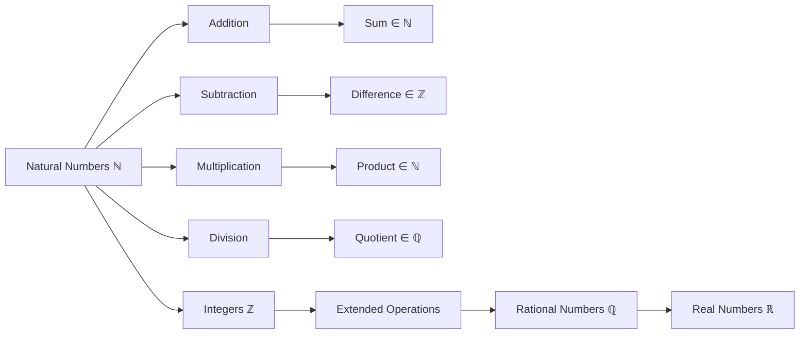

# Foundation: Arithmetic

## 1. Conceptual Mental Model (Core intuition, analogies, and first principles)

Arithmetic is the foundational system for quantifying discrete and continuous quantities through structured operations. At its core, arithmetic emerges from the human need to *model relationships between quantities*—a primal cognitive process observed in early counting behaviors. The mental model operates through three interlocking principles:

1. **Quantitative Continuity**: Numbers represent quantities that exist on a continuous spectrum (e.g., 3 apples → 3 units of quantity), yet operations produce discrete outcomes (e.g., 2 + 3 = 5 apples).
2. **Operational Invariance**: The result of an operation remains consistent regardless of the *representation* (e.g., 5 apples = 5 units = 5 in base-10 notation).
3. **Structural Closure**: Operations generate results that belong to a defined system (e.g., adding two natural numbers always yields another natural number).

**Analogy**: Think of arithmetic as the "language of relationships" between physical objects. When you count 3 stones, you're not just labeling objects—you're establishing a *quantitative relationship* between the stones and the number 3. This relationship is preserved through operations (e.g., adding stones) and becomes invariant across contexts (e.g., 3 stones = 3 units of mass).

**First Principles**:  
- **Counting**: The process of assigning unique labels to discrete objects (1, 2, 3, ...).  
- **Operation Definition**: Arithmetic operations are *defined* by their effect on quantities (e.g., addition = combining quantities).  
- **System Boundaries**: Arithmetic operates within specific number systems (natural numbers → integers → rationals), each defined by closure properties.

This mental model bridges intuition and rigor: *Before* formal proofs, we intuitively understand that operations transform quantities while preserving meaningful relationships—this intuition becomes the foundation for rigorous axiomatic systems.

---

## 2. Essential Terminology & Taxonomy

Here are 6 foundational terms critical to understanding arithmetic's structure:

1. **Natural Number** (`ℕ`): The set of positive integers used for counting (`1, 2, 3, ...`). *Why foundational?* Arithmetic begins with counting, and natural numbers form the basis for all number systems.
2. **Addition** (`+`): The binary operation that combines two quantities to form a *sum* (e.g., `a + b = c`). *Why foundational?* It is the most primitive operation, defining how quantities accumulate.
3. **Multiplication** (`×`): The binary operation representing repeated addition (e.g., `a × b = a + a + ... + a` `b` times). *Why foundational?* It scales quantities and enables efficient computation.
4. **Subtraction** (`−`): The binary operation that finds the *difference* between two quantities (e.g., `a − b = c` where `a ≥ b`). *Why foundational?* It reverses addition and introduces the concept of deficit.
5. **Division** (`÷`): The binary operation that determines how many times one quantity fits into another (e.g., `a ÷ b = c` where `b ≠ 0`). *Why foundational?* It generalizes the concept of sharing and introduces fractions.
6. **Rational Number** (`ℚ`): A number expressible as `p/q` where `p, q ∈ ℤ` and `q ≠ 0`. *Why foundational?* It extends arithmetic to handle ratios and fractions, enabling precise modeling of real-world divisions.

> **Key Insight**: These terms form a *closed system*—each operation's result belongs to the same number system (e.g., natural numbers are closed under addition but not subtraction).

---

## 3. Architecture & Core Workflow

The core workflow of arithmetic follows a hierarchical progression from basic counting to generalized operations. Below is a Mermaid diagram illustrating this structure:

**Workflow Explanation**:
1. **Start**: Natural numbers (`ℕ`) for basic counting.
2. **Core Operations**: Addition, subtraction, multiplication, and division are defined *on* these numbers.
3. **System Extension**: 
   - Subtraction introduces negative numbers → **Integers** (`ℤ`)
   - Division introduces fractions → **Rational numbers** (`ℚ`)
4. **Closure**: Each operation maintains the system's integrity (e.g., addition of two natural numbers stays in `ℕ`; division of two integers may yield `ℚ`).

This architecture shows how arithmetic *builds* from simple counting to complex quantitative relationships while preserving structural consistency.

---

## 4. Common Misconceptions & Mental Traps

| Misconception | Why It's Traps the Mind | Correct Foundation |
|---------------|-------------------------|---------------------|
| "Division always gives an integer" | Overlooks fractional results (e.g., `5 ÷ 2 = 2.5`) | Division produces rational numbers (`ℚ`) when extended beyond natural numbers |
| "Subtraction is just 'taking away'" | Ignores negative results (e.g., `2 − 5 = −3`) | Subtraction defines *difference* in the integer system (`ℤ`) |
| "Multiplication is only repeated addition" | Fails to capture scaling (e.g., `2 × 3` = 6 units, not 3+3) | Multiplication is a *binary operation* that preserves proportional relationships |
| "Zero is not a number" | Confuses zero as a "placeholder" (e.g., in `10`) | Zero is a *natural number* in extended systems (`ℤ`, `ℚ`) and enables closure |

**Critical Trap**: Assuming operations are *always* defined within the same system (e.g., subtracting two natural numbers may yield a negative number, which requires the integer system).

---

## 5. Socratic Discussion Starters

Here are 3 deep questions designed to probe foundational understanding:

1. **How does the *introduction of zero* resolve the closure problem in subtraction?**  
   *(Why is zero necessary for the integer system? How does it transform subtraction from "undefined" to "defined"?)*

2. **Why is division by zero *undefined* in the rational number system, yet the concept of "division" remains meaningful in physical contexts?**  
   *(What does this reveal about the relationship between abstract systems and real-world phenomena?)*

3. **If multiplication is defined as repeated addition, why does it *not* break the closure property when applied to natural numbers?**  
   *(How does the distributive property bridge addition and multiplication to create a consistent system?)*

These questions target the *structural integrity* of arithmetic—pushing beyond rote operations to explore why certain systems work while others fail. They require tracing the interplay between intuition, formal definitions, and the constraints of number systems.
