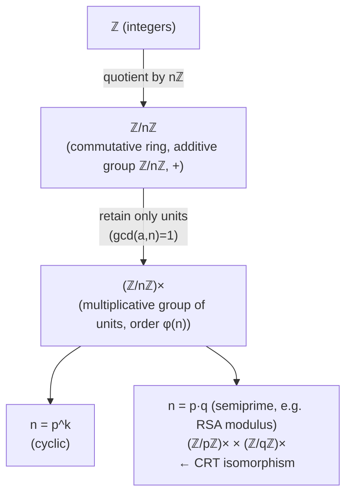

# Lesson 4: Modular Arithmetic, Congruences

## 1. First-Principles Intuition & Invariants

### The Clock as a Mathematical Object

Before a single symbol is written, it is worth pausing on the intuition that makes modular arithmetic so surprisingly natural. Consider an ordinary twelve-hour clock. When you add seven hours to eight o'clock, you do not arrive at the fifteenth hour; you arrive at three o'clock. Something was discarded in that computation—namely, the full revolution of the clock face—and yet the discard was not arbitrary. It was governed by an equivalence: fifteen and three are indistinguishable to the clock because their difference, twelve, is exactly one full period. This is the germ of Gauss's formal construction, introduced in the *Disquisitiones Arithmeticae* of 1801 and still the foundational language of number theory, cryptography, and theoretical computer science.

The key philosophical move Gauss made was to shift attention away from individual integers and toward the *relationships* between them. Rather than asking "what is $15$?", he asked "in what way does $15$ behave like $3$ when the period is $12$?" That reframing converts a question about identity into a question about equivalence, and equivalence relations are among the most powerful structuring tools in all of mathematics.

### Formal Definition of Congruence

Let $n$ be a positive integer, which we call the **modulus**. Two integers $a$ and $b$ are **congruent modulo $n$**, written

$$a \equiv b \pmod{n},$$

if and only if $n \mid (a - b)$, that is, if there exists some integer $k$ such that $a - b = kn$. This is the definition in full generality, and every theorem of modular arithmetic ultimately rests on it.

It is immediately worth verifying that congruence modulo $n$ is a genuine equivalence relation on $\mathbb{Z}$. Reflexivity holds because $a - a = 0 = 0 \cdot n$. Symmetry holds because if $n \mid (a - b)$ then $n \mid (b - a)$. Transitivity holds because if $n \mid (a - b)$ and $n \mid (b - c)$, then $n \mid ((a - b) + (b - c)) = (a - c)$. These three verifications are brief but they carry real weight: they confirm that congruence partitions $\mathbb{Z}$ into disjoint **residue classes**, and those classes are the true objects of the theory.

### Residue Classes and the Ring $\mathbb{Z}/n\mathbb{Z}$

For each integer $r$ with $0 \le r < n$, the residue class of $r$ modulo $n$ is the set

$$[r]_n = \{ \ldots, r - 2n,\; r - n,\; r,\; r + n,\; r + 2n, \ldots \} = \{ a \in \mathbb{Z} : a \equiv r \pmod{n} \}.$$

There are exactly $n$ such classes, corresponding to the $n$ possible remainders when any integer is divided by $n$: $[0]_n, [1]_n, \ldots, [n-1]_n$. Together they form a **partition** of $\mathbb{Z}$—every integer belongs to exactly one class. The set of all residue classes is denoted $\mathbb{Z}/n\mathbb{Z}$ (read "$\mathbb{Z}$ mod $n\mathbb{Z}$"), or sometimes $\mathbb{Z}_n$ in applied contexts.

What makes this partition algebraically interesting is that it supports well-defined arithmetic operations. Define addition and multiplication of residue classes by

$$[a]_n + [b]_n = [a + b]_n, \qquad [a]_n \cdot [b]_n = [ab]_n.$$

For these definitions to be **well-defined**, the results must be independent of which representatives $a$ and $b$ we choose from their respective classes. The proof is a direct application of the definition. Suppose $a' \equiv a \pmod{n}$ and $b' \equiv b \pmod{n}$, so that $a' = a + sn$ and $b' = b + tn$ for integers $s, t$. Then

$$a' + b' = (a + b) + (s + t)n \equiv a + b \pmod{n},$$

which establishes that addition is well-defined. For multiplication,

$$a'b' = (a + sn)(b + tn) = ab + atn + sbn + stn^2 = ab + (at + sb + stn)n \equiv ab \pmod{n},$$

establishing the same for multiplication. With these operations, $\mathbb{Z}/n\mathbb{Z}$ becomes a commutative ring—it satisfies all ring axioms: associativity and commutativity of addition, associativity of multiplication, the distributive law, the additive identity $[0]_n$, and the multiplicative identity $[1]_n$. When $n = p$ is prime, $\mathbb{Z}/p\mathbb{Z}$ is in fact a **field**, since every non-zero element has a multiplicative inverse—a fact that undergirds virtually all of modern cryptography.

### The Invariant Perspective: What Modular Arithmetic Preserves

The deepest way to understand why modular arithmetic is useful is to identify what it preserves and what it destroys. A congruence $a \equiv b \pmod{n}$ is preserved under addition: if $a \equiv b$ and $c \equiv d$, then $a + c \equiv b + d$. It is preserved under multiplication: $ac \equiv bd$. It is preserved under exponentiation by non-negative integer powers: $a^k \equiv b^k$. These properties make it possible to reduce enormous computations—computing $a^{1000} \bmod n$, for instance—to tractable ones by working entirely within the small universe $\{0, 1, \ldots, n-1\}$.

What modular arithmetic does *not* generally preserve is division. The equation $ac \equiv bc \pmod{n}$ does not imply $a \equiv b \pmod{n}$ unless $\gcd(c, n) = 1$. This is not a defect but a structural fact: in $\mathbb{Z}/n\mathbb{Z}$, an element $[c]_n$ is invertible (has a multiplicative inverse) if and only if $\gcd(c, n) = 1$. The elements satisfying this condition form a group under multiplication, the **group of units** $(\mathbb{Z}/n\mathbb{Z})^\times$, whose order is Euler's totient $\phi(n)$—a quantity we will study in depth when we reach Euler's theorem.

---

## 2. Core Architecture & Mechanics

### The Structural Hierarchy of Modular Arithmetic

Before deriving the principal theorems, it is useful to map out the structural relationships that govern this domain. The following diagram summarizes the algebraic hierarchy from $\mathbb{Z}$ down through its quotient rings and unit groups, with the key theorems acting as arrows between structures.

Each node in this hierarchy has well-defined arithmetic, and each edge represents a construction or theorem. The Chinese Remainder Theorem, Fermat's Little Theorem, and Euler's Theorem each correspond to structural facts about these nodes and their relationships.

### Modular Addition and Multiplication: The Operational Model

Working in $\mathbb{Z}/n\mathbb{Z}$, addition and multiplication proceed by performing the integer operation and then reducing the result modulo $n$, taking the representative in $\{0, 1, \ldots, n-1\}$. This reduction is performed by computing the remainder in Euclidean division: given $a \in \mathbb{Z}$, write $a = qn + r$ with $0 \le r < n$ (guaranteed by the Division Algorithm), and take $r$ as the canonical representative.

For concreteness, consider $n = 7$. The addition table for $\mathbb{Z}/7\mathbb{Z}$ wraps around at $7$: $3 + 5 = 8 \equiv 1 \pmod{7}$. The multiplication table is similarly closed: $3 \cdot 5 = 15 = 2 \cdot 7 + 1 \equiv 1 \pmod{7}$, which incidentally reveals that $3$ and $5$ are multiplicative inverses of each other modulo $7$. When $n = p$ is prime, every non-zero element has such an inverse, and the full structure $(\mathbb{Z}/p\mathbb{Z}, +, \cdot)$ is the finite field $\mathbb{F}_p$.

**Finding modular inverses.** Given $a$ with $\gcd(a, n) = 1$, the inverse $a^{-1} \pmod{n}$ is computed via the **Extended Euclidean Algorithm**. The algorithm finds integers $x, y$ such that $ax + ny = \gcd(a, n) = 1$, from which $ax \equiv 1 \pmod{n}$, so $x \equiv a^{-1} \pmod{n}$. As a worked example, take $a = 11$, $n = 26$:

$$\gcd(26, 11): \quad 26 = 2 \cdot 11 + 4, \quad 11 = 2 \cdot 4 + 3, \quad 4 = 1 \cdot 3 + 1, \quad 3 = 3 \cdot 1 + 0.$$

Back-substituting to express $1$ as a linear combination of $26$ and $11$:

$$1 = 4 - 1 \cdot 3 = 4 - 1 \cdot (11 - 2 \cdot 4) = 3 \cdot 4 - 11 = 3(26 - 2 \cdot 11) - 11 = 3 \cdot 26 - 7 \cdot 11.$$

Therefore $-7 \cdot 11 \equiv 1 \pmod{26}$, giving $11^{-1} \equiv -7 \equiv 19 \pmod{26}$. Verification: $11 \cdot 19 = 209 = 8 \cdot 26 + 1$. $\checkmark$

### The Chinese Remainder Theorem: Decomposition and Reconstruction

The **Chinese Remainder Theorem** (CRT) is one of the oldest results in number theory—its origins trace to the mathematician Sun Tzu (not the military strategist, but a third-century Chinese mathematician) in the *Sunzi Suanjing*—and one of the most consequential in modern computation. Its power lies in converting a single congruence problem modulo a composite number into several independent problems modulo coprime factors, solving each one separately in a smaller universe, and then reconstructing the unique global solution.

**Theorem (Chinese Remainder Theorem).** Let $n_1, n_2, \ldots, n_k$ be pairwise coprime positive integers—meaning $\gcd(n_i, n_j) = 1$ for all $i \ne j$—and let $a_1, a_2, \ldots, a_k$ be arbitrary integers. Then the system of simultaneous congruences

$$x \equiv a_1 \pmod{n_1}, \quad x \equiv a_2 \pmod{n_2}, \quad \ldots, \quad x \equiv a_k \pmod{n_k}$$

has a solution, and that solution is unique modulo $N = n_1 n_2 \cdots n_k$.

*Proof.* We prove existence constructively, since the construction itself is the computational algorithm. Define $N_i = N / n_i$ for each $i$. Because the moduli are pairwise coprime, $\gcd(N_i, n_i) = 1$, so by the Extended Euclidean Algorithm there exists $M_i$ such that $N_i M_i \equiv 1 \pmod{n_i}$. Consider the integer

$$x = \sum_{i=1}^k a_i N_i M_i.$$

For each index $j$, examine $x \pmod{n_j}$. When $i \ne j$, the factor $N_i = N/n_i$ contains $n_j$ as a divisor (since $n_j \mid N$ and $n_j \nmid N_i$ only when $j = i$; for $i \ne j$, $n_j \mid N_i$). Therefore every term in the sum with $i \ne j$ vanishes modulo $n_j$, leaving

$$x \equiv a_j N_j M_j \equiv a_j \cdot 1 = a_j \pmod{n_j}.$$

This proves existence. For uniqueness, suppose $x$ and $x'$ are both solutions. Then $n_i \mid (x - x')$ for all $i$. Since the $n_i$ are pairwise coprime, their product $N$ also divides $(x - x')$, forcing $x \equiv x' \pmod{N}$. $\blacksquare$

The algebraic content of the theorem is captured by the ring isomorphism

$$\mathbb{Z}/N\mathbb{Z} \cong \mathbb{Z}/n_1\mathbb{Z} \times \mathbb{Z}/n_2\mathbb{Z} \times \cdots \times \mathbb{Z}/n_k\mathbb{Z},$$

which sends $[x]_N$ to $([x]_{n_1}, [x]_{n_2}, \ldots, [x]_{n_k})$. The CRT asserts that this map is a bijection (and in fact a ring isomorphism). Restricting to units, the same decomposition yields $(\mathbb{Z}/N\mathbb{Z})^\times \cong (\mathbb{Z}/n_1\mathbb{Z})^\times \times \cdots \times (\mathbb{Z}/n_k\mathbb{Z})^\times$, from which the multiplicativity of Euler's totient $\phi(mn) = \phi(m)\phi(n)$ for $\gcd(m,n)=1$ follows immediately.

**A fully worked CRT example.** Find the unique $x \in \{0, \ldots, 104\}$ satisfying $x \equiv 2 \pmod{3}$, $x \equiv 3 \pmod{5}$, $x \equiv 2 \pmod{7}$.

Here $N = 3 \cdot 5 \cdot 7 = 105$, and $N_1 = 35$, $N_2 = 21$, $N_3 = 15$.

Compute each $M_i$ by extended Euclidean algorithm: $35 M_1 \equiv 1 \pmod{3}$ gives $2 M_1 \equiv 1 \pmod 3$ so $M_1 = 2$. For $21 M_2 \equiv 1 \pmod{5}$: $1 \cdot M_2 \equiv 1 \pmod 5$ so $M_2 = 1$. For $15 M_3 \equiv 1 \pmod 7$: $1 \cdot M_3 \equiv 1 \pmod 7$ so $M_3 = 1$.

Then

$$x = 2 \cdot 35 \cdot 2 + 3 \cdot 21 \cdot 1 + 2 \cdot 15 \cdot 1 = 140 + 63 + 30 = 233.$$

Reduce: $233 = 2 \cdot 105 + 23$, so $x \equiv 23 \pmod{105}$. Verification: $23 = 7 \cdot 3 + 2$ $\checkmark$, $23 = 4 \cdot 5 + 3$ $\checkmark$, $23 = 3 \cdot 7 + 2$ $\checkmark$.

### Euler's Totient Function

Before stating Euler's theorem, we need a precise understanding of the totient function $\phi(n)$, which counts the integers in $\{1, 2, \ldots, n\}$ coprime to $n$—equivalently, the order of the group $(\mathbb{Z}/n\mathbb{Z})^\times$.

For $n = p$ prime, every integer from $1$ to $p-1$ is coprime to $p$, so $\phi(p) = p - 1$. For $n = p^k$, the integers in $\{1, \ldots, p^k\}$ not coprime to $p^k$ are exactly the multiples of $p$, of which there are $p^{k-1}$, giving $\phi(p^k) = p^k - p^{k-1} = p^{k-1}(p-1)$. For general $n$, the multiplicativity property (a consequence of CRT) gives

$$\phi(n) = n \prod_{p \mid n} \left(1 - \frac{1}{p}\right),$$

where the product runs over distinct prime divisors of $n$. For example, $\phi(12) = \phi(4)\phi(3) = 2 \cdot 2 = 4$, corresponding to the four units $\{1, 5, 7, 11\}$ in $(\mathbb{Z}/12\mathbb{Z})^\times$.

### Fermat's Little Theorem: Full Proof

**Theorem (Fermat's Little Theorem).** Let $p$ be prime and let $a$ be an integer with $p \nmid a$. Then

$$a^{p-1} \equiv 1 \pmod{p}.$$

Equivalently, $a^p \equiv a \pmod p$ for all integers $a$.

*Proof.* Consider the set $S = \{1, 2, \ldots, p-1\}$, which is precisely the set of non-zero residue classes modulo $p$. For fixed $a$ with $p \nmid a$, define the function $f : S \to S$ by $f(r) = ar \bmod p$. We claim $f$ is a bijection from $S$ to itself. It maps $S$ into $S$ because $p \nmid a$ and $p \nmid r$ implies $p \nmid ar$. It is injective because if $ar \equiv as \pmod p$ and $\gcd(a, p) = 1$, we may cancel $a$ to obtain $r \equiv s \pmod p$, hence $r = s$ since both are in $\{1, \ldots, p-1\}$. A finite injective map from a finite set to itself is a bijection.

Since $f$ is a bijection from $S$ to $S$, the multisets $\{a \cdot 1, a \cdot 2, \ldots, a \cdot (p-1)\}$ and $\{1, 2, \ldots, p-1\}$ are identical modulo $p$. Taking the product of all elements in both multisets:

$$(a \cdot 1)(a \cdot 2) \cdots (a \cdot (p-1)) \equiv 1 \cdot 2 \cdots (p-1) \pmod{p},$$

$$a^{p-1} \cdot (p-1)! \equiv (p-1)! \pmod{p}.$$

Since $p$ is prime, $\gcd((p-1)!, p) = 1$, so $(p-1)!$ is invertible modulo $p$ and may be cancelled, yielding $a^{p-1} \equiv 1 \pmod{p}$. $\blacksquare$

The structure of this proof is more than a clever trick. It is an instance of a general principle: a group element and its left-multiplication action on the group preserves the product of all elements. Recognizing this, Euler generalized the argument beyond primes.

### Euler's Theorem: Full Proof

**Theorem (Euler's Theorem).** Let $n \ge 1$ be any positive integer and let $a$ be an integer with $\gcd(a, n) = 1$. Then

$$a^{\phi(n)} \equiv 1 \pmod{n}.$$

*Proof.* The group $G = (\mathbb{Z}/n\mathbb{Z})^\times$ has order $|G| = \phi(n)$. Since $\gcd(a, n) = 1$, the class $[a]_n$ is an element of $G$. By Lagrange's theorem—which states that the order of any element divides the order of the group—the order of $[a]_n$ in $G$ divides $\phi(n)$. That is, there exists a positive integer $d \mid \phi(n)$ such that $[a]_n^d = [1]_n$, i.e., $a^d \equiv 1 \pmod n$.

We can make this fully explicit without invoking Lagrange's theorem by reproducing the same bijection argument. Let $r_1, r_2, \ldots, r_{\phi(n)}$ be the elements of $G$ listed explicitly (the **reduced residue system** modulo $n$). Multiplication by $a$ is a bijection on $G$ (since $a \in G$ and $G$ is a group). Therefore $\{ar_1, ar_2, \ldots, ar_{\phi(n)}\}$ is a permutation of $\{r_1, r_2, \ldots, r_{\phi(n)}\}$ modulo $n$, and

$$\prod_{i=1}^{\phi(n)} (a r_i) \equiv \prod_{i=1}^{\phi(n)} r_i \pmod{n},$$

$$a^{\phi(n)} \prod_{i=1}^{\phi(n)} r_i \equiv \prod_{i=1}^{\phi(n)} r_i \pmod{n}.$$

Since every $r_i \in G$, the product $P = \prod r_i$ satisfies $\gcd(P, n) = 1$, so $P$ is invertible modulo $n$ and may be cancelled, giving $a^{\phi(n)} \equiv 1 \pmod{n}$. $\blacksquare$

Fermat's Little Theorem is the special case $n = p$ prime, where $\phi(p) = p - 1$.

### Divisibility Tests as Theorems in $\mathbb{Z}/n\mathbb{Z}$

A striking application of modular arithmetic is the rigorous derivation of the elementary divisibility tests that are often stated without proof in school mathematics. Consider an integer $m$ written in decimal as $m = \sum_{k=0}^{d} a_k \cdot 10^k$, where each $a_k \in \{0, \ldots, 9\}$ is a decimal digit.

**Divisibility by 9.** Since $10 \equiv 1 \pmod 9$, we have $10^k \equiv 1^k = 1 \pmod 9$ for all $k \ge 0$. Therefore

$$m = \sum_{k=0}^d a_k \cdot 10^k \equiv \sum_{k=0}^d a_k \cdot 1 = \sum_{k=0}^d a_k \pmod 9.$$

Thus $9 \mid m$ if and only if $9$ divides the sum of the decimal digits of $m$. The same reasoning gives the divisibility test for $3$, since $10 \equiv 1 \pmod 3$ as well.

**Divisibility by 11.** Since $10 \equiv -1 \pmod{11}$, we have $10^k \equiv (-1)^k \pmod{11}$. Therefore

$$m \equiv \sum_{k=0}^d a_k (-1)^k = a_0 - a_1 + a_2 - a_3 + \cdots \pmod{11}.$$

Hence $11 \mid m$ if and only if the alternating sum of digits is divisible by $11$.

**Divisibility by 7, 11, 13 simultaneously.** Since $10^3 = 1000 \equiv -1 \pmod{7}$, $1000 \equiv -1 \pmod{11}$, and $1000 \equiv -1 \pmod{13}$ (as $1001 = 7 \cdot 11 \cdot 13$), one may group digits in blocks of three from the right and test whether their alternating sum is divisible by $7$, $11$, or $13$ respectively—a more obscure but fully rigorous test.

---

## 3. High-Performance Optimization & Failure Modes

### Fast Modular Exponentiation: The Binary Method

The most computationally critical operation in modular arithmetic is evaluating $a^e \pmod n$ for large exponents $e$. Computing this naively by repeated multiplication requires $O(e)$ multiplications, which is entirely impractical when $e$ has hundreds of digits (as in RSA, where exponents are $2048$ bits). The **repeated squaring** method (also called binary exponentiation) reduces this to $O(\log e)$ multiplications, making the computation tractable.

The algorithm is derived from the binary representation of $e = \sum_{i=0}^{L} b_i 2^i$ where each $b_i \in \{0, 1\}$. Then

$$a^e = a^{\sum_{i=0}^L b_i 2^i} = \prod_{i=0}^L \left(a^{2^i}\right)^{b_i}.$$

Each factor $a^{2^i}$ is obtained by squaring the previous: $a^{2^{i+1}} = \left(a^{2^i}\right)^2$. So computing all $L+1$ required bases costs $L$ squarings, and multiplying together the $L+1$ factors for the bits where $b_i = 1$ costs at most $L$ multiplications. Total cost: $O(\log e)$ multiplications modulo $n$, each of which involves numbers at most $n^2$ in magnitude before reduction.

As a concrete illustration, compute $3^{13} \pmod{17}$. Write $13 = 1101_2 = 8 + 4 + 1$.

Compute the squaring chain:
$$3^1 \equiv 3, \quad 3^2 \equiv 9, \quad 3^4 \equiv 81 \equiv 13, \quad 3^8 \equiv 169 \equiv 16 \equiv -1 \pmod{17}.$$

Then $3^{13} = 3^8 \cdot 3^4 \cdot 3^1 \equiv (-1) \cdot 13 \cdot 3 = -39 \equiv -39 + 3 \cdot 17 = 12 \pmod{17}$.

Verification via Fermat: $3^{16} \equiv 1 \pmod{17}$, so $3^{13} = 3^{16} \cdot 3^{-3} \equiv 3^{-3} \pmod{17}$. Since $3^3 = 27 \equiv 10 \pmod{17}$ and $10 \cdot 12 = 120 = 7 \cdot 17 + 1 \equiv 1 \pmod{17}$, we confirm $3^{-3} \equiv 12 \pmod{17}$. $\checkmark$

### Reduction via Fermat and Euler: Exponent Reduction

Fermat's Little Theorem and Euler's theorem provide a systematic method for reducing large exponents before computation begins. If $\gcd(a, n) = 1$ and $a^{\phi(n)} \equiv 1 \pmod n$, then for any integer $e$, write $e = q \cdot \phi(n) + r$ with $0 \le r < \phi(n)$. It follows immediately that

$$a^e = a^{q\phi(n) + r} = \left(a^{\phi(n)}\right)^q \cdot a^r \equiv 1^q \cdot a^r = a^r \pmod n.$$

Thus $a^e \equiv a^{e \bmod \phi(n)} \pmod n$, and one replaces the original exponent by its residue modulo $\phi(n)$ before invoking binary exponentiation. This exponent reduction is the core mechanism of the **RSA** cryptosystem: encryption computes $m^e \bmod n$ and decryption recovers $m$ because $de \equiv 1 \pmod{\phi(n)}$, so $m^{de} \equiv m^{1 + k\phi(n)} \equiv m \pmod n$.

### Failure Modes and Boundary Cases

Several important failure modes arise in modular arithmetic that require careful treatment.

**When the modulus is composite and the base is not coprime to it.** Euler's theorem requires $\gcd(a, n) = 1$. If this condition fails, the conclusion $a^{\phi(n)} \equiv 1 \pmod n$ may not hold. For example, $\gcd(2, 6) = 2 \ne 1$, and indeed $2^{\phi(6)} = 2^2 = 4 \not\equiv 1 \pmod 6$. In such cases one must use the more general **Carmichael function** $\lambda(n)$, defined as the least positive integer $m$ such that $a^m \equiv 1 \pmod n$ for all $a$ coprime to $n$. For prime powers and their products, $\lambda(n)$ divides $\phi(n)$ and is often strictly smaller.

**Fermat pseudoprimes and the primality testing problem.** The converse of Fermat's Little Theorem is false: there exist composite numbers $n$ for which $a^{n-1} \equiv 1 \pmod n$ for some (or even many) bases $a$ not divisible by $n$. Such composites are called **Fermat pseudoprimes** to base $a$. Even more pathologically, the **Carmichael numbers** (the smallest being $561 = 3 \cdot 11 \cdot 17$) satisfy $a^{n-1} \equiv 1 \pmod n$ for every $a$ coprime to $n$, making them invisible to simple Fermat tests. This failure motivates the **Miller-Rabin primality test**, which strengthens the Fermat condition by additionally probing whether $a^{(n-1)/2^k} \equiv \pm 1$ for the appropriate powers of $2$ dividing $n-1$, exploiting the fact that in $\mathbb{Z}/p\mathbb{Z}$, the only square roots of $1$ are $\pm 1$.

**CRT failure when moduli are not coprime.** The uniqueness and existence guaranteed by the Chinese Remainder Theorem depend critically on pairwise coprimality of the moduli. The system $x \equiv 1 \pmod 4$ and $x \equiv 3 \pmod 6$ has $\gcd(4, 6) = 2$, and existence requires checking that the two congruences are compatible. Here $x \equiv 1 \pmod 4$ implies $x$ is odd, while $x \equiv 3 \pmod 6$ implies $x$ is odd—so by coincidence a solution exists. But $x \equiv 1 \pmod 4$ and $x \equiv 2 \pmod 6$ have $\gcd(4,6) = 2$ and $1 \not\equiv 2 \pmod 2$, so no solution exists. The general theory for possibly non-coprime moduli uses the fact that $x \equiv a \pmod m$ and $x \equiv b \pmod n$ has a solution if and only if $\gcd(m, n) \mid (a - b)$, and when a solution exists it is unique modulo $\text{lcm}(m, n)$.

**Overflow in multi-precision arithmetic.** When performing modular exponentiation with a modulus $n$ of $k$ bits, intermediate products $a \cdot b$ (before reduction) can be as large as $(n-1)^2 \approx 2^{2k}$, requiring $2k$-bit arithmetic. For RSA-2048, this means intermediate values of up to $4096$ bits appear. Standard software implementations handle this through multi-precision integer libraries (GMP, for example), but naive implementations in fixed-width integer types will overflow silently, producing incorrect results without warning. Montgomery multiplication addresses this by keeping all intermediate values reduced to $k$-bit representations via a clever change of basis, trading divisions by $n$ (which are expensive) for reductions by a power of two (which are cheap bit-shifts).

### Wilson's Theorem and Its Computational Significance

A result that closes a natural loop in the theory is **Wilson's Theorem**, which provides a purely modular characterization of primality.

**Theorem (Wilson's Theorem).** An integer $p \ge 2$ is prime if and only if

$$(p-1)! \equiv -1 \pmod p.$$

*Proof.* First suppose $p$ is composite. Then $p$ has a divisor $d$ with $1 < d < p$, so $d$ appears among the factors of $(p-1)!$. Since $d \mid p$, we have $d \mid p$ and $d \mid (p-1)!$, so $p \nmid (p-1)!$, meaning $(p-1)! \not\equiv -1 \pmod p$ (since $-1 \equiv p-1 \pmod p$ and $p-1$ is coprime to $p$).

Now suppose $p$ is prime. Consider the integers $1, 2, \ldots, p-1$ as elements of the field $\mathbb{F}_p = \mathbb{Z}/p\mathbb{Z}$. Each element $a \in \{1, \ldots, p-1\}$ has a unique multiplicative inverse $a^{-1}$ in this set. An element equals its own inverse when $a^2 \equiv 1 \pmod p$, i.e., $p \mid (a-1)(a+1)$. Since $p$ is prime, either $p \mid (a-1)$ giving $a \equiv 1$, or $p \mid (a+1)$ giving $a \equiv -1 \equiv p-1$. So the only self-inverse elements in $\{1, \ldots, p-1\}$ are $1$ and $p-1$. The remaining $p-3$ elements pair up as $(a, a^{-1})$ with $a \ne a^{-1}$, and each pair contributes $a \cdot a^{-1} = 1$ to the product $(p-1)!$. Therefore

$$(p-1)! \equiv 1 \cdot (p-1) \cdot \prod_{\text{paired}} (a \cdot a^{-1}) \equiv 1 \cdot (p-1) \cdot 1 = p - 1 \equiv -1 \pmod p. \quad \blacksquare$$

Wilson's theorem, while computationally impractical as a primality test (computing $(p-1)! \bmod p$ requires $O(p)$ operations, exponential in the size of $p$), is of theoretical importance because it characterizes primes through pure modular arithmetic, without reference to divisibility or factorization.

### The Interplay of Theorems: A Synthesis

These results do not stand in isolation. Fermat's Little Theorem is a corollary of Euler's theorem, which is itself a consequence of Lagrange's theorem in group theory. The Chinese Remainder Theorem provides the multiplicativity of $\phi$ and the structural decomposition of $(\mathbb{Z}/n\mathbb{Z})^\times$ over prime power factors. Wilson's theorem characterizes primality inside the same framework. Fast exponentiation makes the theoretical reductions of Euler's theorem computationally actionable. Divisibility tests are restatements of congruence identities for powers of $10$.

The practitioner's insight is that modular arithmetic is not merely a computational convenience but a coherent algebraic theory: the ring $\mathbb{Z}/n\mathbb{Z}$ has a definite structure, that structure is controlled by the prime factorization of $n$, and every major theorem in this lesson is an expression of some facet of that structure. Mastery of this theory means fluency not just with the recipes—compute $(p-1)!$, apply CRT, reduce the exponent—but with the structural reasons each recipe works, so that when a new computational or cryptographic problem arrives, the right theorem presents itself immediately rather than through trial and error.
