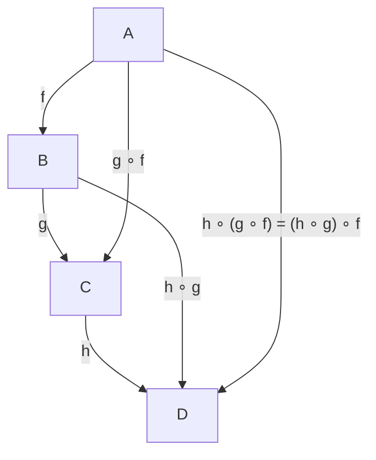

# Lesson 1: Categories, Morphisms, Composition Laws

## 1. First-Principles Intuition & Invariants

Mathematics, viewed from sufficient altitude, is not really about its objects. It is about the relationships between them. A group is not interesting merely as a set equipped with a binary operation; what makes it legible is how it relates to other groups through the structure-preserving maps we call homomorphisms. A topological space earns its significance through the continuous functions that connect it to other spaces. A partial order reveals its character through the monotone maps that respect it. This observation, repeated across enough mathematical disciplines, eventually crystallizes into a single organizing principle: *structure lives in the morphisms, not the objects*. Category theory is the formal machinery that makes this principle precise, and it does so with a parsimony that is almost shocking. The entire edifice rests on two operations and three axioms.

The historical moment of category theory's birth is precisely locatable. In 1945, Samuel Eilenberg and Saunders Mac Lane published "General Theory of Natural Equivalences" in the *Transactions of the American Mathematical Society*. Their immediate problem was concrete: they needed a rigorous language to express the sense in which certain constructions in algebraic topology are "natural" — meaning they do not depend on arbitrary choices of basis or coordinatization. To define naturality, they needed functors. To define functors, they needed categories. The foundational layer was, in a precise sense, a byproduct of the need to talk about structure-preserving maps between structure-preserving maps. This layered self-reference — morphisms between morphisms between morphisms — is not an accident; it is the deepest feature of the subject.

**The Axiomatic Definition.** A *category* $\mathcal{C}$ consists of two species of data: a collection of *objects*, denoted $\text{ob}(\mathcal{C})$, and for every ordered pair of objects $A, B \in \text{ob}(\mathcal{C})$, a collection of *morphisms* from $A$ to $B$, written $\text{Hom}_{\mathcal{C}}(A, B)$ or $\mathcal{C}(A, B)$. A morphism $f \in \text{Hom}(A, B)$ is written $f : A \to B$; the object $A$ is its *domain* and $B$ its *codomain*. These hom-sets must carry a *composition law*

$$\circ : \text{Hom}(B, C) \times \text{Hom}(A, B) \longrightarrow \text{Hom}(A, C)$$

which takes a morphism $g : B \to C$ and a morphism $f : A \to B$ and produces a composite $g \circ f : A \to C$. Notice the order: composition is written right-to-left, in the tradition of function composition, so $g \circ f$ means "first $f$, then $g$." Some authors write $f ; g$ for the same composite in left-to-right order, but we maintain the standard convention throughout.

This data must satisfy three axioms. The first is **associativity**: for any morphisms $f : A \to B$, $g : B \to C$, $h : C \to D$, we require

$$h \circ (g \circ f) = (h \circ g) \circ f.$$

This is not a mere convenience; it is what licenses the unambiguous notation $h \circ g \circ f$ and, more deeply, what ensures that a chain of morphisms has a well-defined composite regardless of the order in which we assemble it. The second and third axioms concern **identity morphisms**: for every object $A$, there must exist a distinguished morphism $\text{id}_A : A \to A$ such that for every $f : A \to B$ and every $g : C \to A$,

$$f \circ \text{id}_A = f \qquad \text{and} \qquad \text{id}_A \circ g = g.$$

The identity morphism acts as a two-sided neutral element for composition. These three axioms — associativity, left identity, and right identity — are the complete axiomatic content of a category.

What is philosophically striking about this definition is what it *omits*. There is no requirement that objects have elements. There is no requirement that morphisms be functions in any set-theoretic sense. There is no requirement that two distinct morphisms $f, g : A \to B$ can be distinguished by their action on points, because objects need not have points. The definition is entirely combinatorial: objects are just nodes in a directed graph, morphisms are labeled arrows, and the structure is entirely in the composition table.

**A Remark on Size.** Set-theoretic caution is warranted. When $\text{ob}(\mathcal{C})$ and each $\text{Hom}(A,B)$ are sets (rather than proper classes), $\mathcal{C}$ is called *locally small*. When $\text{ob}(\mathcal{C})$ is itself a set, $\mathcal{C}$ is *small*. The category $\mathbf{Set}$ of all sets is locally small but not small, and this distinction matters when one needs to form categories of functors without running into paradox. Working mathematicians typically resolve this either by working within a chosen Grothendieck universe or by simply marking size conditions as hypotheses when they become relevant.

---

## 2. Core Architecture & Mechanics

The abstract definition becomes intellectually tractable once it is populated with the central examples of mathematics. Each example not only illustrates the axioms but also reveals what categorical language *buys* in that context.

**The Category $\mathbf{Set}$.** The most immediate example takes sets as objects and functions as morphisms. Composition is ordinary function composition: if $f : A \to B$ and $g : B \to C$ are functions, then $g \circ f : A \to C$ is defined by $(g \circ f)(x) = g(f(x))$. Associativity holds because function composition is always associative:

$$h(g(f(x))) = (h \circ g)(f(x)) = h((g \circ f)(x))$$

for all $x \in A$. The identity morphism $\text{id}_A : A \to A$ is the identity function $\text{id}_A(x) = x$, which satisfies $f \circ \text{id}_A = f$ and $\text{id}_A \circ g = g$ trivially. This is the archetypal example, and many categorical concepts were first named by analogy with $\mathbf{Set}$, even when the generalization has little to do with functions or elements.

**The Category $\mathbf{Grp}$.** Here objects are groups and morphisms are group homomorphisms. If $f : (G, \cdot) \to (H, \star)$ and $g : (H, \star) \to (K, \diamond)$ are homomorphisms, then $g \circ f : G \to K$ is defined pointwise and is itself a homomorphism:

$$(g \circ f)(x \cdot y) = g(f(x \cdot y)) = g(f(x) \star f(y)) = g(f(x)) \diamond g(f(y)) = (g \circ f)(x) \diamond (g \circ f)(y).$$

The identity morphism on a group $G$ is the identity homomorphism $\text{id}_G(x) = x$, which trivially preserves the group operation. The categorical structure here is saying something substantial: the morphisms of $\mathbf{Grp}$ are precisely those maps that respect the algebraic structure, and this choice determines what counts as an "isomorphism" (a morphism with a two-sided inverse in the categorical sense), recovering the usual notion of group isomorphism.

**The Category $\mathbf{Top}$.** Objects are topological spaces; morphisms are continuous maps. Composition of continuous maps is continuous (a standard theorem of point-set topology), so $\mathbf{Top}$ is a well-defined category. The identity function on any topological space is continuous. Isomorphisms in $\mathbf{Top}$ are homeomorphisms — continuous bijections with continuous inverses — which is exactly the correct notion of equivalence for topological spaces.

**Posets as Categories.** A *partially ordered set* $(P, \leq)$ gives a category with $P$ as its object set and, for each pair $a, b \in P$, the hom-set

$$\text{Hom}(a, b) = \begin{cases} \{(a,b)\} & \text{if } a \leq b \\ \emptyset & \text{if } a \not\leq b. \end{cases}$$

There is at most one morphism between any two objects. Composition is defined by transitivity: since $a \leq b$ and $b \leq c$ implies $a \leq c$, we obtain a morphism $a \to c$ from morphisms $a \to b$ and $b \to c$. The identity morphism at $a$ corresponds to reflexivity $a \leq a$. Associativity is automatic because there is at most one morphism of each type. This example is clarifying precisely because the morphisms carry no information beyond existence: the category encodes only the *order structure*, not any action on elements. It demonstrates that categorical morphisms need not resemble functions in any operational sense.

**Monoids as Single-Object Categories.** A *monoid* $(M, \cdot, e)$ — a set with an associative binary operation and a two-sided identity — corresponds to a category $\mathbf{B}M$ with exactly *one* object, call it $\bullet$, and $\text{Hom}(\bullet, \bullet) = M$. Composition of morphisms is the monoid multiplication, and the identity morphism is the monoid identity $e$. Associativity and identity laws of a category correspond exactly to the monoid axioms. This correspondence is not a curiosity; it means that a monoid *is* a category, up to the choice of presenting it as a single-object structure. Groups are then single-object categories in which every morphism is an isomorphism.

The following diagram summarizes the composition law for a generic triple of objects, which is the operative structure every practitioner must internalize:

The associativity axiom states that the two paths from $A$ to $D$ — composing $f$ with $g$ first, or composing $g$ with $h$ first — produce identical morphisms. This is not a commutativity condition (which would require $g \circ f = f \circ g$, a much stronger and generally false statement); it is a bracketing-independence condition.

**Isomorphisms.** A morphism $f : A \to B$ in a category $\mathcal{C}$ is an *isomorphism* if there exists a morphism $g : B \to A$ such that $g \circ f = \text{id}_A$ and $f \circ g = \text{id}_B$. The morphism $g$ is unique when it exists (a standard categorical proof: if $g'$ also satisfies these equations, then $g' = g' \circ \text{id}_B = g' \circ (f \circ g) = (g' \circ f) \circ g = \text{id}_A \circ g = g$), and is called the *inverse* of $f$, written $f^{-1}$. In $\mathbf{Set}$, isomorphisms are bijections. In $\mathbf{Grp}$, they are group isomorphisms. In $\mathbf{Top}$, homeomorphisms. In a poset category, $f : a \to b$ is an isomorphism if and only if both $a \leq b$ and $b \leq a$, which by antisymmetry means $a = b$; the only isomorphisms in a poset are the identity morphisms.

**Opposite Categories.** For any category $\mathcal{C}$, the *opposite category* $\mathcal{C}^{\text{op}}$ has the same objects and reverses all morphisms: $\text{Hom}_{\mathcal{C}^{\text{op}}}(A,B) = \text{Hom}_{\mathcal{C}}(B,A)$. Composition in $\mathcal{C}^{\text{op}}$ is defined by $g \circ^{\text{op}} f = f \circ g$, where the right-hand side uses the composition of $\mathcal{C}$. This construction is foundational: many theorems come in dual pairs, where the proof of one theorem in $\mathcal{C}$ yields the proof of the dual theorem in $\mathcal{C}^{\text{op}}$ for free. The *duality principle* of category theory is a systematic doubling of every theorem.

**Commutative Diagrams.** The working language of category theory is the commutative diagram. A diagram of objects and morphisms in $\mathcal{C}$ is said to *commute* if every pair of directed paths between the same two objects yields the same composite morphism. The square

$$\begin{CD} A @>{f}>> B \\ @V{h}VV @V{k}VV \\ C @>{g}>> D \end{CD}$$

commutes if and only if $k \circ f = g \circ h$. The categorical proof style consists almost entirely of constructing and verifying commutative diagrams, and proficiency in this style is the central practical skill the working mathematician must develop.

---

## 3. High-Performance Optimization & Failure Modes

Mastery of category theory as a practitioner tool requires not only fluency with the definitions but also a disciplined understanding of where the framework applies with full force, where it must be adapted, and where naive applications produce subtle errors.

**Proving Identity and Associativity from Scratch.** When constructing a new category — a frequent occurrence in research — the mathematician must verify the axioms explicitly. The most common failure mode is assuming associativity without proof. Consider the category of *binary relations*: objects are sets, and a morphism $R : A \to B$ is a relation $R \subseteq A \times B$. Composition of relations $R : A \to B$ and $S : B \to C$ is relational composition:

$$S \circ R = \{(a, c) \mid \exists b \in B : (a,b) \in R \text{ and } (b,c) \in S\}.$$

Associativity here requires explicit verification. Take $R \subseteq A \times B$, $S \subseteq B \times C$, $T \subseteq C \times D$. We must show $T \circ (S \circ R) = (T \circ S) \circ R$. For any $(a, d)$:

$$(a,d) \in T \circ (S \circ R) \iff \exists c \in C : (a,c) \in S \circ R \text{ and } (c,d) \in T$$

$$\iff \exists c \in C, \exists b \in B : (a,b) \in R \text{ and } (b,c) \in S \text{ and } (c,d) \in T.$$

By the same unfolding,

$$(a,d) \in (T \circ S) \circ R \iff \exists b \in B : (a,b) \in R \text{ and } (b,d) \in T \circ S$$

$$\iff \exists b \in B, \exists c \in C : (a,b) \in R \text{ and } (b,c) \in S \text{ and } (c,d) \in T.$$

The two conditions are logically equivalent (both reduce to the existence of a triple $(b, c)$ with $(a,b) \in R$, $(b,c) \in S$, $(c,d) \in T$), so associativity holds. The identity morphism on a set $A$ is the diagonal relation $\Delta_A = \{(a,a) \mid a \in A\}$, and the check $R \circ \Delta_A = R$ is routine. This is the category $\mathbf{Rel}$.

**The Failure Mode of Sethood.** When working with large categories such as $\mathbf{Set}$, $\mathbf{Grp}$, or $\mathbf{Top}$, the hom-collection $\text{Hom}(A,B)$ is a genuine set (the category is locally small), but the collection of all objects is a proper class. Attempting to form the "set of all groups" leads immediately to Russell-type paradoxes. The resolution in everyday practice is to fix a strongly inaccessible cardinal $\kappa$ and work within $V_\kappa$, the sets of rank below $\kappa$; this is Mac Lane's "one universe" axiom. For most mathematical purposes — constructing functor categories, forming slice categories, working with limits and colimits — this bookkeeping stays in the background, but the mathematician must recognize when a size argument is silently being invoked.

**Thin Categories and Loss of Information.** Poset categories are *thin* (at most one morphism between any two objects), and this thinness means that categorical universal properties collapse to order-theoretic ones. A *product* in a poset is a greatest lower bound; a *coproduct* is a least upper bound. This is conceptually unifying but also reveals a limitation: when working in a thin category, one cannot distinguish between a morphism that "carries information" and one that merely witnesses a relation. Any argument that requires tracking morphisms as data — not just their existence — will not function in a thin category and must be run in a richer one like $\mathbf{Set}$ or $\mathbf{Vect}_k$.

**Working with Hom-Sets in Practice: The Yoneda Perspective.** The most powerful diagnostic tool for understanding an object $A$ in a category $\mathcal{C}$ is the collection of hom-sets $\text{Hom}(X, A)$ as $X$ ranges over all objects. The *Yoneda Lemma* — to be treated in depth in a later lesson — formalizes the slogan that an object is completely determined by the maps into it (or out of it). The practical workflow consequence is this: to prove that two objects $A$ and $B$ are isomorphic, it suffices to exhibit a natural isomorphism between $\text{Hom}(-, A)$ and $\text{Hom}(-, B)$ as functors $\mathcal{C}^{\text{op}} \to \mathbf{Set}$. This is frequently easier than constructing an explicit isomorphism directly, particularly in categories where objects lack an internal element structure.

**Diagram Chasing as Proof Strategy.** The standard proof technique in abelian categories, and more broadly in categories with enough structure to support exact sequences, is *diagram chasing*: tracking an element through a commutative diagram to establish the existence or uniqueness of a morphism, or to show that a particular composite is zero. Even in non-abelian categories, the diagram-based reasoning style is universal. The discipline is to never appeal to "elements" of an object unless the category provides them (as $\mathbf{Set}$ and $\mathbf{Ab}$ do), and to instead express every argument as a chain of equalities between composites. The *Mitchell Embedding Theorem* guarantees that any small abelian category embeds fully and faithfully into $\mathbf{Ab}$, the category of abelian groups, which retroactively justifies element-based diagram chasing in those settings — but this justification is a theorem, not an assumption, and the practitioner should know when it applies.

**Recognizing Categorical Universality.** The highest-leverage habit a practitioner can develop is recognizing when a construction satisfies a *universal property*: a specification of an object entirely in terms of morphisms into or out of it. The Cartesian product $A \times B$ in $\mathbf{Set}$ is the universal object equipped with projections $\pi_1 : A \times B \to A$ and $\pi_2 : A \times B \to B$ such that for any set $C$ and functions $f : C \to A$, $g : C \to B$, there exists a unique function $\langle f, g \rangle : C \to A \times B$ with $\pi_1 \circ \langle f, g \rangle = f$ and $\pi_2 \circ \langle f, g \rangle = g$. Any two objects satisfying this property are isomorphic — this is the first universal-property uniqueness argument and must be reproduced fluently. If $P$ and $P'$ both satisfy the product universal property, then the universal property of $P$ applied to $P'$ yields a morphism $\phi : P' \to P$, and vice versa a morphism $\psi : P \to P'$; the composites $\phi \circ \psi$ and $\psi \circ \phi$ each satisfy the uniqueness condition for the identity morphism in the respective universal property, forcing $\phi \circ \psi = \text{id}_P$ and $\psi \circ \phi = \text{id}_{P'}$. This two-line argument is the prototype for every "uniqueness up to unique isomorphism" result in category theory.

**Coherence and the Danger of Strictness.** A subtle failure mode arises when a mathematician conflates "equal" and "isomorphic" in a categorical context. In many practically occurring categories — categories of modules, functor categories, monoidal categories — natural constructions satisfy the axioms only up to isomorphism, not on the nose. The tensor product of modules satisfies $A \otimes (B \otimes C) \cong (A \otimes B) \otimes C$, but this is a natural isomorphism, not an equality. Mac Lane's Coherence Theorem for monoidal categories guarantees that all such associativity isomorphisms are compatible, so the distinction does not cause inconsistency in practice — but it must be tracked. Working naively as if $=$ and $\cong$ are interchangeable in a monoidal category will produce arguments that break when examined under a formal lens. The remedy is to work with the coherence isomorphisms explicitly until one is certain that the coherence theorem applies and absorbs them.

The lesson's essential takeaway is both simple and inexhaustible: a category is a directed graph equipped with an associative composition law and identity loops, and virtually all of classical mathematics lives naturally inside this framework. The power is not in the axioms, which are austere, but in the morphisms they force you to take seriously. Every subsequent concept in category theory — functors, natural transformations, adjunctions, limits, Kan extensions — is built by applying this same axiom system one level higher, to categories of categories, to maps between maps. The discipline of always asking "what are the morphisms?" is not a stylistic preference; it is the central epistemological commitment of the subject.
