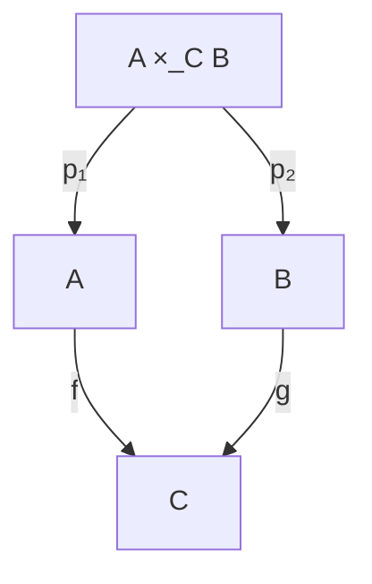
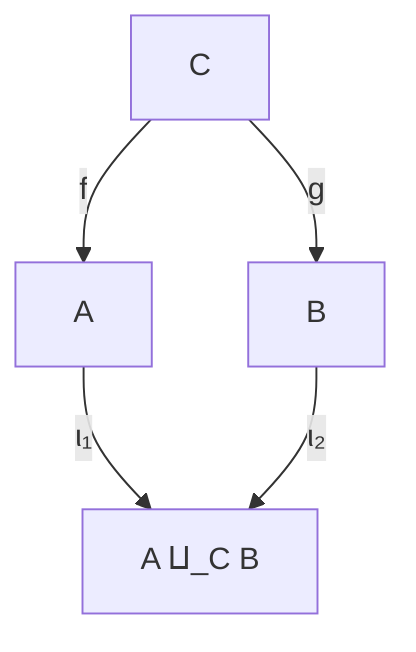
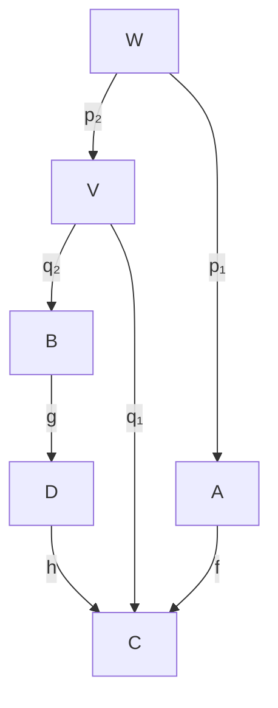

# Lesson 3: Universal Properties, Limits, Colimits

## 1. First-Principles Intuition & Invariants

The history of mathematics is, in a quiet but persistent way, a history of optimization. When we define the greatest common divisor of two integers, we are singling out an object that divides both while sitting above every other common divisor in the divisibility order. When we define the free group on a set, we are describing the most general group that contains that set, one that imposes no relations beyond those forced by the group axioms. When we define the product of two topological spaces, we are demanding a space equipped with projections that factor every other candidate pair of maps through it. Each of these constructions, despite living in different mathematical universes—number theory, algebra, topology—shares a structural skeleton. Category theory identifies that skeleton and gives it a name: the **universal property**.

The conceptual move is radical in its simplicity. Rather than specifying what an object *is* by describing its internal structure (its elements, its points, its open sets), we specify what an object *does* by describing the unique maps that factor through it. The object is characterized not by its substance but by its relationships—by the commutative diagrams it participates in and, crucially, by the uniqueness of the mediating arrow that makes those diagrams commute. This is a shift from extensional definition to relational definition, from building objects up from internal parts to pinning them down by their external behavior. The payoff is enormous: two objects satisfying the same universal property in the same category are isomorphic, and the isomorphism itself is uniquely determined by the universal property. We never need to look inside the objects to know they are the same; we only need to verify that the arrows behave correctly.

A universal property always has the same logical shape, which we can state abstractly and then instantiate concretely. We are given a category $\mathcal{C}$, a diagram $D: \mathcal{J} \to \mathcal{C}$ (where $\mathcal{J}$ is some small indexing category, often called the "shape category"), and we seek an object $L \in \mathcal{C}$ equipped with a family of morphisms that is *terminal* or *initial* among all such families. Concretely, for a **limit** of $D$, we want a cone $(L, \{\lambda_j: L \to D(j)\}_{j \in \mathcal{J}})$ such that for every other cone $(X, \{f_j: X \to D(j)\}_{j \in \mathcal{J}})$ over $D$, there exists a unique morphism $u: X \to L$ with $\lambda_j \circ u = f_j$ for all $j$. The word "cone" is apt: imagine the diagram $D$ as a constellation of objects and arrows laid out in the category, and the cone is an apex point $L$ with legs descending to each object in the diagram, respecting all the arrows in the diagram. The universal property says that $L$ is the *optimal* such apex: every other cone factors through it uniquely. For a **colimit**, we dualize—reversing every arrow. A cocone $(C, \{\iota_j: D(j) \to C\}_{j \in \mathcal{J}})$ is universal if every other cocone factors through $C$ uniquely.

The deep invariant here is the **uniqueness of the mediating morphism**. Existence of a mediating arrow tells us that $L$ is a valid candidate; uniqueness tells us that it is *the* candidate, up to unique isomorphism. This is the categorical formulation of optimization: the limit is the terminal object in the category of cones, the colimit is the initial object in the category of cocones. The entire apparatus of limits and colimits is, in a precise sense, a generalization of the notions of greatest lower bound and least upper bound from lattice theory, lifted from posets to arbitrary categories where the "order" is replaced by the richer structure of morphisms.

The practical power of this framework becomes visible the moment we recognize that a startling number of constructions across mathematics are instances of limits or colimits for particular choices of the shape category $\mathcal{J}$. The terminal object is the limit of the empty diagram. The product is the limit of a discrete two-object diagram. The equalizer is the limit of a parallel-pair diagram. The pullback is the limit of a cospan diagram. Dually, the initial object is the colimit of the empty diagram, the coproduct is the colimit of a discrete diagram, the coequalizer is the colimit of a parallel pair, and the pushout is the colimit of a span. Once we establish general theorems about limits and colimits—how they interact with functors, when they are preserved or reflected, how they compose—we automatically obtain theorems about products, equalizers, pullbacks, kernels, intersections, and all the rest, without re-proving each one individually. This is the efficiency of category theory: it factors out the common pattern from dozens of superficially different constructions and proves the theorem once, at the right level of abstraction.

## 2. Core Architecture & Mechanics

### 2.1 Cones, Cocones, and the Universal Arrow

Let us make the definitions precise. Let $\mathcal{C}$ be a category and let $\mathcal{J}$ be a small category. A **diagram** of shape $\mathcal{J}$ in $\mathcal{C}$ is a functor $D: \mathcal{J} \to \mathcal{C}$. This functor picks out an object $D(j)$ for each $j \in \mathcal{J}$ and a morphism $D(\alpha): D(j) \to D(k)$ for each arrow $\alpha: j \to k$ in $\mathcal{J}$, preserving composition and identities.

A **cone** over $D$ with apex $X$ is an object $X \in \mathcal{C}$ together with a family of morphisms $f_j: X \to D(j)$, one for each $j \in \mathcal{J}$, such that for every arrow $\alpha: j \to k$ in $\mathcal{J}$, the triangle commutes: $D(\alpha) \circ f_j = f_k$. We can package all cones over $D$ into a category, which we call $\mathrm{Cone}(D)$. An object of $\mathrm{Cone}(D)$ is a cone $(X, \{f_j\})$, and a morphism from $(X, \{f_j\})$ to $(Y, \{g_j\})$ is a single map $h: X \to Y$ in $\mathcal{C}$ such that $g_j \circ h = f_j$ for all $j$. The **limit** of $D$ is the terminal object of $\mathrm{Cone}(D)$, if it exists. We denote it $\varprojlim D$ or $\varprojlim_{j \in \mathcal{J}} D(j)$, and we write the universal cone as $(\varprojlim D, \{\lambda_j\})$.

By duality, a **cocone** under $D$ with nadir $X$ consists of morphisms $f_j: D(j) \to X$ such that for every $\alpha: j \to k$ in $\mathcal{J}$, we have $f_k \circ D(\alpha) = f_j$. These form the category $\mathrm{Cocone}(D)$, and the **colimit** of $D$ is its initial object, denoted $\varinjlim D$ or $\varinjlim_{j \in \mathcal{J}} D(j)$.

The uniqueness of the mediating arrow is what makes limits and colimits well-defined up to unique isomorphism. Let us prove this explicitly.

**Proposition (Uniqueness of Limits up to Unique Isomorphism).** *If $(L, \{\lambda_j\})$ and $(L', \{\lambda'_j\})$ are both limits of $D: \mathcal{J} \to \mathcal{C}$, then there exists a unique isomorphism $\phi: L' \to L$ such that $\lambda_j \circ \phi = \lambda'_j$ for all $j \in \mathcal{J}$.*

**Proof.** Since $L$ is a limit and $(L', \{\lambda'_j\})$ is a cone over $D$, the universal property of $L$ yields a unique morphism $\phi: L' \to L$ such that $\lambda_j \circ \phi = \lambda'_j$ for all $j$. Symmetrically, since $L'$ is a limit and $(L, \{\lambda_j\})$ is a cone, we obtain a unique $\psi: L \to L'$ with $\lambda'_j \circ \psi = \lambda_j$ for all $j$. Now consider $\psi \circ \phi: L' \to L'$. For each $j$, we have $\lambda'_j \circ (\psi \circ \phi) = \lambda_j \circ \phi = \lambda'_j$. But the identity $\mathrm{id}_{L'}$ also satisfies $\lambda'_j \circ \mathrm{id}_{L'} = \lambda'_j$. By the uniqueness clause of the universal property of $L'$, we conclude $\psi \circ \phi = \mathrm{id}_{L'}$. By the identical argument with the roles reversed, $\phi \circ \psi = \mathrm{id}_L$. Therefore $\phi$ and $\psi$ are mutual inverses, and $\phi: L' \to L$ is the unique isomorphism satisfying $\lambda_j \circ \phi = \lambda'_j$. $\blacksquare$

This proof is the template for nearly every uniqueness-up-to-isomorphism argument in category theory. The pattern is always the same: obtain two mediating arrows by applying the universal property in both directions, compose them, observe that the composition satisfies the same commutativity condition as the identity, and invoke uniqueness.

### 2.2 Products and Coproducts

The most immediately recognizable instance of a limit is the **product**. Take $\mathcal{J}$ to be the discrete category on two objects, say $\{1, 2\}$ with no non-identity morphisms. A diagram $D: \{1, 2\} \to \mathcal{C}$ is simply a pair of objects $D(1) = A$ and $D(2) = B$. A cone over this diagram is an object $X$ with maps $f_1: X \to A$ and $f_2: X \to B$. Since there are no non-identity arrows in $\mathcal{J}$, the commutativity condition is vacuous—every pair of maps from $X$ constitutes a cone. The limit is an object $A \times B$ with projections $\pi_1: A \times B \to A$ and $\pi_2: A \times B \to B$ such that for any $X$ with maps $f: X \to A$ and $g: X \to B$, there is a unique $\langle f, g \rangle: X \to A \times B$ with $\pi_1 \circ \langle f, g \rangle = f$ and $\pi_2 \circ \langle f, g \rangle = g$.

In $\mathbf{Set}$, this is the familiar Cartesian product $A \times B = \{(a, b) \mid a \in A, b \in B\}$ with $\pi_1(a,b) = a$ and $\pi_2(a,b) = b$, and $\langle f, g \rangle(x) = (f(x), g(x))$. In $\mathbf{Grp}$, it is the direct product $G \times H$ with componentwise multiplication. In $\mathbf{Top}$, it is the product topology, the coarsest topology making the projections continuous. In each case, the universal property is the same; only the concrete construction differs.

The dual construction is the **coproduct**, the colimit of a discrete two-object diagram. We seek an object $A + B$ (or $A \amalg B$) with injections $\iota_1: A \to A + B$ and $\iota_2: B \to A + B$ such that for any $X$ with maps $f: A \to X$ and $g: B \to X$, there is a unique $[f, g]: A + B \to X$ with $[f, g] \circ \iota_1 = f$ and $[f, g] \circ \iota_2 = g$. In $\mathbf{Set}$, this is the disjoint union $A \sqcup B$. In $\mathbf{Ab}$, it is the direct sum $A \oplus B$ (which coincides with the product for finite families but differs for infinite ones). In $\mathbf{Grp}$, it is the free product $G * H$, a considerably more complex object whose elements are reduced words in the elements of $G$ and $H$.

The difference between $\mathbf{Ab}$ and $\mathbf{Grp}$ here is instructive. In $\mathbf{Ab}$, finite products and coproducts coincide—the biproduct $A \oplus B$ is simultaneously a product and a coproduct, a situation that characterizes **semi-additive categories**. In $\mathbf{Grp}$, the product $G \times H$ and the free product $G * H$ are wildly different: $G \times H$ has elements that commute across the two factors, while $G * H$ imposes no such relation. The free product is, in a precise sense, "larger" and more general. This distinction has direct computational consequences: the free product $G * H$ is the group-theoretic analogue of string concatenation without interleaving constraints, and it appears naturally in the Seifert–van Kampen theorem, where the fundamental group of a space obtained by gluing along a common subspace is computed as a pushout (a colimit construction we will examine shortly).

### 2.3 Equalizers and Coequalizers

When the shape category $\mathcal{J}$ has two objects and two parallel arrows between them, the limit is called an **equalizer**. Concretely, given two parallel morphisms $f, g: A \to B$ in $\mathcal{C}$, the equalizer is an object $E$ with a map $e: E \to A$ such that $f \circ e = g \circ e$, and for any $X$ with a map $h: X \to A$ satisfying $f \circ h = g \circ h$, there is a unique $u: X \to E$ with $e \circ u = h$.

In $\mathbf{Set}$, the equalizer is the subset $E = \{a \in A \mid f(a) = g(a)\}$ with $e$ the inclusion. The universal property says: any function $h: X \to A$ whose image lands in the equalizer set factors uniquely through the inclusion. This is just the set-theoretic fact that if $f(h(x)) = g(h(x))$ for all $x$, then $h$ factors through the subset where $f$ and $g$ agree.

In $\mathbf{Grp}$, the equalizer of two group homomorphisms $f, g: G \to H$ is the subgroup $\{x \in G \mid f(x) = g(x)\}$ with the inclusion map. In $\mathbf{Top}$, it is the subspace topology on the equalizer set. The equalizer is always a **monomorphism** (a categorical analogue of injectivity), which we can prove directly:

**Proposition.** *Every equalizer is a monomorphism.*

**Proof.** Let $e: E \to A$ be the equalizer of $f, g: A \to B$. Suppose $u, v: X \to E$ satisfy $e \circ u = e \circ v$. Then $h = e \circ u: X \to A$ satisfies $f \circ h = f \circ e \circ u = g \circ e \circ u = g \circ h$, so $h$ is a map into $A$ equalizing $f$ and $g$. By the universal property, there is a unique $w: X \to E$ with $e \circ w = h$. But both $u$ and $v$ satisfy $e \circ u = h$ and $e \circ v = h$, so by uniqueness, $u = v$. $\blacksquare$

The dual, the **coequalizer**, is the colimit of the same parallel-pair diagram. Given $f, g: A \to B$, the coequalizer is an object $Q$ with a map $q: B \to Q$ such that $q \circ f = q \circ g$, and for any $h: B \to X$ with $h \circ f = h \circ g$, there is a unique $u: Q \to X$ with $u \circ q = h$. In $\mathbf{Set}$, the coequalizer is the quotient of $B$ by the smallest equivalence relation containing $\{(f(a), g(a)) \mid a \in A\}$. In $\mathbf{Grp}$, the coequalizer of $f, g: G \to H$ is the quotient $H / N$ where $N$ is the normal closure of $\{f(x)g(x)^{-1} \mid x \in G\}$. Coequalizers are always **epimorphisms**, by the dual of the proof above.

The coequalizer is the abstract engine behind quotient constructions. Whenever we form a quotient—of a group by a normal subgroup, of a ring by an ideal, of a topological space by an equivalence relation—we are computing a coequalizer. The two parallel maps encode the relation being quotiented by: one map is the inclusion of the relation into the object, the other is the "trivial" map that sends each related pair to the same place, and the coequalizer forces them to be equal.

### 2.4 Pullbacks and Pushouts

A **pullback** is the limit of a diagram shaped like a cospan: two maps with a common codomain. Given $f: A \to C$ and $g: B \to C$, the pullback is an object $A \times_C B$ with maps $p_1: A \times_C B \to A$ and $p_2: A \times_C B \to B$ such that $f \circ p_1 = g \circ p_2$, and for any $X$ with maps $x_1: X \to A$ and $x_2: X \to B$ satisfying $f \circ x_1 = g \circ x_2$, there is a unique $u: X \to A \times_C B$ with $p_1 \circ u = x_1$ and $p_2 \circ u = x_2$.

In $\mathbf{Set}$, the pullback is the set $\{(a, b) \in A \times B \mid f(a) = g(b)\}$, which we can read as the "fiber product": it pairs up elements of $A$ and $B$ that map to the same element of $C$. The pullback generalizes both the product (when $C$ is a terminal object, the condition $f \circ p_1 = g \circ p_2$ is vacuous and we recover $A \times B$) and the equalizer (when $A = B$ and $f, g: A \to C$ with $C$ playing the role of the common codomain, and we take $g = f$ to get the kernel pair, or more directly, when $B$ is a terminal object and $g$ is the unique map, the pullback of $f$ along $g$ recovers the equalizer of $f$ and the constant map).

A critical practical instance: in $\mathbf{Set}$, if $g: B \to C$ is the inclusion of a subset $B \subseteq C$, then the pullback $A \times_C B$ is the preimage $f^{-1}(B) = \{a \in A \mid f(a) \in B\}$, with $p_1$ the restriction of $f$ and $p_2$ the inclusion. This is the set-theoretic content of the pullback: it computes inverse images. In algebraic geometry, the fibered product of schemes is constructed as a pullback in the category of schemes, and it is the foundational operation for base change—the process of "changing the base field" or "changing the base scheme" over which a family of varieties is defined.

The dual **pushout** is the colimit of a span: two maps with a common domain. Given $f: C \to A$ and $g: C \to B$, the pushout is an object $A \amalg_C B$ with maps $\iota_1: A \to A \amalg_C B$ and $\iota_2: B \to A \amalg_C B$ such that $\iota_1 \circ f = \iota_2 \circ g$, universal among such objects.

In $\mathbf{Set}$, the pushout is the quotient of the disjoint union $A \sqcup B$ by the equivalence relation generated by $\{(f(c), g(c)) \mid c \in C\}$. In $\mathbf{Grp}$, it is the amalgamated free product $A *_C B$, the quotient of the free product $A * B$ by the normal subgroup generated by $\{f(c)g(c)^{-1} \mid c \in C\}$. The Seifert–van Kampen theorem states that if a space $X = U \cup V$ with $U \cap V$ path-connected, then $\pi_1(X) \cong \pi_1(U) *_{\pi_1(U \cap V)} \pi_1(V)$, a pushout in $\mathbf{Grp}$. This is perhaps the single most important computational application of pushouts in topology: it reduces the computation of fundamental groups of complex spaces to the computation of pushouts of the fundamental groups of their pieces.

### 2.5 Completeness and Cocompleteness

A category is **complete** if it has all small limits—that is, limits of all diagrams indexed by small categories (categories whose objects form a set rather than a proper class). Dually, it is **cocomplete** if it has all small colimits. The distinction between "small" and "large" is not merely pedantic; it prevents set-theoretic paradoxes. The category $\mathbf{Set}$, for instance, has all small limits and colimits but not all large ones (there is no product of all sets, as this would be a proper class rather than a set).

The central structural result is the following theorem, which reduces the verification of completeness to checking a small number of limit types.

**Theorem (Existence of Limits via Products and Equalizers).** *A category $\mathcal{C}$ has all small limits if and only if it has all small products and equalizers.*

**Proof.** ($\Rightarrow$) Products are limits of discrete diagrams, and equalizers are limits of parallel-pair diagrams. So if $\mathcal{C}$ has all small limits, it has these in particular.

($\Leftarrow$) Let $D: \mathcal{J} \to \mathcal{C}$ be a diagram with $\mathcal{J}$ small. We construct its limit from products and equalizers. First, form the product $P = \prod_{j \in \mathrm{Ob}(\mathcal{J})} D(j)$ with projections $\pi_j: P \to D(j)$. This product exists by hypothesis. Second, form the product $Q = \prod_{\alpha \in \mathrm{Mor}(\mathcal{J})} D(\mathrm{cod}(\alpha))$ with projections $\rho_\alpha: Q \to D(\mathrm{cod}(\alpha))$, where $\mathrm{cod}(\alpha)$ denotes the codomain of the arrow $\alpha: j \to k$. This also exists by hypothesis.

Now define two maps $f, g: P \to Q$. For each arrow $\alpha: j \to k$ in $\mathcal{J}$, we need to specify the $\alpha$-component of $f$ and $g$. Set $f_\alpha = \pi_k \circ \pi_j'$ (more precisely, the $\alpha$-component of $f$ is $\pi_{\mathrm{cod}(\alpha)} \circ \pi_{\mathrm{dom}(\alpha)}$-adjusted... let us be more careful). Actually, let us define:

$$f = \langle D(\alpha) \circ \pi_{\mathrm{dom}(\alpha)} \rangle_{\alpha \in \mathrm{Mor}(\mathcal{J})}: P \to Q$$

$$g = \langle \pi_{\mathrm{cod}(\alpha)} \rangle_{\alpha \in \mathrm{Mor}(\mathcal{J})}: P \to Q$$

Here $f$ is the map whose $\alpha$-component is $D(\alpha) \circ \pi_{\mathrm{dom}(\alpha)}$ (first project to $D(\mathrm{dom}(\alpha))$, then apply $D(\alpha)$), and $g$ is the map whose $\alpha$-component is $\pi_{\mathrm{cod}(\alpha)}$ (directly project to $D(\mathrm{cod}(\alpha))$). Now form the equalizer $e: L \to P$ of $f$ and $g$. We claim $(L, \{\pi_j \circ e\}_{j \in \mathcal{J}})$ is a limit cone over $D$.

First, it is a cone: for each arrow $\alpha: j \to k$ in $\mathcal{J}$, we need $D(\alpha) \circ (\pi_j \circ e) = \pi_k \circ e$. This follows because $e$ equalizes $f$ and $g$: the $\alpha$-component of $f \circ e$ equals the $\alpha$-component of $g \circ e$, i.e., $D(\alpha) \circ \pi_j \circ e = \pi_k \circ e$.

Second, it is universal. Given any cone $(X, \{h_j: X \to D(j)\})$, the maps $h_j$ induce a unique $\langle h_j \rangle: X \to P$ with $\pi_j \circ \langle h_j \rangle = h_j$ for all $j$. The cone condition $D(\alpha) \circ h_j = h_k$ for all $\alpha: j \to k$ means precisely that $f \circ \langle h_j \rangle = g \circ \langle h_j \rangle$. Since $e$ is the equalizer of $f$ and $g$, there is a unique $u: X \to L$ with $e \circ u = \langle h_j \rangle$, hence $\pi_j \circ e \circ u = h_j$ for all $j$. $\blacksquare$

The dual result holds: a category has all small colimits if and only if it has all small coproducts and coequalizers.

This theorem is the structural backbone of completeness verification. To show that $\mathbf{Set}$ is complete, we observe that it has arbitrary products (Cartesian products of families of sets) and equalizers (subsets where two functions agree). To show that $\mathbf{Grp}$ is complete, we note that it has products (direct products) and equalizers (subgroups where two homomorphisms agree). To show that $\mathbf{Ab}$ is cocomplete, we observe that it has coproducts (direct sums) and coequalizers (quotients by the image of $f - g$). In each case, two constructions suffice to generate the entire zoo of limits or colimits.

### 2.6 The Category of Diagrams and the Yoneda Perspective

There is a deeper way to see why limits and colimits exist in presheaf categories, which we mention here because it underlies much of the practical machinery. Given a small category $\mathcal{J}$, a diagram $D: \mathcal{J} \to \mathcal{C}$ can be viewed as an object in the functor category $[\mathcal{J}, \mathcal{C}]$, and the limit of $D$ is a right adjoint to the diagonal functor $\Delta: \mathcal{C} \to [\mathcal{J}, \mathcal{C}]$ that sends each object $X$ to the constant diagram $\Delta(X): \mathcal{J} \to \mathcal{C}$ with $\Delta(X)(j) = X$ for all $j$ and $\Delta(X)(\alpha) = \mathrm{id}_X$ for all arrows $\alpha$. The limit, if it exists for all $D$, is the right adjoint $\varprojlim: [\mathcal{J}, \mathcal{C}] \to \mathcal{C}$, and the colimit is the left adjoint $\varinjlim: [\mathcal{J}, \mathcal{C}] \to \mathcal{C}$. The adjunction $\varinjlim \dashv \Delta \dashv \varprojlim$ encodes the universal properties:

$$\mathrm{Hom}_{\mathcal{C}}(\varinjlim D, X) \cong \mathrm{Hom}_{[\mathcal{J}, \mathcal{C}]}(D, \Delta(X))$$

$$\mathrm{Hom}_{\mathcal{C}}(X, \varprojlim D) \cong \mathrm{Hom}_{[\mathcal{J}, \mathcal{C}]}(\Delta(X), D)$$

These isomorphisms are natural in both $D$ and $X$, and they say precisely what the universal properties say: a map from $X$ to the limit of $D$ is the same thing as a cone from $X$ to $D$, and a map from the colimit of $D$ to $X$ is the same thing as a cocone from $D$ to $X$. The adjoint functor perspective unifies limits and colimits under the banner of adjunctions, which we will study in detail in a later lesson, and it provides a powerful computational tool: any theorem about adjoint functors immediately applies to limits and colimits.

## 3. High-Performance Optimization & Failure Modes

### 3.1 Diagram Chasing as a Tactical Discipline

The working mathematician's encounter with limits and colimits is almost always through **diagram chasing**: the practice of proving commutativity of a complex diagram by decomposing it into elementary commutative pieces, each of which follows from a universal property, a functoriality condition, or a known identity. The technique is analogous to simplification in algebraic manipulation, but the "equations" are commutative squares, triangles, and higher-dimensional cells in a diagram, and the "rules of inference" are the universal properties that provide the mediating arrows.

The fundamental tactical principles of diagram chasing are few but powerful.

**Principle 1: Factor through the universal object.** Whenever you have a cone over a diagram and a limit of that diagram, you are entitled to a unique mediating arrow. Use it. If you need to construct a map into the limit, construct the components separately and verify they form a cone; the universal property does the rest. If you need to prove two maps into the limit are equal, prove their components are equal—for the universal property guarantees that the map is determined by its components.

**Principle 2: Compose commutative diagrams.** If two adjacent squares commute, their outer rectangle commutes. This is the transitivity of commutativity, and it is the primary way to reduce a large diagram to a collection of small ones. The practical import is that you can check commutativity of a complex diagram by triangulating it into small pieces, each of which you verify directly.

**Principle 3: Use the two-out-of-three property.** In many situations, if two of three arrows in a triangle are isomorphisms and the triangle commutes, the third is also an isomorphism. More generally, in a commutative square, if three sides are isomorphisms, so is the fourth. This is the basis for proving that constructed maps are isomorphisms without explicitly constructing the inverse.

**Principle 4: Duality is free.** Every theorem about limits has a dual theorem about colimits, obtained by reversing all arrows. If you have proven a result about pullbacks, you have proven the dual result about pushouts. This halves the work in many arguments and is the reason category theory is so efficient at producing theorems in pairs.

Let us illustrate with a concrete computation that appears frequently in practice.

**Proposition (Pullback Lemma / "The Pasting Lemma").** *Given the diagram*

*where the right square is a pullback and the outer rectangle is a pullback, then the left square is a pullback.*

**Proof.** We need to show that given any $X$ with maps $a: X \to A$ and $b: X \to V$ such that $f \circ a = q_1 \circ b$, there exists a unique $u: X \to W$ with $p_1 \circ u = a$ and $p_2 \circ u = b$.

From the cone $(X, a, b)$ with $f \circ a = q_1 \circ b$, compose to get a cone over the outer rectangle: we have $a: X \to A$ and $q_2 \circ b: X \to B$ with $g \circ q_2 \circ b = h \circ q_2 \circ b$... We need to be more careful. Let us use the explicit setup. The right square being a pullback means $V \cong C \times_D B$ via $q_1$ and $q_2$, and $g \circ q_2 = h \circ q_1$... actually, let me restate with cleaner notation.

Let the right square be:
$$\begin{array}{ccc} V & \xrightarrow{q_2} & B \\ \downarrow{q_1} & & \downarrow{g} \\ C & \xrightarrow{h} & D \end{array}$$
This is a pullback, so $V \cong C \times_D B$.

Let the outer rectangle be:
$$\begin{array}{ccc} W & \xrightarrow{q_2 \circ p_2} & B \\ \downarrow{p_1} & & \downarrow{g} \\ A & \xrightarrow{h \circ f} & D \end{array}$$
This is also a pullback, so $W \cong A \times_D B$.

We want to show the left square is a pullback:
$$\begin{array}{ccc} W & \xrightarrow{p_2} & V \\ \downarrow{p_1} & & \downarrow{q_1} \\ A & \xrightarrow{f} & C \end{array}$$
i.e., $W \cong A \times_C V$.

Given $X$ with $a: X \to A$ and $b: X \to V$ such that $f \circ a = q_1 \circ b$, we need a unique $u: X \to W$ with $p_1 \circ u = a$ and $p_2 \circ u = b$.

From $b: X \to V$, compose to get $q_2 \circ b: X \to B$. We claim $(a, q_2 \circ b)$ is a cone over the outer rectangle, i.e., $h \circ f \circ a = g \circ q_2 \circ b$. Since $f \circ a = q_1 \circ b$, we have $h \circ f \circ a = h \circ q_1 \circ b$. Since the right square commutes, $h \circ q_1 = g \circ q_2$, so $h \circ q_1 \circ b = g \circ q_2 \circ b$. Thus $h \circ f \circ a = g \circ q_2 \circ b$, confirming the cone condition.

Since the outer rectangle is a pullback, there is a unique $u: X \to W$ with $p_1 \circ u = a$ and $(q_2 \circ p_2) \circ u = q_2 \circ b$.

We have $p_1 \circ u = a$ as required. We need $p_2 \circ u = b$. We know $q_2 \circ p_2 \circ u = q_2 \circ b$ and $q_1 \circ p_2 \circ u = f \circ p_1 \circ u = f \circ a = q_1 \circ b$ (the last equality is our hypothesis, the second-to-last uses $p_1 \circ u = a$, and the first uses commutativity of the left square which we are trying to prove is a pullback—but we actually need the left square to commute first). 

Let me restart the argument more carefully. The left square commutes because $q_1 \circ p_2 = f \circ p_1$ follows from the commutativity of the outer rectangle ($h \circ f \circ p_1 = g \circ q_2 \circ p_2$, which equals $h \circ q_1 \circ p_2$ by the right square's commutativity) and... actually, we need a cleaner approach.

Since the outer rectangle is a pullback with apex $W$ and the right square is a pullback with apex $V$, and the left square commutes (which we should verify), the left square is a pullback. The commutativity of the left square follows from the universal property: $q_1 \circ p_2$ and $f \circ p_1$ are both maps $W \to C$, and $h \circ q_1 \circ p_2 = g \circ q_2 \circ p_2 = h \circ f \circ p_1$ (using commutativity of the right square and the outer rectangle). Since $h$ need not be monic, this alone doesn't give us $q_1 \circ p_2 = f \circ p_1$. 

The standard statement of the pullback lemma assumes the left square commutes. Under that assumption, the argument proceeds as follows. Given $a: X \to A$ and $b: X \to V$ with $f \circ a = q_1 \circ b$, form the cone $(a, q_2 \circ b)$ over the outer cospan $(A \xrightarrow{h \circ f} D \xleftarrow{g} B)$. The outer pullback gives unique $u: X \to W$ with $p_1 \circ u = a$ and $q_2 \circ p_2 \circ u = q_2 \circ b$. Now both $p_2 \circ u$ and $b$ are maps $X \to V$ satisfying $q_1 \circ (p_2 \circ u) = f \circ p_1 \circ u = f \circ a = q_1 \circ b$ and $q_2 \circ (p_2 \circ u) = q_2 \circ b$. Since the right square is a pullback, the map into $V$ is uniquely determined by its compositions with $q_1$ and $q_2$, so $p_2 \circ u = b$. Uniqueness follows from the outer pullback. $\blacksquare$

This lemma is the workhorse of diagram chasing in abelian categories, where it underlies the "five lemma" and "snake lemma" arguments. It states, in essence, that pullbacks can be composed and decomposed: if a large pullback square is split into two smaller squares, one of which is a pullback, then the other is a pullback if and only if the whole is.

### 3.2 Preservation and Reflection of Limits

A functor $F: \mathcal{C} \to \mathcal{D}$ **preserves limits** if, whenever $(L, \{\lambda_j\})$ is a limit of $D: \mathcal{J} \to \mathcal{C}$, the cone $(F(L), \{F(\lambda_j)\})$ is a limit of $F \circ D: \mathcal{J} \to \mathcal{D}$. It **reflects limits** if the converse holds: whenever $(F(L), \{F(\lambda_j)\})$ is a limit of $F \circ D$, then $(L, \{\lambda_j\})$ was already a limit of $D$. It **creates limits** if it both preserves and reflects them, and additionally the limit exists in $\mathcal{D}$ whenever the corresponding limit exists in $\mathcal{C}$ (more precisely, if $F \circ D$ has a limit in $\mathcal{D}$, then $D$ has a limit in $\mathcal{C}$ that is preserved by $F$).

The most important practical result is that **right adjoints preserve limits** and **left adjoints preserve colimits**. This single fact, which we prove properly when we study adjunctions, collapses a large number of individual verifications. The forgetful functor $U: \mathbf{Grp} \to \mathbf{Set}$ is a right adjoint (its left adjoint is the free group functor), so it preserves limits. This immediately tells us that the underlying set of a group product $G \times H$ is the Cartesian product of the underlying sets, and the underlying set of an equalizer is the set-theoretic equalizer. On the other hand, $U$ does not preserve colimits (the underlying set of a free product $G * H$ is not the disjoint union of the underlying sets), which is consistent with $U$ being a right adjoint, not a left adjoint.

The practical consequence for diagram chasing is this: when working in a category of structured sets (groups, rings, modules, topological spaces), you can often compute limits by first computing them in $\mathbf{Set}$ and then verifying that the result carries the appropriate structure. This works because the forgetful functor, being a right adjoint, preserves limits. For colimits, the situation is more delicate: the free functor (left adjoint) preserves colimits, but the forgetful functor does not, so colimits in categories of algebraic structures are generally more complex than their set-theoretic counterparts.

### 3.3 Failure Modes: When Limits and Colimits Do Not Exist

Not every category has all limits or colimits, and recognizing the failure modes is essential for avoiding subtle errors.

**Failure 1: Missing products.** The category $\mathbf{Field}$ has no product of $\mathbb{F}_2$ and $\mathbb{F}_3$. The product would need to be a field $K$ with maps to $\mathbb{F}_2$ and $\mathbb{F}_3$, but any field has maps to at most one of these (a field homomorphism preserves characteristic, and $\mathbb{F}_2$ has characteristic 2 while $\mathbb{F}_3$ has characteristic 3). There is no field that admits homomorphisms to both. More fundamentally, $\mathbf{Field}$ lacks even binary products because there is no "universal field" receiving maps from two given fields of different characteristics. This is a structural feature of the category, not an oversight: $\mathbf{Field}$ is not complete, and this reflects the rigidity of field homomorphisms.

**Failure 2: Missing coequalizers.** The category $\mathbf{Top}$ has all limits and colimits (it is complete and cocomplete), but the category of Hausdorff spaces $\mathbf{Haus}$ has limits but not all colimits. Specifically, the coequalizer in $\mathbf{Top}$ of two maps between Hausdorff spaces need not be Hausdorff: quotienting a Hausdorff space by an arbitrary equivalence relation can produce a non-Hausdorff space (for instance, the line with two origins, obtained by gluing two copies of $\mathbb{R}$ along $\mathbb{R} \setminus \{0\}$, is not Hausdorff). The coequalizer in $\mathbf{Haus}$, when it exists, is the Hausdorff reflection of the topological coequalizer—a more complex object that does not always exist for arbitrary coequalizer diagrams.

**Failure 3: Infinite products versus coproducts in algebra.** In $\mathbf{Ab}$, finite products and coproducts coincide (both are direct sums), but infinite products and coproducts differ. The product $\prod_{i \in I} A_i$ consists of all families $(a_i)_{i \in I}$ with $a_i \in A_i$, while the coproduct $\bigoplus_{i \in I} A_i$ consists of families with only finitely many nonzero entries. Confusing these two is a common source of error in homological algebra, particularly when working with chain complexes indexed by infinite sets. The product is the limit of the discrete diagram, the coproduct is its colimit, and they agree only for finite diagrams in additive categories.

**Failure 4: Limits not preserved by non-right-adjoints.** A classic error is to assume that a functor preserves limits because it "should" in some intuitive sense. The forgetful functor $U: \mathbf{Top} \to \mathbf{Set}$ preserves limits (products and subspaces are computed on underlying sets) but not colimits: the coproduct in $\mathbf{Top}$ (disjoint union with the coproduct topology) maps to the coproduct in $\mathbf{Set}$ (disjoint union), which is fine, but the coequalizer in $\mathbf{Top}$ (quotient topology) maps to a set that is generally not the coequalizer in $\mathbf{Set}$ (the quotient set can be coarser than the set-theoretic coequalizer would suggest—though actually the underlying set of the topological quotient is the set-theoretic quotient, so $U$ does preserve this particular colimit; the issue is more subtle and arises with more complex colimit shapes). The safe principle is: do not assume a functor preserves limits or colimits unless you have verified it via adjunction or direct computation.

### 3.4 Filtered Colimits and Their Computational Advantages

A particularly well-behaved class of colimits is the **filtered colimit**: a colimit of a diagram $D: \mathcal{J} \to \mathcal{C}$ where $\mathcal{J}$ is a **filtered category**, meaning every finite diagram in $\mathcal{J}$ has a cocone. Concretely, $\mathcal{J}$ is filtered if it is non-empty, every pair of objects has an upper bound, and every pair of parallel arrows can be coequalized (there exists an arrow making both compositions equal).

Filtered colimits commute with finite limits in $\mathbf{Set}$ (and more generally in any locally finitely presentable category). This means:

$$\varinjlim_{i} \varprojlim_{j} D(i,j) \cong \varprojlim_{j} \varinjlim_{i} D(i,j)$$

when the colimit is filtered and the limit is finite. This commutativity is the categorical expression of a phenomenon familiar from algebra: a finitely presented module can be described by finitely many generators and relations, and operations on finitely presented modules can be computed "element by element" even in the presence of infinite colimits. In computational practice, this means that when working with filtered colimits (such as direct limits of groups, rings, or modules indexed by a directed set), you can interchange the order of finite limits and filtered colimits, which dramatically simplifies many arguments in commutative algebra and algebraic geometry.

For example, the tensor product $M \otimes_R N$ commutes with filtered colimits in each variable: $(\varinjlim M_i) \otimes_R N \cong \varinjlim (M_i \otimes_R N)$. This is because $-\otimes_R N$ is a left adjoint (its right adjoint is $\mathrm{Hom}(N, -)$), and left adjoints preserve colimits. The practical consequence is that to compute the tensor product of a filtered colimit with a fixed module, you can compute the tensor products at each stage and take the colimit afterward, which is often far more tractable.

### 3.5 The Interplay of Limits and Colimits in Practice

A pattern that recurs throughout mathematics is the following: a construction is defined as a limit or colimit, and the main theorem about it states that it interacts well (or poorly) with other limits and colimits. The **exactness** of a functor—whether it preserves finite limits or colimits, kernels or cokernels—is the central question of homological algebra. A functor is **left exact** if it preserves finite limits, equivalently if it preserves terminal objects and pullbacks (or, in an abelian category, if it preserves kernels). It is **right exact** if it preserves finite colimits, equivalently finite coproducts and coequalizers (or cokernels). A functor is **exact** if it is both left and right exact.

The Hom functor $\mathrm{Hom}(X, -): \mathcal{C} \to \mathbf{Set}$ is left exact: it preserves limits, which means $\mathrm{Hom}(X, \varprojlim D) \cong \varprojlim \mathrm{Hom}(X, D(-))$. This is precisely the universal property of the limit restated: a map into the limit is a cone, and a cone is a limit (in $\mathbf{Set}$) of the corresponding diagram of Hom-sets. This observation is the bridge between the abstract universal property and concrete computation: to understand maps into a limit, you reduce to understanding maps into each component, subject to compatibility. The dual statement—that $\mathrm{Hom}(-, X)$ sends colimits to limits—gives the tool for understanding maps out of colimits.

This interplay reaches its full power in the context of **derived functors**, which measure the failure of exactness: the right derived functors of a left exact functor (computed via injective resolutions) capture the "error" in the functor's failure to preserve colimits, and the left derived functors of a right exact functor (computed via projective resolutions) capture the dual failure. This is the content of homological algebra, and it all rests on the diagram-chasing techniques and universal properties we have developed here. The snake lemma, the five lemma, the nine lemma—all are diagram-chasing arguments that exploit the universal properties of kernels, cokernels, and exact sequences, which are themselves built from equalizers and coequalizers (or, in abelian categories, from finite limits and colimits). The entire edifice of homological algebra is, in this sense, an extended application of the theory of limits and colimits, elevated to a computational discipline by the systematic use of diagram chasing and the universal properties that make it possible.
