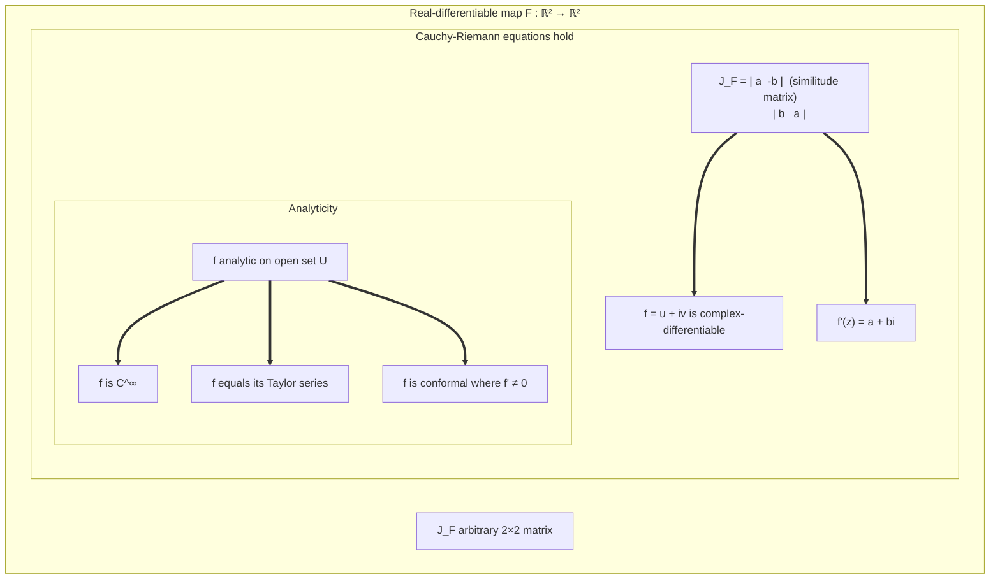

# Lesson 1: Complex Numbers, Topology of the Plane, Analytic Functions

## 1. First-Principles Intuition & Invariants

The story of complex numbers begins not with abstraction but with necessity. When sixteenth-century algebraists—del Ferro, Tartaglia, Cardano—confronted the depressed cubic $x^3 + px + q = 0$, they encountered an uncomfortable phenomenon: the formula for three distinct real roots passed through the square roots of negative numbers as intermediate steps, even when the final answer was a perfectly ordinary real number. The formal device $\sqrt{-1}$ was not a philosophical luxury but a computational tool demanded by real problems. What followed over three centuries of mathematical development—from Euler's $e^{i\theta} = \cos\theta + i\sin\theta$ to Gauss's geometric interpretation to Riemann's visionary analysis—culminated in the discovery that the complex numbers are not merely an algebraic convenience but carry a geometric rigidity so strong that it fundamentally distinguishes complex analysis from its real counterpart.

The central invariant of this lesson, the idea that organizes everything else, is the following: **complex differentiability is an enormously stronger condition than real differentiability.** A function that is merely differentiable in the real sense can be arbitrarily badly behaved; a function that is complex-differentiable on an open set is immediately infinitely differentiable, is representable by a convergent power series, and satisfies a system of partial differential equations that ties together its real and imaginary parts in a precise way. Understanding why this is true—mechanically, algebraically, geometrically—is the whole purpose of this lesson.

### The Algebraic Structure of $\mathbb{C}$

We construct $\mathbb{C}$ rigorously as the quotient ring $\mathbb{R}[x]/(x^2 + 1)$, the ring of real polynomials modulo the ideal generated by the irreducible polynomial $x^2 + 1$. An element of this quotient is a coset $a + bx + (x^2+1)$ for $a, b \in \mathbb{R}$, which we write as $a + bi$ once we identify the coset of $x$ with the symbol $i$. Multiplication is then forced by the relation $i^2 = -1$:

$$
(a + bi)(c + di) = (ac - bd) + (ad + bc)i.
$$

This construction proves immediately that $\mathbb{C}$ is a commutative ring, and since $x^2 + 1$ is irreducible over $\mathbb{R}$, the ideal $(x^2+1)$ is maximal, so the quotient is a field. We can verify this directly: for any nonzero $z = a + bi$, the multiplicative inverse is

$$
z^{-1} = \frac{a - bi}{a^2 + b^2},
$$

which is well-defined precisely when $a^2 + b^2 \neq 0$, i.e., when $z \neq 0$.

The **complex conjugate** of $z = a + bi$ is $\bar{z} = a - bi$. It is a field automorphism of $\mathbb{C}$ over $\mathbb{R}$: it satisfies $\overline{z + w} = \bar{z} + \bar{w}$, $\overline{zw} = \bar{z}\bar{w}$, and fixes $\mathbb{R}$ pointwise. The **modulus** is $|z| = \sqrt{z\bar{z}} = \sqrt{a^2 + b^2}$, measuring Euclidean distance from the origin when $\mathbb{C}$ is identified with $\mathbb{R}^2$ in the natural way. The modulus is multiplicative: $|zw| = |z||w|$, which follows immediately from $|zw|^2 = zw\overline{zw} = z\bar{z} \cdot w\bar{w} = |z|^2|w|^2$.

The **argument** $\arg(z)$, defined for $z \neq 0$, is the angle $\theta \in (-\pi, \pi]$ such that $z = |z|(\cos\theta + i\sin\theta)$. Euler's formula, which we will derive properly from power series in a later lesson, asserts $e^{i\theta} = \cos\theta + i\sin\theta$, so every nonzero complex number admits the **polar form** $z = re^{i\theta}$ with $r = |z| > 0$. Under multiplication, moduli multiply and arguments add: $(r_1 e^{i\theta_1})(r_2 e^{i\theta_2}) = r_1 r_2 e^{i(\theta_1 + \theta_2)}$. This gives multiplication in $\mathbb{C}$ a beautiful geometric interpretation: multiplying by $w = re^{i\theta}$ is the composition of a dilation by factor $r$ and a rotation by angle $\theta$. This geometric picture is not merely ornamental—it is the seed of the entire theory of conformal maps.

### The Metric Topology of $\mathbb{C}$

Since $\mathbb{C}$ is in bijection with $\mathbb{R}^2$ via $a + bi \leftrightarrow (a, b)$, we equip it with the metric $d(z, w) = |z - w|$. This makes $\mathbb{C}$ a complete metric space. All the standard topological notions from real analysis carry over without modification. An **open disk** of radius $r$ centered at $z_0$ is

$$
D(z_0, r) = \{ z \in \mathbb{C} : |z - z_0| < r \},
$$

and the open sets of $\mathbb{C}$ are precisely the unions of open disks. A set $U \subseteq \mathbb{C}$ is **open** if for every $z \in U$ there exists $r > 0$ such that $D(z, r) \subseteq U$. A **neighborhood** of a point $z_0$ is any open set containing $z_0$. A set is **closed** if its complement is open, equivalently if it contains all its limit points.

A point $z_0$ is a **limit point** (or accumulation point) of a set $S$ if every deleted neighborhood $D(z_0, r) \setminus \{z_0\}$ meets $S$ nontrivially. A set $S$ is **bounded** if $S \subseteq D(0, R)$ for some $R > 0$, and **compact** if it is closed and bounded—by the Heine-Borel theorem, which extends to $\mathbb{R}^n$ and hence to $\mathbb{C} \cong \mathbb{R}^2$, compactness is equivalent to sequential compactness: every sequence in $S$ has a convergent subsequence with limit in $S$.

The notion of a **connected** open set, called a **domain**, is central in complex analysis. An open set $U$ is connected if it cannot be partitioned into two disjoint nonempty open sets. Equivalently, $U$ is connected if any two points in $U$ can be joined by a continuous path lying entirely in $U$ (path-connectedness and connectedness coincide for open subsets of $\mathbb{R}^n$). Most of the theorems in complex analysis—the identity theorem, the maximum modulus principle, the existence of analytic continuations—are statements about functions defined on a domain, and they fail without the connectivity hypothesis.

**Limits and Continuity.** The limit $\lim_{z \to z_0} f(z) = L$ means: for every $\varepsilon > 0$ there exists $\delta > 0$ such that $0 < |z - z_0| < \delta$ implies $|f(z) - L| < \varepsilon$. This is exactly the $\varepsilon$-$\delta$ definition from real analysis, now applied to the complex modulus. The critical subtlety is that $z$ can approach $z_0$ from any direction in the plane—along the real axis, the imaginary axis, a spiral, or any path whatsoever. The limit must be the same along every such path for it to exist. This directional freedom is what makes complex differentiability so constraining.

A function $f : U \to \mathbb{C}$ is **continuous** at $z_0$ if $\lim_{z \to z_0} f(z) = f(z_0)$. Writing $f(x + iy) = u(x, y) + iv(x, y)$ where $u, v : \mathbb{R}^2 \to \mathbb{R}$ are the real and imaginary parts, continuity of $f$ is equivalent to simultaneous continuity of both $u$ and $v$ as real-valued functions of two variables. This decomposition into real and imaginary parts is a persistent and useful technique throughout complex analysis.

---

## 2. Core Architecture & Mechanics

### Complex Differentiability and the Cauchy-Riemann Equations

We now arrive at the central mechanism of the subject. Let $U \subseteq \mathbb{C}$ be an open set and $f : U \to \mathbb{C}$ a function. We say $f$ is **complex-differentiable** at $z_0 \in U$ if the following limit exists:

$$
f'(z_0) = \lim_{h \to 0} \frac{f(z_0 + h) - f(z_0)}{h}, \quad h \in \mathbb{C}, \; h \neq 0.
$$

The difference from real differentiation is the division by the complex number $h$. Because $h$ can approach zero from any direction in the plane, the difference quotient must converge to the same complex number regardless of the path $h \to 0$. This single requirement encodes two independent real constraints, as we now derive.

Write $z_0 = x_0 + iy_0$, $h = \Delta x + i \Delta y$, and $f = u + iv$. The difference quotient expands as

$$
\frac{f(z_0 + h) - f(z_0)}{h} = \frac{[u(x_0 + \Delta x, y_0 + \Delta y) - u(x_0, y_0)] + i[v(x_0 + \Delta x, y_0 + \Delta y) - v(x_0, y_0)]}{\Delta x + i\Delta y}.
$$

**Approach along the real axis:** Set $\Delta y = 0$, so $h = \Delta x \in \mathbb{R}$. The quotient becomes

$$
\frac{[u(x_0 + \Delta x, y_0) - u(x_0, y_0)] + i[v(x_0 + \Delta x, y_0) - v(x_0, y_0)]}{\Delta x} \xrightarrow{\Delta x \to 0} \frac{\partial u}{\partial x} + i\frac{\partial v}{\partial x}.
$$

**Approach along the imaginary axis:** Set $\Delta x = 0$, so $h = i\Delta y$. The quotient becomes

$$
\frac{[u(x_0, y_0 + \Delta y) - u(x_0, y_0)] + i[v(x_0, y_0 + \Delta y) - v(x_0, y_0)]}{i\Delta y} \xrightarrow{\Delta y \to 0} \frac{1}{i}\frac{\partial u}{\partial y} + \frac{\partial v}{\partial y} = \frac{\partial v}{\partial y} - i\frac{\partial u}{\partial y}.
$$

For the limit $f'(z_0)$ to exist, these two expressions must be equal:

$$
\frac{\partial u}{\partial x} + i\frac{\partial v}{\partial x} = \frac{\partial v}{\partial y} - i\frac{\partial u}{\partial y}.
$$

Equating real and imaginary parts yields the **Cauchy-Riemann equations**:

$$
\boxed{\frac{\partial u}{\partial x} = \frac{\partial v}{\partial y}, \qquad \frac{\partial u}{\partial y} = -\frac{\partial v}{\partial x}.}
$$

These equations are **necessary** for complex differentiability. The common misconception is to think they are also sufficient; they are not, in general. The function $f(z) = \sqrt{|xy|}$ satisfies the Cauchy-Riemann equations at the origin but is not complex-differentiable there, because the partial derivatives exist but $u$ and $v$ are not differentiable as functions of two real variables at that point.

**Theorem (Cauchy-Riemann, necessary and sufficient form).** Let $f = u + iv$ be defined on an open set $U$ and suppose $u$ and $v$ have continuous partial derivatives on $U$. Then $f$ is complex-differentiable at every point of $U$ if and only if the Cauchy-Riemann equations hold at every point of $U$. Moreover, $f'(z) = \partial u / \partial x + i \, \partial v / \partial x$.

The continuity of the partial derivatives is the additional hypothesis that bridges necessity to sufficiency. Under this hypothesis, $u$ and $v$ are real-differentiable in the sense of multivariable calculus, meaning they admit first-order linear approximations. The Cauchy-Riemann equations then force the total derivative of $f$, viewed as a map $\mathbb{R}^2 \to \mathbb{R}^2$, to have a Jacobian matrix of a very special form.

### The Jacobian Constraint and the Geometric Meaning of $f'$

Consider $f = u + iv$ as a map $F : \mathbb{R}^2 \to \mathbb{R}^2$ given by $F(x, y) = (u(x,y), v(x,y))$. The Jacobian matrix of $F$ at a point is

$$
J_F = \begin{pmatrix} \partial u/\partial x & \partial u/\partial y \\ \partial v/\partial x & \partial v/\partial y \end{pmatrix}.
$$

The Cauchy-Riemann equations $u_x = v_y$ and $u_y = -v_x$ force this matrix to take the form

$$
J_F = \begin{pmatrix} a & -b \\ b & a \end{pmatrix}, \qquad a = u_x, \; b = v_x.
$$

This is precisely the matrix representation of multiplication by the complex number $a + bi = f'(z)$ in $\mathbb{R}^2$. The linear map $\mathbb{R}^2 \to \mathbb{R}^2$ defined by such a matrix is a composition of a rotation and a scaling (a **similitude**), never a shear or a reflection. Its determinant is $a^2 + b^2 = |f'(z)|^2 \geq 0$.

This is the geometric content of the Cauchy-Riemann equations: a complex-differentiable map, at each point where $f'(z) \neq 0$, acts locally like a rotation by $\arg(f'(z))$ followed by a scaling by $|f'(z)|$. In particular, it preserves angles between curves. A map with this angle-preserving property is called **conformal**, and conformal maps are exactly the complex-differentiable maps with nonzero derivative. The preservation of angles is not a consequence of analyticity that we layer on afterwards—it is baked into the algebraic structure of $\mathbb{C}$ from the start.

### Analytic Functions

A function $f : U \to \mathbb{C}$ is called **analytic** (or **holomorphic**) on the open set $U$ if it is complex-differentiable at every point of $U$. The term "analytic" reflects the deeper theorem that holomorphic functions are exactly those representable locally by convergent power series—a fact we will prove in a later lesson using Cauchy's integral formula. For now, the working definition is pointwise complex-differentiability across an open set.

The class of analytic functions is closed under addition, scalar multiplication, composition, and (away from zeros) division. If $f$ and $g$ are analytic on $U$, then:

The **sum rule** $f + g$ is analytic with $(f+g)' = f' + g'$. The **product rule** $fg$ is analytic with $(fg)' = f'g + fg'$. The **chain rule**: if $f : U \to V$ and $g : V \to \mathbb{C}$ are analytic, then $g \circ f$ is analytic on $U$ with $(g \circ f)'(z) = g'(f(z)) \cdot f'(z)$. The chain rule holds in this form because complex multiplication is commutative—there is no ambiguity in the order of the factors, unlike the matrix chain rule for maps $\mathbb{R}^n \to \mathbb{R}^n$ with $n \geq 2$.

**Entire functions** are functions analytic on all of $\mathbb{C}$. Polynomials are entire; so are $e^z$, $\sin z$, and $\cos z$ once we define them by their power series. A function that is analytic on $U \setminus \{z_0\}$ for some isolated point $z_0 \in U$ is said to have an **isolated singularity** at $z_0$—the classification of such singularities (removable, pole, essential) is a key topic of later lessons.

### Worked Derivation: Verifying Analyticity of $f(z) = z^2$

Let $f(z) = z^2 = (x+iy)^2 = x^2 - y^2 + 2xyi$, so $u(x,y) = x^2 - y^2$ and $v(x,y) = 2xy$. We compute all four partial derivatives:

$$
\frac{\partial u}{\partial x} = 2x, \qquad \frac{\partial u}{\partial y} = -2y, \qquad \frac{\partial v}{\partial x} = 2y, \qquad \frac{\partial v}{\partial y} = 2x.
$$

The Cauchy-Riemann equations require $u_x = v_y$ and $u_y = -v_x$. We verify: $u_x = 2x = v_y$ ✓ and $u_y = -2y = -v_x = -2y$ ✓. Since all partial derivatives are continuous on all of $\mathbb{C}$, the function $f(z) = z^2$ is entire. Its derivative is $f'(z) = u_x + iv_x = 2x + i(2y) = 2(x + iy) = 2z$, consistent with the formal differentiation rule for polynomials.

### Worked Derivation: A Failure of Analyticity—$f(z) = \bar{z}$

Consider $f(z) = \bar{z} = x - iy$, so $u(x,y) = x$ and $v(x,y) = -y$. The partial derivatives are $u_x = 1$, $u_y = 0$, $v_x = 0$, $v_y = -1$. The Cauchy-Riemann equation $u_x = v_y$ requires $1 = -1$, which is false everywhere. Therefore $f(z) = \bar{z}$ is nowhere analytic, despite being a perfectly smooth (in fact, real-linear) map from $\mathbb{R}^2$ to $\mathbb{R}^2$.

This example is the sharpest possible illustration of the gap between real and complex differentiability. The map $F(x,y) = (x, -y)$ is real-differentiable everywhere, with Jacobian

$$
J_F = \begin{pmatrix} 1 & 0 \\ 0 & -1 \end{pmatrix}.
$$

This matrix is not of the similitude form $\begin{pmatrix} a & -b \\ b & a \end{pmatrix}$; it represents a reflection across the real axis, which reverses orientation. Complex differentiability forbids orientation reversal. Maps that are real-differentiable but fail the Cauchy-Riemann equations are real-linear maps that include a component of conjugation; they are **anti-holomorphic** rather than holomorphic.

### Harmonic Functions and Harmonic Conjugates

The Cauchy-Riemann equations, combined with the smoothness of analytic functions (which we accept provisionally here and prove rigorously via Cauchy's integral formula later), imply a remarkable consequence for the real and imaginary parts of an analytic function.

If $f = u + iv$ is analytic on $U$ and $u$, $v$ have continuous second-order partial derivatives, differentiate the first Cauchy-Riemann equation $u_x = v_y$ with respect to $x$, and the second equation $u_y = -v_x$ with respect to $y$:

$$
\frac{\partial^2 u}{\partial x^2} = \frac{\partial^2 v}{\partial y \partial x}, \qquad \frac{\partial^2 u}{\partial y^2} = -\frac{\partial^2 v}{\partial x \partial y}.
$$

By equality of mixed partials (Clairaut's theorem, valid under continuity of second partials), $\partial^2 v / \partial y \partial x = \partial^2 v / \partial x \partial y$. Adding the two equations:

$$
\frac{\partial^2 u}{\partial x^2} + \frac{\partial^2 u}{\partial y^2} = 0.
$$

This is **Laplace's equation**: $\Delta u = 0$, where $\Delta = \partial^2/\partial x^2 + \partial^2/\partial y^2$ is the **Laplacian**. An identical calculation (differentiating the C-R equations in the opposite order) shows that $\Delta v = 0$ as well. A real-valued function satisfying Laplace's equation on a domain is called **harmonic**.

The conclusion is that the real and imaginary parts of any analytic function are harmonic. This is one of the most productive connections in all of mathematics: complex analysis is the natural machinery for solving Laplace's equation, which governs electrostatics, steady-state heat flow, inviscid fluid potential, and gravitational potential in two dimensions.

The converse gives the concept of a **harmonic conjugate**. Given a harmonic function $u$ on a simply-connected domain $U$, there exists a harmonic function $v$ on $U$, unique up to an additive constant, such that $f = u + iv$ is analytic on $U$. The function $v$ is called the harmonic conjugate of $u$. The simple connectivity of $U$ is essential: on a domain with holes (such as the punctured plane $\mathbb{C} \setminus \{0\}$), a harmonic function may fail to have a global harmonic conjugate—the standard example is $u(x,y) = \ln|z| = \frac{1}{2}\ln(x^2+y^2)$, whose formal conjugate is $\arg(z)$, which cannot be defined continuously on all of $\mathbb{C} \setminus \{0\}$.

**Worked Construction: Finding the Harmonic Conjugate of $u(x,y) = x^2 - y^2$.**

We verify that $u$ is harmonic: $\partial^2 u / \partial x^2 = 2$ and $\partial^2 u / \partial y^2 = -2$, so $\Delta u = 2 + (-2) = 0$ ✓. To find $v$, we use the Cauchy-Riemann equations as a system to integrate.

From $v_y = u_x = 2x$, we integrate with respect to $y$ holding $x$ fixed:

$$
v(x, y) = \int 2x \, dy = 2xy + g(x),
$$

where $g(x)$ is an arbitrary function of $x$ alone, the "constant" of integration. Now we apply the second Cauchy-Riemann equation $v_x = -u_y$. We compute $v_x = 2y + g'(x)$ and $-u_y = -(-2y) = 2y$. Setting these equal:

$$
2y + g'(x) = 2y \implies g'(x) = 0 \implies g(x) = C,
$$

for some constant $C \in \mathbb{R}$. Therefore $v(x, y) = 2xy + C$, and the analytic function is

$$
f(z) = (x^2 - y^2) + i(2xy) + iC = z^2 + iC,
$$

which we recognize as $z^2$ up to a purely imaginary constant, consistent with our earlier verification.

---

## 3. High-Performance Optimization & Failure Modes

### The Wirtinger Calculus: A Coordinate-Free Formulation

Working with the Cauchy-Riemann equations in Cartesian coordinates is correct but sometimes cumbersome, particularly when composing changes of variables or analyzing functions defined by power series. The **Wirtinger derivatives** offer a more efficient algebraic framework. Define the formal differential operators

$$
\frac{\partial}{\partial z} = \frac{1}{2}\left(\frac{\partial}{\partial x} - i\frac{\partial}{\partial y}\right), \qquad \frac{\partial}{\partial \bar{z}} = \frac{1}{2}\left(\frac{\partial}{\partial x} + i\frac{\partial}{\partial y}\right).
$$

These are defined formally to be consistent with the chain rule if we treat $z$ and $\bar{z}$ as independent variables. For a smooth function $f = u + iv$, a direct computation gives

$$
\frac{\partial f}{\partial \bar{z}} = \frac{1}{2}\left(\frac{\partial u}{\partial x} - \frac{\partial v}{\partial y}\right) + \frac{i}{2}\left(\frac{\partial v}{\partial x} + \frac{\partial u}{\partial y}\right).
$$

The Cauchy-Riemann equations $u_x = v_y$ and $u_y = -v_x$ are exactly the conditions that make both real and imaginary parts of this expression vanish. Therefore:

$$
f \text{ is analytic on } U \iff \frac{\partial f}{\partial \bar{z}} = 0 \text{ on } U.
$$

This is an extraordinarily compact statement. Analytic functions are precisely those that do not depend on $\bar{z}$—they depend only on $z$. Conversely, $\bar{z}$ itself satisfies $\partial \bar{z} / \partial \bar{z} = 1 \neq 0$, confirming its failure to be analytic. When $f$ is analytic, the Wirtinger derivative in the holomorphic direction gives $\partial f / \partial z = f'(z)$, the complex derivative.

The Wirtinger framework also expresses Laplace's equation cleanly. For a real-valued function $u$, one computes $\Delta u = 4 \, \partial^2 u / \partial z \partial \bar{z}$. So $\Delta u = 0$ iff $\partial(\partial u / \partial z) / \partial \bar{z} = 0$, linking harmonicity directly to the Wirtinger structure.

### Failure Modes: When the Cauchy-Riemann Approach Breaks Down

**The partial derivatives exist but are discontinuous.** As noted earlier, the Cauchy-Riemann equations holding at a point are not sufficient for complex differentiability unless the partial derivatives are continuous or $u$, $v$ are real-differentiable. Consider the function

$$
f(z) = \begin{cases} \dfrac{z^5}{|z|^4} & z \neq 0 \\ 0 & z = 0. \end{cases}
$$

Writing $z = re^{i\theta}$, we have $f(z) = re^{5i\theta}$, so $|f(z)| = r = |z|$ and $f(z)/z = e^{4i\theta}$, which depends on the direction of approach. The difference quotient $f(h)/h = e^{4i\theta}$ does not converge as $h \to 0$, so $f$ is not differentiable at the origin despite the Cauchy-Riemann equations holding there. The lesson is that checking the Cauchy-Riemann equations algebraically without verifying real-differentiability is insufficient, and one must always confirm the regularity of the partial derivatives.

**Confusing analyticity with real-analyticity.** A function $f : \mathbb{R}^2 \to \mathbb{R}^2$ can be real-analytic—expressible as a convergent power series in $x$ and $y$ separately—without being complex-analytic. The function $u(x,y) = x$ is a real-analytic (in fact, real-polynomial) function. As a complex function $f(z) = \text{Re}(z) = (z + \bar{z})/2$, it involves $\bar{z}$ and is therefore nowhere holomorphic. Real-analyticity in the sense of power series in two real variables is strictly weaker than complex-analyticity.

**Harmonic does not imply analytic.** The function $u(x,y) = x$ is harmonic ($\Delta u = 0$), but it is not the real part of an analytic function in a way that makes $u$ itself analytic as a complex-valued function. A harmonic function $u$ is real-valued; it cannot be analytic as a complex function in the same sense. The correct statement is that $u$ is harmonic if and only if it is locally the real part of an analytic function. The function $u$ itself is not being called analytic—the analytic object is $f = u + iv$.

**Domains with nontrivial topology.** On multiply-connected domains, the existence of harmonic conjugates fails globally. This is not a pathology but a topological obstruction. The function $u(x,y) = \ln|z|$ is harmonic on the punctured plane $\mathbb{C}^* = \mathbb{C} \setminus \{0\}$. Its would-be harmonic conjugate is $v(x,y) = \arg(z)$, but no continuous single-valued branch of $\arg(z)$ exists on all of $\mathbb{C}^*$: any path encircling the origin accumulates a change of $2\pi$ in the argument. The correct statement involves the first cohomology of the domain, which is nontrivial for $\mathbb{C}^*$, and the resolution involves Cauchy's theorem and the residue of $1/z$—topics for Lesson 3.

### Sharpening Intuition: The Real vs. Complex Derivative Gap

It is worth driving home the magnitude of the gap between real and complex differentiability with a precise comparison. In real analysis, a function $f : \mathbb{R} \to \mathbb{R}$ can be differentiable everywhere but have a derivative that is nowhere itself differentiable (Volterra's construction). It can be differentiable everywhere but not representable by any power series. In one real variable, differentiability accumulates no regularity beyond itself.

In complex analysis, a single assumption—that $f : U \to \mathbb{C}$ is complex-differentiable on the open set $U$—implies all of the following, which we will prove over the next several lessons:

$f$ is differentiable infinitely many times on $U$, so $f \in C^\infty(U)$. On every disk $D(z_0, r)$ compactly contained in $U$, $f$ equals its Taylor series $\sum_{n=0}^\infty a_n (z - z_0)^n$, which converges absolutely and uniformly on the disk. The Taylor coefficients are given by $a_n = f^{(n)}(z_0)/n!$, and they are themselves computable as contour integrals. The zeros of $f$ (unless $f \equiv 0$) are isolated. If two analytic functions on a connected open set agree on any set with an accumulation point, they agree everywhere on the set.

Each of these properties would, in real analysis, require a separate and increasingly strong hypothesis. In complex analysis, they all follow from a single assumption. This miraculous compressive power is why complex analysis has found applications in number theory (the Riemann zeta function $\zeta(s) = \sum n^{-s}$ is analytic for $\text{Re}(s) > 1$), fluid dynamics (potential flow), quantum mechanics (the analytic structure of the S-matrix), and the theory of special functions. The Cauchy-Riemann equations, innocent-looking as a pair of first-order PDEs, are the keystone that holds this entire architecture together.
