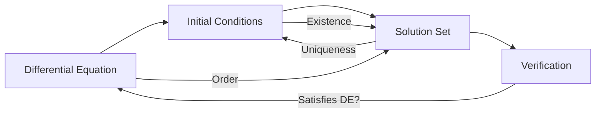

# Foundation: Differential Equations

## 1. Conceptual Mental Model (Core intuition, analogies, and first principles)

At its essence, a **differential equation (DE)** is a mathematical statement that describes how a quantity *changes* in response to other quantities. This is not a static relationship but a *dynamic relationship* governed by the principle of **local change**—the rate of change of a function at a point is determined by its values and derivatives at that point.

### Core Intuition
Imagine a function $y(x)$ that evolves over a domain $\mathbb{R}$. A differential equation specifies a *rule* that links $y$ and its derivatives $\frac{dy}{dx}, \frac{d^2y}{dx^2}, \dots$ to form a condition that *must hold* at every point in the domain. This rule encodes the *local behavior* of the system:  
> *"How does $y$ change next? Depends on current state and past history."*

### First Principles
1. **Rate of Change**: The derivative $\frac{dy}{dx}$ represents the instantaneous rate of change of $y$ with respect to $x$.
2. **Local Constraint**: A DE imposes a condition on this rate *at every point* in the domain (e.g., $\frac{dy}{dx} = f(x, y)$).
3. **Solution as Trajectory**: A solution is a function $y(x)$ that *satisfies the DE at all points*—it traces the path the system follows under the rule.

### Physical Analogy (for intuition)
Think of a pendulum:  
- $y(x)$ = angle of pendulum from vertical  
- $\frac{dy}{dx}$ = angular velocity  
- $\frac{d^2y}{dx^2}$ = angular acceleration  
The DE $\frac{d^2y}{dx^2} + \sin(y) = 0$ describes how the pendulum *must* accelerate at each instant based on its current angle. This is **not** a physical law but a *mathematical abstraction* of physical behavior.

> **Why this matters**: Differential equations are the *language of change* in nature. They model everything from planetary motion to electrical circuits—by capturing how systems evolve *dynamically* rather than statically.

---

## 2. Essential Terminology & Taxonomy

| Term                  | Formal Definition                                                                 | Foundational Significance                                                                 |
|-----------------------|---------------------------------------------------------------------------------|----------------------------------------------------------------------------------------|
| **Differential Equation** | An equation involving an unknown function $y(x)$ and its derivatives (e.g., $\frac{dy}{dx} = f(x, y)$) | The *core rule* governing change; defines the system's dynamics                          |
| **Order**             | Highest derivative present (e.g., $\frac{d^2y}{dx^2}$ → order 2)                 | Determines *complexity* and *independence* of solutions; higher order = more constraints |
| **Solution**          | A function $y(x)$ satisfying the DE for all $x$ in a domain                     | Represents the *actual trajectory* of the system under the rule                         |
| **Initial Condition** | A value $y(x_0) = y_0$ specifying the state at a point $x_0$                   | *Uniquely determines* the solution (for well-posed DEs); anchors the system in reality |
| **Existence**         | A solution *exists* for given initial conditions (guaranteed by theorems)         | Ensures the system *can* evolve; critical for physical applicability                    |
| **Uniqueness**        | Only *one* solution exists for given initial conditions (guaranteed by theorems)  | Ensures *predictability*; prevents ambiguity in system behavior                         |

> **Why these terms matter**: These define the *minimal framework* for analyzing DEs. Without existence/uniqueness, solutions are meaningless; without order, we cannot classify DEs.

---

## 3. Architecture & Core Workflow

**Workflow Explanation**:
1. **Input**: A differential equation (e.g., $\frac{dy}{dx} = x + y$) and initial conditions (e.g., $y(0) = 1$).
2. **Processing**: The DE defines a *local rule* for change; initial conditions anchor the system at a starting point.
3. **Output**: A unique solution $y(x)$ that satisfies the DE *and* initial conditions.
4. **Verification**: Check if $y(x)$ satisfies the DE at all points (via substitution).

> **Key Insight**: The *order* of the DE constrains the solution space. A 1st-order DE has a 1-parameter family of solutions; a 2nd-order DE has a 2-parameter family.

---

## 4. Common Misconceptions & Mental Traps

| Misconception                          | Why It’s Dangerous                                  | Correct Understanding                                                                 |
|----------------------------------------|----------------------------------------------------|------------------------------------------------------------------------------------|
| "All DEs have solutions"               | Ignores existence theorems (e.g., Picard-Lindelöf)  | Solutions *only exist* for specific initial conditions and smooth functions          |
| "Higher order = more complex"         | Overlooks that order defines *independence*        | Order 2 DEs have *two* independent constraints; order 1 has *one*                   |
| "Initial conditions are arbitrary"    | Fails to see their role in *uniqueness*             | Initial conditions *uniquely determine* the solution (for well-posed DEs)           |
| "Solutions are always explicit functions" | Misses implicit solutions (e.g., $x^2 + y^2 = 1$) | Solutions can be *implicit* relations; not all DEs admit explicit $y(x)$ forms     |
| "All DEs model physical systems"      | Confuses mathematical abstraction with reality      | DEs are *mathematical tools*—not all physical phenomena are differentiable          |

> **Critical Trap**: Assuming a solution exists without verifying existence/uniqueness. This leads to *false conclusions* in applied contexts (e.g., predicting unstable systems).

---

## 5. Socratic Discussion Starters

1. **Why do we require *initial conditions* for a 1st-order DE but not for a 2nd-order DE?**  
   *(Probes the role of order in solution uniqueness and the physical meaning of "starting point")*

2. **Can a differential equation have *multiple* solutions satisfying the *same* initial conditions? If so, what does this imply about the system’s stability?**  
   *(Challenges the uniqueness assumption and connects to real-world robustness)*

3. **Suppose a DE has a solution $y(x)$ that satisfies the equation *only* for $x > 0$. What does this say about the *domain* of the solution and the DE’s applicability?**  
   *(Explores domain constraints and the boundary between mathematical validity and physical reality)*

These questions force deep engagement with the *foundational constraints* of differential equations—moving beyond computation to understand *why* solutions behave as they do.
