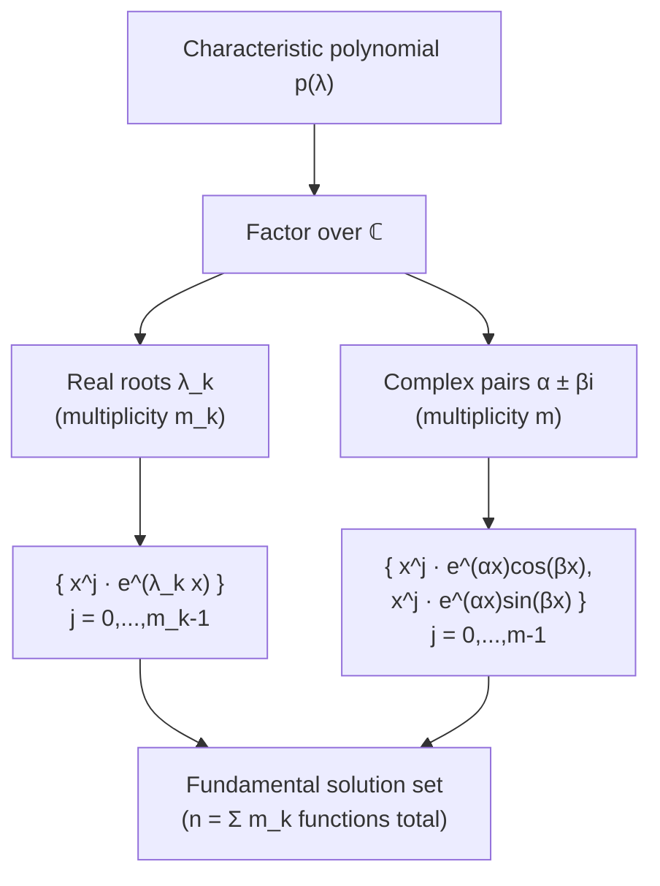

# Lesson 2: Linear ODEs of Higher Order — Structure of Solution Spaces

## 1. First-Principles Intuition & Invariants

The study of higher-order linear ordinary differential equations sits at the intersection of algebra and analysis in a way that reveals one of pure mathematics' deepest structural insights: the solution set of a linear problem is not merely a collection of functions satisfying a condition, but a *geometric object* — a vector space of prescribed dimension whose architecture is entirely determined by the equation's coefficients. Before developing the machinery, it is worth understanding precisely why linearity is so powerful, and what it structurally guarantees.

Consider an $n$-th order linear ODE written in standard form

$$L[y] = y^{(n)} + p_{n-1}(x)\,y^{(n-1)} + \cdots + p_1(x)\,y' + p_0(x)\,y = f(x),$$

where the coefficient functions $p_k(x)$ and the forcing term $f(x)$ are continuous on some open interval $I \subseteq \mathbb{R}$. The operator $L$ is a linear map from the function space $C^n(I)$ to $C^0(I)$: it satisfies $L[\alpha u + \beta v] = \alpha L[u] + \beta L[v]$ for any scalars $\alpha, \beta$ and $n$-times differentiable functions $u, v$. This single fact — linearity of the operator — is the axiom from which the entire structural theory flows.

### The Superposition Principle and Affine Solution Structure

The linearity of $L$ immediately implies what practitioners call the **superposition principle**, which is the load-bearing theorem of the whole subject. It has two complementary faces. First, if $y_1$ and $y_2$ are both solutions of the homogeneous equation $L[y] = 0$, then so is every linear combination $c_1 y_1 + c_2 y_2$. The homogeneous solution set $\ker L$ is therefore closed under linear combinations, making it a vector subspace of $C^n(I)$.

Second, if $y_p$ is any particular solution of the inhomogeneous equation $L[y] = f$ and $y_h$ is any element of $\ker L$, then $y_p + y_h$ is again a solution of $L[y] = f$. Moreover, every solution of $L[y] = f$ can be written in this form. To see why, suppose $y_1$ and $y_2$ both satisfy $L[y] = f$. Then $L[y_1 - y_2] = L[y_1] - L[y_2] = f - f = 0$, so their difference lies in $\ker L$. This means the full solution set of the inhomogeneous equation is an **affine subspace** — a translate of $\ker L$ by a fixed vector $y_p$:

$$\text{Sol}(L[y]=f) = y_p + \ker L.$$

The geometric picture is exact: in the ambient space $C^n(I)$, the homogeneous solutions form a linear subspace passing through the origin, and the inhomogeneous solutions form a parallel "flat" that passes through $y_p$ instead. The computational implication is decisive — to solve $L[y] = f$ completely, it suffices to find $\ker L$ fully, then find any single $y_p$. These are independent tasks, and the theory provides separate machineries for each.

### Dimension of the Kernel: The Existence and Uniqueness Engine

The Picard–Lindelöf existence and uniqueness theorem, applied to the first-order system equivalent of an $n$-th order linear ODE, establishes that the initial value problem

$$L[y] = 0, \quad y(x_0) = a_0,\; y'(x_0) = a_1,\; \ldots,\; y^{(n-1)}(x_0) = a_{n-1}$$

has a unique solution on all of $I$ whenever the coefficients $p_k$ are continuous on $I$. This uniqueness result, whose proof reduces to Gronwall's inequality applied to the integral form of the system, has an immediate algebraic corollary: the **evaluation map**

$$\text{ev}_{x_0} : \ker L \to \mathbb{R}^n, \quad y \mapsto \bigl(y(x_0),\, y'(x_0),\, \ldots,\, y^{(n-1)}(x_0)\bigr)$$

is a linear isomorphism. The map is injective because two solutions with the same initial data are identical by uniqueness. It is surjective because every initial data vector $(a_0, \ldots, a_{n-1}) \in \mathbb{R}^n$ corresponds to some solution by existence. Since $\ker L$ is isomorphic to $\mathbb{R}^n$, it is an $n$-dimensional vector space over $\mathbb{R}$. This is the central invariant of the entire theory:

$$\dim(\ker L) = n.$$

The number $n$ — the order of the equation — is simultaneously the dimension of the initial data space and the dimension of the solution space. The two are matched by design, and the matching is witnessed concretely by the evaluation isomorphism. Every abstract element of $\ker L$ is pinned down completely by its first $n$ derivatives at a single point.

---

## 2. Core Architecture & Mechanics

### The Wronskian and Fundamental Solution Sets

Knowing that $\ker L$ is $n$-dimensional does not immediately tell us how to construct a basis for it. The classical tool for certifying that a given set of solutions forms a basis is the **Wronskian**.

Suppose $y_1, y_2, \ldots, y_n$ are $n$ solutions of $L[y] = 0$ on $I$. Their Wronskian is the determinant of the matrix of derivatives:

$$W[y_1, \ldots, y_n](x) = \det \begin{pmatrix} y_1(x) & y_2(x) & \cdots & y_n(x) \\ y_1'(x) & y_2'(x) & \cdots & y_n'(x) \\ \vdots & & & \vdots \\ y_1^{(n-1)}(x) & y_2^{(n-1)}(x) & \cdots & y_n^{(n-1)}(x) \end{pmatrix}.$$

The Wronskian is the bridge between analytic and algebraic notions of independence. Its fundamental property, which distinguishes solutions of linear ODEs from arbitrary functions, is captured by Abel's identity. For the $n$-th order equation with leading coefficient normalized to $1$ and next coefficient $p_{n-1}(x)$, Abel's identity states

$$W(x) = W(x_0) \cdot \exp\!\left(-\int_{x_0}^x p_{n-1}(t)\,dt\right).$$

This identity, derived by differentiating $W$ and applying the Leibniz rule across each row, then substituting $y_k^{(n)}$ from the ODE itself, proves that $W(x)$ is either identically zero on all of $I$ or never zero anywhere on $I$. There is no intermediate case. This dichotomy is the Wronskian's essential gift: a single evaluation of $W$ at any convenient point $x_0$ determines linear dependence or independence globally across the entire interval.

The proof of Abel's identity for the second-order case $y'' + p_1(x)y' + p_0(x)y = 0$ proceeds cleanly. Differentiate $W = y_1 y_2' - y_2 y_1'$:

$$W' = y_1 y_2'' - y_2 y_1''.$$

Since $y_1'' = -p_1 y_1' - p_0 y_1$ and $y_2'' = -p_1 y_2' - p_0 y_2$, substitution gives

$$W' = y_1(-p_1 y_2' - p_0 y_2) - y_2(-p_1 y_1' - p_0 y_1) = -p_1(y_1 y_2' - y_2 y_1') = -p_1 W.$$

This is the separable ODE $W' = -p_1(x) W$, whose unique solution with initial value $W(x_0)$ is precisely

$$W(x) = W(x_0)\exp\!\left(-\int_{x_0}^x p_1(t)\,dt\right).$$

The generalization to $n$-th order follows by multilinearity of the determinant and the same substitution technique row by row.

A set $\{y_1, \ldots, y_n\}$ of solutions of $L[y] = 0$ with $W \not\equiv 0$ is called a **fundamental solution set** (or fundamental system). Every solution $y$ of the homogeneous equation can be written uniquely as

$$y = c_1 y_1 + c_2 y_2 + \cdots + c_n y_n$$

for constants $c_1, \ldots, c_n \in \mathbb{R}$. The linear combination $y_h = \sum c_k y_k$ is called the **general solution** of the homogeneous equation. The term "general" here has precise meaning: parameterized by all $(c_1, \ldots, c_n) \in \mathbb{R}^n$, it sweeps out all of $\ker L$ exactly once.

### Constant-Coefficient Equations and the Characteristic Polynomial

When the coefficient functions $p_k$ are constants, the structure of $\ker L$ becomes completely explicit and computable. Consider

$$L[y] = y^{(n)} + a_{n-1}y^{(n-1)} + \cdots + a_1 y' + a_0 y = 0, \quad a_k \in \mathbb{R}.$$

The key observation is that exponential functions $y = e^{\lambda x}$ are eigenfunctions of the differentiation operator: $D^k[e^{\lambda x}] = \lambda^k e^{\lambda x}$. Substituting $y = e^{\lambda x}$ into $L[y] = 0$ gives

$$e^{\lambda x}\bigl(\lambda^n + a_{n-1}\lambda^{n-1} + \cdots + a_1 \lambda + a_0\bigr) = 0.$$

Since $e^{\lambda x} \neq 0$, the equation reduces to the **characteristic polynomial**

$$p(\lambda) = \lambda^n + a_{n-1}\lambda^{n-1} + \cdots + a_1 \lambda + a_0 = 0.$$

The fundamental theorem of algebra guarantees that $p(\lambda)$ has exactly $n$ roots (counted with multiplicity) in $\mathbb{C}$. The structure of the fundamental solution set follows directly from the root structure.

**Case 1: $n$ distinct real roots $\lambda_1, \ldots, \lambda_n$.** The functions $e^{\lambda_1 x}, \ldots, e^{\lambda_n x}$ are solutions, and their Wronskian is a Vandermonde determinant times a positive exponential — nonzero whenever the $\lambda_k$ are distinct. The general solution is

$$y_h = c_1 e^{\lambda_1 x} + c_2 e^{\lambda_2 x} + \cdots + c_n e^{\lambda_n x}.$$

**Case 2: A real root $\lambda_0$ of multiplicity $m$.** Here the solution space for that root is spanned not by $e^{\lambda_0 x}$ alone, but by the $m$ linearly independent functions

$$e^{\lambda_0 x},\; x e^{\lambda_0 x},\; x^2 e^{\lambda_0 x},\; \ldots,\; x^{m-1} e^{\lambda_0 x}.$$

This follows from a reduction argument. Write $L = (D - \lambda_0)^m \circ M$ where $M$ is a differential operator whose characteristic polynomial has no $\lambda_0$ root. Functions of the form $x^k e^{\lambda_0 x}$ satisfy $(D - \lambda_0)^{k+1}[x^k e^{\lambda_0 x}] = 0$, which can be verified by the Leibniz rule:

$$(D - \lambda_0)[x^k e^{\lambda_0 x}] = k x^{k-1} e^{\lambda_0 x} + \lambda_0 x^k e^{\lambda_0 x} - \lambda_0 x^k e^{\lambda_0 x} = k x^{k-1} e^{\lambda_0 x}.$$

Applying $(D - \lambda_0)$ repeatedly annihilates the polynomial factor degree by degree, so after $m$ applications the result is zero. Linear independence of $\{x^k e^{\lambda_0 x}\}_{k=0}^{m-1}$ follows from the fact that their Wronskian at $x=0$ is a nonzero constant multiple of $\prod_{k=0}^{m-1} k!$.

**Case 3: Complex conjugate pairs $\alpha \pm \beta i$ (with $\beta \neq 0$).** Real-valued solutions are obtained by taking real and imaginary parts of $e^{(\alpha+\beta i)x} = e^{\alpha x}(\cos\beta x + i\sin\beta x)$, yielding the real-valued basis elements $e^{\alpha x}\cos\beta x$ and $e^{\alpha x}\sin\beta x$. If $\alpha \pm \beta i$ has multiplicity $m$, these are supplemented by the $2m$ functions $x^k e^{\alpha x}\cos\beta x$ and $x^k e^{\alpha x}\sin\beta x$ for $k = 0, 1, \ldots, m-1$.

The solution architecture for a constant-coefficient equation is therefore a lookup from the factored characteristic polynomial to a basis of $\ker L$, as summarized schematically:

The total count of basis elements across all roots, respecting multiplicities and conjugate pairs, always equals $n$, confirming that the constructed set spans all of $\ker L$.

### Operator Notation and the Annihilator Method

Operator notation formalizes the algebraic structure latent in constant-coefficient equations. Write $D = d/dx$ so that $D^k[y] = y^{(k)}$. The linear ODE becomes $p(D)[y] = f(x)$ where $p(\lambda) = \sum a_k \lambda^k$ is the characteristic polynomial evaluated with $\lambda \mapsto D$.

The fundamental fact is that differential operators with constant coefficients commute and factor exactly like polynomials: $p(D) \circ q(D) = q(D) \circ p(D) = (pq)(D)$. This algebraic isomorphism between the polynomial ring $\mathbb{R}[\lambda]$ and the ring of constant-coefficient differential operators is not merely notational convenience — it is a ring isomorphism, and it means that every algebraic manipulation valid for polynomials transfers to operators. The factorization $(D - \lambda_0)^m$ in the polynomial ring corresponds exactly to the factored operator that annihilates $\{x^k e^{\lambda_0 x}\}$, and the Chinese Remainder Theorem for polynomials explains why contributions from different roots to $\ker L$ are independent and addable.

The **annihilator method** exploits this structure to find particular solutions when $f(x)$ itself belongs to the kernel of some known operator $A(D)$. If $A(D)[f] = 0$ and $p(D)[y] = f$, then applying $A(D)$ to both sides gives $A(D)p(D)[y] = 0$, which is a homogeneous equation with characteristic polynomial $A(\lambda)p(\lambda)$. The particular solution $y_p$ must lie in the solution space of this larger equation but outside $\ker p(D)$ — it is found by solving the larger homogeneous system and subtracting the part that already solves the original homogeneous equation. For instance, to find a particular solution of

$$(D^2 + 1)y = x^2,$$

note that $D^3[x^2] = 0$, so $A(D) = D^3$ annihilates $x^2$. Apply $D^3$ to both sides to get $D^3(D^2+1)y = 0$ with characteristic polynomial $\lambda^3(\lambda^2+1)$. The general solution of this larger equation is $c_1 + c_2 x + c_3 x^2 + c_4\cos x + c_5 \sin x$. Subtracting the homogeneous solutions $c_4\cos x + c_5\sin x$ of the original equation, the particular solution ansatz is $y_p = A + Bx + Cx^2$. Substituting into $(D^2+1)y_p = x^2$:

$$2C + (A + Bx + Cx^2) = x^2.$$

Matching coefficients: $C = 1$, $B = 0$, $A + 2C = 0 \Rightarrow A = -2$. Thus $y_p = x^2 - 2$.

### Variation of Parameters: The General Particular-Solution Machine

The annihilator method is fast but limited to forcing functions that are themselves annihilated by constant-coefficient operators. For arbitrary continuous $f(x)$ — including $f(x) = \sec x$, $f(x) = \ln x$, or $f(x) = e^x/x$ — the method fails. Variation of parameters is the universal remedy.

The idea is to promote the constants $c_1, \ldots, c_n$ in the general homogeneous solution to unknown functions $u_1(x), \ldots, u_n(x)$, and ask what conditions on the $u_k'$ force $y_p = \sum u_k(x) y_k(x)$ to satisfy $L[y] = f$. The derivation requires care: computing $y_p'$ generates both terms $\sum u_k y_k'$ and $\sum u_k' y_k$. To keep the computation tractable, we impose the first constraint

$$\sum_{k=1}^n u_k'(x)\, y_k(x) = 0.$$

Differentiating $y_p'$ again and imposing analogous constraints at each step, we enforce

$$\sum_{k=1}^n u_k'(x)\, y_k^{(j)}(x) = 0, \quad j = 0, 1, \ldots, n-2.$$

After $n-1$ differentiations under these constraints, the $n$-th derivative of $y_p$ produces a final sum that, when substituted into $L[y_p]$, reduces to

$$\sum_{k=1}^n u_k'(x)\, y_k^{(n-1)}(x) = f(x).$$

The full set of $n$ constraints is a linear system for the unknowns $u_1'(x), \ldots, u_n'(x)$:

$$\begin{pmatrix} y_1 & y_2 & \cdots & y_n \\ y_1' & y_2' & \cdots & y_n' \\ \vdots & & & \vdots \\ y_1^{(n-1)} & y_2^{(n-1)} & \cdots & y_n^{(n-1)} \end{pmatrix} \begin{pmatrix} u_1' \\ u_2' \\ \vdots \\ u_n' \end{pmatrix} = \begin{pmatrix} 0 \\ 0 \\ \vdots \\ f(x) \end{pmatrix}.$$

The coefficient matrix is precisely the Wronskian matrix, whose determinant $W \neq 0$ because $\{y_1, \ldots, y_n\}$ is a fundamental solution set. Cramer's rule gives the unique solution

$$u_k'(x) = \frac{W_k(x)}{W(x)},$$

where $W_k(x)$ is the determinant of the Wronskian matrix with its $k$-th column replaced by $(0, 0, \ldots, 0, f(x))^T$. Integrating each $u_k'$,

$$u_k(x) = \int_{x_0}^x \frac{W_k(t)}{W(t)}\,dt,$$

and the particular solution is

$$y_p(x) = \sum_{k=1}^n y_k(x) \int_{x_0}^x \frac{W_k(t)}{W(t)}\,dt.$$

This formula requires no special structure of $f$ beyond continuity on $I$. It converts the problem of finding $y_p$ entirely into the problem of evaluating $n$ definite integrals, each of which exists because $W(t) \neq 0$ on $I$ and $f$ is continuous.

As a concrete second-order illustration, let $y'' + y = \sec x$ on $I = (-\pi/2, \pi/2)$. The homogeneous solutions are $y_1 = \cos x$, $y_2 = \sin x$, with $W = \cos^2 x + \sin^2 x = 1$. Then

$$W_1 = \det\begin{pmatrix} 0 & \sin x \\ \sec x & \cos x \end{pmatrix} = -\sin x \cdot \sec x = -\tan x,$$

$$W_2 = \det\begin{pmatrix} \cos x & 0 \\ -\sin x & \sec x \end{pmatrix} = \cos x \cdot \sec x = 1.$$

Thus $u_1'(x) = -\tan x$ and $u_2'(x) = 1$, giving $u_1(x) = \ln|\cos x|$ and $u_2(x) = x$, so

$$y_p = \cos x \cdot \ln|\cos x| + x\sin x.$$

Neither the annihilator method nor any undetermined coefficient technique could produce this — $\sec x$ belongs to no finite-dimensional invariant subspace of constant-coefficient operators.

---

## 3. High-Performance Optimization and Failure Modes

### Reduction of Order: Exploiting One Known Solution

When only one solution $y_1$ of the homogeneous equation is known — typically by inspection or by symmetry — the technique of **reduction of order** lowers an $n$-th order problem to an $(n-1)$-th order problem. Setting $y = v(x) y_1(x)$ and substituting into $L[y] = 0$, the terms containing $v$ (without any derivative of $v$) cancel by virtue of $L[y_1] = 0$. The result is an equation in $w = v'$, whose order is $n-1$. For the second-order case with known $y_1$, the equation in $w = v'$ is first-order linear and solvable by the integrating factor method, producing

$$v'(x) = \frac{1}{y_1(x)^2} \exp\!\left(-\int p_1(x)\,dx\right),$$

which follows directly from Abel's identity. This yields $y_2 = y_1 \int v'\,dx$ as a second, linearly independent solution. The practical benefit is significant: in variable-coefficient equations where the characteristic polynomial approach is unavailable, a single known solution unlocks the entire solution space through repeated reduction.

### Identifying and Navigating Failure Modes

The most consequential failure mode in applying variation of parameters is **singularity of the Wronskian matrix**, which arises when the equation's coefficients have a discontinuity or singularity within the interval $I$. Abel's identity shows that $W(x) = W(x_0)\exp(-\int_{x_0}^x p_{n-1} dt)$, so if $p_{n-1}$ has an integrable singularity, $W$ can vanish or blow up. The standard hypothesis — continuity of all $p_k$ on $I$ — is not merely technical convenience; it is what guarantees $W \neq 0$ throughout $I$ and makes variation of parameters well-defined.

A second failure mode concerns the characteristic polynomial approach under repeated roots: students frequently attempt to use $e^{\lambda_0 x}$ alone as a basis for a multiplicity-$m$ root, leaving the kernel $(n - m + 1)$-dimensional instead of $n$-dimensional. The symptom is that initial value problems with data inconsistent with that restricted form have no solution, contradicting the existence theorem. The diagnostic is to check that the number of basis functions equals $n$ by counting multiplicities: $\sum_k m_k = n$ where the sum runs over all distinct roots.

A third failure mode is the **imposition of the wrong interval**. The existence and uniqueness theorem is global on $I$, but $I$ must not contain any point where a leading coefficient vanishes (after the equation is put in standard form by dividing through by the leading coefficient). For the equation $x^2 y'' + xy' + y = 0$, the coefficient of $y''$ vanishes at $x = 0$, making it an irregular singular point. Applying the constant-coefficient or variation-of-parameters theory across $x = 0$ is incorrect; the solutions may fail to exist or fail to be unique there. The correct response is to restrict $I$ to $(0, \infty)$ or $(-\infty, 0)$ and use Frobenius theory for the singular point itself.

### Structural Verification: The Wronskian as a Diagnostic

A reliable computational habit is to verify any proposed fundamental solution set by evaluating $W$ at a convenient point before proceeding to variation of parameters. For constant-coefficient equations, the Wronskian at $x = 0$ of the basis constructed from the characteristic roots reduces to a generalized Vandermonde determinant whose nonvanishing is guaranteed by distinctness of roots, so verification is automatic. For variable-coefficient equations, numerical evaluation at a single point suffices — by Abel's identity, that single value determines the sign (and hence nonvanishing) of $W$ everywhere on $I$.

It is equally important to track the domain of integration in variation of parameters. The formula $u_k(x) = \int_{x_0}^x W_k(t)/W(t)\,dt$ produces a particular solution on $I$, but the lower limit $x_0$ affects $y_p$ by an additive homogeneous solution. Different choices of $x_0$ produce different $y_p$'s that differ by elements of $\ker L$ — all correct, none canonical. When initial conditions are prescribed, the lower limit $x_0$ is naturally taken at the initial point, so that $u_k(x_0) = 0$ and $y_p(x_0) = 0$, cleanly separating the particular and homogeneous contributions to the initial data.

### The Complete Solution Assembly

The full workflow synthesizes every component of this lesson into a single, determinate procedure. Given $L[y] = f$ on $I$:

**Step 1.** Solve $L[y] = 0$ completely. If $p_k$ are constant, factor $p(\lambda)$ and read off the fundamental solution set $\{y_1, \ldots, y_n\}$ from the root structure. If $p_k$ are variable, seek solutions by reduction of order, power series, or other analytic methods.

**Step 2.** Verify linear independence by computing $W[y_1, \ldots, y_n](x_0) \neq 0$ at any convenient $x_0 \in I$.

**Step 3.** Find a particular solution $y_p$ using variation of parameters: form the Wronskian matrix, apply Cramer's rule to find each $u_k'(x) = W_k(x)/W(x)$, and integrate.

**Step 4.** Write the general solution as $y = c_1 y_1 + \cdots + c_n y_n + y_p$ with $c_1, \ldots, c_n \in \mathbb{R}$.

**Step 5.** If initial conditions are given, evaluate $y(x_0), y'(x_0), \ldots, y^{(n-1)}(x_0)$ and solve the resulting $n \times n$ linear system (which is invertible precisely because $W(x_0) \neq 0$) for the constants $c_k$.

This procedure is not a heuristic — each step is backed by a theorem: Picard–Lindelöf for the dimension of $\ker L$, Abel's identity for the Wronskian dichotomy, Cramer's rule for variation of parameters, and the invertibility of the evaluation map for the final determination of constants. The whole architecture of higher-order linear ODEs is an exercise in turning abstract linear-algebraic principles — dimension counts, kernel-image relationships, basis selection — into an explicit, executable computation over function spaces. The elegance lies in the fact that the abstract and the computational are, in this theory, the same thing.
