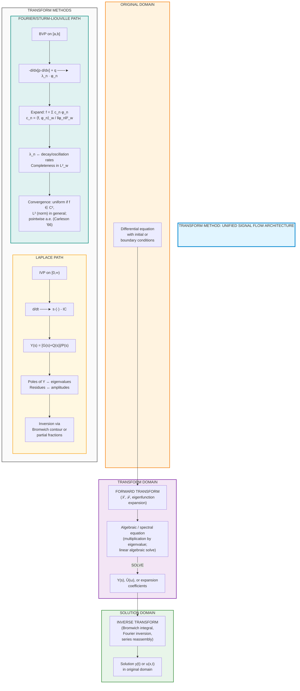

# Lesson 5: Transform Methods — Laplace, Fourier, Spectral Decomposition

## 1. First-Principles Intuition & Invariants

The central frustration of classical differential calculus, when applied to differential equations, is that differentiation is an operation that *raises* complexity: derivatives mix together the values of a function across infinitesimally neighboring points, and composing differential operators accumulates this complexity until even a linear equation with constant coefficients becomes a nontrivial algebraic problem dressed in analytic clothing. The transform methods developed across the eighteenth and nineteenth centuries — by Euler, Fourier, Laplace, and later Sturm and Liouville — address this frustration through a single unifying idea: map the differential equation into a domain where differentiation becomes multiplication, solve the resulting algebraic or algebraic-functional equation in that domain, and then invert the map to recover the solution in the original domain.

This is not merely a computational trick. It reflects a deep structural fact about linear operators. A linear ordinary or partial differential equation is, at its core, a statement about a linear operator acting on a function space. The spectral theory of such operators — the study of their eigenvalues and eigenfunctions — reveals that the transform domains of Laplace and Fourier are precisely the spaces where these operators become diagonal. In a diagonal representation, every eigenfunction is acted upon independently by its corresponding eigenvalue, and the entire complexity of the original problem reduces to scalar multiplication. The recovery of this intuition, made fully rigorous through the Sturm-Liouville framework, forms the theoretical backbone of the present lesson.

### The Laplace Transform: Algebraization of the Initial-Value Problem

Given a function $f : [0, \infty) \to \mathbb{R}$ of exponential order — meaning there exist constants $M, \alpha > 0$ such that $|f(t)| \le M e^{\alpha t}$ for all sufficiently large $t$ — the Laplace transform is defined as

$$\mathcal{L}\{f\}(s) = F(s) = \int_0^\infty e^{-st} f(t) \, dt,$$

where $s \in \mathbb{C}$ is the complex frequency variable. The integral converges absolutely for all $s$ in the half-plane $\text{Re}(s) > \alpha$, called the **region of convergence** (ROC) of the transform. This region is not incidental: it is the domain in the complex $s$-plane where the function $F$ is analytic, and its boundary — the abscissa of convergence $\sigma_c = \inf\{\text{Re}(s) : F(s) \text{ converges}\}$ — encodes essential information about the growth behavior of $f$.

The algebraic power of the Laplace transform emerges immediately from the differentiation property. Suppose $f$ is continuously differentiable and $f'$ is of exponential order. Then integration by parts yields

$$\mathcal{L}\{f'\}(s) = \int_0^\infty e^{-st} f'(t) \, dt = \left[ e^{-st} f(t) \right]_0^\infty + s \int_0^\infty e^{-st} f(t) \, dt = sF(s) - f(0).$$

The boundary term vanishes at $t \to \infty$ because $f$ is of exponential order and $\text{Re}(s) > \alpha$, while at $t = 0$ it contributes exactly the initial condition $f(0)$. Iterating this integration by parts argument, one establishes that for $f$ sufficiently smooth,

$$\mathcal{L}\{f^{(n)}\}(s) = s^n F(s) - s^{n-1} f(0) - s^{n-2} f'(0) - \cdots - f^{(n-1)}(0).$$

This single formula is the entire engine of the Laplace method for initial-value problems. When applied to a linear ODE with constant coefficients

$$a_n y^{(n)} + a_{n-1} y^{(n-1)} + \cdots + a_1 y' + a_0 y = g(t), \quad y(0) = y_0, \, y'(0) = y_1, \ldots,$$

every derivative $y^{(k)}$ transforms to $s^k Y(s)$ minus a polynomial in $s$ encoding the initial data. The differential equation becomes a linear algebraic equation in $Y(s) = \mathcal{L}\{y\}(s)$:

$$P(s) Y(s) = G(s) + Q(s),$$

where $P(s) = a_n s^n + \cdots + a_0$ is the **characteristic polynomial** of the ODE, $G(s) = \mathcal{L}\{g\}(s)$ is the transform of the forcing function, and $Q(s)$ is a polynomial of degree at most $n-1$ assembled from the initial conditions. Solving for $Y(s)$ is now trivial division:

$$Y(s) = \frac{G(s) + Q(s)}{P(s)}.$$

The structure of this rational or meromorphic function in $s$ completely encodes the solution. The poles of $Y(s)$ — that is, the roots of $P(s)$ — are precisely the eigenvalues of the differential operator, and their location in the complex $s$-plane determines the qualitative character of the solution: poles with negative real part correspond to decaying transients, poles on the imaginary axis to sustained oscillations, and poles with positive real part to exponential growth.

### Region of Convergence and the Inversion Problem

The passage from $Y(s)$ back to $y(t)$ requires the **inverse Laplace transform**. The rigorous inversion formula is the **Bromwich integral** (also called the Mellin inversion integral):

$$y(t) = \frac{1}{2\pi i} \int_{\gamma - i\infty}^{\gamma + i\infty} e^{st} Y(s) \, ds,$$

where $\gamma \in \mathbb{R}$ is chosen so that the vertical contour $\text{Re}(s) = \gamma$ lies strictly within the region of convergence of $Y(s)$ — that is, to the right of all singularities of $Y$. This integral is evaluated by closing the contour in the left half-plane (for $t > 0$), which is justified by Jordan's lemma when $Y(s) \to 0$ uniformly as $|s| \to \infty$ in $\text{Re}(s) < \gamma$. The residue theorem then gives

$$y(t) = \sum_{\text{poles } s_k \text{ of } Y} \text{Res}_{s = s_k} \left[ e^{st} Y(s) \right].$$

For a simple pole at $s_k$, the residue computes directly as $\lim_{s \to s_k} (s - s_k) e^{st} Y(s)$, and the full solution $y(t)$ is the sum of exponential terms $e^{s_k t}$ weighted by their respective residues. For a pole of order $m$ at $s_k$, the contribution is a term of the form $p(t) e^{s_k t}$ where $p$ is a polynomial of degree $m-1$, recoverable from the standard higher-order residue formula.

In practice, however, the Bromwich integral is bypassed entirely for rational $Y(s)$ through **partial fraction decomposition** combined with a table of known inverse transforms. If

$$Y(s) = \frac{N(s)}{P(s)} = \sum_k \frac{A_k}{s - s_k}$$

for distinct simple poles $s_k$, then the linearity of $\mathcal{L}^{-1}$ and the fundamental pair $\mathcal{L}\{e^{at}\}(s) = 1/(s-a)$ for $\text{Re}(s) > \text{Re}(a)$ immediately give $y(t) = \sum_k A_k e^{s_k t}$. This reduction to partial fractions is not a limitation of the method — it is a reflection of the fact that the most important solutions of linear ODEs with constant coefficients are superpositions of exponentials, and the partial fraction decomposition reads off exactly those superposition coefficients.

The region of convergence deserves careful attention because it distinguishes distinct functions that share the same functional form for $F(s)$. The function $1/(s-1)$ defines two different distributions depending on the ROC: for $\text{Re}(s) > 1$ it is the Laplace transform of the causal function $e^t u(t)$, while for $\text{Re}(s) < 1$ it corresponds to $-e^t u(-t)$ supported on $t < 0$. In initial-value problems, the causal convention $t \ge 0$ fixes the ROC as the half-plane to the right of all poles, but in more general distribution-theoretic settings this distinction becomes essential.

### Worked Resolution: Second-Order IVP

To see the full algorithm in action, consider the initial-value problem

$$y'' + 2y' + 5y = e^{-t}\sin(2t), \quad y(0) = 1, \quad y'(0) = 0.$$

Applying $\mathcal{L}$ to both sides and using the differentiation rule, the left side transforms to

$$\mathcal{L}\{y''\} + 2\mathcal{L}\{y'\} + 5\mathcal{L}\{y\} = \left[s^2 Y - s \cdot 1 - 0\right] + 2\left[sY - 1\right] + 5Y = (s^2 + 2s + 5)Y - s - 2.$$

For the right side, the frequency-shift property $\mathcal{L}\{e^{-t}f(t)\}(s) = F(s+1)$ combined with $\mathcal{L}\{\sin(2t)\}(s) = 2/(s^2+4)$ gives

$$\mathcal{L}\{e^{-t}\sin(2t)\}(s) = \frac{2}{(s+1)^2 + 4} = \frac{2}{s^2 + 2s + 5}.$$

Therefore

$$(s^2 + 2s + 5)Y(s) - s - 2 = \frac{2}{s^2 + 2s + 5},$$

$$Y(s) = \frac{s + 2}{s^2 + 2s + 5} + \frac{2}{(s^2 + 2s + 5)^2}.$$

The first term inverts via completing the square: $s^2 + 2s + 5 = (s+1)^2 + 4$, so

$$\frac{s+2}{(s+1)^2+4} = \frac{(s+1)+1}{(s+1)^2+4} = \frac{s+1}{(s+1)^2+4} + \frac{1}{2} \cdot \frac{2}{(s+1)^2+4},$$

which inverts to $e^{-t}\cos(2t) + \tfrac{1}{2}e^{-t}\sin(2t)$. The second term $2/(s^2+2s+5)^2$ inverts via a standard convolution result (or differentiation of a known transform). By the convolution theorem, $\mathcal{L}^{-1}\{F(s)^2\} = (f * f)(t)$ where $f(t) = e^{-t}\sin(2t)/2$; working this out yields $\tfrac{1}{4}e^{-t}(\sin(2t) - 2t\cos(2t))$. The full solution is then

$$y(t) = e^{-t}\cos(2t) + \frac{1}{2}e^{-t}\sin(2t) + \frac{1}{4}e^{-t}(\sin(2t) - 2t\cos(2t)),$$

which simplifies to

$$y(t) = e^{-t}\left[\cos(2t) + \frac{3}{4}\sin(2t) - \frac{1}{2}t\cos(2t)\right].$$

The appearance of the secular term $t\cos(2t)$ reflects the fact that the forcing frequency coincides with the natural frequency of the system (since $e^{-t}\sin(2t)$ is itself a solution of the homogeneous equation), causing resonant amplification modulated by the exponential decay.

### Fourier Series and Eigenfunction Expansions for Boundary-Value Problems

The Laplace transform is architecturally suited to initial-value problems on the half-line $t \ge 0$ because it encodes initial conditions algebraically in the transform domain. For **boundary-value problems** on a compact interval, an entirely different mechanism is natural: the **eigenfunction expansion**, which decomposes the unknown solution in terms of a complete orthogonal basis of functions that individually satisfy the homogeneous boundary conditions.

The historical origin of this idea lies in Fourier's 1822 analysis of heat conduction. Consider the heat equation on $[0, L]$:

$$\frac{\partial u}{\partial t} = k \frac{\partial^2 u}{\partial x^2}, \quad u(0,t) = u(L,t) = 0, \quad u(x,0) = f(x).$$

Fourier's proposal was to write $u(x,t) = \sum_{n=1}^\infty c_n(t) \phi_n(x)$ where each $\phi_n$ satisfies the eigenvalue problem

$$-\phi_n'' = \lambda_n \phi_n, \quad \phi_n(0) = \phi_n(L) = 0.$$

This ODE with boundary conditions is the prototype of a **Sturm-Liouville problem**, and its solutions are immediate: $\phi_n(x) = \sin(n\pi x / L)$ with $\lambda_n = (n\pi/L)^2$. Substituting the expansion into the heat equation and using the fact that each $\phi_n$ satisfies $-\phi_n'' = \lambda_n \phi_n$ yields, for each $n$,

$$c_n'(t) = -k\lambda_n c_n(t) \implies c_n(t) = c_n(0) e^{-k\lambda_n t}.$$

The initial condition $u(x,0) = f(x)$ then demands $\sum_{n=1}^\infty c_n(0) \sin(n\pi x/L) = f(x)$, so the coefficients $c_n(0)$ are precisely the Fourier sine coefficients of $f$:

$$c_n(0) = \frac{2}{L} \int_0^L f(x) \sin\!\left(\frac{n\pi x}{L}\right) dx.$$

The full solution $u(x,t) = \sum_{n=1}^\infty c_n(0) e^{-k(n\pi/L)^2 t} \sin(n\pi x/L)$ is not a formal expression — it is a genuinely convergent series for $t > 0$, as the exponential factors $e^{-k\lambda_n t}$ decay superexponentially fast in $n$, rendering the series real analytic in both $x$ and $t$ for any positive time regardless of the roughness of the initial data $f$.

This example reveals the architecture of the eigenfunction expansion method: separate variables to reduce the PDE to an ODE eigenvalue problem, solve that eigenvalue problem to obtain an orthogonal basis, expand the data in that basis using orthogonality to compute the expansion coefficients, and multiply each term by the appropriate time-evolution factor. The entire procedure depends on a single foundational fact: that the eigenfunctions of the relevant differential operator form a complete orthogonal set in $L^2(0,L)$.

---

## 2. Core Architecture & Mechanics

### The Sturm-Liouville Framework

The abstract underpinning of eigenfunction expansions is the **Sturm-Liouville theory**, which identifies the precise class of boundary-value problems whose eigenfunctions inherit orthogonality and completeness from the self-adjointness of the associated differential operator.

A **regular Sturm-Liouville problem** on $[a,b]$ is an eigenvalue problem of the form

$$\mathcal{L}[y] := -\frac{d}{dx}\left[p(x) \frac{dy}{dx}\right] + q(x) y = \lambda w(x) y, \quad x \in [a,b],$$

together with separated boundary conditions

$$\alpha_1 y(a) + \alpha_2 y'(a) = 0, \quad \beta_1 y(b) + \beta_2 y'(b) = 0,$$

where the coefficient functions satisfy $p \in C^1[a,b]$, $q, w \in C[a,b]$, and both $p(x) > 0$ and $w(x) > 0$ on the entire closed interval $[a,b]$. The function $w$ is called the **weight function** and endows the interval with a weighted $L^2$ inner product:

$$\langle f, g \rangle_w = \int_a^b f(x) g(x) w(x) \, dx.$$

The operator $\mathcal{L}$ is **formally self-adjoint** in this weighted space in the sense that, for any two functions $u, v$ satisfying the boundary conditions,

$$\langle \mathcal{L}[u], v \rangle_w = \langle u, \mathcal{L}[v] \rangle_w.$$

This identity follows from a double integration by parts. Starting from

$$\int_a^b \mathcal{L}[u] \cdot v \, w \, dx = \int_a^b \left[-(p u')' + qu\right] v \, dx,$$

one integrates the leading term by parts:

$$-\int_a^b (pu')' v \, dx = \left[-(pu')v\right]_a^b + \int_a^b pu'v' \, dx.$$

A second integration by parts on the symmetric form $\int_a^b pu'v' \, dx$ gives

$$\int_a^b pu'v' \, dx = \left[puv'\right]_a^b - \int_a^b p u (v')' \, dx = \left[puv'\right]_a^b + \int_a^b u(pv')' \, dx \cdot (-1) \cdot (-1).$$

Combining these two steps,

$$\int_a^b \mathcal{L}[u] \cdot v \, dx = \left[p(u'v - uv')\right]_a^b + \int_a^b u \cdot \mathcal{L}[v] \, dx.$$

The boundary term $\left[p(u'v - uv')\right]_a^b$ is called the **Wronskian boundary form**. The separated boundary conditions $\alpha_1 y(a) + \alpha_2 y'(a) = 0$ and $\beta_1 y(b) + \beta_2 y'(b) = 0$ force any two functions satisfying them to annihilate this boundary form, since the conditions at each endpoint impose a linear constraint relating $y$ and $y'$ there, and two such functions satisfying the same constraint make $u'(a)v(a) - u(a)v'(a) = 0$ (by proportionality of the vector $(y(a), y'(a))$ to $(\alpha_2, -\alpha_1)$ for both $u$ and $v$). Thus $\langle \mathcal{L}[u], v \rangle_w = \langle u, \mathcal{L}[v] \rangle_w$, establishing self-adjointness.

The spectral consequences of self-adjointness are immediate and decisive.

**Theorem (Sturm-Liouville Spectral Theorem).** Let $\mathcal{L}$ be a regular Sturm-Liouville operator on $[a,b]$ with weight $w > 0$. Then:

1. All eigenvalues $\lambda_n$ are real.
2. All eigenvalues are simple (each eigenspace is one-dimensional).
3. The eigenvalues form an unbounded increasing sequence $\lambda_1 < \lambda_2 < \lambda_3 < \cdots$ with $\lambda_n \to +\infty$.
4. Eigenfunctions $\phi_n, \phi_m$ corresponding to distinct eigenvalues $\lambda_n \ne \lambda_m$ satisfy $\langle \phi_n, \phi_m \rangle_w = 0$.
5. The normalized eigenfunctions $\{\hat\phi_n\}$ form a complete orthonormal basis of $L^2_w(a,b)$.

The proof of items 1 and 4 flows directly from self-adjointness. For item 1: suppose $\mathcal{L}[\phi] = \lambda w \phi$ with $\phi \ne 0$, and take the inner product of both sides with $\phi$:

$$\langle \mathcal{L}[\phi], \phi \rangle_w = \lambda \langle w\phi, \phi \rangle_w / w.$$

More precisely, $\langle \mathcal{L}[\phi], \phi \rangle_w = \lambda \|\phi\|_w^2$. By self-adjointness, the left side equals $\langle \phi, \mathcal{L}[\phi] \rangle_w = \overline{\lambda} \|\phi\|_w^2$. Since $\|\phi\|_w^2 > 0$, we conclude $\lambda = \overline{\lambda}$, so $\lambda \in \mathbb{R}$.

For item 4: suppose $\mathcal{L}[\phi_n] = \lambda_n w \phi_n$ and $\mathcal{L}[\phi_m] = \lambda_m w \phi_m$ with $\lambda_n \ne \lambda_m$. Then

$$\lambda_n \langle \phi_n, \phi_m \rangle_w = \langle \mathcal{L}[\phi_n], \phi_m \rangle_w = \langle \phi_n, \mathcal{L}[\phi_m] \rangle_w = \lambda_m \langle \phi_n, \phi_m \rangle_w,$$

so $(\lambda_n - \lambda_m)\langle \phi_n, \phi_m \rangle_w = 0$, and since $\lambda_n \ne \lambda_m$ we conclude $\langle \phi_n, \phi_m \rangle_w = 0$.

The proof of items 2, 3, and 5 is deeper, requiring Sturm's oscillation and comparison theorems for items 2 and 3, and functional analytic compactness arguments (via the Green's function integral operator associated to $\mathcal{L}$, which is Hilbert-Schmidt and hence compact) for item 5. These are detailed in the following section.

### From Formal Self-Adjointness to Completeness

The completeness of the eigenfunction system — the claim that every $f \in L^2_w(a,b)$ can be expanded as $f = \sum_{n=1}^\infty \langle f, \hat\phi_n \rangle_w \hat\phi_n$ with convergence in $L^2_w$ norm — requires a functional analytic argument that goes beyond formal self-adjointness. The key mechanism is the **Green's function** (or resolvent kernel) of the Sturm-Liouville operator.

For $\lambda$ not an eigenvalue of $\mathcal{L}$, the inhomogeneous problem $\mathcal{L}[y] - \lambda w y = f$ has a unique solution given by

$$y(x) = \int_a^b G(x,\xi;\lambda) f(\xi) w(\xi) \, d\xi,$$

where $G(x,\xi;\lambda)$ is the **Green's function** of $\mathcal{L} - \lambda w$. It is constructed by taking $y_1, y_2$ as solutions of the homogeneous equation satisfying the boundary conditions at $a$ and $b$ respectively, and forming

$$G(x,\xi;\lambda) = \frac{1}{p(\xi)W(\xi)} \begin{cases} y_1(x) y_2(\xi), & x \le \xi \\ y_1(\xi) y_2(x), & x \ge \xi \end{cases}$$

where $W = y_1 y_2' - y_1' y_2$ is the Wronskian of $y_1$ and $y_2$. The symmetry $G(x,\xi) = G(\xi,x)$ reflects the self-adjointness of $\mathcal{L}$.

The integral operator $T_\lambda : f \mapsto \int_a^b G(\cdot,\xi;\lambda) f(\xi) w(\xi)\, d\xi$ is a **Hilbert-Schmidt operator** on $L^2_w(a,b)$, since $\int_a^b \int_a^b |G(x,\xi)|^2 w(x) w(\xi)\, dx\, d\xi < \infty$ (the kernel is bounded on the compact square $[a,b]^2$). By the spectral theorem for compact self-adjoint operators on a Hilbert space, $T_\lambda$ has a complete orthonormal system of eigenfunctions. But the eigenfunctions of $T_\lambda$ are precisely the eigenfunctions of $\mathcal{L}$: indeed $T_\lambda[\phi] = \mu \phi$ if and only if $(\mathcal{L} - \lambda w)\phi = w\phi/\mu$, that is $\mathcal{L}[\phi] = (\lambda + 1/\mu) w \phi$. Thus the completeness of the eigenfunctions of $T_\lambda$ in $L^2_w$ implies the completeness of the eigenfunctions of $\mathcal{L}$.

### Signal Flow: The Complete Transform-Inversion Architecture

The workflow of the transform and eigenfunction expansion methods shares a common computational topology, which the following diagram makes explicit:

### The Fourier Transform on $\mathbb{R}$: Spectral Decomposition via Continuous Eigenfunctions

When the domain is all of $\mathbb{R}$ rather than a compact interval, the discrete spectrum of the Sturm-Liouville problem gives way to a **continuous spectrum**, and the eigenfunction expansion becomes the **Fourier transform**:

$$\hat{f}(\omega) = \int_{-\infty}^\infty f(t) e^{-i\omega t} \, dt, \qquad f(t) = \frac{1}{2\pi} \int_{-\infty}^\infty \hat{f}(\omega) e^{i\omega t} \, d\omega.$$

The complex exponentials $e^{i\omega t}$ are the generalized eigenfunctions of the operator $-d^2/dt^2$ on $\mathbb{R}$, satisfying $-\frac{d^2}{dt^2}e^{i\omega t} = \omega^2 e^{i\omega t}$ in a distributional sense. They are not in $L^2(\mathbb{R})$ themselves — the continuous spectrum contributes to the spectral decomposition via a measure-theoretic integral rather than a sum — but Plancherel's theorem recovers the essential Parseval identity:

$$\int_{-\infty}^\infty |f(t)|^2 \, dt = \frac{1}{2\pi} \int_{-\infty}^\infty |\hat{f}(\omega)|^2 \, d\omega,$$

which extends the Fourier transform to a unitary isometry $\mathcal{F} : L^2(\mathbb{R}) \to L^2(\mathbb{R})$.

For differential equations, the Fourier transform converts $d/dt$ to multiplication by $i\omega$, and therefore converts a linear constant-coefficient ODE into a polynomial equation in $\omega$:

$$\mathcal{F}\{y^{(n)}\}(\omega) = (i\omega)^n \hat{y}(\omega).$$

The PDE $u_t = k u_{xx}$ on $\mathbb{R} \times (0,\infty)$ transforms in the spatial variable to $\hat{u}_t(\omega, t) = -k\omega^2 \hat{u}(\omega,t)$, giving $\hat{u}(\omega,t) = \hat{f}(\omega) e^{-k\omega^2 t}$. Inverting via the convolution theorem — recognizing $e^{-k\omega^2 t}$ as the Fourier transform of the Gaussian kernel $G_t(x) = (4\pi k t)^{-1/2} e^{-x^2/(4kt)}$ — yields the fundamental solution

$$u(x,t) = (G_t * f)(x) = \frac{1}{\sqrt{4\pi kt}} \int_{-\infty}^\infty e^{-(x-\xi)^2/(4kt)} f(\xi) \, d\xi.$$

---

## 3. High-Performance Optimization & Failure Modes

### Sturm's Oscillation Theory and Eigenvalue Counting

Understanding the structure of the eigenvalue sequence $\lambda_1 < \lambda_2 < \cdots$ is not merely academic — it governs the convergence rate of eigenfunction expansions and the qualitative behavior of solutions. Sturm's oscillation theorem gives a precise combinatorial description: the $n$-th eigenfunction $\phi_n$ has exactly $n-1$ zeros in the open interval $(a,b)$. This means $\phi_1$ does not vanish in the interior, $\phi_2$ has exactly one zero, and so on. The proof uses the **Prüfer substitution**, which transforms the Sturm-Liouville equation into a first-order ODE for the angle $\theta$ in a polar coordinate representation $y = r\sin\theta$, $py' = r\cos\theta$. The zeros of $y$ correspond to values $x$ where $\theta(x)$ passes through a multiple of $\pi$, and the equation for $\theta$ makes it possible to show that $\theta$ is a strictly increasing function of $\lambda$ for each fixed $x$, allowing one to count zeros precisely.

Sturm's **comparison theorem** complements this: if $p_1 \le p_2$, $q_1 \ge q_2$, and $w_1 \le w_2$ (component-wise), then the zeros of solutions of the first Sturm-Liouville equation are at least as dense as those of the second. This provides eigenvalue comparison inequalities between operators with different coefficients, which are essential for perturbation analysis.

### Convergence of Eigenfunction Expansions

The convergence of the eigenfunction expansion $f(x) \sim \sum_{n=1}^\infty c_n \phi_n(x)$ depends on the smoothness of $f$ in a way that precisely mirrors the convergence theory of classical Fourier series. For $f \in L^2_w(a,b)$, convergence holds in the $L^2_w$ norm by completeness of the eigenfunctions. For pointwise convergence, one needs more:

If $f \in C^1[a,b]$ and $f$ satisfies the same boundary conditions as the eigenfunctions, then $\sum_{n=1}^\infty c_n \phi_n(x)$ converges absolutely and uniformly to $f(x)$ on $[a,b]$. The proof uses the **asymptotic behavior** of the eigenvalues $\lambda_n \sim (n\pi/(b-a))^2$ as $n \to \infty$ (derivable from a WKB or Prüfer analysis) and the fact that $|c_n| = O(1/n)$ under the $C^1$ hypothesis, while $\|\phi_n\|_\infty = O(1)$ by Liouville's normal form transformation (which reduces the Sturm-Liouville equation to a Schrödinger-type equation with bounded potential, whose solutions are asymptotically sinusoidal).

If $f$ has a jump discontinuity at a point $x_0 \in (a,b)$ while satisfying the Dirichlet conditions (bounded variation in a neighborhood of $x_0$), the expansion converges to $(f(x_0^+) + f(x_0^-))/2$ at $x_0$, the mid-value of the left and right limits. This is the eigenfunction-expansion analogue of the Dirichlet-Jordan theorem for Fourier series, and it carries the same geometric interpretation: the expansion computes the "best $L^2$-approximation" at every point, and at a jump the best approximation of a step function in this sense is its midpoint.

The notorious **Gibbs phenomenon** appears at jump discontinuities: partial sums $S_N(x) = \sum_{n=1}^N c_n \phi_n(x)$ overshoot the function value near the jump by approximately $9\%$ of the jump magnitude, regardless of how large $N$ is. This overshoot does not diminish; only the width of the region in which it occurs shrinks to zero as $N \to \infty$. The $L^2$ norm of the error still tends to zero, but the supremum norm does not. This is not a failure of the method — it is an intrinsic feature of approximating a discontinuous function by a sum of smooth eigenfunctions — but it must be accounted for in applications where pointwise accuracy near discontinuities matters. Regularization methods such as Fejér summation (Cesàro averaging of partial sums) or Fourier extension techniques that pad the domain to a larger interval before expanding can suppress the Gibbs phenomenon.

### Failure Modes: Singular Sturm-Liouville Problems

The classical theory above assumes $p(x) > 0$ and $w(x) > 0$ on the entire closed interval $[a,b]$, and that the interval is compact. In many natural problems these assumptions fail:

A **singular endpoint** occurs when $p(a) = 0$ or $p(b) = 0$ (or when $[a,b]$ is replaced by a semi-infinite or infinite interval). The Legendre operator $\mathcal{L}[y] = -d/dx[(1-x^2)y']$ on $[-1,1]$ is the canonical example: $p(x) = 1-x^2$ vanishes at both $x = \pm 1$. In this case, no boundary conditions are imposed at the singular endpoints — the boundary condition is replaced by the requirement that the solution remain bounded (i.e., be in $L^2_w(-1,1)$). The eigenfunctions are the Legendre polynomials $P_n(x)$ with eigenvalues $\lambda_n = n(n+1)$, and their completeness in $L^2(-1,1)$ still holds but the proof requires more delicate Weyl limit-point/limit-circle analysis rather than the simple Hilbert-Schmidt compactness argument of the regular case.

The Bessel operator $\mathcal{L}[y] = -y'' - y'/x + \nu^2 y/x^2$ on $[0, R]$ is singular at $x = 0$ due to the coefficient $1/x$. Its eigenfunctions (for a Dirichlet condition at $x = R$ and a regularity condition at $x = 0$) are $J_\nu(j_{\nu,n} x/R)$, where $j_{\nu,n}$ are the positive zeros of the Bessel function $J_\nu$. The completeness of these Bessel functions in $L^2_w(0,R)$ with weight $w(x) = x$ is essential for solving the heat and wave equations in cylindrical geometry.

### Optimal Strategies: Matching the Transform to the Problem Geometry

A practitioner working with transform methods must match the choice of transform to the geometry of the problem domain, the character of the boundary conditions, and the nature of the differential operator. The Laplace transform is optimal when the problem is an IVP on $[0,\infty)$ with exponentially bounded data and when one wants the initial conditions absorbed algebraically into the transformed equation. The Fourier transform is optimal when the domain is all of $\mathbb{R}$ (or $\mathbb{R}^n$), the equation has constant coefficients, and no boundary conditions are present, turning the PDE into an ODE in the transform variable. The Fourier sine or cosine transform is optimal when the domain is a half-line $[0,\infty)$ with Dirichlet (sine) or Neumann (cosine) conditions at $x = 0$, since these transforms diagonalize $-d^2/dx^2$ subject to the respective boundary condition. The eigenfunction expansion in terms of Sturm-Liouville eigenfunctions is the method of choice for compact domains with general self-adjoint boundary conditions, where the spectrum is discrete and the expansion is a true series.

There is a profound and computationally important connection between the Fourier series approach and the Laplace approach via the **z-transform** in discrete mathematics, and via the **bilateral Laplace transform** in the complex analysis of periodic functions. When the eigenvalues $\lambda_n$ of a Sturm-Liouville operator are known analytically, the Green's function of the associated heat or wave equation can be expressed as a **theta function** — a series $\sum_{n=1}^\infty e^{-\lambda_n t}$ that encodes the entire spectral geometry of the domain. These theta functions satisfy functional equations under $t \mapsto 1/t$ (generalizations of the Jacobi inversion formula) that connect the small-time and large-time asymptotics of solutions. The coefficients of the asymptotic expansion of the heat kernel as $t \to 0^+$ are the **heat invariants** (or Weyl invariants): $a_0 = \text{Vol}(\Omega)/(4\pi t)^{d/2}$, $a_1 \propto \partial \Omega$ area, and so on. This is the mathematical content of Kac's question "can you hear the shape of a drum?" — the spectrum of the Laplacian determines the heat invariants, but (as Gordon, Webb, and Wolpert showed in 1992) does not determine the domain up to isometry.

### Convolution, Transfer Functions, and the Operational Calculus

A central unifying concept across all transform methods is the **convolution theorem**: if $H(s) = \mathcal{L}\{h\}(s)$ and $G(s) = \mathcal{L}\{g\}(s)$, then

$$\mathcal{L}\{h * g\}(s) = H(s) G(s), \quad \text{where } (h*g)(t) = \int_0^t h(t-\tau)g(\tau)\, d\tau.$$

This theorem elevates the Laplace transform from a tool for solving specific initial-value problems to a general framework for analyzing linear time-invariant systems. The function $H(s) = Y(s)/G(s)$ — the ratio of the output transform to the input transform when initial conditions are zero — is the **transfer function** of the system. Its poles and zeros in the complex $s$-plane completely characterize the system's response: pole locations determine stability and transient character, while zero locations shape the frequency-dependent gain.

The partial fraction expansion of $H(s)$ is therefore both the computational tool for inverting the Laplace transform and the analytical tool for understanding the system. A simple real pole at $s = -\alpha$ contributes a decaying exponential $e^{-\alpha t}$ to the impulse response $h(t) = \mathcal{L}^{-1}\{H\}(t)$; a conjugate pair of poles at $s = -\alpha \pm i\beta$ contributes a damped sinusoid $e^{-\alpha t}\cos(\beta t + \phi)$; a pole at the origin contributes a constant (integrating behavior); and poles in the right half-plane contribute growing exponentials (instability). The transfer function framework is the bridge between the pure-mathematical theory of linear operators and the applied theory of dynamical systems, control, and signal processing — but its mathematical foundation is entirely within the spectral theory developed in this lesson.

### Closed-Form Verification: Parseval's Theorem as a Consistency Check

A powerful diagnostic tool for verifying eigenfunction expansion computations is **Parseval's theorem**, which in the Sturm-Liouville context states

$$\|f\|_w^2 = \int_a^b |f(x)|^2 w(x)\, dx = \sum_{n=1}^\infty |c_n|^2 \|\phi_n\|_w^2.$$

This identity follows immediately from completeness: writing $f = \sum c_n \hat\phi_n$ in the orthonormal basis $\hat\phi_n = \phi_n/\|\phi_n\|_w$ and computing $\|f\|_w^2 = \langle \sum_n c_n \hat\phi_n, \sum_m c_m \hat\phi_m\rangle_w = \sum_{n,m} c_n \overline{c_m} \delta_{nm} = \sum_n |c_n|^2$. If the computed coefficients $c_n$ do not satisfy this identity — that is, if $\sum |c_n|^2 \|\phi_n\|_w^2$ does not converge to $\|f\|_w^2$ — then either the expansion is incomplete (the eigenfunction system has not been fully captured) or the coefficients have been computed incorrectly. Parseval's theorem thus serves as a global consistency check: computing the left side directly and comparing with the partial sums $\sum_{n=1}^N |c_n|^2 \|\phi_n\|_w^2$ as $N$ grows tells the practitioner both whether the expansion is correct and how rapidly it is converging.

The rate at which the Parseval sum converges to $\|f\|_w^2$ is itself governed by the smoothness of $f$: for $f \in H^k_w(a,b)$ (the Sobolev space of functions whose first $k$ derivatives lie in $L^2_w$), the eigenvalue asymptotics $\lambda_n \sim n^2$ imply $|c_n| = O(n^{-k})$, so $\sum |c_n|^2 = O(1/N^{2k-1})$ for the tail. This means that smoother functions have faster-converging eigenfunction expansions, with the convergence rate improving by two orders in $n$ for each additional derivative.

The deepest insight that this entire architecture delivers is not any single formula or theorem, but the structural recognition that **differential operators on function spaces are diagonalized by their eigenfunctions**, and that all the analytic labor of solving differential equations reduces, in the transform domain, to the trivial algebraic operations of multiplication and division. The Laplace transform makes this diagonalization explicit in the frequency domain for time-evolution problems; the Sturm-Liouville framework makes it explicit in the spatial eigenfunction basis for boundary-value problems; and the Fourier transform connects both pictures through the continuous spectral theory of translation-invariant operators on $\mathbb{R}$. Together, these three methods constitute the complete operational calculus of linear differential equations.
