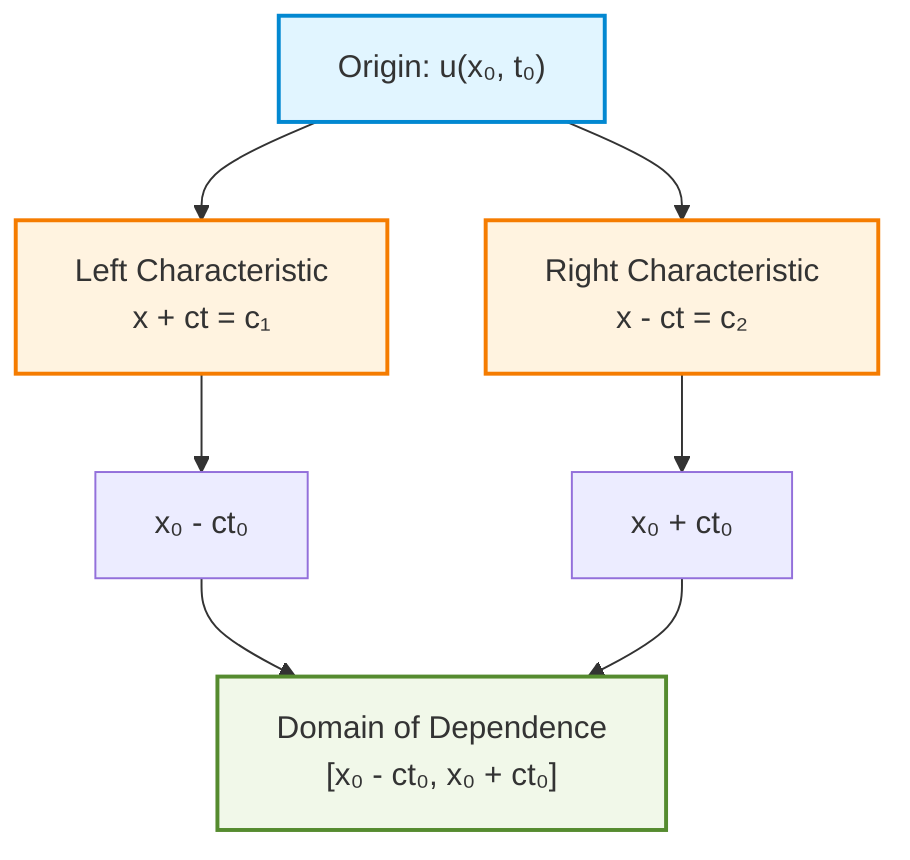

# Lesson 6: Partial Differential Equations — Classification, Canonical Forms, Fundamental Solutions

## 1. First-Principles Intuition & Invariants

The theory of partial differential equations occupies a peculiar position in mathematics: it is simultaneously one of the oldest and one of the most actively developing fields, touching number theory through the modularity of elliptic curves, computer science through numerical stability and complexity of solvers, and theoretical physics through the geometric fabric of general relativity. Yet for the pure mathematician and theoretical computer scientist, the entry point is not physical motivation but algebraic structure — the question of what it means for a PDE to be *well-determined*, and why the same syntactic form of a second-order equation can produce phenomena as wildly different as the irreversible smoothing of heat diffusion and the oscillatory propagation of waves. The answer lies in the geometry of characteristics.

Consider a general second-order linear PDE in two independent variables $x$ and $y$, with real coefficients that may themselves depend on the point $(x, y)$:

$$Au_{xx} + Bu_{xy} + Cu_{yy} + Du_x + Eu_y + Fu = G$$

where $A, B, C, D, E, F, G$ are given functions of $(x, y)$ and $u$ is the unknown. The principal part — the highest-order terms $Au_{xx} + Bu_{xy} + Cu_{yy}$ — dominates the qualitative behavior of solutions, and it is from the principal part alone that the classification emerges. The discriminant

$$\Delta = B^2 - 4AC$$

is the decisive invariant. When $\Delta < 0$, the equation is **elliptic** at that point; when $\Delta = 0$, it is **parabolic**; when $\Delta > 0$, it is **hyperbolic**. This trichotomy is not merely a taxonomic convention — it reflects a deep geometric fact about which directions in the $(x, y)$-plane can carry discontinuities of solutions, and therefore about how data prescribed on curves propagates into or fails to propagate into the domain.

To see why, consider how one might pose an initial value problem. Given a smooth curve $\Gamma$ in the plane, prescribing $u$ and its normal derivative on $\Gamma$ constitutes Cauchy data. The question is whether the PDE uniquely determines all higher-order derivatives of $u$ along $\Gamma$, allowing a formal power series to be continued off the curve into the domain. If we parametrize $\Gamma$ by $x$, writing $y = \phi(x)$, then the values of $u_x$, $u_y$ along $\Gamma$ are constrained by the given Cauchy data. When we try to solve for $u_{xx}$, $u_{xy}$, $u_{yy}$ from the PDE and the two compatibility conditions (expressing that the given data is consistent along $\Gamma$), we obtain a linear system whose determinant is precisely $A(\phi')^2 - B\phi' + C$. A **characteristic curve** is one for which this determinant vanishes — that is, a curve along which we cannot uniquely determine the second-order derivatives from Cauchy data. The characteristics therefore identify directions of propagation along which information either travels freely or is indeterminate.

Setting $A\lambda^2 - B\lambda + C = 0$ (where $\lambda = dy/dx$), the characteristics satisfy

$$\frac{dy}{dx} = \frac{B \pm \sqrt{B^2 - 4AC}}{2A}$$

When $\Delta > 0$, two distinct real families of characteristic curves exist, and the hyperbolic equation genuinely propagates data along these curves — this is the geometric content of wave propagation. When $\Delta < 0$, the characteristic directions are complex, meaning no real curve in the domain carries data without determination; the elliptic equation forces information to spread in all directions simultaneously, producing global rigidity. The parabolic case $\Delta = 0$ yields a single (repeated) real family of characteristics, which corresponds geometrically to a one-way propagation direction — the arrow of time in diffusion processes.

This invariance of the discriminant's sign under smooth coordinate changes (a fact we will verify explicitly in §2) is the cornerstone of the classification. It tells us that hyperbolicity, ellipticity, and parabolicity are intrinsic geometric properties of the equation, not artifacts of the coordinate system in which we write it. For a theorist, this is the proper definition: the type is a property of the symbol of the principal part as a quadratic form in the cotangent variables $(\xi, \eta)$, evaluated at each point of the domain.

The three canonical archetypes — the **wave equation**, the **heat equation**, and **Laplace's equation** — are the standard forms to which generic second-order linear PDEs reduce by coordinate change, and they encode all three regimes:

$$u_{tt} = c^2 u_{xx} \quad \text{(wave, hyperbolic, } \Delta = 4c^2 > 0\text{)}$$
$$u_t = \kappa u_{xx} \quad \text{(heat, parabolic, } \Delta = 0\text{)}$$
$$u_{xx} + u_{yy} = 0 \quad \text{(Laplace, elliptic, } \Delta = -4 < 0\text{)}$$

Each archetype has its own natural notion of well-posed boundary or initial data, its own fundamental solution, and its own class of function spaces in which solutions live. The remainder of this lesson constructs these in full.

---

## 2. Core Architecture & Mechanics

### 2.1 Coordinate Transformations and Canonical Reduction

The passage from an arbitrary second-order linear PDE to its canonical form is a systematic algebraic procedure, and working through it completely reveals why the discriminant is an invariant. Introduce a smooth, invertible change of independent variables $\xi = \xi(x, y)$, $\eta = \eta(x, y)$, with Jacobian nonzero. By the chain rule,

$$u_x = u_\xi \xi_x + u_\eta \eta_x, \qquad u_y = u_\xi \xi_y + u_\eta \eta_y$$

Computing $u_{xx}$, $u_{xy}$, $u_{yy}$ and substituting into the original equation, the coefficient of $u_{\xi\xi}$ in the transformed equation is

$$\bar{A} = A\xi_x^2 + B\xi_x\xi_y + C\xi_y^2$$

the coefficient of $u_{\xi\eta}$ is

$$\bar{B} = 2A\xi_x\eta_x + B(\xi_x\eta_y + \xi_y\eta_x) + 2C\xi_y\eta_y$$

and the coefficient of $u_{\eta\eta}$ is

$$\bar{C} = A\eta_x^2 + B\eta_x\eta_y + C\eta_y^2$$

A direct computation shows that the transformed discriminant satisfies

$$\bar{B}^2 - 4\bar{A}\bar{C} = (B^2 - 4AC)\left(\frac{\partial(\xi,\eta)}{\partial(x,y)}\right)^2$$

Since the Jacobian of the transformation is nonzero by assumption, the sign of $B^2 - 4AC$ is preserved, confirming the discriminant is a genuine invariant of the equation under smooth changes of coordinates.

**Canonical reduction in the hyperbolic case.** To eliminate $u_{\xi\xi}$ and $u_{\eta\eta}$ (or equivalently, to bring the equation into the form $u_{\xi\eta} = \text{lower-order terms}$), choose $\xi$ and $\eta$ to be the two families of characteristics. The characteristic ODEs are

$$\frac{dy}{dx} = \frac{B + \sqrt{B^2 - 4AC}}{2A}, \qquad \frac{dy}{dx} = \frac{B - \sqrt{B^2 - 4AC}}{2A}$$

Integrating these (when possible in closed form) yields two families of level curves $\phi_1(x,y) = c_1$ and $\phi_2(x,y) = c_2$. Setting $\xi = \phi_1$ and $\eta = \phi_2$, one finds $\bar{A} = \bar{C} = 0$, reducing the equation to

$$u_{\xi\eta} = \tilde{D}u_\xi + \tilde{E}u_\eta + \tilde{F}u + \tilde{G}$$

This is the first canonical form of the hyperbolic equation. A second canonical form, closer to the wave equation, is obtained by the further substitution $\xi = \alpha + \beta$, $\eta = \alpha - \beta$:

$$u_{\alpha\alpha} - u_{\beta\beta} = \hat{D}u_\alpha + \hat{E}u_\beta + \hat{F}u + \hat{G}$$

**Canonical reduction in the elliptic case.** When $\Delta < 0$ and the coefficients are real analytic, we may allow complex characteristics and then take real and imaginary parts. The complex characteristic families satisfy $A\lambda^2 - B\lambda + C = 0$ with $\lambda = \bar{\mu}$ being the complex conjugate of $\mu$. If $\phi(x,y) + i\psi(x,y) = \text{const}$ defines the characteristics in $\mathbb{C}$, then setting $\xi = \phi$, $\eta = \psi$ (the real and imaginary parts) yields $\bar{A} = \bar{C}$ and $\bar{B} = 0$, reducing the equation to

$$u_{\xi\xi} + u_{\eta\eta} = \tilde{D}u_\xi + \tilde{E}u_\eta + \tilde{F}u + \tilde{G}$$

which is the canonical elliptic form. The analytic hypothesis is not merely technical: it is precisely the content of the Cauchy-Kovalevskaya theorem that analytic data on non-characteristic surfaces determines an analytic solution, but this theorem is irrelevant for smooth non-analytic coefficients, where the global theory requires entirely different tools.

**Canonical reduction in the parabolic case.** Here $\Delta = 0$, so $B^2 = 4AC$ pointwise. There is a single characteristic family, obtained by integrating $A\lambda^2 - B\lambda + C = 0$ (which now has a double root $\lambda = B/2A$). Setting $\xi = \phi(x,y)$ along characteristics and choosing $\eta$ transverse to them forces $\bar{A} = 0$ and, since $\bar{B}^2 = 4\bar{A}\bar{C} = 0$, also $\bar{B} = 0$. The canonical form is

$$u_{\eta\eta} = \tilde{D}u_\xi + \tilde{E}u_\eta + \tilde{F}u + \tilde{G}$$

in which $\xi$ plays the role of time and $\eta$ is the spatial variable — the structure of heat conduction made manifest in the algebra.

### 2.2 The Method of Characteristics for First-Order and Hyperbolic PDEs

Before solving the canonical hyperbolic equation in full, it is worth developing the method of characteristics for the quasilinear first-order PDE

$$a(x,y,u)u_x + b(x,y,u)u_y = c(x,y,u)$$

because the hyperbolic second-order theory generalizes precisely this structure. The method converts the PDE into a system of ODEs — the **characteristic equations** — by identifying curves along which the PDE reduces to an ODE for $u$.

The characteristic system is

$$\frac{dx}{ds} = a(x,y,u), \qquad \frac{dy}{ds} = b(x,y,u), \qquad \frac{du}{ds} = c(x,y,u)$$

A solution curve $(x(s), y(s), u(s))$ of this system is a **characteristic strip** in the $(x, y, u)$-space. The key observation is that if $(x(s), y(s), u(s))$ satisfies these ODEs and $x(0), y(0)$ lies on the initial curve $\Gamma$ where $u$ is prescribed, then $u(s)$ is completely determined by the ODE without any reference to the PDE in directions transverse to the characteristic. The solution surface $u(x,y)$ is the union of all characteristic strips passing through $\Gamma$, and it exists as long as the characteristics through $\Gamma$ do not cross (i.e., as long as shocks do not form).

For the constant-coefficient wave equation $u_{tt} = c^2 u_{xx}$, the characteristic system yields the two families $x - ct = \text{const}$ and $x + ct = \text{const}$. Setting $\xi = x - ct$ and $\eta = x + ct$, the equation becomes $u_{\xi\eta} = 0$, which integrates immediately to

$$u(\xi, \eta) = F(\xi) + G(\eta) = F(x - ct) + G(x + ct)$$

This is **d'Alembert's solution**: a superposition of a right-traveling wave $F(x-ct)$ and a left-traveling wave $G(x+ct)$. With initial conditions $u(x,0) = f(x)$ and $u_t(x,0) = g(x)$, we determine $F$ and $G$ by

$$F(x) + G(x) = f(x), \qquad -cF'(x) + cG'(x) = g(x)$$

Integrating the second equation:

$$G(x) - F(x) = \frac{1}{c}\int_0^x g(s)\,ds + K$$

for some constant $K$. Adding and subtracting with the first equation:

$$F(x) = \frac{f(x)}{2} - \frac{1}{2c}\int_0^x g(s)\,ds - \frac{K}{2}, \qquad G(x) = \frac{f(x)}{2} + \frac{1}{2c}\int_0^x g(s)\,ds + \frac{K}{2}$$

Substituting back and simplifying:

$$u(x,t) = \frac{f(x-ct) + f(x+ct)}{2} + \frac{1}{2c}\int_{x-ct}^{x+ct} g(s)\,ds$$

This formula carries the **domain of dependence** in its structure: the value $u(x_0, t_0)$ depends only on the initial data in the interval $[x_0 - ct_0, x_0 + ct_0]$. Conversely, data at a point $x_1$ on the initial line influences the solution only within the **domain of influence** bounded by the two characteristics through $(x_1, 0)$.

The following diagram illustrates the characteristic structure of the wave equation and the relationship between domain of dependence and domain of influence:

The characteristic lines through $(x_0, t_0)$ reach back to the initial line at exactly $x_0 \pm ct_0$, bounding the interval of initial data that determines the solution at that point.

### 2.3 Fundamental Solutions

A **fundamental solution** of a linear PDE $Lu = 0$ is a distributional solution $\Phi$ of $L\Phi = \delta$, where $\delta$ is the Dirac delta. Its significance is both practical and theoretical: by convolution, it generates solutions to the inhomogeneous equation $Lu = f$ as

$$u(x) = \int \Phi(x - y)f(y)\,dy$$

whenever the domain permits, and it encodes the response of the system to a point impulse, revealing the propagation kernel of the operator.

**Fundamental solution of the heat equation.** The heat equation in $\mathbb{R}^n$ is $u_t = \kappa \Delta u$, where $\Delta = \sum_{i=1}^n \partial_{x_i}^2$ is the spatial Laplacian. We seek a solution of the form $\Phi(x,t)$ satisfying $\Phi_t = \kappa \Delta \Phi$ for $t > 0$, together with $\Phi(x,t) \to \delta(x)$ as $t \to 0^+$. A dimensional analysis argument (or more rigorously, the Fourier transform in $x$) suggests searching for a **self-similar solution** of the form $\Phi(x,t) = t^{-\alpha}\varphi(|x|t^{-\beta})$.

For the heat equation, the balance $[\partial_t] = [\kappa \partial_{x_i}^2]$ requires $\alpha = n\beta$ and $\beta = 1/2$ to maintain the total mass $\int_{\mathbb{R}^n} \Phi\,dx = 1$. This forces $\alpha = n/2$, and the ansatz reduces to the ODE

$$-\frac{n}{2}\varphi - \frac{r}{2}\varphi' = \kappa\left(\varphi'' + \frac{n-1}{r}\varphi'\right)$$

where $r = |x|t^{-1/2}$. This ODE is solved by $\varphi(r) = C\exp(-r^2/(4\kappa))$, giving the fundamental solution

$$\Phi(x,t) = \frac{1}{(4\pi\kappa t)^{n/2}}\exp\!\left(-\frac{|x|^2}{4\kappa t}\right), \qquad t > 0$$

Let us verify this is correct. For fixed $t > 0$, $\Phi(x,t)$ is a Gaussian in $x$ with variance $2\kappa t$. As $t \to 0^+$, the Gaussian concentrates: for any $\epsilon > 0$, the integral of $\Phi$ over $|x| > \epsilon$ tends to zero while the total integral over $\mathbb{R}^n$ remains exactly $1$ for all $t > 0$:

$$\int_{\mathbb{R}^n} \Phi(x,t)\,dx = \frac{1}{(4\pi\kappa t)^{n/2}}\int_{\mathbb{R}^n} e^{-|x|^2/(4\kappa t)}\,dx = \frac{1}{(4\pi\kappa t)^{n/2}} \cdot (4\pi\kappa t)^{n/2} = 1$$

We now verify that $\Phi_t = \kappa \Delta \Phi$ for $t > 0$. Writing $\Phi = (4\pi\kappa t)^{-n/2}\exp(-r^2/(4\kappa t))$ with $r = |x|$:

$$\Phi_t = \left(-\frac{n}{2t} + \frac{|x|^2}{4\kappa t^2}\right)\Phi$$

For the Laplacian, using radial symmetry:

$$\Delta \Phi = \left(-\frac{n}{2\kappa t} + \frac{|x|^2}{4\kappa^2 t^2}\right)\Phi$$

Multiplying by $\kappa$: $\kappa\Delta\Phi = \left(-\frac{n}{2t} + \frac{|x|^2}{4\kappa t^2}\right)\Phi = \Phi_t$. The verification is complete. The solution to the initial value problem $u_t = \kappa\Delta u$, $u(x,0) = f(x)$ is then

$$u(x,t) = \int_{\mathbb{R}^n} \Phi(x-y,t)f(y)\,dy = \frac{1}{(4\pi\kappa t)^{n/2}}\int_{\mathbb{R}^n} e^{-|x-y|^2/(4\kappa t)}f(y)\,dy$$

A striking property of this formula is its **infinite propagation speed**: for any compactly supported $f \geq 0$ and any $t > 0$, $u(x,t) > 0$ for all $x \in \mathbb{R}^n$. The heat kernel is everywhere positive for $t > 0$, which reflects the irreversibility and global coupling inherent in elliptic-parabolic diffusion.

**Fundamental solution of the Laplace equation.** The Laplace operator $\Delta u = 0$ governs electrostatics, steady-state heat flow, and harmonic analysis. Its fundamental solution $\Phi$ satisfies $\Delta \Phi = \delta(x)$ in $\mathbb{R}^n$. By radial symmetry, we seek $\Phi(x) = \varphi(r)$ with $r = |x|$. The Laplacian in $n$ dimensions for a radial function is

$$\Delta\varphi = \varphi''(r) + \frac{n-1}{r}\varphi'(r) = \frac{1}{r^{n-1}}\frac{d}{dr}\left(r^{n-1}\varphi'(r)\right)$$

Setting this equal to zero for $r > 0$ and integrating twice:

For $n \geq 3$: $r^{n-1}\varphi' = C_1$ gives $\varphi' = C_1 r^{1-n}$, so $\varphi = C_1 r^{2-n}/(2-n) + C_2$. For $n = 2$: $r\varphi' = C_1$ gives $\varphi = C_1 \ln r + C_2$.

The normalization constant is determined by requiring $\int_{\mathbb{R}^n}\Delta\Phi\,dx = 1$. Using the divergence theorem on a ball $B_\epsilon(0)$:

$$1 = \int_{B_\epsilon} \Delta\Phi\,dx = \int_{\partial B_\epsilon} \nabla\Phi \cdot \hat{n}\,dS = \omega_n \epsilon^{n-1}\varphi'(\epsilon)$$

where $\omega_n = 2\pi^{n/2}/\Gamma(n/2)$ is the surface area of the unit sphere in $\mathbb{R}^n$. This gives $C_1 = 1/\omega_n$. Taking $C_2 = 0$ (choosing the solution that vanishes at infinity for $n \geq 3$), the fundamental solutions are

$$\Phi(x) = \begin{cases} \dfrac{1}{(2-n)\omega_n}|x|^{2-n} & n \geq 3 \\[10pt] \dfrac{1}{2\pi}\ln|x| & n = 2 \end{cases}$$

For $n = 3$ this reduces to the familiar Newtonian potential $\Phi(x) = -1/(4\pi|x|)$, the kernel of the Poisson equation in electrostatics. The solution to $\Delta u = f$ in $\mathbb{R}^n$ (under suitable decay conditions) is

$$u(x) = \int_{\mathbb{R}^n} \Phi(x-y)f(y)\,dy$$

which is the **Newton potential** or **volume potential** of the source distribution $f$.

### 2.4 Green's Functions and the Method of Images

The fundamental solution $\Phi(x-y)$ gives the full-space response to a point source, but most problems of interest are posed on bounded domains $\Omega \subset \mathbb{R}^n$ with boundary conditions on $\partial\Omega$. The **Green's function** $G(x,y)$ for the Dirichlet problem on $\Omega$ corrects the fundamental solution to satisfy the boundary condition. Specifically, $G(x,y)$ satisfies

$$\Delta_x G(x,y) = \delta(x-y), \quad x \in \Omega, \qquad G(x,y) = 0, \quad x \in \partial\Omega$$

It is constructed as

$$G(x,y) = \Phi(x-y) - \phi^y(x)$$

where $\phi^y(x)$ is the unique harmonic corrector: $\Delta_x \phi^y = 0$ in $\Omega$, with $\phi^y(x) = \Phi(x-y)$ on $\partial\Omega$. The solution to the Dirichlet problem $\Delta u = f$ in $\Omega$, $u = g$ on $\partial\Omega$ is then

$$u(x) = \int_\Omega G(x,y)f(y)\,dy - \int_{\partial\Omega} g(y)\frac{\partial G}{\partial \nu_y}(x,y)\,dS(y)$$

where $\partial/\partial\nu_y$ denotes the outward normal derivative at the boundary point $y$. The boundary term involves the **Poisson kernel** $P(x,y) = -\partial G/\partial\nu_y$, which is positive on $\Omega$ and integrates to $1$ over $\partial\Omega$ for each fixed $x \in \Omega$.

For the half-space $\Omega = \{(x_1,\ldots,x_n) : x_n > 0\}$ in $\mathbb{R}^n$ with $n = 3$, the Green's function is constructed by the **method of images**: the harmonic corrector $\phi^y(x)$ is taken as the fundamental solution centered at the **image point** $\tilde{y} = (y_1, y_2, -y_3)$ (the reflection of $y$ through $\partial\Omega = \{x_3 = 0\}$). Then

$$G(x,y) = \Phi(x-y) - \Phi(x-\tilde{y}) = -\frac{1}{4\pi|x-y|} + \frac{1}{4\pi|x-\tilde{y}|}$$

One verifies directly that $G(x,y) = 0$ for $x_3 = 0$ (since $|x - y| = |x - \tilde{y}|$ on the boundary) and $\Delta_x G = \delta(x-y)$ for $x_3 > 0$. The Poisson kernel for the half-space is

$$P(x,y) = \frac{x_n}{c_n |x-y|^n}$$

where the normalization constant $c_n = 2\pi^{n/2}/\Gamma(n/2)$ ensures $\int_{\partial\Omega} P(x,y)\,dS(y) = 1$. The Poisson formula for the half-space then reads

$$u(x) = \frac{x_n}{c_n}\int_{\partial\Omega}\frac{g(y)}{|x-y|^n}\,dS(y)$$

For the ball $B_R(0) \subset \mathbb{R}^n$, the image construction is more subtle: the image of a point $y \in B_R$ through the sphere $\partial B_R$ is the **Kelvin inverse** $\tilde{y} = R^2 y/|y|^2$, and the Green's function requires a scaling factor to match boundary values. The resulting Poisson kernel is

$$P(x,y) = \frac{R^2 - |x|^2}{c_n R |x-y|^n}$$

which is the classical Poisson formula for the ball, convergent absolutely for $|x| < R$ and $y \in \partial B_R$.

---

## 3. Well-Posedness and Failure Modes

### 3.1 Hadamard's Framework

Jacques Hadamard formalized in 1902 what it means for a PDE problem to be mathematically meaningful. A problem is **well-posed in the sense of Hadamard** if it satisfies three conditions: existence of a solution, uniqueness of that solution, and continuous dependence of the solution on the data. The third condition is the most delicate: it requires that small perturbations in the initial or boundary data produce small perturbations in the solution, with "smallness" measured in appropriate function space norms.

The classification of PDEs is precisely the guide to which boundary value problems are well-posed. Each type admits a canonical well-posed problem, and attempting to solve a PDE with boundary conditions appropriate to a different type typically produces an ill-posed problem.

The **elliptic Dirichlet problem** — prescribing $u$ on $\partial\Omega$ and asking for $\Delta u = f$ in $\Omega$ — is well-posed in $H^1(\Omega)$ (the Sobolev space of square-integrable functions with square-integrable weak gradient) whenever $\Omega$ satisfies mild regularity conditions. The energy method yields the Poincaré inequality $\|u\|_{L^2} \leq C\|\nabla u\|_{L^2}$, which via the Lax-Milgram theorem establishes existence and uniqueness. Moreover, regularity theory (Schauder estimates, $L^p$ estimates) shows that if $f \in H^{k}(\Omega)$ and $\partial\Omega \in C^{k+2}$, then $u \in H^{k+2}(\Omega)$ — the solution is two derivatives more regular than the right-hand side, a remarkable gain.

**What happens if we pose a Cauchy problem for an elliptic equation?** Prescribing $u$ and $\partial u/\partial\nu$ on a portion of $\partial\Omega$ (Cauchy data) for an elliptic equation is catastrophically ill-posed. Hadamard himself constructed the following example. Consider $\Delta u = 0$ in $\mathbb{R}^2$ with Cauchy data on $y = 0$:

$$u(x,0) = 0, \qquad u_y(x,0) = \frac{1}{n}\sin(nx)$$

The exact solution is

$$u_n(x,y) = \frac{1}{n^2}\sin(nx)\sinh(ny)$$

As $n \to \infty$, the initial data $u_y(x,0) = \sin(nx)/n \to 0$ uniformly, so the data tends to the trivial data. But for any fixed $y > 0$:

$$|u_n(x,y)| = \frac{1}{n^2}|\sin(nx)|\sinh(ny) \sim \frac{e^{ny}}{2n^2} \to \infty$$

The solution grows without bound despite the data tending to zero. No continuous dependence on data exists in any norm that controls the solution at positive time: the Cauchy problem for Laplace's equation is Hadamard ill-posed. This is not a regularity issue to be fixed by working in Sobolev spaces — it is a fundamental structural consequence of the equation's type.

**The hyperbolic Cauchy problem.** For the wave equation $u_{tt} = c^2\Delta u$ in $\mathbb{R}^n \times (0,\infty)$, Cauchy data $(u, u_t)$ at $t = 0$ is the correct prescription. D'Alembert's formula in $n = 1$ gives explicit continuous dependence. In $n = 3$, Kirchhoff's formula provides the solution

$$u(x,t) = \frac{\partial}{\partial t}\left(\frac{t}{4\pi c^2 t^2}\int_{|y-x|=ct}f(y)\,dS(y)\right) + \frac{t}{4\pi c^2 t^2}\int_{|y-x|=ct}g(y)\,dS(y)$$

where $f = u(\cdot,0)$ and $g = u_t(\cdot,0)$. The **strong Huygens principle** holds in odd dimensions $\geq 3$: signals propagate exactly on the light cone $|x - y| = ct$, with no trailing wave. In even dimensions (including $n = 2$), the **weak Huygens principle** holds instead: the solution at $(x,t)$ depends on data throughout the ball $|y - x| \leq ct$, producing a trailing wake. This dimension-dependent phenomenon is an example of how the classification interacts non-trivially with the global topology of the domain.

**The parabolic initial value problem.** For $u_t = \kappa\Delta u$ in $\mathbb{R}^n$, the Cauchy data at $t = 0$ is well-posed forward in time, but not backward. The fundamental solution $\Phi(x,t) = (4\pi\kappa t)^{-n/2}e^{-|x|^2/(4\kappa t)}$ shows that the heat equation is an **infinitely smoothing operator**: even if $f \in L^1(\mathbb{R}^n)$, the solution $u(\cdot,t)$ is real analytic in $x$ for all $t > 0$. This extreme gain of regularity is the forward-time manifestation of well-posedness. Attempting to run the heat equation backward in time (the backward Cauchy problem) corresponds to asking: given $u(\cdot,T)$, recover $u(\cdot,0)$. The heat kernel decays like $e^{-|x|^2/(4\kappa t)}$, so the recovery of $u(\cdot,0)$ from $u(\cdot,T)$ requires amplifying high-frequency modes by a factor $e^{|\xi|^2\kappa T}$ — exponentially amplifying noise — yielding an exponentially ill-posed problem.

### 3.2 Energy Methods and Uniqueness

The energy method is the principal tool for proving uniqueness and stability for all three types of equations, with the energy functional tailored to the type.

For the **wave equation**, the natural energy is

$$E(t) = \frac{1}{2}\int_\Omega \left(u_t^2 + c^2|\nabla u|^2\right)dx$$

If $u$ is a smooth solution of $u_{tt} = c^2\Delta u$ in $\Omega$ with homogeneous Dirichlet boundary conditions on $\partial\Omega$, then

$$\frac{dE}{dt} = \int_\Omega \left(u_t u_{tt} + c^2 \nabla u \cdot \nabla u_t\right)dx = \int_\Omega u_t\left(u_{tt} - c^2\Delta u\right)dx + c^2\int_{\partial\Omega} u_t \frac{\partial u}{\partial\nu}\,dS = 0$$

using the PDE for the first term and the boundary condition $u|_{\partial\Omega} = 0$ (hence $u_t|_{\partial\Omega} = 0$) for the boundary term. Thus $E(t) = E(0)$ for all $t$: the wave equation **conserves energy**. If two solutions $u_1$ and $u_2$ agree at $t = 0$ (same initial data), their difference $w = u_1 - u_2$ satisfies $E_w(0) = 0$ and therefore $E_w(t) = 0$ for all $t$, forcing $w_t = 0$ and $\nabla w = 0$, hence $w \equiv 0$. This establishes uniqueness.

For the **heat equation**, the natural energy is $E(t) = \frac{1}{2}\int_\Omega u^2\,dx$. Computing:

$$\frac{dE}{dt} = \int_\Omega u u_t\,dx = \kappa\int_\Omega u\Delta u\,dx = -\kappa\int_\Omega |\nabla u|^2\,dx + \kappa\int_{\partial\Omega} u\frac{\partial u}{\partial\nu}\,dS$$

With homogeneous Dirichlet conditions, the boundary term vanishes and we obtain

$$\frac{dE}{dt} = -\kappa\int_\Omega|\nabla u|^2\,dx \leq 0$$

The energy is monotone decreasing: the heat equation is a **dissipative system**. The difference of two solutions with the same data again satisfies $E_w(0) = 0$ and $E_w(t) \leq 0$, so $E_w(t) = 0$ and $w \equiv 0$. The heat equation not only has a unique solution — it drives perturbations exponentially to zero as $t \to \infty$.

For **Laplace's equation**, the energy argument takes the form of a maximum principle. If $\Delta u = 0$ in a connected, bounded, open domain $\Omega$ and $u \in C^2(\Omega) \cap C(\bar\Omega)$, then $u$ attains its maximum and minimum on $\partial\Omega$. The proof follows from the sub-mean-value property: for any ball $B_r(x) \subset \Omega$,

$$u(x) = \frac{1}{|\partial B_r|}\int_{\partial B_r} u\,dS$$

This is the **mean value property**, which characterizes harmonic functions. If $u$ achieved an interior maximum at $x_0$, then $u \equiv u(x_0)$ on $\partial B_r(x_0)$ for all small $r$ (otherwise the mean would be strictly less), and by connectivity $u \equiv u(x_0)$ throughout $\Omega$, contradicting the assumption that the maximum is strict unless $u$ is constant. The maximum principle gives uniqueness for the Dirichlet problem immediately: if $\Delta u = \Delta v$ with $u = v$ on $\partial\Omega$, then $\Delta(u-v) = 0$ with $u-v = 0$ on $\partial\Omega$, so by the maximum principle $u - v \equiv 0$.

### 3.3 Regularity, Sobolev Spaces, and Elliptic Estimates

The modern treatment of PDEs passes through Sobolev spaces, which replace pointwise smoothness with integrability of weak derivatives and allow the full power of functional analysis. The Sobolev space $H^k(\Omega) = W^{k,2}(\Omega)$ consists of functions $u \in L^2(\Omega)$ whose weak partial derivatives up to order $k$ are in $L^2(\Omega)$, with norm

$$\|u\|_{H^k}^2 = \sum_{|\alpha| \leq k} \|\partial^\alpha u\|_{L^2}^2$$

The fundamental elliptic estimate states: if $\Omega$ is bounded with $C^\infty$ boundary and $u \in H^1_0(\Omega)$ solves $\Delta u = f$ with $f \in H^{k-1}(\Omega)$, then $u \in H^{k+1}(\Omega)$ and

$$\|u\|_{H^{k+1}} \leq C_k \|f\|_{H^{k-1}}$$

for a constant $C_k$ depending on $\Omega$ and $k$ but not on $u$ or $f$. This is the **elliptic regularity estimate**, and it shows that the Laplacian gains exactly two derivatives in the Sobolev scale. By the Sobolev embedding theorem, $H^k(\Omega) \hookrightarrow C^j(\bar\Omega)$ whenever $k > n/2 + j$, so if $f \in C^\infty(\Omega)$ then $u \in C^\infty(\Omega)$ as well — elliptic equations smooth their data completely.

This regularity theory fails for the backward heat equation and for elliptic Cauchy problems precisely because the relevant operators fail to satisfy the elliptic estimate or its parabolic analog in the relevant function space topology. The Lax-Milgram theorem, which guarantees existence and uniqueness for elliptic problems in the variational (weak) formulation, requires the bilinear form $a(u,v) = \int_\Omega \nabla u \cdot \nabla v\,dx$ to be coercive: $a(u,u) \geq \alpha\|u\|_{H^1}^2$ for some $\alpha > 0$. The Poincaré inequality $\|u\|_{L^2(\Omega)} \leq C\|\nabla u\|_{L^2(\Omega)}$ for $u \in H^1_0(\Omega)$ ensures this coercivity, and the entire functional analytic machinery for existence, uniqueness, and stability follows from this single inequality.

The interplay between geometry (the nature of $\Omega$ and its boundary), algebra (the principal symbol of the differential operator as a quadratic form in cotangent variables), and analysis (the function spaces and norms that make estimates tight) is the unifying theme of modern PDE theory. The classification we began with — discriminant, characteristic curves, canonical forms — is not a computational convenience but the geometric skeleton on which this entire analytical edifice is built. Every well-posedness theorem, every regularity result, and every numerical stability criterion traces back, at its structural core, to whether the characteristics are real, complex, or repeated, and to what that dichotomy implies for the propagation of information through the domain.
