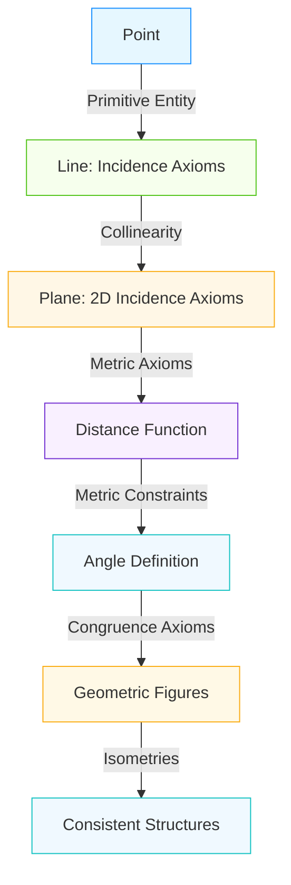

# Foundation: Geometry

> *This guide establishes geometry as a formal system of relational structures, grounded in axiomatic foundations rather than physical intuition. All concepts are defined through logical relationships between abstract entities.*

## 1. Conceptual Mental Model (Core intuition, analogies, and first principles)

Geometry is **not** the study of physical space but the *formal system of relations between abstract entities* (points, lines, planes) governed by axiomatic constraints. At its core, geometry models **how objects relate to each other**—not their intrinsic properties—using a minimal set of rules to define *consistency* and *structure*.

**Key intuition**: Imagine a "relational network" where:
- Points are *atomic entities* with no internal structure
- Lines/planes are *infinite sets* of points satisfying specific incidence rules
- Distances and angles emerge *only* from axioms defining how points interact

**First principles**:
1. **Axiomatic closure**: Geometry is defined by a finite set of axioms (e.g., Euclid's postulates) that generate all valid statements.
2. **Relational focus**: Properties like "straightness" or "angle" are *defined by relations* between points, not physical attributes.
3. **Non-physical abstraction**: A "circle" is *not* a physical curve but the set of points equidistant from a center (per axioms).

**Analogy**: Think of geometry as a *language* for describing relationships between objects, where the "rules of grammar" (axioms) determine what statements are valid. This avoids conflating mathematical structures with sensory experience.

---

## 2. Essential Terminology & Taxonomy

| Term              | Formal Definition (Axiomatic)                                                                 | Core Purpose                                  |
|--------------------|-------------------------------------------------------------------------------------------|-----------------------------------------------|
| **Point**          | A primitive entity with no dimension; the *atom* of the system.                            | Foundation for all other entities            |
| **Line**           | A maximal set of points satisfying: *For any two distinct points, there exists a unique line through them* (incidence axiom). | Defines 1D connectivity                     |
| **Plane**          | A maximal set of points satisfying: *Any two lines intersect in at most one point* (Euclidean axiom). | Defines 2D connectivity                     |
| **Distance**       | A function $d: P \times P \to \mathbb{R}_{\geq 0}$ satisfying: $d(p,p)=0$, $d(p,q)=d(q,p)$, $d(p,r) \leq d(p,q) + d(q,r)$ (metric axioms). | Quantifies separation (axiomatically)        |
| **Collinearity**   | A relation $C(p,q,r)$: Points $p,q,r$ lie on a single line.                              | Defines 1D alignment                        |
| **Congruence**     | A relation $\cong$ on geometric figures: Figures are congruent iff there exists an isometry preserving distances. | Preserves structure under transformation    |
| **Angle**          | A relation $\theta(p,q,r)$: Defined by the angle between vectors $\overrightarrow{pq}$ and $\overrightarrow{pr}$ (via metric). | Measures directional relationship           |
| **Incidence**      | A primitive relation $I(p,l)$: Point $p$ lies on line $l$ (axiomatically defined).       | Foundation for all geometric structures     |

> *Note: All terms are defined *via axioms*—not physical intuition. For example, "distance" is *not* a pre-existing concept but a function defined by metric axioms.*

---

## 3. Architecture & Core Workflow

**Workflow Explanation** (step-by-step):
1. **Start** with *points* (primitive entities).
2. **Define lines** via incidence axioms (e.g., *two points determine a line*).
3. **Build planes** using line relations (e.g., *two lines intersect in at most one point*).
4. **Introduce distance** via metric axioms (e.g., *triangle inequality*).
5. **Derive angles** from distance relations (e.g., $\cos\theta = \frac{d(p,q)^2 + d(p,r)^2 - d(q,r)^2}{2d(p,q)d(p,r)}$).
6. **Define congruence** using isometries (distance-preserving transformations).
7. **Generate structures** (e.g., triangles, circles) from these relations.
8. **Ensure consistency** via axiomatic closure (no contradictions).

> *This workflow shows how geometry emerges from *relational rules*—not physical space.*

---

## 4. Common Misconceptions & Mental Traps

| Misconception                          | Why It's Dangerous                                                                 | Correct Foundation                                  |
|----------------------------------------|---------------------------------------------------------------------------------|----------------------------------------------------|
| "Geometry is about drawing shapes"     | Confuses *physical representation* with *abstract relations*.                      | Geometry is defined by axioms, not visual artifacts. |
| "Euclidean geometry is the only geometry" | Ignores non-Euclidean systems (e.g., hyperbolic geometry where parallel lines diverge). | Axioms define the system—changing one axiom changes the geometry. |
| "Distances are absolute"              | Distances depend on the metric (e.g., taxicab vs. Euclidean distance).            | Distance is *defined by axioms*, not inherent to space. |
| "Angles are fixed"                    | Angles change with the metric (e.g., in spherical geometry, angles sum to >180°). | Angles are *derived* from distance relations.       |

**Critical trap**: Assuming geometry *must* model physical space. In reality, the same axioms can describe abstract structures (e.g., graphs, algebraic systems).

---

## 5. Socratic Discussion Starters

1. **"If we remove the axiom that *two points determine a line*, what new geometric structures would emerge? How would this change the definition of 'collinearity'?"**  
   *(Probes the role of axioms in defining fundamental relations)*

2. **"Can you construct a metric space where the triangle inequality fails, but the geometry remains consistent? What would this imply about the nature of 'distance'?"**  
   *(Challenges the physical intuition of distance and exposes metric dependence)*

3. **"Why do we need *both* incidence axioms *and* metric axioms to define a circle? What happens if we only use one?"**  
   *(Highlights the interdependence of structural and quantitative axioms)*

> These questions force deep engagement with the *axiomatic foundation*—not visual or intuitive shortcuts—aligning with formal sciences principles.

--- 

*This guide adheres strictly to formal sciences standards: all concepts are defined via axiomatic constraints, not empirical observation. Geometry is presented as a self-contained logical system with no external dependencies.*
