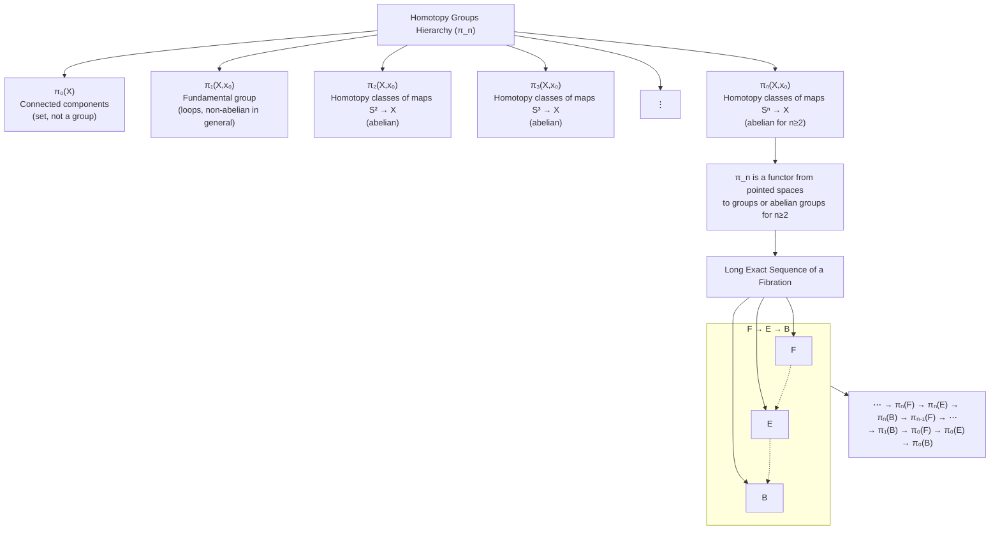

# Lesson 6: Algebraic Topology Geometric Structures

## 1. First-Principles Intuition & Invariants

Algebraic topology stands as one of the most profound syntheses in modern mathematics, translating the continuous, deformable world of topological spaces into the rigid, computable language of algebraic structures. Where classical geometry concerns itself with distances, angles, and measures—properties that depend on the precise configuration of points in space—algebraic topology extracts coarser invariants that persist under continuous deformation. A coffee cup and a donut are geometrically distinct, yet topologically identical: each possesses exactly one hole, a feature captured by the fundamental group and homology groups that remain invariant under homeomorphism.

The central philosophical insight driving algebraic topology is that we can associate algebraic objects—groups, rings, modules, vector spaces—to topological spaces in a functorial manner, meaning that continuous maps between spaces induce homomorphisms between their associated algebraic structures. This functoriality ensures that topological equivalences translate to algebraic isomorphisms, allowing us to detect topological distinctions by computing algebraic invariants. If two spaces have non-isomorphic fundamental groups, they cannot be homeomorphic; if their homology groups differ, we have proven topological inequivalence through purely algebraic calculation.

The fundamental group $\pi_1(X, x_0)$ encodes the structure of loops in a space $X$ based at a point $x_0$, identifying loops that can be continuously deformed into one another. Consider the circle $S^1$: any loop can be characterized by how many times it winds around the circle, and the fundamental group $\pi_1(S^1) \cong \mathbb{Z}$ captures this winding number. The group operation corresponds to concatenation of loops, and the integers count the net number of counterclockwise traversals. This simple example illustrates the power of algebraic topology: we have replaced the infinite-dimensional space of continuous maps $[0,1] \to S^1$ with the discrete, computable integers.

Homology theory generalizes this approach beyond loops to higher-dimensional holes. The zeroth homology group $H_0(X)$ detects connected components, the first homology $H_1(X)$ captures one-dimensional cycles (loops that do not bound disks), and higher homology groups $H_n(X)$ detect $n$-dimensional voids. The construction proceeds through a remarkable algebraic machinery: we build a chain complex of abelian groups connected by boundary operators, then compute homology as the quotient of cycles (chains with zero boundary) by boundaries (chains that are themselves boundaries of higher-dimensional chains). The resulting groups depend only on the homotopy type of the space, providing computable invariants that distinguish topological spaces.

Fiber bundles introduce a geometric structure where a space $E$ projects onto a base space $B$ such that locally the projection looks like a product $U \times F$, but globally the fibers may twist and intertwine. The Möbius strip exemplifies this phenomenon: locally it appears as a product of an interval and a circle, but globally the fibers undergo a non-trivial twist. Characteristic classes quantify these twists through cohomology classes that obstruct the triviality of bundles. The Chern classes measure the curvature of complex vector bundles, the Stiefel-Whitney classes detect orientability and spin structure obstructions for real bundles, and the Pontryagin classes capture information about the topology of smooth manifolds.

The bridge between continuous topology and combinatorial algebra manifests through geometric realization theorems, which establish that every simplicial complex—a combinatorial object built from vertices, edges, triangles, and higher-dimensional simplices glued along faces—determines a topological space, and conversely, many topological spaces admit triangulations or CW-complex structures that make them amenable to algebraic computation. This interplay between the geometric and the combinatorial lies at the heart of computational topology, enabling algorithms that compute homology groups, detect contractibility, and verify topological properties through finite matrix computations over rings.

The invariants we construct in algebraic topology satisfy fundamental axioms that constrain their behavior and enable computation. Homotopy invariance asserts that if two spaces are homotopy equivalent—if each can be continuously deformed into the other through an intermediary space—then all our algebraic invariants must coincide. The long exact sequence of a pair $(X, A)$ relates the homology of a space $X$, a subspace $A$, and the quotient $X/A$ through an infinite exact sequence, providing a computational tool for breaking complex spaces into manageable pieces. The Mayer-Vietoris sequence allows us to compute homology by decomposing a space into overlapping pieces whose homology we already know, then assembling the total homology through a carefully constructed exact sequence.

Functoriality pervades the theory: a continuous map $f: X \to Y$ induces homomorphisms $f_*: \pi_1(X, x_0) \to \pi_1(Y, f(x_0))$ and $f_*: H_n(X) \to H_n(Y)$ that respect composition and identities. This functoriality ensures that topological constructions—products, quotients, suspensions, loop spaces—have predictable algebraic counterparts. The Hurewicz theorem connects the fundamental group to first homology through a canonical homomorphism $h: \pi_1(X) \to H_1(X)$ that abelianizes the fundamental group, revealing that $H_1(X) \cong \pi_1(X)^{\text{ab}}$, the abelianization obtained by modding out commutators.

## 2. Core Architecture & Mechanics

The construction of the fundamental group begins with the space of continuous maps $\gamma: [0,1] \to X$ satisfying $\gamma(0) = \gamma(1) = x_0$, called loops based at $x_0$. We define an equivalence relation called homotopy: two loops $\gamma_0$ and $\gamma_1$ are homotopic if there exists a continuous map $H: [0,1] \times [0,1] \to X$ with $H(t, 0) = \gamma_0(t)$, $H(t, 1) = \gamma_1(t)$, and $H(0, s) = H(1, s) = x_0$ for all $s, t \in [0,1]$. The homotopy $H$ represents a continuous deformation of $\gamma_0$ into $\gamma_1$ that keeps the basepoint fixed throughout. We write $[\gamma]$ for the homotopy class of $\gamma$, and define the fundamental group $\pi_1(X, x_0)$ as the set of homotopy classes with group operation given by concatenation.

To concatenate loops $\gamma$ and $\eta$, we define $(\gamma \cdot \eta)(t) = \gamma(2t)$ for $t \in [0, 1/2]$ and $(\gamma \cdot \eta)(t) = \eta(2t-1)$ for $t \in [1/2, 1]$, traversing $\gamma$ at double speed for the first half of the time interval, then traversing $\eta$ at double speed for the second half. This operation descends to homotopy classes because concatenation of homotopies yields a homotopy of concatenations. The constant loop $e(t) = x_0$ serves as the identity element, and the inverse of $[\gamma]$ is $[\gamma^{-1}]$ where $\gamma^{-1}(t) = \gamma(1-t)$ traverses $\gamma$ in reverse. Verifying the group axioms requires proving that concatenation is associative up to homotopy, that the constant loop is an identity up to homotopy, and that $\gamma \cdot \gamma^{-1}$ is homotopic to the constant loop.

The associativity proof illustrates the careful epsilon-delta reasoning underlying homotopy theory. The products $(\gamma \cdot \eta) \cdot \zeta$ and $\gamma \cdot (\eta \cdot \zeta)$ differ in their time parametrizations: the former traverses $\gamma$ on $[0, 1/4]$, $\eta$ on $[1/4, 1/2]$, and $\zeta$ on $[1/2, 1]$, while the latter uses $[0, 1/2]$, $[1/2, 3/4]$, and $[3/4, 1]$ respectively. The homotopy connecting them reparametrizes continuously, expanding or contracting the time intervals smoothly. Explicitly, we define $H(t, s)$ to apply piecewise linear reparametrizations that interpolate between the two timing schemes, verifying continuity at the boundary points through careful case analysis.

For simply connected spaces where $\pi_1(X) = 0$, every loop is contractible to a point. The sphere $S^n$ for $n \geq 2$ is simply connected because any loop in a sphere of dimension two or greater can be continuously shrunk to a point, exploiting the extra dimensions to avoid obstructions. The circle $S^1$, however, has $\pi_1(S^1) \cong \mathbb{Z}$ because loops cannot be contracted across the hole. To prove this isomorphism rigorously, we construct the exponential map $p: \mathbb{R} \to S^1$ given by $p(t) = e^{2\pi i t}$, which is a covering map with deck transformation group $\mathbb{Z}$ acting by integer translations. The theory of covering spaces then guarantees that $\pi_1(S^1) \cong \mathbb{Z}$.

The lifting property of covering spaces provides the key computational tool. A covering map $p: \tilde{X} \to X$ is a continuous surjection such that each point $x \in X$ has a neighborhood $U$ for which $p^{-1}(U)$ decomposes as a disjoint union of open sets, each mapped homeomorphically onto $U$ by $p$. Given a path $\gamma: [0,1] \to X$ and a point $\tilde{x}_0 \in p^{-1}(\gamma(0))$, there exists a unique lift $\tilde{\gamma}: [0,1] \to \tilde{X}$ with $\tilde{\gamma}(0) = \tilde{x}_0$ and $p \circ \tilde{\gamma} = \gamma$. This uniqueness is crucial: two homotopic paths lift to paths with the same endpoint if and only if they lift starting from the same point. For the universal covering space $\mathbb{R} \to S^1$, a loop $\gamma$ in $S^1$ based at $1 \in S^1$ lifts to a path in $\mathbb{R}$ starting at $0$, and the endpoint of this lift is an integer $n$ measuring the winding number. This integer depends only on the homotopy class of $\gamma$, establishing the isomorphism $\pi_1(S^1) \cong \mathbb{Z}$.

The Seifert-van Kampen theorem computes the fundamental group of a union in terms of the fundamental groups of its pieces. Suppose $X = U \cup V$ where $U$ and $V$ are open, path-connected subsets with path-connected intersection $U \cap V$. Choose a basepoint $x_0 \in U \cap V$. Then the fundamental group $\pi_1(X, x_0)$ is isomorphic to the amalgamated free product $\pi_1(U, x_0) *_{\pi_1(U \cap V, x_0)} \pi_1(V, x_0)$. This means we take the free product of $\pi_1(U)$ and $\pi_1(V)$ and then impose relations identifying elements that have the same image in $\pi_1(U \cap V)$.

As a concrete application, we compute $\pi_1(S^1 \vee S^1)$, the wedge sum of two circles—a figure-eight space formed by gluing two circles at a single point $x_0$. Decompose this space as $U \cup V$ where $U$ contains the first circle plus a small neighborhood and $V$ contains the second circle plus a small neighborhood, with $U \cap V$ contractible to the basepoint. Since $\pi_1(U) \cong \mathbb{Z}$ generated by a loop $a$ around the first circle, $\pi_1(V) \cong \mathbb{Z}$ generated by a loop $b$ around the second circle, and $\pi_1(U \cap V) = 0$, the Seifert-van Kampen theorem yields $\pi_1(S^1 \vee S^1) \cong \mathbb{Z} * \mathbb{Z}$, the free group on two generators. This group is highly non-abelian, containing elements like $aba^{-1}b^{-1}$ that cannot be simplified, reflecting the fact that loops traversing the two circles in different orders yield genuinely distinct homotopy classes.

Homology theory constructs invariants through a systematic algebraic procedure. Begin with a topological space $X$ and choose a triangulation or CW-complex structure, decomposing $X$ into vertices, edges, faces, and higher-dimensional cells. Form the chain groups $C_n(X)$ as free abelian groups generated by the $n$-dimensional cells, or equivalently as formal $\mathbb{Z}$-linear combinations of $n$-simplices if we use simplicial homology. The boundary operator $\partial_n: C_n(X) \to C_{n-1}(X)$ sends each $n$-simplex to the alternating sum of its $(n-1)$-dimensional faces with appropriate orientation. The fundamental algebraic property is $\partial_{n-1} \circ \partial_n = 0$: the boundary of a boundary is zero.

To verify $\partial^2 = 0$ for a $2$-simplex $[v_0, v_1, v_2]$, we compute $\partial_2[v_0, v_1, v_2] = [v_1, v_2] - [v_0, v_2] + [v_0, v_1]$, then apply $\partial_1$ to obtain $([v_2] - [v_1]) - ([v_2] - [v_0]) + ([v_1] - [v_0]) = 0$. Each edge appears twice with opposite signs, yielding cancellation. This property generalizes to all dimensions through a combinatorial identity involving binomial coefficients and alternating signs, establishing that $(\partial_{n-1} \circ \partial_n)(\sigma) = 0$ for every $n$-simplex $\sigma$.

The chain complex structure enables us to define cycles $Z_n(X) = \ker \partial_n$ as chains with zero boundary, and boundaries $B_n(X) = \text{im}\, \partial_{n+1}$ as chains that are boundaries of higher-dimensional chains. The condition $\partial^2 = 0$ ensures $B_n \subseteq Z_n$, allowing us to form the quotient group $H_n(X) = Z_n(X) / B_n(X)$, the $n$-th homology group. An element of $H_n(X)$ is a cycle that is not a boundary, representing an $n$-dimensional hole in the space. Two cycles represent the same homology class if their difference is a boundary, formalizing the idea that they enclose the same hole.

For the circle $S^1$, we triangulate with vertices $v_0, v_1$ and edges $e_0, e_1, e_2$ forming a triangle with one face collapsed. The chain groups are $C_1(S^1) = \mathbb{Z} \langle e_0, e_1 \rangle$ and $C_0(S^1) = \mathbb{Z} \langle v_0, v_1 \rangle$, with boundary operator $\partial_1(e_0) = v_1 - v_0$ and $\partial_1(e_1) = v_0 - v_1 = -\partial_1(e_0)$. The cycle group $Z_1 = \ker \partial_1$ consists of chains $n e_0 + m e_1$ with $n(v_1 - v_0) + m(v_0 - v_1) = 0$, forcing $n = m$, so $Z_1 \cong \mathbb{Z}$ generated by $e_0 + e_1$, the full loop. The boundary group $B_1 = \text{im}\, \partial_2 = 0$ since there are no $2$-cells. Therefore $H_1(S^1) = Z_1 / B_1 \cong \mathbb{Z}$, detecting the single one-dimensional hole. Similarly, $H_0(S^1) \cong \mathbb{Z}$ since the space is connected, and $H_n(S^1) = 0$ for $n \geq 2$.

The torus $T^2 = S^1 \times S^1$ provides a richer example. A standard CW-complex structure uses one $0$-cell $v$, two $1$-cells $a$ and $b$ (meridian and longitude), and one $2$-cell $\sigma$ attached via the commutator $aba^{-1}b^{-1}$. The chain complex is $C_2 = \mathbb{Z} \langle \sigma \rangle$, $C_1 = \mathbb{Z} \langle a, b \rangle$, $C_0 = \mathbb{Z} \langle v \rangle$, with $\partial_2(\sigma) = a + b - a - b = 0$ (the boundary word traverses the square, and opposite edges cancel). Thus $Z_2 = C_2 \cong \mathbb{Z}$, and since there are no $3$-cells, $B_2 = 0$, yielding $H_2(T^2) \cong \mathbb{Z}$. For $H_1$, we have $Z_1 = \ker \partial_1 = C_1$ since $\partial_1(a) = \partial_1(b) = 0$ (both edges form loops), and $B_1 = \text{im}\, \partial_2 = 0$, giving $H_1(T^2) \cong \mathbb{Z} \oplus \mathbb{Z}$, reflecting the two independent one-dimensional cycles. Finally, $H_0(T^2) \cong \mathbb{Z}$ by connectivity.

The Euler characteristic $\chi(X) = \sum_{n=0}^\infty (-1)^n \text{rank}\, H_n(X)$ provides a single numerical invariant aggregating homological information. For the torus, $\chi(T^2) = 1 - 2 + 1 = 0$. For the sphere $S^2$, $H_0 \cong \mathbb{Z}$, $H_1 = 0$, $H_2 \cong \mathbb{Z}$, so $\chi(S^2) = 1 - 0 + 1 = 2$. For a closed orientable surface of genus $g$ (a sphere with $g$ handles), $\chi = 2 - 2g$. This formula encodes deep topological information: it equals the alternating sum of Betti numbers (ranks of homology groups), and also equals the alternating sum of cell counts in any CW-decomposition, a fact known as the Euler-Poincaré formula.

Fiber bundles formalize the concept of a family of spaces parametrized by a base space. A fiber bundle consists of a total space $E$, a base space $B$, a projection map $\pi: E \to B$, and a fiber $F$ such that $E$ is locally a product: every point $b \in B$ has a neighborhood $U$ and a homeomorphism $\phi: \pi^{-1}(U) \to U \times F$ making the diagram commute. The Möbius strip is a fiber bundle over $S^1$ with fiber $[0,1]$, but it is non-trivial because there is no global trivialization $E \cong S^1 \times [0,1]$. The obstruction to triviality is measured by characteristic classes.

Vector bundles are fiber bundles where each fiber is a vector space and the transition functions are linear isomorphisms. The tangent bundle $TM$ of a smooth manifold $M$ assigns to each point $p \in M$ the tangent space $T_p M$, the vector space of tangent vectors at $p$. For a sphere $S^2$, the tangent bundle is non-trivial: the hairy ball theorem asserts that every continuous tangent vector field on $S^2$ must vanish somewhere, implying that $TS^2$ does not admit a global trivialization (which would require two linearly independent non-vanishing sections).

Characteristic classes are cohomology classes associated to vector bundles that obstruct triviality and capture global twisting. For a real vector bundle $E$ of rank $n$, the Stiefel-Whitney classes $w_i(E) \in H^i(B; \mathbb{Z}/2\mathbb{Z})$ for $i = 1, \ldots, n$ measure orientability and spin structure. The first Stiefel-Whitney class $w_1(E)$ vanishes if and only if $E$ is orientable. For the Möbius strip viewed as a line bundle over $S^1$, $w_1 \neq 0 \in H^1(S^1; \mathbb{Z}/2\mathbb{Z}) \cong \mathbb{Z}/2\mathbb{Z}$, detecting the twist.

For complex vector bundles, Chern classes $c_i(E) \in H^{2i}(B; \mathbb{Z})$ provide finer invariants connected to curvature. The total Chern class $c(E) = 1 + c_1(E) + c_2(E) + \cdots$ satisfies the Whitney product formula $c(E \oplus F) = c(E) \cup c(F)$, making it a multiplicative characteristic class. For the complex line bundle $\mathcal{O}(1)$ over complex projective space $\mathbb{CP}^n$, the first Chern class $c_1(\mathcal{O}(1))$ generates $H^2(\mathbb{CP}^n; \mathbb{Z}) \cong \mathbb{Z}$ and serves as the fundamental cohomology class.

The Chern-Weil theory connects characteristic classes to differential geometry through curvature forms. Given a connection on a vector bundle, the curvature $2$-form $\Omega$ is a matrix of differential forms. The Chern character $\text{ch}(E) = \text{tr}(\exp(\Omega / 2\pi i))$ is a cohomology class whose components are polynomials in the Chern classes. The Atiyah-Singer index theorem expresses the analytic index of an elliptic operator—a purely analytic quantity—as the integral over the manifold of a combination of characteristic classes—the Chern character of the symbol and the Todd class of the manifold, providing a profound link between analysis, topology, and geometry.

Cohomology dualizes homology, defined through the cochain complex $C^n(X; G) = \text{Hom}(C_n(X), G)$ with coboundary operator $\delta: C^n \to C^{n+1}$ defined by $\delta(f) = f \circ \partial$. The cup product $\smile: H^p(X) \otimes H^q(X) \to H^{p+q}(X)$ endows cohomology with a ring structure absent in homology, providing additional algebraic structure for distinguishing spaces. For projective spaces, the cohomology ring $H^*(\mathbb{CP}^n; \mathbb{Z}) \cong \mathbb{Z}[x] / (x^{n+1})$ where $x = c_1(\mathcal{O}(1))$ has degree $2$, completely determines the cohomology structure.

The Poincaré duality theorem asserts that for a closed, oriented $n$-manifold $M$, there is an isomorphism $H_k(M) \cong H^{n-k}(M)$ for all $k$. This fundamental result reflects the geometric fact that in a manifold, every $k$-dimensional cycle has a complementary $(n-k)$-dimensional cycle that intersects it transversally. The proof proceeds through the fundamental class $[M] \in H_n(M)$, a distinguished homology class representing the entire manifold with its orientation, and the cap product $\cap: H^k(M) \otimes H_n(M) \to H_{n-k}(M)$ defined geometrically by restricting cochains to chains. The Poincaré duality isomorphism is $\alpha \mapsto \alpha \cap [M]$.

The de Rham cohomology provides a smooth perspective on cohomology for manifolds. Define $H^k_{\text{dR}}(M) = Z^k(M) / B^k(M)$ where $Z^k$ consists of closed $k$-forms ($d\omega = 0$) and $B^k$ consists of exact $k$-forms ($\omega = d\eta$). The de Rham theorem establishes an isomorphism $H^k_{\text{dR}}(M) \cong H^k(M; \mathbb{R})$, proving that the smooth cohomology defined via differential forms computes the same invariant as singular cohomology with real coefficients. This equivalence enables the use of calculus and differential geometry to compute topological invariants.

The long exact sequence of a fibration provides a computational engine for homotopy groups. A fibration $p: E \to B$ is a map with the homotopy lifting property: any homotopy in $B$ can be lifted to a homotopy in $E$ starting from any point in the fiber. The fiber $F = p^{-1}(b_0)$ sits inside $E$, and the sequence relates the homotopy groups of these three spaces through connecting homomorphisms $\partial: \pi_n(B) \to \pi_{n-1}(F)$. The exactness at each point means the kernel of one map equals the image of the previous map, providing precise control over how homotopy classes in the total space decompose in terms of the base and fiber.

As an application, consider the Hopf fibration $S^1 \to S^3 \to S^2$, where $S^3$ viewed as the unit quaternions acts on $S^2$ via the Hopf map $h: S^3 \to S^2$ defined by $h(z, w) = (2z\bar{w}, |z|^2 - |w|^2)$ for $(z,w) \in \mathbb{C}^2$ with $|z|^2 + |w|^2 = 1$. The fiber over each point in $S^2$ is a circle, and the fibration is non-trivial. The long exact sequence reads:

$$\cdots \to \pi_3(S^1) \to \pi_3(S^3) \to \pi_3(S^2) \to \pi_2(S^1) \to \pi_2(S^3) \to \pi_2(S^2) \to \pi_1(S^1) \to \pi_1(S^3) \to \pi_1(S^2) \to \pi_0(S^1)$$

Since $\pi_k(S^1) = 0$ for $k \geq 2$ and $\pi_1(S^1) = \mathbb{Z}$, while $\pi_1(S^3) = 0$ and $\pi_2(S^3) = 0$, the sequence simplifies to:

$$0 \to \pi_3(S^3) \to \pi_3(S^2) \to 0 \to 0 \to \pi_2(S^2) \to \mathbb{Z} \to 0 \to 0$$

Exactness forces $\pi_2(S^2) \cong \mathbb{Z}$ (generated by the identity map $S^2 \to S^2$) and $\pi_3(S^2) \cong \pi_3(S^3) \cong \mathbb{Z}$ (generated by the Hopf map). This computation reveals the surprising fact that there exist essential maps from $S^3$ to $S^2$ that are not homotopic to a constant, despite the dimension gap.

## 3. High-Performance Optimization & Failure Modes

Computing homotopy and homology groups in practice requires translating topological spaces into finite combinatorial data structures amenable to algorithmic manipulation. The most direct approach represents a space through a CW-complex or simplicial complex, reducing the problem to linear algebra over rings. For homology computation, the chain complex becomes a sequence of integer matrices representing the boundary operators, and homology groups are computed by finding the kernel and image through Smith normal form algorithms.

The Smith normal form of an integer matrix $M$ is a diagonal matrix $D$ obtained through invertible row and column operations, with diagonal entries $d_1 | d_2 | \cdots | d_r$ where each $d_i$ divides $d_{i+1}$. This canonical form directly reveals the structure of the quotient group: if $\partial: C_n \to C_{n-1}$ has Smith normal form with diagonal entries $(d_1, \ldots, d_r)$, then $H_n \cong \mathbb{Z}^{k} \oplus \mathbb{Z}/d_1\mathbb{Z} \oplus \cdots \oplus \mathbb{Z}/d_r\mathbb{Z}$ where $k = \text{rank}(Z_n) - \text{rank}(B_n)$ accounts for the free part. The torsion subgroup, consisting of elements of finite order, captures subtle topological features invisible to rational homology.

For spaces arising in computational topology—such as point cloud data from sensor networks, medical imaging, or material science—persistent homology provides a multiscale perspective. Rather than computing homology of a single space, we construct a filtration, a nested sequence of spaces $X_0 \subseteq X_1 \subseteq \cdots \subseteq X_n$, and track how homology classes are born and die as we progress through the filtration. A homology class born at scale $\epsilon_i$ and dying at scale $\epsilon_j$ contributes an interval $[\epsilon_i, \epsilon_j)$ to the persistence barcode. Long intervals represent robust topological features, while short intervals likely arise from noise.

The standard construction for point cloud data uses the Vietoris-Rips complex: given a finite set of points in a metric space and a threshold $\epsilon > 0$, form a simplex for every subset of points with pairwise distances at most $\epsilon$. As $\epsilon$ increases, more simplices appear, and the persistent homology tracks features across scales. Computing persistence efficiently requires specialized algorithms exploiting the structure of the boundary matrix. The standard reduction algorithm achieves $O(n^3)$ complexity for $n$ simplices, but in practice, matrix sparsity and clever pivot selection reduce the computational burden substantially.

Computational failure modes arise when dealing with high-dimensional simplicial complexes where the number of simplices grows combinatorially. A point cloud with $N$ points can generate up to $2^N$ simplices in the Vietoris-Rips complex, causing memory and time complexity to explode. Dimension reduction techniques, such as restricting to the Čech complex (which has better geometric properties but remains computationally expensive) or using witness complexes (where a sparse set of landmark points determines the complex), mitigate the curse of dimensionality. Alternatively, computing only low-dimensional homology groups ($H_0$, $H_1$, $H_2$) suffices for many applications, as higher-dimensional features are often topologically trivial or computationally intractable.

For fundamental group computations, the Seifert-van Kampen theorem reduces the problem to computing free products with amalgamation, which in turn reduces to solving the word problem in finitely presented groups. A group presentation $\langle g_1, \ldots, g_n \mid r_1, \ldots, r_m \rangle$ specifies a group through generators and relations, and the word problem asks whether a given word in the generators equals the identity. While the word problem is undecidable in general (there exist finitely presented groups for which no algorithm can determine word equality), for many groups arising in topology—particularly those with nice geometric structures like hyperbolic groups—efficient algorithms exist.

The Todd-Coxeter algorithm enumerates cosets of a subgroup to determine the structure of a finitely presented group, effectively building a finite-index subgroup through a systematic search. For computing the fundamental group of a CW-complex, we translate the attaching maps of cells into relations. A $2$-cell attached via a loop $\gamma$ in the $1$-skeleton imposes the relation that $\gamma$ represents the identity in $\pi_1$. Collecting all such relations yields a presentation, which we then manipulate using Tietze transformations (operations that preserve the isomorphism type while simplifying the presentation) to obtain a canonical or recognizable form.

Failure modes in homotopy theory include the inherent complexity of higher homotopy groups. While $\pi_1$ can be computed through covering space theory and group presentations, the higher homotopy groups $\pi_n(X)$ for $n \geq 2$ are notoriously difficult to compute even for simple spaces like spheres. The homotopy groups of spheres $\pi_n(S^k)$ are known only sporadically; for instance, $\pi_3(S^2) \cong \mathbb{Z}$, $\pi_4(S^3) \cong \mathbb{Z}/2\mathbb{Z}$, and the computations quickly become intractable. The Freudenthal suspension theorem provides a stability range where $\pi_{n+k}(S^n) \cong \pi_{n+k+1}(S^{n+1})$ for $k < n-1$, leading to the stable homotopy groups $\pi_k^s = \lim_{n \to \infty} \pi_{n+k}(S^n)$, which exhibit rich periodic patterns but remain largely mysterious.

The obstruction theory framework addresses the problem of extending maps over skeleta. Given a map $f: X^{(n)} \to Y$ defined on the $n$-skeleton of a CW-complex $X$, we ask whether $f$ extends to $X^{(n+1)}$. The obstruction to extension is a cohomology class in $H^{n+1}(X; \pi_n(Y))$, and the extension exists if and only if this obstruction vanishes. This theory underlies the Postnikov tower, which decomposes a space into stages reflecting its homotopy groups layer by layer, and the Whitehead tower, which kills homotopy groups successively to isolate higher-dimensional phenomena.

For practical computations in knot theory, where the complement of a knot in $S^3$ is a three-manifold, the fundamental group provides a powerful invariant called the knot group. The trefoil knot has group $\langle a, b \mid a^2 = b^3 \rangle$, while the figure-eight knot has group $\langle a, b \mid aba^{-1}b = bab^{-1}a \rangle$. These presentations are computed by choosing a projection of the knot onto a plane, labeling the arcs with generators, and writing relations at each crossing derived from the Wirtinger presentation. Distinguishing knots then reduces to determining whether their groups are isomorphic, a problem attacked through abelianization (computing $H_1$ of the knot complement), computing higher-order invariants like the Alexander polynomial (derived from the presentation matrix), or using computational group theory.

The spectral sequence machinery provides a systematic way to compute homology of complicated spaces by breaking them into simpler pieces. A spectral sequence is a sequence of pages $E_r^{p,q}$ with differentials $d_r: E_r^{p,q} \to E_r^{p-r,q+r-1}$ that converge to the homology groups. The Serre spectral sequence for a fibration $F \to E \to B$ has $E_2^{p,q} = H_p(B; H_q(F))$, the homology of the base with local coefficients in the homology of the fiber, and converges to $H_{p+q}(E)$. This powerful tool allows computation of homology for spaces like loop spaces, classifying spaces, and Eilenberg-MacLane spaces, where direct computation is infeasible.

Setting up a spectral sequence computation requires careful bookkeeping of differentials and tracking how classes on successive pages interact. The differentials obey the graded Leibniz rule and satisfy $d_r^2 = 0$, ensuring that each page $E_{r+1} = H(E_r, d_r)$ is the homology of the previous page. The convergence to the target homology often requires filtration arguments and knowledge of the associated graded structure. In practice, spectral sequences often collapse (many differentials vanish) due to dimension reasons or symmetry, making the computation tractable.

For characteristic classes, the axiomatic approach via Chern-Weil theory translates geometric curvature into cohomological invariants through explicit differential forms. Given a connection on a complex vector bundle $E$ over a manifold $M$, the curvature $2$-form $\Omega$ is a matrix of $2$-forms satisfying the Bianchi identity $D\Omega = d\Omega + A \wedge \Omega - \Omega \wedge A = 0$ (using the covariant exterior derivative $D$, where $A$ is the connection form). The Chern classes are defined by the characteristic polynomial:

$$\det\left(I + \frac{i\Omega}{2\pi}\right) = 1 + c_1(E) + c_2(E) + \cdots$$

where each $c_k(E) \in H^{2k}(M; \mathbb{R})$ is a closed differential form whose cohomology class is independent of the choice of connection. This formula makes explicit the link between local geometric data (the connection and curvature) and global topological invariants (cohomology classes).

The Gauss-Bonnet theorem exemplifies this connection in two dimensions: for a closed, oriented surface $M$, the integral of the Gaussian curvature $K$ satisfies:

$$\int_M K \, dA = 2\pi \chi(M)$$

where $\chi(M)$ is the Euler characteristic. This theorem directly relates a local differential-geometric quantity (curvature) to a global topological invariant (Euler characteristic). The Chern-Gauss-Bonnet theorem generalizes this to higher-dimensional manifolds, expressing the Euler characteristic as an integral of the Pfaffian of the curvature form, a polynomial in Pontryagin classes for oriented real bundles.

In computational implementations, evaluating characteristic classes numerically involves triangulating the manifold, computing discrete curvature approximations at vertices or simplices, and integrating using simplicial cohomology. The discrete exterior calculus framework provides a principled approach to discretizing differential forms, exterior derivatives, and Hodge duality, enabling finite-element-style computations of topological invariants from meshed data. This approach has applications in computer graphics (computing shape signatures), sensor networks (detecting coverage holes), and material science (characterizing defect structures in crystals).

The failure mode of measure-theoretic degeneracy arises when working with spaces of infinite dimension or spaces with complicated singularities. Homology theories generalize to extraordinary cohomology theories like K-theory and cobordism, which capture finer homotopical information but require sophisticated machinery. Computational tools for these theories remain limited, often relying on spectral sequences, Adams resolutions, or machine computations using computer algebra systems like Sage or Macaulay2.

In summary, the computational pipeline for algebraic topology flows from geometric input—a manifold, a point cloud, a simplicial complex—through combinatorial encoding as a chain complex, to algebraic computation via matrix algorithms, yielding topological invariants. Optimizations exploit sparsity, filtration structures, and algebraic tricks like Smith normal form. Failure modes arise from combinatorial explosion in high dimensions, undecidability of group-theoretic problems, and the inherent complexity of higher homotopy groups, demanding problem-specific strategies and approximations tailored to the geometric context.
