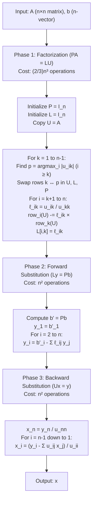

# Lesson 3: Determinants, Systems of Linear Equations, Matrix Inverses

## 1. First-Principles Intuition & Invariants

The determinant stands as one of the most elegant yet computationally complex invariants in linear algebra, encoding volumetric information about linear transformations while simultaneously serving as the algebraic gatekeeper for matrix invertibility. When we apply a linear transformation $T: \mathbb{R}^n \to \mathbb{R}^n$ represented by an $n \times n$ matrix $A$, the determinant $\det(A)$ measures the signed scaling factor by which $T$ expands or contracts $n$-dimensional volumes. A unit hypercube in $\mathbb{R}^n$ transforms into a parallelepiped whose volume equals $|\det(A)|$, with the sign of the determinant encoding orientation preservation (positive) or reversal (negative). This geometric interpretation provides immediate insight into invertibility: if $\det(A) = 0$, the transformation collapses at least one dimension, mapping the entire space into a lower-dimensional subspace, destroying volume and making the transformation non-injective and thus non-invertible.

The axiomatic foundation for determinants rests on three fundamental properties that uniquely characterize the determinant function. First, the determinant is **multilinear** in each row (or column): if we fix all rows except the $i$-th row and view $\det(A)$ as a function of that row vector, it behaves as a linear functional. Concretely, if row $i$ of matrix $A$ equals $\alpha \mathbf{u} + \beta \mathbf{v}$ while all other rows remain fixed, then $\det(A) = \alpha \det(A_{\mathbf{u}}) + \beta \det(A_{\mathbf{v}})$, where $A_{\mathbf{u}}$ denotes the matrix with $\mathbf{u}$ in row $i$ and $A_{\mathbf{v}}$ has $\mathbf{v}$ in row $i$. Second, the determinant is **alternating**: swapping any two rows (or columns) negates the determinant. This alternating property immediately implies that if any two rows are identical, the determinant vanishes, since swapping identical rows both leaves the matrix unchanged and must negate the determinant, forcing $\det(A) = -\det(A)$, which holds only when $\det(A) = 0$. Third, the determinant is **normalized**: the identity matrix $I_n$ has $\det(I_n) = 1$. These three axioms completely determine the determinant function on $n \times n$ matrices over any field, providing a coordinate-free characterization that transcends any particular computational formula.

From these axioms, we can derive the classical cofactor expansion formula, also known as Laplace expansion. For an $n \times n$ matrix $A = [a_{ij}]$, expanding along row $i$ yields:

$$\det(A) = \sum_{j=1}^{n} (-1)^{i+j} a_{ij} M_{ij}$$

where $M_{ij}$ denotes the **minor**: the determinant of the $(n-1) \times (n-1)$ submatrix obtained by deleting row $i$ and column $j$ from $A$. The term $C_{ij} = (-1)^{i+j} M_{ij}$ is called the **cofactor**. The checkerboard sign pattern $(-1)^{i+j}$ emerges naturally from the alternating property through row and column transpositions needed to move entry $a_{ij}$ to the $(1,1)$ position. This recursive formula reduces determinant computation to $(n-1) \times (n-1)$ determinants, bottoming out at $2 \times 2$ matrices where $\det\begin{pmatrix} a & b \\ c & d \end{pmatrix} = ad - bc$. While elegant, cofactor expansion suffers from catastrophic computational complexity: computing an $n \times n$ determinant via naive recursion requires $O(n!)$ arithmetic operations, rendering it infeasible for even moderately sized matrices. A $10 \times 10$ determinant computed this way demands over $3.6$ million operations, while a $20 \times 20$ determinant would require $2.4 \times 10^{18}$ operations—computationally intractable.

The determinant interacts intimately with matrix products through the fundamental multiplicative property: for any $n \times n$ matrices $A$ and $B$, we have $\det(AB) = \det(A) \det(B)$. This multiplicativity has profound consequences. If $A$ is invertible with inverse $A^{-1}$, then $I_n = AA^{-1}$ implies $1 = \det(I_n) = \det(AA^{-1}) = \det(A) \det(A^{-1})$, forcing $\det(A^{-1}) = (\det A)^{-1}$. Conversely, if $\det(A) \neq 0$, the matrix $A$ must be invertible, since a singular matrix would map some nonzero vector to zero, collapsing volume to zero and yielding $\det(A) = 0$. Thus **invertibility is equivalent to having nonzero determinant**, a criterion we can verify computationally.

Systems of linear equations form the central computational problem motivating much of linear algebra. Consider the system $A\mathbf{x} = \mathbf{b}$ where $A$ is an $n \times n$ matrix, $\mathbf{x}$ is the unknown vector in $\mathbb{R}^n$, and $\mathbf{b}$ is a given vector. This system has a unique solution if and only if $A$ is invertible, which occurs precisely when $\det(A) \neq 0$. When $A$ is invertible, the solution is $\mathbf{x} = A^{-1}\mathbf{b}$. Cramer's rule provides an explicit determinant-based formula for each component of the solution vector. If $A$ is invertible and $A_i(\mathbf{b})$ denotes the matrix obtained by replacing the $i$-th column of $A$ with the vector $\mathbf{b}$, then the $i$-th component of the solution satisfies:

$$x_i = \frac{\det(A_i(\mathbf{b}))}{\det(A)}$$

While Cramer's rule offers theoretical elegance and proves useful in symbolic computation, it suffers the same factorial complexity as cofactor expansion, making it computationally impractical for numerical work with large systems. The proof of Cramer's rule follows from cofactor expansion: if $\mathbf{x}$ solves $A\mathbf{x} = \mathbf{b}$, then $\mathbf{b} = \sum_{k=1}^{n} x_k \mathbf{a}_k$ where $\mathbf{a}_k$ denotes the $k$-th column of $A$. Substituting this into $A_i(\mathbf{b})$ and using multilinearity yields $\det(A_i(\mathbf{b})) = x_i \det(A)$ after all terms with repeated columns vanish by the alternating property.

The computational breakthrough for determinants and linear systems arrives through **Gaussian elimination**, the systematic process of reducing a matrix to row echelon form through elementary row operations. Three types of elementary row operations preserve solution sets: scaling a row by a nonzero scalar $\alpha$ (multiplies determinant by $\alpha$), swapping two rows (negates determinant), and adding a scalar multiple of one row to another (leaves determinant unchanged). By composing these operations, we can transform any matrix $A$ into an upper triangular matrix $U$ where all entries below the main diagonal vanish. For triangular matrices, the determinant equals the product of diagonal entries: $\det(U) = u_{11} u_{22} \cdots u_{nn}$, a formula following immediately from cofactor expansion or from observing that triangular matrices factor as products of diagonal matrices and elementary matrices.

Gaussian elimination with partial pivoting provides numerical stability while maintaining $O(n^3)$ complexity. At step $k$, we identify the entry of maximum absolute value in column $k$ below the diagonal, swap that row into position $k$ (pivoting), then eliminate all entries below the pivot by subtracting appropriate multiples of row $k$. The process transforms $A$ into $U$ through a sequence of elementary operations representable as left multiplication by elementary matrices $E_1, E_2, \ldots, E_m$, yielding $E_m \cdots E_2 E_1 A = U$. Each elementary matrix has determinant $\pm 1$ or $\alpha$ for scalings, so tracking these operations allows determinant computation: $\det(A) = (\det(E_1) \cdots \det(E_m))^{-1} \det(U)$.

The **LU decomposition** formalizes this process into a factorization $A = LU$ where $L$ is lower triangular with unit diagonal (all diagonal entries equal $1$) and $U$ is upper triangular. When $A$ is invertible and no row swaps are required (i.e., all leading principal minors are nonzero), Gaussian elimination naturally produces this factorization. The lower triangular matrix $L$ accumulates the elimination multipliers: if we subtract $\ell_{ik}$ times row $k$ from row $i$ during elimination, then $\ell_{ik}$ becomes the $(i,k)$ entry of $L$. The factorization $A = LU$ has determinant $\det(A) = \det(L)\det(U) = 1 \cdot (u_{11} \cdots u_{nn}) = \prod_{i=1}^{n} u_{ii}$, reducing determinant computation to finding the diagonal entries of $U$.

When row swaps are necessary, we obtain the **PLU decomposition**: $PA = LU$ where $P$ is a permutation matrix encoding the row swaps. Permutation matrices have determinant $\pm 1$ (specifically, $(-1)^{\text{number of swaps}}$), so $\det(A) = \det(P)^{-1} \det(L)\det(U) = \pm \prod_{i=1}^{n} u_{ii}$. Computing the LU decomposition requires $\frac{2}{3}n^3 + O(n^2)$ floating-point operations, a dramatic improvement over the $O(n!)$ operations needed for naive cofactor expansion. For a $1000 \times 1000$ matrix, LU decomposition demands approximately $6.7 \times 10^8$ operations—hours on modern hardware—while cofactor expansion would require more operations than atoms in the observable universe.

## 2. Core Architecture & Mechanics

The matrix inverse $A^{-1}$ satisfies $AA^{-1} = A^{-1}A = I_n$, acting as the multiplicative inverse in the algebra of $n \times n$ matrices. Not all matrices possess inverses; as established, $A$ is invertible if and only if $\det(A) \neq 0$. When the inverse exists, it is unique: if both $B$ and $C$ satisfy $AB = I$, then $C = CI = C(AB) = (CA)B = IB = B$. The classical formula for the inverse employs the **adjugate matrix** (also called the classical adjoint), defined as the transpose of the cofactor matrix:

$$\text{adj}(A) = [C_{ji}]$$

where $C_{ji} = (-1)^{i+j}M_{ji}$ is the cofactor of entry $a_{ji}$. Note the index reversal: the $(i,j)$ entry of $\text{adj}(A)$ equals the cofactor of $a_{ji}$, not $a_{ij}$. The fundamental relationship between a matrix and its adjugate states:

$$A \cdot \text{adj}(A) = \text{adj}(A) \cdot A = \det(A) \cdot I_n$$

This identity follows from cofactor expansion: multiplying row $i$ of $A$ by column $j$ of $\text{adj}(A)$ yields $\sum_{k=1}^{n} a_{ik} C_{jk}$, which equals $\det(A)$ when $i = j$ (cofactor expansion along row $i$) and equals $0$ when $i \neq j$ (expansion of a matrix with two identical rows). When $\det(A) \neq 0$, dividing both sides by $\det(A)$ yields:

$$A^{-1} = \frac{1}{\det(A)} \text{adj}(A)$$

While elegant, this formula inherits the factorial complexity of cofactor computation, making it practical only for small matrices or symbolic computation. For a $3 \times 3$ matrix $A = \begin{pmatrix} a & b & c \\ d & e & f \\ g & h & i \end{pmatrix}$, the adjugate formula produces:

$$A^{-1} = \frac{1}{\det(A)} \begin{pmatrix} ei - fh & ch - bi & bf - ce \\ fg - di & ai - cg & cd - af \\ dh - eg & bg - ah & ae - bd \end{pmatrix}$$

where $\det(A) = a(ei - fh) - b(di - fg) + c(dh - eg)$. This $3 \times 3$ formula sees frequent use in computer graphics for transforming normal vectors and computing camera matrices.

For numerical computation with larger matrices, we compute $A^{-1}$ by solving $n$ linear systems simultaneously. The inverse $A^{-1} = [\mathbf{x}_1 \; \mathbf{x}_2 \; \cdots \; \mathbf{x}_n]$ has columns satisfying $A\mathbf{x}_j = \mathbf{e}_j$ where $\mathbf{e}_j$ is the $j$-th standard basis vector (all zeros except $1$ in position $j$). We solve these $n$ systems using LU decomposition with a single factorization $PA = LU$, then perform $n$ forward-backward substitution passes, one for each right-hand side $\mathbf{e}_j$. The total cost is $\frac{2}{3}n^3$ operations for factorization plus $2n^3$ operations for $n$ substitutions, yielding $\frac{8}{3}n^3 + O(n^2)$ total operations. This approach dominates numerical inverse computation in practice.

The process of solving $A\mathbf{x} = \mathbf{b}$ via LU decomposition decomposes into distinct phases. First, we compute the factorization $PA = LU$ through Gaussian elimination with partial pivoting. The permutation matrix $P$ records row swaps: if we swap rows $i$ and $j$ at some stage, we apply that swap to $P$, initially set to the identity matrix. At elimination step $k$, we scan column $k$ from row $k$ downward to find the entry $a_{pk}$ of maximum absolute value (the pivot). We swap row $p$ with row $k$, then for each row $i > k$, we compute the multiplier $\ell_{ik} = a_{ik} / a_{kk}$ and subtract $\ell_{ik}$ times row $k$ from row $i$, zeroing entry $a_{ik}$. The multipliers $\ell_{ik}$ accumulate into $L$, and the transformed matrix becomes $U$.

Once we have $PA = LU$, solving $A\mathbf{x} = \mathbf{b}$ reduces to solving two triangular systems. First, we apply the permutation to $\mathbf{b}$, computing $\mathbf{b}' = P\mathbf{b}$. Then we solve $L\mathbf{y} = \mathbf{b}'$ by forward substitution: since $L$ is lower triangular with unit diagonal, we compute $y_1 = b'_1$, then for $i = 2, \ldots, n$, we compute $y_i = b'_i - \sum_{j=1}^{i-1} \ell_{ij} y_j$. Finally, we solve $U\mathbf{x} = \mathbf{y}$ by backward substitution: for $i = n, n-1, \ldots, 1$, we compute $x_i = (y_i - \sum_{j=i+1}^{n} u_{ij} x_j) / u_{ii}$. Each triangular solve requires $O(n^2)$ operations, dominated by the $O(n^3)$ factorization cost.

The LU factorization enjoys remarkable stability when combined with partial pivoting. The row swaps ensure that each multiplier $\ell_{ik}$ satisfies $|\ell_{ik}| \leq 1$, bounding the growth of intermediate entries during elimination. Without pivoting, entries in $U$ can experience exponential growth, causing catastrophic cancellation and loss of precision in floating-point arithmetic. The classical example is the matrix $A = \begin{pmatrix} \epsilon & 1 \\ 1 & 1 \end{pmatrix}$ for small $\epsilon > 0$. Without pivoting, elimination produces $U = \begin{pmatrix} \epsilon & 1 \\ 0 & 1 - 1/\epsilon \end{pmatrix}$, where the $(2,2)$ entry $1 - 1/\epsilon \approx -1/\epsilon$ has magnitude $O(1/\epsilon)$, growing unboundedly as $\epsilon \to 0$. With partial pivoting, we swap rows first, yielding $U = \begin{pmatrix} 1 & 1 \\ 0 & 1 - \epsilon \end{pmatrix}$, where all entries remain $O(1)$.

The **condition number** $\kappa(A) = \|A\| \, \|A^{-1}\|$ quantifies the sensitivity of the solution $\mathbf{x}$ to perturbations in $A$ or $\mathbf{b}$. For the $2$-norm (induced by the Euclidean vector norm), the condition number equals the ratio of the largest to smallest singular values: $\kappa_2(A) = \sigma_{\max}(A) / \sigma_{\min}(A)$. A matrix with $\kappa(A) \approx 10^k$ loses approximately $k$ decimal digits of accuracy when solving linear systems in finite-precision arithmetic. Matrices with large condition numbers are termed **ill-conditioned**, requiring careful algorithmic treatment. The Hilbert matrix $H_n = [1/(i+j-1)]_{i,j=1}^n$ is notoriously ill-conditioned, with $\kappa_2(H_{10}) \approx 1.6 \times 10^{13}$, rendering numerical inversion essentially hopeless without extended precision.

Determinants possess elegant computational properties beyond multiplicativity. The determinant of a transpose equals the original: $\det(A^T) = \det(A)$, reflecting the equivalence of row and column perspectives in multilinearity. For block triangular matrices $A = \begin{pmatrix} B & C \\ 0 & D \end{pmatrix}$ where $B$ is $k \times k$, $D$ is $(n-k) \times (n-k)$, and the zero block is $(n-k) \times k$, the determinant factors as $\det(A) = \det(B) \det(D)$. This follows from cofactor expansion or from recognizing that Gaussian elimination decouples into independent elimination on $B$ and $D$. When both $B$ and $D$ are invertible, the inverse of $A$ takes the form:

$$A^{-1} = \begin{pmatrix} B^{-1} & -B^{-1}CD^{-1} \\ 0 & D^{-1} \end{pmatrix}$$

This block structure underlies recursive algorithms for matrix operations and appears throughout numerical linear algebra.

The **Schur complement** generalizes this block perspective. For a partitioned matrix $M = \begin{pmatrix} A & B \\ C & D \end{pmatrix}$ where $A$ is $k \times k$ and invertible, the Schur complement of $A$ in $M$ is $S = D - CA^{-1}B$. The determinant satisfies $\det(M) = \det(A) \det(S)$, and when $S$ is also invertible, the inverse of $M$ can be expressed in terms of $A^{-1}$ and $S^{-1}$. The Schur complement plays a central role in optimization (elimination of variables in constrained problems), control theory (computing closed-loop transfer functions), and statistics (conditional distributions in multivariate Gaussian models).

## 3. High-Performance Optimization & Failure Modes

Numerical computation of determinants and matrix inverses confronts fundamental accuracy limits imposed by finite-precision arithmetic. Standard IEEE 754 double-precision floating-point provides approximately $16$ decimal digits of precision, with machine epsilon $\epsilon_{\text{mach}} \approx 2.22 \times 10^{-16}$. Every arithmetic operation introduces relative error bounded by $\epsilon_{\text{mach}}$, and these errors accumulate through lengthy computations. For LU decomposition of an $n \times n$ matrix, error analysis reveals that the computed solution $\hat{\mathbf{x}}$ to $A\mathbf{x} = \mathbf{b}$ satisfies $(A + \delta A)\hat{\mathbf{x}} = \mathbf{b}$ where $\|\delta A\| / \|A\| = O(n \epsilon_{\text{mach}})$ under partial pivoting. The relative error in the solution satisfies $\|\mathbf{x} - \hat{\mathbf{x}}\| / \|\mathbf{x}\| = O(\kappa(A) n \epsilon_{\text{mach}})$, revealing that ill-conditioned matrices amplify numerical errors catastrophically.

When $\kappa(A) \gtrsim 10^{16}$, even small perturbations of order $\epsilon_{\text{mach}}$ can completely overwhelm the solution. The Hilbert matrix $H_{13}$ has condition number exceeding $10^{17}$, making accurate inversion impossible in double precision. Iterative refinement can partially mitigate conditioning issues: after computing an approximate solution $\hat{\mathbf{x}}^{(0)}$ via LU decomposition, we compute the residual $\mathbf{r}^{(0)} = \mathbf{b} - A\hat{\mathbf{x}}^{(0)}$, solve $A\mathbf{d}^{(0)} = \mathbf{r}^{(0)}$ using the existing LU factorization, then update $\hat{\mathbf{x}}^{(1)} = \hat{\mathbf{x}}^{(0)} + \mathbf{d}^{(0)}$. Repeating this process can recover several digits of accuracy, provided residuals are computed in extended precision to avoid catastrophic cancellation.

For matrices with special structure, specialized algorithms achieve superior performance and stability compared to general LU decomposition. **Symmetric positive definite** (SPD) matrices $A$ satisfy $A = A^T$ and $\mathbf{x}^T A \mathbf{x} > 0$ for all nonzero $\mathbf{x}$. Such matrices arise ubiquitously in optimization (Hessian matrices of convex functions), statistics (covariance matrices), and finite element methods (stiffness matrices). Every SPD matrix admits a unique **Cholesky decomposition** $A = LL^T$ where $L$ is lower triangular with positive diagonal entries. The Cholesky factorization requires only $\frac{1}{3}n^3$ operations—half the cost of LU decomposition—and enjoys superior numerical stability, never requiring pivoting. The algorithm proceeds by computing $L$ column-by-column: $\ell_{11} = \sqrt{a_{11}}$, then for $j = 1, \ldots, n$, we compute $\ell_{jj} = \sqrt{a_{jj} - \sum_{k=1}^{j-1} \ell_{jk}^2}$ and for $i > j$, $\ell_{ij} = (a_{ij} - \sum_{k=1}^{j-1} \ell_{ik}\ell_{jk}) / \ell_{jj}$. The square roots remain real and positive precisely because $A$ is positive definite.

**Band matrices** with nonzero entries confined to a diagonal band of width $w$ around the main diagonal admit LU factorization in $O(nw^2)$ operations rather than $O(n^3)$. Tridiagonal matrices ($w = 1$) factorize in $O(n)$ time, enabling efficient solution of boundary value problems for ordinary differential equations. The banded structure is preserved during factorization: if $A$ has bandwidth $w$, then $L$ and $U$ have the same bandwidth, preventing fill-in outside the band. Specialized storage schemes (storing only the bands as compact arrays) reduce memory requirements from $O(n^2)$ to $O(nw)$.

**Sparse matrices** containing mostly zero entries arise throughout scientific computing, particularly in discretizations of partial differential equations. A matrix with $O(n)$ nonzero entries (sparse) should not require $O(n^3)$ operations for factorization. Unfortunately, Gaussian elimination generally causes **fill-in**: zero entries become nonzero during elimination. The graph structure of the sparsity pattern determines fill-in behavior. Define the adjacency graph $G(A)$ with vertices $\{1, \ldots, n\}$ and an edge $(i,j)$ whenever $a_{ij} \neq 0$. Eliminating variable $k$ (zeroing column $k$ below the diagonal) introduces fill-in at position $(i,j)$ whenever both $(i,k)$ and $(k,j)$ are nonzero, effectively connecting all neighbors of vertex $k$ into a clique. **Reordering** the matrix rows and columns to minimize fill-in becomes essential. The **minimum degree** heuristic iteratively eliminates the vertex with the smallest degree (fewest nonzero connections), updating degrees after each elimination. The **nested dissection** method recursively partitions the graph into three sets (two large components and a small separator), ordering the separator last, achieving $O(n^{3/2})$ operations for planar graphs.

Iterative methods provide an alternative to direct factorization for large sparse systems, particularly when high accuracy is not required or when the matrix is too large to store in memory. The **Jacobi method** iterates $x_i^{(k+1)} = (b_i - \sum_{j \neq i} a_{ij} x_j^{(k)}) / a_{ii}$, while the **Gauss-Seidel method** immediately uses updated values: $x_i^{(k+1)} = (b_i - \sum_{j < i} a_{ij} x_j^{(k+1)} - \sum_{j > i} a_{ij} x_j^{(k)}) / a_{ii}$. Both methods converge when $A$ is strictly diagonally dominant ($|a_{ii}| > \sum_{j \neq i} |a_{ij}|$ for all $i$) or when $A$ is symmetric positive definite. The **successive over-relaxation** (SOR) method accelerates Gauss-Seidel by extrapolating updates: after computing the Gauss-Seidel update $\tilde{x}_i^{(k+1)}$, SOR sets $x_i^{(k+1)} = \omega \tilde{x}_i^{(k+1)} + (1 - \omega) x_i^{(k)}$ for relaxation parameter $1 < \omega < 2$. Optimal choice of $\omega$ can yield convergence rates far superior to Gauss-Seidel.

**Krylov subspace methods** represent the modern frontier of iterative linear solvers, generating approximate solutions in the Krylov subspace $\mathcal{K}_k(A, \mathbf{b}) = \text{span}\{\mathbf{b}, A\mathbf{b}, A^2\mathbf{b}, \ldots, A^{k-1}\mathbf{b}\}$. The **conjugate gradient** (CG) method applies specifically to SPD matrices, minimizing the quadratic form $\phi(\mathbf{x}) = \frac{1}{2}\mathbf{x}^T A \mathbf{x} - \mathbf{b}^T \mathbf{x}$ over $\mathcal{K}_k$ and converging in at most $n$ iterations in exact arithmetic. In practice, CG converges much faster for well-conditioned matrices: after $k$ iterations, the error satisfies $\|\mathbf{x}_k - \mathbf{x}^*\|_A \leq 2 \left(\frac{\sqrt{\kappa(A)} - 1}{\sqrt{\kappa(A)} + 1}\right)^k \|\mathbf{x}_0 - \mathbf{x}^*\|_A$ where $\|\mathbf{v}\|_A = \sqrt{\mathbf{v}^T A \mathbf{v}}$ is the energy norm. **Preconditioning** transforms the system $A\mathbf{x} = \mathbf{b}$ into $M^{-1}A\mathbf{x} = M^{-1}\mathbf{b}$ for a preconditioner $M$ approximating $A$, ideally reducing the condition number of $M^{-1}A$ dramatically. Incomplete LU factorizations (computing sparse approximations to $L$ and $U$ by discarding small fill-in entries) serve as popular preconditioners, balancing computational cost with conditioning improvement.

The **generalized minimal residual** (GMRES) method extends Krylov techniques to general nonsymmetric matrices, minimizing the residual $\|\mathbf{b} - A\mathbf{x}_k\|$ over $\mathcal{K}_k$. Unlike CG, GMRES requires storing the entire Krylov basis, demanding $O(k n)$ memory for $k$ iterations. **Restarted GMRES** limits memory by restarting after $m$ iterations, though restart frequency trades off memory against convergence speed. The **biconjugate gradient stabilized** (BiCGSTAB) method provides a memory-efficient alternative for nonsymmetric systems, using short recurrences similar to CG at the cost of less predictable convergence behavior.

Determinant computation for large matrices rarely requires the determinant value itself; instead, its sign and magnitude provide qualitative information. Computing $\det(A)$ for an $n \times n$ matrix via LU decomposition yields $\det(A) = (-1)^s \prod_{i=1}^{n} u_{ii}$ where $s$ is the number of row swaps. For large $n$, this product can overflow or underflow floating-point range. Computing $\log|\det(A)| = \sum_{i=1}^{n} \log|u_{ii}|$ avoids overflow, storing magnitude on a logarithmic scale. In probabilistic contexts (multivariate Gaussian likelihood functions, Bayesian inference), the log-determinant appears directly in objective functions, making this representation natural.

Matrix inversion itself should generally be avoided in numerical computing. The explicit formation of $A^{-1}$ costs $O(n^3)$ operations and destroys sparsity: even if $A$ is sparse, $A^{-1}$ is typically dense. Instead of computing $A^{-1}\mathbf{b}$, we solve $A\mathbf{x} = \mathbf{b}$ directly using LU decomposition, achieving the same result with better numerical stability and efficiency. When multiple right-hand sides must be processed, computing the LU factorization once and reusing it for multiple solves costs $\frac{2}{3}n^3 + k \cdot 2n^2$ for $k$ solves, whereas forming $A^{-1}$ costs $\frac{8}{3}n^3$ followed by $k \cdot n^2$ matrix-vector products—more expensive for small $k$. Only when $k \gtrsim n$ does inversion become competitive, and even then, direct solution remains stabler.

The singular value decomposition (SVD), explored in depth in subsequent lessons, provides the ultimate tool for understanding matrix invertibility and conditioning. Every $m \times n$ matrix $A$ factors as $A = U\Sigma V^T$ where $U$ and $V$ are orthogonal and $\Sigma$ is diagonal with nonnegative singular values $\sigma_1 \geq \sigma_2 \geq \cdots \geq \sigma_r > 0$ (where $r$ is the rank of $A$). For square invertible $A$, the inverse is $A^{-1} = V\Sigma^{-1}U^T$ where $\Sigma^{-1} = \text{diag}(1/\sigma_1, \ldots, 1/\sigma_n)$. The condition number is $\kappa_2(A) = \sigma_1 / \sigma_n$, with small $\sigma_n$ indicating near-singularity. When $A$ is numerically singular ($\sigma_n \approx 0$), computing $A^{-1}$ amplifies errors disastrously. The **pseudoinverse** $A^+ = V\Sigma^+U^T$ where $\Sigma^+ = \text{diag}(1/\sigma_1, \ldots, 1/\sigma_r, 0, \ldots, 0)$ inverts only the nonzero singular values, providing the minimum-norm least-squares solution to $A\mathbf{x} = \mathbf{b}$ even when $A$ is singular or rectangular.

Determinants and inverses carry theoretical elegance but demand computational sophistication in practice. Understanding when to compute them explicitly versus when to solve linear systems implicitly, selecting appropriate factorizations for matrix structure, and navigating the treacherous waters of finite-precision arithmetic separates competent numerical practitioners from those who produce unstable, inefficient, or incorrect results. The axiomatic beauty of multilinearity and the geometric intuition of volume scaling coexist with the harsh realities of condition numbers, fill-in, and floating-point cancellation—a duality that makes linear algebra both foundational and endlessly challenging in computational mathematics.
