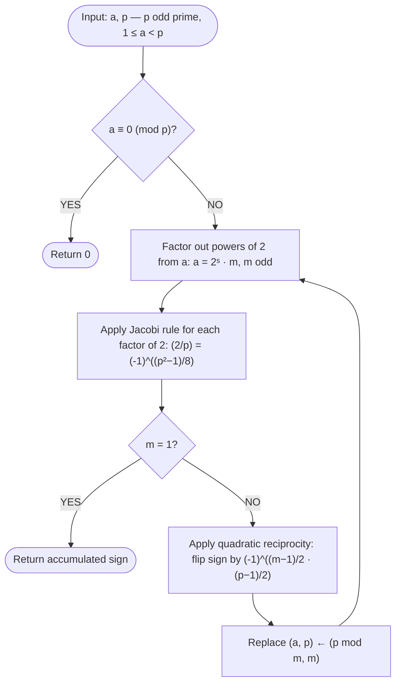

# Lesson 4: Quadratic Residues, the Law of Quadratic Reciprocity

## 1. First-Principles Intuition & Invariants

Number theory achieves one of its most elegant moments when it asks a deceptively simple question: given a prime $p$ and an integer $a$, does the congruence $x^2 \equiv a \pmod{p}$ have a solution? This is not merely an existence question for a particular equation. It is the entry point into a web of deep structural symmetry, one that connects the multiplicative group of a prime field to Gaussian integers, to character sums, and ultimately to class field theory. The question of quadratic residuosity is the first place where number theory stops being a collection of isolated tricks and starts revealing the architecture underneath.

Fix an odd prime $p$ and an integer $a$ not divisible by $p$. We say $a$ is a **quadratic residue modulo $p$** if there exists $x \in \mathbb{Z}$ satisfying $x^2 \equiv a \pmod{p}$; otherwise $a$ is a **quadratic non-residue**. The structure of this partition is immediately governed by the multiplicative group $(\mathbb{Z}/p\mathbb{Z})^\times$, which is cyclic of order $p-1$. Let $g$ be a primitive root modulo $p$, so that every nonzero residue class can be written $g^k$ for a unique $k \in \{0, 1, \ldots, p-2\}$. Then $a = g^k$ is a quadratic residue precisely when $k$ is even, since $(g^j)^2 = g^{2j}$ ranges exactly over the even-indexed powers as $j$ varies. This immediately tells us there are exactly $(p-1)/2$ quadratic residues and $(p-1)/2$ non-residues modulo $p$, a perfect equipartition of $(\mathbb{Z}/p\mathbb{Z})^\times$ that will prove fundamental throughout.

The **Legendre symbol** packages this classification into a single arithmetic function. For an odd prime $p$ and integer $a$, define

$$\left(\frac{a}{p}\right) = \begin{cases} 0 & \text{if } p \mid a \\ 1 & \text{if } a \text{ is a quadratic residue mod } p \\ -1 & \text{if } a \text{ is a quadratic non-residue mod } p \end{cases}$$

The symbol is not merely a lookup table. Its power comes from the fact that it is a **completely multiplicative function** in its numerator, meaning $\left(\frac{ab}{p}\right) = \left(\frac{a}{p}\right)\left(\frac{b}{p}\right)$ for all integers $a, b$. This multiplicativity makes the Legendre symbol a homomorphism from $(\mathbb{Z}/p\mathbb{Z})^\times$ to $\{+1, -1\}$, the unique group of order two. Understanding why multiplicativity holds is the first real derivation of the subject, and it rests on the primitive-root interpretation: $\left(\frac{g^k}{p}\right) = (-1)^k$, so $\left(\frac{g^j \cdot g^k}{p}\right) = (-1)^{j+k} = (-1)^j \cdot (-1)^k$. The product of two residues is a residue (even plus even is even), the product of two non-residues is a residue (odd plus odd is even), and the product of a residue with a non-residue is a non-residue (even plus odd is odd). This parity argument through the discrete logarithm is the structural engine beneath all Legendre symbol arithmetic.

**Euler's Criterion** gives a computable formula: for $p \nmid a$,

$$\left(\frac{a}{p}\right) \equiv a^{(p-1)/2} \pmod{p}$$

The proof is clean and worth carrying through in full. By Fermat's Little Theorem, $a^{p-1} \equiv 1 \pmod{p}$, so $a^{(p-1)/2}$ satisfies $\left(a^{(p-1)/2}\right)^2 \equiv 1 \pmod{p}$, which means $a^{(p-1)/2} \equiv \pm 1 \pmod{p}$. Now suppose $a \equiv x^2 \pmod{p}$ for some $x$. Then $a^{(p-1)/2} \equiv x^{p-1} \equiv 1 \pmod{p}$. Conversely, suppose $a^{(p-1)/2} \equiv 1 \pmod{p}$ and write $a = g^k$. Then $g^{k(p-1)/2} \equiv 1 \pmod{p}$, which means $(p-1) \mid k(p-1)/2$, i.e., $2 \mid k$, so $a$ is a perfect square in the group. For the non-residue case, the polynomial $X^{(p-1)/2} - 1$ has at most $(p-1)/2$ roots modulo $p$ (a prime field has no zero divisors, so a degree-$d$ polynomial has at most $d$ roots), and we have already found all $(p-1)/2$ quadratic residues as roots. The remaining $(p-1)/2$ non-residues must satisfy $a^{(p-1)/2} \equiv -1 \pmod{p}$.

Euler's criterion has an immediate corollary that will recur throughout cryptographic applications. The value $\left(\frac{-1}{p}\right) = (-1)^{(p-1)/2}$, which equals $+1$ when $p \equiv 1 \pmod{4}$ and $-1$ when $p \equiv 3 \pmod{4}$. This is the precise characterization of which primes represent $-1$ as a quadratic residue, a result whose proof through Euler's criterion requires no further machinery. Similarly, $\left(\frac{2}{p}\right) = (-1)^{(p^2-1)/8}$, a formula we will derive through Gauss sums below.

The crowning theorem of the subject is **Gauss's Law of Quadratic Reciprocity**, which Gauss called the *theorema aureum*: the golden theorem. For distinct odd primes $p$ and $q$,

$$\left(\frac{p}{q}\right)\left(\frac{q}{p}\right) = (-1)^{\frac{p-1}{2} \cdot \frac{q-1}{2}}$$

The right-hand side equals $-1$ if and only if both $p \equiv 3 \pmod{4}$ and $q \equiv 3 \pmod{4}$; in all other cases it equals $+1$. The practical consequence is that evaluating $\left(\frac{p}{q}\right)$ can be reduced to evaluating $\left(\frac{q}{p}\right)$, and by then reducing modulo $p$, one can iterate in a manner analogous to the Euclidean algorithm, eventually reaching a base case computable by direct inspection. This reciprocity relation is non-obvious. There is no elementary reason why the solvability of $x^2 \equiv q \pmod{p}$ should bear any relation to the solvability of $x^2 \equiv p \pmod{q}$. The theorema aureum reveals that these two solvability questions are linked by an astonishing symmetry, one that generalizes to higher reciprocity laws and motivates the entire program of class field theory.

## 2. Core Architecture & Mechanics

### Gauss Sums and the Proof of Quadratic Reciprocity

The standard proof of quadratic reciprocity via Gauss sums is both the most transparent and the most instructive, as it introduces the analytic machinery of character sums that permeates modern number theory and cryptography. We build it from first principles.

For an odd prime $p$, define the **quadratic Gauss sum**

$$\tau_p = \sum_{a=0}^{p-1} \left(\frac{a}{p}\right) \zeta_p^a$$

where $\zeta_p = e^{2\pi i / p}$ is a primitive $p$-th root of unity in $\mathbb{C}$. We can restrict the sum to $a = 1, \ldots, p-1$ since $\left(\frac{0}{p}\right) = 0$. The Gauss sum is an algebraic integer in $\mathbb{Z}[\zeta_p]$, and its critical property is captured in the following lemma.

**Lemma (Gauss sum self-product):** $\tau_p^2 = (-1)^{(p-1)/2} \cdot p = \left(\frac{-1}{p}\right) p$.

*Proof.* Compute directly:

$$\tau_p^2 = \left(\sum_{a=0}^{p-1} \left(\frac{a}{p}\right) \zeta_p^a\right)\left(\sum_{b=0}^{p-1} \left(\frac{b}{p}\right) \zeta_p^b\right) = \sum_{a,b=1}^{p-1} \left(\frac{a}{p}\right)\left(\frac{b}{p}\right) \zeta_p^{a+b}$$

Substitute $b = ac$ (which is a bijection on $(\mathbb{Z}/p\mathbb{Z})^\times$ for fixed $a \neq 0$):

$$= \sum_{a=1}^{p-1} \sum_{c=1}^{p-1} \left(\frac{a}{p}\right)\left(\frac{ac}{p}\right) \zeta_p^{a(1+c)} = \sum_{a=1}^{p-1} \sum_{c=1}^{p-1} \left(\frac{a^2 c}{p}\right) \zeta_p^{a(1+c)}$$

Since $\left(\frac{a^2 c}{p}\right) = \left(\frac{a^2}{p}\right)\left(\frac{c}{p}\right) = \left(\frac{c}{p}\right)$ (as $a^2$ is always a residue):

$$= \sum_{c=1}^{p-1} \left(\frac{c}{p}\right) \sum_{a=1}^{p-1} \zeta_p^{a(1+c)}$$

Now evaluate the inner sum. When $c \equiv -1 \pmod{p}$, the inner sum $\sum_{a=1}^{p-1} \zeta_p^{0} = p-1$. When $c \not\equiv -1 \pmod{p}$, the sum $\sum_{a=1}^{p-1} \zeta_p^{a(1+c)}$ is a complete sum of a nontrivial character, so $\sum_{a=0}^{p-1} \zeta_p^{a(1+c)} = 0$, giving $\sum_{a=1}^{p-1} \zeta_p^{a(1+c)} = -1$. Splitting the sum over $c$:

$$\tau_p^2 = \left(\frac{-1}{p}\right)(p-1) + \sum_{\substack{c=1 \\ c \neq p-1}}^{p-1} \left(\frac{c}{p}\right)(-1)$$

The sum $\sum_{c=1}^{p-1} \left(\frac{c}{p}\right) = 0$ because there are equally many residues and non-residues, so $\sum_{c=1, c\neq p-1}^{p-1} \left(\frac{c}{p}\right) = -\left(\frac{-1}{p}\right)$. Therefore:

$$\tau_p^2 = \left(\frac{-1}{p}\right)(p-1) - \left(-\left(\frac{-1}{p}\right)\right) = \left(\frac{-1}{p}\right)(p-1) + \left(\frac{-1}{p}\right) = \left(\frac{-1}{p}\right) \cdot p$$

This completes the lemma. The result $\tau_p^2 = \left(\frac{-1}{p}\right)p$ is fundamental: it shows that $\tau_p = \pm\sqrt{\pm p}$ depending on the residue class of $p$ modulo 4, and more precisely that $\tau_p$ lives in $\mathbb{Q}(\sqrt{p})$ when $p \equiv 1 \pmod 4$ and in $\mathbb{Q}(\sqrt{-p})$ when $p \equiv 3 \pmod 4$.

**Proof of Quadratic Reciprocity.** Let $p$ and $q$ be distinct odd primes. Work in the ring $\mathbb{Z}[\zeta_p]$, in which we can reduce modulo $q$ to work in $\mathbb{F}_q[\zeta_p] \cong \mathbb{F}_q[X]/(f(X))$ where $f$ is the minimal polynomial of $\zeta_p$ over $\mathbb{F}_q$.

Consider $\tau_p^q$ modulo $q$. By the Frobenius endomorphism of characteristic $q$,

$$\tau_p^q = \left(\sum_{a=1}^{p-1} \left(\frac{a}{p}\right) \zeta_p^a\right)^q \equiv \sum_{a=1}^{p-1} \left(\frac{a}{p}\right)^q \zeta_p^{aq} \pmod{q}$$

The cross terms vanish modulo $q$ because every multinomial coefficient $\binom{q}{k_1, \ldots, k_r}$ with all $k_i < q$ is divisible by $q$. Since $\left(\frac{a}{p}\right) \in \{-1, +1\}$ and $q$ is odd, $\left(\frac{a}{p}\right)^q = \left(\frac{a}{p}\right)$. Substituting $b = aq$ (again a bijection on $(\mathbb{Z}/p\mathbb{Z})^\times$):

$$\tau_p^q \equiv \sum_{b=1}^{p-1} \left(\frac{bq^{-1}}{p}\right) \zeta_p^{b} = \left(\frac{q^{-1}}{p}\right) \sum_{b=1}^{p-1} \left(\frac{b}{p}\right) \zeta_p^b = \left(\frac{q^{-1}}{p}\right) \tau_p \pmod{q}$$

Since $\left(\frac{q^{-1}}{p}\right) = \left(\frac{q}{p}\right)^{-1} = \left(\frac{q}{p}\right)$ (the symbol squares to 1 for nonzero residue classes):

$$\tau_p^q \equiv \left(\frac{q}{p}\right) \tau_p \pmod{q}$$

On the other hand, since $\tau_p^2 = \left(\frac{-1}{p}\right)p$,

$$\tau_p^q = \tau_p \cdot (\tau_p^2)^{(q-1)/2} = \tau_p \cdot \left(\left(\frac{-1}{p}\right)p\right)^{(q-1)/2}$$

Modulo $q$, by Euler's criterion applied to the prime $q$, we have $p^{(q-1)/2} \equiv \left(\frac{p}{q}\right) \pmod{q}$. Also $\left(\frac{-1}{p}\right)^{(q-1)/2} = \left((-1)^{(p-1)/2}\right)^{(q-1)/2} = (-1)^{\frac{p-1}{2}\cdot\frac{q-1}{2}}$. Therefore:

$$\tau_p^q \equiv (-1)^{\frac{p-1}{2}\cdot\frac{q-1}{2}} \cdot \left(\frac{p}{q}\right) \cdot \tau_p \pmod{q}$$

Equating the two expressions for $\tau_p^q$ and canceling $\tau_p$ (which is a unit modulo $q$, since $\tau_p^2 = \left(\frac{-1}{p}\right)p \not\equiv 0 \pmod{q}$ for $q \neq p$):

$$\left(\frac{q}{p}\right) \equiv (-1)^{\frac{p-1}{2}\cdot\frac{q-1}{2}} \cdot \left(\frac{p}{q}\right) \pmod{q}$$

Since both sides are $\pm 1$ and $q \geq 3$, congruence modulo $q$ implies actual equality:

$$\left(\frac{p}{q}\right)\left(\frac{q}{p}\right) = (-1)^{\frac{p-1}{2}\cdot\frac{q-1}{2}}$$

This completes the proof. $\blacksquare$

The structure of the argument is worth pausing on. The Frobenius map $x \mapsto x^q$ in characteristic $q$ does the heavy lifting: it simultaneously acts as the $q$-th power map in the coefficient ring and as a permutation of the roots of unity $\{\zeta_p^a\}$, and the interplay between these two actions encodes both Legendre symbols. The proof is an early example of the technique of lifting an identity in $\mathbb{F}_q$ to $\mathbb{Z}$ by a units argument, a technique that recurs throughout $p$-adic methods.

### The Jacobi Symbol

For computational purposes, restricting to prime denominators is impractical. The **Jacobi symbol** extends the Legendre symbol to arbitrary odd positive integers $n = p_1^{e_1} \cdots p_r^{e_r}$ by

$$\left(\frac{a}{n}\right) = \prod_{i=1}^r \left(\frac{a}{p_i}\right)^{e_i}$$

where each factor on the right is a Legendre symbol. The Jacobi symbol is completely multiplicative in both numerator and denominator, and it satisfies the same quadratic reciprocity law: for odd positive integers $m, n$ with $\gcd(m,n)=1$,

$$\left(\frac{m}{n}\right)\left(\frac{n}{m}\right) = (-1)^{\frac{m-1}{2}\cdot\frac{n-1}{2}}$$

The critical subtlety is that $\left(\frac{a}{n}\right) = 1$ does not guarantee that $a$ is a quadratic residue modulo $n$; it means only that the number of prime factors of $n$ (counted with multiplicity) for which $a$ is a non-residue is even. The Jacobi symbol answers a Legendre question only when $n$ is prime. This distinction matters enormously in practice: the Miller-Rabin and Solovay-Strassen primality tests both rely on comparing Euler's criterion output to the Jacobi symbol, and the gap between the two is precisely what witnesses compositeness.

The reciprocity formula for the Jacobi symbol is proven by reducing to the prime case, using the Chinese Remainder Theorem to decompose $(\mathbb{Z}/n\mathbb{Z})^\times$ into a product of groups modulo prime powers, and then observing that the sign factors telescope. The two supplementary laws, $\left(\frac{-1}{n}\right) = (-1)^{(n-1)/2}$ and $\left(\frac{2}{n}\right) = (-1)^{(n^2-1)/8}$, hold for the Jacobi symbol with the same formulas as the Legendre symbol, and they are verified by induction on the number of prime factors using the multiplicativity of the exponents.

The following diagram captures the computational reduction pipeline for evaluating a Legendre symbol $\left(\frac{a}{p}\right)$:

This algorithm runs in $O(\log^2 \min(a,p))$ time, identical in structure to the Euclidean algorithm, with an accumulated sign correction at each reciprocity flip. It is the standard computational workhorse for Legendre/Jacobi symbol evaluation in computer algebra systems.

### Computing Square Roots Modulo a Prime

Knowing that $\left(\frac{a}{p}\right) = 1$ guarantees the existence of a square root, but extracting it requires further work. When $p \equiv 3 \pmod{4}$, the formula is immediate from Euler's criterion: since $a^{(p-1)/2} \equiv 1 \pmod{p}$, we have

$$x \equiv a^{(p+1)/4} \pmod{p}$$

Verification: $x^2 \equiv a^{(p+1)/2} = a^{(p-1)/2} \cdot a \equiv 1 \cdot a = a \pmod{p}$. This requires a single modular exponentiation.

For $p \equiv 1 \pmod{4}$ the situation is more subtle. Write $p - 1 = 2^s \cdot t$ with $t$ odd and $s \geq 2$. The **Tonelli-Shanks algorithm** finds $x$ with $x^2 \equiv a \pmod{p}$ by working in the $2$-Sylow subgroup of $(\mathbb{Z}/p\mathbb{Z})^\times$. The core idea is to maintain an invariant: at step $i$, we have a value $R$ with $R^2 \equiv a \cdot M \pmod p$ where $M$ is an element of exact order $2^i$ in the multiplicative group, and we drive $i$ down to $0$ by multiplying $R$ by appropriate square roots of $M^{-1}$.

In detail, let $n$ be a quadratic non-residue modulo $p$ (found by random search, which succeeds with probability $1/2$ per trial). Set $Q = t$, $M = a^Q \pmod{p}$ (so $M$ has order dividing $2^s$), $c = n^t \pmod{p}$ (so $c$ is a primitive $2^s$-th root of $-1$ in $(\mathbb{Z}/p\mathbb{Z})^\times$), and $R = a^{(Q+1)/2} \pmod{p}$. Then $R^2 = a^{(Q+1)} = a \cdot a^Q = a \cdot M$. We now reduce the order of $M$ iteratively. At each step, find the least $i \geq 1$ such that $M^{2^i} \equiv 1 \pmod{p}$. If $i = s$, we are done: $R^2 \equiv a \pmod p$. Otherwise, set $b = c^{2^{s-i-1}} \pmod p$, update $R \leftarrow Rb$, $M \leftarrow Mb^2$, $c \leftarrow b^2$, and $s \leftarrow i$. The key invariant is that $R^2 \equiv aM \pmod p$ is preserved under this update: $(Rb)^2 = R^2 b^2 = aMb^2$ and indeed $b^2 = c^{2^{s-i}}$ has order $2^i$ in the group so $Mb^2$ has strictly smaller $2$-power order than $M$. The loop terminates because $s$ strictly decreases at each iteration.

The Tonelli-Shanks algorithm runs in expected $O(\log^2 p)$ group operations (each being a modular multiplication), where the expectation is over the random choice of non-residue $n$. In the dense case where $p - 1 = 2^s \cdot t$ with $s$ large, the loop runs $s$ times, but $s = O(\log p)$ so the overall complexity remains polynomial. For cryptographic primes where $p \equiv 3 \pmod{4}$ (such as the NIST P-384 prime), the one-line formula suffices. For primes where $v_2(p-1)$ is large, Tonelli-Shanks (or its refinement, the Cipolla-Lehmer algorithm, which uses an extension field when $s$ is large) is the standard method.

The Cipolla algorithm provides an alternative approach with uniform complexity. Choose $a_0$ such that $a_0^2 - a$ is a quadratic non-residue modulo $p$, and work in $\mathbb{F}_{p^2} = \mathbb{F}_p(\omega)$ where $\omega^2 = a_0^2 - a$. Then $(a_0 + \omega)^{(p+1)/2}$ lies in $\mathbb{F}_p$ and equals the square root of $a$ modulo $p$. The proof uses the Frobenius: $\omega^p = \omega^p$. Since $\omega^2 = a_0^2 - a$ is a non-residue, $(\omega^2)^{(p-1)/2} \equiv -1 \pmod{p}$, so $\omega^p = \omega \cdot (\omega^2)^{(p-1)/2} = -\omega$. Therefore $(a_0 + \omega)^p = a_0^p + \omega^p = a_0 - \omega$ (using Fermat for the coefficient $a_0$), and so

$$(a_0 + \omega)^{p+1} = (a_0 + \omega)(a_0 - \omega) = a_0^2 - \omega^2 = a_0^2 - (a_0^2 - a) = a$$

Thus $(a_0 + \omega)^{(p+1)/2}$ squares to $a$, and since the product lies in $\mathbb{F}_p^\times$ it is the desired root.

## 3. High-Performance Optimization & Failure Modes

### Legendre Symbol Computation in Practice

The iterative Jacobi-symbol algorithm described above is the workhorse in every serious implementation, but several failure modes arise in practice that are easy to overlook. The most common error is treating the Jacobi symbol as a primality test. The congruence $a^{(n-1)/2} \equiv \left(\frac{a}{n}\right) \pmod{n}$ holds for all $a$ when $n$ is prime (by Euler's criterion), but it can also hold for all $a$ when $n$ is an **Euler pseudoprime** to every base, the so-called Carmichael numbers for the Euler criterion. These are called **absolute Euler pseudoprimes**, and while they exist, they are exceedingly rare; the Solovay-Strassen test becomes a probabilistic primality test precisely by exploiting the fact that if $n$ is composite, at least half of the bases $a \in (\mathbb{Z}/n\mathbb{Z})^\times$ will witness this. Using only a single base $a = 2$ produces deterministic errors on specific constructed composites.

A second failure mode in the reciprocity-based symbol reduction is sign bookkeeping. Each Euclidean-style step flips the sign according to $(-1)^{\frac{m-1}{2}\cdot\frac{n-1}{2}}$ and the supplementary laws. Implementations that compute $(n-1)/2 \bmod 2$ using integer division on signed inputs will silently produce wrong results for negative intermediate values. The correct implementation always reduces $a$ to the range $[0, n-1]$ before each step, never allowing negative numerators into the sign calculation.

A third failure mode specific to Tonelli-Shanks is the degenerate case $a \equiv 0 \pmod{p}$, which must be checked before the algorithm begins, and the case $p = 2$, where every element is its own square root and the entire quadratic residue framework degenerates. For $p = 2$, $x^2 \equiv x \pmod 2$ for all $x$, so every element is a square.

### Connecting to Gauss Sums for $\left(\frac{2}{p}\right)$

The formula $\left(\frac{2}{p}\right) = (-1)^{(p^2-1)/8}$ can be derived from Gauss sums via a modified argument. Consider the product $\prod_{j=1}^{(p-1)/2} 2j$, which equals $2^{(p-1)/2} \cdot \left(\frac{p-1}{2}\right)!$. By Wilson's theorem and a careful analysis of the reduced residue system, one establishes that

$$2^{(p-1)/2} \equiv (-1)^{|\{k \in \{1,\ldots,(p-1)/2\} : k > p/4\}|} \pmod{p}$$

The count $|\{k \leq (p-1)/2 : k > p/4\}|$ depends on $p \bmod 8$ and evaluates to the exponent $(p^2-1)/8 \bmod 2$ after case analysis on $p \equiv 1, 3, 5, 7 \pmod 8$. When $p \equiv \pm 1 \pmod 8$ the count is even and $\left(\frac{2}{p}\right) = 1$; when $p \equiv \pm 3 \pmod 8$ the count is odd and $\left(\frac{2}{p}\right) = -1$. The formula $(-1)^{(p^2-1)/8}$ encodes exactly this four-way case analysis in a single closed expression.

### Toward Higher Reciprocity and the Jacobi Symbol in Cryptography

The computational relevance of the Jacobi symbol in cryptography runs deep. The **Goldwasser-Micali cryptosystem** encrypts a single bit $m \in \{0,1\}$ by choosing a random $r$ coprime to $n = pq$ and computing $c = y^m r^2 \bmod n$, where $y$ is a quadratic non-residue modulo $n$ with $\left(\frac{y}{n}\right) = 1$. The hardness assumption is **quadratic residuosity**: the problem of deciding, given $c$ and $n$, whether $c$ is a quadratic residue modulo $n$, is computationally equivalent to factoring $n$ under standard assumptions. The Jacobi symbol is a trapdoor here: without knowledge of $p$ and $q$, one cannot distinguish residues from non-residues among elements with Jacobi symbol $+1$, since distinguishing them requires knowing whether $c$ is a residue modulo both $p$ and $q$ simultaneously or neither, and this requires knowing $p$ and $q$.

The gap between the Legendre and Jacobi symbols also underlies the **QR/NQR problem** used in zero-knowledge proofs. A prover can demonstrate knowledge of a square root of $a$ modulo $n$ without revealing the root by a cut-and-choose protocol: the verifier challenges the prover to open a randomly chosen commitment, and after $k$ rounds the probability of a cheating prover succeeding is $2^{-k}$. The soundness of this protocol rests on the assumed hardness of quadratic residuosity, which in turn rests on the structural gap that the Jacobi symbol creates between information available publicly and information available only to a party who knows the factorization.

The theory of quadratic residues thus sits at the exact intersection of pure structure and computational complexity: a theorem proved by Gauss using character sums in $\mathbb{Z}[\zeta_p]$ becomes the semantic security foundation of a public-key encryption scheme two centuries later. The quadratic reciprocity law is not an isolated curiosity. It is the first example of a profound pattern where symmetries among $L$-functions, here the Legendre character $\left(\frac{\cdot}{p}\right)$ as a Dirichlet character, dictate computable relations between number fields, a pattern that extends through cubic and biquadratic reciprocity, Artin's reciprocity law, and the full apparatus of class field theory. Every subsequent lesson in this sequence will draw on the machinery constructed here: the Gauss sum, the Frobenius, the multiplicativity of characters, and the interplay between field extensions and congruence conditions.
