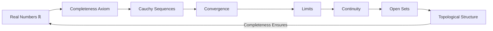

# Foundation: Real Analysis

## 1. Conceptual Mental Model (Core intuition, analogies, and first principles)

Real Analysis is the rigorous mathematical study of **real numbers** and **functions** defined on them, grounded in the *completeness* of the real number system. At its core, it addresses the *why* behind calculus: **why do limits exist? Why do infinite series converge? Why are continuous functions well-behaved?**  

### Core Intuition
Imagine the real number line as an *unbroken continuum*—a single, infinitely dense line with no gaps. This contrasts sharply with the rational numbers (ℚ), which have "gaps" (e.g., √2 is missing). Real Analysis resolves these gaps through the **completeness axiom**: *Every non-empty subset of ℝ with an upper bound has a least upper bound (supremum)*. This ensures that infinite processes (like sequences) can be meaningfully analyzed without contradictions.

### Key Analogies
- **Number Line as a "Seamless Fabric"**: Real numbers fill every point between integers without gaps (unlike ℚ, which has holes).
- **Limits as "Approaching"**: A limit describes how a function behaves *as it gets arbitrarily close* to a point—without necessarily reaching it (e.g., limₓ→₀ sin(1/x) does not exist).
- **Convergence as "Stability"**: A sequence converges if its terms stabilize toward a single value (e.g., 1/n → 0).

### First Principles
1. **The real numbers (ℝ) form a complete ordered field** (axiomatic foundation).
2. **Limits define continuity, differentiability, and integration**.
3. **Completeness resolves paradoxes** (e.g., the "infinite" in calculus is *finite* due to ℝ's structure).

> 💡 *Why this matters*: Without Real Analysis, calculus is intuitive but *unrigorous*. For example, the series ∑₁^∞ 1/n² converges to π²/6—yet without completeness, we couldn’t prove this rigorously.

---

## 2. Essential Terminology & Taxonomy

| Term                  | Definition & Intuition                                                                 | Foundational Role                                  |
|-----------------------|-------------------------------------------------------------------------------------|----------------------------------------------------|
| **Real Number (ℝ)**   | A number that fills the number line without gaps (completeness axiom ensures existence of suprema/infima) | Foundation of the entire system                    |
| **Limit**             | Value *L* such that for every ε > 0, there exists δ > 0 where |f(x) - L| < ε whenever 0 < |x - a| < δ | Defines continuity, derivatives, integrals |
| **Continuity**        | A function f is continuous at *a* if limₓ→ₐ f(x) = f(a) (no "jumps")                | Bridges limits and function behavior               |
| **Open Set**          | A set where every point has a neighborhood entirely contained within it               | Basis for topology; defines "nearness" in ℝ       |
| **Convergence**       | A sequence {xₙ} converges to *L* if for every ε > 0, ∃N such that |xₙ - L| < ε for all n > N    | Ensures infinite processes have finite outcomes   |
| **Cauchy Sequence**   | A sequence where terms become arbitrarily close (|xₙ - xₘ| < ε for n, m > N)         | Characterizes convergence in ℝ (via completeness)  |
| **Completeness**      | Every Cauchy sequence in ℝ converges to a real number (supremum/infimum axiom)       | Resolves gaps in ℚ; the "why" of real numbers     |

> ✅ *Why these 7 terms?* They form a self-contained ecosystem: **Completeness** → **Cauchy sequences** → **Convergence** → **Limits** → **Continuity** → **Open sets**.

---

## 3. Architecture & Core Workflow

**Workflow Explanation**:
1. **Start** with the real numbers (ℝ) as a complete ordered field.
2. **Completeness** (supremum/infimum axiom) guarantees that *every* Cauchy sequence converges.
3. **Convergence** (via Cauchy sequences) defines stable infinite processes.
4. **Limits** emerge as the "endpoint" of convergence.
5. **Continuity** is defined via limits (no abrupt changes).
6. **Open sets** arise from the topological structure of ℝ (neighborhoods).
7. **Completeness** closes the loop: Ensures all infinite processes are well-defined.

> 💡 *Visual Insight*: This workflow shows how Real Analysis is *self-sustaining*—completeness is both the foundation and the consequence of the system’s structure.

---

## 4. Common Misconceptions & Mental Traps

| Misconception                     | Why It’s Traps Students | Correct Intuition                                                                 |
|-----------------------------------|--------------------------|--------------------------------------------------------------------------------|
| "Limits are just 'the value the function approaches'" | Confuses *limit* with *function value* | Limits describe *behavior near* a point, not the point itself (e.g., limₓ→₀ sin(1/x) doesn’t exist) |
| "Continuous functions are always differentiable" | Ignores smoothness | Continuity is weaker than differentiability (e.g., |x| is continuous but not differentiable at 0) |
| "Open sets are 'empty' or 'full'" | Misinterprets topology | Open sets are *dense* neighborhoods (e.g., (0,1) is open; every point has a tiny interval inside it) |
| "Completeness means all infinite series converge" | Overgeneralizes | Completeness ensures *Cauchy* sequences converge—but not all series (e.g., ∑1/n diverges) |

> ⚠️ *Critical Trap*: **Confusing ℚ (rational numbers) with ℝ**. The rationals are *not* complete—e.g., √2 has no rational limit. Real Analysis fixes this via the completeness axiom.

---

## 5. Socratic Discussion Starters

1. **Why does the completeness axiom resolve the "gap" in rational numbers (e.g., √2), but not the "gap" in the sequence {1/n} (which converges to 0)?**  
   *(Probes the distinction between structural gaps and convergent processes)*

2. **If a function is continuous at a point, does it *always* have a limit there? Why or why not?**  
   *(Tests understanding of continuity as a limit condition)*

3. **How would the real number system look *without* the completeness axiom? What would be the practical consequences for calculus?**  
   *(Challenges intuition about why completeness is non-negotiable)*

> 💡 *For your AI tutor*: These questions force you to move beyond definitions into *why*—the heart of Real Analysis. Start with the first question to build intuition before formal proofs.

--- 

This foundation provides the rigorous, intuitive scaffolding for mastering Real Analysis—without sacrificing mathematical precision. Remember: **Real Analysis is not about "computing" but *understanding why* the infinite is finite**.
