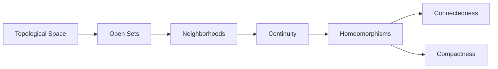

# Foundation: Topology

## 1. Conceptual Mental Model (Core intuition, analogies, and first principles)

Topology is the study of **inherent spatial relationships** that persist under continuous deformation—*without* reference to distance, measurement, or specific coordinates. Think of it as the "geometry of shape without size":  
- **Core intuition**: Imagine stretching, bending, or twisting a rubber sheet (e.g., a coffee cup vs. a donut) while *never* tearing or gluing. Properties that remain unchanged (like "having one hole") define the topological structure.  
- **Key analogy**: Topology is to *space* what **algebra** is to *numbers*. Just as algebra reveals structure through operations (addition, multiplication), topology reveals structure through *adjacency* and *continuity*.  
- **First principles**:  
  - **Invariance**: Topological properties (e.g., connectedness, compactness) must be preserved under continuous transformations.  
  - **Local vs. global**: Topology focuses on *local* neighborhoods (e.g., "what's near a point?") to infer *global* properties (e.g., "is the space connected?").  
  - **Abstraction**: Topology abstracts away metric structures (distance) to capture *qualitative* relationships—making it the foundation for fields like algebraic topology, differential geometry, and data analysis.

## 2. Essential Terminology & Taxonomy

| Term                  | Definition & Core Purpose                                                                 | Why It Matters                                                                 |
|-----------------------|----------------------------------------------------------------------------------------|------------------------------------------------------------------------------|
| **Topological Space** | A set `X` with a collection `τ` of subsets (open sets) satisfying:  1. `∅, X ∈ τ`  2. Arbitrary unions of sets in `τ` are in `τ`  3. Finite intersections of sets in `τ` are in `τ` | *The minimal structure to define "nearness" and continuity* |
| **Open Set**          | A subset `U ⊆ X` such that `U ∈ τ` (where `τ` is the topology on `X`)                  | *Defines neighborhoods and continuity; the foundation of all topological constructions* |
| **Neighborhood**      | For `x ∈ X`, a set `N` containing `x` such that `N` is an open set containing `x`     | *Encodes local structure; critical for continuity and convergence* |
| **Continuity**        | A function `f: (X, τ₁) → (Y, τ₂)` is continuous iff `f⁻¹(V) ∈ τ₁` for all `V ∈ τ₂`    | *Preserves topological structure; bridges spaces without "breaking" continuity* |
| **Homeomorphism**    | A continuous bijection `f: X → Y` with `f⁻¹` also continuous                           | *Identifies "same shape" (topologically equivalent spaces)* |
| **Connectedness**     | `X` is connected iff it cannot be written as `A ∪ B` with `A, B` non-empty, disjoint, open | *Measures "wholeness"; distinguishes spaces like intervals vs. disconnected sets* |
| **Compactness**       | `X` is compact iff every open cover has a finite subcover                              | *Generalizes "finite size"; crucial for existence theorems (e.g., Heine-Borel)* |

> 💡 *Why these 7 terms?* They form the **minimal toolkit** for constructing all topological concepts. We avoid metrics (e.g., `distance`), manifolds, or homology to stay foundational.

## 3. Architecture & Core Workflow

**Workflow Explanation**:  
1. Start with a *topological space* (a set + open sets).  
2. Use *open sets* to define *neighborhoods* (local structure).  
3. *Continuity* (via preimages of open sets) links spaces.  
4. *Homeomorphisms* (bijective continuous maps) identify equivalent spaces.  
5. *Connectedness* and *compactness* emerge as properties derived from this architecture.

## 4. Common Misconceptions & Mental Traps

| Misconception                          | Why It’s Traps the Mind                                                                 | Correct Insight                                                                 |
|----------------------------------------|-------------------------------------------------------------------------------------|--------------------------------------------------------------------------------|
| "Topology is about shapes"             | Topology studies *properties* of shapes (e.g., holes), not shapes themselves.          | *Topological spaces are abstract sets—shapes are just intuition aids.*           |
| "Open sets = empty space"              | Open sets are *non-empty* (by definition) and include the entire space.               | *Open sets define "nearness," not emptiness.*                                  |
| "Continuous functions are smooth"      | Continuity is *weaker* than smoothness (e.g., a function can be continuous but not differentiable). | *Continuity preserves topological structure; smoothness is a metric property.* |
| "All connected spaces are path-connected" | Path-connectedness is stronger than connectedness (e.g., the topologist’s sine curve is connected but not path-connected). | *Connectedness is a weaker topological property; path-connectedness requires paths.* |

## 5. Socratic Discussion Starters

1. **Why do we define *homeomorphisms* as *bijective continuous functions* with *continuous inverses*?**  
   *(Probe: What would happen if we dropped bijectivity? How does this definition ensure "shape equivalence"?)*

2. **Can a space be *connected* but *not path-connected*? If so, what does this imply about the *local* structure of neighborhoods?**  
   *(Probe: How does this distinction reveal the *minimal* topological requirements for paths?)*

3. **Suppose we have a topological space where *every* open set is also closed. What is the *smallest* non-trivial topology that satisfies this?**  
   *(Probe: How does this relate to the interplay between open/closed sets and the "fineness" of a topology?)*
