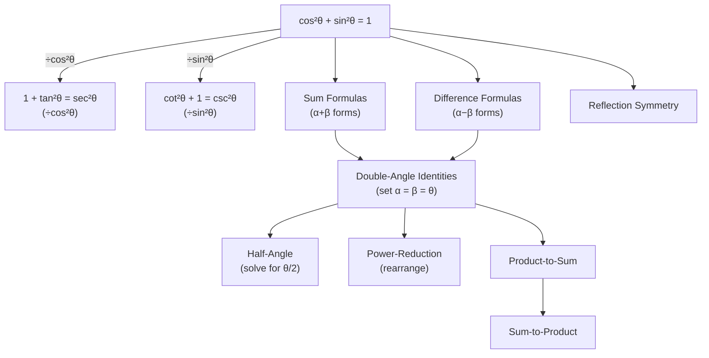

# Lesson 2: Trigonometric Identities and Algebraic Transformations

## 1. First-Principles Intuition & Invariants

Trigonometric identities are not arbitrary algebraic facts to be memorized under duress. They are the visible surface of a deep geometric and analytic invariant: the unit circle, together with the Euclidean metric it encodes, constrains every ratio of sides in every right triangle in ways that propagate through the entire superstructure of real and complex analysis. When we speak of an identity, we mean a statement that holds for every value in the domain of its constituent functions — not a coincidence, not an approximation, but a consequence of structure. Understanding where these identities come from, rather than merely what they say, is what separates a practitioner who can derive from one who can only recall.

The foundational invariant is as old as Pythagoras and as precise as Euclid. Consider a point $P = (\cos\theta, \sin\theta)$ on the unit circle $x^2 + y^2 = 1$ in $\mathbb{R}^2$. The circle is defined by the condition that every point lies at distance exactly 1 from the origin. The Euclidean distance formula applied to $P$ yields immediately:

$$\cos^2\theta + \sin^2\theta = 1$$

This is not a theorem so much as a definition made explicit: $\cos\theta$ and $\sin\theta$ are, by construction, the $x$- and $y$-coordinates of the unit circle's parameterization by arc length, and the defining equation of that circle is the Pythagorean relation. Everything else in the landscape of Pythagorean identities follows from this single equation by elementary algebra. Dividing both sides by $\cos^2\theta$ (wherever $\cos\theta \neq 0$) yields

$$1 + \tan^2\theta = \sec^2\theta$$

because $\sin\theta / \cos\theta = \tan\theta$ and $1/\cos\theta = \sec\theta$ by definition. Dividing the original identity instead by $\sin^2\theta$ (wherever $\sin\theta \neq 0$) produces

$$\cot^2\theta + 1 = \csc^2\theta$$

These three Pythagorean identities are therefore a single fact observed from three different algebraic vantage points, each obtained by rescaling the same geometric constraint. A mathematician who internalizes this will never need to memorize all three independently; they need only remember the unit circle and the capacity to divide.

The story deepens considerably when we ask not about a single angle but about the relationship between two angles $\alpha$ and $\beta$ and their sum. The sum and difference formulas are the most consequential identities in the entire theory, because every remaining identity — double-angle, half-angle, power-reduction, product-to-sum — can be derived from them without any further geometric input. Their proof admits several approaches of varying elegance, but the most rigorous and generalizable uses rotations in $\mathbb{R}^2$ expressed through $2 \times 2$ orthogonal matrices.

A rotation by angle $\theta$ counterclockwise about the origin is represented by the matrix

$$R_\theta = \begin{pmatrix} \cos\theta & -\sin\theta \\ \sin\theta & \cos\theta \end{pmatrix}$$

This matrix is orthogonal (its columns form an orthonormal basis) and its determinant equals $\cos^2\theta + \sin^2\theta = 1$, confirming it lies in $\text{SO}(2)$. Composing two rotations amounts to multiplying their matrices:

$$R_\alpha \cdot R_\beta = \begin{pmatrix} \cos\alpha & -\sin\alpha \\ \sin\alpha & \cos\alpha \end{pmatrix} \begin{pmatrix} \cos\beta & -\sin\beta \\ \sin\beta & \cos\beta \end{pmatrix}$$

Computing this product entry by entry:

$$R_\alpha \cdot R_\beta = \begin{pmatrix} \cos\alpha\cos\beta - \sin\alpha\sin\beta & -\cos\alpha\sin\beta - \sin\alpha\cos\beta \\ \sin\alpha\cos\beta + \cos\alpha\sin\beta & -\sin\alpha\sin\beta + \cos\alpha\cos\beta \end{pmatrix}$$

Since the composition of a rotation by $\beta$ followed by a rotation by $\alpha$ is a rotation by $\alpha + \beta$, this product must equal $R_{\alpha+\beta}$. Reading off the entries of $R_{\alpha+\beta}$ and equating them with those of the product above, we extract the addition formulas:

$$\cos(\alpha + \beta) = \cos\alpha\cos\beta - \sin\alpha\sin\beta$$

$$\sin(\alpha + \beta) = \sin\alpha\cos\beta + \cos\alpha\sin\beta$$

Replacing $\beta$ with $-\beta$ and using the even-odd symmetries $\cos(-\beta) = \cos\beta$ and $\sin(-\beta) = -\sin\beta$ (which follow directly from the unit circle's reflection symmetry across the $x$-axis) yields the difference formulas:

$$\cos(\alpha - \beta) = \cos\alpha\cos\beta + \sin\alpha\sin\beta$$

$$\sin(\alpha - \beta) = \sin\alpha\cos\beta - \cos\alpha\sin\beta$$

The addition formula for $\tan(\alpha + \beta)$ is not an independent fact but an algebraic consequence. Since $\tan\theta = \sin\theta / \cos\theta$, we write

$$\tan(\alpha + \beta) = \frac{\sin(\alpha+\beta)}{\cos(\alpha+\beta)} = \frac{\sin\alpha\cos\beta + \cos\alpha\sin\beta}{\cos\alpha\cos\beta - \sin\alpha\sin\beta}$$

Dividing numerator and denominator by $\cos\alpha\cos\beta$ (valid wherever both are nonzero):

$$\tan(\alpha + \beta) = \frac{\tan\alpha + \tan\beta}{1 - \tan\alpha\tan\beta}$$

The geometric content here is worth pausing over. This formula is precisely what underlies the angle addition law for slopes in projective geometry, the composition formula for Möbius transformations restricted to the real line, and the relativistic velocity addition formula in special relativity. The identity is not merely a trigonometric convenience; it is an expression of how $\text{SO}(2)$ acts on the circle's tangent line at the identity.

---

## 2. Core Architecture & Mechanics

With the sum formulas established, the remaining identities form a tightly connected network, each derivable from the last by substitution or algebraic manipulation. The clearest way to see this structure is to trace the full derivation of each family in turn, treating the sum formulas as the root node of a dependency graph.

**The Double-Angle Identities.** Setting $\alpha = \beta = \theta$ in the addition formulas gives the double-angle formulas immediately. For cosine:

$$\cos(2\theta) = \cos^2\theta - \sin^2\theta$$

This can be rewritten in two further equivalent forms by applying the Pythagorean identity $\cos^2\theta + \sin^2\theta = 1$ to eliminate one of the squared terms. Substituting $\sin^2\theta = 1 - \cos^2\theta$ yields

$$\cos(2\theta) = 2\cos^2\theta - 1$$

and substituting $\cos^2\theta = 1 - \sin^2\theta$ yields

$$\cos(2\theta) = 1 - 2\sin^2\theta$$

All three forms are equivalent; which one to use in a given computation depends on which variable is more convenient to retain. For sine, the addition formula gives directly:

$$\sin(2\theta) = 2\sin\theta\cos\theta$$

For the tangent double-angle formula, applying the tangent addition formula with $\alpha = \beta = \theta$:

$$\tan(2\theta) = \frac{2\tan\theta}{1 - \tan^2\theta}$$

**The Power-Reduction Identities.** The double-angle forms for $\cos(2\theta)$ can be solved algebraically to express $\cos^2\theta$ and $\sin^2\theta$ as linear functions of $\cos(2\theta)$, eliminating the square entirely. From $\cos(2\theta) = 2\cos^2\theta - 1$, we solve for $\cos^2\theta$:

$$\cos^2\theta = \frac{1 + \cos(2\theta)}{2}$$

From $\cos(2\theta) = 1 - 2\sin^2\theta$, solving for $\sin^2\theta$:

$$\sin^2\theta = \frac{1 - \cos(2\theta)}{2}$$

The importance of these two identities in both pure and applied mathematics cannot be overstated. In real analysis, they are the engine of every trigonometric integral involving even powers: without them, computing $\int \sin^2\theta \, d\theta$ requires a substitution that is effectively reinventing the identity. In Fourier analysis, power-reduction converts products of trigonometric functions into sums of sinusoids at different frequencies, which is precisely what allows one to decompose the spectrum of a signal. The power-reduction formula for $\tan^2\theta$ follows from the ratio:

$$\tan^2\theta = \frac{\sin^2\theta}{\cos^2\theta} = \frac{1 - \cos(2\theta)}{1 + \cos(2\theta)}$$

**The Half-Angle Identities.** Replacing $\theta$ with $\theta/2$ in the power-reduction formulas and then taking square roots produces the half-angle identities:

$$\cos\frac{\theta}{2} = \pm\sqrt{\frac{1 + \cos\theta}{2}}, \qquad \sin\frac{\theta}{2} = \pm\sqrt{\frac{1 - \cos\theta}{2}}$$

The sign ambiguity is not a defect of the formula but a reflection of genuine geometric information: the sign depends on the quadrant in which $\theta/2$ lies, and no algebraic manipulation can determine this without knowledge of the specific value of $\theta$. When applying these formulas in a proof, one must explicitly state which quadrant $\theta/2$ inhabits and justify the sign selection. This is one of the most common failure modes in student work, treated in detail in Section 3.

The half-angle formula for tangent admits an elegant alternative form that avoids the ambiguous square root entirely. Starting from the ratio definition and rationalizing:

$$\tan\frac{\theta}{2} = \frac{\sin(\theta/2)}{\cos(\theta/2)} = \frac{2\sin^2(\theta/2)}{2\sin(\theta/2)\cos(\theta/2)} = \frac{1 - \cos\theta}{\sin\theta}$$

where the numerator uses $1 - \cos\theta = 2\sin^2(\theta/2)$ and the denominator uses $\sin\theta = 2\sin(\theta/2)\cos(\theta/2)$. An equivalent form multiplying numerator and denominator of the original by $2\cos(\theta/2)$ gives

$$\tan\frac{\theta}{2} = \frac{\sin\theta}{1 + \cos\theta}$$

Both of these are sign-free, defined wherever the respective denominators are nonzero, and far more useful in practice than the square-root form.

**The Product-to-Sum Identities.** Adding and subtracting the cosine addition and difference formulas reveals a remarkable algebraic symmetry. The addition formula gives $\cos(\alpha - \beta) = \cos\alpha\cos\beta + \sin\alpha\sin\beta$ and the difference formula gives $\cos(\alpha + \beta) = \cos\alpha\cos\beta - \sin\alpha\sin\beta$. Adding these:

$$\cos(\alpha - \beta) + \cos(\alpha + \beta) = 2\cos\alpha\cos\beta$$

which rearranges to

$$\cos\alpha\cos\beta = \frac{1}{2}\left[\cos(\alpha - \beta) + \cos(\alpha + \beta)\right]$$

Subtracting the addition formula from the difference formula:

$$\cos(\alpha - \beta) - \cos(\alpha + \beta) = 2\sin\alpha\sin\beta$$

giving

$$\sin\alpha\sin\beta = \frac{1}{2}\left[\cos(\alpha - \beta) - \cos(\alpha + \beta)\right]$$

Proceeding with the sine addition formulas: adding $\sin(\alpha + \beta) = \sin\alpha\cos\beta + \cos\alpha\sin\beta$ and $\sin(\alpha - \beta) = \sin\alpha\cos\beta - \cos\alpha\sin\beta$ gives

$$\sin\alpha\cos\beta = \frac{1}{2}\left[\sin(\alpha + \beta) + \sin(\alpha - \beta)\right]$$

These product-to-sum formulas convert a product of two trigonometric functions into a sum of single-frequency terms. In the theory of Fourier series, this algebraic conversion corresponds to the convolution theorem: the product of two sinusoids at frequencies $\alpha$ and $\beta$ has spectral content at frequencies $\alpha + \beta$ and $|\alpha - \beta|$, which is exactly the phenomenon of beat frequencies in acoustics and amplitude modulation in signal theory.

**The Sum-to-Product Identities.** The sum-to-product formulas are obtained by running the product-to-sum derivation in reverse through a change of variables. Set $u = \alpha + \beta$ and $v = \alpha - \beta$, so that $\alpha = (u + v)/2$ and $\beta = (u - v)/2$. Substituting into the product-to-sum formula for $\cos\alpha\cos\beta$:

$$\cos u + \cos v = 2\cos\frac{u+v}{2}\cos\frac{u-v}{2}$$

Similarly, from the formula for $\sin\alpha\sin\beta$:

$$\cos v - \cos u = 2\sin\frac{u+v}{2}\sin\frac{u-v}{2}$$

and from the formula for $\sin\alpha\cos\beta$:

$$\sin u + \sin v = 2\sin\frac{u+v}{2}\cos\frac{u-v}{2}$$

$$\sin u - \sin v = 2\cos\frac{u+v}{2}\sin\frac{u-v}{2}$$

These four identities convert a sum or difference of two sinusoids into a product, which immediately reveals the amplitude envelope and the carrier frequency. The factored form $2\cos\frac{u+v}{2}\cos\frac{u-v}{2}$, for example, identifies $\cos\frac{u-v}{2}$ as a slowly varying amplitude envelope modulating a rapidly oscillating carrier $\cos\frac{u+v}{2}$ when $u$ and $v$ are close in value — the mathematical underpinning of beats.

---

## 3. High-Performance Optimization & Failure Modes

Knowing the identities is necessary but not sufficient for mathematical fluency. The genuine practitioner skill lies in selecting the right transformation strategy for a given proof goal and recognizing the structural patterns that make a chain of manipulations terminate. This section addresses the systematic methodology for identity verification and the failure modes that most frequently derail otherwise competent work.

**Canonical Strategy: Work One Side.** The standard method for proving a trigonometric identity is to take one side of the proposed equation and transform it algebraically until it matches the other side, without altering both sides simultaneously. The reason for this discipline is logical hygiene: if you manipulate both sides, you risk constructing a valid chain of equalities that nonetheless fails to establish the original claim because one or more steps assumed what you were trying to prove. The left-to-right direction — transforming the more complex side into the simpler one — is usually more productive, since simplification typically reduces the number of terms and functions involved.

A concrete and instructive example: prove that $\dfrac{\sin\theta}{1 - \cos\theta} = \dfrac{1 + \cos\theta}{\sin\theta}$.

Beginning with the left side, the natural strategy is to rationalize by multiplying numerator and denominator by the conjugate expression $1 + \cos\theta$:

$$\frac{\sin\theta}{1 - \cos\theta} \cdot \frac{1 + \cos\theta}{1 + \cos\theta} = \frac{\sin\theta(1 + \cos\theta)}{1 - \cos^2\theta}$$

The denominator $1 - \cos^2\theta = \sin^2\theta$ by the Pythagorean identity, so:

$$= \frac{\sin\theta(1 + \cos\theta)}{\sin^2\theta} = \frac{1 + \cos\theta}{\sin\theta}$$

This matches the right side exactly, completing the proof. The key move was recognizing the difference-of-squares structure $1 - \cos^2\theta$ latent in the denominator after rationalization, and knowing to reach for the Pythagorean identity to collapse it. This pattern — multiply by a conjugate, then apply Pythagoras — recurs throughout identity proofs involving expressions of the form $1 \pm \sin\theta$ or $1 \pm \cos\theta$, and internalizing it as a technique saves considerable effort.

**Canonical Strategy: Reduce to Sines and Cosines.** When a proposed identity involves $\tan$, $\cot$, $\sec$, or $\csc$, a reliable starting move is to replace every occurrence of these functions with their definitions in terms of $\sin$ and $\cos$. This reduces the problem to a single vocabulary, making Pythagorean substitutions and common-denominator manipulations easier to see. The strategy is not always optimal in terms of step count, but it essentially never fails to make progress.

**Failure Mode: Circular Reasoning.** The most dangerous error in identity proofs is assuming the identity in the course of proving it. This happens when a student writes $A = B$ as a first step (the goal) and then manipulates it to reach $C = C$, reasoning backward from the goal. The chain $A = B \Rightarrow C = C$ is logically useless: a false statement can imply a true one, so the truth of $C = C$ provides no information about $A = B$. The correct logical flow is always a chain of steps in which each step is justified by an already-known identity, proceeding from one side alone to the other side.

**Failure Mode: Domain Neglect.** An identity is only valid within the domain where all constituent functions are defined. The identity $1 + \tan^2\theta = \sec^2\theta$ does not hold at $\theta = \pi/2 + k\pi$ for integer $k$, because both $\tan\theta$ and $\sec\theta$ are undefined there. When applying the half-angle formulas and selecting the sign of a square root, one must specify the domain of $\theta/2$ explicitly and verify that the sign selection is consistent throughout. Failing to do so introduces spurious sign errors that invalidate an otherwise correct derivation. The clean resolution, wherever possible, is to use the sign-free forms of the half-angle tangent rather than the square-root forms.

**Failure Mode: Premature Expansion.** A common inefficiency, particularly in problems involving double-angle or sum-of-angle expressions, is to immediately expand everything into sines and cosines of individual angles using the addition formulas. This expansion generates a large number of terms that then require significant algebraic effort to recombine. The superior approach is to look first for structure that can be matched without full expansion. For instance, to verify

$$\sin(3\theta) = 3\sin\theta - 4\sin^3\theta$$

the temptation is to expand $\sin(3\theta) = \sin(2\theta + \theta)$ using the addition formula and then expand $\sin(2\theta) = 2\sin\theta\cos\theta$ and $\cos(2\theta) = 1 - 2\sin^2\theta$. This approach is entirely valid, but let us trace it carefully to its conclusion. Using $\sin(2\theta + \theta) = \sin(2\theta)\cos\theta + \cos(2\theta)\sin\theta$:

$$= 2\sin\theta\cos\theta \cdot \cos\theta + (1 - 2\sin^2\theta)\sin\theta$$

$$= 2\sin\theta\cos^2\theta + \sin\theta - 2\sin^3\theta$$

Replacing $\cos^2\theta = 1 - \sin^2\theta$:

$$= 2\sin\theta(1 - \sin^2\theta) + \sin\theta - 2\sin^3\theta$$

$$= 2\sin\theta - 2\sin^3\theta + \sin\theta - 2\sin^3\theta$$

$$= 3\sin\theta - 4\sin^3\theta$$

The derivation succeeds, but the organizing insight is that the form of $\cos(2\theta)$ used ($1 - 2\sin^2\theta$, rather than $\cos^2\theta - \sin^2\theta$ or $2\cos^2\theta - 1$) was chosen specifically because we want the final result expressed entirely in terms of $\sin\theta$. This is the broader strategic principle: before expanding, identify the target form of the answer and choose double-angle or Pythagorean substitutions that move toward that form, rather than substituting mechanically.

**Optimization: Matching Structural Signatures.** Experienced practitioners recognize certain algebraic signatures that indicate which identity to reach for. A product of two sines or two cosines or a sine and cosine calls for product-to-sum. A sum of two cosines with arguments that are arithmetic combinations of two underlying angles calls for sum-to-product. An expression that is homogeneous degree 2 in $\sin$ and $\cos$ can almost always be attacked with the Pythagorean identity. An expression involving $\sin^{2n}\theta$ or $\cos^{2n}\theta$ for integer $n$ calls for repeated power-reduction, as each application halves the exponent. A rational function of $\sin$ and $\cos$ that must be integrated or summed over a symmetric interval calls for the Weierstrass substitution $t = \tan(\theta/2)$, which transforms the entire expression into a rational function of $t$ using:

$$\sin\theta = \frac{2t}{1 + t^2}, \qquad \cos\theta = \frac{1 - t^2}{1 + t^2}, \qquad d\theta = \frac{2\,dt}{1 + t^2}$$

These substitutions are themselves direct consequences of the half-angle tangent formula: writing $t = \tan(\theta/2)$ and applying $\sin\theta = 2\sin(\theta/2)\cos(\theta/2)$ and $\cos\theta = \cos^2(\theta/2) - \sin^2(\theta/2)$, then dividing numerator and denominator by $\cos^2(\theta/2)$ and recognizing $\sec^2(\theta/2) = 1 + \tan^2(\theta/2) = 1 + t^2$, yields exactly the formulas above. The Weierstrass substitution thus closes the loop: the entire architecture of trigonometric identities, beginning with the Pythagorean relation on the unit circle, ultimately produces a universal algebraic reduction from trigonometric to rational functions, and in doing so demonstrates that the identity system is not a collection of isolated facts but a coherent algebraic structure built from a single geometric seed.
