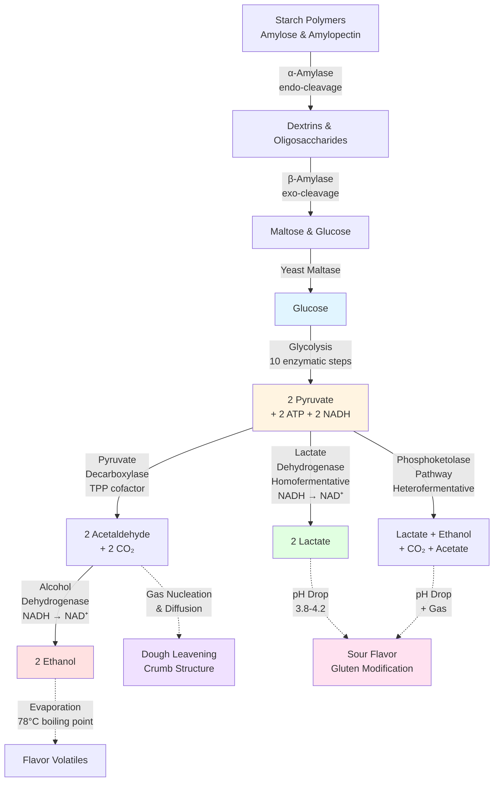

# Lesson 1: Fermentation Biochemistry, Microbiology, Metabolic Pathways

## 1. First-Principles Intuition & Invariants

Fermentation represents one of humanity's oldest controlled biochemical processes, a marriage of microbial metabolism and culinary craftsmanship that transforms simple flour-water doughs into structurally complex, flavor-rich breads and converts grain mashes into ethanol. At its heart, fermentation is an anaerobic metabolic pathway through which microorganisms extract energy from carbohydrates in the absence of oxygen, generating characteristic byproducts—carbon dioxide, ethanol, organic acids, and aromatic compounds—that fundamentally alter the physical structure, chemical composition, and sensory profile of the substrate. Understanding fermentation from first principles requires recognizing that every bubble in sourdough, every tang of acidity, and every alcohol note in beer emerges from specific enzymatic cascades operating within living microbial cells under thermodynamic constraints.

The governing invariant of all fermentation is the central role of adenosine triphosphate (ATP) as the universal energy currency. Microorganisms do not ferment sugars out of gastronomic altruism; they do so to regenerate ATP from adenosine diphosphate (ADP), capturing a small fraction of the chemical potential energy locked in glucose and other hexoses. In aerobic respiration, a single glucose molecule yields approximately 32 ATP molecules through glycolysis, the citric acid cycle, and oxidative phosphorylation. In fermentation, however, the absence of oxygen as the terminal electron acceptor forces cells to rely solely on substrate-level phosphorylation during glycolysis, yielding a mere 2 ATP per glucose. This dramatic energy inefficiency explains why fermenting organisms consume sugars rapidly and produce large volumes of metabolic waste—the ethanol and lactic acid we prize in bread and fermented beverages are simply discarded electron sinks that allow glycolysis to continue by regenerating the oxidized cofactor nicotinamide adenine dinucleotide (NAD⁺) from its reduced form (NADH).

In bread fermentation, the primary agent is *Saccharomyces cerevisiae*, baker's yeast, a facultative anaerobe capable of both aerobic respiration and anaerobic fermentation. When flour and water combine, endogenous amylases—both alpha-amylase (which cleaves internal glycosidic bonds in starch chains) and beta-amylase (which liberates maltose from non-reducing ends)—break down starch polymers into fermentable sugars. Baker's yeast preferentially consumes glucose and maltose through glycolysis, splitting each six-carbon hexose into two three-carbon pyruvate molecules, capturing energy as 2 ATP and 2 NADH. Under anaerobic dough conditions, pyruvate undergoes decarboxylation via pyruvate decarboxylase, releasing carbon dioxide gas and forming acetaldehyde, which is then reduced to ethanol by alcohol dehydrogenase, simultaneously regenerating NAD⁺. The carbon dioxide becomes physically trapped within the gluten network, expanding dough volume and creating the alveolar crumb structure characteristic of leavened bread. The ethanol, highly volatile with a boiling point of 78°C, largely evaporates during baking, though trace amounts contribute subtle flavor complexity.

In sourdough fermentation, the microbial ecosystem expands dramatically. Alongside *Saccharomyces* yeast strains, heterofermentative and homofermentative lactic acid bacteria—principally *Lactobacillus sanfranciscensis*, *Lactobacillus brevis*, *Lactobacillus plantarum*, and *Pediococcus* species—colonize the dough matrix. Homofermentative species convert glucose almost entirely to lactic acid through the Embden-Meyerhof-Parnas glycolytic pathway, producing 2 ATP and 2 lactate molecules per glucose without generating gas. Heterofermentative species employ the phosphoketolase pathway, cleaving hexoses into lactate, ethanol, acetate, and carbon dioxide in variable ratios depending on substrate availability and environmental pH. The organic acids—lactic (pKa 3.86) and acetic (pKa 4.76)—lower dough pH from approximately 6.0 to 3.8–4.2 over 12–24 hours, inhibiting spoilage organisms, enhancing gluten extensibility through partial hydrolysis of peptide bonds, and generating the characteristic sour flavor profile. The stoichiometry of acid production directly correlates with fermentation temperature: warmer temperatures (above 28°C) favor acetic acid–producing heterofermentative pathways and accelerate yeast metabolism, while cooler temperatures (18°C–24°C) shift the balance toward milder lactic acid production and slower, more controlled gas generation.

The symbiotic relationship between yeast and bacteria in sourdough operates through reciprocal metabolic exchanges. Yeast cells release amino acids, vitamins, and nitrogen compounds that nourish bacteria, while bacterial acidification creates a pH environment hostile to competing spoilage organisms but tolerable to acid-adapted sourdough yeasts. Maltose utilization represents a critical metabolic partitioning: most sourdough lactobacilli cannot metabolize maltose directly, whereas *Saccharomyces* species consume it readily, reducing direct substrate competition. Bacterial proteolysis also liberates additional amino acids from gluten proteins, providing nitrogen sources for yeast growth while simultaneously weakening gluten structure—a double-edged sword requiring careful fermentation timing to maximize flavor complexity without over-degrading dough strength.

Temperature stands as the master control variable in all fermentation systems, directly governing enzymatic reaction rates through the Arrhenius equation. For baker's yeast, optimal fermentation occurs between 24°C and 28°C, where glycolytic flux balances carbon dioxide production with manageable dough expansion rates. Below 18°C, enzymatic activity slows exponentially, extending bulk fermentation to 18–24 hours—ideal for developing complex flavor through prolonged enzymatic and microbial activity. Above 35°C, enzyme denaturation begins, and yeast cells experience thermal stress, producing undesirable sulfur compounds and fusel alcohols. In professional bakeries, retarded fermentation at 4°C–8°C exploits this temperature dependence, slowing yeast metabolism to near-dormancy while allowing cold-tolerant amylases and proteases to continue modifying dough structure, yielding superior extensibility and caramelization potential during baking.

## 2. Core Architecture & Mechanics

The biochemical architecture of fermentation resolves into three integrated metabolic subsystems: carbohydrate hydrolysis through enzymatic starch degradation, central carbon metabolism through glycolysis and its fermentative branches, and cofactor regeneration through redox balancing. Each subsystem operates under strict thermodynamic and kinetic constraints, with reaction fluxes determined by substrate availability, enzyme concentration, pH, temperature, and the thermodynamic favorability encoded in Gibbs free energy changes.

Starch hydrolysis initiates the fermentation cascade. Cereal flour contains 65–75% starch by dry weight, composed of amylose (linear α-1,4-glycosidic chains) and amylopectin (branched polymers with α-1,6 branch points every 20–25 glucose residues). Endogenous cereal alpha-amylases, activated by water and optimal at pH 5.5–6.0 and 60°C–70°C, perform endo-cleavage of internal glycosidic bonds, rapidly reducing starch viscosity and generating dextrins and oligosaccharides. Beta-amylase, optimal at pH 5.0–5.5 and 55°C–65°C, performs exo-cleavage from non-reducing chain ends, liberating maltose units. In bread dough at room temperature, these enzymes operate below their thermal optima but remain active throughout fermentation, continuously supplying fermentable sugars as yeast depletes the initial pool. The kinetics follow Michaelis-Menten behavior, with starch concentration initially saturating the enzymes (zero-order kinetics) before transitioning to first-order kinetics as substrate becomes limiting. In sourdough, bacterial acidification gradually inactivates these enzymes as pH drops below 5.0, slowing sugar production and contributing to the extended fermentation timeline.

Glycolysis represents the universal entry point for hexose catabolism, a ten-step enzymatic pathway converting one glucose molecule into two pyruvate molecules with net production of 2 ATP and 2 NADH. The pathway divides into an energy-investment phase (steps 1–5), consuming 2 ATP to phosphorylate glucose and fructose-6-phosphate, and an energy-payoff phase (steps 6–10), generating 4 ATP through substrate-level phosphorylation at the phosphoglycerate kinase and pyruvate kinase steps. The oxidation of glyceraldehyde-3-phosphate to 1,3-bisphosphoglycerate by glyceraldehyde-3-phosphate dehydrogenase couples aldehyde oxidation to NAD⁺ reduction, capturing energy as a high-energy acyl phosphate bond subsequently transferred to ADP. This NAD⁺-dependent step constitutes the critical redox bottleneck: glycolysis cannot proceed unless NADH is continuously reoxidized back to NAD⁺. Aerobic organisms accomplish this through the mitochondrial electron transport chain, but fermenting organisms must employ alternative electron acceptors.

In alcoholic fermentation, pyruvate decarboxylase catalyzes the irreversible decarboxylation of pyruvate to acetaldehyde, releasing carbon dioxide and requiring thiamine pyrophosphate (TPP) as a cofactor. The acetaldehyde then serves as the terminal electron acceptor: alcohol dehydrogenase reduces acetaldehyde to ethanol, oxidizing NADH back to NAD⁺ and closing the redox loop. This two-step shunt bypasses the citric acid cycle entirely, sacrificing the vast majority of glucose's potential energy (which remains locked in ethanol's C-C and C-H bonds) to maintain glycolytic flux. The stoichiometry is elegant: one glucose yields two pyruvates, two CO₂ molecules, two ethanol molecules, 2 ATP, and regenerates 2 NAD⁺. In bread dough, the carbon dioxide diffuses into gluten-encased gas cells, inflating them from initial nucleation diameters of 50–100 micrometers to final diameters of 1–3 millimeters, while ethanol partitions between the aqueous phase and the gas phase, eventually evaporating during baking.

Lactic acid fermentation follows an alternative pyruvate fate. Homofermentative lactobacilli employ lactate dehydrogenase to directly reduce pyruvate to lactate, oxidizing NADH to NAD⁺ in a single step without decarboxylation. The result: one glucose yields two lactate molecules and 2 ATP, with no gas production. Heterofermentative species employ the phosphoketolase pathway, a metabolic variant that cleaves xylulose-5-phosphate (derived from fructose-6-phosphate via the pentose phosphate pathway) into acetyl phosphate and glyceraldehyde-3-phosphate. The acetyl phosphate can be reduced to ethanol (via acetaldehyde) or oxidized to acetate while generating ATP, depending on cellular redox state and substrate availability. Glyceraldehyde-3-phosphate proceeds through the latter half of glycolysis to yield pyruvate and lactate. The net outcome for heterofermentative metabolism of one glucose: one lactate, one ethanol, one CO₂, one acetate (or ethanol), and 1–2 ATP depending on pathway branching. This metabolic flexibility allows heterofermentative bacteria to adapt to varying substrate and oxygen conditions, but the lower ATP yield per glucose necessitates higher substrate consumption rates, accelerating acid accumulation and pH drop.

Microbial kinetics in dough fermentation follow logistic growth curves modulated by nutrient availability, pH, temperature, and oxygen tension. Yeast populations in typical bread dough (0.5–2.0% fresh yeast by flour weight) begin at approximately 10⁷–10⁸ cells per gram. During the lag phase (first 30–60 minutes), cells adapt to the dough environment, synthesizing enzymes and regulatory proteins. Exponential growth ensues as cells divide every 90–120 minutes at 28°C, doubling population until nutrient limitation or waste accumulation triggers stationary phase. In lean doughs (flour, water, salt, yeast), glucose depletion typically limits growth after 2–3 hours, but continued amylase activity sustains slower fermentation through maltose metabolism. Sourdough bacteria exhibit slower growth with doubling times of 3–6 hours, but their acid tolerance allows sustained activity even as pH drops below 4.0, a threshold that inhibits most competing organisms.

The interplay between carbon dioxide production rate and dough rheology determines leavening kinetics. Gas production follows first-order kinetics with respect to yeast population and fermentable sugar concentration, peaking during exponential growth and declining as cells enter stationary phase. However, gas retention depends critically on gluten network strength and surface tension at the dough-gas interface. Freshly mixed dough contains small gas nuclei (50–100 μm diameter) formed during mixing. As fermentation proceeds, carbon dioxide diffuses from the aqueous phase into these nuclei, expanding them according to the ideal gas law modified by Laplace pressure from surface tension. Weak gluten networks rupture under gas pressure, allowing coalescence and gas escape. Strong networks trap gas effectively, but excessive fermentation can over-expand cells, thinning gluten films to the point of rupture—the hallmark of over-proofed dough with coarse, irregular crumb.

## 3. High-Performance Optimization & Failure Modes

Optimizing fermentation performance requires precise calibration of temperature, hydration, inoculation rate, and timing to maximize gas production, flavor development, and dough strength retention while avoiding over-fermentation, excessive acidity, or structural collapse. Professional bakers exploit three primary control levers: bulk fermentation temperature and duration, dough hydration percentage, and preferment usage to modulate fermentation kinetics and flavor complexity.

Temperature control delivers the most direct performance leverage. A 10°C temperature increase approximately doubles enzymatic and microbial reaction rates (Q₁₀ ≈ 2), compressing fermentation timelines but sacrificing flavor complexity. For lean doughs targeting mild flavor and reliable structure, bulk fermentation at 26°C–28°C for 60–90 minutes provides predictable gas production and minimal acidity. For artisan breads requiring complex flavor, cold bulk fermentation at 4°C–8°C for 12–24 hours dramatically extends enzymatic activity while slowing yeast metabolism, yielding doughs with enhanced extensibility, superior caramelization during baking, and richer flavor from extended proteolysis and Maillard precursor accumulation. The failure mode: insufficient cold fermentation (under 8 hours) yields underdeveloped flavor and poor extensibility, while excessive cold fermentation (over 36 hours) over-weakens gluten through excessive proteolysis, resulting in slack, sticky doughs that collapse during shaping.

Hydration percentage (water weight divided by flour weight, expressed as a percentage) profoundly impacts fermentation kinetics through multiple mechanisms. Higher hydration (75–85%) increases enzyme mobility, accelerates starch hydrolysis, and provides more favorable conditions for bacterial growth, but simultaneously weakens gluten networks and increases susceptibility to over-fermentation. Lower hydration (60–70%) yields stiffer doughs with stronger gluten networks and slower enzymatic activity, extending fermentation tolerance but reducing enzymatic flavor development. Sourdough fermentation particularly benefits from hydration above 70%, as the increased water activity promotes bacterial metabolism and acid diffusion, accelerating pH drop. The critical failure threshold occurs when hydration exceeds gluten's capacity to form a continuous network (typically above 90% for bread flour), resulting in batter-like consistency and complete loss of gas retention.

Preferments—poolish (100% hydration), biga (50–60% hydration), pâte fermentée (old dough), and sourdough starters—serve as microbial and enzymatic amplifiers, pre-conditioning a portion of the final dough's flour and water with active yeast and bacteria. Poolish fermentation at room temperature for 12–16 hours produces a highly active, liquid preferment rich in organic acids, alcohol, and enzymatic breakdown products. Incorporating 20–40% poolish by total flour weight accelerates final dough fermentation, enhances flavor complexity through accumulated fermentation byproducts, and improves dough extensibility through partial gluten proteolysis. Biga, fermented for 12–18 hours at cool temperatures, provides similar benefits with less hydration-induced weakening. The optimization challenge lies in timing preferment maturity: under-fermented preferments contribute insufficient flavor and enzymatic activity, while over-fermented preferments introduce excessive acidity and weakened gluten fragments, resulting in slack, over-acidic doughs with poor volume.

Sourdough starter maintenance exemplifies high-performance microbial ecosystem management. A mature starter maintained at 100% hydration (equal weights flour and water) and refreshed every 12–24 hours at 24°C–28°C achieves stable pH 3.8–4.2 and predictable leavening power. The refresh ratio (weight of new flour/water divided by weight of retained starter) controls microbial population dynamics: a 1:5:5 refresh (1 part starter, 5 parts flour, 5 parts water) dilutes the population, forcing exponential growth and maximizing activity at peak maturity (typically 6–8 hours post-feeding at 26°C). The failure mode of infrequent feeding: accumulated acidity inhibits yeast while selecting for highly acid-tolerant bacteria, skewing the ecosystem toward extreme sourness and weak leavening. Conversely, excessive feeding without sufficient fermentation time prevents acid accumulation, yielding mild-flavored starters with unstable microbial ratios.

Diagnostic indicators for fermentation state include visual dough volume (target: 50–100% volume increase for bulk fermentation), pH measurement (target: 4.8–5.2 for yeasted dough, 3.8–4.2 for sourdough), and the "poke test" for final proof: gently pressing the dough surface should leave a slowly rebounding indentation. Rapid rebound indicates under-proofing (insufficient gas production and gluten relaxation), while no rebound indicates over-proofing (gluten network rupture and gas loss). Gas production rate can be monitored by tracking dough height in a cylindrical container, targeting linear expansion during exponential phase and plateau as cells enter stationary phase. Over-proofed dough exhibits characteristic failure signatures: collapsed dough volume, sour or alcoholic off-odors (from excessive fermentation byproducts), and inability to hold shape during shaping or scoring.

Thermal kill protocols during baking exploit the fact that yeast cells die at 55°C–60°C and most enzymes denature above 70°C, arresting fermentation and setting dough structure. Insufficient oven temperature (below 200°C for hearth breads) allows prolonged enzymatic activity during the bake, degrading starch structure and yielding gummy, under-set crumb. Excessive temperature (above 260°C) causes rapid surface caramelization before interior structure sets, trapping excess moisture and producing dense, doughy interiors. The optimal baking profile for artisan breads: initial high temperature (240°C–260°C) for rapid oven spring (final gas expansion driven by thermal expansion and vaporization), followed by temperature reduction to 210°C–220°C for even heat penetration and complete starch gelatinization, targeting internal crumb temperature of 96°C–98°C.

## 4. Summary & Verification Matrix

| Governing Invariant | Mechanism & Architecture | Diagnostic Criteria | Failure Mode & Mitigation |
|---|---|---|---|
| **ATP Yield Constraint** | Fermentation yields only 2 ATP per glucose via substrate-level phosphorylation in glycolysis; ethanol and lactate serve as obligate electron sinks to regenerate NAD⁺ and sustain glycolytic flux; accounts for rapid sugar consumption and large byproduct volumes. | Monitor sugar depletion rate via reducing sugar assays or refractometry; yeast consumes 1–2% of flour weight as fermentable sugars during typical bulk fermentation; CO₂ production rate peaks during exponential phase (1–2 mL/min/g dough at 26°C). | Insufficient fermentable sugars (low amylase activity, short autolyse): weak leavening and bland flavor. Mitigation: extend autolyse to 30–60 minutes, add diastatic malt (0.5–1.0%), or use lower-protein flours with higher endogenous amylase. |
| **pH-Dependent Enzyme & Microbial Activity** | Amylases optimal at pH 5.0–6.0; yeast optimal at pH 4.5–6.0; homofermentative bacteria optimal at pH 5.5–6.5; heterofermentative bacteria tolerate pH 3.5–5.5. Bacterial acid production self-limits through pH inhibition (below 3.8). | Measure dough pH with calibrated meter; yeasted dough maintains pH 5.0–5.5; sourdough drops to 3.8–4.2 over 12–24 hours. Taste for balanced sour intensity; acetic acid (pKa 4.76) tastes sharper than lactic (pKa 3.86). | Over-acidification (pH < 3.5): excessively sour flavor, yeast inhibition, over-weakened gluten. Mitigation: reduce fermentation time/temperature, increase refresh ratio for starters, or buffer with small amounts of baking soda (0.1–0.2%, sacrificing some sour character). |
| **Gas Retention via Gluten Network Integrity** | Carbon dioxide diffuses into gluten-encased gas cells, expanding them according to ideal gas law and Laplace pressure; gas retention requires continuous gluten films with sufficient tensile strength to resist rupture under internal gas pressure and surface tension forces. | Perform windowpane test post-mixing: stretch small dough piece; should form translucent membrane without tearing. Monitor dough volume during proof: target 50–100% increase. Poke test: slow rebound indicates optimal proof. | Over-proofing: excessive gas expansion thins gluten films to rupture threshold; dough collapses when handled or scored. Mitigation: reduce fermentation time/temperature, increase dough strength via stronger flour or improved mixing, or shape and bake promptly upon reaching target volume. |
| **Temperature-Dependent Reaction Kinetics (Q₁₀ ≈ 2)** | Enzymatic and microbial reaction rates approximately double per 10°C increase; controls fermentation timeline, flavor complexity (longer fermentation → more enzymatic proteolysis and byproduct accumulation), and acid production balance (warmer → more acetic acid from heterofermentative pathways). | Track fermentation time to target volume at known temperature; 26°C bulk fermentation reaches target in 60–90 minutes; 4°C cold fermentation requires 12–24 hours. Use thermometer to verify dough temperature (friction from mixing adds 2°C–4°C). | Thermal runaway: uncontrolled temperature rise during bulk fermentation (from fermentation heat release in large batches) accelerates kinetics beyond control, causing over-proofing. Mitigation: ferment in temperature-controlled environment, divide large batches, or use ice water in initial mix to lower starting temperature. |
