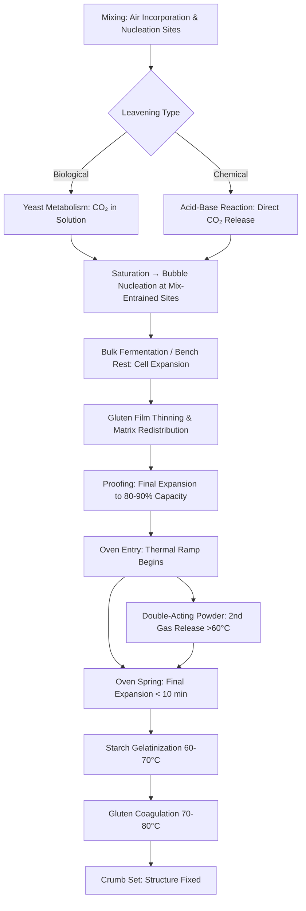

# Lesson 2: Leavening Mechanisms, Gas Retention, Structural Development

## 1. First-Principles Intuition & Invariants

Every leavened baked good is governed by a single, indivisible equation: the final volume of the product equals the quantity of gas produced multiplied by the fraction of that gas successfully retained by the structural matrix, all modulo the temperature and pressure conditions of the baking environment. Gas production without retention yields a flat, dense crumb. Gas retention without production yields a tough, compact mass. The baker's craft sits at the intersection of these two forces, and every decision — flour selection, hydration level, kneading intensity, fermentation temperature, oven temperature, steam injection — either increases gas production, improves gas retention, or manages the thermal conditions under which both operate. This is the foundational invariant of leavening, and it applies equally to a panettone rising under a natural sourdough culture and to a biscuit lifted by a double-acting baking powder.

The second invariant concerns the nature of the structural matrix itself. In wheat-based doughs, that matrix is gluten — a viscoelastic protein network formed when gliadin and glutenin, two insoluble storage proteins endemic to the wheat endosperm, hydrate and mechanically interlock under shear. Gluten is not present in flour as a pre-formed network. It exists as discrete protein aggregates embedded in starch granules. Only when water contacts flour and mechanical energy is applied do these proteins unfold, align, cross-link through disulfide bonds, and form the continuous, extensible film that traps gas bubbles. The degree of gluten development is therefore a function of three variables: protein content of the flour (determined by wheat variety and growing conditions), hydration percentage (water weight divided by flour weight, expressed as a baker's percentage), and mechanical energy input (kneading time, shear rate, or fold repetitions). A bread flour at 12.5% protein hydrated to 65% and kneaded to full windowpane development will produce a dramatically different matrix than a pastry flour at 9% protein hydrated to 50% and minimally mixed. The baker controls all three.

The third invariant distinguishes the two families of leavening agents. Biological leaveners — primarily Saccharomyces cerevisiae commercial yeast and wild sourdough consortia of yeast and lactic acid bacteria — produce carbon dioxide through metabolic respiration of fermentable sugars. This process is slow, temperature-dependent, and carries secondary flavor consequences: yeast produces ethanol, organic acids, and aromatic esters that define the flavor profile of naturally leavened breads. Chemical leaveners — sodium bicarbonate, acidulated baking powders, ammonium bicarbonate — produce gas through acid-base neutralization or thermal decomposition. This process is fast, controllable, and flavor-neutral (or, in the case of baking soda, mildly alkaline and capable of browning enhancement through accelerated Maillard reactions). The choice between these systems is rarely arbitrary. It is determined by the desired crumb structure, flavor profile, production timeline, and the chemical environment of the dough or batter.

Consider the structural implications. A lean bread dough at 65% hydration, leavened by a sourdough starter at 20% inoculation, develops a strong gluten network over a long bulk fermentation of four to six hours at 24°C. The gas cells nucleate slowly, expand gradually, and the gluten matrix has time to thin into films around each cell without rupturing. The result is an open, irregular crumb with large alveoli — the hallmark of a well-fermented artisan loaf. Contrast this with a muffin batter at 80% hydration, leavened by 2% baking powder (by flour weight), mixed for thirty seconds and immediately baked. The gluten network here is barely developed — the batter is more accurately a viscous fluid than a viscoelastic solid. Gas retention depends not on a protein film but on batter viscosity and surface tension of the fat phase. The result is a fine, even, cake-like crumb. The leavening system and the structural matrix are co-evolved: you cannot swap a biological leavener into a chemically leavened formula without rebuilding the entire hydration and mixing protocol.

The fourth invariant is thermal. Starch gelatinization and protein denaturation set the final structure, and they do so within a narrow temperature band. Wheat starch begins gelatinizing at approximately 60°C, with peak swelling occurring between 65°C and 70°C. Gluten denatures and coagulates between 70°C and 80°C, losing extensibility and becoming a rigid scaffold. Once both processes complete, the crumb is set: no further expansion is possible, and gas production becomes irrelevant because the matrix can no longer accommodate it. This is why oven spring — the rapid initial expansion in the first ten minutes of baking — is the last meaningful contribution of leavening. After that, the die is cast. The baker's window for influencing final volume closes when the internal temperature of the product crosses 70°C.

## 2. Core Architecture & Mechanics

The leavening system in any baked good can be modeled as a four-stage pipeline: nucleation, expansion, retention, and thermal fixation. Each stage has distinct physical mechanisms, and a failure at any stage propagates forward to produce a defective crumb.

Nucleation is the formation of the initial gas bubbles within the dough or batter. In biological leavening, the first gas bubbles are not produced by yeast metabolism directly. Yeast produces CO₂ in solution, and the gas does not form discrete bubbles until it exceeds the liquid's saturation concentration and comes out of solution at nucleation sites. These nucleation sites are typically micro-pockets of air incorporated during mixing — the fat-coated air cells in creamed butter, the bubbles entrained during kneading, or the residual gas pockets left in the gluten matrix from previous fold cycles. This is why the first mix of a bread dough is structurally critical: the air incorporated during initial kneading seeds every gas cell that will later expand during fermentation. A dough mixed under vacuum, or a batter mixed so gently that no air is entrained, will ferment poorly because the dissolved CO₂ has nowhere to nucleate and will simply escape through the dough surface.

In chemical leavening, nucleation is more direct. Baking soda (sodium bicarbonate) reacts with an acid — cream of tartar, buttermilk, yogurt, lemon juice, or the mono-calcium phosphate in a commercial baking powder — to release CO₂ on contact. Double-acting baking powders release approximately 30% of their gas at room temperature upon hydration (the acid salt reacting with the bicarbonate) and the remaining 70% at oven temperatures above 60°C (the second acid salt, typically sodium aluminum sulfate, activating thermally). This staged release is engineered to match the thermal setting timeline: the first burst provides initial nucleation and lift during bench rest, and the second burst provides the driving force for oven spring as the matrix begins to set.

Expansion is governed by the ideal gas law in its practical form: the volume of a gas bubble is proportional to its absolute temperature. A dough proofed at 24°C (297 K) and baked in a 230°C oven (though the internal dough temperature will only reach approximately 100°C at the crumb center) experiences a temperature increase that drives roughly a 5% expansion of existing bubbles through thermal enlargement alone — not dramatic, but significant when compounded across millions of cells. The dominant expansion force, however, is continued gas production. In yeast-leavened doughs, fermentation accelerates as the dough warms in the oven, with yeast activity peaking around 35°C before thermal death at approximately 55°C. This window between oven entry and yeast death is the engine of oven spring: the yeast enters a final burst of metabolic activity, producing CO₂ at an accelerated rate, while the existing gas cells thermally expand and the still-extensible gluten matrix stretches to accommodate. The steam injected into the oven (or trapped under a Dutch oven lid) delays crust formation by keeping the surface temperature below 100°C, extending the window of extensibility and allowing maximum volume gain.

Retention is the domain of rheology — the study of how materials deform and flow under stress. A bread dough is a viscoelastic material: it exhibits both elastic behavior (it springs back when stretched, like a rubber band) and viscous behavior (it flows and permanently deforms under sustained stress, like honey). The ideal dough for gas retention is highly extensible (it stretches without tearing) but sufficiently elastic to hold its shape and not collapse under its own weight. This balance is controlled by gluten development and hydration. Underdeveloped gluten is weak and tears under the pressure of expanding gas cells, producing a dense, coarse crumb with irregular, burst-looking alveoli. Overdeveloped gluten, rare but achievable through excessive machine kneading, becomes excessively elastic and resistant, constraining expansion and producing a tight, rubbery crumb with small, uniform cells.

The retention mechanism in chemically leavened batters operates differently. With low-protein flours and high hydration, there is no meaningful gluten film. Gas retention depends on batter viscosity — the continuous phase of flour, water, fat, and sugar is thick enough to slow gas bubble coalescence and upward migration. The fat phase plays a critical role: in a creamed cake batter, the fat coats the air cells incorporated during creaming, stabilizing them against coalescence. Emulsifiers — whether added commercially as mono- and diglycerides or present naturally in egg yolks as lecithin — reduce the interfacial tension between gas and liquid phases, preventing bubble rupture and promoting a fine, even cell structure. This is why a cake recipe that omits eggs or substitutes oil for butter without adjusting the emulsifier content will produce a coarse, irregular crumb: the gas cells merge and rise to the surface, leaving a structureless, hole-riddled interior.

The final structural matrix is set by thermal fixation, which proceeds in two concurrent phases. Starch gelatinization begins when the crumb temperature reaches approximately 60°C. Native wheat starch granules, which are insoluble in cold water, absorb water and swell irreversibly as temperature rises, eventually bursting and releasing amylose and amylopectin into the matrix. This process increases viscosity dramatically, converting the dough from a viscoelastic material to a semi-rigid gel. Simultaneously, gluten proteins denature: their folded structures unfold and cross-link covalently, forming a rigid protein scaffold that reinforces the starch gel. The interplay between these two networks — the starch gel filling the spaces and the protein scaffold providing backbone — defines the final crumb texture. Bread, with its high protein content and low sugar/fat interference, produces a chewy, resilient crumb where the gluten scaffold dominates. Cake, with its high sugar and fat content (which inhibit both gluten development and starch gelatinization), produces a tender, friable crumb where the starch gel is softer and the protein network is minimal.

## 3. High-Performance Optimization & Failure Modes

The practitioner's challenge is not merely understanding these mechanisms in isolation but orchestrating them in sequence with precise timing. The most common failure mode in biological leavening is over-fermentation. A dough that ferments beyond its optimal window exhausts the available fermentable sugars in the flour, and the yeast begins consuming the flour's complex damaged starches through amylase-mediated breakdown. More critically, the gluten matrix degrades: the acidic byproducts of fermentation (lactic acid from sourdough bacteria, acetic acid from acetic acid bacteria, and various organic acids from yeast metabolism) progressively lower the pH, and at a pH below 4.5, the gluten proteins begin to lose their ability to form strong cross-links. The dough becomes slack, extensible without elasticity, and unable to retain gas. The resulting loaf spreads laterally in the oven, producing a flat, gummy crumb with large, irregular holes separated by thin, translucent cell walls. The diagnostic test is the poke test: press a floured finger 1 cm into the dough surface. An optimally proofed dough springs back slowly and leaves a partial indentation. An over-proofed dough collapses entirely, and the indentation fills immediately.

Under-fermentation produces the opposite defect. The gluten network is strong and extensible, but insufficient gas has been produced to inflate it. The crumb is dense, uniform, and fine, with small alveoli and a cottony texture. The loaf may have good volume from oven spring alone, but it will lack the open, custard-like crumb structure that characterizes well-fermented artisan bread. The diagnostic is the same poke test: an under-proofed dough springs back immediately and fully, leaving no indentation. The remedy is simply more time at the proofing temperature, or a warmer proofing environment.

Dough temperature management is the most powerful optimization lever available to the baker, and it is routinely underutilized. The relationship between temperature and fermentation rate follows a Q₁₀ coefficient of approximately 2.0 for yeast metabolism: for every 10°C increase in temperature, the fermentation rate doubles. A dough fermented at 20°C will take roughly twice as long as the same dough at 30°C, but the slower fermentation produces a more complex flavor profile (more organic acids, more esters, better gluten maturation) and a stronger, more extensible gluten network. The professional standard is to calculate the desired dough temperature (DDT) using the friction factor of the mixer, the flour temperature, and the room temperature, then solve for the water temperature. The formula is: water temperature = (3 × DDT) − (flour temperature + room temperature + friction factor). A friction factor of 1°C per minute of mixing is a reasonable estimate for a spiral mixer on a standard bread dough. For a target DDT of 24°C with flour at 22°C, room at 21°C, and a friction factor of 5°C, the water temperature should be (3 × 24) − (22 + 21 + 5) = 72 − 48 = 24°C. This precision eliminates the guesswork that produces inconsistent fermentation times.

For chemical leavening, the primary failure mode is leavener imbalance. Excess baking soda (more than approximately 0.5% of flour weight in a recipe containing no acidic ingredients to neutralize it) produces an alkaline batter pH above 8.0, which accelerates Maillard browning to the point of producing a dark, bitter crust with a soapy off-flavor. The residual sodium carbonate from incomplete neutralization is the culprit. The remedy is to pair the baking soda with an acidic ingredient — buttermilk, sour cream, molasses, natural cocoa powder (not Dutch-processed) — at a ratio of approximately 120 grams of buttermilk per teaspoon (4.6 g) of baking soda, or to substitute a commercial baking powder that contains its own acid salt. Excess baking powder (above approximately 3% of flour weight) produces a bitter, metallic flavor from residual sodium aluminum sulfate and can cause the crumb to over-expand and collapse, as the matrix cannot support the gas volume generated. Insufficient leavener simply produces a dense, heavy product with poor volume.

The hydration of the dough or batter is the second optimization axis, and it directly affects both gas retention and crumb architecture. Higher hydration (more water relative to flour) produces a more extensible gluten network that can stretch further before tearing, supporting larger gas cells and a more open crumb. But higher hydration also reduces dough viscosity, which increases gas mobility and the rate at which bubbles coalesce and escape. The practical upper bound for an open crumb in a hearth bread is approximately 75–80% hydration, beyond which the dough becomes too slack to hold its shape and the gas escapes faster than it is produced, producing a flat, gummy loaf. For ciabatta, which targets a very open crumb, the optimal range is 75–78% hydration with minimal handling and a long, cold retard to allow the gluten to develop through autolyse and time rather than mechanical input. For a baguette, which targets a moderate, even crumb, 65–68% hydration with more active shaping produces the target structure.

The autolyse technique deserves specific attention as an optimization strategy. Pioneered by Professor Raymond Calvel in the mid-twentieth century, the autolyse involves mixing flour and water only — no salt, no yeast, no starter — and resting the shaggy mass for 20 to 40 minutes before adding the remaining ingredients and completing the mix. During this rest, the flour hydrates fully and uniformly, the gluten proteins begin to align and cross-link without mechanical input, and the endogenous flour enzymes (proteases and amylases) begin breaking down damaged proteins and starches. The result is a dough that reaches full gluten development with significantly less kneading — often 50% less — which preserves the delicate gas cell structure that aggressive mixing can destroy. For high-hydration doughs targeting an open crumb, the autolyse is not optional; it is the mechanism by which the dough achieves sufficient strength without the mechanical shearing that would tighten the crumb.

The cold retard — holding the dough at 4°C (refrigerator temperature) for 8 to 24 hours after bulk fermentation — is the complementary optimization. At 4°C, yeast metabolism slows to roughly 10% of its rate at 24°C, but it does not stop. Gas continues to be produced, slowly and uniformly, distributing it evenly through the dough. More importantly, the proteolytic enzymes continue to work, slowly remodeling the gluten network and improving its extensibility. The organic acids continue to accumulate, developing flavor. The cold retard is the single most powerful tool for improving both the flavor and the crumb structure of a naturally leavened bread, and it is the technique that distinguishes professional sourdough from home-fermented loaves. The dough should be retarded for a minimum of 8 hours; 12 to 18 hours is optimal. Beyond 24 hours, the proteolytic breakdown begins to weaken the gluten excessively, and the dough will lose its ability to hold shape and retain gas.

## 4. Summary & Verification Matrix

| System / Mechanism | Governing Invariant | Key Parameters | Diagnostic Criteria | Primary Failure Mode | Corrective Action |
|---|---|---|---|---|---|
| **Biological Leavening (Yeast)** | Gas production rate = f(T, sugar availability, yeast concentration); Q₁₀ ≈ 2.0 | DDT 24–26°C; inoculation 0.2–1.0% instant yeast (flour weight); bulk 2–4 h at 24°C; proof to 80–90% volume | Poke test: partial springback, slight indentation remains | Over-fermentation: pH <4.5 degrades gluten; dough goes slack, spreads in oven | Reduce fermentation time; lower DDT; cold retard at 4°C to slow yeast while developing flavor |
| **Biological Leavening (Sourdough)** | Yeast + LAB co-culture; acidification strengthens flavor but weakens gluten past pH 4.5 | 20% starter inoculation; 78–82% hydration; bulk 4–6 h at 24–26°C; cold retard 12–18 h at 4°C | Dough holds shape on bench; surface shows slight dome and tension | Under-fermentation: dense crumb, small alveoli, sour taste without volume | Extend bulk or warm proofing; ensure starter is active (doubles in 4 h at 25°C) |
| **Chemical Leavening (Baking Soda)** | NaHCO₃ + acid → CO₂ + Na-salt; requires pH <6.5 for full reaction; residual alkali causes soapy flavor | 0.25–0.5% of flour weight; pair with buttermilk/cocoa/molasses at ~120 g acid liquid per tsp soda | Batter pH 6.0–7.0; controlled browning; no soapy aftertaste | Excess soda: dark bitter crust, soapy flavor, over-browning | Reduce soda; increase acid ingredient; or switch to baking powder |
| **Chemical Leavening (Baking Powder)** | Double-acting: 30% gas at hydration, 70% gas above 60°C; thermal second release matches oven spring window | 1.5–3.0% of flour weight; immediate bake after mixing | Even fine crumb; no bitter metallic taste; good volume without collapse | Excess powder: bitter metallic flavor (SAS), over-expansion and collapse | Reduce to 2% max; ensure immediate bake after mix to capture first gas release |
| **Gluten Matrix & Gas Retention** | Retention = f(gluten development, hydration, matrix integrity); viscoelastic balance of extensibility and elasticity | Bread flour 12–13% protein; hydration 65–78%; full windowpane development; autolyse 20–40 min | Windowpane test: thin translucent film without tearing; dough holds shape | Underdeveloped gluten: coarse crumb, torn cell walls, poor volume | Increase kneading or fold frequency; autolyse to build strength; verify flour protein content |
| **Thermal Fixation (Oven Spring & Crumb Set)** | Starch gelatinizes 60–70°C; gluten coagulates 70–80°C; structure fixed above 75°C internal | Oven 230–260°C hearth bread / 175–190°C enriched; steam first 10 min; internal target 95–100°C bread, 85–93°C cake | Hollow sound on tap; internal temp reached; crust color GBD (golden brown delicious) | Underbaked: gummy crumb, collapsed structure as it cools | Verify internal temperature with probe; extend bake time; lower oven temp if crust browns before crumb sets |
