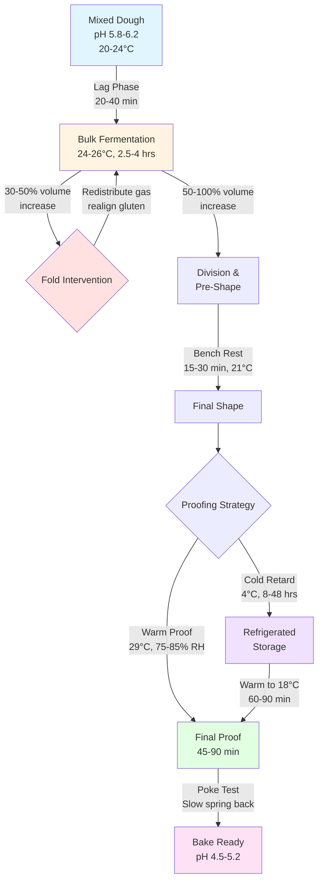

# Lesson 3: Dough Fermentation, Proofing Kinetics, Environmental Controls

## 1. First-Principles Intuition & Invariants

Fermentation is the metabolic engine that transforms a simple mixture of flour, water, salt, and leaven into a living, breathing dough structure capable of extraordinary expansion, flavor complexity, and textural transformation. At its core, fermentation is a controlled microbial cultivation process governed by yeast and bacterial populations consuming fermentable sugars and producing carbon dioxide, ethanol, organic acids, and dozens of volatile aromatic compounds. The baker's task is not merely to wait for dough to rise, but to architect a precise environmental envelope—temperature, humidity, time, and mechanical intervention—that maximizes enzymatic activity, gas retention, and gluten network maturation while avoiding the catastrophic collapse that occurs when fermentation outpaces structural development.

The fundamental invariant governing all dough fermentation is the balance between gas production rate and gluten network extensibility. Yeast metabolism accelerates exponentially with temperature, following modified Arrhenius kinetics with an optimal activity window between 24°C and 29°C for *Saccharomyces cerevisiae*. Below 15°C, metabolic activity slows to a crawl, entering a retardation regime useful for flavor development but requiring extended time horizons measured in days rather than hours. Above 35°C, yeast begins to experience thermal stress, producing off-flavors and ultimately dying above 46°C. Meanwhile, the gluten network—a viscoelastic matrix formed by hydrated glutenin and gliadin proteins—must develop sufficient tensile strength and elasticity to trap the carbon dioxide produced by fermentation without tearing. This network is both mechanically developed through mixing and kneading, and enzymatically conditioned by protease activity that cleaves peptide bonds, rendering the dough more extensible but also more fragile if overdeveloped.

The relationship between fermentation rate and dough strength defines fermentation tolerance, the temporal window during which dough maintains optimal handling characteristics and baking performance. A low-tolerance dough, such as a high-hydration ciabatta at 80% water content, may have a viable window of only 15 to 30 minutes at peak proof before enzymatic degradation and gas cell coalescence destroy structure. A high-tolerance dough, such as a stiff bagel dough at 55% hydration with added malt and ascorbic acid strengtheners, may tolerate a two-hour proofing window with minimal performance degradation. Understanding these tolerance boundaries allows the baker to schedule production workflows, predict optimal bake timing, and intervene with retardation or mechanical degassing when environmental conditions push fermentation beyond controllable rates.

Enzymatic dough conditioning introduces a parallel transformation pathway that operates independently of yeast metabolism but profoundly influences fermentation outcomes. Amylase enzymes, both endogenous to flour and supplemented through malted barley or fungal additives, cleave starch polymers into fermentable maltose and glucose, providing continuous fuel for yeast populations and preventing premature sugar depletion. Protease enzymes simultaneously hydrolyze gluten peptide bonds, increasing dough extensibility and reducing mixing requirements but also weakening gas retention if activity is excessive. The interplay between amylase-driven sugar liberation and protease-driven gluten weakening creates a dynamic equilibrium that shifts with temperature, hydration, and time, requiring the baker to adjust fermentation protocols based on flour quality, enzymatic activity levels, and desired final texture.

The pH trajectory of fermenting dough provides a quantitative diagnostic window into microbial activity and dough conditioning. Fresh dough typically begins at pH 5.8 to 6.2, reflecting the slightly acidic nature of hydrated flour. As fermentation progresses, lactic acid bacteria—particularly in sourdough systems but also present in commercial yeast doughs—produce lactic and acetic acids, driving pH downward toward 4.5 to 5.0 over bulk fermentation. This acidification strengthens gluten networks through ionic cross-linking, inhibits undesirable microbial competitors, and contributes tangy flavor notes. However, excessive acidification below pH 4.2 can denature gluten proteins and inhibit yeast activity, creating a dense, gummy crumb. Monitoring pH evolution with calibrated meters or inferring it from taste and dough extensibility allows real-time fermentation adjustments, including earlier retardation or accelerated proofing to arrest acid accumulation.

## 2. Core Architecture & Mechanics

The architecture of dough fermentation unfolds across three distinct temporal phases, each characterized by specific microbial population dynamics, gas production rates, and structural transformations. Bulk fermentation, the first and longest phase, begins immediately after mixing and continues until the dough is divided and pre-shaped. During this period, yeast cells undergo a lag phase of 20 to 40 minutes as they acclimate to the dough environment, activate metabolic enzymes, and begin consuming available glucose. Following lag, yeast enters exponential growth, doubling populations every 90 to 120 minutes at optimal temperatures and producing carbon dioxide at accelerating rates. The dough volume increases by 50% to 100% during bulk fermentation, though this expansion is deliberately interrupted by one or two fold sequences—mechanical degassing steps that redistribute yeast populations, equalize dough temperature, and strengthen the gluten network by realigning protein strands.

The fold is not merely a volume-reduction technique but a critical structural intervention that resets gas cell size distribution and prevents premature coalescence. When dough is folded, large gas cells formed during early fermentation are subdivided into smaller, more uniform cells with thicker gluten membranes. This refinement improves final crumb structure by ensuring that expansion during proofing and oven spring occurs uniformly rather than creating large irregular voids. The optimal fold timing occurs when dough has expanded by 30% to 50% but before gas cells have grown so large that folding causes irreversible gluten tearing. For a typical bread dough at 26°C, this translates to fold intervals of 45 to 60 minutes over a total bulk fermentation of 2.5 to 4 hours.

Following bulk fermentation, dough enters the intermediate bench rest phase, a brief 15 to 30 minute period after division and pre-shaping that allows gluten to relax before final shaping. This relaxation is critical because pre-shaping induces mechanical stress that temporarily increases dough elasticity and resistance to extension. Attempting to perform final shaping immediately after pre-shaping results in tearing, uneven thickness, and poor seam closure. The bench rest allows viscoelastic stress relaxation, a time-dependent phenomenon governed by polymer chain disentanglement and conformational rearrangement. Temperature control during bench rest is essential: excessive warmth accelerates fermentation and risks overproofing, while excessive cooling stiffens dough and impedes shaping.

The final proofing phase, occurring after shaping, represents the terminal gas accumulation period before baking. Proofing temperature becomes the dominant kinetic variable, with each 5°C increase roughly doubling fermentation rate. A baguette proofed at 29°C may achieve optimal volume in 45 minutes, while the same dough proofed at 21°C requires 90 to 120 minutes. Professional bakeries exploit this temperature sensitivity by constructing dedicated proofing chambers—insulated enclosures maintaining 24°C to 29°C with 75% to 85% relative humidity. Humidity control is equally critical: air below 70% relative humidity causes surface desiccation, forming a rigid skin that restricts oven spring and creates surface cracks. Air above 85% humidity creates condensation, producing a sticky, unworkable surface. The ideal proofing environment maintains a vapor pressure gradient that allows minimal evaporative cooling while preventing condensation, achieved through saturated salt solutions, ultrasonic humidifiers, or steam injection systems.

Retardation—the deliberate cold-storage of dough at 2°C to 8°C—introduces a fourth optional phase that decouples fermentation from production schedules while enhancing flavor complexity. At refrigerator temperatures, yeast metabolism slows by 90% to 95%, extending fermentation timelines from hours to days. However, enzymatic activity continues at reduced but significant rates, particularly protease and amylase activity, which proceeds at 20% to 40% of room-temperature rates. This extended enzymatic conditioning produces doughs with exceptional extensibility and enables the accumulation of complex flavor compounds—aldehydes, ketones, esters, and alcohols—that require long development times. The retardation protocol matters enormously: dough retarded immediately after mixing undergoes minimal flavor development and must be warmed and bulk-fermented after removal from refrigeration. Dough retarded after 60% to 80% bulk fermentation at room temperature arrives at refrigeration with active yeast populations and developed flavor precursors, requiring only final proofing after cold storage.

The diagram above illustrates the complete fermentation architecture from mixed dough through bake-ready state, showing decision points for mechanical intervention, environmental control transitions, and the optional retardation pathway. Each node encodes critical temperature, humidity, and temporal parameters that govern phase transitions and structural outcomes.

The enzymatic conditioning pathway operates in parallel to fermentation gas production, creating a race between dough strengthening through gluten cross-linking and dough weakening through protease activity. High-protein bread flours with 12% to 14% protein content develop strong gluten networks capable of withstanding extended fermentation, making them suitable for long bulk fermentation and retardation protocols. Lower-protein flours with 9% to 11% protein, typical of pastry and cake formulations, develop weaker networks that require shorter fermentation windows and more aggressive mechanical development through intensive mixing. The falling number test, a measure of alpha-amylase activity based on starch liquefaction rate, provides a quantitative predictor of fermentation tolerance. Flours with falling numbers above 300 seconds exhibit low amylase activity, producing doughs with long fermentation tolerance but requiring added malt or enzymes to maintain sugar availability. Flours with falling numbers below 200 seconds exhibit high amylase activity, producing doughs with rapid sugar production but short fermentation tolerance before excessive starch degradation creates sticky, gummy textures.

## 3. High-Performance Optimization & Failure Modes

Optimizing fermentation performance requires precise control over three environmental variables—temperature, humidity, and time—while accounting for the intrinsic variability of flour enzymatic activity, yeast viability, and ambient conditions. The most powerful optimization lever is temperature staging, a protocol that exploits the nonlinear relationship between temperature and fermentation rate to maximize flavor development while maintaining production efficiency. A typical staging protocol begins bulk fermentation at 21°C to 23°C for the first 90 minutes, allowing gradual yeast activation and extensive enzymatic conditioning without rapid gas production. Temperature is then increased to 26°C to 28°C for the final bulk fermentation period, accelerating gas production and achieving target volume expansion within the desired timeframe. This staged approach produces doughs with more complex flavor profiles than constant-temperature fermentation while reducing total bulk fermentation time by 20% to 30% compared to cold-start protocols.

Humidity optimization during proofing prevents the two catastrophic failure modes that plague final proof: surface desiccation and excessive condensation. Surface desiccation occurs when evaporative moisture loss exceeds 1% to 2% of dough weight, forming a rigid skin that restricts oven spring and causes surface tearing during baking. This failure mode is particularly severe in low-humidity environments below 60% relative humidity and can be diagnosed by touch—properly proofed dough exhibits a soft, supple surface that depresses slightly under gentle finger pressure, while desiccated dough feels papery and resists deformation. The solution is either enclosure in a humidity-controlled proofer or covering with plastic film to create a localized high-humidity microenvironment. Excessive condensation occurs when proofing chamber humidity exceeds dew point temperature, depositing liquid water on dough surfaces. This creates a sticky, unworkable surface that prevents scoring, causes uneven baking, and dilutes surface starches, preventing crust browning. Condensation risk increases dramatically when cold-retarded dough is transferred to warm proofing environments, as the cold dough surface initially sits well below ambient dew point. The mitigation protocol is either slow warming in a cool room for 60 to 90 minutes before proofing or reducing proofer humidity to 70% to 75% until dough surface temperature equilibrates with ambient conditions.

The poke test provides a real-time diagnostic for proofing completion that integrates gas production, gluten strength, and enzymatic conditioning into a single haptic measurement. The test involves gently pressing a fingertip 1 to 2 centimeters into the dough surface and observing the deformation recovery rate. Underproofed dough springs back rapidly and completely within 2 to 3 seconds, indicating insufficient gas accumulation and excessively strong gluten networks that will produce dense crumb and poor oven spring. Properly proofed dough springs back slowly over 5 to 10 seconds, leaving a shallow indentation, indicating optimal gas cell population and gluten extensibility balanced at the threshold of maximum volume potential. Overproofed dough does not spring back at all, leaving a permanent indentation or collapsing entirely, indicating that gas cell membranes have thinned beyond structural viability and enzymatic conditioning has weakened gluten to the point of network failure. The poke test must be calibrated to specific dough formulations—high-hydration doughs exhibit slower spring-back than stiff doughs at equivalent proofing states, and enriched doughs with added fats and sugars require deeper indentations to assess structural integrity.

Retardation protocol optimization requires matching cold storage duration to flour enzymatic activity and desired flavor development. Doughs made from low-enzyme flours with falling numbers above 350 seconds tolerate retardation periods of 48 to 72 hours with minimal structural degradation, producing breads with exceptional flavor complexity and open crumb structure. Doughs made from high-enzyme flours with falling numbers below 250 seconds experience accelerated protease-driven gluten weakening during cold storage, developing excessive extensibility and sticky handling characteristics after 24 to 36 hours. The diagnostic signature of over-retarded dough is loss of surface tension during shaping—the dough spreads and flattens rather than maintaining a taut, domed surface—and produces baked goods with flat profiles and gummy crumb texture. The intervention strategy for high-enzyme flours is either limiting retardation to 12 to 24 hours or adding vital wheat gluten at 1% to 2% of flour weight to increase protein content and strengthen gluten networks against enzymatic degradation.

The failure mode of premature gas cell coalescence occurs when fermentation rate exceeds gluten development rate, causing adjacent gas cells to merge into large irregular voids rather than maintaining a fine, uniform crumb structure. This failure is most common in high-hydration doughs above 75% water content, where gluten networks are inherently weaker and more extensible. The coalescence threshold can be predicted by monitoring dough volume expansion rate—safe expansion proceeds at 15% to 25% volume increase per hour during bulk fermentation, while expansion exceeding 30% per hour indicates imminent structural failure. The mitigation protocol involves immediate fold intervention to subdivide gas cells, temperature reduction to slow fermentation rate, or transition to retardation if production timing allows. In extreme cases, degassing and reshaping can reset dough structure, though this intervention sacrifices accumulated flavor compounds and requires additional proofing time.

The opposite failure mode, insufficient gas production, creates dense, compact crumb with poor volume and texture. This failure has three primary etiologies: expired or thermally damaged yeast, insufficient fermentable sugars due to low-enzyme flour or excessive sugar competition from enrichments, and excessively cold fermentation temperatures below 18°C. Diagnosis requires systematic elimination: fresh yeast from refrigerated storage rules out viability issues, dough pH measurement above 4.2 rules out fermentation arrest from excessive acidification, and ambient temperature verification above 20°C rules out thermal inhibition. The most subtle cause is competitive sugar inhibition in enriched doughs containing more than 8% sugar by flour weight—high osmotic pressure dehydrates yeast cells and slows metabolism, requiring osmotolerant yeast strains or extended fermentation times to achieve adequate gas production.

## 4. Summary & Verification Matrix

| Fermentation Phase | Governing Mechanism | Optimal Parameters | Diagnostic Criteria | Failure Mode & Mitigation |
|-------------------|---------------------|-------------------|---------------------|--------------------------|
| **Bulk Fermentation** | Yeast exponential growth + enzymatic gluten conditioning + fold-driven gas cell subdivision | 24-26°C, 2.5-4 hrs, fold at 30-50% volume increase, target 50-100% total expansion | Dough volume doubling, pH decline to 5.2-5.5, dome retention after fold, smooth extensible texture | **Coalescence:** Expansion >30%/hr → immediate fold + temperature reduction. **Weak structure:** Add vital gluten 1-2%, extend mixing time by 30%. **Slow fermentation:** Increase to 28°C, verify yeast viability, add 0.5% diastatic malt. |
| **Bench Rest** | Viscoelastic stress relaxation + continued low-rate fermentation | 20-22°C, 15-30 min, covered to prevent skin formation | Dough extensibility increase, reduced spring-back resistance, surface remains moist and pliable | **Overproofing:** Excessive volume increase >15% → immediate final shape. **Desiccation:** Dry papery skin → mist surface, cover tightly. **Cold shock:** Dough < 18°C → extend rest to 40-50 min for thermal equilibration. |
| **Final Proof (Warm)** | Accelerated gas production + gluten network strain + enzymatic weakening race | 27-29°C, 75-85% RH, 45-90 min, poke test slow 5-10 sec spring-back | Volume increase 50-75%, finger poke slow recovery with shallow indentation, surface tension maintained | **Overproof:** No poke recovery, collapsed structure → degas, reshape, reproof 50% time. **Underproof:** Rapid poke recovery < 3 sec → extend proof 20-30 min. **Desiccation:** Surface skin → increase humidity to 80-85% or cover. **Condensation:** Wet sticky surface → reduce humidity to 70%, increase air circulation. |
| **Retardation (Cold)** | Suppressed yeast metabolism (10% rate) + continued protease/amylase activity + flavor compound accumulation | 4-6°C, 8-48 hrs depending on flour enzyme activity, post-bulk at 60-80% completion optimal | pH decline to 4.5-5.0, increased extensibility, complex aromatic profile, maintained surface tension | **Over-retardation:** Loss of dough tension, spreading during shaping, gummy crumb → limit to 24 hrs for high-enzyme flour (FN < 250), add vital gluten 2%. **Under-retardation:** Minimal flavor development → extend to 16-24 hrs minimum. **Thermal shock:** Surface condensation when warming → slow warm 60-90 min at 18-20°C before proofing. |

This verification matrix consolidates the critical decision points, quantitative thresholds, and intervention protocols that govern successful fermentation across all phases. Mastery of these parameters transforms fermentation from an uncertain waiting game into a precisely controlled biotransformation process, yielding consistent excellence in volume, crumb structure, flavor complexity, and baking performance regardless of ambient variability or production constraints.
