# Lesson 4: Baking Transformations, Heat Transfer, Maillard Chemistry

## 1. First-Principles Intuition & Invariants

A loaf of bread is, at its core, a controlled failure. The baker's entire art consists of engineering a precise sequence of collapses: the collapse of gluten structure under thermal stress, the collapse of starch granules as they absorb free water, the collapse of fermentation gases into a fixed, rigid crumb. What emerges from the oven is not simply cooked dough — it is a material that has undergone four simultaneous and interdependent phase transitions, each governed by temperature thresholds that the baker must understand not as memorized numbers but as mechanistic invariants.

The first invariant is this: heat moves through bread by all three classical mechanisms simultaneously, and each one governs a different layer of the loaf. Convective heat from oven air and steam strikes the outer surface; conductive heat travels from the crust inward through the crumb's dense protein-starch matrix; radiant heat from deck stones, Dutch oven walls, or electric elements penetrates the base and sides with particular intensity. The baker who understands this triad stops asking "what temperature should my oven be?" and starts asking "which heat transfer mode is limiting my crust development right now?" A covered Dutch oven at 500°F (260°C) for the first twenty minutes is a radiant and conductive environment with suppressed convection, because the lid traps steam and prevents the surface-drying that would otherwise terminate oven spring prematurely. Removing the lid at the twenty-minute mark floods the loaf with convective dry heat precisely when the internal structure has set enough to no longer expand, redirecting all energy toward surface browning. Every baking vessel decision is, beneath the surface, a decision about heat transfer mode and timing.

The second invariant concerns water. Free water in dough is simultaneously the medium for heat transport, the reactant for starch gelatinization, the plasticizer that keeps gluten extensible during oven spring, and the substance whose controlled departure determines final crumb texture and crust brittleness. Water does not merely leave the bread during baking; it migrates from the hot surface toward the cooler interior through vapor pressure gradients, then exits through the crust once the crust itself dries past the dew point. This migration is why a loaf pulled from the oven too early has a gummy crumb even when the crust appears fully browned: the internal temperature never reached the threshold at which starch networks complete their gelatinization and water binding.

The third invariant is sequential irreversibility. The transformations in a baking loaf proceed in a strict thermodynamic order, and no amount of additional baking time can recover from a transformation that was cut short or executed in the wrong thermal environment. Starch that never gelatinized will retrograde into a dense, staling crumb within hours. Gluten that denatured before the loaf achieved full oven spring will produce a dense, torn crust. Maillard reactions that began before the crust was dry enough will produce bitterness rather than the complex, roasty sweetness of properly timed browning. Mastery of baking is mastery of sequence, and sequence is controlled by temperature ramps and moisture management.

---

## 2. Core Architecture & Mechanics

### Oven Spring: The First Seven Minutes

Oven spring is not a single event but a cascade of three overlapping processes compressed into the first seven to ten minutes of baking. When shaped dough enters a hot oven, CO₂ dissolved in the dough liquor comes out of solution as it exceeds its solubility threshold, expanding existing gas cells. Simultaneously, the CO₂ and ethanol produced by yeast activity vaporize and expand thermally at a rate governed by the ideal gas law — volume increases proportionally with absolute temperature, meaning a dough surface jumping from 25°C (298K) to 70°C (343K) sees a roughly 15% volumetric gas expansion from thermal effects alone, before any additional CO₂ production occurs. Finally, alcohol and other fermentation volatiles vaporize below 78°C, contributing additional vapor pressure to the expanding gas cells.

Gluten extensibility is the structural limit on oven spring. If the gluten network is too tight from insufficient bulk fermentation or over-chilling, gas cells cannot expand before the network denatures and locks. If it is too weak from over-fermentation, the cells burst and coalesce, producing a coarse, irregular crumb. The optimal state entering the oven is a gluten network that is both strong enough to retain gas and extensible enough to accommodate rapid expansion — a balance achieved through proper bulk fermentation temperature (24–26°C), appropriate hydration, and a shaped dough that has completed 75–80% of its final proof.

Steam during the first phase of baking serves a precise mechanical function: it condenses on the dough surface, keeping the crust pliable so that internal gas pressure can expand the loaf rather than tearing it. Without steam, surface drying and premature gelatinization of surface starches creates a rigid skin that resists expansion. The scoring cuts the baker makes serve the same goal — controlled weak points that direct the crust's movement along a predetermined path rather than allowing random rupture.

### Starch Gelatinization: 60°C to 85°C

As internal temperature climbs through the 60–85°C band, wheat starch granules absorb free water, swell irreversibly, and disrupt their crystalline structure. This gelatinization is exothermic on a molecular scale but thermodynamically driven by the oven's heat input; the granules transition from discrete, birefringent crystals visible under polarized light to a continuous, amorphous gel network that entraps water and provides structural rigidity to the crumb. The practical implication is that an internal temperature of at least 82°C is required for the crumb to be fully set — a loaf pulled at 75°C will have incompletely gelatinized starch in its core that will produce a gummy, undercooked texture regardless of crust color.

Protein denaturation runs parallel to and partially overlapping with starch gelatinization. Gluten proteins — glutenin and gliadin polymers — begin denaturing around 55°C and are substantially denatured by 80°C. This denaturation is what transforms the viscoelastic dough matrix into a rigid, porous solid. The two processes are thermodynamically coupled: starch gelatinization competes with gluten for the loaf's free water, and the baker's hydration choice determines which process has the larger pool of reactant water. High-hydration doughs (75%+) have sufficient free water to fully gelatinize starch without depleting gluten's plasticization, which is why they produce open, moist crumbs. Lower-hydration doughs restrict gelatinization and produce a chewier, denser matrix.

### Crust Formation and Maillard Kinetics

The crust is the loaf's most thermodynamically active zone. While the crumb climbs slowly toward 95–98°C (the practical ceiling for a water-saturated matrix at sea level, since evaporative cooling prevents the interior from exceeding 100°C), the crust dries rapidly and its temperature climbs well past 100°C once free surface water has evacuated. It is only after surface water activity drops and temperature exceeds approximately 130°C that Maillard reactions begin with commercially relevant speed.

The Maillard reaction is a family of non-enzymatic browning reactions between reducing sugars and free amino acid groups, particularly the ε-amino group of lysine residues in gluten proteins and the free amino acids in fermented doughs. The reaction rate follows Arrhenius kinetics: for every 10°C increase in surface temperature above the initiation threshold, the reaction rate approximately doubles. This means the difference between a crust that browns in 15 minutes at 220°C and one that takes 30 minutes at 190°C is not a matter of preference but of exponential kinetics. The flavor compounds produced — pyrazines, furans, thiophenes, melanoidins — are distinct at different temperature ranges. Surface temperatures of 140–155°C produce lightly nutty, biscuity pyrazines; 155–175°C adds roasty, coffee-adjacent furfurals; above 175°C, increasingly bitter, complex melanoidin polymers dominate.

Caramelization, often conflated with the Maillard reaction, is a wholly different process: the thermal decomposition of sugars in the absence of nitrogen compounds. Pure sucrose begins caramelizing at approximately 160°C, fructose at 110°C, and glucose at 150°C. In bread crusts, both reactions proceed simultaneously, but Maillard chemistry dominates flavor development because the dough's protein content provides abundant amino acid reactants. The baker tastes the balance of these two reaction pathways when comparing the complex, savory-sweet crust of a long-fermented sourdough (rich in free amino acids from proteolytic activity) against the simpler, sweeter crust of a straight-dough enriched bread whose sugars were added rather than produced.

### The Transformation Cascade: State Diagram

The following diagram maps the sequential state transitions a baking loaf undergoes, from oven entry to finished internal temperature, and the heat transfer modes and chemical reactions active at each stage.

```mermaid
flowchart LR
    Start([Start]) --> OvenEntry
    
    subgraph OvenEntry["Oven Entry"]
        OE1["Steam Phase<br/>Surface condensation<br/>Crust pliability maintained<br/>Convective + Radiant heat"]
    end
    
    OvenEntry -->|"0–7 min | Surface < 60°C"| OvenSpring
    
    subgraph OvenSpring["Oven Spring"]
        OS1["Gas Expansion<br/>CO₂ de-solvation<br/>Ethanol vaporization<br/>Thermal gas expansion (PV=nRT)"]
        OS2["Gluten Extension<br/>Gluten elongates<br/>Gas cells expand<br/>Score opens"]
        OS1 --> OS2
    end
    
    OvenSpring -->|"Internal temp 60°C–85°C"| GelatinizationZone
    
    subgraph GelatinizationZone["Gelatinization Zone"]
        GZ1["Starch Swelling<br/>Granule hydration<br/>Crystalline → amorphous<br/>Free water binding"]
        GZ2["Protein Denaturation<br/>Glutenin/gliadin cross-links set<br/>Crumb structure locked<br/>Elasticity lost"]
        GZ1 --> GZ2
    end
    
    GelatinizationZone -->|"Surface temp crosses 100°C"| CrustDrying
    
    subgraph CrustDrying["Crust Drying"]
        CD1["Water Evacuation<br/>Surface Aw drops below 0.9<br/>Moisture migrates inward<br/>Crust temp rises past 130°C"]
    end
    
    CrustDrying -->|"Crust temp 130°C–200°C"| BrowningReactions
    
    subgraph BrowningReactions["Browning Reactions"]
        BR1["Maillard Reaction<br/>Reducing sugars + amino acids<br/>Pyrazines, furans, melanoidins<br/>Rate doubles per 10°C rise"]
        BR2["Caramelization<br/>Fructose 110°C / Sucrose 160°C<br/>Caramel polymers<br/>Colorant and sweetness"]
        BR1 --> BR2
    end
    
    BrowningReactions -->|"Internal temp 92°C–98°C"| FullyBaked["Fully Baked"]
    
    FullyBaked -->|"Remove, cool on wire rack<br/>Moisture redistribution 20–30 min"| End([End])
```

The transition from GelatinizationZone to CrustDrying is the critical junction in the baking arc. If the crust dries and hardens before the interior completes gelatinization — which happens when oven spring steam is insufficient or oven temperature is too high too early — the crumb is permanently compromised regardless of how long the loaf subsequently bakes. The baker's instrument at this junction is a combination of steam management, oven temperature, and the loaf's initial dough temperature going into the oven.

---

## 3. High-Performance Optimization & Failure Modes

### Internal Temperature Profiling as Diagnostic Tool

The single highest-leverage tool an advanced practitioner can adopt is systematic internal temperature logging using a leave-in probe thermometer (Thermoworks Signals, DOT, or equivalent) placed at the geometric center of the loaf before it enters the oven. The resulting temperature curve is an unambiguous diagnostic record. A correctly baking lean sourdough will show a characteristic sigmoid profile: a slow initial climb as the cold crumb absorbs heat conductively, an inflection point around 60°C as gelatinization begins consuming energy, a plateau at approximately 70–75°C lasting several minutes as free water absorbs latent heat, and then a final climb to 92–96°C for a lean sourdough or 88–91°C for a richer enriched bread whose fats and eggs lower the effective starch gelatinization temperature.

Deviation from this sigmoid is diagnostic. A temperature curve that climbs steeply with no plateau at 70°C indicates inadequate free water — either an underhydrated formula or a dough that proofed in conditions so dry that surface evaporation robbed the crumb of moisture before baking. A curve that plateaus for an extended period above 80°C and climbs extremely slowly to final temperature indicates a very dense crumb with poor conductive pathways, often caused by over-fermentation that degraded the gluten network and produced a closed, uneven crumb structure. A curve that shoots past 95°C before the crust has browned indicates an oven temperature too low, forcing extended bake times that dry out the crumb past the ideal window.

For practical execution, pull lean sourdough and country loaves at 93–96°C internal. Enriched breads (brioche, challah, milk bread) pull at 88–91°C, since their fat content makes full gelatinization occur at lower temperatures and over-baking drives off the moisture that makes their crumb tender. Laminated doughs (croissant, kouign-amann) are pulled by color and layer definition rather than internal temperature, as their flaky structure makes probe placement unreliable; however, an oven temperature of 175–185°C combined with 25–30 minutes bake time produces surface temperatures adequate for Maillard browning without burning the exposed butter layers.

### Moisture Migration and the Post-Bake Rest

Pulling a loaf from the oven and immediately slicing it destroys the crumb not through impatience but through physics. The interior of a freshly baked loaf is still above 85°C and saturated with steam. The starch gel network is in its loosest, most hydrated state; slicing at this point shears the gel strands and produces a gummy, compressed crumb that will never recover its intended texture. During the 20–45 minutes of post-bake resting on a wire rack, three processes complete: moisture redistributes from the still-wet interior toward the drier crust, bringing the crumb to a uniform, lower water activity; starch retrogradation begins, stiffening the gel network and providing the crumb with its characteristic bite; and volatile aromatics, particularly pyrazines and organic acids, partially volatilize into the ambient air, mellowing the crust's initial sharp, bitter notes into a more complex flavor profile.

The wire rack is not optional equipment. Setting a hot loaf on a solid surface traps steam under the base, re-wetting the bottom crust and producing the soggy bottom that is one of the most common and easily preventable baking failures. The same vapor pressure gradient that drove moisture outward during baking will drive it back into any surface that is cooler than the loaf, including a wooden cutting board.

### Managing the Maillard Window: Failure Modes and Corrections

The two dominant Maillard failure modes are under-browning and bitterness, and both are more commonly caused by formula and fermentation decisions than by oven calibration. Under-browning despite adequate surface temperature is almost always a symptom of sugar depletion: a long, cold retard fermentation consumes available maltose and glucose, leaving little substrate for browning reactions. The correction is not to raise oven temperature but to add a small amount of diastatic malt powder (1–2g per 1,000g flour) to the formula to maintain amylase activity and ensure residual sugar availability. Bitterness in a well-colored crust is usually the product of Maillard reactions proceeding at too high a surface temperature before the crust has fully dried — a wet surface subjected to 220°C+ heat produces a thin, over-browned skin with a concentration of bitter melanoidin polymers before underlying flavor precursors have had time to develop. The fix is a staged oven temperature: begin at 250°C with steam for oven spring, drop to 220°C after removing the steam source, and finish at 210°C if the loaf is browning ahead of internal temperature completion.

Starch retrogradation — the structural re-crystallization of gelatinized starch chains — begins within hours of baking and is the primary mechanism of staling. It is accelerated by refrigeration (which is why storing bread in the refrigerator makes it stale faster than room temperature storage) and slowed by the presence of amylose-lipid complexes, which is why enriched doughs with added fats have a longer shelf life. For the advanced practitioner, the actionable insight is that bread should be stored at room temperature for one to two days or frozen immediately; the freezer arrests retrogradation completely, and a frozen loaf reheated to an internal temperature of 60°C briefly in a hot oven is effectively restored to its fresh-baked texture by re-melting the retrograded starch crystals.

---

## 4. Summary & Verification Matrix

| Transformation | Temperature Range | Mechanism | Diagnostic Indicator | Failure Mode | Correction |
|---|---|---|---|---|---|
| Oven Spring | Surface 25°C → 60°C, first 7–10 min | CO₂ de-solvation, ethanol vaporization, thermal gas expansion; gluten extensibility permits cell growth | Loaf volume increases 25–40%; score opens cleanly along predetermined axis | Dense, torn crust; minimal volume gain | Ensure adequate proof (75–80%), sufficient steam, dough temp 24–26°C at load |
| Starch Gelatinization | Internal 60°C → 85°C | Granule hydration and crystalline disruption; amorphous gel formation binds free water | Crumb fully set, non-gummy when probed; internal temp sigmoid shows plateau at 70–75°C | Gummy, dense crumb; retrograding rapidly | Pull at minimum 92°C internal; verify with leave-in probe thermometer |
| Protein Denaturation | Internal 55°C → 80°C | Glutenin/gliadin cross-link thermolysis; viscoelastic matrix converted to rigid solid | Crumb holds shape under light compression; no dough-like elasticity | Collapsed crumb post-bake; loaf deflates when scored | Correct bulk fermentation volume (50–75% rise); do not under-proof |
| Maillard Browning | Crust surface 130°C → 200°C | Reducing sugar + amino acid condensation; Arrhenius rate doubles per 10°C | Deep amber-mahogany crust color; complex roasty-sweet aroma; audible hollow knock on base | Under-brown: sugar depletion. Bitter over-brown: too fast, too wet | Add diastatic malt for under-browning; stage oven temperature drop for bitterness |
| Caramelization | Crust surface 110°C (fructose) – 160°C (sucrose) | Thermal sugar decomposition without nitrogen; caramel polymers form | Amber coloration with sweet, slightly burnt sugar aroma; complements Maillard compounds | Premature burning of fructose-rich enriched doughs | Lower oven to 175–185°C for enriched formulas; tent with foil if browning outpaces bake time |
| Moisture Migration & Staling | Post-bake: crumb cools from 95°C → ambient | Vapor pressure gradient drives water from hot interior toward drying crust; starch retrogradation begins within 2–4 hours | Even crumb moisture; non-gummy slice after 30-min rest on wire rack; crust remains crisp | Soggy base from steam trap; gummy crumb from early slicing; rapid staling from refrigeration | Rest on wire rack 20–45 min minimum; store at room temperature or freeze; reheat frozen loaves to 60°C internal |
