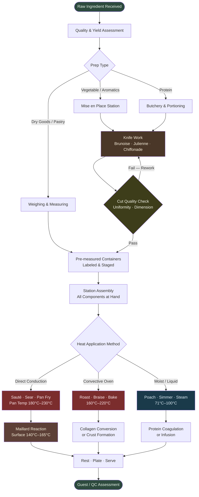

# Lesson 1: Knife Technique, Heat Control, and Mise en Place

## 1. First-Principles Intuition & Invariants

Professional cooking is, at its foundation, an exercise in controlled transformation. Raw ingredients arrive at the kitchen in a state of biological complexity — dense cellular matrices, tightly bound proteins, volatile aromatic compounds locked inside membrane structures — and the cook's entire arsenal of technique exists to selectively disrupt that complexity in ways that produce predictable, desirable results. Before any flame is lit or blade is drawn, the practitioner must understand a core invariant that governs everything else: *precision precedes speed, and speed is simply precision made automatic*. No amount of kitchen velocity compensates for irregular cuts that cook unevenly, poorly calibrated heat that scorches the exterior while leaving the interior raw, or a disorganized station that forces reactive, error-prone decision-making. These three domains — knife technique, heat control, and mise en place — are not separate skills to be learned sequentially. They form an integrated operational system, and mastery in one amplifies performance in the others.

The knife's role in this system goes far beyond cutting. Every time a blade contacts an ingredient, it performs mechanical work that directly determines surface area, moisture retention, and eventual cooking behavior. A brunoise of shallots cut to 3mm uniform cubes will sweat evenly in a hot pan, releasing their sugars in a controlled cascade. The same shallots cut irregularly — some 2mm, some 5mm — will produce a mixture where the small pieces burn before the large ones soften. The knife, in this sense, is a precision instrument for controlling heat exposure, and understanding its geometry and motion is prerequisite to controlling anything that happens afterward on the stove.

Heat control rests on equally rigorous physical principles. Cooking is a process of energy transfer, and the cook's job is to manage the rate, directionality, and duration of that transfer across the specific thermal properties of each ingredient. Water boils at 100°C at sea level and cannot exceed that temperature in an open system regardless of flame intensity — a fact that makes poaching inherently gentle and predictable. The Maillard reaction, responsible for the complex browning and flavor development on seared proteins and crusts, requires surface temperatures between 140°C and 165°C, achievable only when surface moisture has been driven off. Fat, with a smoke point that varies by type (refined avocado oil at approximately 270°C, unrefined extra-virgin olive oil at approximately 160°C), functions as both heat transfer medium and flavor compound, and choosing the wrong fat for a given application is a thermodynamic error as much as a culinary one.

Mise en place — French for "everything in its place" — is the operational architecture that makes all of this repeatable under pressure. In a professional kitchen running three hundred covers in a service, the cook cannot afford to search for a peeled garlic clove or a measured tablespoon of acid at a critical moment. Mise en place is the discipline of converting future reactive decisions into present deliberate actions. Its invariant is simple: *any task that can be completed before the heat is on should be*. This eliminates the cognitive overhead of parallel decision-making during service and reduces error at the moments of highest stress. Together, these three domains encode what the great French culinary tradition called the *brigade de cuisine* philosophy: system before intuition, preparation before improvisation.

---

## 2. Core Architecture & Mechanics

### Knife Mechanics: Geometry, Grip, and Edge Dynamics

A chef's knife — typically 20cm to 25cm in blade length, with a bolster that guards the forefinger — is designed around a specific mechanical advantage. The blade is a wedge, and its cutting action is a controlled propagation of that wedge through cellular material. Two distinct cutting motions exist in professional practice: the *push cut*, where the blade drives forward and down simultaneously, and the *pull cut* (or draw cut), where the blade is drawn rearward through the material. The push cut maximizes efficiency on dense, fibrous vegetables like carrots and parsnips; the pull cut is superior for protein fibers in meat, where a drawing stroke severs myofibril bundles cleanly rather than crushing them.

Grip is non-negotiable. The professional pinch grip — forefinger and thumb pinching the flat of the blade just forward of the bolster, with the remaining three fingers curled around the handle — does several things simultaneously. It lowers the knife's effective center of mass toward the hand, dramatically improving control. It eliminates the "hammer grip" tendency that causes lateral wobble, which is the primary source of inconsistent cut thickness. The guide hand mirrors this precision: the claw position, with fingertips curled inward and the flat second phalanges presented to the blade, allows the blade to ride against the knuckles as a physical rail. The knuckle descends with each stroke, advancing the cut by the thickness of one slice. This is not a safety affectation — it is a velocity control mechanism. The rate of knuckle descent directly regulates slice thickness and rhythm.

Sharpening protocol governs long-term knife performance. A honing steel does not remove metal; it realigns the microscopic wire edge that folds over with repeated use. Honing should be performed before every session. True sharpening on a whetstone (starting at 220–400 grit for damage repair, progressing to 1000 grit for edge setting, finishing at 3000–8000 grit for polish) is required when honing no longer restores the edge's ability to slice a sheet of paper cleanly. A dull knife requires more force, which destabilizes the guide hand claw and dramatically increases cut injury risk — the most common serious kitchen injury, and entirely preventable.

### Heat Transfer Architecture: Conduction, Convection, and Radiant Flux

The stove, oven, and grill each deliver heat through fundamentally different mechanisms, and the cook must select the appropriate medium with the same deliberateness they apply to knife selection. Conductive heat transfer — through direct contact between a hot pan surface and food — is the fastest and most controllable method for surface cooking. Pan material determines the thermal response curve: cast iron has very high thermal mass and slow responsiveness, making it ideal for searing where consistent high heat must be maintained across a large protein; thin carbon steel heats rapidly and responds instantly to flame adjustment, making it superior for sautéed vegetables where rapid thermal modulation is required. Copper has the highest thermal conductivity of common cookware materials (401 W/m·K), which is why it appears in professional sauce kitchens where precise temperature gradients in reductions and emulsions are critical.

Convective heat transfer governs roasting and braising. In a conventional oven, natural convection currents distribute heat unevenly, which is why rotation of sheet pans is standard practice. A convection oven forces those currents mechanically, reducing effective cooking temperatures by approximately 15°C–20°C relative to conventional settings for equivalent results. Braising exploits convection within a liquid medium — the collagen-rich connective tissue of secondary cuts (chuck, shank, oxtail) undergoes irreversible hydrolysis to gelatin at sustained temperatures between 71°C and 82°C, a conversion that requires both time and the right temperature window. Below 71°C the conversion is too slow to be practical; above 85°C, muscle fibers contract excessively and expel moisture, producing dry, stringy texture regardless of gelatin content.

The following diagram maps the full operational architecture of a professional kitchen station — the data flow from raw ingredient through knife work and mise en place into the heat application stage and final plating:

This architecture makes visible something that experienced cooks understand intuitively but rarely articulate: mise en place is not a phase of cooking, it is the *control plane* of the entire operation. Every box upstream of the heat application node represents a decision made in advance, under low cognitive load, with time for quality verification. Every decision deferred to the heat stage compounds under pressure.

---

## 3. High-Performance Optimization & Failure Modes

### Optimizing Knife Workflow: Batching, Sequencing, and Edge Management

The first optimization principle for knife work is *cut sequencing by moisture and staining*. A practitioner working through a full mise en place list should cut dry aromatics (shallots, garlic) before wet ingredients (tomatoes, citrus) and pale ingredients before high-staining ones (mushrooms before beets) to minimize cross-contamination and board maintenance interruptions. This is not merely hygienic practice — repeated board wiping mid-session disrupts rhythm and thermal awareness of the broader station setup.

The second principle is *batch geometry*. When producing large volumes of a single cut, the practitioner should break the ingredient into consistent staging shapes before making final cuts. A head of celery, for example, should have its ribs cut to uniform 10cm lengths before being julienned across the batch, rather than julienning one full-length rib at a time. This batching approach reduces total knife strokes, minimizes cumulative edge wear, and produces more consistent final dimensions because the guide-hand position is repeated with less variation.

Edge failure manifests in three recognizable patterns. The first is tearing rather than slicing — visible as ragged cell walls on cut surfaces of soft vegetables like tomatoes or herbs. This indicates the edge has folded over and requires honing. The second is lateral drift, where the blade wanders from vertical during a push cut on dense root vegetables, indicating a rolled or asymmetrically worn bevel requiring whetstone work. The third is chipping, where small notches appear in the edge — typically caused by contact with a hard surface (ceramic plate, metal bowl) or cutting through frozen material. Chipping requires starting at coarse grit (220–400) to re-establish the primary bevel before progressing through finer grits.

### Heat Control Failure Modes and Recovery Protocols

The most common heat failure in professional kitchens is pan temperature miscalibration at the start of service — specifically, a pan that appears ready based on time alone rather than thermal verification. The water droplet test (a few drops of water flicked into a dry pan) provides reliable feedback: at approximately 100°C, water sizzles and evaporates quickly; at 150°C–180°C, the Leidenfrost effect causes water droplets to bead and skitter across the surface on a vapor cushion rather than immediately vaporizing. For searing protein, the pan should reach the Leidenfrost range before fat is added. Adding fat too early to an insufficiently hot pan means the fat heats at the same rate as the protein, prolonging the surface moisture evaporation phase and preventing Maillard browning within the target time window.

Overshooting pan temperature — most common with thin carbon steel on high-output burners — produces pyrolysis of the cooking fat before the protein contacts the surface. Fat breakdown products above the smoke point generate acrolein and other acrid compounds that penetrate the food's surface and cannot be removed. Recovery requires removing the pan from heat, allowing it to cool below the smoke point of the replacement fat, discarding and wiping out degraded fat with a paper towel, and restarting. This costs two to three minutes in service — a recoverable but significant penalty.

Braising failure typically manifests as texture collapse (excessively fibrous and dry protein despite adequate liquid) caused by sustained temperatures above 90°C. The solution is not more liquid but lower heat. A properly calibrated braise should exhibit a lazy, intermittent bubble at the surface — roughly one to two bubbles per second at the edge of the vessel — indicating a temperature between 80°C and 85°C. A rolling boil is not more efficient; it is thermodynamically destructive to the protein matrix. The collagen-to-gelatin conversion is a time-temperature function, and once the optimal window is exceeded, no amount of additional cooking time restores moisture to expelled muscle fibers.

### Mise en Place Optimization: Labeling, Staging, and the Hierarchy of Perishability

A fully optimized mise en place station follows a *perishability hierarchy* in its spatial layout. Items with the shortest post-prep stability (cut herbs, dressed salads, whipped cream) occupy the smallest containers nearest to the final plating station and are prepared last. Items with longer stability (blanched vegetables held in ice water, brined proteins, roasted garlic confit) are prepared first and held in covered containers at appropriate temperatures — typically below 4°C in a lowboy refrigerator beneath the work surface, or at holding temperature (above 60°C) in a bain-marie.

Labeling is non-negotiable in multi-cook station environments. Every container in a professional mise en place carries three data points: contents, prep date and time, and the initials of the cook who prepared it. This eliminates the ambiguity that leads to service errors when a station is handed off between prep and service cooks. The failure mode of unlabeled mise en place compounds during service when a cook is working at high speed and cannot afford the cognitive interruption of opening and smelling each container to verify its contents.

The terminal optimization for mise en place is the pre-service *station walk* — a systematic physical inspection of every container on the station against the day's menu, performed thirty minutes before service. This is the equivalent of a preflight checklist: a final verification that quantity, quality, temperature, and completeness are confirmed before the first order arrives. Any gap identified during the station walk is recoverable; the same gap identified during service is a crisis.

---

## 4. Summary & Verification Matrix

| Domain | Governing Invariant | Execution Mechanism | Diagnostic Criterion | Primary Failure Mode | Recovery Protocol |
|---|---|---|---|---|---|
| **Knife Technique** | Precision determines surface area, which determines heat exposure uniformity | Pinch grip + claw guide hand; push or draw cut matched to material fiber direction | Cut surfaces are clean and uniform; tomato skin severs without compression | Tearing, lateral drift, or chipping due to dull or damaged edge | Hone before each session; whetstone at 220→1000→6000 grit for damage; replace chipped blades |
| **Cut Sequencing** | Dry and pale ingredients before wet and staining ingredients to preserve board hygiene and rhythm | Batch ingredients into staging shapes before final dimensioning; group by cut type | Consistent final dimensions across the entire batch; no cross-contamination staining | Irregular dimensions from inconsistent guide-hand descent or skipped staging step | Re-batch and re-cut; recalibrate guide-hand knuckle rail position |
| **Pan Heat Calibration** | Surface moisture must be driven off before Maillard browning can begin at 140°C–165°C | Leidenfrost test before fat addition; match pan material thermal mass to application | Water droplets bead and skitter (Leidenfrost) rather than sizzling flat | Adding fat to an under-temperature pan; fat pyrolysis from temperature overshoot | Let cool below fat smoke point, wipe, re-oil, and restart; never rush pre-heat phase |
| **Braising Temperature** | Collagen-to-gelatin conversion requires sustained 71°C–82°C; above 85°C expels moisture irreversibly | Maintain lazy 1–2 bubble/sec simmer at vessel edge; use oven at 150°C–160°C for consistency | Probe thermometer reads 76°C–82°C at liquid surface; protein yields gently to fork pressure | Rolling boil causing fiber contraction and moisture expulsion regardless of collagen content | Reduce heat immediately; add liquid if needed; protein texture loss above 90°C is irreversible |
| **Mise en Place Architecture** | Decisions made pre-service under low cognitive load produce fewer errors than decisions made during service | Perishability hierarchy staging; labeled containers with contents, time, and initials | Station walk 30 minutes before service confirms quantity, quality, and temperature at every position | Unlabeled or mistemped containers; gaps discovered mid-service | Mandatory label protocol; station walk as preflight checklist; prep calendar for high-lead-time items |
| **Fat Selection & Smoke Points** | Fat is both heat transfer medium and flavor compound; exceeding smoke point degrades both functions | Match fat to application: refined high-smoke fats (avocado ~270°C) for high-heat sear; unrefined fats (EVOO ~160°C) for finishing | Fat shimmers and coats pan evenly; no visible smoke, blue haze, or acrid smell before food contact | Acrolein production from pyrolyzed fat penetrating food surface, non-recoverable in finished dish | Discard overheated fat immediately; wipe pan; re-oil with appropriate fat before proceeding |
