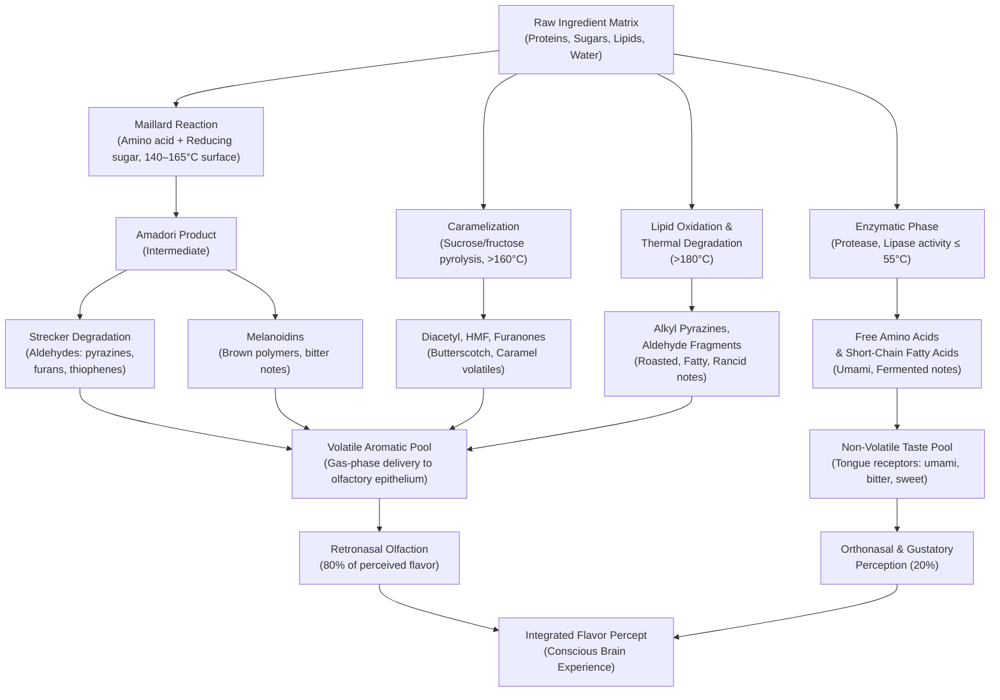

# Lesson 2: Ingredient Chemistry, Flavor Compounds, and Sensory Perception

## 1. First-Principles Intuition & Invariants

Flavor is not a property of food. It is an event that occurs in the brain, assembled from molecular signals that originate in the kitchen and travel through two distinct sensory channels before they ever reach conscious perception. Understanding this distinction is not an academic nicety for culinary practitioners — it is the mechanical foundation on which every decision about heat, acid, salt, and time must rest. A cook who treats flavor as an intrinsic quality of an ingredient is working blind. A cook who understands flavor as a constructed, chemical phenomenon has the ability to engineer it with precision.

The molecular composition of an ingredient defines its potential. Raw beef contains thousands of precursor molecules — free amino acids, reducing sugars, phospholipids, sulfur-containing compounds — none of which smell or taste like roasted beef. The flavor of a seared crust emerges only when those precursors are driven through thermally activated chemical reactions, most critically the Maillard reaction and the pyrolysis of fats, which together generate hundreds of volatile aromatic compounds. The ingredient supplies the raw material; the cook's manipulation of temperature, water activity, pH, and time determines which chemical pathways are activated and which are suppressed. This is the central invariant of flavor chemistry: **cooking is controlled molecular transformation, and flavor is the perceptual output of that transformation.**

Three governing invariants define this space and constrain every practical decision a skilled cook makes.

The first is the **volatility threshold invariant**. Aroma compounds must be volatile — meaning they must exist in the vapor phase at serving temperature — to stimulate olfactory receptors. Compounds with high boiling points never reach the nose in meaningful concentrations unless the food is hot. This is why cold roast beef tastes flat compared to the same cut served warm, and why high-fat sauces suppress perceived aroma: lipids dissolve volatile compounds and reduce their vapor pressure above the food's surface, a phenomenon with direct plating implications.

The second is the **taste-aroma integration invariant**. What people colloquially call "taste" is in fact flavor, which is roughly 80% retronasal olfaction — the perception of volatiles that travel from the back of the mouth up through the nasopharynx to the olfactory epithelium during chewing and swallowing. The five primary tastes (sweet, salty, sour, bitter, umami) are detected by taste receptor cells on the tongue and account for a small fraction of the total gustatory experience. This means that a dish which smells extraordinary will be perceived as tasting extraordinary, even if its basic taste profile is relatively simple. Skilled cooks exploit this by layering volatile aromatics through finishing oils, fresh herbs, and controlled reductions, all applied after the main thermal transformation.

The third is the **reaction selectivity invariant**. No single cooking reaction is chemically isolated. The Maillard reaction, caramelization, fat oxidation, Strecker degradation, and enzymatic browning all proceed simultaneously, and their relative rates are controlled by temperature, water content, pH, and the specific molecular species present. A practitioner who can manipulate these variables — drying a surface to reduce water activity before searing, adding baking soda to accelerate Maillard browning by raising pH, holding a braise at exactly 74°C to convert collagen without denaturing myosin proteins into a grainy texture — is operating at the highest level of culinary craft because they are directing molecular traffic rather than simply applying heat and hoping.

## 2. Core Architecture & Mechanics

### The Flavor Generation System

Flavor in a cooked food system is best understood as a layered transformation pipeline. Precursor molecules in the raw ingredient are acted upon by heat, enzymatic activity, and pH change to generate primary reactive intermediates, which then undergo secondary condensation and fragmentation reactions to yield the aromatic volatile compounds and non-volatile taste compounds that define the finished dish. This pipeline is not linear in the sequential sense; it is a concurrent, branching network of reactions whose relative outputs shift continuously as conditions change. The diagram below maps the principal pathways.

### The Maillard Reaction: Mechanistic Detail

The Maillard reaction is the single most important flavor-generating mechanism available to a cook operating at temperatures above 140°C. Its practical significance cannot be overstated: a properly executed sear on a ribeye or a well-developed crust on a sourdough loaf derives the overwhelming majority of its aromatic complexity from this reaction, which proceeds through three broadly distinguishable phases.

In the initial phase, a free amino group — typically from an amino acid side chain, most productively from lysine, cysteine, or methionine — condenses with the carbonyl group of a reducing sugar (glucose, fructose, lactose, maltose) to form an unstable N-glycosylamine. This intermediate rapidly rearranges to yield an Amadori product, which has little flavor or color of its own but represents the committed entry point into the cascade. The practical implication is that surfaces high in free amino acids and reducing sugars — not sucrose, which must first hydrolyze into glucose and fructose — will brown faster and more completely. This is why brushing a roast with a glucose syrup or coating a chicken skin in a mixture of baking soda dissolved in water (which raises surface pH, dramatically accelerating the reaction rate) produces faster, deeper browning than untreated surfaces.

In the intermediate and final phases, Amadori products fragment and rearrange through dozens of competing pathways, producing the families of compounds that constitute the characteristic aroma of cooked food. Pyrazines, which carry roasted and nutty notes, form through the condensation of two nitrogen-bearing intermediates. Furans, including furfural and 5-hydroxymethylfurfural (HMF), generate sweet caramel-like volatiles and are particularly abundant in baked goods. Thiophenes and thiazoles, formed when sulfur-bearing amino acids like cysteine participate, are among the most potent aroma-active compounds in the entire palette — present in roasted meat, coffee, and bread crust at concentrations measured in parts per billion.

Water activity is the practitioner's primary lever for controlling Maillard rate. At high water activity (aw > 0.9), the reaction is severely retarded because the aqueous environment dilutes reactant concentrations and because evaporative cooling prevents the surface from reaching reaction-threshold temperatures. This is why patting meat completely dry before searing, applying a dry brine twelve to twenty-four hours before cooking, or using a wire rack in the refrigerator overnight produces dramatically superior crust development. The goal is to reduce surface water activity to below 0.6, at which point Maillard chemistry proceeds rapidly and evaporative cooling ceases to suppress surface temperature.

### Caramelization and Its Practical Separation from Maillard

Caramelization is frequently conflated with the Maillard reaction in popular culinary discourse, but they are chemically distinct events with different temperature thresholds, different reactant requirements, and different flavor outcomes. Caramelization is the thermal degradation of sugars in the absence of amino acids. Fructose begins to caramelize around 110°C, glucose around 160°C, and sucrose around 185°C. The products are a family of volatile compounds dominated by diacetyl (responsible for the buttery-sweet aroma of a crème brûlée crust), HMF, furanones, and a range of acyclic enols. The flavor profile is characteristically sweeter, more candy-like, and less complex than Maillard-derived aromas, which is why a pure sugar sauce reduced to a dark caramel tastes markedly different from a meat jus concentrated to the same color.

The practical separation matters most in applications like onion caramelization, where the misleading culinary term refers primarily to Maillard chemistry occurring between the amino acids and reducing sugars in onion tissue, not pure sugar pyrolysis. True onion caramelization that generates the deep amber color associated with French onion soup requires a minimum of 45 minutes at a medium-low temperature with no lid, repeated micro-deglazations with small amounts of liquid to prevent burning, and an understanding that the natural fructans in onion must hydrolyze into fructose and glucose before Maillard reactants are even available.

### Lipid Degradation and Fat-Soluble Flavor Carriers

Lipids serve a dual role in flavor architecture. First, they are flavor precursors: at temperatures above 180°C, triglycerides and phospholipids undergo thermal oxidation and pyrolysis to yield aldehydes, ketones, and alkyl pyrazines that contribute roasted, fatty, and savory notes. The specific aldehydes produced depend heavily on the fatty acid composition of the fat — linoleic acid produces trans-2-hexenal (green, grassy), while oleic acid yields nonanal (fatty, waxy), which is why lard, duck fat, and coconut oil each produce distinctly different flavor profiles in high-heat applications. Second, lipids are flavor vehicles: they dissolve non-polar volatile compounds and provide a sustained-release mechanism that prolonges aromatic persistence on the palate. A finishing drizzle of extra-virgin olive oil over a dish does not merely add fat calories; it loads the dish's aromatic surface with a reservoir of volatile esters and terpenoids from the olive itself, which release gradually during eating.

## 3. High-Performance Optimization & Failure Modes

### Precision Control of Maillard Chemistry in Professional Execution

The highest-impact intervention a practitioner can make to maximize Maillard output is to treat surface preparation as its own protocol, entirely separate from the cooking of the interior. For seared proteins, this means combining dry brining (1–1.5% salt by weight applied 12–24 hours in advance), uncovered refrigerator resting on a wire rack to desiccate the surface, and a patting-dry step immediately before the sear. The combined effect reduces surface water activity from approximately 0.98 to below 0.70, allowing a cast iron or carbon steel surface held at 230–260°C to generate Maillard products within 60–90 seconds of contact rather than the 3–4 minutes required for a wet surface that must first evaporate its surface moisture. The practical result is a thinner, more intensely flavored crust with less overcooked gray band beneath it.

For baked goods, pH manipulation is a powerful and underutilized tool. The Maillard reaction rate approximately doubles for every unit of pH increase in the range from 6 to 8. Adding 0.25% baking soda (relative to flour weight) to a pretzel dough wash — or to the surface of a chicken that will be roasted — raises surface pH from approximately 6.0 to between 7.5 and 8.0 and produces dramatically accelerated browning at oven temperatures. This must be balanced against the soapy, metallic off-flavor that excess baking soda introduces when used at concentrations above 0.5%, a failure mode caused by residual sodium carbonate that forms when baking soda is not fully neutralized by an acid reaction partner.

### Managing Volatile Loss and Aroma Timing

The single most common failure mode in professional kitchens is the volatilization and irreversible loss of aromatics before the dish reaches the diner. This manifests in two distinct patterns. The first is premature aromatic addition: adding fresh herbs, citrus zest, or finishing-grade olive oils to a hot sauce that remains on the stove dissipates the most volatile and perceptually potent compounds within minutes, leaving only the heavier, less aromatic fractions. The mitigation is strict timing discipline — finishing aromatics are added off-heat, within two minutes of plating. The second pattern is covering hot dishes immediately after plating, which traps the vapor cloud and allows volatile compounds to condense and fall back into the food as droplets rather than presenting them to the diner's orthonasal system when the dish arrives. If covering is necessary for transport, the dish should be uncovered for 15–20 seconds before it reaches the table.

A related failure mode is volatile masking by high-fat emulsions. Hollandaise, beurre blanc, and cream-based sauces bind volatile aromatics in their lipid phase, suppressing perceived aroma intensity. This is not always undesirable — a cream sauce intentionally moderates sharp or pungent notes — but when maximum aromatic impact is the goal, water-based jus and broths present volatiles with far less suppression. The practitioner's decision should be deliberate.

### Bitterness, Astringency, and the Melanoidin Problem

Extended Maillard reaction, insufficient dilution of reaction intermediates, or high concentrations of polyphenols that have undergone oxidative polymerization will generate perceptible bitterness and astringency. Melanoidins — the high-molecular-weight brown polymers produced in the late stages of Maillard chemistry — are mildly bitter and strongly colored. This is the mechanism behind the acrid, bitter notes in a pan that has been allowed to go too dark, in over-extracted coffee, or in bread that has baked at too high a temperature for too long. The mitigation in sauce and jus production is controlled fond development: the browned residues should be developed to a deep amber but never black, then immediately deglazed with an aqueous liquid that solubilizes and dilutes melanoidins while also arresting further pyrolysis by dropping the pan temperature. In baking, crust bitterness is managed through temperature, hydration, and the deliberate use of steam injection in the first phase of baking to keep the crust surface moist and reactive without overheating it.

Tannin-derived astringency in wine reductions and braising liquids is a separate phenomenon: polyphenols bind to salivary proteins and precipitate them, generating the dry, puckering mouthfeel associated with astringency. The mitigation is prolonged reduction, which polymerizes tannins into larger molecular species that are less reactive with salivary proteins, combined with the addition of fat (butter mounting) or a small amount of sugar, both of which physically moderate the interaction between polyphenols and oral mucosa.

### Salt, Acid, and Sensory Modulation

Salt does not add a simple taste note in the way a sweet ingredient does. At concentrations between 0.4% and 0.8% by weight, sodium chloride selectively suppresses bitter taste receptor signaling while simultaneously enhancing sweet and umami perception through ion-channel mechanisms on the taste receptor cell membrane. This is the mechanistic explanation for the culinary empirical rule that food "needs salt" to taste fully expressed — without adequate sodium, bitter masking fails and low-concentration bitter compounds (which are present in virtually every complex food) overwhelm the balance. Acid performs a parallel function: hydrogen ions at concentrations corresponding to roughly pH 4.0–5.5 increase the perception of bright, fresh aromatic notes while suppressing the perception of heavy, fatty ones. A squeeze of lemon over a rich braise does not add lemon flavor in a meaningful concentration; it shifts the sensory weighting of the dish's existing aromatic profile toward volatility and freshness.

## 4. Summary & Verification Matrix

| Invariant / Mechanism | Governing Conditions | Practitioner Execution Target | Failure Mode | Diagnostic Criterion | Mitigation |
|---|---|---|---|---|---|
| **Maillard Reaction** | Surface temp 140–165°C, low water activity (aw < 0.70), pH 6.5–8.0, reducing sugars + free amino acids present | Pat-dry surface, dry brine 12–24 hr, preheat pan to 230–260°C, 60–90 sec contact time | Pale crust, steamed texture, gray band | No audible sizzle on contact; surface remains moist after 30 sec | Extend drying time; deglaze and reattempt; check pan temp with IR thermometer |
| **Volatile Aroma Timing** | Volatiles released maximally at serving temperature; most potent compounds evaporate within 2–4 min of heat exposure | Add finishing aromatics off-heat within 2 min of plating; uncover dish 15–20 sec before service | Flat, muted flavor on arrival; "cooked-off" herb note | Aroma detectable from pan but absent at table | Strict mise en place timing; reserve final aromatic additions for the pass |
| **Lipid Flavor Duality** | Fats as volatile precursors (>180°C) and flavor carriers (all temps); fatty acid profile determines specific aldehydes produced | Match fat to desired flavor profile; use finishing-grade oils post-heat for aromatic delivery | Rancid/oxidized notes from overheated polyunsaturated fats | Acrid, paint-like, or greasy-flat aroma in finished dish | Use high-saturate fats for high-heat; reserve EVOO and nut oils for finishing only |
| **Melanoidin Bitterness** | Late-stage Maillard at prolonged high temps; polyphenol oxidative polymerization; over-extracted solids | Develop fond to deep amber only; deglaze immediately; control oven temp and bake time | Acrid, persistent bitterness; black fond that will not dissolve | Blackened pan residue; visible dark particulates in sauce | Discard black fond; restart with clean surface; in baking, reduce temp 10–15°C and extend time |
| **Salt and Acid Modulation** | NaCl 0.4–0.8% suppresses bitterness, enhances umami; pH 4.0–5.5 elevates aromatic brightness | Season in stages; add acid (lemon, vinegar) as a finishing correction after heat is off | Flat, one-dimensional profile despite correct aromatics; perceived heaviness | Dish tastes "complete" in isolation but dull when tasted critically | Add acid in 0.5 mL increments; taste after each addition; adjust salt last |
| **Water Activity Control** | aw > 0.9 retards Maillard; aw < 0.6 enables rapid surface chemistry; directly manipulated by dry brining and desiccation | Measure or estimate surface dryness before searing; use wire rack cold-resting; apply dry brine 12–24 hr ahead | Boiled rather than seared exterior; excessive moisture expulsion during cooking | Water pooling in pan within 30 sec of protein contact | Re-dry surface; increase resting time; reduce pan crowding to maintain pan temp above steam point |
