# Lesson 3: Cooking Methods, Stocks, and Sauce Construction

## 1. First-Principles Intuition & Invariants

The transformation of raw ingredients into finished dishes represents a controlled manipulation of heat energy, moisture content, and molecular structure. At the foundation of all culinary technique lies a deceptively simple thermodynamic principle: energy transfer drives structural change in protein matrices, carbohydrate networks, and lipid emulsions. Whether searing a steak at 260°C or poaching an egg at 73°C, the cook orchestrates precise temperature gradients and exposure durations to achieve specific textural and flavor outcomes. This lesson establishes the mechanical and biochemical invariants governing the three fundamental cooking method families—dry heat, moist heat, and combination methods—before dissecting the classical architecture of stocks and mother sauces that form the structural backbone of Western culinary tradition.

Dry heat cooking methods operate through direct radiant energy transfer or conductive contact with hot surfaces in the absence of moisture barriers. Sautéing, roasting, grilling, and deep frying all share a common thermal boundary condition: surface temperatures that exceed the boiling point of water, typically ranging from 150°C to 260°C. At these elevated temperatures, the Maillard reaction initiates between reducing sugars and amino acids, generating hundreds of aromatic heterocyclic compounds that define roasted, browned, and caramelized flavor profiles. Simultaneously, surface moisture evaporates rapidly, creating a dehydrated crust with concentrated flavors and desirable textural contrast. The governing invariant for dry heat methods is that surface temperature must remain consistently above 140°C to sustain Maillard kinetics while internal temperatures climb more slowly through conductive heat diffusion, creating a thermal gradient that permits exterior browning before interior overcooking.

Moist heat methods—boiling, steaming, braising, and poaching—operate within the thermal ceiling imposed by water's phase transition at 100°C under standard atmospheric pressure. Because liquid water cannot exceed its boiling point without pressurization, moist heat cooking produces no Maillard browning and yields fundamentally different textural outcomes. Collagen-rich connective tissues hydrolyze slowly into gelatin through prolonged exposure to temperatures between 71°C and 82°C, transforming tough cuts into tender, succulent textures through systematic breakdown of triple-helix collagen into soluble gelatin chains. The critical invariant for moist heat cooking is temperature precision rather than intensity: maintaining narrow thermal windows prevents protein coagulation (which toughens egg whites above 80°C) while sustaining enzymatic or hydrolytic reactions that tenderize fibrous tissues.

Combination methods merge the browning advantages of dry heat with the tenderizing capacity of moist heat through sequential phase application. Braising and stewing both begin with an aggressive surface sear to develop Maillard complexity, then transition to a covered moist environment where collagen hydrolysis proceeds over hours at sub-boiling temperatures. This dual-phase approach captures the aromatic depth of caramelization while ensuring complete connective tissue breakdown in cuts like short ribs, brisket, or lamb shanks. The temporal sequence matters profoundly: attempting to brown meat after braising yields no Maillard reaction because surface moisture prevents temperature rise above 100°C.

Stock production represents the ultimate expression of moist heat extraction, converting skeletal collagen, soluble proteins, and aromatic vegetables into a gelatin-rich foundation liquid through prolonged simmering. The mechanical invariant governing stock clarity and gelatin yield is temperature control: maintaining a bare simmer between 85°C and 95°C sustains collagen hydrolysis while minimizing convective turbulence that would emulsify fat droplets and bone marrow into the liquid, producing cloudiness. Vigorous boiling denatures albumin proteins into insoluble aggregates that create permanent haze, while excessively low temperatures fail to break collagen cross-links efficiently. The temporal dimension scales with bone density and collagen concentration—chicken stocks require three to four hours, veal stocks demand eight to twelve hours, and fish fumets achieve full extraction in only thirty to forty-five minutes due to the delicate collagen structure in marine vertebrae.

The classical mother sauce architecture codified by Auguste Escoffier in the early twentieth century reduces sauce construction to five fundamental structural templates: béchamel (milk-based white sauce), velouté (light stock-based sauce), espagnole (brown stock-based sauce), hollandaise (egg yolk emulsion), and tomato sauce. Each mother sauce operates through distinct thickening mechanisms and flavor base matrices, yet all share a common architectural principle: controlled viscosity development through starch gelatinization, protein coagulation, or lipid emulsification. Derivative sauces multiply these five foundations into hundreds of variations through aromatics, reductions, and finishing enrichments, but the underlying rheological mechanics remain invariant.

Emulsion theory governs the stability of butter sauces and vinaigrettes through the thermodynamic contest between interfacial surface tension and mechanical dispersion energy. Oil and water do not spontaneously mix because of their vastly different polarities—water molecules form hydrogen-bonded networks while triglyceride lipids remain nonpolar and hydrophobic. Creating stable emulsions requires both mechanical energy to shatter fat globules into microscopic droplets and emulsifying agents—lecithin, proteins, or mustard polysaccharides—that reduce interfacial tension by presenting both hydrophilic and lipophobic molecular domains. Hollandaise achieves emulsion stability through egg yolk lecithin and continuous whisking that maintains droplet suspension, while mayonnaise employs mustard and vigorous shear to create permanent emulsion structure. Temperature precision becomes critical in butter emulsions: heating beyond 65°C denatures the protein scaffolding that stabilizes fat droplets, causing irreversible separation that no amount of whisking can repair.

## 2. Core Architecture & Mechanics

The thermal transformation pathways through which raw ingredients become finished dishes follow predictable energy transfer mechanics and biochemical reaction cascades. Dry heat methods rely on radiant or conductive energy transfer to drive surface dehydration and Maillard browning, while moist heat methods leverage water's thermal mass and phase transition properties to deliver uniform, gentle heating. Understanding these architectural distinctions allows the practitioner to select appropriate methods for specific ingredient matrices and desired textural outcomes.

Sautéing operates through conductive heat transfer from a preheated pan surface, typically stainless steel or carbon steel heated to 175°C to 205°C, into the contact surface of proteins or vegetables. The term derives from the French *sauter* (to jump), referencing the tossing motion that ensures even surface contact and prevents scorching. The mechanical invariant for successful sautéing is maintaining high pan temperature despite the cooling effect of added ingredients—this requires adequate thermal mass in the pan and sufficient spacing between food items to prevent steam accumulation. When proteins contact the hot pan surface, surface moisture evaporates within seconds, allowing the Maillard reaction to initiate once the contact zone exceeds 140°C. Proper sautéing produces a golden-brown crust while preserving interior moisture through rapid cooking that minimizes total heat exposure duration.

Roasting and baking both employ convective and radiant heat transfer within an enclosed oven environment, but differ in intensity and target outcomes. Roasting typically operates at 190°C to 230°C for proteins and vegetables, sustaining Maillard browning across exposed surfaces while conducting internal heat through the food mass. The thermal gradient from surface to core governs doneness progression—a 2.5 cm thick steak at 230°C requires approximately eight to ten minutes to reach a 52°C medium-rare core while developing substantial surface crust, whereas a whole chicken at 190°C demands ninety minutes for heat to penetrate through insulating fat layers and raise the thigh core to 74°C. Baking operates at similar or slightly lower temperatures for starch-based goods, where the objective shifts from browning proteins to gelatinizing starch networks, denaturing gluten structures, and evaporating moisture to create crumb structure.

Deep frying submerges food completely in lipid heated to 165°C to 190°C, creating the most violent moisture evaporation and fastest crust formation of any dry heat method. The physics governing frying quality centers on temperature recovery: when cold food enters hot oil, thermal energy transfers rapidly into the food mass, cooling the surrounding oil. If oil temperature drops below 150°C, moisture evaporates slowly, allowing oil to penetrate the food matrix and creating greasy, soggy textures. Proper frying maintains oil temperature through adequate oil volume, controlled batch sizes, and high BTU heat sources that restore target temperature within thirty to sixty seconds. The audible intensity of bubbling and steam release provides real-time feedback on frying kinetics—vigorous, rapid bubbling indicates active moisture expulsion and proper crust formation, while sluggish, irregular bubbling signals insufficient temperature.

Moist heat methods exploit water's exceptional thermal properties: high specific heat capacity (4.18 J/g·°C) and phase transition latency (2,260 J/g for vaporization) create a stable thermal environment that prevents localized overheating. Boiling and simmering both maintain liquid water in contact with food surfaces, but differ in convective intensity and temperature precision. Boiling at 100°C produces vigorous convection that can fragment delicate items like fish or fresh pasta, while simmering at 85°C to 95°C provides gentler heat transfer suitable for poaching eggs, cooking dried legumes, or extracting stock from bones. The mechanical advantage of simmering lies in reduced evaporation rates and more uniform heat distribution, preventing the temperature gradients that occur in dry heat cooking.

Steaming delivers moist heat through vapor condensation, releasing 2,260 J/g of latent heat directly onto food surfaces as steam condenses back into liquid water. This energy transfer mechanism produces faster heating than boiling because vapor temperature can be maintained above 100°C under pressure, though atmospheric steaming holds steady at the boiling point. Steaming preserves water-soluble vitamins and minerals that leach into boiling water, making it nutritionally advantageous for vegetables. The critical operational parameter for steaming is maintaining adequate vapor generation—insufficient steam flow results in uneven heating and prolonged cooking times.

Braising architecture combines an initial searing phase at 175°C to 205°C with a subsequent covered moist phase at 135°C to 165°C oven temperature, where the enclosed environment traps moisture and prevents surface dehydration. The liquid component—stock, wine, or aromatic broth—fills the vessel one-third to halfway up the protein, creating a hybrid cooking environment where the submerged portion poaches while the exposed surface roasts in saturated steam. This configuration sustains collagen hydrolysis throughout the meat mass while periodically basting the exposed surface with concentrated cooking liquid. Braising durations scale with collagen density: beef short ribs require two and a half to three hours at 150°C, while lamb shoulder demands three and a half to four hours for complete connective tissue breakdown.

Stock production follows a four-phase extraction sequence: cold start, gradual temperature climb, sustained simmer, and final straining. Beginning with bones and aromatics in cold water rather than boiling water allows albumin proteins to coagulate slowly into large aggregates that float to the surface as scum, where they can be skimmed away rather than emulsifying into the liquid. The temperature climb from 15°C to 85°C should require thirty to forty minutes, permitting protein denaturation to proceed in an orderly fashion. The sustained simmer phase maintains 88°C to 93°C for the full extraction duration, balancing collagen hydrolysis kinetics against convective turbulence. Vigorous boiling produces cloudy stock through fat emulsification and protein dispersion, while insufficient temperature fails to achieve complete gelatin extraction.

```mermaid
graph TB
    subgraph sub_dry_heat_methods ["Dry Heat Methods"]
        A[Raw Ingredient] --> B[Surface Contact 175-260°C]
        B --> C[Moisture Evaporation]
        C --> D[Maillard Reaction >140°C]
        D --> E["Crust Formation & Aromatic Development"]
    end
    
    subgraph sub_moist_heat_methods ["Moist Heat Methods"]
        F[Raw Ingredient] --> G[Water Contact 71-100°C]
        G --> H[Collagen Hydrolysis]
        H --> I[Gelatin Formation]
        I --> J["Tender Texture / No Browning"]
    end
    
    subgraph sub_combination_methods ["Combination Methods"]
        K[Raw Ingredient] --> L[Phase 1: Sear 175-205°C]
        L --> M[Maillard Complexity]
        M --> N[Phase 2: Braise 85-95°C]
        N --> O[Collagen Breakdown]
        O --> P["Dual Texture: Crust + Tender Interior"]
    end
    
    subgraph sub_stock_architecture ["Stock Architecture"]
        Q["Bones + Aromatics + Cold Water"] --> R["Gradual Heat 15-85°C / 30-40 min"]
        R --> S["Albumin Coagulation & Skimming"]
        S --> T["Sustained Simmer 88-93°C / 3-12 hrs"]
        T --> U[Collagen → Gelatin Extraction]
        U --> V["Strain & Cool"]
        V --> W[Clear, Gelatin-Rich Stock]
    end
    
    subgraph sub_mother_sauce_framework ["Mother Sauce Framework"]
        X[Liquid Base] --> Y[Thickening Agent]
        Y --> Z[Heat Application]
        Z --> AA{Sauce Type}
        AA --> AB["Béchamel: Milk + Roux"]
        AA --> AC["Velouté: Light Stock + Roux"]
        AA --> AD["Espagnole: Brown Stock + Roux"]
        AA --> AE[Hollandaise: Yolk Emulsion]
        AA --> AF["Tomato: Reduction + Aromatics"]
    end
    
    style A fill:#e1f5ff
    style F fill:#fff4e1
    style K fill:#f0e1ff
    style Q fill:#e1ffe1
    style X fill:#ffe1e1
```

The mother sauce architecture operates through distinct thickening mechanisms that govern final viscosity and mouthfeel. Béchamel begins with a white roux—equal parts clarified butter and flour cooked to 75°C to 85°C for two to three minutes to eliminate raw starch flavor without developing color. Milk heated to 65°C combines with the roux through vigorous whisking, swelling starch granules and creating a smooth, creamy suspension. The final sauce simmers gently for twelve to fifteen minutes to complete starch gelatinization and achieve target viscosity, typically coating the back of a spoon with a continuous, opaque film.

Velouté substitutes light chicken, veal, or fish stock for milk, creating a more delicate, translucent sauce. The roux remains identical, but stock's lower fat content produces a thinner mouthfeel that requires slightly higher roux ratios for equivalent viscosity. Espagnole builds from brown roux—cooked to 110°C to 120°C until achieving a hazelnut color—combined with rich brown veal stock and tomato product, then simmered for one to two hours to develop deep, concentrated flavors. Modern demi-glace reduces espagnole further with additional stock, yielding an intensely flavored, syrup-thick sauce base.

Hollandaise abandons starch thickening entirely, relying instead on egg yolk emulsion mechanics. Egg yolks whisked with water and acid over gentle heat (55°C to 60°C) create a protein matrix that stabilizes emulsified clarified butter through lecithin and protein interfacial activity. The critical temperature window prevents yolk coagulation above 65°C while sustaining sufficient heat to maintain butter fluidity and emulsion stability. Proper hollandaise holds a thick, creamy consistency at 55°C to 60°C, breaking irreversibly if heated beyond 68°C or if butter incorporation proceeds too rapidly without adequate mechanical shear.

Tomato sauce follows a reduction-concentration pathway, where tomatoes break down through heat and enzymatic activity while moisture evaporates to concentrate flavors and thicken the sauce through pectin and fiber networks. Unlike roux-based sauces, tomato sauce viscosity develops naturally through evaporation rather than starch gelatinization, requiring forty-five to ninety minutes of gentle simmering to achieve proper consistency. Aromatics—onion, garlic, basil—infuse during the reduction phase, contributing flavor complexity without requiring separate sauce mounting or finishing steps.

## 3. High-Performance Optimization & Failure Modes

Optimizing cooking methods for consistency and quality requires precise control over thermal inputs, timing, and ingredient preparation. Dry heat methods demand aggressive preheating to sustain surface temperatures despite the cooling effect of added ingredients. When sautéing proteins, the pan must reach 175°C to 190°C before food addition, verified through the water droplet test: a flicked droplet should ball up and skitter across the surface rather than instantly evaporating (indicating excessive heat) or spreading and boiling (indicating insufficient heat). Crowding the pan represents the most common failure mode—excessive ingredient density traps steam, dropping surface temperature below 140°C and preventing Maillard browning. Proteins release moisture continuously during cooking, so maintaining adequate spacing allows steam to escape while preserving pan temperature for effective crust formation.

Roasting optimization centers on thermal mass management and convective airflow. Large roasts benefit from reverse searing: slow-roasting at 120°C to 135°C until internal temperature reaches 5°C below target, then finishing with a high-heat sear at 260°C to develop surface crust. This inverted sequence produces minimal thermal gradients—the interior cooks uniformly at low temperature while the final sear develops browning without overcooking subsurface layers. Conventional high-heat roasting creates pronounced gradients with gray, overcooked bands beneath the crust, sacrificing tenderness for exterior color development.

Deep frying quality depends entirely on temperature recovery capacity and oil turnover rate. Professional kitchens maintain oil temperature through high-BTU burners and large oil volumes that minimize temperature drop when food enters the fryer. Home practitioners compensate for lower heat inputs by reducing batch sizes and allowing sixty to ninety seconds between batches for temperature stabilization. Oil degradation through repeated heating cycles manifests as darkening color, increased viscosity, and reduced smoke point—all symptoms of lipid oxidation and polymerization. Filtering oil after each service removes particulate matter that accelerates degradation, while limiting maximum temperature to 190°C slows oxidative breakdown.

Moist heat methods optimize for temperature precision and minimal convective disruption. Poaching eggs in water held at 73°C to 76°C produces tender whites with liquid yolks through controlled albumin coagulation kinetics—ovalbumin denatures at 73°C while ovotransferrin firms at 76°C, creating a narrow window for optimal texture. Adding vinegar to the poaching water accelerates protein coagulation, tightening the white structure before it disperses into the surrounding liquid. Vigorous boiling disrupts delicate structures through mechanical shear, making gentle simmering essential for items like fish, gnocchi, or fresh pasta.

Stock production optimization requires meticulous skimming discipline and temperature vigilance. As albumin proteins rise to the surface during the initial temperature climb, removing the gray scum every ten to fifteen minutes prevents it from emulsifying back into the stock. Achieving crystal-clear stock demands continuous skimming throughout the first hour, when protein denaturation proceeds most actively. The sustained simmer phase must avoid boiling—a bare simmer with occasional small bubbles breaking the surface indicates ideal temperature. If the stock boils vigorously, fat droplets and bone marrow emulsify into the liquid, creating permanent cloudiness that no amount of straining can clarify.

Gelatin extraction efficiency scales with surface area and collagen density. Cutting bones into 5 cm to 8 cm segments exposes marrow and increases collagen-rich surface contact with water. Blanching bones in boiling water for five minutes before stock preparation removes surface impurities and coagulated blood, improving final clarity. The cooling phase matters profoundly for gelatin retention—rapid cooling through ice baths prevents gelatin from remaining dissolved at elevated temperatures long enough to leach back into the stock during slow ambient cooling.

Mother sauce optimization addresses the primary failure modes specific to each type. Béchamel suffers from starch lumping when cold milk combines with hot roux, creating gelatinized starch clusters that resist mechanical dissolution. Heating milk to 65°C before incorporation ensures smooth integration, though vigorous whisking during addition provides insurance against lumps. If lumps form despite precautions, passing the sauce through a fine-mesh strainer removes them, though this represents correction rather than proper technique.

Hollandaise presents the most demanding failure profile because emulsion breaking is thermally irreversible. The yolk proteins that stabilize the emulsion denature permanently above 68°C, collapsing the droplet structure and causing butter to separate. Maintaining water bath temperature at 58°C to 62°C provides a narrow safety margin—the sauce thickens properly while remaining comfortably below coagulation thresholds. If hollandaise begins to break during butter incorporation, immediate removal from heat combined with whisking in a tablespoon of cold water may arrest the separation before it becomes complete. Once fully broken, the sauce cannot be repaired; the only remedy involves creating a fresh yolk base and gradually whisking in the broken sauce as if it were melted butter, reconstituting the emulsion from scratch.

Velouté and espagnole share the common failure mode of insufficient reduction, producing thin, watery sauces lacking body and flavor concentration. Proper velouté coats the back of a spoon with a continuous, opaque film that holds for several seconds before running. Espagnole demands prolonged simmering to reduce volume by half, concentrating flavor compounds and achieving syrup-like viscosity. Attempting to compensate for inadequate reduction through increased roux ratios produces pasty, starch-forward flavors rather than the clean, intense savoriness of properly reduced stock-based sauces.

Tomato sauce optimization balances acidity, sweetness, and concentration. High-quality canned San Marzano tomatoes provide superior flavor and consistency compared to fresh tomatoes outside peak season, which often lack sufficient acidity and sugar to develop complex flavor. Simmering duration must be sufficient to break down cell walls and concentrate solids, typically forty-five to sixty minutes, but excessive reduction produces caramelized, jammy flavors inappropriate for classic preparations. Adding a pinch of baking soda neutralizes excessive acidity in low-quality tomatoes, though this risks mushy texture through accelerated pectin breakdown.

## 4. Summary & Verification Matrix

| Cooking Method / System | Governing Invariant | Mechanism | Diagnostic Criteria | Primary Failure Mode |
|---|---|---|---|---|
| **Dry Heat (Sauté, Roast, Fry)** | Surface temperature >140°C for Maillard reaction; rapid moisture evaporation creates crust while preserving interior texture | Conductive, convective, or radiant heat transfer drives surface dehydration and amino acid-sugar condensation reactions | Golden-brown surface crust; audible sizzle during cooking; minimal moisture release; internal temperature progression matches target doneness | Pan crowding traps steam, dropping surface temperature below Maillard threshold; insufficient preheating produces steaming rather than browning |
| **Moist Heat (Boil, Steam, Poach)** | Thermal ceiling at 100°C (atmospheric) prevents Maillard browning; collagen hydrolysis occurs at 71-82°C over extended duration | Water's phase transition limits maximum temperature while high specific heat provides uniform, gentle heating; convection distributes thermal energy evenly | Tender, uniform texture throughout; no surface crust or browning; collagen-rich cuts become gelatinous after prolonged exposure; proteins remain moist | Vigorous boiling creates mechanical disruption of delicate items; insufficient temperature fails to hydrolyze collagen; overcooking denatures proteins into dry, tough textures |
| **Combination Methods (Braise, Stew)** | Sequential application of dry heat (sear phase) followed by moist heat (covered simmer) captures Maillard complexity while achieving complete collagen breakdown | Initial high-temperature sear develops surface crust and aromatic compounds; subsequent low-temperature moist phase hydrolyzes connective tissue over hours | Initial brown crust evident on protein surface; fork-tender interior texture; cooking liquid enriched with gelatin and dissolved collagen; concentrated, complex flavor profile | Skipping sear phase eliminates Maillard flavors; excessive liquid dilutes flavor concentration; inadequate cooking time leaves collagen intact and meat tough |
| **Stock Production** | Sustained simmer at 88-93°C balances collagen extraction against albumin emulsification; cold start permits orderly protein coagulation | Gradual temperature climb coagulates albumin into skimmable aggregates; prolonged low-temperature extraction hydrolyzes collagen triple helix into soluble gelatin chains | Crystal-clear liquid with no cloudiness or fat droplets; rich gelatin content that solidifies to gel when chilled; clean, concentrated flavor without bitterness | Boiling emulsifies fat and disperses proteins, creating permanent cloudiness; insufficient skimming leaves albumin residue; inadequate duration fails to extract gelatin fully |
| **Roux-Based Sauces (Béchamel, Velouté, Espagnole)** | Equal-weight roux (butter:flour) swells starch granules through gelatinization, creating viscosity proportional to roux quantity and cooking duration | Flour starch granules absorb liquid and swell at 65-85°C, forming microscopic gel networks that trap water molecules and increase viscosity | Smooth, homogeneous texture with no lumps; sauce coats back of spoon in continuous film; nappe consistency (neither watery nor pasty); clean flavor without raw starch taste | Cold liquid added to hot roux creates starch lumps; insufficient cooking leaves raw flour flavor; excessive roux ratio produces pasty, gluey texture |
| **Emulsion Sauces (Hollandaise, Mayonnaise)** | Mechanical shear disperses fat into microscopic droplets stabilized by emulsifiers (lecithin, proteins); temperature must remain below protein denaturation threshold (65-68°C for yolks) | Emulsifier molecules present hydrophilic heads to water phase and lipophobic tails to fat phase, reducing interfacial tension and preventing droplet coalescence | Thick, creamy consistency at 55-60°C; sauce holds structure without separation; smooth, homogeneous appearance; rich mouthfeel from suspended fat droplets | Overheating denatures stabilizing proteins, causing irreversible breaking; insufficient mechanical shear produces coarse emulsion that separates under storage; rapid fat incorporation overwhelms emulsion capacity |
