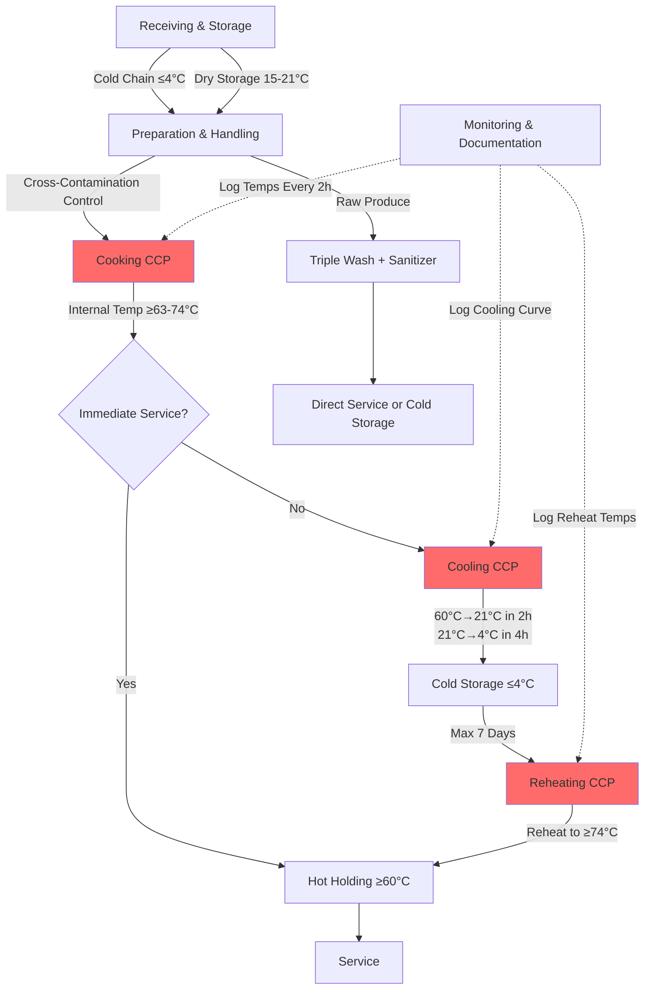

# Lesson 4: Food Safety, Nutrition Science, and Menu Architecture

## 1. First-Principles Intuition & Invariants

Food safety represents the intersection of microbiology, thermodynamics, and chemistry, where the fundamental goal is to manipulate environmental conditions to render pathogenic organisms unable to survive, reproduce, or produce toxins. The core invariant governing all food safety practice is the relationship between time, temperature, and microbial growth kinetics. Pathogenic bacteria such as *Salmonella*, *Listeria monocytogenes*, *Campylobacter jejuni*, and *Escherichia coli* O157:H7 exhibit predictable growth curves that follow exponential models under favorable conditions. The danger zone—the temperature range between 4°C and 60°C—represents the thermal window where bacterial populations can double every 20 to 40 minutes under optimal conditions of moisture, pH, and nutrient availability. Understanding this exponential growth pattern reveals why seemingly minor lapses in cold chain management or inadequate reheating protocols can transform a safe dish into a vector for foodborne illness within hours.

Thermal processing operates on the principle of protein denaturation and nucleic acid disruption. When bacterial cells are exposed to temperatures above 60°C, the enzymes and structural proteins that maintain cellular integrity begin to unfold and aggregate irreversibly. The D-value, or decimal reduction time, quantifies the time required at a specific temperature to reduce a bacterial population by 90 percent—one logarithmic order of magnitude. For *Salmonella*, the D-value at 60°C is approximately 5 minutes, meaning that after 5 minutes at this temperature, only 10 percent of the original population remains viable. After 10 minutes, only 1 percent survives, and after 15 minutes, only 0.1 percent. This logarithmic kill curve underpins all pasteurization and cooking protocols. The Z-value describes the temperature change required to alter the D-value by a factor of 10, typically ranging from 4°C to 6°C for most pathogens. These quantitative relationships allow chefs and food safety professionals to calculate equivalent lethality across different time-temperature combinations, enabling low-temperature sous-vide cooking to achieve the same microbial reduction as traditional high-heat methods through extended holding times.

Water activity ($a_w$) represents the ratio of vapor pressure of water in a food product to the vapor pressure of pure water, and it governs microbial viability independently of temperature. Most bacteria require an $a_w$ above 0.90 to proliferate, while yeasts can tolerate down to 0.88 and molds down to 0.80. This principle explains why salt-cured meats, dried fruits, and aged cheeses remain stable at ambient temperatures despite their moderate pH and nutrient density. The process of osmotic stress created by high solute concentrations—whether salt, sugar, or naturally occurring compounds—draws water out of microbial cells, collapsing their internal structures and halting metabolic function. Fermented products leverage competitive inhibition, where beneficial lactic acid bacteria rapidly acidify the environment to pH values below 4.6, the threshold below which *Clostridium botulinum* spores cannot germinate. This is why properly fermented sauerkraut, kimchi, and yogurt achieve microbiological stability without refrigeration or high-temperature processing.

Nutritional science extends beyond calorie counting to encompass macronutrient quality, micronutrient density, bioavailability, and anti-nutritional factor management. Protein quality is determined not merely by gram content but by amino acid profile completeness and digestibility. The Protein Digestibility-Corrected Amino Acid Score (PDCAAS) and the newer Digestible Indispensable Amino Acid Score (DIAAS) quantify protein quality by measuring the availability of the nine essential amino acids that humans cannot synthesize endogenously. Animal proteins typically score near 1.0 on the PDCAAS scale, indicating complete amino acid profiles with high bioavailability, while plant proteins often score lower due to limiting amino acids—lysine in grains, methionine in legumes—and the presence of protease inhibitors and phytic acid that reduce digestive efficiency. Strategic food pairing, such as combining rice with beans or hummus with whole grain bread, achieves amino acid complementarity, where the limiting amino acid in one food is abundant in the other, creating a complete protein profile from plant sources.

Carbohydrate science distinguishes between simple sugars that provoke rapid glycemic response and complex carbohydrates that deliver sustained energy release. The glycemic index (GI) quantifies how quickly a food elevates blood glucose relative to pure glucose, while the glycemic load (GL) accounts for portion size, providing a more practical metric for meal planning. High-fiber foods containing resistant starch and non-digestible oligosaccharides bypass small intestine absorption, reaching the colon intact where they undergo bacterial fermentation to produce short-chain fatty acids—butyrate, propionate, and acetate—that nourish colonocytes, modulate inflammation, and regulate appetite through gut hormone signaling. This mechanistic understanding transforms dietary fiber from a passive bulking agent into an active metabolic modulator with implications for satiety, insulin sensitivity, and long-term metabolic health.

Lipid science recognizes that fat quality matters as much as quantity. Saturated fatty acids with no carbon-carbon double bonds remain solid at room temperature and elevate low-density lipoprotein (LDL) cholesterol when consumed in excess, particularly lauric, myristic, and palmitic acids found in tropical oils and dairy fat. Monounsaturated fatty acids, such as oleic acid abundant in olive oil and avocados, maintain fluidity at room temperature and improve the LDL-to-HDL cholesterol ratio when substituted for saturated fats. Polyunsaturated fatty acids are subdivided into omega-3 and omega-6 families based on the position of the first double bond from the methyl terminus. Omega-3 fatty acids—alpha-linolenic acid (ALA) from flaxseed and walnuts, and the long-chain eicosapentaenoic acid (EPA) and docosahexaenoic acid (DHA) from fatty fish—serve as precursors to anti-inflammatory eicosanoids and are essential for neurological function and cardiovascular health. The modern Western diet exhibits an omega-6 to omega-3 ratio often exceeding 15:1, far above the evolutionarily optimal range of 4:1 or lower, contributing to systemic inflammatory tone. Menu architecture that prioritizes fatty fish, flaxseed, chia seeds, and walnuts while moderating refined seed oils can restore this balance.

Menu architecture operates as an optimization problem across multiple constraints: nutritional adequacy, cost per serving, preparation time, equipment availability, skill requirements, sensory appeal, and dietary restriction accommodation. The constraint satisfaction problem becomes particularly acute in institutional settings—hospitals, schools, prisons—where budgets are fixed, dietary restrictions are numerous, and nutritional standards are mandated. Plate composition strategy draws from the Harvard Healthy Eating Plate model, which allocates half the plate to vegetables and fruits, one quarter to whole grains, and one quarter to lean protein, with healthy fats incorporated through cooking oils and garnishes. This template provides a visual framework that translates abstract nutritional guidelines into concrete portion control, preventing the cognitive load of calculating macronutrient percentages while ensuring micronutrient diversity through produce variety.

Cost analysis requires understanding commodity pricing volatility, yield percentages, and labor allocation. The edible portion (EP) weight divided by the as-purchased (AP) weight yields the usable percentage, which varies dramatically across ingredients—98 percent for flour, 75 percent for bone-in chicken thighs, 60 percent for whole fish, 45 percent for whole pineapple. Accurate costing depends on calculating the cost per EP gram rather than per AP kilogram, then multiplying by the recipe's specified portion. Labor cost per dish is estimated by dividing the hourly wage by the number of portions produced per hour, factoring in both active cooking time and passive holding time. High-skill techniques such as demi-glace reduction or hand-rolled pasta justify premium pricing through labor intensity, while low-skill assembly dishes must compete on ingredient quality and presentation creativity.

## 2. Core Architecture & Mechanics

The architecture of a comprehensive food safety management system follows the Hazard Analysis and Critical Control Points (HACCP) framework, which identifies biological, chemical, and physical hazards at each stage of food production, then establishes critical control points (CCPs) where monitoring and corrective action can prevent hazards from reaching the consumer. The HACCP plan begins with hazard analysis, systematically evaluating each ingredient and process step for potential contamination vectors. Raw animal proteins represent the highest-risk category, carrying baseline contamination rates of *Salmonella* in poultry (10 to 15 percent of carcasses), *E. coli* in ground beef (particularly in mechanically tenderized cuts where surface bacteria are driven into the interior), and *Vibrio* species in raw oysters harvested from warm coastal waters. Fresh produce presents cross-contamination risk, especially leafy greens that contact soil and irrigation water, requiring triple-wash protocols with sanitizer rinses at 50 to 200 ppm chlorine or peroxyacetic acid solutions.

Critical control points are established at cooking, cooling, and reheating stages. For cooking, the CCP threshold is defined by the FDA Food Code's time-temperature tables, which specify minimum internal temperatures that achieve a 7-log reduction in *Salmonella*: 74°C instantaneous for ground meats and poultry, 63°C for 15 seconds for whole-muscle beef and pork, and 145°F for 15 seconds for fish and shellfish. Sous-vide cooking operates on the same microbiological principles but extends time to compensate for lower temperatures—a 1-inch thick chicken breast held at 60°C for 90 minutes achieves equivalent lethality to a 74°C instantaneous cook. The cooling CCP addresses the reality that cooked food often must be prepared in advance and stored before service. The FDA mandates cooling from 60°C to 21°C within 2 hours, then from 21°C to 4°C within an additional 4 hours, creating a 6-hour total cooling window. This protocol recognizes that *Clostridium perfringens* spores survive cooking and can germinate during slow cooling, producing enterotoxins if the food lingers in the danger zone. Rapid cooling is achieved through ice baths, blast chillers, or portioning hot foods into shallow pans to maximize surface area for heat dissipation, ensuring the thermal mass drops below bacterial growth thresholds before spore germination can occur.

Reheating represents a frequently neglected CCP. Food that has been cooked, cooled, and stored must be reheated to an internal temperature of 74°C for 15 seconds to eliminate any vegetative cells that may have proliferated during storage. Steam tables and hot holding equipment maintain food at 60°C or above to prevent further bacterial growth but do not achieve the kill step—food placed into hot holding must arrive already at safe temperatures from reheating. This distinction is critical in buffet and cafeteria operations where lukewarm food represents a major foodborne illness vector.

The nutritional architecture of a balanced meal follows the macronutrient distribution recommended by the Dietary Guidelines for Americans: 45 to 65 percent of total calories from carbohydrates, 20 to 35 percent from fat, and 10 to 35 percent from protein. For a 2,000 calorie daily intake, this translates to 225 to 325 grams of carbohydrate, 44 to 78 grams of fat, and 50 to 175 grams of protein. These ranges accommodate individual variation in metabolic rate, activity level, and therapeutic goals—endurance athletes skew toward the upper carbohydrate range, while individuals managing insulin resistance benefit from the lower carbohydrate, higher fat distribution within the acceptable range. Micronutrient adequacy is achieved through produce diversity, ensuring that the water-soluble vitamins—B-complex and vitamin C—are represented through fresh fruits, leafy greens, and whole grains, while fat-soluble vitamins A, D, E, and K are delivered through animal fats, fortified dairy, nuts, and seeds.

Dietary restriction accommodation requires understanding the biochemical basis of food intolerances and allergies. Celiac disease represents an autoimmune disorder where gluten proteins—gliadin and glutenin from wheat, hordein from barley, secalin from rye—trigger small intestine inflammation and villous atrophy, necessitating absolute gluten exclusion below 20 ppm contamination. Gluten-free menu options must avoid cross-contact through dedicated cutting boards, toasters, fryers, and utensils. Lactose intolerance results from insufficient lactase enzyme production in the small intestine, leaving undigested lactose to undergo bacterial fermentation in the colon, producing gas, bloating, and osmotic diarrhea. Lactose-free alternatives include aged hard cheeses where lactose has been consumed by bacteria during aging, lactose-hydrolyzed milk products, and plant-based milk substitutes fortified with calcium and vitamin D to match dairy's nutritional profile.

Food allergies involve IgE-mediated immune responses to specific proteins, with the FDA recognizing nine major allergens: milk, eggs, fish, crustacean shellfish, tree nuts, peanuts, wheat, soybeans, and sesame. Cross-contact prevention requires strict allergen separation during storage, preparation, and service, with color-coded cutting boards, dedicated utensils, and thorough cleaning protocols between allergen-containing and allergen-free preparations. The severity of allergic reactions ranges from mild oral itching to anaphylaxis with airway constriction and cardiovascular collapse, making allergen management a life-or-death responsibility in professional kitchens.

Menu architecture cost analysis begins with ingredient costing. A roasted chicken dish requires calculating the cost per portion: a 1.5 kg whole chicken at $8.00 per kg costs $12.00 as-purchased, yields 60 percent edible meat after removing bones, skin trim, and cooking loss, resulting in 900 grams EP at $13.33 per kg EP. A 180-gram portion costs $2.40 in protein alone. Add roasted vegetables at $0.80 per portion, grain pilaf at $0.50, and pan sauce at $0.30, totaling $4.00 in food cost. With a target food cost percentage of 30 percent, the menu price calculates to $13.33. Labor cost is estimated by determining that two cooks can prepare 40 portions per hour at $18 per hour each, yielding $0.90 labor cost per portion. Overhead allocation—rent, utilities, equipment depreciation—adds approximately 15 percent, or $2.00 per portion. The total cost per portion sums to $6.90, leaving $6.43 in gross profit per dish, from which marketing, administrative salaries, and taxes are paid.

Plate composition strategy balances visual appeal with nutritional completeness. The protein element occupies the focal point, positioned at the 5 o'clock position on a round plate using the clock-face metaphor, with the leanest face or most attractive cross-section presented upward. The starch component is placed at 11 o'clock, providing visual balance and height variation. Vegetables are arranged from 2 to 9 o'clock, utilizing color contrast—deep green kale against orange roasted carrots against white cauliflower—to create visual interest and signal micronutrient diversity. Sauce is applied beneath and around the protein to prevent sogginess while providing moisture and flavor, using a squeeze bottle for precise application or a spoon for rustic pooling. Garnishes serve functional purposes—microgreens add fresh, bitter contrast to rich proteins, toasted nuts provide textural crunch, and citrus zest delivers aromatic brightness—rather than existing as inedible decoration.

## 3. High-Performance Optimization & Failure Modes

High-performance food safety protocols optimize pathogen control without sacrificing culinary quality or operational efficiency. Rapid cooling techniques become critical for high-volume operations preparing food in advance. Blast chillers operate at -40°C with high-velocity fans, dropping a 10 kg batch of soup from 90°C to 4°C in 90 minutes, well within the 6-hour window and minimizing time spent in the danger zone. Ice paddle stirring accelerates cooling in stockpots by circulating the product and maximizing surface contact with ice-cold metal. Portioning hot stews and braises into 5 cm deep hotel pans rather than 15 cm deep containers increases surface area fivefold, allowing heat to dissipate through convection and conduction simultaneously. The failure mode occurs when kitchens undercool, leaving thermal dead zones in the center of large-volume containers where temperatures remain above 21°C for extended periods, creating ideal incubators for spore-forming bacteria.

Sous-vide cooking requires precise temperature calibration and validated time-temperature tables. A water bath thermometer certified to ±0.1°C accuracy ensures the displayed temperature matches the actual water temperature within the immersion circulator. Validation involves cooking inoculated samples and plating for bacterial counts, but professional kitchens rely on published pasteurization tables from Douglas Baldwin or the USDA, which provide conservative time-temperature combinations. The failure mode in sous-vide is incomplete sealing, where air remains in the vacuum bag and floats the product above the water line, or where bag puncture during cooking allows water infiltration and uneven heat transfer. Bag inspection before cooking and weighting floating bags with a stainless steel trivet prevents these failures.

Nutritional optimization in menu planning balances macronutrient targets with micronutrient density and sensory satisfaction. A 600-calorie entrée targeting 40 grams protein, 60 grams carbohydrate, and 20 grams fat is constructed as follows: 180 grams salmon fillet (250 calories, 35 grams protein, 12 grams fat), 200 grams roasted sweet potato (180 calories, 4 grams protein, 42 grams carbohydrate, 0 grams fat), 150 grams sautéed kale with garlic and olive oil (120 calories, 3 grams protein, 15 grams carbohydrate, 8 grams fat), and 50 grams quinoa pilaf (60 calories, 2 grams protein, 11 grams carbohydrate, 1 gram fat). This totals 610 calories, 44 grams protein, 68 grams carbohydrate, and 21 grams fat, closely matching the target profile while delivering vitamin A from sweet potato, omega-3 fatty acids from salmon, iron from kale, and complete protein from quinoa's balanced amino acid profile. The failure mode occurs when chefs focus exclusively on calorie and macronutrient targets while neglecting micronutrient density, producing meals that meet numerical benchmarks but lack the vitamins, minerals, and phytonutrients necessary for optimal health.

Allergen management optimization requires rigorous standard operating procedures and staff training. Color-coded cutting boards—red for raw meat, yellow for poultry, green for produce, blue for seafood, white for dairy, purple for allergen-free—create visual cues that prevent cross-contact. Dedicated fryer oil for gluten-free items prevents gluten contamination from breaded products. Allergen-free prep zones with separate utensils, pans, and storage containers isolate sensitive preparations from cross-contact vectors. Staff training drills include ingredient label reading to identify hidden allergens—whey and casein as milk derivatives, malt as a barley product, lecithin often derived from soy—and communication protocols where servers can confidently answer allergen questions or defer to kitchen management when uncertain. The catastrophic failure mode is cavalier allergen handling, where staff assume "a little bit won't hurt" or fail to disclose potential cross-contact, resulting in anaphylactic emergencies and legal liability.

Cost optimization without quality degradation focuses on ingredient yield improvement and labor efficiency. Whole animal butchery transforms a commodity purchase into multiple menu items—a whole chicken yields airline breasts for premium entrées, leg quarters for braises, wings for appetizers, carcass for stock, and fat for schmaltz—maximizing revenue per kilogram purchased while minimizing waste. Seasonal produce purchasing exploits supply-demand dynamics, where tomatoes cost $2 per kg in August peak season versus $8 per kg in January, allowing menus to rotate based on market pricing. Batch cooking during off-peak hours leverages labor more efficiently than à la carte preparation during service, with prep cooks fabricating mise en place when labor cost per hour is divided across multiple menu items. The failure mode is false economy, where purchasing inferior ingredients—mealy, bland tomatoes in winter, frozen fish of questionable provenance—saves cost per kilogram but requires additional labor for preparation, diminishes customer satisfaction, and damages reputation value that far exceeds the ingredient cost savings.

Menu engineering applies profitability and popularity matrix analysis to optimize revenue. Dishes are classified into four quadrants: stars (high popularity, high profitability), plow-horses (high popularity, low profitability), puzzles (low popularity, high profitability), and dogs (low popularity, low profitability). Stars are prominently featured and maintained without modification. Plow-horses are repriced upward or reformulated to improve margin through portion reduction or lower-cost ingredient substitution that maintains perceived quality. Puzzles are repositioned through menu placement, descriptive language enhancement, or server upselling training to increase popularity. Dogs are eliminated unless they serve a strategic purpose such as accommodating dietary restrictions or completing a cuisine category. This analytical framework prevents menus from drifting toward mediocrity through accumulated low-performers that consume kitchen labor and inventory without contributing to profitability.

## 4. Summary & Verification Matrix

| **Governing Invariant** | **Core Mechanism** | **Diagnostic Criterion** | **Failure Mode & Mitigation** |
|-------------------------|-------------------|-------------------------|-------------------------------|
| **Pathogen Control via Time-Temperature** | Exponential bacterial growth in danger zone (4-60°C); logarithmic kill curve above 60°C; D-value and Z-value define equivalent lethality across time-temperature combinations. | Cooking: Internal temp ≥63-74°C depending on protein type. Cooling: 60°C→21°C in 2h, 21°C→4°C in 4h. Reheating: ≥74°C for 15 seconds. Cold storage: ≤4°C. Hot holding: ≥60°C. | **Failure:** Inadequate cooling leaves food in danger zone >6h, allowing spore germination and toxin production. **Mitigation:** Blast chiller, ice paddle stirring, shallow pans (≤5cm depth), validated cooling logs every 30 minutes. |
| **Water Activity & Osmotic Stress** | $a_w$ < 0.90 inhibits bacterial growth; $a_w$ < 0.80 inhibits mold growth. High solute concentration (salt, sugar) draws water from microbial cells via osmosis, collapsing cellular function. | Cured meats: $a_w$ 0.85-0.91 with ≥2.5% salt. Dried fruits: $a_w$ 0.60-0.75. Fermented products: pH <4.6 from lactic acid production, $a_w$ 0.92-0.96. | **Failure:** Insufficient salt or drying leaves $a_w$ >0.90, enabling mold and bacterial growth during ambient storage. **Mitigation:** Calibrated hygrometer verification, salt percentage calculation, controlled fermentation with starter cultures. |
| **Macronutrient Balance & Glycemic Load** | Carbohydrate: 45-65% calories. Fat: 20-35% calories. Protein: 10-35% calories. Glycemic load = (GI × carb grams) / 100 controls blood glucose response; fiber and fat slow glucose absorption. | Balanced plate: 50% vegetables/fruits, 25% whole grains, 25% lean protein. Fiber ≥25-30g/day. Omega-6:omega-3 ratio <4:1. Post-meal blood glucose <140 mg/dL at 2 hours. | **Failure:** High-GI refined carbohydrates without fiber or fat cause glucose spikes and insulin hypersecretion, promoting fat storage and hunger rebound. **Mitigation:** Pair starches with fiber (whole grains, legumes) and healthy fats (olive oil, avocado) to moderate glycemic response. |
| **Amino Acid Complementarity** | Nine essential amino acids (histidine, isoleucine, leucine, lysine, methionine, phenylalanine, threonine, tryptophan, valine) must be supplied exogenously. Plant proteins have limiting amino acids: lysine in grains, methionine in legumes. Combining corrects deficiencies. | PDCAAS or DIAAS score ≥0.90 indicates complete protein. Strategic pairing: rice + beans, hummus + whole grain pita, peanut butter + whole wheat bread achieves complementarity within 24-hour window. | **Failure:** Reliance on single plant protein source creates amino acid deficiency over time, limiting protein synthesis and immune function. **Mitigation:** Diverse plant protein sources throughout day, or inclusion of complete animal proteins (eggs, dairy, fish, poultry). |
| **Allergen Cross-Contact Control** | IgE-mediated immune response to specific food proteins triggers histamine release, causing urticaria, angioedema, bronchospasm, or anaphylaxis. Cross-contact via shared equipment or storage introduces allergen traces sufficient to trigger reaction. | Allergen-free zone with dedicated equipment (cutting boards, utensils, fryers). Ingredient labels checked for hidden allergens (whey=milk, malt=barley, lecithin=soy). Staff trained on severity and communication protocols. | **Failure:** Cross-contact during prep or cooking introduces allergen traces. Anaphylaxis requires epinephrine auto-injector (EpiPen) and emergency medical services. **Mitigation:** Color-coded equipment, thorough cleaning between allergen/allergen-free prep, clear menu labeling, staff drills on allergen identification and emergency response. |
| **Cost Per Portion & Menu Pricing** | Food cost % = (ingredient cost / menu price) × 100. Target 28-35% for profitability. Total cost includes food + labor + overhead. Price = food cost / target food cost %. Menu engineering maximizes star items (high popularity, high profit). | As-purchased (AP) to edible portion (EP) yield % calculated by weighing raw and trimmed product. Labor cost = (hourly wage × prep time) / portions produced. Break-even price covers all costs; profit margin set above break-even. | **Failure:** Underpricing due to inaccurate yield calculation or failure to account for labor and overhead results in negative cash flow despite volume. **Mitigation:** Detailed recipe costing with actual yield testing, periodic menu price audits, elimination or repricing of low-margin items (plow-horses and dogs). |
