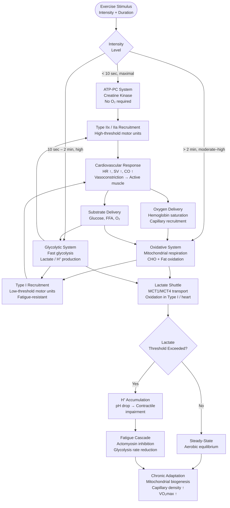

# Lesson 1: Exercise Physiology Fundamentals

## 1. First-Principles Intuition & Invariants

Every movement the human body produces, from a single finger tap to a 200-kilogram deadlift, runs on the same universal energy currency: adenosine triphosphate, or ATP. The cell cannot directly burn glucose, fat, or protein. It must first convert those substrates into ATP, and only then can the myosin cross-bridge cycle proceed, sodium-potassium pumps fire, and calcium re-sequester into the sarcoplasmic reticulum. This constraint is not incidental — it is the organizing principle around which all exercise physiology is built. Understanding it means understanding why a sprinter collapses at 60 seconds, why a marathon runner can sustain effort for hours, and why the first repetition of a heavy squat feels fundamentally different from the twentieth.

The body maintains only enough free ATP to sustain maximal effort for approximately two to three seconds. Everything beyond that depends on resynthesis, and the three systems responsible — phosphocreatine (ATP-PC), glycolytic, and oxidative — differ in their rate of ATP delivery, their substrate requirements, and the metabolic byproducts they generate. These are not discrete switches that flip sequentially. They operate as overlapping contributors whose relative proportions shift continuously with exercise intensity and duration. A practitioner who internalizes this overlap rather than treating the systems as mutually exclusive will program training with far greater precision, because they understand that every workout simultaneously stresses multiple systems and that fatigue in one cascades into the others.

The phosphocreatine system dominates the first six to ten seconds of maximal effort. Creatine kinase cleaves a phosphate group from phosphocreatine and donates it directly to ADP, regenerating ATP at a rate fast enough to sustain peak power output. No oxygen is required, no lactate accumulates, and the process is nearly instantaneous. This is the system a 100-meter sprinter relies on for the first stride through the first 60 meters, and it is the system driving maximal force expression in a one-rep-maximum lift. Its limitation is substrate scarcity: muscle phosphocreatine stores are exhausted within roughly ten seconds at true maximal intensity, though at submaximal power outputs the system can contribute meaningfully for longer.

As phosphocreatine depletes, glycolysis accelerates to fill the ATP gap. Glycolysis splits glucose into pyruvate, yielding a net of two ATP molecules per glucose unit with remarkable speed — not as fast as the creatine kinase reaction, but fast enough to sustain near-maximal efforts lasting from roughly ten seconds to two minutes. When oxygen supply to the working muscle is insufficient to process all the pyruvate being produced, lactate dehydrogenase converts excess pyruvate to lactate, simultaneously regenerating the NAD⁺ required to keep glycolysis running. Lactate is not, as was taught for decades, a metabolic waste product that causes muscle fatigue. It is a substrate, shuttled via monocarboxylate transporters to adjacent slow-twitch fibers, the heart, and the liver, where it is oxidized or converted back to glucose. The hydrogen ions released during this process, not the lactate itself, are the primary contributors to the intramuscular acidosis that impairs muscle contractility at high intensities. This distinction matters enormously for training prescription: interventions that raise lactate threshold are really raising the intensity at which hydrogen ion accumulation outpaces buffering capacity, not the intensity at which lactate is produced.

The oxidative system works through mitochondrial respiration, using oxygen to completely oxidize carbohydrates, fats, and proteins into carbon dioxide, water, and large quantities of ATP — up to 36–38 molecules per glucose unit compared to the glycolytic yield of two. Its limitation is delivery rate: the electron transport chain is thorough but relatively slow, making oxidative metabolism the dominant supplier only once intensity drops below roughly 70–80% of maximal oxygen uptake. At lower intensities, beta-oxidation of fatty acids becomes the primary substrate pathway, explaining the common observation that prolonged low-intensity activity spares glycogen. At higher aerobic intensities, carbohydrate oxidation predominates, and the practitioner managing glycogen depletion across a multi-day training block must account for this shift.

Muscle fiber architecture adds another layer of complexity. Type I fibers are small, densely mitochondrial, highly vascularized, and fatigue-resistant because their entire biochemical machinery is optimized for sustained oxidative metabolism. Type IIx fibers are large, generate force rapidly through fast myosin ATPase isoforms, rely heavily on glycolysis, and fatigue within seconds to minutes of maximal activation. Type IIa fibers occupy the middle ground: they express fast myosin isoforms but carry more mitochondria than IIx fibers, making them the workhorse of repeated high-intensity efforts like a 400-meter run or a cluster set at 80% of one-rep maximum. Fiber type distribution is largely genetically determined, though training can shift IIx toward IIa phenotype expression, improving the fatigue resistance of the fast-twitch pool without meaningfully converting fiber type identity.

The neuromuscular dimension is often underappreciated in applied settings. Strength gains during the first four to eight weeks of a training program are driven not by hypertrophy — which requires eight to twelve weeks of consistent mechanical tension to become significant — but by neural adaptations: increased motor unit recruitment, improved discharge rate coding, enhanced motor unit synchronization, and reduced co-contraction of antagonist muscles. These adaptations explain the rapid early strength gains seen in novice trainees and in experienced lifters returning from detraining. A practitioner designing a peaking block for a strength athlete must understand that the final weeks before competition are primarily about expressing the neural adaptations accumulated over the preceding training cycle, not building new tissue.

---

## 2. Core Architecture & Mechanics

The three energy systems, fiber type recruitment hierarchy, and cardiovascular response to exercise do not operate independently. They form an integrated architecture in which the metabolic state of the muscle directly influences cardiovascular output, which in turn determines substrate delivery and waste removal. The diagram below maps this architecture as a dataflow: from the initial exercise stimulus through energy system engagement, cardiovascular response, and adaptive feedback.

The cardiovascular response to exercise is not simply a consequence of working muscle — it is a parallel activation that begins even before the first muscle contraction. Central command, originating in the motor cortex, sends feedforward signals to the cardiovascular control centers in the medulla, triggering immediate heart rate elevation. This anticipatory rise, seen in athletes standing at the starting line before a race begins, reflects the nervous system pre-loading the delivery infrastructure. Within the first seconds of exercise onset, muscle mechanoreceptors and metaboreceptors send afferent feedback confirming the metabolic demand, and cardiac output scales accordingly through increases in both heart rate and stroke volume.

Stroke volume rises during light to moderate intensity exercise via the Frank-Starling mechanism: greater venous return stretches the ventricle, producing a more forceful contraction and a larger ejection volume. At high intensities, increased sympathetic drive augments contractility directly. Maximal cardiac output in untrained adults runs approximately 20–25 liters per minute; in elite endurance athletes, the structural hypertrophy of the left ventricle can push this to 40 liters per minute or beyond. The difference is not primarily heart rate — maximal heart rate changes minimally with training — but stroke volume, which is trainable and represents the primary cardiovascular adaptation to sustained aerobic work.

Blood flow redistribution is equally critical. At rest, working muscle receives roughly 15–20% of cardiac output. During maximal exercise, that figure rises to 80–85%, achieved through sympathetic vasoconstriction in visceral beds and metabolic vasodilation in active muscle. Locally produced metabolites — adenosine, nitric oxide, potassium ions, and CO₂ — override sympathetic constriction in the capillary beds of exercising muscle, allowing oxygen and substrate delivery to match demand. This local override is the mechanism by which cardiac output is directed where it is needed, and training increases its efficiency by expanding capillary density and improving endothelial nitric oxide synthase activity.

The lactate threshold deserves particular mechanical attention because it is the single most predictive physiological variable for endurance performance, more predictive even than VO₂max in trained populations where VO₂max values are relatively similar. Lactate threshold 1 (LT1) represents the first sustained rise above baseline lactate, typically occurring around 2 mmol/L blood lactate and corresponding to the work rate at which glycolysis begins to contribute meaningfully alongside oxidative metabolism. LT2 — also called the anaerobic threshold, maximal lactate steady state, or OBLA (onset of blood lactate accumulation) — occurs around 4 mmol/L and marks the intensity above which lactate accumulates progressively, hydrogen ion buffering is overwhelmed, and sustained steady-state exercise is no longer possible. Training at and near LT2 is the dominant mechanism for raising it, shifting the threshold to a higher absolute and relative intensity.

---

## 3. High-Performance Optimization & Failure Modes

Translating these physiological mechanics into training prescription requires understanding not only how the systems work at their peaks, but where they break down and how accumulated fatigue degrades the architecture. The most common failure mode in advanced training programs is not insufficient volume or intensity — it is insufficient specificity in matching energy system demand to the athlete's competitive or functional requirements, combined with inadequate recovery between high-stress sessions.

For athletes whose performance depends on the phosphocreatine system — powerlifters, Olympic weightlifters, sprinters, field sport athletes — the primary training objective is maximizing peak power output and the speed of phosphocreatine resynthesis between efforts. Inter-set rest intervals of three to five minutes allow approximately 95–98% phosphocreatine resynthesis, ensuring each working set is performed with a fully loaded system. Compressing rest to 90 seconds, as is common in hypertrophy-focused programs, shifts the metabolic demand toward glycolysis and reduces peak force expression by 10–20%. This is not wrong for hypertrophy, but it is a significant error when the stated goal is maximal strength or power. The practitioner who programs four-minute rest periods for a 90-kilogram squat at 90% of one-rep maximum is not being indulgent — they are protecting the integrity of the energy system being trained.

Glycolytic system optimization centers on managing the density of lactate-producing work. High-intensity interval training (HIIT) protocols targeting the glycolytic system typically use work intervals of 30 seconds to two minutes at 90–105% of VO₂max, with rest-to-work ratios of 1:1 to 2:1. The specific adaptation sought is twofold: improved buffering capacity through increased muscle carnosine content and bicarbonate availability, and enhanced lactate clearance through upregulation of MCT1 and MCT4 transporter density. Athletes using beta-alanine supplementation are specifically targeting carnosine synthesis, which raises the intramuscular pH buffer pool and delays the onset of contractile inhibition. The dosing evidence supports 3.2–6.4 grams per day in divided doses to minimize paresthesia, with meaningful ergogenic effects at efforts lasting 60–240 seconds — precisely the glycolytic domain.

Oxidative system development requires volume and consistency over time. Mitochondrial biogenesis — the actual increase in mitochondrial number and volume within muscle fibers — takes eight to twelve weeks of sustained aerobic training to become measurable, driven primarily by AMPK and PGC-1α signaling cascades activated by repeated ATP depletion and calcium flux. The practical implication is that a single hard aerobic week cannot build the oxidative base that six months of Zone 2 training produces. Zone 2, defined as the work rate below LT1 where conversation is possible and blood lactate stays below 2 mmol/L, is the primary stimulus for mitochondrial biogenesis and capillary expansion. Elite endurance athletes typically spend 75–80% of their training volume in Zone 2, a distribution that surprises many intermediate practitioners accustomed to making every session feel hard.

The failure mode specific to oxidative training is the intensity creep that gradually shifts Zone 2 work into Zone 3 — above LT1 but below LT2. This zone, sometimes called the "moderate intensity trap," accumulates significant fatigue without providing the full mitochondrial stimulus of Zone 2 or the threshold adaptation of work at LT2. Field-expedient monitoring using heart rate and ventilatory cues is effective: Zone 2 corresponds to an intensity where nasal-only breathing is comfortable and full sentences are possible. When sentences become fragmented and mouth breathing is required to maintain pace, the athlete has drifted into Zone 3. Heart rate monitors calibrated to individual lactate threshold data provide more precision, but the ventilatory markers are reliable proxies for practitioners without lab access.

Neuromuscular fatigue presents a failure mode distinct from metabolic fatigue and is frequently misidentified in practice. Central fatigue — originating in reduced motor unit firing rates and decreased neural drive from the central nervous system — produces a subjective heaviness and lack of motivation to train that is often misread as laziness or inadequate sleep. Its most reliable field marker is a drop in barbell velocity at a given submaximal load: if an athlete's mean concentric velocity on a 70% one-rep-maximum squat drops 10% below their well-rested baseline, significant neuromuscular fatigue is present and the session should be reduced in volume or intensity. Velocity-based training (VBT) using devices such as GymAware, PUSH, or the RepOne sensor makes this monitoring practical in real time, providing objective readiness data that RPE alone cannot capture.

Overreaching — a planned short-term accumulation of fatigue that, with adequate recovery, produces supercompensation — becomes overtraining syndrome when recovery is chronically insufficient. The physiological markers of overtraining syndrome include elevated resting heart rate, suppressed heart rate variability (HRV), decreased performance across all intensity domains, elevated cortisol-to-testosterone ratio, impaired immune function, and persistent mood disturbance. HRV monitoring using a validated tool such as WHOOP, Polar H10, or Oura Ring, combined with morning resting heart rate tracking, provides the earliest warning signal available outside a laboratory. A sustained downward trend in HRV over five or more consecutive days, particularly when accompanied by performance regression, is the clearest non-invasive indicator that training load must be reduced before the athlete crosses from functional overreaching into the pathological overtraining state, which can require weeks to months for full recovery.

---

## 4. Summary & Verification Matrix

| Invariant / System | Governing Mechanism | Performance Indicator | Optimal Training Stimulus | Critical Failure Mode |
|---|---|---|---|---|
| **ATP-PC System** | Creatine kinase resynthesis; no O₂ required; 6–10 sec maximal duration | Peak power output (W/kg); bar velocity at 90–100% 1RM | 3–6 sec maximal efforts; 3–5 min inter-set rest for ≥95% PCr resynthesis | Insufficient rest compresses PCr resynthesis, shifts demand to glycolysis, reduces peak force 10–20% |
| **Glycolytic System** | Fast glycolysis; NAD⁺ regeneration via lactate dehydrogenase; H⁺ accumulation limits duration | Blood lactate at target intensity; time-to-failure at 90–105% VO₂max | 30 sec–2 min intervals at near-maximal intensity; 1:1–2:1 rest-to-work ratio | Insufficient buffering capacity (low carnosine, bicarbonate); H⁺ accumulation collapses contractile function before substrate depletes |
| **Oxidative System** | Mitochondrial respiration; PGC-1α–driven biogenesis; LT1/LT2 thresholds | VO₂max (mL/kg/min); lactate threshold as % VO₂max; running economy | 75–80% training volume in Zone 2 (below LT1); threshold work near LT2 | Intensity creep into Zone 3 accumulates fatigue without full mitochondrial stimulus; glycogen depletion from chronic high-intensity overemphasis |
| **Muscle Fiber Recruitment** | Henneman size principle; Type I → IIa → IIx sequential recruitment by force demand | 1RM strength; force-velocity curve profile; fiber-type biopsy | High-load compound movements for IIa/IIx recruitment; sustained submaximal volume for IIx→IIa phenotypic shift | Exclusive high-rep low-load training under-recruits IIx pool; exclusive low-rep training fails to drive IIa fatigue-resistance adaptation |
| **Neuromuscular Adaptation** | Motor unit recruitment, rate coding, synchronization; antagonist co-contraction reduction | Submaximal velocity at fixed %1RM (VBT); force-time curve RFD | Heavy compound lifting with intent; plyometric velocity work; deload cycles every 4–6 weeks | Central fatigue misidentified as motivational deficit; velocity drop >10% signals accumulated neural fatigue requiring volume reduction |
| **Cardiovascular Response** | Cardiac output (HR × SV); metabolic vasodilation via adenosine/NO; Frank-Starling mechanism | Resting HR; HRV (morning baseline); VO₂max; stroke volume at max effort | Progressive aerobic volume; long-duration Zone 2 for SV adaptation; LT2 threshold sessions for oxygen kinetics | Overtraining syndrome: sustained HRV decline + performance regression across all intensity domains; requires 2–8 weeks reduced load for recovery |
