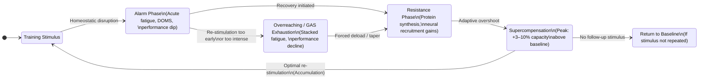

# Lesson 2: Training Principles of Adaptation

## 1. First-Principles Intuition & Invariants

The human body does not improve because you trained hard. It improves because it was disrupted, survived, and rebuilt itself with a slight surplus of capacity. That distinction is not semantic—it is the foundational mechanism separating athletes who make consistent, decade-long progress from those who plateau or break down inside a year. Understanding adaptation at first principles means understanding why the body changes at all, and what conditions must be satisfied to make that change directional rather than random.

Hans Selye's General Adaptation Syndrome (GAS), first published in 1936, remains the most useful conceptual scaffold for understanding how biological organisms respond to stress. Selye described a universal three-phase response: an alarm phase, in which the organism encounters a novel stressor and its performance temporarily decreases as homeostasis is disrupted; a resistance phase, in which adaptive mechanisms rebuild the organism to a higher functional ceiling; and an exhaustion phase, in which chronically applied stress without adequate recovery drives the organism into irreversible functional decline. Selye was studying rats and pharmacological stressors, but the arc maps with remarkable fidelity onto the training process. A first squat session is an alarm. A four-week mesocycle is a resistance phase. A year of relentless loading without deload or periodization is exhaustion.

What makes exercise science interesting—and difficult—is that the body is not a single system expressing a single adaptive response. Skeletal muscle, connective tissue, the central nervous system, the endocrine system, and the cardiovascular system each adapt along distinct timelines, to distinct stimuli, and with distinct ceilings. Myofibrillar hypertrophy, the accretion of contractile proteins, operates on a timescale of weeks to months. Tendon collagen remodeling operates on months to years. Neural adaptations—motor unit recruitment efficiency, rate coding, inter-muscular coordination—can manifest within days of initiating a novel movement pattern. A complete training theory must account for all of these simultaneously, which is why the governing principles cannot be reduced to a single variable like volume or intensity.

The five invariants that govern all productive training are progressive overload, specificity, reversibility, individual variation, and the supercompensation cycle. Each is a constraint on the design space of any training program, and violating any one of them reliably produces either stagnation or injury. Progressive overload states that adaptation only continues when the training stimulus exceeds the organism's current adaptive threshold—not by an arbitrary amount, but by a margin that is recoverable within the available time window. Specificity states that adaptation is mechanistically targeted: the body builds exactly what the imposed demands require, and not a generalized enhancement of performance. Reversibility states that adaptations are maintained only by the continued application of sufficient stimulus; they degrade predictably when that stimulus is withdrawn. Individual variation acknowledges that two athletes following identical programs will express different rates, magnitudes, and distributions of adaptation, governed by genetics, training age, hormonal environment, sleep quality, nutrition, and psychological stress. The supercompensation cycle is the temporal expression of GAS applied specifically to athletic training: the window of elevated capacity that opens after recovery from a training bout, and that must be timed correctly to accumulate progressive fitness rather than dissipate back to baseline.

These five invariants are not guidelines or best practices. They are operational constraints. A program that violates progressive overload is not suboptimal—it simply does not cause adaptation. A program that violates specificity does not make an athlete worse at their sport; it makes them fitter in ways that do not transfer. The practitioner's job is to design a training architecture that satisfies all five simultaneously across a planning horizon that may span weeks, months, or years.

---

## 2. Core Architecture & Mechanics

The practical expression of these principles is periodization: the systematic structuring of training into phases that modulate volume, intensity, and exercise selection over time to drive progressive adaptation while managing cumulative fatigue. Before examining specific models, it is worth mapping the signal path from a training stimulus through the adaptation machinery, because that path explains why periodization takes the forms it does.

When mechanical tension is applied to a muscle fiber—particularly at long muscle lengths during eccentric loading—mechanosensors in the sarcolemma and extracellular matrix activate downstream signaling cascades. The mTORC1 pathway, the central regulator of muscle protein synthesis, is upregulated. Satellite cells are recruited to donate nuclei for hypertrophic expansion. Meanwhile, metabolic stress from repeated contractions generates reactive oxygen species and metabolic byproducts that signal mitochondrial biogenesis via the PGC-1α pathway. These two signals—mechanical tension and metabolic stress—are largely distinct, which is why strength training and endurance training produce different adaptive phenotypes even when performed by the same athlete. The practitioner does not need to memorize the molecular actors, but they do need to understand the implication: the type of stress determines the type of adaptation, not merely the magnitude.

The diagram above captures the temporal logic of the supercompensation cycle and its failure modes. The critical decision point is re-stimulation timing. If the next training bout lands during the supercompensation window, the organism's new, elevated baseline is disrupted, and the subsequent supercompensation settles slightly higher than the previous one—this is the mechanism of fitness accumulation. If the next bout lands during the alarm phase, before recovery is complete, the organism is pushed deeper into fatigue, and successive bouts in this configuration produce functional overreaching, and eventually non-functional overreaching or frank overtraining syndrome.

The three major periodization models—linear, undulating, and block—represent different strategies for navigating this timing problem across a macrocycle.

**Linear periodization**, the oldest and most intuitive model, progresses a single biomotor quality over consecutive weeks by monotonically increasing load and decreasing volume. A classical 12-week linear strength program might begin at 70% of one-rep maximum (1RM) for four sets of ten repetitions, advancing by approximately 2.5% 1RM per week until the athlete reaches 90% 1RM for three sets of three in the final weeks. The model's strength is its simplicity and the clear progressive overload signal it delivers. Its weakness is that early-developed qualities, such as the hypertrophic base built in the first four weeks, begin to detrain by the time the athlete reaches the peak intensity phase—a phenomenon sometimes called "concurrent decay."

**Daily undulating periodization (DUP)** addresses concurrent decay by cycling multiple rep ranges within a single week. A Monday session might target hypertrophy at 70–75% 1RM for eight to twelve reps, Wednesday might target strength at 80–85% 1RM for four to six reps, and Friday might target power at 55–65% 1RM for three to five reps with maximal intent. DUP maintains stimulation across multiple adaptive pathways simultaneously, and research by Rhea and colleagues (2002) demonstrated superior strength gains in DUP versus linear periodization over a twelve-week comparison. The tradeoff is programming complexity and the need for precise session-level recovery management.

**Block periodization**, popularized by Vladimir Issurin and refined through the work of coaches like Mike Israetel in the context of hypertrophy, organizes training into concentrated three-to-six-week mesocycles (blocks), each targeting a primary quality: accumulation (hypertrophy/volume), intensification (strength), and realization (peaking/testing). The logic is that concentrated blocks drive deeper adaptation in a single quality by overloading it beyond what concurrent training allows, while the subsequent block leverages that quality's residual effect to build the next layer. The model works well for intermediate-to-advanced athletes whose training age is high enough that general stimuli no longer drive sufficient adaptation.

For practical programming, volume landmarks provide the governing parameters within any of these models. Mike Israetel's volume landmarks framework identifies four thresholds per muscle group per week: the Minimum Effective Volume (MEV), below which no meaningful hypertrophic adaptation occurs; the Maximum Adaptive Volume (MAV), which is the range in which adaptation is maximized; the Maximum Recoverable Volume (MRV), above which the athlete cannot recover within the available time; and the Maximum Tolerable Volume (MTV), which defines the absolute ceiling before structural breakdown. For intermediate trainees, the MAV for large muscle groups like the quadriceps or latissimus dorsi typically falls between 12 and 20 sets per week, though individual MRV values vary considerably. The practitioner's task across a mesocycle is to begin near MEV, progress toward MAV, approach but not exceed MRV in the final week before a deload, and then reset.

---

## 3. High-Performance Optimization & Failure Modes

The gap between understanding these principles and applying them effectively is where most experienced trainees lose years of progress. Advanced practitioners commit characteristically different errors than beginners. Where a novice fails by under-loading or skipping sessions, an advanced athlete typically fails by misidentifying their MRV, neglecting specificity in favor of variety, or timing deloads reactively rather than proactively.

**Fatigue management and deload timing** represent the most consequential optimization variable for athletes beyond the intermediate stage. The standard recommendation of a deload every fourth week is a heuristic, not a prescription. The actual deload timing should be determined by the trajectory of performance markers and subjective wellness indicators across the mesocycle. A barbell athlete who tracks session-to-session velocity loss on their primary lifts—using a linear position transducer or even video-based velocity estimation—will observe that mean concentric velocity on a given submaximal load gradually declines across a mesocycle as cumulative fatigue accumulates. When velocity loss on a 75% 1RM set exceeds 15–20% relative to the mesocycle baseline, fatigue is masking fitness, and a deload is warranted regardless of where the calendar sits. This approach, sometimes called autoregulation by performance feedback, allows the athlete to extend productive mesocycles when recovery is favorable and truncate them when life stress, sleep debt, or nutritional deficit is compressing MRV downward.

Deload structure matters as much as timing. A passive deload—simply reducing volume to 40–50% of working sets and dropping intensity to 50–60% 1RM—is appropriate after a true peaking block that has accumulated substantial neuromuscular fatigue. An active deload, in which volume is reduced but intensity is maintained or slightly increased, is more appropriate after a hypertrophy block, because maintaining mechanical tension signals to the nervous system that the muscle mass accrued has functional utility and should not be downregulated. Dropping both volume and intensity simultaneously after a hypertrophy mesocycle is a common error that contributes to accelerated strength loss in the early intensification block.

**Specificity violations** are subtler and more insidious in advanced training. The principle of specificity does not merely mean "practice your sport." At the biomechanical level, it means that adaptations are joint-angle specific, velocity specific, and contraction-type specific to a degree that matters for elite performance. A powerlifter who trains the squat exclusively to a parallel depth and then competes at a meet requiring below-parallel depth has built strength that partially transfers—but the specific mechanical advantage window below parallel has not been trained, and the athlete will be weaker there under maximal load than a similarly strong competitor who trained through that range. The same principle applies to athletic velocity specificity: heavy barbell training at slow tempos builds substantial force production but limited rate of force development (RFD), which is the biomechanical variable most predictive of sprint and jump performance. For athletes whose sport demands maximal power expression, a portion of weekly training volume must be devoted to high-velocity work, even at substantially lower absolute loads.

**Individual variation** becomes a dominant variable at the advanced level in ways that general program templates cannot anticipate. Two athletes at the same training age and 1RM may differ dramatically in their response to high-frequency training, to high-rep metabolic work, or to a particular exercise variant, due to differences in fiber type distribution, limb segment ratios, motor cortex adaptability, and hormonal recovery profiles. The practitioner who relies exclusively on published program templates is essentially applying population-level averages to an individual, which is appropriate for novices but increasingly inefficient for advanced athletes. The correct approach is to treat each training block as a controlled experiment: hold most variables constant, manipulate one primary variable (frequency, volume, exercise selection, or intensity distribution), track both objective performance markers and subjective recovery scores using a standardized tool like the validated Daily Analysis of Life Demands for Athletes (DALDA) questionnaire, and use the results to calibrate the subsequent block.

**Overreaching and overtraining syndrome** are the most serious failure modes in advanced training, and they are almost always preceded by identifiable warning signs that practitioners ignore. Functional overreaching (FOR) is a planned and expected state in which an athlete accumulates more fatigue than they can resolve in a single week—a strategy used deliberately in shock microcycles to drive deeper adaptation. FOR resolves with one to two weeks of reduced load and produces a supercompensation above the pre-overreaching baseline. Non-functional overreaching (NFOR) develops when FOR is not followed by adequate recovery, or when stressors outside of training (occupational, psychological, nutritional) erode recovery capacity below what training demands require. NFOR requires weeks to months of reduced training to resolve and does not reliably produce supercompensation afterward. Overtraining syndrome (OTS) is a clinical diagnosis requiring months of near-complete rest and medical management. The diagnostic distinction between NFOR and OTS is a resting morning heart rate elevation above 7–10 bpm from baseline sustained for more than two weeks, combined with performance decrements, persistent mood disturbance, and sleep disruption unresponsive to load reduction. At that point, training is not the solution.

The reversibility principle presents a specific optimization problem for athletes managing injury, travel, or life disruption. Strength adaptations are not lost uniformly across the training continuum. Research by Mujika and Padilla demonstrates that strength decrements during detraining are substantially slower than cardiovascular fitness decrements: maximal strength can be maintained for two to four weeks of complete cessation with minimal loss, and significant decrements of 7–12% typically emerge at four to eight weeks. For athletes facing unavoidable training interruptions, the evidence-based strategy is to perform a minimum effective maintenance stimulus—one to two sessions per week at high relative intensity (85–90% 1RM), even if volume is drastically reduced—rather than complete cessation. This leverages the fact that neural adaptations, which dominate early strength expression in well-trained athletes, degrade faster than structural adaptations but are also more rapidly re-expressed.

---

## 4. Summary & Verification Matrix

| Governing Principle | Operational Mechanism | Optimal Execution Criteria | Diagnostic Warning Signs | Failure Mode |
|---|---|---|---|---|
| **Progressive Overload** | Incrementally exceeding current adaptive threshold via load, volume, density, or complexity | 2.5–5% load increase per week (novice); 1–2% per mesocycle (advanced); track bar velocity or RPE to confirm stimulus above threshold | Stalled lifts for 2+ consecutive sessions; RPE rising on constant load | Stagnation; zero adaptation if threshold is never exceeded |
| **Specificity** | Adaptation is joint-angle, velocity, and contraction-type specific to imposed demands | Match exercise selection, velocity, range of motion, and energy system demands to sport or primary objective each mesocycle | Performance gains in training don't transfer to competition or sport; weakness at specific joint angles | Fitness without performance transfer; wasted training volume |
| **Supercompensation Timing** | Re-stimulation during elevated capacity window drives cumulative fitness; mistimed re-stimulation drives fatigue accumulation | Re-stimulate 48–96 hours post-session for trained muscle groups; use velocity or HRV data to confirm recovery before high-intensity sessions | Progressive velocity loss on submaximal sets; rising session RPE trend | Functional overreaching (recoverable); NFOR or OTS (requires extended rest) |
| **Reversibility** | Adaptations maintain only under sufficient stimulus; neural adaptations degrade faster than structural | Minimum 1–2 high-intensity sessions/week to maintain strength during disruption; never drop intensity and volume simultaneously | Strength loss exceeding 10% over 4-week reduced-load phase | Accelerated detraining; loss of competitive readiness |
| **Individual Variation** | Population-level program templates apply averages; individual MRV, fiber type, and recovery capacity diverge substantially with training age | Treat each mesocycle as a controlled experiment; track DALDA scores, HRV, and objective performance; adjust next block parameters empirically | Consistent fatigue with no performance gain despite adequate sleep and nutrition | Chronic under- or over-stimulation; failure to identify personal MRV |
| **Periodization Model Fit** | Linear, DUP, and block models optimize for different athlete profiles and timelines | Novice: linear; intermediate: DUP or linear; advanced: block periodization with concentrated mesocycles targeting one primary biomotor quality | Concurrent decay (early qualities detrain during peaking); persistent fatigue with low training density | Mismatched model erodes adaptations faster than they accumulate; wasted training time |
