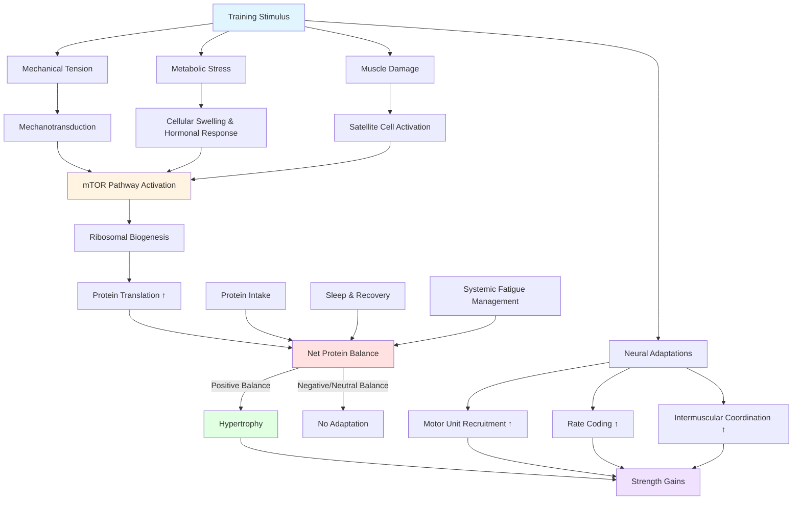

# Lesson 3: Resistance Training Mechanics

## 1. First-Principles Intuition & Invariants

Resistance training represents a controlled perturbation of homeostasis designed to induce specific morphological and neurological adaptations in skeletal muscle tissue and its supporting connective structures. The body responds to mechanical stress by reinforcing the tissues subjected to that stress, following a dose-response curve governed by the intensity, volume, frequency, and specificity of the applied load. Unlike aerobic conditioning, which primarily enhances oxidative enzyme density and capillary perfusion, resistance training targets force production capacity through two distinct but overlapping pathways: neural adaptation, which increases motor unit recruitment efficiency and firing rate synchronization, and structural hypertrophy, which enlarges the contractile machinery itself.

The fundamental invariant governing all resistance training adaptations is the principle of progressive overload. Skeletal muscle possesses a remarkable homeostatic buffer; it will adapt only when exposed to a stimulus that exceeds its current capacity. This threshold is not static but shifts upward as adaptations accrue, creating a moving target that demands systematic load progression. The nervous system adapts first, typically within two to eight weeks, improving coordination, reducing antagonist co-contraction, and recruiting high-threshold motor units more readily. Structural changes follow more slowly, as protein synthesis must consistently exceed protein degradation over weeks and months to accumulate net contractile mass.

Three mechanistic drivers govern hypertrophic adaptation: mechanical tension, metabolic stress, and muscle damage. Mechanical tension, the force experienced by muscle fibers under load, appears to be the primary stimulus. When a muscle generates high tension—particularly during eccentric lengthening or near-maximal concentric contractions—mechanoreceptors embedded in the sarcolemma and costameres detect this strain and initiate mechanotransduction cascades involving the mTOR pathway, which upregulates ribosomal biogenesis and protein translation. Metabolic stress, characterized by the accumulation of lactate, hydrogen ions, inorganic phosphate, and reactive oxygen species during high-repetition sets, creates an anabolic hormonal milieu and induces cellular swelling that may independently stimulate growth. Muscle damage, evidenced by Z-line disruption and delayed-onset muscle soreness, triggers satellite cell activation and contributes to remodeling, though excessive damage impairs recovery and is not the goal in itself.

The strength adaptation curve diverges from the hypertrophy curve due to the predominance of neural factors at high intensity. A powerlifter training with loads exceeding ninety percent of one-repetition maximum for low repetitions develops profound skill in force production: refined motor patterns, improved rate coding, and enhanced intermuscular coordination. The specificity of adaptation principle dictates that the body becomes proficient at the exact movement pattern and load profile it is exposed to. A heavy back squat performed for triples recruits different motor unit pools and develops different kinetic chain timing than a leg press performed for sets of fifteen, even though both target the knee and hip extensors.

Volume, defined as the product of sets, repetitions, and load, serves as the primary driver of hypertrophy once a minimum effective intensity threshold is reached. Current evidence suggests that mechanical tension sufficient to stimulate growth occurs across a broad intensity range from approximately sixty-five percent to ninety percent of one-repetition maximum, provided sets are taken close to concentric failure. The dose-response relationship is not linear; diminishing returns set in as volume accumulates within a training week. Each muscle group exhibits a minimum effective volume below which no adaptation occurs, a maximum adaptive volume where growth is optimized, and a maximum recoverable volume beyond which accumulated fatigue exceeds the body's regenerative capacity.

Recovery and adaptation occur not during the training session itself but in the hours and days afterward, when protein synthesis rates remain elevated and damaged structures are repaired. The supercompensation model posits that after a training stimulus disrupts homeostasis, the body not only restores baseline capacity but overshoots slightly, creating a window of enhanced performance. Strategic deload weeks, during which volume is reduced by forty to sixty percent while maintaining intensity, allow fatigue dissipation without complete detraining, resetting the adaptive runway for subsequent training blocks.

## 2. Core Architecture & Mechanics

The architecture of a resistance training program rests on four interrelated variables: exercise selection, intensity, volume, and frequency. Exercise selection dictates which muscle groups receive mechanical tension and through what biomechanical lever arms. Intensity, expressed as a percentage of one-repetition maximum or via the rating of perceived exertion scale, determines the magnitude of mechanical tension and the recruitment threshold of motor units. Volume quantifies the total mechanical work performed, serving as the cumulative growth stimulus. Frequency distributes this volume across training sessions throughout the week, balancing the need for repeated stimuli with adequate recovery intervals.

Exercise selection must account for anatomical leverages, joint kinematics, and moment arm profiles. The back squat places the hip and knee extensors under load through a full range of motion, with peak torque demands occurring near parallel when the femur is horizontal and the knee moment arm is maximal. The barbell follows a vertical path over the midfoot, and any deviation creates inefficiency and potential for injury. The deadlift, by contrast, begins with the hip extensors in a stretched position and transitions emphasis to the spinal erectors and upper-back musculature as the torso rises. The bench press generates maximal pectoral tension when the humerus is abducted and the muscle is lengthened near the bottom of the movement, while the lockout emphasizes triceps and anterior deltoid contribution.

Compound multi-joint movements recruit large muscle masses and permit heavy loading, making them efficient for both hypertrophy and strength development. Isolation exercises, which restrict motion to a single joint, allow targeted overload of specific muscles and can address weak points or imbalances. A well-structured program layers both: compound movements form the foundation, generating systemic fatigue and hormonal response, while isolation work provides additional volume to individual muscles without the same central nervous system tax.

The dose-response curve for hypertrophy follows a sigmoidal pattern with three key landmarks: minimum effective volume, maximum adaptive volume, and maximum recoverable volume. For most muscle groups, minimum effective volume sits around eight to ten hard sets per week, though individual variability is substantial. Maximum adaptive volume—the point where additional sets no longer yield proportional gains—typically ranges between fifteen and twenty-five sets per muscle group per week. Exceeding maximum recoverable volume results in overreaching: performance decrements, elevated resting heart rate, disrupted sleep, and immune suppression.

Intensity modulates the repetition range achievable before concentric failure. Loads at eighty-five percent of one-repetition maximum permit approximately five to seven repetitions, while sixty-five percent allows twelve to fifteen. Hypertrophy occurs across this entire spectrum, provided sets approach failure, but the fatigue cost differs. Heavy loads induce greater neural fatigue and joint stress, limiting total volume capacity. Lighter loads create more metabolic stress and muscular discomfort but permit higher set counts and faster recovery between sessions. Periodization schemes cycle through these intensity zones to accumulate volume while managing fatigue.

The repetition tempo—eccentric lowering speed, bottom pause, concentric lifting speed, and top pause—alters time under tension and the distribution of mechanical work. A controlled eccentric phase lasting two to four seconds maximizes tension during the lengthening contraction, which produces greater force per active motor unit due to the force-velocity relationship and cross-bridge overlap mechanics. Explosive concentric phases recruit high-threshold motor units via rate coding, while deliberately slow concentrics reduce momentum and maintain constant tension. The total time under tension for a hypertrophy set typically ranges from thirty to seventy seconds, balancing mechanical tension with metabolic stress accumulation.

Recovery protocols begin immediately post-exercise. Protein synthesis rates remain elevated for twenty-four to forty-eight hours following a training session, peaking in the first four hours. Consuming twenty to forty grams of high-quality protein containing adequate leucine triggers maximal mTOR activation. Carbohydrate intake replenishes muscle glycogen stores, which are depleted during high-volume sessions, and attenuates cortisol-mediated catabolism. Sleep quality and duration govern growth hormone secretion and immune function; insufficient sleep impairs both protein synthesis and central nervous system recovery.

The interplay between volume and intensity determines the training effect along a continuum from pure strength adaptation to pure hypertrophy. High-intensity, low-volume programs optimize neural efficiency and skill acquisition in specific movement patterns, making them ideal for powerlifting peaking phases. Moderate-intensity, high-volume programs maximize time under tension and metabolic stress, driving hypertrophy. Hybrid approaches periodize these stimuli across mesocycles, alternating accumulation blocks emphasizing volume with intensification blocks emphasizing load.

## 3. High-Performance Optimization & Failure Modes

Optimizing resistance training outcomes demands precise calibration of volume, intensity, frequency, and exercise selection while continuously monitoring fatigue accumulation and recovery capacity. The most common failure mode is premature stagnation caused by insufficient progressive overload. Novice trainees adapt rapidly to any stimulus, permitting linear load progression—adding weight to the bar every session—for months. Intermediate lifters require weekly periodization, alternating heavy, moderate, and light sessions to accumulate volume while managing fatigue. Advanced athletes must employ block periodization, cycling through distinct training phases lasting four to eight weeks, each emphasizing a specific adaptation.

The principle of specificity governs transfer of training effect. An athlete seeking maximal squat strength must squat heavy and frequently, as the neural patterns governing three-dimensional balance, depth perception, and kinetic chain timing are highly specific. Conversely, a bodybuilder targeting quadriceps hypertrophy can rotate through squat variations, leg press, split squats, and hack squats, as the mechanical tension delivered to the vastus lateralis matters more than the specific movement. Overspecialization risks repetitive strain; varying exercises within a movement category—horizontal presses, vertical presses, and pressing angles—distributes stress across joint surfaces and prevents overuse injuries.

Volume landmarks guide programming decisions but must be individualized. A mesocycle typically begins near minimum effective volume, allowing technique refinement and neural adaptation without excessive fatigue. Volume escalates weekly, approaching maximum adaptive volume by the third or fourth week. A deload week follows, reducing volume by fifty percent while maintaining intensity, allowing supercompensation. This pattern repeats across multiple mesocycles, with incremental load increases each block. Failure to deload results in functional overreaching, where performance decrements persist despite several days of rest, or nonfunctional overreaching, requiring weeks of reduced training to restore homeostasis.

Proximity to failure influences both the stimulus magnitude and the fatigue cost. Sets terminated one to three repetitions short of concentric failure—quantified as one to three repetitions in reserve—provide nearly equivalent hypertrophy stimulus to sets taken to absolute failure, but accumulate less systemic fatigue and permit higher total volume. Training consistently to failure on compound movements like squats and deadlifts generates disproportionate central nervous system fatigue, impairing subsequent performance. Isolation exercises tolerate failure training better, as the systemic cost is lower. Autoregulation strategies, such as rating of perceived exertion-based load selection, allow daily adjustment based on readiness, accommodating fluctuations in sleep quality, nutrition, and life stress.

Exercise order within a session follows a descending hierarchy of complexity and neural demand. Multi-joint compound movements that permit the heaviest loads—squats, deadlifts, bench press, overhead press—occupy the beginning of the session when neuromuscular freshness is maximal. Secondary compounds and unilateral variations follow, and isolation exercises conclude the session. Pre-fatiguing a target muscle with isolation work before a compound movement, a technique called pre-exhaust, can intensify the metabolic stress on that muscle but reduces absolute load capacity on the compound, potentially limiting mechanical tension.

Intra-session rest intervals balance incomplete recovery, which sustains metabolic stress, with sufficient recovery to maintain load and volume capacity. For heavy strength work above eighty-five percent of one-repetition maximum, rest periods of three to five minutes allow creatine phosphate replenishment and clearance of metabolic byproducts, preserving force output across sets. Hypertrophy-focused training at moderate intensity can employ shorter rest intervals of sixty to ninety seconds, accepting some performance decrement in exchange for heightened metabolic stress and training density. Excessively short rest on heavy compounds compromises form and safety.

The recovery timeline extends beyond the gym. Muscle protein synthesis remains elevated for 24–48 hours post-training in trained individuals, creating a window for nutritional support. Distributing protein intake across four to six meals, each containing twenty to thirty grams, maintains a positive net protein balance throughout the day. Leucine, the branched-chain amino acid most directly activating mTOR, should reach two to three grams per meal. Carbohydrate timing matters less for hypertrophy than total daily intake, though peri-workout carbohydrates support high-volume performance and glycogen repletion.

Failure modes beyond inadequate volume include poor exercise execution, insufficient recovery, and neglect of structural balance. Compensatory movement patterns—rounding the lumbar spine during deadlifts, allowing the knees to cave medially during squats, flaring the elbows excessively during bench press—redistribute load away from target muscles and concentrate stress on passive structures like ligaments and intervertebral discs. Video analysis and proprioceptive feedback correct these deviations before they become ingrained. Structural imbalances, such as dominant pressing musculature with underdeveloped scapular stabilizers, create injury susceptibility. Accessory work addressing these imbalances—face pulls, external rotation exercises, unilateral leg work—maintains joint health and supports long-term progression.

## 4. Summary & Verification Matrix

| **Governing Invariant** | **Mechanistic Pathway** | **Diagnostic Criterion** | **Failure Mode & Mitigation** |
|---|---|---|---|
| **Progressive Overload** | Mechanical tension exceeding current capacity triggers mTOR-mediated protein synthesis and neural adaptations; systematic load or volume progression sustains stimulus above homeostatic threshold. | Load increases across mesocycles, performance progression in 3–8 rep max testing, visible hypertrophy via circumference or body composition, strength gains in primary lifts. | Stagnation from insufficient overload or excessive fatigue accumulation; mitigate with periodized volume progression, deload weeks, and autoregulated intensity adjustments. |
| **Volume-Intensity Relationship** | Hypertrophy dose-response peaks at 15–25 weekly sets per muscle group at 65–85% 1RM; strength peaks at higher intensities (≥85%) with lower volume but greater neural demand. | Weekly set count per muscle group, proximity to failure (RIR 1–3), session RPE, performance on subsequent sessions, resting heart rate variability. | Overreaching from exceeding maximum recoverable volume or undertraining from subthreshold volume; adjust via RPE-based autoregulation and tracking performance trends. |
| **Exercise Biomechanics & Specificity** | Movement pattern, joint angle, and moment arm profiles dictate muscle recruitment and tension distribution; neural adaptations are highly specific to trained patterns. | Bar path consistency, joint angle at peak torque, target muscle fatigue/pump, transfer to sport-specific performance, absence of compensatory patterns. | Inefficient exercise selection or poor technique causing energy leaks and injury risk; video analysis, coaching cues, and exercise rotation within movement categories. |
| **Metabolic Stress & Time Under Tension** | Accumulation of lactate, H⁺, and inorganic phosphate during 30–70s TUT sets induces cellular swelling and hormonal milieu favoring anabolism. | Perceived muscular burn during final repetitions, post-set localized pump, elevated lactate markers, session density (volume per unit time). | Excessive rest intervals eliminating metabolic stress or excessively short rest compromising load capacity; calibrate rest intervals to intensity (60–90s moderate, 3–5min heavy). |
| **Recovery & Protein Synthesis Window** | Muscle protein synthesis elevated 24–48h post-training; net positive protein balance requires adequate leucine, total protein (1.6–2.2g/kg), sleep (7–9h), and fatigue management. | Morning resting heart rate, sleep quality scores, soreness resolution timeline, performance restoration between sessions, body composition trends. | Chronic under-recovery from sleep deprivation, inadequate protein intake, or insufficient inter-session rest; implement deloads, prioritize sleep hygiene, distribute protein intake. |
| **Periodization & Fatigue Management** | Block periodization cycles accumulation (volume emphasis), intensification (load emphasis), and realization (peaking) phases; deload weeks dissipate fatigue without detraining. | Mesocycle completion with PRs or hypertrophy, absence of overreaching symptoms, sustained motivation, joint health, readiness scores. | Functional or nonfunctional overreaching from monotonous high-volume training without deloads; program 4–6 week blocks with planned deload every 3–4 weeks. |
