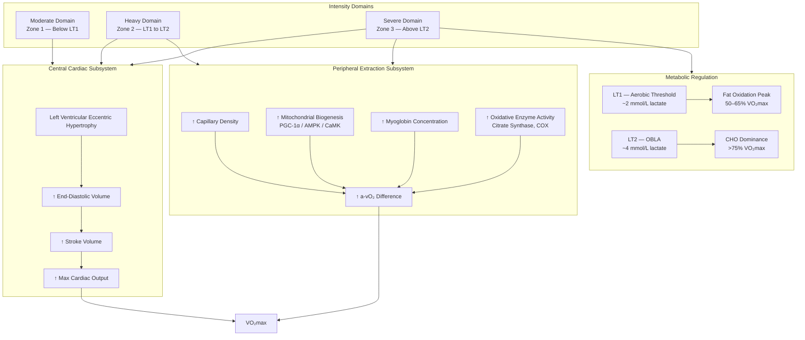

# Lesson 4: Cardiovascular Metabolic Training

## 1. First-Principles Intuition & Invariants

The human organism is fundamentally an oxidative machine. Even at maximal sprint effort, the ATP regenerated through substrate-level phosphorylation during the contraction itself is replenished afterward by mitochondrial oxidative phosphorylation, meaning every joule of work ultimately draws through the aerobic pipeline. This single fact makes cardiovascular metabolic training the bedrock upon which all other energy-system development rests, whether the athlete's arena is a 60-minute ultra-endurance mountain race, a repeated-sprint team sport, or a strength athlete's capacity to recover between heavy sets. To program aerobic training intelligently, you must understand the Fick equation not as a textbook formula to memorize but as the engineering blueprint of every adaptation you are trying to provoke.

The Fick principle states that whole-body oxygen consumption equals cardiac output multiplied by the arteriovenous oxygen difference: **VO₂ = Q × (a-vO₂ diff)**, where cardiac output (Q) itself decomposes into heart rate (HR) × stroke volume (SV). These three multipliers — heart rate, stroke volume, and peripheral oxygen extraction — define the entire adaptive landscape of cardiovascular training. The central component, cardiac output, is governed primarily by stroke volume, because maximal heart rate is essentially fixed by age and unresponsive to training. Stroke volume, by contrast, is exquisitely trainable and is the single largest determinant of VO₂max improvements in the first six to twelve weeks of a training program. The mechanism is straightforward: chronic volume overload produces eccentric left ventricular hypertrophy, increasing end-diastolic volume through chamber enlargement and enhanced ventricular filling. A larger preload stretches the myocardial sarcomeres toward their optimal length-tension position, producing a more forceful contraction via the Frank-Starling mechanism. The trained heart ejects more blood per beat at any given heart rate, meaning the athlete can sustain a given submaximal cardiac output at a lower heart rate — the familiar resting bradycardia of the endurance athlete is not a lower metabolic demand but a larger stroke volume doing the same work in fewer beats.

The peripheral component, the a-vO₂ difference, describes how much oxygen the working muscles strip from the blood passing through their capillaries. At rest, arterial blood carries roughly 20 mL O₂ per dL, and mixed venous blood returns with about 15 mL/dL, yielding a 5 mL/dL difference. At maximal effort in an elite endurance athlete, the a-vO₂ difference can reach 18–20 mL/dL, meaning the muscles extract nearly all available oxygen. This extraction capacity is governed by capillary density, mitochondrial volume, oxidative enzyme concentration (citrate synthase, succinate dehydrogenase, cytochrome c oxidase), myoglobin concentration, and the sodium-potassium pump density that maintains membrane excitability under repeated depolarization. These peripheral adaptations respond most robustly to sustained submaximal work in the moderate intensity domain, which is why hours of Zone 2 training remain the foundation of every serious endurance program despite the fashionable emphasis on high-intensity intervals.

The lactate threshold occupies the hinge between sustainable and unsustainable effort. Blood lactate is not a waste product but a continuously produced metabolite that serves as a shuttle between glycolytic and oxidative fibers, between muscle and liver (via the Cori cycle), and even between muscle and brain. At low intensities, lactate production and clearance are balanced, and blood concentration remains near resting levels of 1–2 mmol/L. As intensity rises, glycolytic flux outpaces mitochondrial pyruvate handling, and lactate accumulates. The lactate threshold (LT1), sometimes called the aerobic threshold, marks the first clear rise above baseline, typically around 2 mmol/L. The second lactate threshold (LT2), also called the onset of blood lactate accumulation (OBLA) at approximately 4 mmol/L or the individual anaerobic threshold, marks the intensity beyond which lactate accumulates inexorably and the athlete is on a clock to exhaustion. The zone between LT1 and LT2 — often called Zone 3 or the "sweet spot" — is the highest sustainable steady-state intensity, and it is trainable through sustained threshold work. The zone above LT2 is the severe domain, where VO₂ eventually reaches its maximum and exhaustion follows within minutes.

A critical invariant governs all cardiovascular programming: the specificity of the metabolic demand must match the target event's profile. A 5K runner needs a high LT2 relative to VO₂max and the capacity to tolerate significant time above LT2 during the race's final kilometers. An ultramarathon runner needs extraordinary LT1 efficiency and fat oxidation capacity, with relatively little time spent at or above LT2. A repeated-sprint athlete — a soccer midfielder, a CrossFit competitor — needs a high VO₂max to accelerate recovery between bouts and a robust anaerobic capacity to fuel each sprint. Programming that ignores this specificity produces athletes who are fit in a generic sense but underperform in their specific event.

## 2. Core Architecture & Mechanics

The cardiovascular training system can be modeled as a cascade of three interlocking subsystems: the central pump, the peripheral extraction network, and the metabolic regulatory pathways that govern substrate selection and lactate kinetics. Understanding how these subsystems respond to different intensity domains allows you to construct training sessions that target each component with surgical precision.

Moderate-intensity continuous training below LT1 drives the largest volume of mitochondrial biogenesis signaling through the calcium-calmodulin kinase (CaMK) and AMPK pathways, which converge on PGC-1α, the master regulator of mitochondrial proliferation. These pathways are activated in proportion to the duration of sustained calcium flux and energy stress, which is why a 90-minute Zone 2 session produces a stronger PGC-1α signal than a 20-minute HIIT session despite the latter's higher peak intensity. The moderate domain is also where fat oxidation rates are maximized, typically peaking between 50 and 65 percent of VO₂max. Sustained time in this zone upregulates the enzymes of beta-oxidation (carnitine palmitoyltransferase-1, HADH), increases intramuscular triglyceride storage capacity, and shifts substrate reliance toward fat at any given intensity. This is the metabolic flexibility that allows the trained endurance athlete to spare glycogen and sustain submaximal pace for hours.

Heavy-domain work between LT1 and LT2 — what cyclists call "sweet spot" training — targets the lactate threshold itself. Sustained time at 85 to 95 percent of LT2 power or pace pushes the boundary upward by increasing mitochondrial density in Type IIa fibers, improving lactate clearance through enhanced MCT-1 and MCT-4 transporter expression, and raising the percentage of VO₂max at which the athlete can sustain steady-state lactate. The classic session is two to four repetitions of 20 minutes at 90 to 95 percent of threshold power, with 5-minute easy recovery between repetitions. This is the single most time-efficient intensity for improving sustained performance in events lasting 40 minutes to 3 hours.

Severe-domain work above LT2, including traditional VO₂max intervals, is where the central pump receives its strongest stimulus. When the athlete exercises at an intensity requiring 95 to 100 percent of VO₂max, the heart is driven to its maximal output, and the left ventricle experiences the maximal preload and contractility that drive eccentric hypertrophy. The challenge is sustaining this intensity long enough to accumulate time at or near VO₂max. A single 3-minute interval at 95 percent VO₂max may only produce 60 to 90 seconds of actual time at VO₂max, because the cardiovascular system takes 60 to 90 seconds to reach steady-state maximal oxygen consumption at the onset of exercise. This is why interval protocols with repetitions of 3 to 5 minutes are more effective for VO₂max development than the popular 30-second on / 30-second off formats, which spend most of their time in the transition between intensities rather than at the target.

The Norwegian 4×4 protocol, developed by Ulrik Wisløff's group at the Norwegian University of Science and Technology, has become the gold-standard VO₂max interval protocol because it maximizes accumulated time at maximal cardiac output. The structure is simple and brutally effective: four repetitions of 4 minutes at 90 to 95 percent of maximal heart rate (roughly 95–100 percent of VO₂max for most athletes), separated by 3 minutes of active recovery at 60 to 70 percent of maximal heart rate. With each repetition, the cardiac system reaches VO₂max more quickly because the prior interval has elevated baseline cardiac output, and the recovery period is short enough that VO₂ does not fully return to rest. By the third and fourth repetitions, the athlete reaches VO₂max within 30 to 45 seconds, accumulating 10 to 12 minutes of total time at VO₂max across the session.

| Protocol | Work Duration | Intensity (% VO₂max) | Rest Duration | Rest Intensity | Repetitions | Time at VO₂max |
|---|---|---|---|---|---|---|
| Norwegian 4×4 | 4 min | 90–95% | 3 min | 60–70% HRmax | 4 | 10–12 min |
| Tabata | 20 sec | 170% VO₂max | 10 sec | Passive | 8 | 2–3 min |
| 30-15 IFT | 30 sec | 105–110% vVO₂max | 15 sec | 50% vVO₂max | 12–15 | 5–7 min |
| 3-min cruise | 3 min | 95–100% | 2 min | 50% VO₂max | 5–6 | 8–10 min |
| Billat 3-3 | 3 min | 100% vVO₂max | 3 min | 50% vVO₂max | 5 | 6–8 min |

The 30-15 Intermittent Fitness Test protocol, popularized by Martin Buchheit, uses 30-second work bouts at 105 to 110 percent of the velocity at VO₂max (vVO₂max) with 15 seconds of active recovery at 50 percent of vVO₂max. This asymmetrical work-to-rest ratio (2:1) produces a cardiac drift upward across repetitions, with heart rate climbing progressively toward its maximum by the sixth or seventh repetition. The short work bout limits anaerobic glycolytic contribution and lactate accumulation, while the brief, incomplete recovery keeps cardiac output elevated, creating a "cardiovascular rollercoaster" that accumulates significant time near VO₂max without the psychological burden of long maximal intervals. For team-sport athletes who need repeated-sprint capacity and aerobic recovery, this protocol is often preferred over the Norwegian 4×4 because it mimics the intermittent demand profile of their sport.

Steady-state training in the moderate domain is often dismissed as boring or inefficient compared to the glamorous intensity of HIIT, but the physiological evidence is unambiguous: the largest gains in mitochondrial density, capillary density, and fat oxidation capacity come from sustained volume below LT1. This is why the training of elite endurance athletes follows a polarized distribution, typically 80 percent of total training volume below LT1 and 20 percent at or above LT2, with remarkably little time in the heavy middle zone. The 80/20 distribution is not arbitrary. It reflects the fact that easy days must be easy enough to allow recovery from the hard days, which must be hard enough to provoke adaptation. The trap that catches most recreational athletes is training in the gray zone — too hard on easy days to recover fully, too easy on hard days to provoke a VO₂max or threshold adaptation. The result is chronic fatigue without progression, the hallmark of the stagnant athlete.

## 3. High-Performance Optimization & Failure Modes

Periodizing cardiovascular training requires the same discipline as periodizing strength work, but the fatigue and adaptation profiles are different and often counterintuitive. The aerobic system has a large adaptive capacity and a slow decay rate: an endurance athlete can build a massive aerobic base over months and retain most of it with minimal maintenance volume. But the same system is vulnerable to a specific failure mode — the overtraining syndrome — that is insidious because its early symptoms masquerade as inadequate training rather than excessive training. The athlete who is underperforming almost always assumes they need more work, not less.

The intensity distribution is the primary lever for long-term optimization. The polarized model, validated through studies of elite rowers, cyclists, runners, and cross-country skiers, allocates approximately 80 percent of weekly training time to Zone 1 (below LT1, RPE 2–3, 60–75 percent HRmax, conversationally easy) and 20 percent to Zone 3 (above LT2, RPE 8–10, 90–100 percent HRmax, hard to maximum). Zone 2 (the heavy domain between LT1 and LT2) is used sparingly, typically only in specific build phases when threshold power is the direct target. A weekly microcycle for a well-trained endurance athlete might include five or six sessions: four to five easy continuous sessions of 60 to 120 minutes, one threshold session of 2×20 minutes at 90 to 95 percent of LT2 power, and one VO₂max session using the Norwegian 4×4 or a similar severe-domain protocol. Total weekly volume distribution should be checked: if more than 20 percent of total time falls in Zone 2, the athlete is likely in the gray zone and should be pushed either easier or harder.

Monitoring aerobic adaptation and detecting maladaptive drift requires objective markers. Resting heart rate taken every morning before standing provides a crude but useful barometer: a sustained increase of 5 to 7 beats per minute above the rolling 7-day average suggests accumulated fatigue, parasympathetic withdrawal, or impending illness. Heart rate variability (HRV), specifically the RMSSD metric derived from a short morning supine measurement, provides a more sensitive autonomic marker. A rolling 7-day average RMSSD that drops below the athlete's established baseline by more than one standard deviation, combined with a rising resting heart rate, indicates sympathetic dominance and incomplete recovery. The most direct performance marker is heart rate at a fixed submaximal workload: if the athlete's heart rate at a given pace or power is 5 to 8 beats higher than normal, cardiovascular efficiency has degraded and recovery is incomplete.

The two primary failure modes in cardiovascular training are functional overreaching and non-functional overreaching leading to overtraining syndrome. Functional overreaching is a planned, short-term overload that produces transient performance decrement followed by supercompensation after a recovery period of 3 to 14 days. It is the intended mechanism behind a hard training block or a training camp. Non-functional overreaching occurs when the overload exceeds the athlete's recovery capacity and the supercompensation never materializes; performance plateaus or declines for weeks rather than days. Overtraining syndrome is the extreme endpoint, with months of performance decline, neuroendocrine disruption, mood disturbance, and altered immune function. The distinction between these states is not intensity but duration: the same training load that produces functional overreaching in week one becomes non-functional by week four if recovery is inadequate.

The practical diagnostic is straightforward. If the athlete cannot complete the final interval of a VO₂max session at the prescribed intensity despite maximal effort, or if threshold power has declined from the previous test despite consistent training, the response is not to add volume but to reduce it. A 40 to 60 percent reduction in training volume for 5 to 7 days, with intensity maintained at Zone 1 only, typically resolves functional overreaching. If performance does not return within two weeks of reduced training, the athlete has entered non-functional territory and requires a longer deload of 2 to 4 weeks with monitoring by a sports physician.

Altitude training and heat acclimation are two environmental interventions that can extend cardiovascular adaptation beyond what sea-level temperate training allows. Altitude exposure above 2,000 meters stimulates erythropoietin release, increasing red blood cell mass and hemoglobin concentration, which directly raises the oxygen-carrying capacity of the blood. The classic live-high-train-low model, where the athlete sleeps at altitude but trains near sea level, preserves training quality while still gaining the hematological benefits. The minimum effective exposure is 12 hours per day for at least 21 days at 2,200 to 3,000 meters. Shorter exposures or lower altitudes produce negligible EPO response. Heat acclimation, typically 10 to 14 days of 60 to 90 minutes of training in 35 to 40°C environments, produces plasma volume expansion of 10 to 20 percent within the first few days, improving stroke volume and cardiovascular stability during subsequent training in any environment. The plasma volume expansion is the primary mechanism behind heat acclimation's performance benefit, and it is lost within 7 to 10 days of returning to a temperate environment, so the timing must be precise relative to a target competition.

## 4. Summary & Verification Matrix

| System / Invariant | Governing Mechanism | Diagnostic Criteria | Failure Mode |
|---|---|---|---|
| VO₂max (Central Limit) | VO₂ = HR × SV × (a-vO₂ diff); stroke volume is the primary trainable determinant via eccentric LV hypertrophy | Plateau of VO₂ despite increasing workload in graded test; HR reaches age-predicted max with no further Q increase | Overtraining-induced SV depression; insufficient severe-domain stimulus |
| Lactate Threshold (LT2) | Maximal lactate steady-state; balance of lactate production and clearance via MCT-1/4 transporters and mitochondrial oxidation | Blood lactate of ~4 mmol/L sustained; power at LT2 from incremental test with Dmax or modified Dmax method | Gray-zone training fatigue; excessive Zone 2 volume suppressing threshold-specific adaptation |
| Mitochondrial Biogenesis | CaMK + AMPK → PGC-1α activation; proportional to sustained calcium flux duration and energy stress | Citrate synthase activity in muscle biopsy; indirect proxy via submaximal fat oxidation RER shift toward 0.80–0.85 | Insufficient Zone 1 volume; excessive HIIT displacing sustained moderate work |
| Polarized Distribution | 80% Zone 1 / 20% Zone 3; easy days easy enough for recovery, hard days hard enough for adaptation | Weekly time-in-zone analysis; HRV/RHR stable or improving; threshold power and vVO₂max trending upward | Accidental Zone 2 accumulation on easy days; chronic sympathetic dominance from insufficient recovery |
| Overtraining Detection | Autonomic nervous system imbalance; sympathetic overdrive with parasympathetic withdrawal | RHR ↑ 5–7 bpm over 7-day rolling avg; RMSSD ↓ >1 SD; submaximal HR ↑ 5–8 bpm at fixed workload; mood disturbance (POMS) | Failure to deload; misattributing performance decline to undertraining rather than overtraining |
| Environmental Priming | Altitude EPO response (>2000 m, 12+ h/day, 21+ days) for RBC mass; heat acclimation (10–14 d, 35–40°C) for plasma volume expansion | Hematocrit / hemoglobin mass via CO-rebreathing; plasma volume via DEXA or dilution; HR drift at fixed workload | Premature return from altitude (red cell mass not yet realized); heat acclimation decay before competition (>7–10 days post) |
