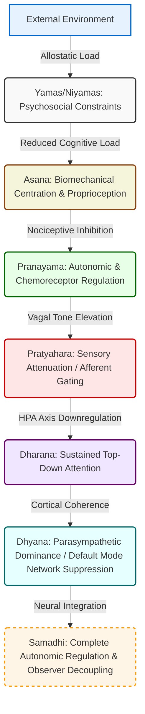

# Lesson 1: Philosophical Foundations of Yoga

## 1. First-Principles Intuition & Invariants

To understand the practice of yoga as an advanced exercise physiologist, one must first strip away the modern commercialized conflation of yoga with mere stretching or calisthenics. Classical yoga, as codified by Patanjali in the Yoga Sutras circa 200 BCE, is fundamentally an allostatic management protocol designed to optimize the human nervous system. The physical postures, known broadly as asana, were not originally intended as an end in themselves. They were meticulously engineered physical scaffolding designed to stabilize the body sufficiently so that the practitioner could endure prolonged periods of seated meditation and breath control without biomechanical distraction or tissue failure. When we examine the philosophical foundations of yoga through the lens of exercise science, we are looking at a centuries-old system of top-down autonomic regulation, where cognitive and behavioral constraints manipulate physiological outputs down to the level of tissue oxygenation and fascial tension.

The underlying metaphysical framework of classical yoga is rooted in Samkhya philosophy, one of the oldest orthodox systems of Indian philosophy. Samkhya proposes a dualistic universe divided into Purusha, pure consciousness or the silent observer, and Prakriti, the realm of matter, physiology, and the physical body. For the exercise specialist, this translates to a practical separation between the observing mind and the physiological substrate being trained. The goal of classical yoga is the isolation of Purusha from the fluctuations of Prakriti. In a gym or clinical setting, this is equivalent to achieving a state of profound interoception and autonomic stillness, where the practitioner is no longer psychologically bound to the sensations of muscular fatigue, joint shear, or respiratory acidosis. 

To achieve this isolation, the practitioner must interact with the Gunas, the three fundamental qualities of Prakriti that govern all physiological and psychological states. Tamas represents inertia, heaviness, and degenerative stagnation, analogous to a sedentary state or excessive parasympathetic lethargy. Rajas represents activity, kinetic energy, and sympathetic drive, the necessary state for generating muscular force and motor unit recruitment. Sattva represents harmony, equilibrium, and parasympathetic dominance, the optimal state for tissue recovery, cognitive clarity, and neuroplasticity. A yoga practice, properly periodized, is designed to burn off Rajasic kinetic energy through structured mechanical loading, thereby driving the nervous system into a Sattvic baseline. This Sattvic state is not merely a philosophical ideal; it is the physiological equivalent of high vagal tone, optimized Heart Rate Variability (HRV), and low basal cortisol, creating the biological conditions necessary for deep meditative absorption.

The governing invariant of this entire system is articulated in Yoga Sutra 2.46: *Sthira sukham asanam*. This translates to the requirement that a physical posture must possess both *Sthira* (structural stability, alertness, and active muscular engagement) and *Sukha* (comfort, ease, and parasympathetic down-regulation). From a biomechanical perspective, this is a non-negotiable invariant. If a posture lacks *Sthira*, the body collapses into passive tension, relying on ligaments and articular capsules to maintain joint integrity. This passive reliance triggers nociceptive signaling, which upregulates the sympathetic nervous system and instantly destroys *Sukha*. Conversely, if a posture prioritizes excessive muscular force to maintain stability, it generates localized ischemia and metabolite accumulation, again triggering sympathetic arousal. The practitioner must find the precise biomechanical midpoint where active muscular tension provides joint centration, while the surrounding non-primary stabilizers remain relaxed enough to allow unimpeded diaphragmatic breathing. This state of active, non-forced joint stability is the mechanical prerequisite for advancing to the higher, purely neurological limbs of the practice.

## 2. Core Architecture & Mechanics

The architectural framework of classical yoga is the Ashtanga, or the Eight Limbs. In modern exercise therapy, these limbs must not be viewed as a strict sequential hierarchy where one must master physical postures before attempting breath work, but rather as an integrated, concurrent operating system. They represent a continuum from gross physical behavior to subtle neurological regulation, culminating in altered states of consciousness. Understanding the mechanics of each limb allows the exercise professional to diagnose exactly where a practitioner’s physiological or psychological bottleneck resides.

The first two limbs, the Yamas and Niyamas, constitute ethical and behavioral constraints. While often dismissed as mere moral guidelines by modern fitness professionals, they function as psychosocial load managers. The Yama of *Ahimsa* (non-violence) directly correlates to the principle of non-harming in exercise execution, respecting tissue tolerance limits and avoiding the overuse injuries that trigger inflammatory cascades and allostatic load. The Niyama of *Tapas* (discipline) corresponds to the psychological resilience required for progressive overload and consistency in periodization. By regulating external behaviors and internal psychological states, the practitioner reduces cognitive friction and emotional volatility, freeing up central nervous system resources for the mechanical demands of the practice.

The third limb, Asana, is where exercise biomechanics take center stage. The physical mechanics of classical postures are governed by the principles of joint centration and active range of motion. Consider the execution of Utthita Trikonasana (Triangle Pose). The leading leg achieves approximately 90 degrees of sagittal hip flexion, dictated by the depth of the acetabulum and the tension of the hamstring complex. To maintain *Sthira*, the gluteus medius and quadratus femoris must eccentrically control the pelvis, preventing passive collapse into the hip capsule. If the practitioner allows the weight of the torso to rest entirely on passive hip ligaments, the femoral head glides superiorly, impinging the labrum and triggering nociceptive warning signals. The correct mechanical execution requires the practitioner to actively press the floor away, creating a reciprocal tension that stabilizes the lumbar spine in a neutral alignment, allowing the respiratory diaphragm to function without mechanical compression.

The fourth limb, Pranayama, is the bridge between physical and neurological control. It is the mechanical manipulation of respiratory chemoreceptors to directly alter blood pH and autonomic nervous system tone. By enforcing nasal breathing and extending the exhale, the practitioner increases carbon dioxide tolerance. This mild hypercapnia gently acidifies the cerebrospinal fluid, stimulating the respiratory centers to increase breathing drive, while the prolonged exhale simultaneously activates the pulmonary stretch receptors. This afferent signaling travels via the vagus nerve to the brainstem, directly downregulating the sympathetic branch and upregulating the parasympathetic branch, creating profound cardiovascular stability.

The final four limbs, Pratyahara, Dharana, Dhyana, and Samadhi, map the trajectory from sensory attenuation to complete cortical integration. Pratyahara is the active inhibition of afferent noise, consciously filtering out proprioceptive and exteroceptive data once the mechanical stability of the posture is established. Dharana is the active holding of a single cognitive thread, anchoring attention to a singular point, which reduces the default mode network activity in the brain. Dhyana is the uninterrupted flow of that attention, where beta brainwave states begin to yield to alpha and theta states, characterized by profound parasympathetic dominance. Samadhi represents the terminal state, where the observer is functionally decoupled from the physiological substrate, and the autonomic nervous system operates in a state of self-sustaining equilibrium.

## 3. High-Performance Optimization & Failure Modes

When integrating classical yoga into a high-performance athletic macrocycle, the exercise professional must treat the practice as a targeted neuro-endocrine intervention rather than a generic flexibility routine. The optimization of yoga within an athletic context requires periodization that respects the athlete's primary sport. During high-intensity mesocycles characterized by heavy sympathetic loading, classical asana practice should be heavily biased toward restorative postures and Pranayama to facilitate active recovery. The goal is to drive the athlete's autonomic nervous system back toward a Sattvic baseline, maximizing HRV and lowering nocturnal cortisol. Protocols such as Bhramari Pranayama, which involves a prolonged humming exhale, generate localized nitric oxide production in the nasal cavity and stimulate the vagus nerve through somatic vibration, effectively hacking the parasympathetic nervous system to accelerate central nervous system recovery.

During off-season or low-intensity mesocycles, the practice can shift toward deeper biomechanical loading, utilizing the physical postures to address fascial densification and joint capsule restriction. Here, the optimization parameter is the duration of the hold. To affect plastic deformation in dense connective tissues, passive holds must be sustained for a minimum of three to five minutes. This duration is required to initiate the viscoelastic creep necessary to overcome the thixotropic properties of fascia and stimulate the Golgi tendon organs to initiate autogenic inhibition. However, this passive loading must be strictly monitored, as it bypasses the active protective mechanisms of the muscle spindle.

A primary failure mode in advanced practitioners occurs precisely at this intersection of passive loading and joint hypermobility. When a practitioner possesses excessive genetic tissue laxity, their passive range of motion often drastically exceeds their active, controlled range. If the practitioner continues to push into end-range passive tension, they sacrifice the *Sthira* invariant. The joint capsule and surrounding ligaments become the primary load bearers, leading to micro-instability, cumulative micro-trauma, and eventual osteoarthritic degradation or labral tearing. The diagnostic criterion for this failure is a noticeable lack of muscular co-contraction at end-range, often accompanied by a dull, diffuse ache in the joint rather than a sharp muscular stretch. The mitigation strategy requires abandoning passive stretching entirely for these individuals, implementing strict eccentrics to build active tissue stiffness, and actively pulling the joint back from its absolute end-range to re-establish muscular centration.

A neuro-physiological failure mode frequently observed in the Pranayama limb is the induction of respiratory alkalosis through forced breath retention. In an attempt to master Kumbhaka (breath suspension), an untrained practitioner will often hyperventilate beforehand, blowing off excessive carbon dioxide. This shifts blood pH alkaline, inducing cerebral vasoconstriction, dizziness, and a panic response mediated by the amygdala. This sympathetic panic response is the antithesis of the classical goal. Diagnostic criteria include tingling in the extremities, tetany in the hands, and an elevated respiratory rate upon release of the retention. The mitigation requires enforcing nasal diaphragmatic breathing, restricting the breath cycle to a manageable 1:2 ratio of inhale to exhale, and allowing the chemoreceptors to slowly adapt to higher, but safe, CO2 partial pressures over weeks of consistent practice rather than forcing extended retentions prematurely.

Finally, failure in the higher cognitive limbs frequently manifests as dissociation rather than true integration. If a practitioner attempts to force Dharana or Dhyana without first stabilizing the biomechanics of Asana and the autonomic regulation of Pranayama, the nociceptive input from unstable joints and erratic breathing will constantly hijack the cognitive networks, pulling the practitioner back into sympathetic arousal. The optimization of the system demands absolute fidelity to the foundational mechanics; one cannot engineer a meditative state atop a biomechanically unsound and autonomic dysregulated chassis.

## 4. Summary & Verification Matrix

| Invariant | Physiological Mechanism | Diagnostic Criteria | Failure Mode & Mitigation |
| :--- | :--- | :--- | :--- |
| **Sthira Sukham Asanam** (Sutra 2.46) | Active muscular co-contraction provides joint centration while permitting unimpeded diaphragmatic breathing. | Joint stability is maintained without excessive muscular trembling; breath remains slow and deep. | **Failure:** Collapse into passive joint tension causing nociception.  **Mitigation:** Back off end-range, engage primary stabilizers to re-center the joint. |
| **Guna Modulation (Sattva)** | Burning off Rajasic energy via structured mechanical loading to drive the nervous system into parasympathetic dominance. | Post-practice HRV is elevated, respiratory rate is depressed, basal cortisol is reduced. | **Failure:** Over-training induces chronic sympathetic arousal (Rajas/Tamas).  **Mitigation:** Periodize yoga as active recovery during high-intensity phases; utilize restorative postures. |
| **Pranayama Chemoreception** | Controlled hypercapnia and extended exhales stimulate pulmonary stretch receptors, elevating vagal tone. | Smooth, nasal diaphragmatic breathing without panic, maintaining a steady 1:2 inhale-to-exhale ratio. | **Failure:** Hyperventilation causes respiratory alkalosis, dizziness, and tetany.  **Mitigation:** Enforce nasal breathing, reduce breath retention times, allow gradual CO2 adaptation. |
| **Joint Centration vs. Hypermobility** | Loading forces are distributed evenly across articular surfaces via active muscular tension rather than passive ligamentous tension. | Active range of motion matches passive range of motion; no dull aching in joint capsules post-practice. | **Failure:** Passive stretching relies on ligaments, leading to micro-instability and osteoarthritis.  **Mitigation:** Implement eccentrics to build active tissue stiffness; avoid absolute end-range loading. |
| **Sensory Attenuation (Pratyahara)** | Top-down cognitive inhibition filters afferent proprioceptive and exteroceptive noise to stabilize attention. | Ability to maintain focus on a singular point despite external auditory or tactile distractions. | **Failure:** Nociceptive input from unstable joints hijacks cognitive networks, breaking concentration.  **Mitigation:** Resolve foundational biomechanical and autonomic deficits before attempting advanced cognitive limbs. |
