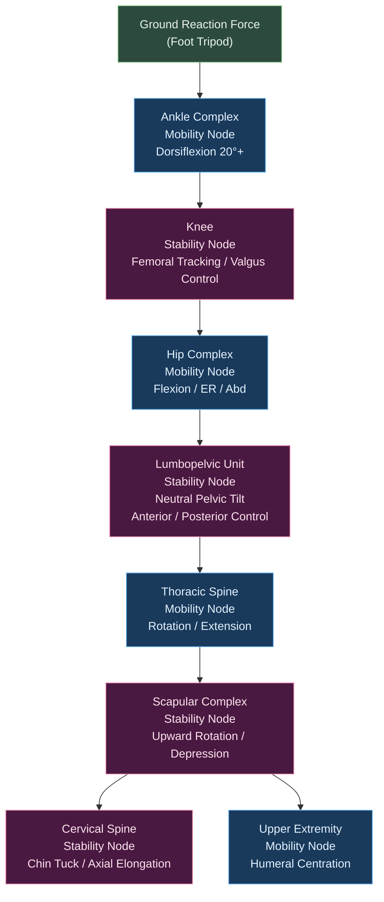

# Lesson 2: Anatomical Foundations in Asana Practice

## 1. First-Principles Intuition & Invariants

Every asana is a conversation between intention and structure. The practitioner's nervous system sends a movement directive, and the musculoskeletal system either honors it cleanly or compensates around its deficiencies. Understanding why a posture works, why it fails, and what distinguishes safe loading from injurious strain requires the same first-principles thinking a structural engineer applies to a bridge: you must know the material properties, the load paths, and the tolerances before you can trust the design.

The skeleton is not a rigid frame. It is a tensegrity system, a term borrowed from architecture, in which rigid compression members (bones) are suspended within a continuous network of tension elements (fascia, ligaments, tendons, and active musculature). Buckminster Fuller's tensegrity models described structures that become more stable under load because tension distributes rather than concentrates force. The human body behaves similarly. When alignment is accurate and muscular tone is appropriately distributed, compressive load through the axial skeleton disperses across broad articular surfaces and dense trabecular bone. When alignment fails, that same load concentrates at a focal point, frequently the posterior annulus of a lumbar disc or the medial compartment of the knee, where tissue is not designed to absorb cyclical compression without consequence.

The foundational invariant of all asana practice is this: **joint centration precedes muscular effort**. Centration describes the condition in which the articular surfaces of a joint are optimally congruent, the capsular ligaments are neither excessively lax nor under pathological tension, and the periarticular musculature can generate force across the full range without creating shear at the joint surface. A hip joint loaded in centration distributes compressive force evenly across the femoral head and acetabular cartilage. The same hip loaded in internal rotation with an adducted femur, a common compensation in Warrior I among practitioners with limited thoracic rotation, directs force toward the anterior-superior labrum, a region of fibrocartilage with limited vascular supply and consequently limited healing capacity.

Three invariants govern every posture in this curriculum. First, proximal stability enables distal mobility: the spine, pelvis, and scapular complex must establish a stable base before the extremities are loaded or lengthened. Second, force couples must balance: every agonist muscle generating torque around a joint must be counterbalanced by an antagonist or stabilizer, or the joint will migrate out of centration. Third, the kinetic chain is continuous, meaning that a compensation at the foot arch will express itself at the knee, hip, and lumbar spine unless actively intercepted. These three invariants are not guidelines; they are mechanical laws, and asana practice that violates them consistently produces the cumulative microtrauma that presents clinically as labral tears, sacroiliac dysfunction, and cervical facet irritation.

The skeletal landmarks an advanced practitioner must internalize are the anterior superior iliac spine (ASIS), the posterior superior iliac spine (PSIS), the greater trochanter of the femur, the tibial tuberosity, and the medial and lateral malleoli. The positional relationships between these landmarks communicate pelvic tilt, femoral rotation, tibial torsion, and foot pronation status in real time, without imaging or instrumentation. Learning to read these landmarks on yourself and others is the clinical skill that separates a practitioner who cues from vocabulary from one who cues from mechanical observation.

---

## 2. Core Architecture & Mechanics

### The Kinetic Chain and Joint Hierarchy

The body organizes movement through a hierarchy of joints, each serving a primary functional role. The ankle and hip are mobility joints: they require large, multiplanar range of motion to absorb ground reaction forces and position the limbs in space. The knee and lumbar spine are stability joints: they require precise alignment and strong periarticular muscular control to transmit force without excessive accessory motion. When a mobility joint is restricted, the adjacent stability joint compensates by increasing its motion, a substitution that places it outside the range for which it is architecturally designed.

This joint-by-joint principle, formalized in movement science by Gray Cook and Mike Boyle, maps directly onto asana mechanics. Limited ankle dorsiflexion in a practitioner attempting Malasana (Garland Pose) forces the knee into valgus collapse and the lumbar spine into excessive flexion, because the kinetic chain must find its degrees of freedom somewhere. Addressing the ankle restriction with targeted soft-tissue work and joint mobilization resolves the downstream compensations more reliably than endless verbal cueing to "lift the chest" or "press the knees out."

The diagram below maps the kinetic chain topology for a bilateral standing asana, tracing force transmission from ground contact through each joint segment and identifying the primary stability demand at each node.

Blue nodes are mobility joints; they should be trained for range, end-range control, and multiplanar capacity. Purple nodes are stability joints; they should be trained for stiffness under load, positional awareness, and force couple balance. When reading a practitioner's compensation pattern in a standing pose, trace the chain: a purple (stability) node that is moving too much is almost always compensating for a blue (mobility) node that is moving too little.

### Pelvic Mechanics and Lumbar Spine Coupling

The pelvis is the mechanical fulcrum of the entire axial skeleton. Its orientation in three-dimensional space determines lumbar curvature, hip joint congruency, and thoracic load distribution simultaneously. Anterior pelvic tilt, in which the ASIS drops forward relative to the PSIS, increases lumbar lordosis, compresses the posterior facet joints, and places the hip flexors in a shortened position that restricts hip extension. This pattern is ubiquitous in populations who sit for extended periods and presents in yoga as an inability to achieve a neutral lumbar curve in forward folds without compensatory hamstring over-lengthening.

Posterior pelvic tilt does the opposite: it flattens the lumbar spine into flexion, unloads the facets, and places the posterior hip capsule and sacroiliac ligaments under tension. While this position is sometimes mistakenly reinforced in yoga instruction as "tucking the tailbone," chronic posterior tilting in postures like Virabhadrasana II (Warrior II) generates posterior disc shear in the lumbar segments and inhibits gluteal activation, since the gluteus maximus is a primary posterior pelvic tilter and cannot function optimally when it is already in a shortened range.

Lumbopelvic rhythm describes the coordinated rotation of the pelvis on the femoral heads and the lumbar segments during forward flexion. In a practitioner with adequate hamstring length and hip mobility, spinal flexion and anterior pelvic rotation share the total forward-bend range approximately equally. When hamstrings are restricted, the pelvis stops rotating early and the lumbar spine contributes disproportionate flexion to reach the floor, increasing posterior disc pressure. The clinical correction is not to stretch the hamstrings harder but to train active hip flexion with a neutral spine so the nervous system learns to dissociate lumbar motion from hip motion before imposing passive lengthening.

### Muscular Activation Patterns in Key Postures

Three postures serve as mechanical archetypes from which almost every other asana can be derived: Tadasana (Mountain Pose), Adho Mukha Svanasana (Downward Dog), and Virabhadrasana I (Warrior I). Each one demands a specific pattern of muscular co-activation that, once mastered, transfers across the entire practice.

In Tadasana, the governing activation sequence is a mild quadriceps contraction to extend the knee without hyperextension, followed by engagement of the gluteus medius to stabilize the hip in neutral abduction, then a posterior tilting of the pelvis through low-level transversus abdominis and multifidus co-contraction to establish a neutral lumbar curve. The scapulae retract and depress through lower trapezius activation, the cervical spine axially elongates through suboccipital decompression, and the foot arch is maintained by the intrinsic foot musculature, specifically the abductor hallucis and flexor digitorum brevis, rather than by passive ligamentous support. This is not a passive standing position; it is an isometric loading drill for the entire postural chain.

Adho Mukha Svanasana places the shoulder girdle under axial load through the upper extremity and demands both scapular stability and thoracic extension simultaneously. The serratus anterior must protract and upwardly rotate the scapula to maintain centration of the glenohumeral joint as the humeral head is loaded against gravity. Without adequate serratus function, the medial scapular border wings away from the thorax and the glenohumeral joint migrates superiorly, compressing the rotator cuff against the acromion. The correct cue is not "push the floor away" in isolation but rather "broaden through the shoulder blades while drawing them down the back," which activates both the serratus anterior (protraction and upward rotation) and the lower trapezius (depression and retraction) as a coupled force system.

Virabhadrasana I is the most mechanically demanding of the three precisely because it requires opposing demands in the same posture: hip flexion in the front leg, hip extension in the back leg, and thoracic extension with overhead arm reach, all while maintaining lumbopelvic neutrality. The practitioner with limited hip flexor length on the back leg will compensate by anteriorly tilting the pelvis and hyperextending the lumbar spine to create the appearance of upright posture. The diagnostic test is to place one hand on the practitioner's ASIS and one on the sacrum: in a compensated position, the ASIS will be significantly lower than the PSIS in the sagittal plane. The correction is to shorten the stance, cue a posterior pelvic tilt through internal oblique activation, and reduce the depth of the front knee bend until hip flexor length permits the full expression without lumbar compromise.

---

## 3. High-Performance Optimization & Failure Modes

### Optimizing End-Range Stability

Advanced practitioners pursuing deeper ranges of motion frequently encounter a distinction that determines long-term joint health: the difference between passive end-range and active end-range. Passive end-range is the position the joint reaches when external force, gravity, or a partner's assistance carries it beyond what active musculature alone can control. Active end-range is the boundary where the practitioner's own neuromuscular system can both achieve and stabilize the position. Injuries occur almost exclusively in the zone between active and passive end-range, where the joint is loaded but the supporting musculature is too long and too inhibited to generate protective stiffness.

The training intervention for this problem is Proprioceptive Neuromuscular Facilitation (PNF), specifically the Contract-Relax-Contract (CRC) protocol. The practitioner moves to active end-range, holds an isometric contraction of the antagonist (the muscle being stretched) at that position for six to eight seconds at approximately 70% effort, releases, then actively contracts the agonist to move deeper. The initial isometric activates the Golgi tendon organ, which inhibits the agonist's stretch reflex and allows greater range on the next attempt. More importantly, immediately contracting the agonist at the new range teaches the nervous system to own that position, converting passive into active range. Applied to Hanumanasana (Splits), this means reaching the hip flexor's end-range, isometrically contracting the hip flexors and rectus femoris against the floor resistance for eight seconds, releasing, and then actively driving deeper hip extension with gluteus maximus contraction before gravity pulls the pelvis further. Over six to eight weeks of consistent application, active end-range gains of 15 to 25 degrees are routine.

### Common Failure Modes and Their Mechanical Signatures

The most prevalent failure mode in yoga practice is lumbar hyperextension substituting for thoracic extension or hip mobility. The thoracic spine has twelve vertebral segments designed for rotation and extension, but the facet joint orientation and rib cage attachment provide inherent stability that limits its range. Many practitioners lack thoracic extension beyond 20 to 25 degrees and lack thoracic rotation beyond 30 to 35 degrees per side, ranges that are inadequate for postures like Ustrasana (Camel) or Parivrtta Parsvakonasana (Revolved Side Angle). Rather than developing thoracic mobility, the nervous system diverts the range requirement to the lumbar spine, which has facet joints oriented almost entirely in the sagittal plane and is poorly equipped to handle rotational shear. The result is progressive posterior disc injury and facet joint irritation, typically presenting as localized lumbar pain that worsens with extension and rotation.

The correction protocol follows a specific sequence. First, assess thoracic extension using a foam roller placed perpendicular to the spine at successive thoracic levels while the practitioner allows passive extension over it. Normal mobility shows 10 to 15 degrees of segmental extension at each level from T4 to T10. Restricted segments feel stiff and the practitioner cannot relax into extension. Second, mobilize restricted segments with thoracic self-mobilization using a doubled lacrosse ball taped together (a "peanut" tool) for three to five extension repetitions per restricted segment. Third, reinforce new range with the Cat-Cow sequence performed with deliberate segmental intention, isolating thoracic movement rather than allowing the lumbar spine to substitute.

Knee valgus in standing postures represents a failure of hip abductor and external rotator activation rather than a knee problem. The knee has no meaningful mechanism to resist valgus stress independently; it depends entirely on the hip musculature above and the foot-ankle complex below to maintain coronal plane alignment. When the gluteus medius and deep external rotators (piriformis, obturator internus, gemelli) are underactivated, the femur adducts and internally rotates under load, the patella tracks laterally against the lateral femoral condyle, and the medial collateral ligament is placed under tensile stress. In Utkatasana (Chair Pose), this presents as the knees drifting inward as the practitioner descends into depth. The intervention is to place a looped resistance band just above the knees and cue the practitioner to press outward against it throughout the descent, recruiting the gluteus medius before depth is added. After four weeks of this activation drill, most practitioners can maintain coronal plane alignment without the band.

Cervical compression in inversions, particularly in Salamba Sirsasana (Headstand), is the highest-risk failure mode in advanced practice. The cervical spine carries approximately 7 times body weight in a full headstand when the forearm and shoulder girdle musculature fails to support the load. The critical activation pattern is scapular elevation through upper trapezius and levator scapulae, combined with shoulder external rotation to create a stable triangular base. If the practitioner cannot maintain this activation under load, the cervical vertebrae compress, and C5-C6 is the most vulnerable level because it represents the transition between the mobile cervical spine and the more stable thoracic segments. Any practitioner who cannot hold a hollow-body plank with active shoulder elevation for 60 seconds has insufficient shoulder girdle strength to practice unsupported headstand safely. This is not a flexibility or balance issue; it is a pure strength prerequisite that must be satisfied before the inversion is attempted.

Sacroiliac joint (SIJ) instability represents the cumulative failure mode most commonly produced by years of aggressive hip external rotation postures without balancing internal rotation and adduction work. The SIJ is stabilized through form closure (the interlocking irregular surfaces of the sacrum and ilium) and force closure (muscular compression through the thoracolumbar fascia, gluteus maximus, and biceps femoris, among others). Excessive ligamentous laxity, whether from repeated overstretching in Baddha Konasana (Bound Angle) or hormonal factors, reduces form closure and places the entire stabilization burden on force closure musculature. The practitioner presents with posterior pelvic pain that is sharp on single-leg loading and that worsens with both end-range hip external rotation and lumbar flexion. Treatment requires temporarily removing aggravating postures, initiating compression-based stabilization exercises (clam shells, single-leg deadlifts at limited range), and re-introducing hip mobility work only after active SIJ compression is established.

---

## 4. Summary & Verification Matrix

| Anatomical Domain | Governing Invariant | Optimal Mechanical State | Primary Failure Mode | Diagnostic Criterion | Corrective Protocol |
|---|---|---|---|---|---|
| Lumbopelvic Unit | Proximal stability enables distal mobility; neutral pelvic tilt is prerequisite to loaded range | ASIS and PSIS level in sagittal plane; transversus abdominis and multifidus co-activated before limb movement | Anterior pelvic tilt with lumbar hyperextension substituting for hip mobility or thoracic extension | ASIS visibly lower than PSIS during Warrior I; practitioner cannot maintain neutral lumbar curve in forward fold with knees straight | Shorten stance depth; cue internal oblique activation to posteriorly tilt pelvis; address hip flexor length with PNF Contract-Relax-Contract protocol |
| Hip Complex | Joint centration precedes force production; femoral head must be congruent in acetabulum before load is applied | Femur in neutral rotation with moderate abduction; gluteus medius and deep external rotators co-activated | Labral impingement from anterior femoral glide; SIJ instability from chronic ligamentous overstretching in external rotation | FABER test reproduces anterior groin pain; posterior pelvic pain worsens on single-leg stance; click or catch during hip circumduction | Restore posterior hip capsule mobility; reinforce force closure with clam shells and single-leg Romanian deadlifts; temporarily remove end-range ER postures |
| Knee and Tibiofemoral Tracking | Knee stability depends entirely on hip abductors above and foot-ankle complex below; knee generates no independent valgus resistance | Tibial tuberosity aligned with second toe; patella tracking centrally; no coronal plane deviation under load | Valgus collapse from gluteus medius inhibition; patellar maltracking from lateral quad dominance | Knees drift medially in Utkatasana descent; J-sign or lateral patellar drift observed during single-leg squat | Resistance band above knees for gluteus medius activation; strengthen VMO with terminal knee extension; assess and correct foot pronation |
| Thoracic Spine | Thoracic mobility must be developed before lumbar mobility is demanded; rotation and extension range must be earned segmentally | 10–15° segmental extension at each level T4–T10; 35°+ rotation per side; rib cage expansion unrestricted in breathing | Lumbar hyperextension and rotational shear substituting for restricted thoracic range in backbends and twists | Practitioner cannot extend over foam roller at mid-thoracic levels; lumbar curve increases dramatically in Ustrasana while thoracic segments remain flat | Segmental thoracic mobilization with peanut tool; Cat-Cow with deliberate thoracic isolation; thoracic rotation drills in quadruped before loaded twists |
| Shoulder Girdle and Cervical Spine | Scapular centration and active elevation are prerequisites for inversion; cervical spine must not bear axial load without full shoulder girdle support | Serratus anterior maintaining scapular upward rotation; lower trapezius providing depression; cervical spine axially elongated, not compressed | Glenohumeral impingement from serratus inhibition in Downward Dog; cervical compression in Headstand from inadequate shoulder elevation strength | Medial scapular border winging in Downward Dog; practitioner cannot hold active shoulder elevation in plank for 60 seconds | Serratus anterior wall slides; hollow-body hold with active shoulder elevation as headstand prerequisite; lower trapezius Y-T-W series before overhead postures |
| Ankle and Foot Complex | Ankle dorsiflexion is the kinetic chain's ground-floor mobility requirement; restricted dorsiflexion produces cascading compensations through knee, hip, and lumbar spine | 20°+ talocrural dorsiflexion with neutral subtalar alignment; foot tripod contact maintained (first metatarsal head, fifth metatarsal head, calcaneus) | Knee valgus, lumbar flexion, and heel rise in Malasana from restricted ankle dorsiflexion; arch collapse from intrinsic foot muscle inhibition | Heel rises before achieving horizontal thigh in Malasana; more than 10° of subtalar eversion visible during single-leg stance | Ankle joint mobilization with band distraction; calf and soleus eccentric lengthening; intrinsic foot strengthening with towel scrunches and short-foot exercise |
