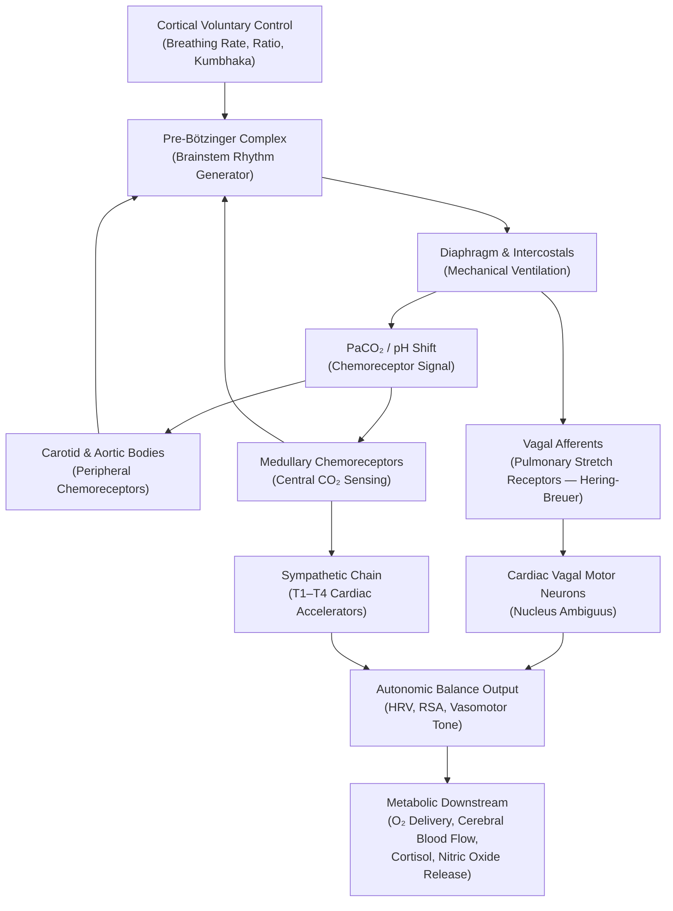

# Lesson 3: Pranayama Physiology and Energy Systems

## 1. First-Principles Intuition & Invariants

Breath is the only autonomic function a human being can consciously override. The heart beats without instruction, digestion proceeds without awareness, and the liver metabolizes in silence — but respiration sits at a rare intersection: it runs automatically when unattended yet surrenders to deliberate command the moment attention arrives. This is not an accident of anatomy. It reflects the respiratory control system's dual innervation, with neural pathways running through both the brainstem's automatic centers and the cortical motor system simultaneously. Pranayama — the Sanskrit codification of breath control — has exploited this physiological doorway for over three thousand years, long before the vocabulary of partial pressure gradients or autonomic tone existed to explain it. The practitioner's intuition preceded the mechanism by millennia. The modern exercise physiologist's task is to reverse-engineer why that intuition works.

The first invariant governing all pranayama practice is the **CO₂ sensitivity principle**. Contrary to the intuitive assumption that breathing is driven by oxygen demand, the primary chemical stimulus for respiration in a healthy person is carbon dioxide tension in arterial blood, specifically the partial pressure of CO₂ (PaCO₂), which is detected by central chemoreceptors in the medulla and peripheral chemoreceptors at the carotid and aortic bodies. Oxygen partial pressure (PaO₂) only becomes a dominant drive when it falls below approximately 60 mmHg — a threshold rarely approached in ordinary exercise or yoga practice. This means that any pranayama technique which manipulates breathing rate and depth is, mechanistically, a tool for manipulating PaCO₂ and pH. Hyperventilation reduces PaCO₂ (hypocapnia), shifting blood pH upward into respiratory alkalosis. Hypoventilation, breath retention (kumbhaka), and slow breathing elevate PaCO₂ (hypercapnia), producing the opposite shift. Every downstream physiological effect — changes in cerebral blood flow, smooth muscle tone, neural excitability, and autonomic balance — flows from this central chemical lever.

The second invariant is the **heart rate variability (HRV) coupling principle**. Respiratory sinus arrhythmia (RSA) describes the natural oscillation in heart rate that tracks the breathing cycle: heart rate accelerates during inhalation and decelerates during exhalation, driven by phasic inhibition and release of vagal tone. This coupling is not incidental; it reflects a fundamental integration between the respiratory pattern generator in the brainstem and the cardiac vagal motor neurons. Slow breathing at approximately 0.1 Hz — which corresponds to roughly six breath cycles per minute, the target rate in many classical pranayama techniques including Nadi Shodhana and deep ujjayi breathing — resonates with the natural oscillation frequency of baroreceptor-mediated blood pressure control, the Mayer wave. At this resonant frequency, RSA amplitude maximizes, coherence between blood pressure and heart rate oscillations peaks, and cardiovagal tone is powerfully upregulated. This is the physiological basis for the pervasive finding that slow yogic breathing measurably increases HRV and shifts the autonomic nervous system toward parasympathetic dominance.

The third invariant concerns the **diaphragm as a primary postural and respiratory organ**. The diaphragm's dome descends approximately 1.5 to 7 centimeters during inhalation, displacing abdominal viscera inferiorly and generating a negative intrathoracic pressure that drives lung inflation. Its geometry and force production depend critically on its resting length, which is determined by abdominal wall tone, spinal curvature, and pelvic tilt. A practitioner seated in Sukhasana with a neutral lumbar curve positions the diaphragm at an optimal length-tension relationship for force generation. A practitioner slumped into thoracic kyphosis compresses the inferior thorax, shortens the diaphragm's resting length, reduces its mechanical advantage, and forces an upward recruitment of the accessory respiratory muscles — the scalenes, sternocleidomastoid, and upper trapezius — which are well-established markers of physiological stress and fatigue. Pranayama technique therefore begins at the pelvis and spine before a single breath is taken.

---

## 2. Core Architecture & Mechanics

The respiratory system functions as a multilayered control architecture with three distinct processing levels operating in parallel and in hierarchy. Understanding this architecture is essential for the advanced practitioner who wishes to know not just *what* a technique does but *where in the system* it acts.

At the base level, the brainstem's pre-Bötzinger complex generates the automatic respiratory rhythm. This oscillatory network produces the inspiratory burst that drives phrenic nerve output to the diaphragm and intercostal nerve output to the external intercostals. It runs continuously without cortical input and maintains ventilation during sleep, anesthesia, and unconsciousness. At the second level, pontine respiratory group neurons in the parabrachial nucleus modulate the brainstem rhythm, coordinating the transition between inspiration and expiration and integrating chemoreceptor feedback. At the third level, the cerebral cortex imposes voluntary override — the mechanism by which a practitioner consciously lengthens the exhalation, suspends the breath in kumbhaka, or maintains a specific inhalation-to-exhalation ratio. These cortical commands descend through the corticospinal tract alongside somatic motor signals, which explains why breath control, postural stability, and manual dexterity share overlapping neural real estate.

The following diagram maps the signal architecture of pranayama's physiological effects, tracing the path from deliberate respiratory manipulation through autonomic modulation to systemic metabolic outcome.

Walking through this architecture clinically: when a practitioner executes a 1:2 inhalation-to-exhalation ratio at six breaths per minute, the extended exhalation prolongs vagal afferent signaling through pulmonary stretch receptors, which projects through the nucleus tractus solitarius into the cardiac vagal motor neurons of the nucleus ambiguus. Vagal outflow to the sinoatrial node increases, heart rate decelerates, and RSA amplitude rises. Simultaneously, the reduced breathing rate allows PaCO₂ to rise modestly toward its resting set point of approximately 40 mmHg, reducing the hypocapnic alkalosis that fast breathing would otherwise induce. Cerebral vascular smooth muscle, which is exquisitely sensitive to CO₂ tension, relaxes as PaCO₂ normalizes, increasing cerebral blood flow and delivering the subjective sensation of calm mental clarity that experienced practitioners consistently report.

Kapalabhati and Bhastrika — the vigorous pumping and bellows techniques — operate in the opposing direction. Rapid diaphragmatic contractions at one to two cycles per second constitute deliberate hyperventilation, driving PaCO₂ downward, raising pH, and causing cerebral vasoconstriction. The transient reduction in cerebral perfusion, combined with sympathetic activation from the increased ventilatory effort and CO₂-driven chemoreceptor withdrawal, produces the heightened alertness and tingling peripheral sensations practitioners describe. Clinically, this is respiratory alkalosis, and it is self-limiting: the same hypocapnia that causes these sensations eventually suppresses the brainstem's drive to breathe, creating the natural pause (the spontaneous kumbhaka) that follows extended Kapalabhati practice. The practitioner who learns to inhabit this pause without forcing it is working at the precise boundary where conscious and automatic control exchange authority.

Bhramari (humming bee breath) introduces a distinct mechanism that neither the slow-breathing nor the hyperventilation techniques share: endogenous nitric oxide production in the paranasal sinuses. The vibration produced by humming during exhalation generates oscillatory airflow through the sinus ostia, increasing sinus ventilation by a factor of fifteen compared to silent exhalation, as measured in published studies. This massively augments the diffusion of nitric oxide — continuously produced by the sinus epithelium via constitutive nitric oxide synthase — into the nasal airstream and subsequently into the lower respiratory tract. Inhaled nitric oxide is a potent pulmonary vasodilator, reducing pulmonary vascular resistance and improving ventilation-perfusion matching. This effect may partially explain the consistently reported antihypertensive outcomes associated with regular pranayama practice.

---

## 3. High-Performance Optimization & Failure Modes

For the advanced practitioner or exercise physiologist designing a pranayama protocol, three performance variables dominate outcomes: breath rate, inhalation-to-exhalation ratio, and kumbhaka duration. Each interacts nonlinearly with the practitioner's current autonomic state, training history, and CO₂ tolerance — a parameter that improves significantly with consistent practice and can be objectively tracked using the **BOLT score** (Body Oxygen Level Test), in which the practitioner measures the comfortable breath-hold time in seconds after a relaxed exhalation before the first involuntary urge to breathe arises. A BOLT score below 20 seconds indicates low CO₂ tolerance, a score of 25–35 seconds reflects an intermediate practitioner, and elite practitioners who have trained diaphragmatic breathing consistently often achieve 40–60 seconds. BOLT score improvement is a reliable proxy for the upward resetting of the CO₂ apneic threshold and correlates with reduced resting respiratory rate, improved exercise economy, and greater resistance to panic responses during breath retention.

Optimizing a training session requires sequencing the techniques in a physiologically coherent arc. Opening with five to ten minutes of diaphragmatic awareness in a neutral spinal position establishes proprioceptive contact with the diaphragm and lowers the resting respiratory rate before any formal ratio work begins. Progressing to Nadi Shodhana at a 4:4 inhalation-to-exhalation ratio and subsequently extending the exhalation to 4:6 and then 4:8 over successive weeks incrementally loads the CO₂ tolerance system without provoking the anxiety response that abrupt breath retention triggers in low-BOLT practitioners. The 0.1 Hz target — six full breaths per minute — is typically reached at a 5-second inhalation and 5-second exhalation count with minimal pause; practitioners who cannot maintain comfortable nasal breathing at this rate without accessory muscle recruitment should remain at a faster rate and progress only when the diaphragm can sustain the mechanical load without compensation.

Kumbhaka training, both the internal retention after inhalation (antara kumbhaka) and the external retention after exhalation (bahya kumbhaka), carries the greatest adaptation potential and the most significant failure modes. Internal retention after a full inhalation elevates intrathoracic pressure if the glottis is closed, impeding venous return and transiently reducing cardiac output — the same mechanism underlying the Valsalva maneuver. For practitioners with hypertension, uncontrolled cardiovascular disease, or glaucoma, this constitutes a contraindication. External retention after exhalation, by contrast, allows intrathoracic pressure to normalize and is hemodynamically far safer for most populations. The progressive addition of a 1:4 ratio of breath-hold to ventilation cycle (e.g., 4-second inhale, 16-second retention, 8-second exhale in the classical 1:4:2 pranayama ratio) should be introduced only after the practitioner has demonstrated stable performance at a 1:2 inhalation-to-exhalation ratio without accessory muscle recruitment or emotional arousal.

The most common failure mode in pranayama practice is **hyperventilation-induced anxiety escalation**. When a practitioner breathes too rapidly or too deeply during Kapalabhati or unstructured "deep breathing," PaCO₂ falls below 35 mmHg, cerebral blood flow decreases, and the resulting cerebral oxygen delivery paradox — more oxygen in the blood but less delivery to the brain due to vasoconstriction — triggers lightheadedness, tingling in the extremities, and in susceptible individuals, carpopedal spasm from hypocalcemia driven by pH-dependent calcium binding shifts. The corrective intervention is immediate: the practitioner reduces breathing rate, allows PaCO₂ to recover by breathing gently into cupped hands or simply pausing, and assumes a supported supine position. This failure mode is not an indication that the technique is harmful; it is an indication that the technique was applied at a dose exceeding the practitioner's current CO₂ buffering capacity.

A second critical failure mode is **musculoskeletal overload of the respiratory apparatus** in sustained retention practice. Practitioners who attempt extended kumbhaka by recruiting the sternocleidomastoid, scalenes, and upper trapezius to elevate the thorax and maintain apparent lung volume are not practicing breath retention — they are practicing isometric contraction of accessory respiratory muscles under progressively increasing hypoxic and hypercapnic stress. This produces cervical and upper thoracic myofascial pain, reinforces the dysfunctional breathing pattern it was meant to correct, and prevents the diaphragm from developing the sustained tonic holding capacity that advanced retention requires. The diagnostic criterion is straightforward: place one hand on the sternum and one on the abdomen at the level of the navel. During any pranayama technique, the abdominal hand should move first and further than the sternal hand on inhalation. Sternal dominance is the red flag.

For practitioners working in hot or high-altitude environments — wilderness yoga, altitude training camps, or outdoor retreat contexts — the physiological landscape shifts materially. At elevations above 2,500 meters, reduced ambient PO₂ activates peripheral chemoreceptors more aggressively, raising resting respiratory rate and lowering PaCO₂ even at rest through hypoxic hyperventilation. This reduces the available CO₂ buffer before alkalosis occurs, meaning that techniques designed around slow breathing at sea level may feel oppressively breathless at altitude. The adaptive strategy is to extend acclimatization before introducing retention-based practices, prioritize nasal breathing during all activity to maximize nitric oxide delivery and airway humidification, and treat BOLT scores assessed at altitude as temporarily depressed rather than as regression in training status.

---

## 4. Summary & Verification Matrix

| Governing Invariant | Mechanism | Practitioner Diagnostic Criterion | Failure Mode & Mitigation |
|---|---|---|---|
| CO₂ sensitivity drives breath control | PaCO₂ detected by medullary and carotid/aortic chemoreceptors sets respiratory drive; all pranayama effects route through CO₂/pH manipulation | BOLT score ≥ 25 s indicates functional CO₂ tolerance; test after relaxed exhalation, measure first urge to breathe | Hypocapnic alkalosis from over-breathing: lightheadedness, tingling, carpopedal spasm; correct by reducing rate, cupped-hand rebreathing, supine recovery |
| Slow breathing (≈0.1 Hz) maximizes vagal tone via RSA resonance | Exhalation-phase vagal release at 6 breaths/min resonates with Mayer wave frequency; HRV coherence peaks; parasympathetic dominance increases | HRV time-domain measure (RMSSD) rises measurably within 4–6 weeks of consistent practice; subjective calm and reduced resting HR | Rate too fast eliminates RSA benefit; rate too slow induces air hunger and sympathetic rebound; target 5-second inhale / 5-second exhale as the initial 0.1 Hz anchor |
| Diaphragm length-tension governs technique quality | Optimal diaphragm resting length requires neutral lumbar curve and relaxed abdominal wall; kyphosis and anterior pelvic tilt compromise mechanical advantage | Abdominal hand (navel level) moves prior to and further than sternal hand during inhalation across all techniques | Accessory muscle dominance (sternal rise first) signals compensated breathing: causes cervical myofascial overload; correct with supine constructive rest and isolated diaphragmatic cueing |
| Kumbhaka dose must match CO₂ tolerance stage | Internal retention elevates intrathoracic pressure (Valsalva risk); external retention is hemodynamically safer; ratio progression 1:1 → 1:2 → 1:4:2 must be sequential | Practitioner sustains target ratio without emotional arousal, accessory recruitment, or HR elevation beyond 10 bpm above resting baseline | Premature retention load triggers anxiety cascade and reinforces breath-holding fear; also contraindicated in hypertension, glaucoma, and uncontrolled cardiovascular disease |
| Bhramari humming amplifies sinus nitric oxide delivery | Oscillatory airflow increases sinus ventilation 15×; NO diffuses into lower airways, dilating pulmonary vasculature and reducing vascular resistance | Consistent daily Bhramari (5–10 minutes) over 8 weeks correlates with clinically measurable reductions in resting systolic blood pressure in hypertensive populations | Forcing exhalation pitch or volume to maximize vibration recruits glottal and pharyngeal tension; technique should use the practitioner's natural comfortable humming pitch with zero throat constriction |
| Altitude and thermal environment depress CO₂ buffer | Hypoxic hyperventilation at > 2,500 m lowers resting PaCO₂, narrowing the safe window for retention practice; heat stress elevates ventilatory demand independently | BOLT scores assessed at altitude are temporarily reduced and do not reflect sea-level training status; retest after 72 hours of acclimatization | Introducing kumbhaka before acclimatization at altitude risks compounding hypocapnia; prioritize nasal breathing, hydration, and 1:2 ratio-only work for the first 48–72 hours at elevation |
