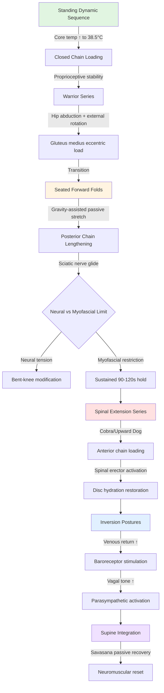

# Lesson 4: Integrated Practice, Adaptation, and Individual Variation

## 1. First-Principles Intuition & Invariants

Yoga practice, when stripped of cultural mystique and examined through the lens of applied physiology and biomechanics, reveals itself as a sophisticated system of progressive neuromuscular adaptation that operates along three primary axes: mechanical loading of connective tissue, refinement of motor control patterns, and modulation of autonomic nervous system tone. The ancient sequences were not arbitrary aesthetic arrangements but empirically derived loading protocols that systematically stress the kinetic chain through ranges of motion rarely encountered in ancestral movement patterns, thereby forcing adaptive remodeling of fascial architecture and recalibration of proprioceptive feedback loops.

The fundamental invariant governing all effective yoga practice is the principle of progressive overload applied to passive tissue extensibility rather than contractile force production. Unlike resistance training where we manipulate external load to induce hypertrophic signaling cascades, yoga leverages bodyweight positioning and gravitational vectors to create time-under-tension exposures that trigger fibroblast proliferation in tendinous tissue and reorientation of collagen fiber alignment along lines of mechanical stress. The critical distinction lies in the stretch-shortening cycle dynamics: whereas plyometric training exploits the rapid elastic recoil of series elastic components, yoga practice deliberately attenuates the stretch reflex through sustained isometric holds at end-range positions, gradually desensitizing Golgi tendon organs and recalibrating the gamma motor neuron firing thresholds that guard against perceived overstretching.

Individual variation in yoga responsiveness stems from three primary structural and metabolic sources. First, collagen fiber composition exhibits heritable variance in the ratio of type I collagen, which provides tensile strength, to type III collagen, which confers elasticity. Practitioners with higher baseline type III ratios demonstrate faster initial gains in passive range of motion but plateau earlier due to reduced remodeling potential, whereas those with denser type I matrices progress slowly but achieve more durable structural adaptations over multi-year training horizons. Second, limb length proportions and acetabular socket depth create mechanical constraints that no amount of practice can overcome. A practitioner with a shallow hip socket and femoral anteversion will achieve external rotation ranges that remain anatomically impossible for someone with deep acetabular coverage and retroverted femoral necks, regardless of soft tissue flexibility. Third, fascial hydration status and myofascial sliding capacity vary with systemic inflammation levels, hydration protocols, and prior injury history that created adhesions between tissue planes.

The metabolic dimension of yoga practice centers on its potent modulation of autonomic balance through mechanoreceptor stimulation and baroreflex activation. Sustained passive stretching triggers type III and IV sensory afferents in muscle spindles and joint capsules that project to the nucleus tractus solitarius in the medulla, initiating a parasympathetic cascade characterized by reduced heart rate variability in the high-frequency band, decreased cortisol secretion from the adrenal cortex, and upregulation of vagal efferent tone to digestive organs. This shift from sympathetic dominance to parasympathetic predominance creates the subjective sensation of relaxation while simultaneously optimizing recovery from high-intensity training by reducing systemic inflammatory cytokine expression and enhancing glycogen resynthesis rates in skeletal muscle.

Contraindications and injury mechanisms in yoga arise primarily from two failure modes: excessive passive joint distraction that exceeds ligamentous tensile limits, and compression loading of spinal discs during combined flexion-rotation movements. The most catastrophic injuries occur when practitioners attempt extreme hip flexion postures like Kurmasana or Supta Kurmasana without adequate posterior chain extensibility, creating shear forces across the lumbar spine that can herniate nucleus pulposus material through weakened annular fibers. Similarly, unsupported shoulderstands and headstands impose compressive loads on cervical vertebrae that exceed 150% of bodyweight, risking fracture in practitioners with osteopenia or compromised bone mineral density. The evidence-based mitigation strategy requires systematic assessment of individual structural constraints before progressing to advanced postures, using specific loading parameters that respect tissue remodeling timelines.

## 2. Core Architecture & Mechanics

The architectural framework of an integrated yoga practice follows a precisely ordered sequence that respects the physiological requirement for progressive tissue temperature elevation, neuromuscular activation, and nervous system priming before imposing maximal stretch demands. The classical Vinyasa structure begins with standing sequences that engage large muscle groups through dynamic concentric-eccentric cycles, elevating core temperature to 38.5°C–39°C and increasing synovial fluid viscosity to optimize joint lubrication. This thermal preparation phase triggers heat shock protein expression that protects cellular structures during subsequent deep tissue loading.

The standing sequence exploits closed kinetic chain mechanics where the foot remains fixed to the ground, creating proprioceptive stability through mechanoreceptor stimulation in the plantar fascia and forcing co-contraction of agonist-antagonist muscle pairs around the ankle, knee, and hip. Warrior postures systematically load the hip in combined abduction-external rotation while maintaining neutral spinal alignment, progressively lengthening the gluteus medius and tensor fasciae latae through eccentric loading. The critical technical parameter is the maintenance of the knee tracking over the second toe to preserve optimal patellofemoral contact pressure distribution and prevent valgus collapse that overloads medial collateral ligament structures.

Transitioning from standing to seated postures represents a deliberate shift from dynamic stabilization demands to passive end-range loading where bodyweight and gravity create sustained tensile stress on posterior chain structures. Forward folds like Paschimottanasana impose flexion moments on the lumbar spine while simultaneously lengthening the hamstring-gastrocnemius complex through hip flexion with knee extension. The limiting factor for most practitioners is not hamstring extensibility but rather sciatic nerve mobility within the neural sheath, as the nerve must slide approximately 15 millimeters relative to surrounding connective tissue to accommodate full hip flexion with knee extension. Practitioners with neural tension will experience sharp, radiating discomfort distinct from the dull ache of myofascial stretch, requiring modification through bent-knee variations that reduce neural tensioning.

The spinal extension series that follows forward folding serves multiple biomechanical purposes beyond simple antagonist muscle activation. Backbends like Bhujangasana and Urdhva Mukha Svanasana create posterior disc compression that expresses fluid from the nucleus pulposus, then upon release allows rehydration through imbibition as osmotic pressure draws water back into the disc matrix. This pumping mechanism maintains disc height and proteoglycan content, counteracting the compressive dehydration that accumulates during seated work. The technical execution requires careful sequencing of spinal extension from cervical through thoracic to lumbar segments, initiating movement at the most mobile regions before attempting lumbar hyperextension that many practitioners lack due to facet joint orientation.

Inversion postures represent the practice apex where gravitational reversal creates unique hemodynamic challenges and opportunities. Shoulderstand and headstand impose approximately 60% and 80% of bodyweight respectively onto cervical structures while simultaneously increasing venous return to the heart through hydrostatic pressure gradients. The enhanced venous return triggers baroreceptor firing in the carotid sinus and aortic arch, initiating a reflex bradycardia and peripheral vasodilation that produces measurable reductions in mean arterial pressure. For practitioners with established cardiovascular health this represents beneficial parasympathetic training, but for those with uncontrolled hypertension or compromised cerebrovascular integrity the increased intracranial pressure poses genuine stroke risk.

The practice concludes with supine integration postures that allow neuromuscular recalibration and consolidation of motor learning. Savasana is not mere rest but an active process of nervous system downregulation where the absence of voluntary muscle tension allows the reticular activating system to reduce cortical arousal and shift brainwave patterns from beta-range alertness toward alpha-range relaxation. The physiological signature includes decreased oxygen consumption dropping to 15-20% below resting baseline, reduced lactate production as metabolic byproducts clear from tissues, and increased peripheral temperature as vasodilation redistributes blood flow to extremities.

## 3. High-Performance Optimization & Failure Modes

Optimizing yoga practice for maximum adaptogenic stimulus while minimizing injury risk requires precise manipulation of three primary loading variables: time under tension at end-range positions, breathing pattern integration with postural mechanics, and progressive sequencing that respects tissue remodeling timelines. The time-under-tension parameter directly governs the magnitude of viscoelastic creep in connective tissue, with research demonstrating that holds exceeding 90 seconds trigger measurably greater collagen reorientation than shorter duration stretches. However, the optimal dosage exhibits a inverted-U relationship where durations beyond 180 seconds produce diminishing returns and increase risk of ligamentous laxity that compromises joint stability.

Breathing mechanics serve as the primary tool for modulating nervous system state and enhancing stretch tolerance. The Valsalva maneuver, involving forced expiration against a closed glottis, increases intra-abdominal pressure and spinal stiffness, creating temporary rigidity that protects vertebral structures during loaded movements. Conversely, prolonged exhalation with complete lung emptying triggers baroreceptor-mediated parasympathetic activation that reduces muscle spindle sensitivity and allows deeper passive range of motion. Advanced practitioners exploit this relationship by timing deep exhalations to coincide with the deepest phases of forward folds and hip openers, using respiratory mechanics to override protective motor reflexes.

Individual metabolic variation demands personalized adaptation of practice intensity and recovery intervals. Practitioners with naturally elevated resting cortisol levels and sympathetic predominance benefit from longer holds in passive postures and extended Savasana durations to counteract their baseline stress physiology, whereas individuals with parasympathetic dominance and low resting heart rate may require more dynamic flow sequences to generate sufficient metabolic stimulus. The assessment framework combines resting heart rate variability measurements, subjective recovery scores using standardized questionnaires, and objective range of motion testing to track adaptation trajectories and identify overtraining indicators.

Structural constraints represent absolute boundaries that no amount of practice intensity can overcome and attempting to do so guarantees injury. Hip socket morphology varies along a continuum from shallow dysplastic configurations that permit extreme external rotation but lack stability, to deep pincer-type acetabula that provide robust stability but mechanically block hip flexion beyond 100 degrees. Practitioners with pincer morphology experience a hard end-feel in deep squats and lotus variations where the femoral neck impacts the acetabular rim, creating impingement that damages the labral cartilage. The evidence-based response is not more aggressive stretching but rather acceptance of anatomical limits and modification of postures to avoid impingement positions.

Spinal disc health represents the most critical injury prevention consideration, as intervertebral discs lack pain receptors and herniation proceeds silently until nerve root compression creates radiating symptoms. The highest-risk movements combine spinal flexion with rotation under load, creating asymmetric shear forces that displace nucleus pulposus material posterolaterally toward the spinal canal. Seated twists performed with aggressive hip rotation and forward flexion violate this safety principle, particularly when practitioners force the twist beyond their natural thoracic rotation capacity and compensate by rotating at the lumbar spine where disc geometry provides minimal rotational stability. The corrective protocol requires cueing thoracic extension before rotation, limiting twist depth to 30 degrees of axial rotation, and completely avoiding combined flexion-rotation movements in practitioners with prior disc injury history.

The overtraining syndrome in yoga manifests differently than in strength sports but follows similar endocrine disruption pathways. Excessive practice volume, defined as more than 90 minutes daily without adequate recovery days, suppresses hypothalamic-pituitary-adrenal axis function and reduces testosterone-to-cortisol ratios in both male and female practitioners. The clinical presentation includes persistent joint soreness, paradoxical loss of flexibility as chronic inflammation stiffens connective tissue, disrupted sleep architecture with reduced slow-wave sleep, and increased resting heart rate indicating incomplete autonomic recovery. The mitigation strategy implements planned deload weeks at 50% normal volume every fourth week, prioritizes sleep duration above 7.5 hours nightly to support growth hormone secretion, and monitors morning heart rate variability as an objective recovery biomarker.

Contraindications for specific populations require absolute respect. Pregnant practitioners must avoid deep twists that compress the abdomen, inversions after the first trimester due to supine hypotensive syndrome risk, and any postures creating excessive intra-abdominal pressure that could stress pelvic floor structures already compromised by pregnancy-related relaxin secretion. Individuals with osteoporosis face fracture risk in any loaded spinal flexion movement and must completely eliminate forward fold variations, substituting neutral spine hinge patterns instead. Those with glaucoma or other conditions involving elevated intraocular pressure cannot safely perform inversions where hydrostatic pressure increases retinal vein pressure and risks hemorrhage.

## 4. Summary & Verification Matrix

| Governing Invariant | Underlying Mechanism | Diagnostic Criterion | Primary Failure Mode |
|---------------------|----------------------|----------------------|----------------------|
| Progressive tissue loading drives collagen remodeling and range of motion gains | Time-under-tension >90 seconds triggers fibroblast activation and collagen fiber reorientation along stress vectors; requires 48-72 hour remodeling intervals | Measurable ROM increase of 3-5° per month in target joints; absence of acute inflammation or joint effusion post-practice | Excessive loading frequency without recovery causes chronic inflammation, paradoxical ROM loss, and ligamentous laxity compromising joint stability |
| Anatomical joint morphology establishes absolute ROM boundaries independent of soft tissue flexibility | Acetabular depth, femoral version angles, and spinal facet orientation create hard mechanical limits where bone contacts bone | Hard end-feel at joint limit with no stretch sensation; imaging confirmation of impingement mechanics if radiating pain present | Forcing movement beyond anatomical limits damages labral cartilage, creates micro-fractures in subchondral bone, and accelerates degenerative joint disease |
| Parasympathetic activation through mechanoreceptor stimulation optimizes recovery and reduces systemic inflammation | Sustained passive stretch activates type III/IV afferents projecting to nucleus tractus solitarius, initiating vagal efferent cascade reducing cortisol and pro-inflammatory cytokines | Heart rate variability increase in high-frequency band (>0.15 Hz); resting heart rate reduction of 4-8 bpm; subjective relaxation response | Excessive sympathetic practice emphasis (dynamic flow without passive holds) maintains stress physiology, impairs recovery, and increases injury susceptibility through maintained muscle guarding |
| Spinal disc integrity requires avoidance of combined flexion-rotation loading patterns | Asymmetric shear forces in flexion-rotation displace nucleus pulposus posterolaterally toward nerve roots; annular fibers weakest in posterior quadrant | Absence of radiating leg pain, normal straight leg raise test >70°, maintained disc height on imaging | Repeated flexion-rotation movements create cumulative annular micro-tears leading to disc herniation, nerve root compression, and chronic radiculopathy requiring surgical intervention |
| Individual stress physiology determines optimal practice intensity and volume | Baseline HPA axis function and autonomic tone create distinct recovery capacities; overtraining suppresses testosterone/cortisol ratio | Morning heart rate variability >60 ms, resting heart rate within 5 bpm of baseline, subjective recovery score >7/10, sustained ROM gains | Excessive volume without periodization causes HPA axis dysfunction, elevated resting cortisol, disrupted sleep, paradoxical flexibility loss, and persistent joint inflammation |
| Breathing pattern modulates stretch tolerance through autonomic and mechanical pathways | Prolonged exhalation reduces muscle spindle sensitivity via vagal activation; Valsalva increases spinal stiffness protecting vertebral structures | Ability to achieve 10-15% deeper ROM during exhale phase; absence of breath-holding during loaded movements | Breath-holding during deep stretches maintains muscle guarding preventing adaptation; forced breathing creates intrathoracic pressure spikes risking vascular events in susceptible individuals |
