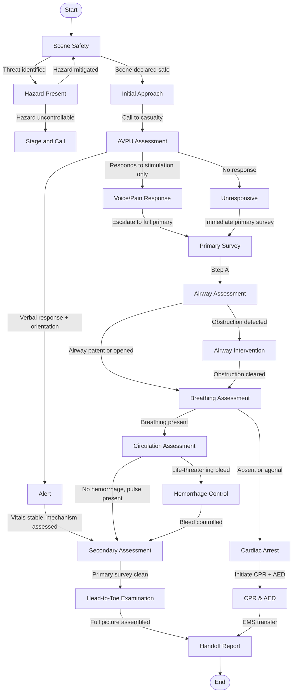

# Lesson 1: Systematic Assessment, Triage, and Scene Safety

## 1. First-Principles Intuition & Invariants

Every emergency response, whether performed by a paramedic in a trauma bay or a trained layperson at a weekend trail run, is a decision tree operating under two simultaneous constraints: incomplete information and irreversible time. The fundamental error most people make in a crisis is confusing urgency with speed. Speed without structure accelerates chaos. Structure, applied with practiced economy of motion, is what saves lives.

The systematic assessment framework exists because the human body fails in a predictable sequence. Oxygen deprivation kills before blood loss does, and blood loss kills before a broken femur does. When you internalize this hierarchy, the entire logic of a primary survey becomes self-evident: you are tracing the cascade of lethality in reverse order, intercepting each failure mode before it propagates to the next. The ABC model — Airway, Breathing, Circulation — is not a mnemonic for memorization; it is a mechanistic map of the physiological kill chain.

The first invariant of emergency assessment is that scene safety is a prerequisite, not a preliminary courtesy. A responder who becomes a casualty doubles the problem. This principle sounds obvious until adrenaline overrides it. When you approach a collapsed runner on a mountain trail, your nervous system wants to rush forward. The trained practitioner pauses for two to four seconds at a distance of roughly ten meters and performs a visual sweep: overhead hazards, unstable terrain, environmental threats, bystander interference vectors, and mechanism of injury clues. Only when the scene is declared safe does physical assessment begin.

The second invariant is that assessment must separate into two distinct phases with a firewall between them. The primary survey addresses immediate life threats in a compressed, serial protocol. The secondary survey is a head-to-toe anatomical inventory performed only after the primary is clean or controlled. Collapsing these two phases into one undifferentiated examination is the single most common error in lay responder care, and it results in responders discovering a suspected spinal injury thirty seconds before they notice the patient has no detectable pulse.

The third invariant is the difference between finding and fixing. During the primary survey, you stop and address a finding the moment you encounter it. You do not complete the survey and then return. You cannot afford to. If you open the airway and discover apnea, you begin rescue breathing immediately. The survey is not a checklist you finish before intervening; it is a real-time interleaving of assessment and action.

For practitioners working in lifestyle contexts — endurance sports, outdoor recreation, group fitness environments, travel, and high-intensity training facilities — these invariants carry additional texture. The casualty is frequently athletic, often young, and may present with vital sign profiles that mask severity. A well-conditioned athlete with resting bradycardia and a high pain threshold can underreport shock symptoms in ways that mislead an undertrained responder. The physiological baseline of a trained athlete diverges enough from population norms that a resting heart rate of 48 bpm is not alarming, but the same rate during a stress response may indicate profound parasympathetic failure. Context is not optional.

## 2. Core Architecture & Mechanics

### Scene Safety and Initial Approach

The practical scene safety assessment takes approximately three to five seconds and runs in parallel channels. You are simultaneously evaluating the physical environment (surface stability, overhead hazards, traffic, weather exposure), the mechanism of injury or illness (trauma versus medical, witnessed versus unwitnessed collapse), the number of casualties, and the resources available to you. In a gym or fitness facility, common hazards include loose weight plates, power rack structures, electrical equipment, and other members who may crowd the scene. In a wilderness context, the hazard profile expands to include terrain instability, wildlife, weather, and the multi-hour evacuation timelines that redefine triage logic entirely.

As you approach, you are calling to the casualty loudly and clearly: "Can you hear me? Open your eyes." The verbal response before physical contact provides the first datum in level of consciousness assessment, which maps directly onto the AVPU scale — Alert, responds to Voice, responds to Pain, Unresponsive. A casualty who responds verbally with orientation ("Yes, I'm here, I twisted my ankle") stratifies immediately to a non-life-threatening primary pathway. A casualty who does not respond to voice or pain forces immediate engagement with the full primary survey.

### The Primary Survey: A to C

Airway assessment begins with a visual and tactile examination of the oral cavity. If the casualty is unconscious and supine, the airway is opened using a head-tilt chin-lift: one hand on the forehead, two fingertips under the chin, extending the neck to roughly 30 degrees. If cervical spine injury is suspected from the mechanism — a mountain bike crash, a fall from height, a contact sport collision — the jaw thrust maneuver substitutes, displacing the mandible anteriorly without extending the cervical spine. You look for gross obstruction: vomit, foreign bodies, blood pooling, tongue fall. Clear the airway with a gloved finger sweep only when the obstruction is visible. Blind finger sweeps in an unconscious adult are contraindicated because they risk pushing an obstruction deeper.

Breathing assessment follows immediately. You bring your cheek to the casualty's mouth, eyes tracking the chest wall, for no more than ten seconds. You are sensing air movement against your cheek, watching for symmetric chest rise, and listening for the quality of breathing sounds. Absent breathing triggers an immediate transition to ventilatory support. Agonal gasping — slow, irregular, gasping breaths — is not effective breathing and must not be mistaken for it. Agonal respirations occur in approximately 40% of cardiac arrest cases in the first minutes and are one of the most reliably lethal diagnostic errors lay responders make.

Circulation assessment in the primary survey is less about pulse counting and more about gross hemorrhage control and perfusion state. You are scanning rapidly for life-threatening external bleeding — arterial spurting, wound saturation, pooled blood. Catastrophic hemorrhage stops the clock faster than any other injury. In tactical and wilderness contexts, the MARCH protocol positions Massive Bleeding ahead of Airway precisely because a femoral artery bleed can exsanguinate an adult in under three minutes; this window is shorter than the time required to clear and manage a complicated airway. In a standard gym or public lifestyle setting with no penetrating trauma mechanism, the original ABC sequence remains appropriate because massive hemorrhage is statistically rare compared to cardiac arrest etiologies.

### Cardiopulmonary Responsiveness Determination

Combining the breathing check with a carotid pulse check creates the cardiopulmonary responsiveness determination. You locate the larynx with two fingers and slide laterally into the groove between trachea and sternocleidomastoid, applying light pressure for five to ten seconds. Absent pulse plus absent breathing indicates cardiac arrest. This triggers immediate CPR: 30 chest compressions at a rate of 100 to 120 per minute, compression depth of 5 to 6 cm in an adult, allowing full recoil between compressions, followed by two rescue breaths if airway management capacity exists, cycling at a 30:2 ratio until an AED is available or advanced care arrives.

### The Secondary Survey

Once the primary survey is complete and immediate threats are addressed or controlled, the secondary survey proceeds as a systematic head-to-toe anatomical examination. This is where you generate your clinical picture: skull palpation for crepitus or deformity, pupillary response (PERRL — Pupils Equal, Round, Reactive to Light), cervical spine tenderness on palpation, clavicle and chest wall integrity, abdominal rigidity or guarding, pelvic rock stability, long-bone integrity in the extremities, and a skin assessment for color, temperature, and moisture. Each finding is verbal in context — if another responder or bystander is present, narrating your findings builds the shared situational picture and reduces cognitive load.

### State Transition Architecture

The assessment workflow is a state machine. Understanding its transitions explicitly allows practitioners to avoid getting trapped in one state when the clinical picture demands escalation.

The diagram makes explicit what prose alone sometimes obscures: assessment is not a linear march from scene entry to handoff. It is a branching state machine where findings at each node can redirect the entire workflow. A practitioner who has internalized this topology does not freeze when a secondary survey finding requires re-entry into the primary track.

## 3. High-Performance Optimization & Failure Modes

### Optimizing Decision Speed Without Sacrificing Accuracy

The primary survey should not take more than sixty to ninety seconds in a single-casualty scenario with no complications. This is achievable through deliberate position mechanics. When you kneel beside a supine casualty, your dominant hand goes to the forehead for the head-tilt while your non-dominant hand positions at the chin. Your cheek drops toward the mouth. Your eyes track the chest. All three sensory channels — touch, sight, and hearing — run simultaneously. This parallel processing is a trained skill, not an innate one, and it must be practiced on mannequins until the motor pattern is automatic.

Cognitive overload is the primary performance failure mode in real emergencies. The antidote is not trying harder; it is reducing the working memory demand through trained protocol execution. When you have practiced the survey enough times that AVPU, ABC, and secondary head-to-toe flow as automatic subroutines, your conscious cognitive bandwidth is freed for clinical decision-making: interpreting findings, managing bystanders, communicating with EMS, and tracking time.

### Triage Decision Logic in Multi-Casualty Scenarios

In lifestyle contexts — a mass participation race, a group alpine expedition, a CrossFit competition — multi-casualty events are possible. The START triage system (Simple Triage and Rapid Treatment) provides a scalable sorting algorithm. Each casualty receives no more than sixty seconds of initial assessment. The classification outputs are four categories: Immediate (red — life-threatening, salvageable with intervention), Delayed (yellow — serious but stable), Minor (green — ambulatory, minor injuries), and Deceased or Expectant (black — no pulse, unsurvivable injuries given available resources).

The critical cognitive shift in mass casualty triage is accepting resource allocation logic. A practitioner trained in one-to-one care must override the instinct to stay with the sickest casualty and instead maximize lives saved across the total casualty set. This is psychologically demanding and requires explicit prior mental rehearsal. START triage asks three questions in sequence: Is the casualty walking? Is the breathing rate above 30 per minute? Is the radial pulse present? These three data points, combined with a rapid AVPU check, generate the classification without stethoscope, monitoring equipment, or laboratory data.

### Failure Modes and Their Mitigations

The most consequential failure mode in primary survey execution is the agonal respiration error described earlier. The mitigation is specific and teachable: before accepting any breathing as effective, ask whether the interval is regular and whether chest rise is consistent. Agonal gasping is characteristically irregular, with long inter-breath intervals of four to ten seconds. When in doubt, treat the casualty as not breathing.

A second failure mode is pulse check paralysis — spending more than ten seconds searching for a carotid pulse in a noisy or high-adrenaline environment. Research on lay responder accuracy in pulse detection shows error rates above 40% under realistic conditions. The 2020 AHA guidelines explicitly deprioritize pulse checks for untrained responders, recommending immediate CPR for any unresponsive, non-breathing adult. For trained practitioners, the pulse check remains in the protocol but is strictly time-bounded at ten seconds. If you have not found a pulse confidently within that window, begin compressions.

A third failure mode is scene fixation — the tendency to remain anchored to the first casualty discovered even when multiple casualties are present. The structured scene safety assessment that includes casualty counting is the direct mitigation. Before kneeling, you count. If you identify two or more casualties, you apply triage logic before providing care.

Environmental factors in lifestyle settings introduce a fourth failure mode: victim-responder thermal transmission in cold environments. Prolonged chest compression delivery in sub-zero conditions is physically and metabolically costly for the responder, and the casualty's core temperature status affects resuscitation prognosis in ways that wilderness protocols explicitly address. The axiom from wilderness emergency medicine — "not dead until warm and dead" — means hypothermic casualties with no palpable pulse require sustained CPR and aggressive rewarming rather than rapid cessation, fundamentally altering the protocol duration calculus compared to a normothermic urban scenario.

## 4. Summary & Verification Matrix

| Invariant | Mechanism | Diagnostic Criterion | Failure Mode | Mitigation |
|---|---|---|---|---|
| Scene safety precedes all contact | Visual sweep of physical, environmental, and mechanism hazards from 10m; AVPU call before touch | Hazard absent or controlled; mechanism of injury identified | Responder becomes secondary casualty; scene contamination | Mandatory 3–5 second pause and sweep; stage at safe distance if hazard uncontrollable |
| Primary survey serial-then-fix order | ABC in sequence; each finding triggers immediate intervention before advancing; 60–90 second target | Patent airway, effective breathing (rate, depth, regularity), pulse present, no catastrophic hemorrhage | Phase collapse (secondary started before primary complete); agonal respiration misidentified as breathing | Firewall between primary and secondary; agonal check: regular interval and consistent chest rise required |
| Cardiopulmonary responsiveness determination | Combined 10-second carotid pulse + breathing check; unresponsive + absent pulse + absent/agonal breathing = cardiac arrest | Pulse identified confidently within 10 seconds; breathing regular and effective | Pulse check paralysis (>10 sec); false pulse detection under adrenaline | Strict 10-second limit; if uncertain, begin CPR; AED deployment as first priority |
| Triage in multi-casualty events | START algorithm: walking → breathing rate → radial pulse → AVPU; ≤60 sec per casualty; RED/YELLOW/GREEN/BLACK classification | All casualties classified before sustained care begins; Immediate (RED) treated first | Scene fixation on first casualty; reluctance to classify casualties as Expectant | Pre-event casualty count during scene safety; prior mental rehearsal of resource-allocation triage logic |
| Secondary survey completeness | Head-to-toe anatomical inventory: skull, pupils, cervical spine, chest, abdomen, pelvis, long bones, skin | PERRL confirmed; no crepitus or deformity missed; skin color, temp, and moisture assessed | Secondary survey omitted after primary because responder believes "nothing else is wrong" | Protocol rule: secondary survey is mandatory after every primary, regardless of mechanism severity |
| Environmental context adjustment | Athlete baseline deviation (resting bradycardia, high pain threshold); hypothermia protocol extension; altitude hypoxia | Vital signs interpreted against individual training history; hypothermic arrest: CPR continues until warm | Standard population norms misapplied to conditioned athletes; premature CPR cessation in hypothermia | Establish baseline context in secondary survey history; apply wilderness medicine axiom for cold arrest |

The table above encodes the governing logic of the entire lesson in a verifiable format. Each row is a testable claim. When you debrief a training scenario, run each row as a checkpoint: was scene safety executed before contact, was the primary firewall maintained, was the agonal respiration checked for regularity, was the triage algorithm applied before sustained care in a multi-casualty scenario? A protocol that passes all six checks has been executed correctly. One that fails any single check has a specific, nameable failure mode with a specific, nameable correction — which is precisely the kind of precision this discipline demands.
