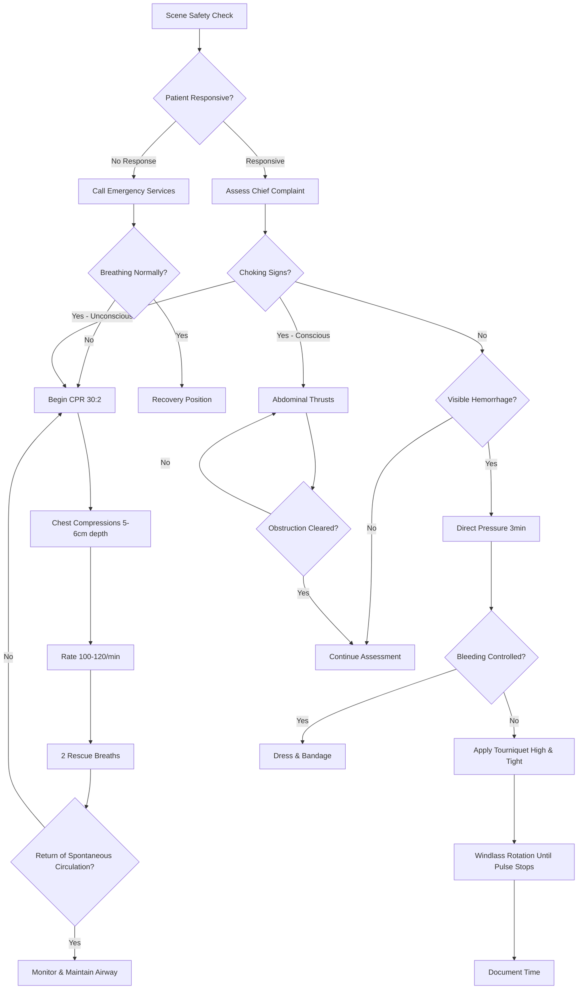

# Lesson 2: Cardiopulmonary Resuscitation, Airway Management, and Hemorrhage Control

## 1. First-Principles Intuition & Invariants

Cardiopulmonary resuscitation, airway management, and hemorrhage control represent the three fundamental pillars of emergency life support, each addressing a distinct failure mode in the body's oxygen delivery cascade. When cardiac arrest occurs, the heart ceases its rhythmic contraction and can no longer generate the pressure differential required to drive oxygenated blood through the systemic circulation to perfuse vital organs. The brain, consuming approximately twenty percent of the body's total oxygen supply despite representing only two percent of body mass, begins to suffer irreversible neuronal damage within four to six minutes of oxygen deprivation. CPR mechanically substitutes for the heart's pumping action by compressing the thoracic cavity, generating artificial pressure waves that propel blood through the coronary and cerebral vasculature. The chest compression cycle creates a transient pressure gradient of approximately 40 to 60 millimeters of mercury, roughly one-third the systolic pressure generated by a healthy myocardium, but sufficient to maintain marginal perfusion to critical organs and buy time until advanced cardiac life support interventions can restore spontaneous circulation.

Airway obstruction, whether from foreign body aspiration, anaphylactic laryngeal edema, or loss of consciousness leading to posterior tongue displacement, interrupts the gas exchange interface at the alveolar-capillary membrane. The partial pressure of oxygen in arterial blood begins to decline precipitously within seconds of complete airway occlusion, triggering chemoreceptor-driven panic responses and reflexive attempts to clear the obstruction. The Heimlich maneuver exploits the compressibility of the abdominal cavity to generate a sudden pressure spike in the thoracic space, converting residual lung volume into a high-velocity expiratory jet capable of dislodging obstructions wedged in the trachea or larynx. For unconscious patients, manual airway positioning techniques leverage anatomical relationships between the mandible, hyoid bone, and tongue musculature to restore patency of the oropharyngeal passage.

Hemorrhage control addresses the third leg of the oxygen delivery triad: circulatory volume and pressure maintenance. The human cardiovascular system contains approximately five liters of blood in a typical adult, circulating under a mean arterial pressure of roughly 90 millimeters of mercury. Acute hemorrhage from traumatic vessel disruption triggers a cascade of compensatory mechanisms including sympathetic vasoconstriction, tachycardia, and activation of the coagulation cascade, but these intrinsic responses prove inadequate when bleeding exceeds approximately 750 milliliters (Class II hemorrhage) or when major arterial vessels are severed. External hemorrhage control through direct pressure, hemostatic dressing application, or tourniquet placement mechanically occludes blood flow distal to the injury site, allowing the coagulation cascade sufficient time to form a stable fibrin clot matrix. The critical time window for hemorrhage control extends only minutes before hemorrhagic shock progresses to irreversible cellular dysfunction, making rapid recognition and intervention the primary determinant of survival in penetrating trauma scenarios.

The physiological invariants governing these three emergency interventions share a common temporal constraint: the oxygen debt accumulating in vital tissues grows exponentially with each passing minute of circulatory or respiratory failure. Cerebral ischemia follows a predictable cascade beginning with loss of consciousness within ten to fifteen seconds of cardiac arrest, progressing to irreversible neuronal death within four to six minutes, and culminating in brainstem herniation and permanent vegetative state beyond ten minutes of complete circulatory arrest. These unforgiving time boundaries mandate immediate action, overriding concerns about rib fractures from chest compressions or tissue damage from tourniquet application. The calculus of emergency intervention prioritizes life over limb, accepting controlled iatrogenic injury to prevent catastrophic systemic failure.

## 2. Core Architecture & Mechanics

The mechanical execution of high-quality cardiopulmonary resuscitation follows a precise biomechanical protocol designed to maximize intrathoracic pressure generation while minimizing fatigue-induced performance degradation. The rescuer positions themselves vertically above the victim's sternum, shoulders aligned directly over the compression point located at the lower half of the sternum, approximately two finger-widths above the xiphoid process. This geometric alignment allows gravitational force to augment muscular effort, converting body weight into downward momentum rather than relying solely on arm and shoulder musculature. The rescuer locks their elbows in full extension, transforming their upper body into a rigid lever system that pivots from the hip joints. Compression depth must reach a minimum of five centimeters (two inches) in adult patients, sufficient to reduce the anterior-posterior thoracic dimension by approximately thirty percent and generate the pressure differential required to eject blood from the ventricular chambers. Inadequate compression depth represents the most common error in lay rescuer CPR, producing minimal hemodynamic output and failing to perfuse coronary arteries during the brief diastolic phase when coronary blood flow occurs.

The compression rate targets a cadence of 100 to 120 compressions per minute, a rhythm that balances adequate ventricular filling time with sufficient cardiac output generation. Faster rates compromise diastolic filling, reducing stroke volume and net forward flow despite increased compression frequency. The compression-to-ventilation ratio follows a 30:2 pattern for single rescuer CPR, delivering thirty chest compressions followed by two rescue breaths. This ratio reflects updated evidence demonstrating that excessive interruptions for ventilation significantly degrade hemodynamic performance, as it requires five to seven compressions to re-establish adequate intrathoracic pressure after each pause. Complete chest recoil between compressions remains critical, allowing full re-expansion of the thoracic cavity to generate negative intrathoracic pressure that draws blood back into the heart during the diastolic phase. Rescuers must release all downward force at the top of each compression cycle, avoiding the common error of leaning on the chest, which prevents adequate venous return and reduces cardiac output by up to twenty-five percent.

Rescue breathing technique centers on creating an airtight seal and delivering tidal volumes of approximately 500 to 600 milliliters over a one-second inflation period. Excessive ventilation volumes or rapid inflation rates increase intrathoracic pressure, impeding venous return and reducing the effectiveness of subsequent chest compressions. The head-tilt chin-lift maneuver serves as the foundational airway positioning technique for unconscious patients without suspected spinal injury. The rescuer places one hand on the victim's forehead, applying gentle backward pressure to extend the atlanto-occipital joint, while simultaneously lifting the mandible anteriorly with two fingers placed under the bony prominence of the chin. This dual motion displaces the tongue away from the posterior pharyngeal wall, opening the oropharyngeal airway and allowing free passage of air into the trachea. For patients with suspected cervical spine trauma, the jaw-thrust maneuver provides airway opening without neck extension, utilizing bilateral pressure at the angles of the mandible to displace the jaw anteriorly while maintaining neutral cervical alignment.

Foreign body airway obstruction in conscious patients triggers the abdominal thrust sequence, commonly known as the Heimlich maneuver. The rescuer positions themselves behind the victim, locating the umbilicus and placing a closed fist immediately above the navel, well below the xiphoid process. The rescuer grasps their fist with the opposite hand and delivers quick, upward thrusts into the abdomen, compressing the diaphragm and creating sudden positive pressure in the thoracic cavity. Each thrust should be distinct and forceful, generating sufficient pressure to expel the foreign body from the airway. For unconscious choking victims, the protocol transitions to CPR, as chest compressions generate similar intrathoracic pressure while simultaneously providing circulatory support. Before delivering ventilations, the rescuer must visually inspect the oropharynx and remove any visible foreign material using a finger sweep or suction device.

Hemorrhage control strategy follows a hierarchical decision tree based on anatomical location and bleeding severity. External hemorrhage from extremity wounds responds initially to direct pressure application, utilizing sterile gauze or cloth pressed firmly against the wound for a minimum of three minutes to allow platelet aggregation and fibrin formation. The pressure point technique targets specific anatomical locations where major arteries cross bony prominences, allowing rescuers to manually occlude arterial flow proximal to the injury site. The brachial artery compression point lies on the medial aspect of the mid-humerus, while the femoral artery can be compressed against the pubic bone just inferior to the inguinal ligament. These anatomical compression points prove particularly valuable when direct wound pressure proves impractical due to embedded foreign objects or extensive tissue damage.

When direct pressure fails to control extremity hemorrhage, tourniquet application becomes the definitive intervention for life-threatening arterial bleeding. Modern combat casualty care protocols mandate tourniquet placement for any hemorrhage that cannot be controlled within thirty seconds of direct pressure, recognizing that time spent attempting inadequate interventions accelerates progression to hemorrhagic shock. The Combat Application Tourniquet (CAT) represents the current standard for prehospital hemorrhage control, featuring a circumferential band, windlass rod, and retention clip system. The tourniquet must be positioned two to three inches proximal to the wound but never directly over a joint, as placement over mobile articulation points prevents adequate arterial compression. The rescuer wraps the tourniquet band tightly around the limb, secures the Velcro fastener, and rotates the windlass rod until all distal bleeding ceases and distal pulses disappear. The windlass rod then locks into the retention clip, maintaining constant circumferential pressure of approximately 300 millimeters of mercury, well above systolic arterial pressure. The rescuer must document tourniquet application time directly on the device or patient's skin, as prolonged tourniquet time beyond two hours significantly increases the risk of reperfusion injury and compartment syndrome requiring surgical fasciotomy.

## 3. High-Performance Optimization & Failure Modes

The primary failure mode in lay rescuer CPR execution stems from progressive compression depth degradation due to rescuer fatigue. Biomechanical studies utilizing accelerometer-equipped manikins demonstrate that compression depth decreases by an average of 15 to 20 percent after just two minutes of continuous CPR, with concurrent increases in compression rate as rescuers unconsciously trade depth for speed. This fatigue-induced performance decay necessitates rescuer rotation every two minutes during prolonged resuscitation efforts, coordinating the transition during the ventilation phase to minimize no-flow time. In single-rescuer scenarios, the lone provider must recognize their own fatigue markers—shoulder muscle burn, loss of consistent recoil sensation, and increasing effort to maintain depth—and adjust their technique to prioritize compression quality over duration. Shifting body position slightly forward or backward, redistributing weight distribution across the palms, or consciously resetting shoulder alignment can temporarily restore mechanical efficiency.

Ventilation errors cluster around two distinct patterns: excessive ventilation volume and rapid inflation rate. Overzealous rescue breathing generates positive intrathoracic pressure that impedes venous return, effectively competing against the hemodynamic benefits of chest compressions. The "squeeze the bag until it collapses" approach commonly seen in untrained bystanders delivers tidal volumes exceeding 1,000 milliliters, approximately double the physiologic requirement, while increasing gastric insufflation risk and precipitating aspiration. The correct technique requires observing chest rise as the sole metric of adequate ventilation, delivering breaths over a full one-second period rather than rapid forceful exhalations. If the chest fails to rise during rescue breathing, immediate reassessment of airway patency takes precedence over repeated ventilation attempts, as forcing air past an obstructed airway proves both ineffective and potentially harmful.

Airway management failure modes frequently involve inadequate head positioning or incomplete foreign body clearance. The head-tilt chin-lift maneuver requires full extension of the atlanto-occipital joint, not merely tilting the forehead backward while leaving the mandible in its resting position. Rescuers must simultaneously lift the bony chin anteriorly with sufficient force to displace the tongue away from the posterior pharynx, maintaining this position continuously during rescue breathing rather than releasing between ventilations. For unconscious choking victims, failure to visually inspect and manually sweep the oropharynx before beginning CPR allows the foreign body to remain lodged in the hypopharynx, making all subsequent ventilation attempts futile. The finger sweep technique requires the rescuer to insert their index finger along the buccal surface of the cheek, hooking around the base of the tongue to extract any visible foreign material, taking care to avoid pushing objects deeper into the airway.

Tourniquet application errors fall into three distinct categories: insufficient tightness, incorrect anatomical placement, and premature removal. A properly applied tourniquet must completely occlude arterial flow, evidenced by cessation of all distal bleeding and absence of radial or pedal pulses. The common error of applying a tourniquet "just tight enough to slow the bleeding" creates venous occlusion while preserving arterial inflow, paradoxically worsening hemorrhage by creating a high-pressure vascular lake distal to the tourniquet. The rescuer must continue rotating the windlass rod past the point of perceived tightness until achieving complete hemostasis, accepting that effective tourniquet placement causes significant pain in conscious patients. Anatomical placement over joint spaces or within two inches of the wound site compromises circumferential compression, as the mobile joint prevents even pressure distribution around the limb circumference. The definitive test of tourniquet effectiveness remains simple: if any bleeding persists distally, the tourniquet remains inadequate and requires further tightening or proximal repositioning.

Direct pressure failure typically results from insufficient pressure duration or premature dressing inspection. The coagulation cascade requires a minimum of three to five minutes of uninterrupted pressure to form a stable fibrin clot matrix capable of withstanding arterial pressure. Rescuers frequently lift the pressure dressing after thirty to sixty seconds to "check if it's working," disrupting early platelet aggregation and restarting the hemorrhage clock. The correct protocol maintains firm, continuous pressure for a full three minutes before cautiously assessing for hemostasis, adding additional gauze layers over existing dressings rather than removing blood-soaked material that may have initiated early clot formation. For wounds with embedded foreign objects, direct pressure must never compress directly over the impaled object, as removal in the field risks precipitating catastrophic hemorrhage from tamponaded vessel injuries. Instead, rescuers should build up bulky dressings on either side of the object, creating circumferential pressure that stabilizes the foreign body while controlling bleeding around its margins.

Hypothermia represents a critical confounding variable in prolonged resuscitation scenarios, as core body temperature below 30 degrees Celsius fundamentally alters cardiac responsiveness to defibrillation and drug therapy. The metabolic rate decreases by approximately fifty percent for every seven-degree drop in core temperature, extending the safe duration of circulatory arrest but simultaneously reducing the efficacy of standard resuscitation protocols. In cold-water drowning or prolonged exposure scenarios, the maxim "no one is dead until they are warm and dead" governs resuscitation duration, mandating continued CPR efforts until core rewarming achieves at least 32 degrees Celsius. Active rewarming during CPR requires removal of all wet clothing, application of insulating blankets, and administration of warm humidified oxygen when available, while avoiding aggressive external heating that may precipitate afterdrop—paradoxical core temperature decline from peripheral vasodilation shunting cold blood centrally.

## 4. Summary & Verification Matrix

| Intervention Domain | Governing Invariant | Critical Mechanism | Diagnostic Criteria | Primary Failure Mode |
|---------------------|--------------------|--------------------|---------------------|---------------------|
| Chest Compressions | Depth 5-6cm, Rate 100-120/min, Full recoil between compressions | Intrathoracic pressure generation (40-60mmHg) creates artificial perfusion gradient driving blood through coronary and cerebral vasculature | Palpable carotid/femoral pulse during compressions, chest compression fraction >60% of total resuscitation time | Inadequate depth from rescuer fatigue after 2min, incomplete recoil from leaning, excessive rate trading depth for speed |
| Rescue Breathing | Tidal volume 500-600ml over 1sec, 30:2 compression-to-ventilation ratio | Positive pressure ventilation maintains alveolar oxygen tension, allowing passive diffusion across alveolar-capillary membrane | Visible chest rise with each breath, no gastric distension, SpO2 >90% if pulse oximetry available | Hyperventilation (rate >12/min) increasing intrathoracic pressure and impeding venous return, excessive volume causing gastric insufflation |
| Airway Positioning | Head-tilt chin-lift or jaw-thrust maintains patent oropharyngeal passage | Anterior mandibular displacement pulls tongue away from posterior pharynx, opening 12-14mm diameter airway | Audible air movement during ventilation attempts, chest rise with rescue breaths, absence of snoring/gurgling sounds | Inadequate head extension leaving tongue against posterior wall, premature position release between breaths, jaw-thrust without sufficient anterior force |
| Abdominal Thrusts | Fist placement above umbilicus, quick upward compressions generating 50-100mmHg pressure spike | Diaphragmatic compression creates rapid positive thoracic pressure converting residual lung volume to high-velocity expiratory jet (>40L/min) | Foreign body expulsion, restoration of effective ventilation, relief of stridor/inability to speak | Insufficient thrust force, placement too high (xiphoid fracture) or too low (ineffective diaphragm compression), failure to continue until obstruction clears |
| Tourniquet Application | Placement 2-3in proximal to wound, circumferential pressure >300mmHg, windlass locked until distal pulse absent | Mechanical vascular occlusion compresses arterial lumen against underlying bone, reducing flow below coagulation cascade threshold | Complete cessation of distal bleeding, absent radial/pedal pulse, pale/cool distal extremity, documented application time | Insufficient tightness leaving arterial flow, placement over joint preventing compression, premature removal before surgical control available |
| Direct Pressure | Firm continuous pressure for minimum 3min, compression force 20-30lbs | External compression reduces vessel diameter, decreasing flow velocity below threshold for platelet aggregation and fibrin polymerization | Hemostasis maintained after pressure release, stable vital signs, no expansion of hematoma or soaked dressings | Premature inspection disrupting early clot formation, inadequate pressure duration, removal of initial dressings rather than reinforcement |
