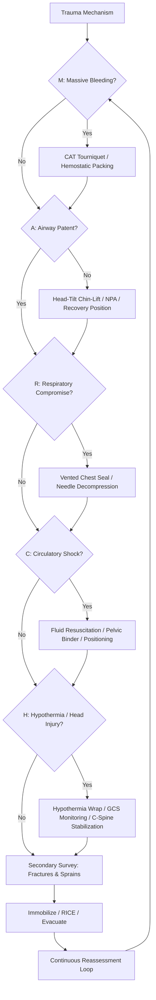

# Lesson 3: Trauma Management, Fractures, Sprains, and Shock Prevention

## 1. First-Principles Intuition & Invariants

Trauma management in wilderness and austere environments operates on a single governing principle: the body is a pressurized, fluid-bearing, neurally controlled system, and every intervention you perform either preserves or compromises one of those three domains. Blood stays where it belongs because vessels are intact and pressure gradients are maintained. Air moves because the airway is patent and the chest wall is structurally continuous. Neurological function persists because the spinal cord remains unmolested by displaced bone fragments, shearing forces, or prolonged hypoperfusion. When trauma disrupts any of these, your job as a wilderness responder is not to diagnose the exact fracture pattern or classify the ligament tear with radiographic precision. Your job is to identify which system is failing, apply mechanical and physiological countermeasures to arrest that failure, and evacuate the patient before secondary injury cascades convert a survivable mechanism into a lethal one.

The critical invariant in fracture and sprain management is that immobilization serves two simultaneous purposes. The obvious one is pain reduction through elimination of movement at the injury site. The less obvious but more consequential purpose is prevention of secondary injury. A displaced femur fracture with sharp osseous fragments lying adjacent to the femoral artery is a time bomb. Every millimeter of fragment movement risks lacerating the neurovascular bundle, converting a closed fracture into an open one, or both. Immobilization is therefore not merely a comfort measure but a hemorrhage prevention protocol. Similarly, an unstable pelvic fracture can bleed profusely into the retroperitoneal space, holding several liters of blood before external signs become obvious. A properly applied pelvic binder does not "fix" the fracture; it reduces pelvic volume, creating a tamponade effect that slows internal bleeding enough to keep the patient alive during extraction.

Shock is the downstream consequence of any insult that reduces perfusion below the metabolic demand of tissue. In trauma, the dominant mechanism is hypovolemic shock from blood loss, but neurogenic shock from spinal cord injury and obstructive shock from tension pneumothorax or cardiac tamponade can present identically: altered mental status, weak distal pulses, cool clammy skin, and rapid heart rate. The responder does not need to differentiate between these with laboratory precision in the field. The treatment cascade for all shock states in the wilderness converges on three interventions: control the source of volume loss or obstruction, restore perfusion pressure through positioning and fluid resuscitation if available, and prevent further heat loss. The body in shock is a body failing to thermoregulate. Hypothermia worsens coagulopathy through disruption of the clotting cascade, creating the lethal triad of trauma: hypothermia, acidosis, and coagulopathy. Every minute a shock patient lies on cold ground without insulation is a minute spent deepening a physiological hole that becomes exponentially harder to climb out of.

The RICE protocol for soft tissue injury, while recently debated in sports medicine literature for its potential to delay the inflammatory healing phase, remains the standard of care in acute wilderness settings for a simple reason. The inflammatory phase of healing requires controlled, not excessive, edema. A massively swollen joint is not healing; it is undergoing secondary injury from pressure-induced ischemia, compartment pressure elevation, and restricted range of motion that will prolong recovery by weeks. Rest prevents reinjury, ice modulates the metabolic demand of compromised tissue, compression provides mechanical opposition to fluid extravasation, and elevation uses gravity to drain the interstitial space. The protocol works because it limits the injury to the primary mechanical damage rather than allowing the secondary inflammatory cascade to amplify it.

## 2. Core Architecture & Mechanics

The trauma assessment and treatment architecture follows a strict priority cascade where each step gates the next. You do not assess a sprained ankle while arterial blood is pumping from a femoral laceration. You do not splint a tibia fracture while the patient is losing consciousness from hemorrhagic shock. The MARCH protocol encodes this priority: Massive bleeding first, Airway second, Respiration third, Circulation fourth, and Hypothermia last. Each step addresses a failure mode that kills faster than the one after it. Exsanguination from a femoral artery kills in three to five minutes. An occluded airway kills in four to six minutes. A tension pneumothorax kills in ten to thirty minutes. Untreated hemorrhagic shock kills over thirty to ninety minutes depending on reserve capacity and rate of loss.

Fracture immobilization mechanics depend on the principle of splinting the joints above and below the fracture site. For a mid-shaft tibia-fibula fracture, this means immobilizing from the knee to the ankle, preventing both angular and rotational displacement. The splint material, whether it is a SAM splint (aluminum and foam laminate that is malleable until shaped, then rigid), a rigid branch padded with clothing, or an inflatable air splint, must conform closely enough to the limb to eliminate movement without creating focal pressure points that could themselves cause tissue injury. The mechanism by which splints work is straightforward: they convert the limb into a rigid lever with a fixed axis, distributing forces along the splint material rather than through the fractured bone ends. For long bone fractures, in-line traction before splinting is often beneficial. Applying gentle longitudinal pull on a fractured femur before applying a traction splint realigns the bone fragments, reduces muscle spasm pain, and restores the limb to a position where the splint can hold it statically. The Slishman traction splint, a modern evolution of the Thomas splint, holds longitudinal traction applied to the femur (roughly 10% of body weight as a field guideline), counteracting the contractile pull of the quadriceps and hamstrings that otherwise cause the fragments to overlap and shear.

Sprain assessment relies on a sequential mechanical evaluation. The first step is to palpate the joint systematically, beginning at a distance from the suspected injury site and working toward the most painful area. For an ankle inversion injury, the responder palpates the distal fibula, the lateral malleolus, the anterior talofibular ligament (ATFL), the calcaneofibular ligament, the base of the fifth metatarsal, and the deltoid ligament complex medially. Point tenderness at a specific ligament insertion, combined with the mechanism of injury, tells you which structure is compromised. Functional testing follows: can the patient bear weight, can they actively range the joint through its full arc, and is there visible deformity or immediate ecchymosis? The Ottawa Ankle Rules provide a clinical decision framework. If the patient cannot bear weight for four steps both immediately and in the field setting, or if there is malleolar zone pain with bone tenderness at the posterior edge of either malleolus, the probability of a fracture requiring imaging exceeds 30%, and the injury should be managed as a potential fracture until ruled out.

Positioning mechanics for shock treatment deserve careful attention because incorrect positioning can harm rather than help. The traditional Trendelenburg position, with the head lower than the feet, was once taught universally for shock. Current evidence shows it does not meaningfully increase cardiac output and can worsen cerebral edema, respiratory mechanics, and aspiration risk. The current recommendation is supine positioning with the legs elevated approximately 15 to 20 degrees, or simply flat if leg elevation causes pain from a lower extremity injury. For a patient who is vomiting, has a suspected spinal injury, or is losing consciousness, the recovery position on the left side is preferred. Left lateral positioning places the stomach on the dependent side, allowing vomitus to pool in the gastric fundus rather than the pylorus, reducing aspiration risk. It also keeps the tongue from falling back into the pharynx and maintains a gravity-assisted airway. For a suspected spinal injury, the head and neck must be maintained in neutral alignment with the body using manual stabilization or a cervical collar, and any repositioning must be a log roll with three rescuers maintaining axial alignment throughout the maneuver.

Cervical spine stabilization works through a mechanical principle of three-point fixation. The head is secured between two lateral supports and a forehead strap. In the field, this can be improvised using rolled jackets, padded backpacks, or sandbags placed on either side of the head with tape or a strap across the forehead securing the assembly. The collar itself does not immobilize the cervical spine. A rigid cervical collar restricts flexion and extension by approximately 70% but allows significant rotational and lateral bending movement. True spinal immobilization requires the collar plus lateral head supports plus a rigid backboard or vacuum mattress that secures the entire torso, pelvis, and legs. The vacuum mattress works by containing thousands of polystyrene beads in an airtight envelope. When air is evacuated with a pump, atmospheric pressure compresses the beads into a rigid mold conforming precisely to the patient's body shape, distributing pressure evenly and eliminating the pressure point problems associated with rigid backboards.

## 3. High-Performance Optimization & Failure Modes

The most common failure mode in wilderness fracture management is inadequate immobilization of the joints proximal and distal to the fracture. A splint that ends at the fracture site itself provides no rotational stability and minimal angular control, because the lever arm on either side of the fracture is effectively zero. The splint must extend beyond the joints flanking the fracture to convert the limb segment into a rigid unit. A second common failure is applying a splint without first assessing distal pulses, motor function, and sensation. If you splint a fractured forearm and then discover the radial pulse is absent, you face a diagnostic problem: was the pulse absent before you splinted, meaning vascular injury from the fracture itself, or did your splint compress the brachial artery? Documenting the pulse, capillary refill, and sensation distal to the fracture before and after splinting eliminates this ambiguity.

Pelvic binder placement has a specific failure mode that is worth examining. The binder must be placed at the level of the greater trochanters, not at the iliac crest or the pubic symphysis. Placing it too high fails to close the pelvic ring because the femoral heads, which are the mechanical anchors for the binder's compressive force, sit below the iliac wings. The binder works by internally rotating the femurs and compressing the pelvis circumferentially at the trochanteric level, reducing the pelvic volume and creating a tamponade effect on bleeding sacral and pelvic vessels. A binder placed at the iliac crest applies force to the iliac wings, which are rigid structures that do not transmit that force effectively to the pelvic ring. The result is a binder that looks correct but does nothing to control hemorrhage.

For the RICE protocol, the failure mode most frequently encountered is inadequate compression combined with excessive ice duration. Ice applied directly to skin for more than twenty minutes per session causes cryotherapy injury, ranging from erythema to frostbite in extreme cases. The recommended protocol is fifteen to twenty minutes of application with at least forty minutes between sessions, using a barrier layer of cloth between the ice and skin. Compression should be applied with an elastic bandage in a spiral pattern from distal to proximal, starting below the injury and extending above it. The compression should be firm enough to oppose fluid accumulation but not so tight as to occlude distal circulation. The test is simple: capillary refill at the nail bed distal to the wrap should return within two seconds. If refill is delayed, the wrap is too tight and must be loosened immediately.

Shock management failures cluster around two areas: delayed recognition of compensated shock and inadequate thermal management. Compensated shock is the physiological state where blood pressure is maintained through vasoconstriction and tachycardia despite significant volume loss, sometimes up to 30% of circulating blood volume. The patient may look stable: blood pressure is normal, they are talking coherently. But the heart rate is elevated, peripheral pulses are weak, and the skin is cool and pale because the body has shunted blood from the periphery to preserve core perfusion. Waiting for hypotension to diagnose shock means you have missed the window where intervention is most effective. The single most sensitive field indicator of shock is altered mental status in a patient who has no head injury. If a trauma patient becomes confused, combative, or lethargic, and the mechanism does not suggest closed head injury, assume hemorrhagic shock until proven otherwise.

Thermal management failures occur because responders underestimate heat loss in trauma patients. The injured body is metabolically depleted and cannot generate heat effectively. Lying on the ground, even in moderate ambient temperatures, a trauma patient loses heat through conduction to the soil at a rate of roughly 2°C per hour if uninsulated. The solution is a three-layer system: a vapor barrier closest to the patient (a reflective emergency blanket or plastic sheet), an insulating layer of clothing, sleeping bag, or dry leaves and pine needles, and a waterproof outer shell. The vapor barrier prevents evaporative heat loss from wet clothing against the skin, the insulation prevents conductive and convective loss, and the outer shell prevents wind and water from saturating the insulation.

Head injury management in the field is fundamentally about recognizing deterioration and preventing secondary brain injury. The primary injury, the mechanical damage from impact, is done. Everything you can influence is secondary: hypoxia, hypotension, and hypothermia all worsen brain injury outcomes. A patient with a suspected traumatic brain injury must have their airway maintained, their oxygenation supported, and their blood pressure preserved. Serial Glasgow Coma Scale assessments at five to fifteen minute intervals track the trajectory. A dropping GCS, particularly a decrease in the motor response component from obeying commands to localizing pain to withdrawing from pain, indicates rising intracranial pressure and mandates urgent evacuation. Unequal pupils, a unilateral dilated pupil that does not constrict to light, suggests uncal herniation and is a preterminal sign requiring immediate intervention.

## 4. Summary & Verification Matrix

| Domain | Governing Invariant | Mechanism | Diagnostic Criteria | Critical Failure Mode |
|---|---|---|---|---|
| Fracture Immobilization | Splint joints above and below fracture | Converts limb to rigid lever, eliminates angular and rotational displacement | Distal pulse check pre/post splinting, capillary refill < 2s, sensation intact | Splint ends at fracture site, zero lever arm; pulse not documented before splinting |
| Sprain Management (RICE) | Control secondary inflammatory edema | Rest prevents reinjury, ice modulates metabolic demand, compression opposes fluid extravasation, elevation drains interstitium | Ottawa rules: inability to bear 4 steps + posterior malleolar tenderness = probable fracture; point tenderness at ligament insertion | Ice >20 min causes cryotherapy injury; compression too tight occludes distal flow |
| Shock Recognition | Perfusion below metabolic demand | Hemorrhagic volume loss triggers vasoconstriction, tachycardia, peripheral shunting | Altered mental status without head injury, cool clammy skin, weak distal pulses, tachycardia before hypotension | Waiting for hypotension to diagnose; missing compensated shock at 30% volume loss |
| Pelvic Binder | Trochanteric-level circumferential compression | Reduces pelvic volume, creates tamponade on bleeding sacral vessels | Mechanical instability on lateral compression, thigh-length asymmetry | Binder at iliac crest instead of greater trochanters; no effective volume reduction |
| Cervical Spine Stabilization | Three-point fixation: collar + lateral supports + body board | Restricts flexion/extension 70%, requires adjuncts for rotation/lateral bending | Mechanism suggests axial load, patient has midline cervical tenderness or neurologic deficit | Collar-only immobilization; manual stabilization released before full adjuncts secured |
| Hypothermia Prevention in Trauma | Core temp loss of 2°C/hr on uninsulated ground | Conduction to soil, evaporation from wet clothing, impaired endogenous thermogenesis | Shivering stops below 32°C, altered consciousness, cold abdomen to touch | Inadequate insulation layer; vapor barrier omitted; patient left on cold ground during assessment |
