# Lesson 4: Environmental Exposure, Acute Medical Crises, and Poison Management

## 1. First-Principles Intuition & Invariants

The human body is, at its core, a thermal and chemical homeostatic machine. Every system from the sodium-potassium pump firing across a neuron's membrane to the oxygen-hemoglobin dissociation curve operating in the pulmonary capillaries depends on a narrow envelope of temperature, pH, and substrate availability. When the environment or an internal disruption violates that envelope violently enough, the cascade of failure is not gradual. It is sudden, nonlinear, and frequently fatal if the responder lacks a mental model of the underlying mechanism.

The first invariant of environmental and acute crisis management is that **physiology, not diagnosis, drives the intervention.** A wilderness responder who waits to confirm the specific snake species before treating a bite, or who waits for a blood glucose meter to confirm hypoglycemia before administering oral glucose to a conscious patient, has prioritized taxonomy over physiology. The practitioner's job is to identify which physiological system is collapsing, deploy the correct countermeasure, and monitor for the system's response. Diagnosis is confirmatory; treatment is imperative.

The second invariant is **time-sensitivity stratification.** Not all acute crises share the same treatment window. Anaphylaxis progresses to cardiovascular collapse in minutes; epinephrine buys time measured in tens of minutes, not hours. Hypothermia, by contrast, operates on a slower clock — but the interventional window narrows deceptively fast in a wet, windy environment. Severe hypoglycemia can produce irreversible neurological injury within fifteen to thirty minutes of profound glucose deprivation. The practitioner must carry a mental urgency ladder, ranking each crisis by its collapse velocity and deploying accordingly.

The third invariant governs **the relationship between cooling and warming as symmetric problems.** Hyperthermia and hypothermia are not simply opposite ends of a thermometer; they engage fundamentally different failure cascades. Hyperthermia kills through enzyme denaturation, coagulation cascade failure, and cerebral edema. Hypothermia kills through cardiac dysrhythmia, particularly ventricular fibrillation, and progressive metabolic acidosis. The cooling rate that saves a hyperthermic patient would kill a hypothermic one. This asymmetry demands that the responder correctly identify the direction of the thermal deviation before any thermal intervention begins — a point that sounds obvious but becomes genuinely difficult in the field when a cold, shivering patient may also be septic and running a core temperature that, while pathologically low, is trending upward due to infection rather than downward from cold exposure.

Poison and overdose management introduces a fourth invariant: **the toxidrome is the roadmap.** The human body's response to toxic exposure follows recognizable syndromic patterns — cholinergic, sympathomimetic, opioid, sedative-hypnotic — and the practitioner who can identify the toxidrome does not need to know the specific agent to initiate appropriate supportive care. Each toxidrome maps to a recognizable constellation of vital signs, pupil response, skin state, and mental status, and those constellations guide treatment even in the absence of a confirmed agent.

---

## 2. Core Architecture & Mechanics

### Thermal Dysregulation: Hypothermia and Hyperthermia

The body's thermoregulatory architecture relies on a feedback loop anchored in the hypothalamus. Peripheral thermoreceptors relay temperature signals centrally; the hypothalamus compares incoming data against its set-point (approximately 37°C core) and deploys effector responses — shivering, vasodilation, sweating, vasoconstriction, piloerection — to correct the deviation. When environmental demand exceeds the effector capacity, core temperature drifts and the system enters crisis.

**Hypothermia** is classified by core temperature into mild (32–35°C), moderate (28–32°C), and severe (< 28°C). In the mild stage, shivering is vigorous and the patient remains conscious and communicative, though judgment is impaired earlier than most people expect. The practitioner should remove wet clothing immediately, insulate from the ground (ground conduction accounts for the largest continuous heat loss in a supine casualty), and apply active external warming to core areas — axillae, groin, neck — using chemical heat packs or warm water bottles wrapped in cloth to prevent contact burns. The critical technique error at this stage is wrapping the periphery before the core, which causes peripheral vasodilation and flushes cold blood centrally, precipitating afterdrop: a paradoxical further decline in core temperature.

In moderate hypothermia, shivering ceases as the muscles run out of glycogen substrate, consciousness depresses, and cardiac arrhythmias — initially bradycardia and atrial fibrillation — become the dominant threat. The patient must be handled with extreme gentleness; any physical jarring can trigger ventricular fibrillation. The hypothermic wrap (a moisture-resistant vapor barrier around the torso, insulating sleeping bag material, and a reflective outer layer) should be constructed around the patient while they remain as horizontal as possible. In severe hypothermia, the patient may appear dead — no palpable pulse, apneic, unresponsive — and the invariant here is the clinical aphorism: **the patient is not dead until they are warm and dead.** CPR is indicated if no pulse is detected after a 60-second assessment, but the rescuer must anticipate that ROSC is unlikely without hospital rewarming.

**Hyperthermia** runs a different cascade. Heat cramps and heat exhaustion occupy one end of the spectrum; heat stroke — defined by core temperature above 40°C combined with altered mental status — represents the life-threatening extreme. Classic heat stroke develops over hours in elderly or sedentary individuals during heat waves, while exertional heat stroke can occur in conditioned athletes within thirty minutes of intense effort in humid conditions. The intervention for heat stroke is aggressive, rapid cooling: immersion in cold water (the gold standard, achieving cooling rates of 0.2°C per minute or greater) or, failing that, ice packs applied to the neck, axillae, and groin while the patient is fanned and misted with water. The target is to reduce core temperature below 39°C within thirty minutes. Oral fluids are contraindicated in an altered patient due to aspiration risk; IV access and saline are the fluid delivery route if available.

### Anaphylaxis Recognition and Epinephrine Deployment

Anaphylaxis is an IgE-mediated or non-IgE-mediated mast cell degranulation event that floods systemic circulation with histamine, leukotrienes, and prostaglandins simultaneously. The resulting vasodilation, increased vascular permeability, and bronchospasm can progress from symptom onset to cardiovascular arrest in under ten minutes in severe cases. The triad that confirms anaphylaxis is: sudden onset, involvement of two or more body systems (skin/mucosal, respiratory, cardiovascular, gastrointestinal), and a plausible exposure history. Waiting for all three to be fully manifest before acting is a failure mode.

Epinephrine (adrenaline) at 0.3 mg IM (or 0.15 mg for patients under 25 kg) injected into the mid-outer thigh — through clothing if necessary — is the only first-line intervention. Its mechanism is threefold: alpha-1 adrenergic vasoconstriction reverses distributive shock, beta-2 bronchodilation opens the airways, and beta-1 positive inotropy supports cardiac output. Antihistamines and corticosteroids are adjuncts, not substitutes; practitioners who reach for diphenhydramine first are applying a tool calibrated for mild allergic reactions to a rapidly evolving emergency. The patient should be positioned supine with legs elevated (or in the recovery position if vomiting) and the epinephrine auto-injector held against the thigh for a full ten seconds to ensure the full dose dispenses. A second dose may be administered after five to fifteen minutes if symptoms persist or recur. Even after apparent resolution, every anaphylaxis patient requires hospital observation for a minimum of four to six hours due to the risk of biphasic reaction — a second mast cell degranulation wave occurring without additional allergen exposure.

### Seizure Management

Seizure management demands that the practitioner resist the impulse to physically restrain the patient. The convulsing person cannot swallow their tongue — the persistent myth that justifies forcing fingers or objects into the mouth causes more trauma than it prevents. The practitioner's role during the ictus (the active seizure phase) is environmental: clear hard objects from the immediate area, place something soft under the head, and time the event precisely. A tonic-clonic seizure lasting more than five minutes constitutes status epilepticus, a neurological emergency requiring immediate emergency services activation. Post-ictally, the patient should be placed in the recovery position to protect the airway during the period of deep unconsciousness and hypersalivation that follows. Document the onset time, duration, type of movements, and any preceding aura the patient can describe — this information determines whether the seizure represents a known epileptic event, a new neurological insult, or a metabolic crisis (hypoglycemia being the most correctable culprit).

### Poisoning, Overdose, and Toxidrome Identification

The toxidrome framework gives the practitioner a decision tree that bypasses the need for agent identification. The **opioid toxidrome** presents with the classic triad of miosis (pinpoint pupils), respiratory depression, and decreased consciousness. Naloxone 0.4–2 mg IV, IM, or intranasal reverses opioid-induced respiratory depression within two to three minutes; because naloxone's half-life (60–90 minutes) is shorter than most opioids' duration of action, re-sedation is a significant risk and repeat dosing or hospital transport is mandatory. The **sympathomimetic toxidrome** (stimulants, cocaine) presents with tachycardia, hypertension, diaphoresis, hyperthermia, and mydriasis; supportive care targets thermoregulation and agitation control. The **cholinergic toxidrome** (organophosphate pesticides, nerve agents) is characterized by SLUDGE: Salivation, Lacrimation, Urination, Defecation, GI distress, and Emesis, alongside bradycardia and bronchospasm; atropine and pralidoxime are antidotes in clinical settings.

Activated charcoal (50 g adult dose in 240 mL water, administered orally within one hour of ingestion) remains a valid intervention for certain ingestions when the patient is conscious and can protect their airway, though the list of contraindications — caustics, hydrocarbons, iron, lithium, alcohols — is as important as the indications. Inducing emesis is no longer recommended in modern toxicology practice.

### Diabetic Emergencies: Hypoglycemia vs. Hyperglycemia

Differentiating hypoglycemia from diabetic ketoacidosis (DKA) or hyperosmolar hyperglycemic state (HHS) is one of the most consequential assessments in acute lifestyle medicine, because the treatments are not merely different — administering glucose to a significantly hyperglycemic patient, while unlikely to cause acute harm, delays appropriate care, while withholding glucose from a hypoglycemic patient causes ongoing neuroglycopenia with every minute of delay.

The clinical signature of hypoglycemia is rapid onset of sympathoadrenal symptoms — diaphoresis, tremor, tachycardia, pallor — followed by neuroglycopenic symptoms: confusion, irritability, ataxia, seizure, and loss of consciousness. The treatment for a conscious patient is 15–20 g of fast-acting oral glucose (glucose tablets, gel, or 150 mL of fruit juice). For an unconscious patient, glucagon 1 mg IM or intranasal is the prehospital standard if IV dextrose is unavailable. DKA, by contrast, develops over hours to days, presents with fruity breath (acetone), Kussmaul breathing (deep, rapid compensatory respirations), and dehydration signs; the patient is alert or mildly confused rather than acutely shocked. HHS presents similarly but with more profound dehydration and hyperosmolality, typically in elderly type 2 diabetic patients. Neither DKA nor HHS is appropriately managed with glucose administration; both require fluid resuscitation and insulin in a clinical setting.

The following state-transition diagram maps the responder's decision logic across the acute crises covered in this lesson.

```mermaid
flowchart TD
    START((" ")) -->|"Scene safe, PPE on"| PA["Patient Assessment"]

    PA -->|"Abnormal core temp / environment"| TC["Thermal Crisis"]
    PA -->|"Hives + respiratory / hypotension"| AN["Anaphylaxis Path"]
    PA -->|"Active convulsions"| SZ["Seizure Path"]
    PA -->|"Suspected ingestion / exposure"| TX["Toxidrome Screen"]
    PA -->|"Known DM / altered mental status"| DB["Diabetic Screen"]

    subgraph thermal ["🌡️ Thermal Crisis"]
        TC --> HY["Hypothermia\nCore temp below 35°C"]
        TC --> HT["Hyperthermia\nCore temp above 40°C + AMS"]

        HY --> WP["Warming Protocol\nRemove wet clothing, insulate core,\navoid jostling"]
        WP --> MR["Monitor Rhythm\nModerate/severe → watch for VF"]
        MR --> CT["CPR + Transport\nNo pulse after 60s assessment"]

        HT --> RC["Rapid Cooling\nCold immersion or ice packs\naxillae / groin / neck"]
        RC --> TB["Target below 39°C\nwithin 30 min"]
    end

    subgraph anaphylaxis ["💉 Anaphylaxis"]
        AN --> EP["Epinephrine IM\n0.3 mg mid-outer thigh"]
        EP --> SP["Supine Position\nLegs elevated unless vomiting"]
        SP --> RE["Repeat Epi\nSymptoms persist after 5–15 min"]
        RE --> TRA_AN["Transport\nObserve minimum 4–6 hrs\nbiphasic risk"]
    end

    subgraph seizure ["⚡ Seizure"]
        SZ --> CE["Clear Environment\nRemove hazards, cushion head,\ntime seizure"]
        CE -->|"Duration > 5 min"| SE["Status Epilepticus\nActivate EMS"]
        CE -->|"Seizure stops"| RP["Recovery Position\nProtect airway"]
        RP --> AM["Assess Metabolic\nRule out hypoglycemia as cause"]
    end

    subgraph toxidrome ["☠️ Toxidrome Screen"]
        TX -->|"Miosis + respiratory depression"| OT["Opioid Toxidrome"]
        TX -->|"SLUDGE + bradycardia"| CT2["Cholinergic Toxidrome"]
        TX -->|"Tachycardia + hyperthermia + mydriasis"| ST["Sympathomimetic Toxidrome"]

        OT --> NA["Naloxone Admin\n0.4–2 mg IN / IM / IV, repeat PRN"]
        NA --> MRS["Monitor for Resedation\nHalf-life shorter than opioid"]
        CT2 --> SC["Supportive Care\nAtropine in clinical setting"]
        ST --> TC2["Thermo Control\nCooling + agitation management"]
    end

    subgraph diabetic ["🩸 Diabetic Emergency"]
        DB -->|"Rapid onset diaphoresis / confusion"| HG["Hypoglycemia"]
        DB -->|"Slow onset, fruity breath,\nKussmaul breathing"| DK["DKA / HHS"]

        HG -->|"Conscious"| OG["Oral Glucose\n15–20 g fast-acting glucose"]
        HG -->|"Unconscious"| GI["Glucagon IM\n1 mg IM or IN"]
        DK --> TRA_DK["Transport\nIV fluids + insulin in clinical setting"]
    end

    TB --> TRANSPORT[/"Transport"/]
    CT --> TRANSPORT
    TRA_AN --> TRANSPORT
    SE --> TRANSPORT
    MRS --> TRANSPORT
    SC --> TRANSPORT
    TC2 --> TRANSPORT
    TRA_DK --> TRANSPORT
    AM --> TRANSPORT

    TRANSPORT --> END((" "))
    OG --> END
    GI --> END

    style START fill:#2d2d2d,stroke:#2d2d2d,color:#fff
    style END fill:#2d2d2d,stroke:#2d2d2d,color:#fff
    style TRANSPORT fill:#1a5276,stroke:#1a5276,color:#fff,font-weight:bold
    style PA fill:#117a65,stroke:#0e6655,color:#fff,font-weight:bold

    style TC fill:#6e2f10,stroke:#5d2708,color:#fff
    style HY fill:#1a5276,stroke:#154360,color:#fff
    style HT fill:#7b241c,stroke:#641e16,color:#fff
    style WP fill:#1f618d,stroke:#1a5276,color:#fff
    style MR fill:#1f618d,stroke:#1a5276,color:#fff
    style CT fill:#922b21,stroke:#7b241c,color:#fff
    style RC fill:#922b21,stroke:#7b241c,color:#fff
    style TB fill:#1e8449,stroke:#196f3d,color:#fff

    style AN fill:#6e2f10,stroke:#5d2708,color:#fff
    style EP fill:#7d6608,stroke:#6d5a07,color:#fff
    style SP fill:#7d6608,stroke:#6d5a07,color:#fff
    style RE fill:#7d6608,stroke:#6d5a07,color:#fff
    style TRA_AN fill:#1a5276,stroke:#154360,color:#fff

    style SZ fill:#4a235a,stroke:#3b1c47,color:#fff
    style CE fill:#6c3483,stroke:#5b2c6f,color:#fff
    style SE fill:#922b21,stroke:#7b241c,color:#fff
    style RP fill:#6c3483,stroke:#5b2c6f,color:#fff
    style AM fill:#6c3483,stroke:#5b2c6f,color:#fff

    style TX fill:#1b4f72,stroke:#154360,color:#fff
    style OT fill:#1f618d,stroke:#1a5276,color:#fff
    style CT2 fill:#1f618d,stroke:#1a5276,color:#fff
    style ST fill:#1f618d,stroke:#1a5276,color:#fff
    style NA fill:#117a65,stroke:#0e6655,color:#fff
    style MRS fill:#117a65,stroke:#0e6655,color:#fff
    style SC fill:#117a65,stroke:#0e6655,color:#fff
    style TC2 fill:#117a65,stroke:#0e6655,color:#fff

    style DB fill:#4d6016,stroke:#3d4d12,color:#fff
    style HG fill:#7d6608,stroke:#6d5a07,color:#fff
    style DK fill:#7d6608,stroke:#6d5a07,color:#fff
    style OG fill:#1e8449,stroke:#196f3d,color:#fff
    style GI fill:#1e8449,stroke:#196f3d,color:#fff
    style TRA_DK fill:#1a5276,stroke:#154360,color:#fff
```

---

## 3. High-Performance Optimization & Failure Modes

### Failure Mode: Misidentifying Thermal Direction

The most dangerous assessment error in thermal emergencies is treating a hypothermic patient as hyperthermic or vice versa. This is not purely a theoretical risk. A marathon runner who collapses at the finish line in cold rain may be severely hyponatremic and mildly hypothermic; their confusion looks similar to heat stroke. The differentiating feature is environmental history and the presence or absence of hot, flushed skin (heat stroke) versus cold, pale, or cyanotic skin (hypothermia). When in doubt, obtain a core temperature via axillary measurement or, ideally, rectal thermometry — the gold standard for field temperature assessment because oral temperature is unreliable in a shivering or hyperventilating patient.

A second thermal failure mode is aggressive external rewarming of a moderate-to-severe hypothermic patient without proper afterdrop management. Applying heat directly to the extremities dilates peripheral vessels and flushes cold, acidotic blood back toward the heart. The correct protocol concentrates heat on the truncal core and chemical heat packs to the axillae and groin, allowing the cardiovascular system to rewarm first and protecting the cardiac conduction tissue from the dysrhythmic trigger of cold blood return.

### Failure Mode: Delayed or Absent Epinephrine in Anaphylaxis

Underutilization of epinephrine remains the leading cause of preventable anaphylaxis death. Practitioners hesitate for several well-documented reasons: uncertainty whether the presentation meets the full diagnostic threshold, concern about injecting epinephrine into a patient who might only have a mild allergic reaction, and over-reliance on antihistamines as a first step. The risk calculus is asymmetric. Epinephrine given to a patient who turns out to have a mild allergic reaction causes transient tachycardia and anxiety. Epinephrine withheld from a patient in anaphylaxis causes death. The practitioner should err toward administration whenever the two-system criterion is met and the exposure history is plausible.

The positional management of anaphylaxis also carries a critical failure mode. Standing a hypotensive anaphylactic patient upright — or allowing them to sit up after apparent improvement — can precipitate sudden cardiovascular collapse through empty ventricle syndrome, in which the preload-depleted right ventricle effectively collapses when the patient assumes an upright posture. The patient should remain supine until transport and hemodynamic stabilization in a clinical environment.

### Failure Mode: Over-Intervention During Active Seizure

Attempting to restrain seizure movement causes fractures, joint dislocations, and soft tissue injury without preventing aspiration, tongue injury, or seizure progression. The practitioner's role is entirely protective and temporal during the ictus: remove hard hazards, cushion the head, do not place anything in the mouth, and time the event. The clinical decision point — five minutes of continuous tonic-clonic activity — is when the responder escalates from witness-and-protect to emergency transport activation. After the seizure resolves, the recovery position is non-negotiable: the post-ictal airway is profoundly unprotected.

The metabolic seizure differential is a failure point for practitioners who assume every seizure represents neurological pathology. A hypoglycemic seizure in a known diabetic, a hyponatremic seizure in an endurance athlete who has consumed excessive plain water (exercise-associated hyponatremia), and an eclamptic seizure in a pregnant patient all require distinct interventions. Glucose testing and a thorough history are the fastest differentiating tools available outside a clinical setting.

### Optimization: Toxidrome Matching Under Uncertainty

When the ingested agent is unknown, the practitioner should perform a rapid five-point screen: level of consciousness, pupil diameter and reactivity, skin moisture and temperature, heart rate and blood pressure, and bowel sounds. This takes under ninety seconds and positions the toxidrome correctly in the majority of cases. The most critical decision is whether the patient can maintain their airway; if not, the specific toxidrome becomes secondary to airway positioning and oxygenation support.

The overlap between opioid and sedative-hypnotic toxidromes creates a practical optimization challenge. Both produce CNS depression and respiratory compromise, but sedative-hypnotic overdose does not respond to naloxone. Giving naloxone to a benzodiazepine-overdose patient is not harmful, but expecting a full reversal and being confused by its absence costs critical assessment time. The differentiating feature is pupil response: opioids produce reliable miosis; benzodiazepines do not.

---

## 4. Summary & Verification Matrix

| Crisis | Identification Criteria | Primary Intervention | Critical Failure Mode | Verification Endpoint |
|---|---|---|---|---|
| **Hypothermia** | Core temp < 35°C; shivering (mild) or absent (moderate/severe); cold, pale skin; bradycardia | Remove wet clothing; insulate core from ground; chemical heat packs to axillae/groin; handle gently to prevent VF | Peripheral rewarming before core; aggressive movement triggering VF; premature pronouncement of death | Gradual core temp rise; return of shivering; improved GCS; stable cardiac rhythm |
| **Heat Stroke** | Core temp >40°C + altered mental status; hot, flushed skin; anhidrosis or profuse sweating; rapid progression | Cold water immersion or ice packs axillae/groin/neck; fan and mist; target < 39°C within 30 min; IV saline if available | Withholding cooling to await transport; oral fluids in altered patient (aspiration risk); underestimating exertional onset speed | Core temp below 39°C; improved GCS; cessation of Kussmaul-pattern breathing (DKA differential) |
| **Anaphylaxis** | Two-system involvement + plausible exposure; urticaria + dyspnea or hypotension | Epinephrine 0.3 mg IM mid-outer thigh; supine with legs elevated; second dose at 5–15 min if no improvement | Administering antihistamine first; allowing patient to stand upright; discharging after apparent resolution without 4–6 hr observation | Systolic BP recovery; reduced bronchospasm; fading urticaria; absence of biphasic recurrence at 4–6 hr |
| **Seizure** | Tonic-clonic movements; loss of consciousness; post-ictal unresponsiveness; >5 min duration = status epilepticus | Clear hazards; cushion head; time duration; recovery position post-ictally; activate EMS if >5 min | Physical restraint causing fractures; objects placed in mouth; failure to test glucose as metabolic cause | Seizure terminates < 5 min; patent airway in recovery position; return of consciousness; blood glucose within normal range |
| **Opioid Overdose** | Miosis; respiratory rate < 8/min; decreased or absent consciousness; cyanosis | Naloxone 0.4–2 mg IM/IN/IV; repeat every 2–3 min up to 10 mg; recovery position; oxygenation support | Single dose without monitoring for re-sedation; misidentifying as sedative-hypnotic and expecting naloxone reversal; early discharge | Respiratory rate >12/min; return of consciousness; sustained oxygenation; no re-sedation within naloxone window |
| **Diabetic Emergency** | Hypoglycemia: rapid onset diaphoresis, tremor, confusion; DKA: slow onset, fruity breath, Kussmaul respiration, dehydration | Conscious hypoglycemia: 15–20 g oral glucose; unconscious: glucagon 1 mg IM/IN; DKA/HHS: transport for IV fluids + insulin | Giving oral glucose to an unconscious patient (aspiration); administering glucose to DKA without fluid replacement; delaying glucagon in unconscious hypoglycemia | Blood glucose 70–140 mg/dL; resolution of diaphoresis and confusion; conscious patient able to tolerate oral intake; GCS return to baseline |

The unifying discipline across every emergency in this lesson is the same: identify the failing physiological system, rank the intervention by urgency and reversibility, deploy the correct countermeasure with precision, and monitor the system's response as feedback. Practitioners who internalize this loop — assess, identify, intervene, verify — carry a framework that scales from wilderness anaphylaxis to urban overdose response, independent of the specific agent or environment they encounter.
