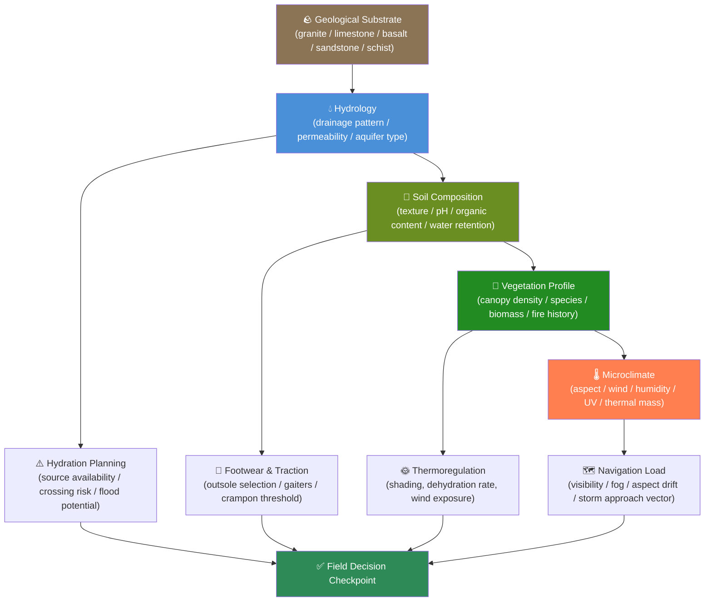

# Lesson 1: Terrain Types, Ecosystems, Bioclimatic Zones

## 1. First-Principles Intuition & Invariants

Every trail is a surface expression of deep history. The ground beneath your boots encodes millions of years of tectonic pressure, glacial advance and retreat, hydrological erosion, and biological succession. An advanced hiker who understands this history does not merely walk through a landscape — they read it in real time, translating the color of a rock face, the density of a canopy, or the angle of a drainage channel into actionable intelligence about footing, water availability, navigation complexity, and physiological demand.

The foundational invariant of terrain analysis is this: **geology drives hydrology, hydrology drives soil chemistry, soil chemistry drives vegetation, and vegetation drives microclimate.** These are not parallel variables to study independently; they are a cascade. A granite batholith sheds water rapidly because its crystalline surface has low porosity, so the soils above it remain thin and nutrient-poor, supporting scrub pine and manzanita rather than deep-rooted hardwoods, which in turn provides less canopy shade, which creates afternoon solar loading and elevated surface temperatures. A limestone karst formation, by contrast, absorbs precipitation into underground aquifers, produces alkaline soils rich in calcium carbonate, supports dense broadleaf vegetation, and can deliver flash flooding into sinkholes with virtually no surface warning. These two substrates, separated by thirty miles on a topographic map, demand entirely different navigation assumptions, hydration planning, and footwear selection.

Bioclimatic zones add a vertical dimension to this analysis. As altitude increases by 300 meters, ambient temperature drops approximately 1.9°C–2.0°C under standard lapse rate conditions, and ultraviolet radiation intensity increases by roughly 10–12% per 1,000 meters of gain. This creates stacked ecological communities — lowland riparian zones, montane mixed forest, subalpine meadow, alpine tundra, and permanent snowfield — each with distinct trail conditions, hazard profiles, and physiological demands. A practitioner planning a single-day objective that crosses three of these zones must treat each transition as a gear, nutrition, and decision checkpoint, not simply a scenic change.

The second invariant is that **microclimate diverges sharply from macroclimate at the resolution that matters for hikers**. A standardized regional forecast describes conditions at 2 meters above open ground. It says nothing about the radiant heat trapped in a south-facing granite bowl at noon, the wind acceleration through a saddle corridor that reduces effective temperature by 8°C, or the fog condensation layer that forms in a coastal redwood valley and saturates trail surfaces with moisture even during a dry week. Reading microclimate requires integrating aspect, slope angle, canopy density, proximity to water, and local topographic geometry — all simultaneously, while moving.

The third invariant governs water systems: **all flowing water in natural terrain is both a navigational reference and a hazard.** Drainages orient you on a map, but they also concentrate runoff, destabilize trail tread during precipitation events, and serve as transmission corridors for waterborne pathogens. The experienced hiker treats every creek crossing as a tactical decision: assess upstream weather history, assess bank stability, assess crossing depth and velocity before committing, and filter or treat every drop of water regardless of apparent clarity.

---

## 2. Core Architecture & Mechanics

### The Environmental Cascade Model

The five-layer cascade — substrate, hydrology, soil, vegetation, microclimate — is not merely conceptual. Each layer has measurable parameters, and each parameter translates directly into field decisions.

**Geological substrate** determines the mechanical properties of trail surface. Granite and quartzite produce coarse, angular gravel that provides reliable grip but causes accelerated boot outsole wear and ankle fatigue from lateral instability. Sandstone, particularly in layered sedimentary formations, cleaves horizontally along bedding planes when wet, turning what appears to be solid footing into sliding slabs. Schist and phyllite — metamorphic rocks with strong foliation — fracture along parallel planes and produce loose, flaky debris that behaves like ball bearings underfoot on steep descents. Volcanic basalt is frequently vesicular, offering surprisingly good grip when dry, but its high porosity means it retains moisture and becomes deeply slick in rain or at elevation where dew forms nightly. Knowing the dominant substrate of your planned route before departure is not academic — it directly determines heel-brake technique on descent, trekking pole pressure, and gaiters selection.

**Soil composition** flows from substrate weathering plus organic decomposition. Sandy soils derived from granite decomposition drain rapidly but compact poorly, so they erode into loose channels after heavy traffic. Clay-dominant soils, common in lowland broadleaf zones, hold water tenaciously and become plastic when saturated — a condition that makes trail tread feel stable until shear stress is applied, at which point a hiker's boot can sink 10–15 centimeters and lose all forward traction. Peat-based soils in boreal and montane bog zones are deceptively loadbearing when frozen or dry, but can swallow a boot to mid-calf in a single step during thaw. The diagnostic tool for a practitioner is simple observation: compaction, color, and vegetation proxy. Dark, spongy, moss-covered surfaces signal high organic water retention. Pale, coarse, sparsely vegetated surfaces signal low water retention and mechanical instability on slopes.

**Vegetation profiles** function as both ecological indicators and direct trail modifiers. Dense coniferous canopy in montane zones keeps trail surfaces shaded and moist year-round, suppresses undergrowth, and creates needle-duff surfaces that are soft and low-traction. Chaparral shrub communities in Mediterranean bioclimatic zones produce trails that are exposed, sun-baked, and subject to rapid afternoon dehydration of both the terrain and the hiker — evapotranspiration demand in full-sun chaparral routinely exceeds 1.5 liters per hour at moderate effort levels. Riparian gallery forests along creek corridors create navigation complexity through dense lateral growth, frequent deadfall, and trails that migrate seasonally with high-water channels.

The diagram below models the full cascade as a decision-flow architecture, mapping each environmental layer to its downstream field variables and practitioner responses.

### Altitude Zones and Bioclimatic Transitions

Altitude zonation is the vertical equivalent of latitude-based biome succession, compressed into a vertical distance that a single day's hike can traverse. In the temperate mountain ranges of western North America, the transitions are as follows, though the absolute elevations shift with latitude and aspect.

The **montane zone** (roughly 1,500–2,500 m in mid-latitudes) is characterized by mixed conifer forest, reliable soil depth, and predictable afternoon convective thunderstorm activity from May through September. Soil structure here is typically deep podzol — acidic, moderately drained, with well-developed root networks that stabilize trail tread. Trail conditions in this zone are generally the most forgiving, but thunderstorm exposure on exposed ridgelines between 1,800 m and 2,200 m creates a consistent lightning hazard window between 13:00 and 16:00 local time during summer months.

The **subalpine zone** (2,500–3,500 m) marks the transition where krummholz — wind-deformed, low-growing conifers — replaces upright forest, snowpack persists beyond June, and soil depth decreases sharply. Navigation becomes materially more demanding here because trail tread is often buried under snowpack in early season, requiring route-finding from topographic features rather than following a visible path. Microclimate in the subalpine is volatile: cloud buildups that look distant at 10:00 can deliver hail by 12:30, and temperature swings of 15°C between solar exposure and shade are common within a single hour.

The **alpine zone** (above treeline, typically 3,200–3,500 m+) presents the highest cognitive and physiological demand. Vegetation is krummholz mat, alpine sedge, and fellfield cushion plants — none of which provides meaningful navigation reference. Rock cairns and GPS waypoints become primary navigation tools. Soil is replaced by talus, scree, and exposed bedrock, all of which require active foot placement rather than passive walking. At this altitude, UV radiation without adequate skin and eye protection causes measurable tissue damage within 90 minutes on snow or pale granite.

---

## 3. High-Performance Optimization & Failure Modes

### Pre-Route Environmental Analysis Protocol

The practitioner's workflow begins 48–72 hours before departure, not at the trailhead. The first task is substrate and vegetation reconnaissance using USGS 7.5-minute topographic quadrangles (1:24,000 scale) cross-referenced against the local geological survey map, which is typically available from state geological survey repositories. On the topo, you are reading two things simultaneously: the spacing and shape of contour lines for slope angle and terrain form, and the drainage network for hydrological cascade prediction. Contour lines spaced closer than 0.9 mm at 1:24,000 scale represent slopes exceeding 30°; 2 mm spacing indicates slopes around 14–15° — which, depending on substrate, is below the threshold where loose material begins to slide under foot pressure. V-shaped drainage incisions pointing uphill on the map indicate active erosional channels that are likely to be wet, unstable, and difficult to cross after precipitation.

Vegetation data can be supplemented with satellite imagery. Google Earth historical imagery is a legitimate practitioner tool: it allows you to compare snowpack at your target elevation in prior years on the same calendar date, assess fire scar extent and resulting loose soil exposure, and identify riparian corridors that may be obscured on the topo.

Weather data should be sourced from two independent systems — the National Weather Service point forecast for the summit elevation and the Mountain Forecast (mountain-forecast.com) model, which provides altitude-band-specific temperature, wind, and precipitation values at 500 m vertical intervals. Discrepancies between the two models on convective precipitation timing are themselves a warning signal to build conservative turnaround margins.

### Microclimate Failure Modes and Their Signatures

The most common failure pattern for experienced hikers is not gross incompetence — it is overconfidence driven by macroclimate data masking microclimate reality. A forecast high of 22°C at the trailhead (900 m) says nothing about the 3°C ambient temperature in the shaded north-facing couloir at 2,800 m where the trail crosses a persistent snowfield in June. The practitioner mitigates this by identifying aspect change points on the map before departure — locations where the trail transitions from south-facing to north-facing slope — and treating each such transition as a potential microclimate discontinuity requiring a gear check.

Hypothermia in summer is the paradigmatic example of microclimate failure. It develops most rapidly not in cold-weather camping scenarios but in trail scenarios where a hiker who is wet from creek crossings or sweat encounters unexpected wind exposure at a ridge transition. The wet-bulb temperature at that transition may be 8–10°C even though the dry-bulb forecast reads 18°C. A pack that lacks a mid-layer insulation piece and a wind shell at that moment has failed the practitioner, and the failure was attributable to a planning error, not an equipment shortage.

Heat illness follows the same logic in reverse. Chaparral trails with full solar exposure, low-to-no shade, and south or southwest aspect generate radiant surface temperatures that can exceed ambient air temperature by 20–25°C on exposed rock and soil. A hiker maintaining 4 km/h effort on such terrain at 11:00–14:00 during July can exceed sweat rates of 1.2–1.8 liters per hour — rates that outpace most carrying capacities unless explicit water caching or resupply planning has been executed. The optimization here is departure timing: starting at 05:30–06:00 to place the most exposed terrain in the morning shade window and completing exposed sections before the peak radiant loading period.

Water systems present a failure mode that is mechanical rather than thermal. Hikers frequently underestimate the velocity and depth multiplier effect of snowmelt-driven creek crossings in May and June. A creek that reads as knee-deep at 09:00, before the solar melt cycle activates, can rise to thigh-deep and double in velocity by 14:00. The rule of field practice is to cross drainages early in the day during snowmelt season, never commit to a crossing where the downstream consequence of a fall is a hydraulic trap or canyon, and always unbuckle the hip belt before entering moving water so the pack can be shed immediately if you go in.

Soil failure on trail tread — post-fire, post-flood, and in early season — is the least anticipated hazard for practitioners who rely on trail condition reports from prior-season data. A burn scar that stabilized through the previous autumn can mobilize as deep ash slurry after the first significant rain of the new season, converting what the trail report describes as a stable maintained path into a loose, ankle-deep channel. Carrying gaiters as a standard kit item, even in summer, mitigates the debris intrusion component of this failure, but the navigation disruption of a trail that has physically moved requires topographic cross-referencing rather than path-following.

---

## 4. Summary & Verification Matrix

| Environmental Layer | Governing Invariant | Field Diagnostic | Primary Failure Mode | Practitioner Mitigation |
|---|---|---|---|---|
| **Geological Substrate** | Rock type determines surface friction, stability under load, and weathering rate | Rock color, texture, and fracture pattern; consult state geological survey map before departure | Wet sandstone and schist bedding planes produce catastrophic slip on descent | Match outsole lug pattern and stiffness to expected substrate; reduce descent pace by 30–40% on foliated or layered rock in wet conditions |
| **Hydrology & Water Systems** | All surface water is both a navigation reference and a timed hazard; drainage geometry predicts flood behavior | V-shaped contour incisions on topo = active erosion; check upstream precipitation 72 hours prior | Underestimating snowmelt peak timing leads to uncrossable afternoon creek levels | Cross major drainages before 10:00 during melt season; unbuckle hipbelt before all moving-water crossings |
| **Soil Composition** | Soil texture and organic content determine traction, erosion risk, and post-precipitation stability | Dark spongy surface = peat/clay (high retention); pale coarse surface = sandy (low retention, loose on slopes) | Post-fire and post-flood ash slurry obscures and relocates trail tread without warning | Carry gaiters regardless of season; cross-reference GPS waypoints against topo when trail tread is visually absent |
| **Vegetation Profile** | Canopy density and species composition proxy both microclimate state and trail surface moisture | Needle-duff = moist, low traction; chaparral = hot, high evapotranspiration demand; krummholz = subalpine transition | Full-exposure chaparral zones generate sweat rates exceeding carrying capacity without explicit water planning | Depart by 05:30–06:00 for south-aspect chaparral routes; plan water sources at no greater than 90-minute intervals |
| **Altitude Zonation** | Each 300 m gain = approximately 2°C temperature drop + 3–4% UV increase; bioclimatic transitions require independent gear and decision audits | Treeline position, snowpack persistence, and cloud-buildout rate; NWS summit forecast vs. Mountain Forecast cross-check | Macroclimate forecast masking microclimate reality at north-facing couloirs and ridge transitions causes summer hypothermia | Identify aspect-change points on topo pre-departure; treat each as a gear check; carry mid-layer and wind shell regardless of trailhead temperature |
| **Microclimate Dynamics** | Aspect, slope geometry, and canopy interact to create temperature and wind conditions that diverge 10–25°C from regional forecast | South-facing bowl = radiant heat trap; saddle corridor = wind acceleration zone; fog-condensation valleys = wet surfaces despite dry forecast | Hypothermia onset in wet-bulb conditions on exposed ridge transitions when pack lacks insulation layer | Build conservative turnaround margins at convective storm risk windows (13:00–16:00 in montane/subalpine summer); never sacrifice insulation layer to save pack weight |
