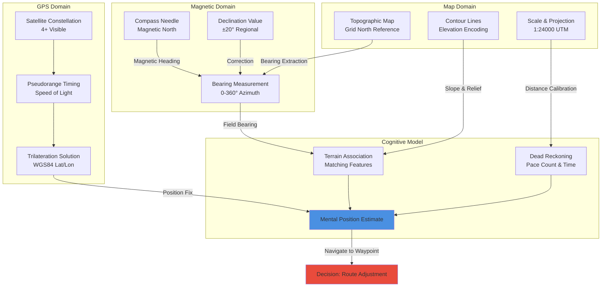

# Lesson 2: Navigation Systems, Orienteering, Wayfinding

## 1. First-Principles Intuition & Invariants

Human spatial cognition evolved under open sky with stable, repeatable celestial patterns and recognizable terrain features. The sun traverses predictable arcs, constellations wheel through fixed cycles, and landforms persist across human timescales. Our ancestors developed wayfinding heuristics rooted in these environmental constants: shadow angles, prevailing wind directions, drainage patterns flowing downhill toward larger water bodies, and the asymmetric growth of vegetation on north-facing versus south-facing slopes. These cognitive models operated without instruments, relying on pattern recognition, dead reckoning stride counts, and landmark memorization.

Modern navigation systems formalize these intuitions into quantifiable protocols. A topographic map transforms three-dimensional terrain into a two-dimensional graphical encoding, preserving spatial relationships through cartographic projection while introducing controlled distortions. The magnetic compass provides an absolute reference frame anchored to Earth's geomagnetic field, enabling repeatable angular measurements independent of visibility or weather. GPS receivers invert the problem entirely: rather than measuring our relationship to fixed terrestrial features, they trilaterate position by timing radio signals from orbiting satellites with atomic clock precision. Each system embodies trade-offs between accuracy, reliability, weight, power consumption, and cognitive load.

The fundamental invariant underlying all terrestrial navigation is the relationship between true north, magnetic north, and grid north. True north points toward the geographic North Pole, the axis of Earth's rotation. Magnetic north indicates the direction a freely suspended magnetized needle aligns with Earth's magnetic field, currently located in the Canadian Arctic and drifting approximately fifty kilometers per year due to convective flows in the outer core. Grid north represents the vertical gridlines printed on UTM (Universal Transverse Mercator) or other projected map coordinate systems, which converge toward the projection's central meridian rather than the true pole. The angular difference between magnetic north and true north is magnetic declination, varying from zero degrees along the agonic line to more than twenty degrees in polar regions and certain mid-latitude zones. The angular difference between grid north and true north is grid convergence, a function of longitude offset from the projection's central meridian.

Declination correction is non-negotiable for precision navigation. A bearing measured with a compass reads as a magnetic azimuth, but map gridlines and GPS coordinates reference true or grid north. Failing to apply the appropriate correction accumulates lateral error proportional to travel distance: at ten degrees of uncorrected declination, every kilometer traveled introduces a 176-meter perpendicular offset, compounding into multi-kilometer positional drift over a day's march. Wilderness contexts amplify these errors because confirming landmarks may be separated by hours of travel through visually homogeneous forest or featureless snow.

Wayfinding in complex terrain requires integrating multiple information streams: the map's planimetric view showing horizontal relationships and trail networks, the contour line topology encoding elevation change and slope steepness, the compass providing directional orientation, and proprioceptive feedback from pace counting and exertion level. Expert navigators build a continuously updated mental model of position, a probabilistic estimate refined by terrain association, handrail following along linear features, and attack point identification near target destinations. This mental map operates as a Bayesian filter, weighing new observations against prior position estimates and reconciling discrepancies through hypothesis testing.

## 2. Core Architecture & Mechanics

The mechanical compass consists of a magnetized needle balanced on a low-friction pivot, housed within a liquid-filled capsule that dampens oscillation. The capsule rotates within a baseplate bearing a direction-of-travel arrow and a transparent base with ruler edges and parallel orienting lines. The rotating bezel is inscribed with a 360-degree azimuth scale, with north at zero degrees, east at ninety, south at 180, and west at 270. The orienting arrow molded into the capsule floor provides a reference for aligning map meridians. High-quality orienteering compasses incorporate declination adjustment mechanisms: either a movable indexing mark offset from the main lubber line, or a rotating capsule base allowing the entire azimuth ring to be preset with the local declination value.

To measure a bearing from map to field using the classic three-step protocol, first place the compass baseplate on the map with the direction-of-travel arrow pointing from your current position toward the target landmark, aligning the baseplate edge to connect both points. Second, rotate the bezel until the orienting arrow and parallel meridian lines inside the capsule align perfectly with the map's north gridlines, ignoring the magnetic needle entirely during this step. Third, hold the compass level at waist height, rotate your body until the red magnetic needle aligns with the orienting arrow inside the capsule, then sight along the direction-of-travel arrow to identify the field bearing. This process converts map geometry into a magnetic heading, assuming the map is oriented to magnetic north or the compass has been adjusted for declination.

Topographic maps encode elevation through contour lines, each representing a constant-height isoline where every point shares the same elevation above a vertical datum, typically mean sea level. The contour interval, printed in the map legend, specifies the vertical spacing between adjacent lines: twenty feet for 1:24,000-scale USGS quads in moderate terrain, forty feet in mountainous regions, or ten meters for metric maps. Where contour lines cluster tightly, slopes are steep; where they spread apart, terrain is gentle. Closed contour circles indicate peaks or depressions, distinguished by hachure marks pointing downslope for depressions. Reading contour topology requires mentally interpolating the continuous three-dimensional surface from the discrete two-dimensional slices.

GPS receivers measure position by timing signal propagation from satellites. Each GPS satellite broadcasts a precisely timestamped signal synchronized to an onboard atomic clock. The receiver correlates incoming signals against internally generated pseudorandom noise codes, determining the time delay for each satellite's signal to reach the antenna. Multiplying this time delay by the speed of light yields the distance from satellite to receiver, defining a spherical surface of possible positions. Ranging to four satellites provides three spatial coordinates and resolves the receiver's clock error, which lacks atomic precision. Satellite geometry affects solution quality: the Dilution of Precision (DOP) metric quantifies how satellite angular separation amplifies range measurement errors into positional uncertainty. A DOP value below three indicates excellent geometry; values above six signal degraded accuracy. Tree canopy, canyon walls, and atmospheric ionization introduce multipath reflections and signal delay, degrading accuracy from the nominal five-meter civilian precision to fifteen meters or worse under dense forest.

The relationship between map scale, real-world distance, and terrain complexity governs route selection. A 1:24,000-scale map represents one unit on paper as 24,000 units on the ground: one inch equals 2,000 feet, or approximately 2.64 inches per mile. Measuring straight-line map distance with a ruler provides Euclidean horizontal distance, but actual walking distance increases due to elevation change and sinuous trail curvature. For every 100 meters of elevation gain, add approximately ten meters to horizontal distance for energy expenditure equivalence—Naismith's Rule. A four-kilometer map distance with 400 meters of ascent translates to an equivalent flat-ground distance of 4.04 kilometers, requiring perhaps seventy minutes at a moderate hiking pace rather than the naive estimate of fifty minutes.

The terrain association feedback loop operates as a continuous validation process. After establishing a bearing and traveling for a measured interval, the navigator pauses to identify observable terrain features: a stream crossing predicted by blue contour-line V-shapes pointing uphill on the map, a ridgeline silhouette matching a tight cluster of contour rings, or a bearing to a visible distant peak matching its plotted map location. Discrepancies between predicted and observed features trigger re-evaluation. If the expected stream does not appear after the calculated travel time, either the pace count was inaccurate, the initial position was misidentified, or terrain forced unintended lateral drift. The navigator employs bracketing techniques: if uncertain whether position lies east or west of a target, deliberately aim to one side, then follow a perpendicular handrail feature to the target with known lateral offset direction.

Advanced orienteers exploit attack points and collecting features. An attack point is a prominent, unmistakable landmark located near the destination: a trail junction 200 meters south of a backcountry campsite, or a lake outlet where a portage begins. Navigating precisely to the attack point, then traveling a short, carefully measured leg to the final target, reduces cumulative error. Collecting features are large-scale terrain boundaries that capture position uncertainty: a long ridgeline running perpendicular to travel direction, a major river, or a shoreline. If lateral drift causes the navigator to miss a target along a trail, continuing until reaching the collecting feature (a road intersection beyond the target) confirms position and enables a controlled backtrack.

## 3. High-Performance Optimization & Failure Modes

Optimizing navigation efficiency requires pre-route planning to minimize cognitive load during execution. Before departing, mark the map with anticipated checkpoints at 500-meter or ten-minute intervals, noting predicted elevation changes and distinctive terrain features. Fold the map to display only the active route segment, reducing the need to unfold and reorient the entire sheet in wind or rain. Pre-calculate and annotate magnetic bearings for key legs directly on the map using a pencil, applying the local declination correction once during planning rather than repeatedly in the field. For a declination of fourteen degrees east, add fourteen degrees to the true bearing to obtain the magnetic bearing: a true bearing of ninety degrees becomes 104 degrees magnetic. Western declination requires subtraction. The mnemonic "East is least, West is best" refers to the adjustment direction applied to magnetic bearings to convert to true: subtract easterly declination, add westerly.

Pace counting maintains dead reckoning accuracy over short distances when visibility is limited or confirming landmarks are scarce. Establish a personal pace count by walking a measured 100-meter course on flat ground at normal hiking speed, counting every second footfall (each time the right foot strikes). Most adults record between fifty and seventy paces per 100 meters. Adjust this baseline for slope angle: ascending adds approximately fifteen percent, descending subtracts ten percent. Carry pace-counting beads on a cord or move small pebbles from one pocket to another after each 100-meter interval. Accumulated pace count multiplied by the baseline interval (100 meters) yields distance traveled, providing a continuous position estimate even without GPS or visible landmarks.

GPS waypoint management optimizes battery life and operational security. Satellite signal acquisition and continuous tracking consume substantial power, reducing battery life from weeks in standby to twelve hours of active navigation. Download and cache map tiles before entering the backcountry to avoid reliance on cellular data. Mark waypoints at trailheads, critical junctions, water sources, and campsites using standardized naming conventions: "CAMP_01_SPRING" clearly identifies the first campsite near a water source. Record waypoint coordinates in multiple formats: UTM for overland grid navigation, latitude-longitude in decimal degrees for SAR (Search and Rescue) communication, and elevation to verify barometric altimeter calibration. Export GPX track files as backup, storing copies on separate devices to mitigate single-point failure.

Magnetic declination varies spatially and temporally, requiring site-specific and date-specific correction. The NOAA National Centers for Environmental Information maintains the World Magnetic Model, updated every five years with a predictive secular variation component. A map printed in 1995 may cite a declination of sixteen degrees east with an annual change of eight minutes west, meaning the current declination is two degrees lower than printed after fifteen years. In regions of rapid magnetic change, such as the Canadian Arctic or areas near magnetic anomalies caused by iron-ore deposits, local declination may deviate significantly from regional models. When operating in unfamiliar terrain, verify declination against GPS compass bearing: identify a distant landmark, measure its GPS bearing, then measure its magnetic compass bearing; the difference is the effective local declination.

Whiteout conditions in snow-covered terrain eliminate visual contrast, making contour interpretation impossible without instrument confirmation. Barometric altimeters provide continuous elevation tracking by measuring atmospheric pressure, which decreases approximately one millibar per eight meters of altitude gain in standard atmospheric conditions. Calibrate the altimeter at a known elevation before departure, then recalibrate whenever crossing a benchmark or summit with verified elevation. Weather system pressure changes introduce drift: a passing low-pressure front can cause the altimeter to indicate a false 100-meter elevation gain while camped. Mitigate this by recalibrating at every known elevation point and comparing pressure trends against weather forecasts. Combining altimeter elevation with compass bearing enables position fixing along a ridgeline even when fog obscures surrounding terrain: if the bearing to a known peak is 047 degrees and elevation is 1,840 meters, only one point on the map satisfies both constraints.

Common failure modes include magnetic deviation from ferrous objects, map misorientation, and scale misinterpretation. Belt buckles, ice axes, electronic devices, and wire-framed backpacks introduce local magnetic fields that deflect the compass needle by five to fifteen degrees. Always measure bearings with the compass at arm's length, away from metal objects and electronics. Map misorientation occurs when the navigator rotates the map until roads or trails align with the expected direction of travel, ignoring north alignment. This intuitive but incorrect approach causes all subsequent bearings to incorporate a systematic angular error. The correct protocol is to first orient the map to north using the compass, placing the compass on the map, rotating both map and compass together until the magnetic needle aligns with the orienting arrow after adjusting for declination. Scale misinterpretation is catastrophic: mistaking a 1:50,000 map for 1:24,000 causes a factor-of-two distance underestimate, potentially doubling planned travel time and exhausting water supplies before reaching the next source.

Night navigation amplifies difficulty, compressing situational awareness and reducing terrain association opportunities. Red headlamp modes preserve night vision while allowing map reading, but contour interpretation suffers without color contrast. Identify bright stars along the intended bearing: Polaris holds within one degree of true north in the Northern Hemisphere, useful for verifying compass accuracy and detecting magnetic deviation. The Southern Cross and pointer stars serve equivalent functions in southern latitudes. Luminous compass bezels or tritium markers enable bearing following without repeatedly illuminating the headlamp. Reduce travel speed to fifty percent of daytime pace, pausing frequently to confirm position against predicted terrain features using tactile feedback: a talus slope's loose rock underfoot confirms arrival at a scree field shown on the map.

Route redundancy protects against single-point navigation failures. Carry a paper map and compass as primary tools, a GPS unit with downloaded maps and spare batteries as secondary confirmation, and a smartphone with offline map application as tertiary backup. Annotate critical waypoints in a waterproof notebook: UTM coordinates, bearing and distance from known landmarks, and descriptive notes. Share route plans and expected return times with a responsible person outside the wilderness, including waypoint coordinates and contingency plans. If GPS failure occurs due to electronic malfunction, satellite geometry, or dead batteries, the paper map and compass provide full navigation capability. If both compass and GPS fail, dead reckoning, celestial navigation, and terrain association maintain sufficient accuracy for extracting to a road or trail network.

## 4. Summary & Verification Matrix

| Invariant Principle | Mechanical Implementation | Diagnostic Verification | Failure Mode & Mitigation |
|---------------------|---------------------------|-------------------------|---------------------------|
| Magnetic declination correction is mandatory for precision navigation | Add easterly declination to true bearing to get magnetic; subtract westerly. Pre-calculate and annotate map bearings during planning phase. NOAA World Magnetic Model updated every 5 years with annual secular variation. | Compare GPS bearing and magnetic compass bearing to same distant landmark; difference equals effective local declination. Verify annotation: true bearing 90° + 14° east declination = 104° magnetic. | Uncorrected declination: 10° error causes 176 m lateral drift per km traveled. Mitigation: Preset compass declination adjustment or use annotated magnetic bearings. Recalibrate when crossing into new declination zones. |
| Contour line clustering encodes slope steepness; closed circles indicate peaks or depressions | Contour interval (vertical spacing) printed in map legend: 20 ft or 40 ft typical USGS. Tight spacing = steep slope; wide spacing = gentle terrain. V-shapes pointing uphill = stream valley. Hachures point downslope for depressions. | Measure horizontal distance between contours: 5 mm spacing at 1:24,000 with 40 ft interval = 120 m horizontal per 12 m vertical = 10% grade. Compare predicted slope to observed exertion and visual angle. | Misinterpreting scale causes 2× distance error. Ignoring contour direction (peak vs. depression) causes navigation to wrong landform. Mitigation: Always verify contour interval and direction of elevation change before route planning. |
| GPS accuracy degrades with poor satellite geometry (high DOP) and canopy obstruction | DOP < 3 excellent, 3-6 good, > 6 poor. Requires 4+ satellites with wide angular separation. Multipath and atmospheric delay add 5-15 m error. Barometric altimeter more accurate than GPS vertical (±10 m). | Check GPS DOP value and satellite count in device status screen. Test position fix against known benchmark or trail junction coordinates. Verify track log smoothness; erratic jumps indicate poor reception. | Tree canopy or canyon walls block satellites, causing 50+ m positional error or complete loss of fix. Mitigation: Combine GPS with map/compass dead reckoning. Cache offline maps. Carry spare batteries. Calibrate barometric altimeter at known elevations. |
| Terrain association validates dead reckoning through continuous hypothesis testing | Identify predicted features (stream crossings, ridgelines, trail junctions) at planned intervals. Observe actual terrain; match or reject position hypothesis. Use attack points (prominent landmarks near target) and collecting features (boundaries capturing drift). | Pace count predicts 800 m travel in 12 min. Map shows stream at 750 m. Stream appears at 11 min confirms position. No stream at 15 min triggers re-evaluation and GPS check. | Confirmation bias: forcing terrain to match desired position rather than actual. Mitigation: Objectively assess discrepancies. Use bracketing (aim off to one side) and collecting features to bound uncertainty. Backtrack to last confirmed position if lost. |
