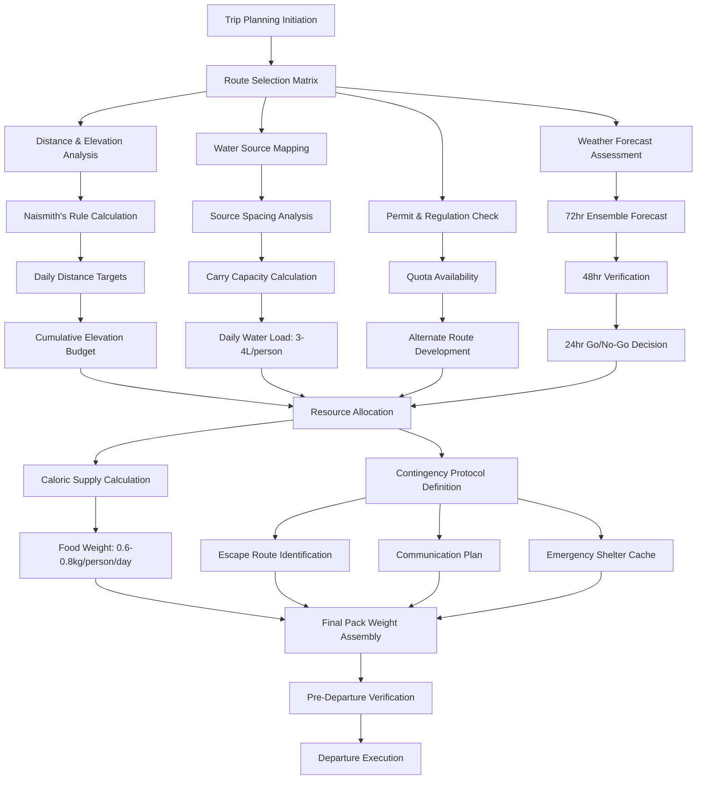

# Lesson 3: Trip Planning, Logistics, Resource Management

## 1. First-Principles Intuition & Invariants

Trip planning for wilderness hiking stands as the critical difference between a successful expedition and a catastrophic rescue operation. Unlike urban environments where infrastructure provides continuous safety nets, the backcountry operates under strict energetic, temporal, and physiological constraints that demand rigorous quantitative planning. Every decision made at the trailhead—route selection, caloric load, water capacity, contingency timeframes—propagates forward through the entire expedition, amplifying either safety margins or compounding risk exposure. The fundamental invariant governing all wilderness logistics is that human performance degrades predictably under load, fatigue accumulates non-linearly with distance and elevation gain, and environmental conditions shift with sufficient volatility to render any single-point forecast inadequate.

The physiological reality of human locomotion under load establishes hard boundaries on achievable distance and elevation gain. A conditioned hiker carrying a moderate pack of fifteen to twenty kilograms can sustain approximately three to four kilometers per hour on flat terrain, but this velocity collapses exponentially when confronted with steep ascents. The energetic cost of elevation gain dominates horizontal distance: raising one kilogram of body mass plus pack weight through one vertical meter requires approximately ten joules of mechanical work, ignoring the thermodynamic inefficiency of human muscle which operates at roughly twenty-five percent efficiency. This means that every hundred meters of elevation gain extracts the same energetic toll as hiking an additional kilometer on flat ground, a conversion factor that must anchor all distance-time calculations.

Water represents the most critical consumable in wilderness logistics because hydration requirements are non-negotiable and water sources are spatially discrete and often unreliable. The human body loses approximately two to three liters of water per day through respiration, perspiration, and metabolic processes under moderate exertion in temperate conditions, but this requirement escalates rapidly in hot, arid environments or during strenuous climbing. Unlike food, where the body can mobilize glycogen and fat reserves for hours or even days, dehydration precipitates cognitive impairment, reduced thermoregulatory capacity, and eventual circulatory collapse within twenty-four to forty-eight hours. Carrying sufficient water introduces a brutal mass penalty: each liter weighs exactly one kilogram, and a three-day supply for two people in a waterless environment would add twelve kilograms to pack weight, fundamentally altering speed and endurance calculations.

Caloric requirements follow a similar non-negotiable physiological boundary. Basal metabolic rate for an adult male averages seventeen hundred kilocalories per day, but hiking with a loaded pack elevates total daily energy expenditure to three thousand to five thousand kilocalories depending on terrain severity, pack weight, and individual body mass. Unlike water, food can be compressed into energy-dense forms: nuts, nut butters, dried fruit, and chocolate deliver five to six kilocalories per gram, while freeze-dried meals reconstituted with boiled water provide complete nutrition at approximately one hundred fifty grams per meal. The strategic tension lies in balancing pack weight against caloric density and palatability, because unpalatable food leads to underconsumption, which in turn accelerates fatigue and impairs decision-making.

Weather assessment transcends simple comfort considerations and directly governs survival margins. Hypothermia kills through a combination of convective heat loss, evaporative cooling from wet clothing, and metabolic exhaustion, and these mechanisms accelerate in windy, wet conditions even at temperatures well above freezing. The wind chill equivalent temperature, calculated from ambient temperature and wind speed, provides a more accurate predictor of cold injury risk than raw thermometer readings. Lightning presents another acute threat in exposed alpine terrain, where the probability of ground current injury or direct strike increases dramatically during afternoon convective thunderstorms common in summer mountain ranges. The critical planning invariant is that weather forecasts degrade in accuracy beyond seventy-two hours, and microclimates in mountainous terrain often deviate significantly from valley forecasts, demanding conservative assumptions and robust contingency layers.

Permit systems and regulatory frameworks exist not as bureaucratic obstacles but as carrying capacity management tools designed to prevent ecological degradation and maintain wilderness character. Popular trailheads operate under quota systems that limit daily entries, requiring advance reservations months ahead for peak season dates. These constraints force planners to develop alternate routes or flexible date windows, integrating permit availability as a hard constraint equivalent to water source locations or escape route feasibility. Understanding the regulatory landscape—whether fire restrictions prohibit stoves, whether bear canisters are mandatory, whether designated campsites constrain nightly stopping points—shapes the entire logistical architecture of a trip.

Group dynamics introduce multiplicative complexity because human travel speed is bounded by the slowest member, decision-making quality degrades with group size beyond four to six individuals, and interpersonal conflict under stress can fracture group cohesion precisely when coordination is most critical. The pace of the slowest hiker establishes the effective travel velocity, which means pre-trip fitness assessment and honest capability discussion are not optional social niceties but essential safety calculations. Leadership structure, decision-making authority, and communication protocols must be established before departure, because ambiguity under duress leads to paralysis or fragmentation.

## 2. Core Architecture & Mechanics

The mechanical architecture of trip planning resolves into a layered decision tree where each node represents a constraint boundary or resource allocation choice. At the apex lies route selection, which must simultaneously satisfy distance capability, elevation gain tolerance, water source spacing, escape route availability, and permit feasibility. This multi-dimensional optimization problem cannot be solved through simple heuristics; it demands systematic decomposition into constituent variables and explicit quantification of tradeoffs.

Distance-time-elevation calculations begin with Naismith's Rule, a nineteenth-century Scottish mountaineering heuristic that remains the foundation of modern trip planning. Naismith proposed that a fit walker can cover five kilometers per hour on flat terrain, with an additional one hour added for every six hundred meters of elevation gain. Modern refinements account for pack weight, terrain roughness, and descent rates. A more precise formulation incorporates Tobler's hiking function, which models walking velocity as a function of slope gradient. Tobler's empirical formula states that walking speed in kilometers per hour equals six times the exponential of negative three point five times the absolute value of the quantity slope gradient plus zero point zero five. This function captures the intuitive reality that moderate descents allow faster travel than flat ground, while steep descents and all ascents slow progress dramatically.

Applying these models requires detailed topographic analysis. A one-to-twenty-four-thousand scale topographic map displays contour lines at ten or twenty meter intervals, allowing precise measurement of cumulative elevation gain and loss. Modern GPS units and smartphone applications automate this analysis, generating elevation profiles that display altitude as a function of horizontal distance. The critical metric is cumulative elevation gain, not merely net elevation change, because descending one thousand meters and then ascending one thousand meters extracts far more physiological cost than remaining at constant elevation despite yielding zero net elevation change. A well-planned route balances daily distance against cumulative gain, typically targeting no more than twelve to fifteen hundred meters of gain per day for multi-day trips unless the group possesses exceptional fitness and acclimatization.

Water logistics demand spatial optimization. Water sources—streams, springs, lakes—are fixed geographic features that cannot be relocated to suit itinerary convenience. The planner must identify all reliable water sources along the route using topographic maps, trail reports, and seasonal flow data, then structure daily distances to ensure arrival at water sources before complete exhaustion of carried supply. In arid environments or during drought conditions, this constraint dominates all other planning factors. A conservative approach assumes each person requires three to four liters per day, carried in two to three liter capacity reservoirs that allow flexible rationing. The temporal spacing of water sources establishes mandatory stopping points or forces the carriage of additional capacity, which in turn reduces travel speed and increases fatigue.

Caloric supply estimation follows a similar constraint-based logic. Total trip caloric requirement equals the product of daily energy expenditure, number of participants, and trip duration, with a twenty percent safety margin added to account for unexpected delays or increased exertion. This total must then be decomposed into breakfast, lunch, dinner, and snack components, each optimized for different criteria. Breakfast demands rapid preparation and hot calories to mobilize metabolism after overnight hypothermia risk; oatmeal with nut butter and dried fruit delivers five hundred to six hundred kilocalories with minimal fuel expenditure. Lunch on the trail prioritizes no-cook convenience and continuous availability; trail mix, energy bars, cheese, and summer sausage allow grazing without stopping. Dinner provides the largest caloric bolus and psychological comfort through hot, savory meals; freeze-dried entrees or dehydrated bean and rice combinations reconstituted with boiled water deliver eight hundred to one thousand kilocalories with acceptable palatability.

Weather assessment frameworks integrate multiple data streams into probabilistic risk estimates. Modern forecasting relies on numerical weather prediction models that solve the Navier-Stokes equations governing atmospheric fluid dynamics on spatial grids with horizontal resolution of three to thirteen kilometers and temporal resolution of one to three hours. These models generate ensemble forecasts that quantify prediction uncertainty by running multiple simulations with slightly perturbed initial conditions. For trip planning, the critical outputs are temperature range, precipitation probability and intensity, wind speed, and freezing level altitude. A robust planning protocol checks forecasts from multiple sources—NOAA's National Weather Service, commercial providers like Weather Underground, and specialized mountain weather services—at seventy-two hours, forty-eight hours, and twenty-four hours before departure. Any forecast showing greater than thirty percent precipitation probability, sustained winds above twenty-five kilometers per hour at treeline, or freezing level dropping to planned camping elevations triggers contingency protocol activation.

The decision matrix for route selection integrates all these constraint variables into a systematic comparison framework. Each candidate route is scored across multiple dimensions: technical difficulty, distance and elevation profile, water source reliability, escape route availability, permit competition, scenic quality, and objective hazard exposure. Technical difficulty follows established rating systems: Class 1 represents straightforward hiking trails, Class 2 introduces occasional hand use for balance on rough terrain, Class 3 demands scrambling with significant exposure where falls would cause injury, and Class 4 and 5 enter technical rock climbing requiring ropes. Most backpacking routes should remain within Class 1 and 2 to maintain safety margins with heavy packs. Distance and elevation profile must match the demonstrated fitness level of the slowest group member; overestimating group capability is the most common planning failure. Water source reliability depends on season and recent precipitation patterns; spring snowmelt fills streams that run dry by late summer, while springs may flow year-round. Escape route availability measures how quickly the group can retreat to a trailhead or road in case of injury, illness, or severe weather; routes with multiple lateral exits to parallel roads provide superior safety margins compared to long linear approaches with single egress points.

Group dynamics management requires explicit pre-trip protocols. The group must designate a trip leader with final decision-making authority, particularly for go-no-go decisions and route modifications in the field. This leadership need not be permanent across all trips but must be unambiguous for each specific expedition. The group should establish a target hiking pace through a short shakedown hike, identifying natural break intervals and evaluating whether all members can maintain the required speed with loaded packs. Communication protocols matter critically when the group stretches along a trail or splits temporarily; agreeing on regrouping points, maximum separation distance, and whistle signal meanings prevents lost-person scenarios. The psychological contract must include mutual commitment to conservative decision-making, where any single member can trigger a retreat or rest day without social penalty, because summit fever and peer pressure kill more wilderness travelers than any environmental hazard.

## 3. High-Performance Optimization & Failure Modes

Optimizing wilderness logistics begins with ruthless minimization of carried weight because every kilogram removed from pack weight translates directly to increased travel speed, reduced fatigue, and expanded safety margins. The base weight of a backpack—defined as total pack weight excluding consumables like food, water, and fuel—should target seven to nine kilograms for three-season conditions. Achieving this demands systematic gear selection prioritizing multi-use items and eliminating redundancy. A tarp shelter weighing four hundred grams replaces a two-kilogram tent if precipitation probability is low and insects are not problematic. A down quilt eliminates the weight of a full sleeping bag's back insulation, which compresses uselessly beneath body weight. Titanium cookware saves two hundred grams compared to stainless steel. These incremental reductions compound into a two to three kilogram total savings, equivalent to an entire day's food supply or two additional liters of water capacity.

Food optimization balances caloric density against palatability and micronutrient completeness. Pure fats like olive oil or coconut oil deliver nine kilocalories per gram, making them the most energy-dense option, but consuming straight oil induces nausea and provides zero satiety. Nuts and nut butters offer six to seven kilocalories per gram with protein and healthy fats. Dried fruit provides quick glucose with four kilocalories per gram plus essential minerals. The optimal backpacking diet achieves approximately five kilocalories per gram on average, yielding six hundred to eight hundred grams of food per person per day for a three thousand to four thousand kilocalorie intake. Pre-trip meal preparation—assembling custom trail mixes, portioning nut butter sachets, pre-measuring freeze-dried meals—eliminates packaging waste and allows precise caloric tracking.

Water purification strategy represents another optimization axis. Carrying adequate water for a full day eliminates the need for purification systems but imposes three to four kilograms of weight. Relying on frequent purification from natural sources eliminates that weight but introduces time delays and failure risk. The optimal approach depends on source spacing: if reliable water appears every three to four hours, carrying one to two liters and purifying frequently minimizes weight while maintaining hydration. Hollow fiber membrane filters provide the fastest purification at approximately one liter per minute with zero chemical taste, but they are vulnerable to freezing damage and require careful maintenance. Chemical treatments using chlorine dioxide tablets are ultralight and reliable but demand thirty-minute contact time and impart mild taste alteration. Ultraviolet light purifiers like SteriPEN offer rapid treatment with no taste impact but depend on battery power and clear water. A robust system combines a primary filter with chemical backup.

Contingency protocols must address the three most probable failure modes: injury or illness, severe weather onset, and navigation error leading to off-route travel. Injury protocols begin with the MARCH trauma assessment sequence detailed in previous lessons, followed by immediate decision-making: can the injured person self-evacuate with assistance, does the situation demand helicopter rescue requiring satellite communication device activation, or can the group shelter in place until weather permits safe evacuation? Severe weather contingency depends on recognizing early warning signs and retreating before conditions become untenable. Lightning risk assessment follows the thirty-thirty rule: if the interval between lightning flash and thunder is less than thirty seconds, the storm is within ten kilometers and immediate descent from exposed ridges is mandatory; remain sheltered for thirty minutes after the last thunder. Navigation error prevention relies on continuous position awareness through GPS waypoint tracking combined with paper map and compass confirmation at every major terrain feature; if position uncertainty exceeds five hundred meters, the group must backtrack to the last confirmed position rather than continuing blindly.

Communication plans for wilderness areas without cellular coverage require satellite-based devices. Personal Locator Beacons (PLBs) transmit distress signals via the COSPAS-SARSAT satellite network, triggering search and rescue response but offering no two-way communication. Satellite messengers like Garmin inReach provide two-way texting and GPS tracking, allowing nuanced situation updates and coordination with rescue services. The critical invariant is that these devices must be carried on person, not buried in a pack, with batteries verified fresh before departure. Pre-trip filing of a detailed trip plan with a responsible person establishes a trigger timeline: if the group does not check in by a specified overdue hour, the contact initiates rescue procedures.

Failure modes in trip planning originate primarily from three sources: optimistic bias in capability assessment, inadequate safety margins in resource allocation, and poor contingency triggering thresholds. Optimistic bias causes groups to plan distances and elevation gains that match their best single-day performance rather than sustainable multi-day capacity while carrying full packs and accumulating fatigue. This error compounds over a multi-day trip as cumulative fatigue degrades performance by twenty to thirty percent by day three or four. The correction is brutal honesty in fitness assessment and application of a twenty percent reduction factor to estimated daily capabilities. Inadequate safety margins manifest as insufficient water capacity between sources, minimal food surplus, or tight timing that leaves no buffer for slow travel. The antidote is systematic addition of twenty-five percent temporal buffers and twenty percent resource surplus. Poor contingency triggering occurs when groups ignore early warning signs—darkening skies, slowing pace, minor injuries—and continue forward commitment until retreat becomes dangerous. Establishing objective trigger criteria before departure—specific weather thresholds, time-of-day turnaround points, mandatory rest days—overrides in-the-moment rationalization.

The interaction between group size and decision quality follows an inverted-U curve. Solo travel eliminates group coordination overhead but removes redundancy for injury scenarios and provides no cognitive backup for poor decisions under stress. Groups of two to four optimize safety through redundancy while maintaining swift decision-making and flexible logistics. Groups beyond six people fragment into sub-groups with divergent paces and goals, require larger campsites stressing ecological impact, and suffer from diffusion of responsibility where critical tasks like navigation and safety monitoring fall through gaps in assumed roles. The optimal group size for wilderness travel is three, providing injury response capability while maintaining cohesion and efficiency.

## 4. Summary & Verification Matrix

| Invariant Domain | Core Mechanism | Diagnostic Criteria | Failure Mode |
|-----------------|----------------|---------------------|--------------|
| Distance-Time-Elevation | Naismith's Rule baseline: 5 km/hr flat + 1 hr per 600m gain; Tobler's function for slope-dependent velocity; cumulative elevation gain dominates net change | Daily targets ≤15 km with ≤1500m gain for loaded multi-day; verify elevation profile against group fitness floor | Optimistic bias: planning to peak capability rather than sustainable pace; fatigue accumulation ignored; slowest member's capability underestimated |
| Water Logistics | Spatial constraint optimization: 3-4L per person per day; source spacing establishes mandatory stops; purification system redundancy | Map all sources with seasonal reliability data; carry capacity matches maximum inter-source interval plus 1L safety margin; dual purification methods | Inadequate inter-source capacity forces dehydration risk; filter failure without chemical backup; seasonal source drying ignored |
| Caloric Supply | Daily energy expenditure 3000-5000 kcal hiking with load; food density target 5 kcal/g yielding 0.6-0.8 kg/person/day; 20% surplus margin | Pre-trip total calculation: (days × persons × 4000 kcal) × 1.2 / 5 kcal/g; palatability verification prevents underconsumption | Insufficient surplus for delays; unpalatable food causes caloric deficit; weight optimization sacrifices nutrition completeness |
| Weather Assessment | Numerical ensemble forecasts at 72/48/24 hr; wind chill and freezing level as primary injury predictors; microclimate deviation from valley forecasts | Precipitation probability >30%, sustained wind >25 km/hr, or freezing level at camping elevation triggers contingency; multi-source forecast agreement required | Forecast confidence misinterpreted; single-point predictions trusted beyond 72hr; inadequate monitoring during trip; continuation bias overrides warning signs |
| Group Dynamics & Decision Authority | Leadership designation eliminates decision paralysis; pace bounded by slowest member; communication protocols prevent separation incidents; any-member veto for safety | Pre-trip shakedown verifies pace compatibility; explicit trigger criteria for retreat/rest; satellite communication device with verified batteries | Ambiguous leadership causes conflict under stress; peer pressure overrides safety veto; separation without regrouping protocol; summit fever continuation bias |
| Contingency Protocols | MARCH trauma response; weather retreat thresholds; navigation error backtracking; satellite communication for rescue coordination; trip plan with responsible contact | Escape route identification every segment; shelter-in-place capability for 24hr weather delay; position verification every major terrain feature | Inadequate medical kit for injury stabilization; no communication device; unrealistic self-rescue assumptions; trip plan not filed or contact unreliable |
