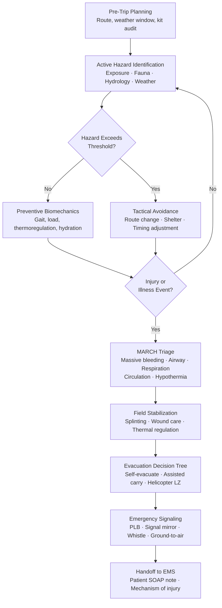

# Lesson 4: Risk Mitigation, Emergency Protocols, Wilderness Medicine

## 1. First-Principles Intuition & Invariants

The wilderness does not punish carelessness uniformly or immediately. It accumulates debt. A hiker who ignores a hot spot on their heel at mile three, dismisses the anvil-headed cumulonimbus building at noon, and fails to account for the stream crossing's current velocity is not making three separate mistakes — they are compounding a single systemic failure of risk perception. Understanding wilderness medicine and emergency protocols at a practitioner level requires grasping this invariant first: harm in the backcountry is almost never a singular event. It is a chain of contributing factors, each one individually manageable, that become catastrophic only through their accumulation.

This is what wilderness medicine educators call the **accident chain** or error chain — a sequence of decisions, environmental conditions, and physiological states that, when linked, produce an injurious outcome. The practitioner's primary tool is not a trauma kit or a signaling mirror. It is pattern recognition applied early enough to break the chain before the links close. The trauma kit and the signal mirror are what you deploy when pattern recognition has already failed.

The fundamental invariants governing backcountry risk are three. First, the gap between the onset of a hazard and its consequences is always shorter than the untrained mind expects. Lightning can strike a ridge within fifteen minutes of a blue sky overhead because the storm cell responsible is still ten miles away and tracking fast. Hyponatremia from overhydration can progress from mild nausea to seizure in under four hours. Second, the severity of a wilderness emergency scales nonlinearly with evacuation distance. A fractured fibula that is a taxi ride from care at a trailhead becomes a multi-day litter carry requiring improvised splinting, edema management, and shock monitoring in a slot canyon. Third, preventive biomechanics, environmental awareness, and physiological self-monitoring are not separate disciplines but a unified situational awareness practice. The hiker who attends to their gait pattern, checks the sky at every exposed ridgeline, and palates their thirst response is running the same perceptual algorithm at three different scales simultaneously.

These invariants inform everything that follows. Emergency protocols are not a substitute for prevention architecture — they are the terminal safety net beneath it.

---

## 2. Core Architecture & Mechanics

### The Integrated Risk Architecture

A practitioner-grade wilderness safety framework operates across four sequential but overlapping phases: **hazard identification**, **injury prevention mechanics**, **field medical response**, and **evacuation and signaling**. These phases are not discrete chapters in a manual. They are concurrent processes that a skilled practitioner runs in parallel throughout any outing, with cognitive bandwidth shifting toward response only when prevention has been insufficient.

This topology makes explicit what most trail guides obscure: the loop between hazard identification and preventive biomechanics is the high-frequency cycle, running continuously during travel. The emergency response branch activates only when that loop fails. The practitioner who understands this architecture invests the majority of their cognitive energy in the left side of the diagram, not in memorizing trauma protocols they may never need.

### Hazard Identification in Practice

The four primary hazard categories in backcountry environments are terrain-exposure risk, weather dynamics, fauna interaction, and water-source contamination. Each demands a different perceptual register.

Terrain-exposure risk is fundamentally a geometry problem. When a hiker traverses a 45-degree scree field or scrambles a wet granite slab, the relevant physics are friction coefficient, center-of-mass displacement, and fall consequence. Practical mitigation means reading the fall line before committing to any step, keeping the center of mass low and inward on steep traverses, and descending loose terrain in a low crouch with three points of contact rather than standing upright where a slip translates into a full-body fall.

Weather hazard identification requires reading multi-scale signals simultaneously. Macroscale awareness means checking NOAA or regional forecasts before departure and understanding synoptic storm tracks. Mesoscale awareness means monitoring cloud evolution — a lenticular cap forming over a summit indicates high winds aloft and pending deterioration, while cumulus towers growing vertically above 20,000 feet by late morning signal afternoon convective storms. The 30-30 rule is the operative threshold for lightning protocol: when the interval between flash and thunder falls below 30 seconds (storm within six miles), immediately descend from exposed ridges and avoid lone trees, cave mouths, and standing water. Do not resume travel until 30 minutes after the last observed thunder.

Fauna hazards are largely managed through behavioral and chemical prophylaxis. Bear canister or hang protocols (minimum 200 feet from camp, 10 feet off the ground) eliminate the primary attractant. In tick-endemic terrain, permethrin-treated clothing (0.5% permethrin applied to outer layers, dried 24 hours before wearing) reduces tick attachment by over 90% per USDA Forest Service data. Blister beetle and spider avoidance relies on inspection protocols: checking boot interiors and clothing left on the ground overnight, particularly in desert environments. Snakebite management has shifted dramatically in the last decade — immobilize the limb, keep it at or below heart level, and evacuate immediately. Tourniquets, incision, and suction are explicitly contraindicated by current Wilderness Medical Society guidelines.

Water-source risk is managed by understanding that no backcountry water source, regardless of visual clarity or apparent remoteness, should be consumed unfiltered. The operative pathogen spectrum includes protozoa (*Giardia lamblia*, *Cryptosporidium parvum*), bacteria (*E. coli*, *Campylobacter*), and in rare cases viruses (*Hepatitis A*, norovirus). A 0.1-micron hollow-fiber filter (Sawyer Squeeze or equivalent) removes protozoa and bacteria mechanically but do not reliably remove viruses. For international or high-use domestic backcountry, follow hollow-fiber filtration with Aquamira two-part chlorine dioxide drops (four drops per liter of Part A and Part B premixed, 15-minute contact time, or 30 minutes in cold water below 40°F) for complete pathogen coverage.

### MARCH Field Triage

When injury or illness occurs, the MARCH protocol imposes a disciplined prioritization hierarchy. **Massive bleeding** is addressed first because exsanguination from an arterial wound can produce unconsciousness in under three minutes, far outpacing any other mortality threat. Apply a CAT tourniquet high and tight on the proximal limb, rotate the windlass until bleeding stops (not until it hurts), lock the windlass clip, and note the time of application on the tourniquet band or the patient's forehead. For junctional wounds not amenable to tourniquet — groin, axilla, neck — pack with hemostatic gauze (Combat Gauze or Celox-A), applying direct pressure for a minimum of three minutes.

**Airway** management follows. A responsive patient who is speaking has a patent airway. An unconscious patient requires a head-tilt chin-lift to open the airway, followed by placement in the recovery position (lateral decubitus) if spontaneous respirations are present. A nasopharyngeal airway (NPA), sized by measuring from the nostril to the earlobe (typically 28–34 French), can maintain airway patency in a semi-conscious patient, lubricated and inserted along the floor of the nostril with the bevel facing the nasal septum.

**Respiration** assessment checks for sucking chest wounds — audible or visible air movement through a thoracic wall defect — which require a vented chest seal (Hyfin or HyTape) sealed on three sides, allowing air to exit during exhalation but preventing tension accumulation. Suspected tension pneumothorax, identified by absent unilateral breath sounds combined with tracheal deviation and shock, requires needle decompression at the second intercostal space, midclavicular line, using a 14-gauge 3.25-inch needle-catheter.

**Circulation** in the wilderness context means assessing for hemorrhagic shock — absent radial pulse (systolic blood pressure below approximately 80 mmHg), altered mental status, and mottled skin. Place the patient supine with legs elevated where spinal injury is not suspected, insulate them from ground contact, and initiate fluid replacement if oral intake is possible and the patient is conscious. **Hypothermia** management closes the protocol: strip wet clothing, insert the patient in a vapor barrier and sleeping bag system, and apply chemical heat packs (activated, wrapped in a sock to prevent burns) to the axillae, groin, and lateral neck where superficial vasculature concentrates.

### Thermoregulatory Emergencies

Hypothermia and heat illness represent opposite ends of the same thermoregulatory failure spectrum and demand precisely opposite management strategies.

Hypothermia is classified by core temperature. Mild hypothermia (32–35°C, 90–95°F) presents with vigorous shivering, impaired fine motor coordination, and mild confusion. The patient can still generate endogenous heat through shivering, so the priority is insulation and caloric replacement — warm high-carbohydrate fluids and food accelerate thermogenesis. Moderate hypothermia (28–32°C, 82–90°F) produces cessation of shivering, paradoxical disrobing behavior (peripheral vasodilation misinterpreted by the patient as warmth), and profound confusion. These patients cannot self-rewarm and require external heat sources and careful handling — rough movement of a cold myocardium can induce ventricular fibrillation. The field mantra is: "not dead until warm and dead."

Exertional heat stroke is the heat-illness emergency. It is distinguished from heat exhaustion by central nervous system dysfunction — confusion, combative behavior, seizure, or loss of consciousness — combined with skin that is hot and may be either wet or dry. Field management is aggressive cooling: immerse in the coldest water available (a stream, a tarp lined with water and ice), apply wet clothing and fan aggressively, and do not wait for cooling to complete before initiating evacuation. The target is reducing core temperature below 39°C (102°F) within 30 minutes of collapse. Failure to cool within that window significantly worsens neurological outcomes.

---

## 3. High-Performance Optimization & Failure Modes

### Preventive Biomechanics Under Load

The musculoskeletal failure modes most common in long-distance hiking are iliotibial band syndrome, patellofemoral pain, plantar fasciitis, and ankle inversion sprains — all of which are substantially preventable through load mechanics and gait discipline. The practitioner who understands these injury pathways can self-audit their movement in real time and intervene before the microtrauma accumulates past the threshold of recovery.

IT band syndrome on descents is driven by excessive knee valgus under load: the foot strikes lateral while the hip adducts, creating a friction force at the lateral femoral epicondyle. The countermeasure is deliberate step placement — point the foot straight along the fall line, activate the gluteus medius by thinking about pushing the knee outward over the second toe, and shorten stride length on steep descents rather than taking long braking steps. Trekking poles, gripped with wrists in the strap, are not optional equipment on loaded descents in steep terrain. They transfer roughly 20% of downhill impact force to the upper extremity, directly reducing peak knee joint compressive load.

Pack fitting is the most underestimated injury-prevention variable. A properly fitted pack transfers 70–80% of load onto the hip belt and iliac crest, leaving the shoulder straps primarily as stabilizers. When the hip belt rides below the iliac crest, that load shifts to the lumbar spine and shoulders, dramatically increasing axial spinal compressive load and fatigue. Fit the pack loaded: cinch the hip belt first over the iliac crest, then tension the shoulder straps until there is light contact without gap, then pull the load lifters (top straps from shoulder harness to pack frame) to 45 degrees. If the hip belt pulls the pack base away from the lumbar curve, the torso length is too long for the frame.

### Psychological Resilience and Decision Degradation

The wilderness medicine literature consistently identifies decision-making degradation as a greater mortality factor than technical skill deficits. A hiker who knows the MARCH protocol but cannot execute it under acute stress, cold, and hypoglycemia is no better prepared than one who has never read a wilderness medicine manual. The practitioner must therefore train both the protocol and the psychological capacity to execute it when cognitively impaired.

The principal degradation vectors are hypoglycemia, fatigue, cold, and acute stress arousal. Each impairs working memory and prefrontal function through distinct but converging pathways. The mitigation is not willpower but structural routines: pre-planned, rehearsed decision trees that require minimal working memory to execute. Keeping a written emergency protocol card in the top lid of the pack means the protocol remains accessible even when memory is compromised. Scheduled eating — 200–250 calories every 90 minutes regardless of perceived hunger, since appetite is often suppressed by exertion and cold — prevents the hypoglycemic valley that most commonly precedes poor trail decisions.

Situational awareness maintenance under extended duress also depends on the **turnaround commitment discipline**: deciding the turnaround time before departure and treating it as non-negotiable unless conditions improve. Summit fever — the psychological pressure to continue when cumulative hazard signals are accumulating — is the single most prevalent contributing factor in search-and-rescue operations, and it operates precisely by overriding the rational risk-assessment loop in favor of sunk-cost reasoning.

### Emergency Signaling Failure Modes

Emergency signaling has a layered architecture, and practitioners frequently underestimate the failure modes of each layer. A personal locator beacon (PLB) or satellite messenger (Garmin inReach, SPOT) is the highest-reliability signaling tool, transmitting GPS coordinates to the COSPAS-SARSAT international satellite system, with U.S. ground stations operated by NOAA with no dependency on cellular infrastructure. Register the PLB with NOAA at beaconregistration.noaa.gov before departure — unregistered activations trigger international rescue coordination that then must be verified before resources are committed, adding hours to response. Test the device on a blue-sky-visible-satellite day before entering the backcountry.

A signal mirror can be seen from aircraft at distances of 50 miles or more on a clear day, outranging any ground-based whistle or voice by an order of magnitude. The technique matters: hold the mirror close to the face, sight through the aiming hole or notch, angle it until the aiming dot appears on the target aircraft, and flash repetitively in three-round sequences (the universal distress signal). The ground-to-air symbol for "need medical assistance" is a capital X laid out in materials contrasting the terrain (branches, clothing, rocks) at a minimum of 10 feet per arm. A whistle emitting above 100 dB (Fox 40, Acme Tornado) carries further than the human voice across terrain in wind, and the universal distress signal — three blasts, pause, repeat — should be continued at two-minute intervals when rescuers may be in auditory range.

The critical failure mode is gear-dependency without location awareness. No signaling device compensates for the inability to communicate a precise location to rescuers. Every practitioner should know their last confirmed GPS coordinate, the name of their drainage, the trail number, and the general bearing to the nearest trailhead — information that can be relayed via satellite messenger text or verbally to a first-responding ranger without requiring a data display.

---

## 4. Summary & Verification Matrix

| Domain | Governing Invariant | Field Mechanism | Diagnostic Criterion | Primary Failure Mode |
|---|---|---|---|---|
| **Hazard Identification** | Harm accumulates as a chain of contributing factors; break any link to prevent the outcome | Continuous terrain, weather, fauna, and hydration monitoring against pre-defined thresholds | Deviations from expected weather timeline; unusual animal behavior; unanticipated stream crossings | Normalcy bias — interpreting early warning signals as benign because no harm has occurred yet |
| **Injury Prevention Biomechanics** | Load mechanics and gait discipline prevent the microtrauma accumulation that precedes acute injury | Hip-belt-first pack fit; knee-over-second-toe descent mechanics; trekking pole force redistribution; scheduled 200–250 kcal fueling every 90 minutes | IT band tenderness at lateral femoral epicondyle; hip belt riding below iliac crest; unilateral fatigue asymmetry | Load transferred from hip to lumbar spine through improper pack fit; summit fever suppressing turnaround discipline |
| **MARCH Triage Protocol** | Mortality threat sequence is fixed: exsanguination → airway obstruction → tension pneumothorax → shock → hypothermia | CAT tourniquet high and tight with time notation; NPA insertion for unconscious breathing patient; three-sided vented chest seal; lateral decubitus recovery position | Absent radial pulse indicates systolic BP < 80 mmHg; cessation of shivering in cold patient indicates moderate hypothermia (< 32°C) | Skipping bleeding control to assess airway; failure to note tourniquet application time; treating hypothermia before hemorrhage is controlled |
| **Thermoregulatory Management** | Heat and cold emergencies are thermoregulatory failures requiring opposite interventions; misidentification is lethal | Hypothermia: strip wet layers, vapor barrier + sleeping bag, axillary heat packs, warm oral carbohydrates; Heat stroke: cold-water immersion, wet fanning, 39°C target within 30 minutes | Heat stroke: CNS dysfunction (confusion, seizure) + hot skin distinguishes from heat exhaustion; mild hypothermia: shivering present; moderate: shivering absent | Rewarding heat exhaustion with rest alone while CNS signs develop; rough patient handling in moderate hypothermia triggering ventricular fibrillation |
| **Emergency Signaling** | Signaling device reliability is layered; no single tool covers all failure modes | PLB/satellite messenger for primary GPS coordinate transmission; signal mirror for air visibility at 15-mile range; ground-to-air X symbol (10-ft arms) for medical emergency | PLB registered at beaconregistration.noaa.gov; signal mirror aiming dot confirmed on target before flashing | Unregistered PLB adding hours to rescue coordination; signaling without communicable location data (drainage name, trail number, bearing to trailhead) |
| **Psychological Resilience** | Decision-making degrades under hypoglycemia, fatigue, cold, and acute stress before the practitioner perceives impairment | Pre-written protocol card in pack lid; non-negotiable turnaround time set before departure; scheduled fueling independent of hunger | Missed scheduled meal; turnaround time exceeded without improved conditions; increasing irritability or apathy under exertion | Summit fever overriding risk-assessment through sunk-cost reasoning; reliance on in-the-moment judgment when prefrontal function is cold- or fatigue-compromised |
