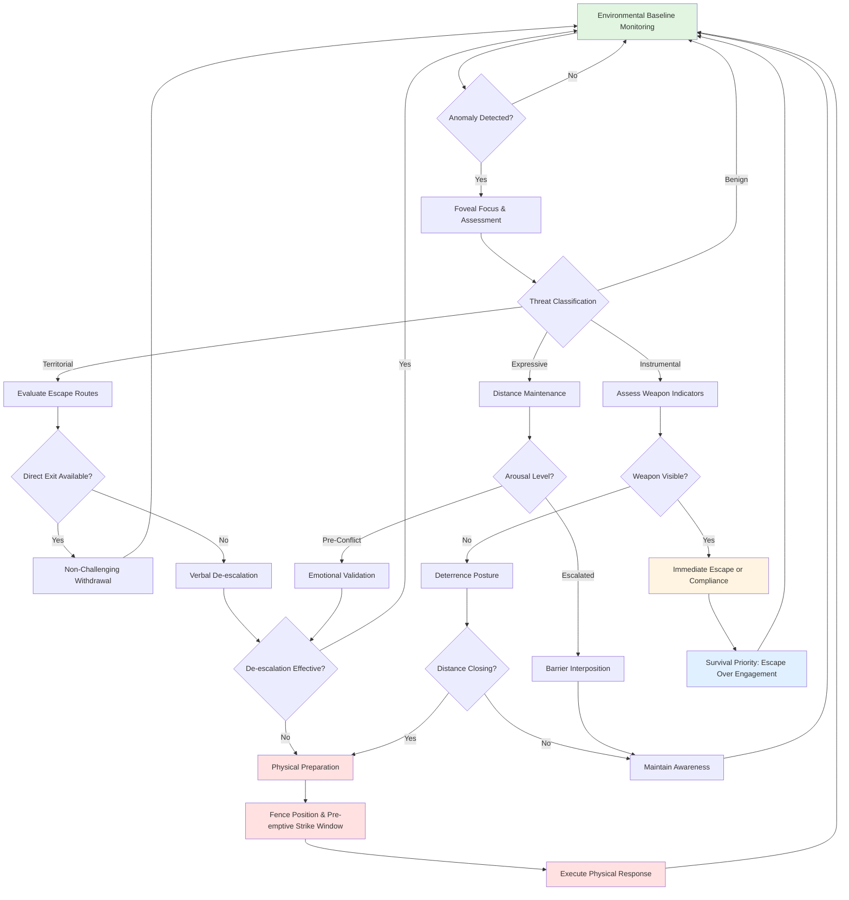

# Lesson 1: Threat Assessment, Situational Awareness, Pre-Conflict Indicators

## 1. First-Principles Intuition & Invariants

Violence unfolds along predictable physiological and behavioral trajectories, yet the untrained observer often perceives aggression as instantaneous and unpredictable. This perception stems from a fundamental misunderstanding of how threat emerges within human social systems. Self-defense begins not with striking mechanics or grappling transitions but with the recognition that conflict materializes through observable pre-incident indicators distributed across spatial, temporal, and behavioral dimensions. The practitioner who masters threat assessment operates within a cognitive framework that treats the environment as a continuous information stream, parsing sensory inputs against baseline normalcy to detect anomalies that signal escalating risk.

At the neurological level, threat perception activates the amygdala-driven fear response, triggering autonomic nervous system arousal that manifests as tachycardia, peripheral vasoconstriction, pupillary dilation, and cortisol release. This ancient survival mechanism evolved to prioritize speed over accuracy, generating false positives that favor survival in wilderness environments where hesitation invites predation. Modern urban threat landscapes, however, demand calibrated discrimination between genuine danger and benign social friction. The cognitive biases embedded within our limbic architecture—availability heuristic, confirmation bias, and in-group favoritism—distort threat perception, causing practitioners to overweight salient recent events, selectively attend to information confirming preexisting fears, and misclassify unfamiliar cultural behaviors as hostile intent. Effective situational awareness requires metacognitive oversight of these automatic processes, deliberately interrogating emotional reactions against objective environmental data.

The operational invariants governing threat assessment derive from proxemics, the spatial anthropology of interpersonal distance. Edward Hall's seminal research established four concentric zones radiating outward from the body: intimate space extending to forty-five centimeters, personal space spanning forty-five to one hundred twenty centimeters, social space occupying one-point-two to three-point-six meters, and public space beyond three-point-six meters. Unauthorized intimate space violation triggers immediate physiological alarm, yet cultural variance modulates these boundaries significantly. Mediterranean and Latin American populations maintain closer conversational distances than Northern European or East Asian cohorts, creating cross-cultural misinterpretation where normative proximity registers as aggression. The practitioner must calibrate proxemic baselines to local context, identifying boundary violations relative to observed norms rather than personal comfort thresholds.

Behavioral baseline establishment constitutes the foundational discipline preceding threat detection. Human environments exhibit statistical regularities: pedestrians maintain rightward flow bias in vehicular societies, queue formation follows ordinal sequencing, and gaze patterns distribute across navigation targets and social attention nodes. Anomalies emerge as deviations from these patterns—individuals moving counter to crowd flow, loitering without apparent purpose, conducting surveillance through repeated scanning cycles, or displaying grooming behaviors such as repeated waistband adjustment suggesting concealed weapon carry. The cognitive load required to maintain deceptive behavior generates observable stress leakage: asymmetric facial expressions confined to one hemisphere, elevated blink rate, hand-to-face adaptor gestures, and postural rigidity. These micro-indicators operate below conscious awareness in untrained observers but become reliably detectable through deliberate attentional allocation.

Threat escalation follows a predictable progression through distinct phases: pre-conflict positioning, verbal challenge, adrenal arousal manifestation, and physical engagement. Each phase offers intervention opportunities, with de-escalation efficacy declining exponentially as autonomic arousal intensifies. During pre-conflict positioning, potential aggressors establish tactical advantage through distance closure, angle optimization to attack blindspots, and environmental obstruction elimination. Verbal challenges initially serve face-saving functions within social hierarchies, creating audience-witnessed confrontation where backing down incurs reputational cost. As sympathetic nervous system activation intensifies, the aggressor exhibits stereotyped physiological signs: neck vein distension, facial flushing, nostril flaring, jaw clenching, and transitional movements such as weight shifting to the rear foot preceding forward explosive action. These signs represent involuntary autonomic responses beyond conscious suppression, providing high-fidelity indicators of imminent violence.

The de-escalation window persists longest during verbal challenge phases when cortical executive function retains partial governance over limbic impulses. Effective verbal de-escalation applies specific linguistic strategies: acknowledging the aggressor's emotional state without conceding factual validity, offering face-saving exit opportunities through third-party attribution of misunderstanding, maintaining paralinguistic calmness through controlled vocal tone and reduced speech rate, and avoiding dominance challenges through non-reciprocal eye contact and open-palm non-threatening gestures. Once physiological arousal crosses critical thresholds—observable through pupillary dilation exceeding five millimeters, gross motor tremor in extremities, and target glancing behavior alternating between intended strike zones and defender's eyes—verbal intervention loses effectiveness and physical preparation becomes imperative.

## 2. Core Architecture & Mechanics

The situational awareness architecture operates as a continuous perception-orientation-decision-action cycle, formalized by Air Force Colonel John Boyd as the OODA loop. This iterative framework models competitive decision-making environments where advantage accrues to actors completing observation, orientation, decision, and action cycles faster than adversaries. In self-defense contexts, the practitioner who accurately perceives environmental changes, correctly interprets threat significance, decisively selects response strategies, and executes physical or evasive actions before an aggressor completes equivalent cycles maintains initiative and dictates engagement parameters.

Observation mechanisms extend beyond passive visual scanning to encompass systematic environmental parsing across multiple sensory channels. Visual attention operates through foveal high-resolution focus spanning approximately two degrees of arc and peripheral motion-detection systems monitoring ambient changes across one hundred sixty degrees of horizontal field. Effective observation employs alternating focus patterns: transitional scanning across potential concealment positions, momentary foveal fixation on identified anomalies for detailed assessment, and continuous peripheral monitoring of approach vectors. Auditory information provides three-hundred-sixty-degree awareness unavailable to vision, detecting approach from blind angles, identifying verbal aggression signatures, and parsing tonal affect for emotional arousal. Olfactory and tactile channels contribute supplementary data—the acrid scent of adrenaline-mediated sweat, the pressure wave of rapid approach, the distinctive tactile signature of hand contact preceding grappling attempts.

Orientation, the most cognitively demanding loop phase, integrates raw sensory data against internal mental models of environmental normalcy, social dynamics, and threat typologies. This process depends critically on pre-existing knowledge structures: the mental library of behavioral patterns associated with intoxication, stimulant drug effects, mental health crisis, predatory targeting, and dominance-hierarchy enforcement. Orientation errors propagate through subsequent decision and action phases, generating inappropriate responses that escalate rather than mitigate conflict. The practitioner must distinguish between territorial aggression from resident populations defending perceived intrusion, instrumental aggression pursuing resource acquisition through intimidation or robbery, and expressive aggression discharging emotional distress without specific instrumental goal. Each threat category demands distinct response strategies—territorial aggression resolves through non-challenging withdrawal, instrumental aggression requires credible deterrence or immediate escape, and expressive aggression benefits from emotional validation and distance maintenance.

Decision-making under acute stress operates within constrained cognitive parameters as cortisol elevation impairs hippocampal memory retrieval and prefrontal executive function. The practitioner cannot reliably execute novel complex responses during adrenal arousal, necessitating pre-programmed decision trees accessible through automated pattern recognition. These decision matrices branch from initial threat classification: Is escape immediately available without turning away from threat? Does the aggressor display weapon indicators? Are bystanders present who might intervene or become collateral casualties? Is the environment confined or open? Each branch point narrows response options until arriving at a terminal action node—verbal de-escalation, evasive withdrawal, environmental barrier interposition, or physical countermeasure engagement.

The fence position represents the terminal pre-conflict posture, establishing defensive readiness while maintaining plausible non-aggression for legal and tactical advantage. This stance positions the hands in a barrier configuration between the defender and aggressor—typically at chest height with palms forward in an open, non-threatening display—while adopting a bladed stance that minimizes frontal target area and facilitates explosive rearward or lateral movement. The fence serves multiple functions: it establishes a tactile tripwire detecting touch-based attack initiation, provides a launching platform for pre-emptive strikes when threat imminence becomes certain, and creates psychological ambiguity preventing the aggressor from definitively classifying the defender as either submissive or combative.

Pre-emptive striking doctrine recognizes that legal self-defense does not require absorbing the first blow when threat imminence satisfies reasonable person standards. The convergence of multiple indicators—unauthorized intimate space violation, postural preparation through weight transfer, target glancing behavior, and verbal threats establishing intent—constitutes articulable justification for defensive action before physical contact. The temporal advantage of pre-emption proves decisive: the defender initiating from fence position delivers strikes approximately two hundred to three hundred milliseconds faster than an aggressor completing attack preparation, disrupting the opponent's motor program and seizing psychological initiative.

Environmental exploitation amplifies defensive advantage through tactical positioning relative to terrain features. The practitioner cultivates automatic awareness of exit routes, barrier positions, improvised weapons, and witness populations. Positioning strategies prioritize maintaining walls or solid obstacles to the rear or flanks, eliminating approach vectors and preventing encirclement by multiple aggressors. Interior environments offer doorway choke points restricting simultaneous multi-aggressor assault, while exterior settings provide escape depth and emergency service accessibility. The defensive principle of environmental dominance mandates claiming superior positions—higher elevation providing gravitational striking advantage, illuminated zones allowing visual clarity while backlighting aggressors, and socially populated areas increasing intervention likelihood and creating legal witness pools.

## 3. High-Performance Optimization & Failure Modes

Situational awareness cultivation requires deliberate practice protocols that override the default cognitive mode of environmental disengagement during routine activities. The mental discipline of continuous baseline monitoring drains cognitive resources, creating practitioner fatigue and attention decay during extended exposure. Combat systems instructor Geoff Thompson documented this phenomenon through his career as a nightclub security professional, noting that even trained personnel experience situational awareness degradation after approximately two hours of sustained vigilance. The optimization strategy involves structured attention cycling: alternating between active scanning phases lasting three to five minutes and brief cognitive rest intervals where awareness persists in peripheral mode while executive attention focuses on non-threat tasks. This pulsed protocol maintains average vigilance levels significantly higher than continuous low-grade attention while preventing mental exhaustion.

Color-coded awareness states, popularized by firearms instructor Jeff Cooper, provide operational frameworks for calibrating attention intensity to environmental risk. Condition White represents complete environmental disengagement with attention absorbed in internal thought or device interaction. Condition Yellow constitutes relaxed awareness where the practitioner continuously scans the environment for anomalies while conducting normal activities. Condition Orange denotes focused attention on a specific identified potential threat with preparation for defensive action. Condition Red represents decision commitment to defensive engagement with autonomic arousal priming physical execution. The practitioner should never operate in Condition White outside secure private spaces, maintaining baseline Condition Yellow during all public exposure and smoothly transitioning through Orange to Red as threat indicators accumulate.

Cognitive bias mitigation requires systematic interrogation of automatic threat assessments through conscious override protocols. When the amygdala signals danger, the practitioner must deliberately query the evidence basis: What specific behaviors triggered alarm? Do these behaviors deviate from local baseline norms or reflect unfamiliar but benign cultural patterns? Am I weighting recent news events or personal traumatic history above current objective indicators? This metacognitive discipline prevents both false positive overreaction that generates unnecessary conflict and false negative normalization that dismisses genuine threat through rationalization or denial.

The normalcy bias represents perhaps the most dangerous cognitive failure mode, manifesting as threat minimization despite accumulating evidence of danger. Victims of violent crime frequently report post-incident recognition that they perceived multiple warning signs but rationalized them away through optimistic reinterpretation. This bias stems from the psychological discomfort of accepting that one's environment has become dangerous, coupled with the social conditioning against appearing paranoid or prejudiced. Women particularly face social pressure against trusting intuitive threat perception when doing so requires rejecting male attention or violating politeness norms. The antidote requires explicit permission structures: granting oneself unconditional authority to act on discomfort without requiring articulable logical justification, recognizing that limbic threat detection operates through pattern-matching algorithms inaccessible to conscious introspection.

Threat fixation constitutes another critical failure mode where the practitioner focuses entirely on an identified threat while losing peripheral awareness, enabling ambush by secondary aggressors or environmental hazards. Multiple-aggressor scenarios frequently employ distraction tactics where one individual engages verbal confrontation while accomplices maneuver to flanking or rear positions. The corrective protocol involves forcing periodic glances away from the primary threat to scan three hundred sixty degrees, accepting momentary primary target information loss to prevent complete blindspot exploitation. In documented street robberies, approximately thirty percent involve multiple perpetrators with at least one member positioned outside the victim's initial awareness field.

De-escalation attempts can paradoxically accelerate violence when misapplied to predatory aggressor types. Instrumental aggressors conducting planned robberies or assaults interpret de-escalation efforts as submission signals confirming target vulnerability, emboldening rather than deterring attack. The verbal de-escalation window applies primarily to territorial and expressive aggression where emotional arousal drives behavior and face-saving exits remain acceptable. Predatory aggressors who have selected targets through deliberate surveillance and approach with premeditated criminal intent require deterrence displays demonstrating unacceptable cost-benefit ratios or immediate escape rather than verbal negotiation. Failure to distinguish these aggressor categories results in wasted time during critical pre-conflict seconds and potential telegraphing of defensive capabilities through verbal engagement.

Environmental complacency in familiar spaces represents an insidious failure mode where routine exposure breeds false security. Statistically, violent crime concentrates in transitional zones between different neighborhood socioeconomic strata and along transportation corridors, yet practitioners often relax vigilance in their residential areas despite these risk factors. The optimization strategy involves maintaining consistent Condition Yellow awareness regardless of location familiarity, recognizing that aggressors specifically exploit victim complacency in presumed safe zones. Parking structures, building entrance vestibules, and elevator lobbies constitute high-risk transition points where attackers achieve positional advantage and victim isolation.

## 4. Summary & Verification Matrix

| Governing Invariant | Operational Mechanism | Diagnostic Criteria | Failure Mode & Mitigation |
|---|---|---|---|
| **Proxemic Boundary Violation** | Unauthorized penetration of personal space (45–120 cm) signals threat escalation through elimination of reaction distance. Cultural baselines modulate absolute distance metrics but relative closure rate remains universally threatening. | Observe approach velocity, angle of approach (direct frontal maximizes threat), accompanying verbal engagement, and postural preparation through weight transfer or hand positioning. Rapid closure exceeding normal conversational pace indicates predatory intent. | **Failure:** Cultural misinterpretation treating normative close-talking distance as aggression. **Mitigation:** Calibrate to local proxemic norms through baseline observation; respond to closure rate and accompaniment by other threat indicators rather than absolute distance alone. |
| **Behavioral Baseline Deviation** | Environmental normalcy establishes statistical patterns (movement flow, gaze distribution, postural configurations). Anomalies signal either innocent distraction or deliberate predatory behavior requiring discrimination through pattern completion observation. | Target glancing between intended victim and environment suggests attack planning. Counter-flow movement or loitering without apparent purpose indicates potential surveillance. Grooming behaviors (waistband adjustment, jacket repositioning) suggest weapon carry or concealment. | **Failure:** Confirmation bias causing selective attention to individuals matching threat stereotypes while ignoring genuine threats from unexpected demographics. **Mitigation:** Force discipline of assessing all individuals against behavioral baselines regardless of age, gender, or appearance; focus on actions rather than attributes. |
| **Autonomic Arousal Cascades** | Sympathetic nervous system activation produces involuntary physiological signs: pupillary dilation beyond 5mm, facial flushing, neck vein distension, nostril flaring, jaw clenching, gross motor tremor. These signs indicate imminent violence with 85–90% predictive validity when clustered. | Observe pupil size in ambient lighting, neck and facial blood flow, respiratory rate elevation (visible chest rise acceleration), weight shifts to rear foot preceding forward drive, and target glancing alternating between strike zones and eyes. | **Failure:** Normalcy bias rationalizing obvious arousal signs as nervousness or intoxication rather than attack preparation. **Mitigation:** Establish pre-commitment rule that three or more clustered autonomic signs mandate immediate defensive posturing regardless of alternate explanations; accept false positive cost as negligible compared to assault risk. |
| **OODA Loop Velocity** | Competitive advantage accrues to the actor completing observation-orientation-decision-action cycles faster than adversaries. Pre-programmed decision trees and rehearsed physical responses reduce orientation and decision time, enabling action before opponent completes equivalent cycles. | Measure cognitive decision latency through scenario training: time from threat stimulus presentation to physical defensive response initiation. Target threshold below 500ms for gross motor responses, 700ms for complex decision branches. Measure through force-on-force drills with timing apparatus. | **Failure:** Analysis paralysis during decision phase seeking perfect information despite time criticality; novel response attempts exceeding trained motor program inventory. **Mitigation:** Limit decision tree complexity to 3–4 branch points maximum; drill decision trees under adrenal stress induction (high-intensity interval training immediately preceding scenarios); accept good-enough responses over optimal delayed responses. |
| **Pre-emptive Strike Window** | Legal and tactical doctrine permits defensive strikes before physical contact when reasonable person standard confirms imminent threat through convergence of proxemic violation, verbal threats, postural preparation, and autonomic arousal. Temporal advantage of 200–300ms initiative proves tactically decisive. | Legal articulation requires multi-factor justification: "Subject closed to intimate distance despite verbal boundaries, clenched fists while stating intent to strike, transferred weight to rear foot, displayed dilated pupils and facial flushing indicating autonomic arousal—totality created reasonable belief of imminent harm." | **Failure:** Hesitation awaiting certainty results in defensive reaction mode after opponent initiates attack, ceding temporal and psychological advantage. **Mitigation:** Establish clear pre-conflict triggers authorizing immediate action (intimate space violation plus verbal threat plus postural preparation); drill fence-to-strike transitions until response latency below 400ms; accept legal defense burden over physical injury risk. |
| **Environmental Exploitation** | Tactical positioning relative to barriers, exits, witnesses, and improvised weapons multiplies defensive effectiveness. Walls eliminate rear approach vectors; doorways restrict multi-aggressor simultaneity; witnesses create legal evidence and social intervention pressure. | Conduct automatic environmental scan upon entering any space: identify all exits within 3-second sprint distance, locate solid barriers for tactical retreat positioning, assess crowd density and composition for intervention likelihood, identify improvised impact weapons (chairs, bottles, fire extinguishers). | **Failure:** Tunnel vision on social objectives (locating friends, ordering drinks, finding seats) suppresses tactical environmental assessment. **Mitigation:** Implement mandatory 5-second scan protocol immediately upon space entry before engaging social tasks; position socially to maintain visual access to primary entrance and exit routes; periodically rescan environment every 3–5 minutes for changes in crowd composition or suspicious individuals. |
