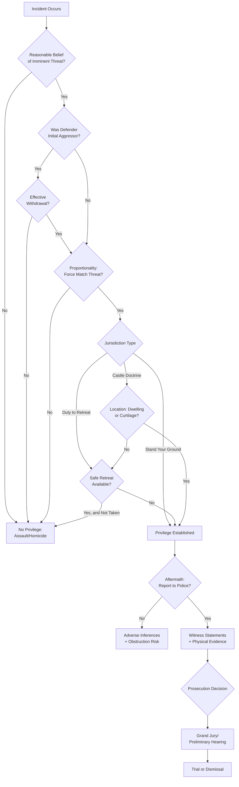

# Lesson 2: Legal Boundaries, Proportionality, Duty to Retreat

## 1. First-Principles Intuition & Invariants

Self-defense law emerges from the fundamental tension between an individual's right to bodily integrity and the state's monopoly on legitimate violence. Every modern legal system recognizes that when the state's protective apparatus cannot arrive in time to prevent imminent harm, the law grants private citizens a narrow, conditional privilege to use force. This privilege, however, is not absolute. It exists within a structured framework of constraints designed to prevent vigilantism, minimize casualties, and preserve the state's authority over lethal force decisions. The legal architecture governing self-defense hinges on three invariant principles that remain stable across virtually all jurisdictions, even as their specific implementations vary dramatically.

The first invariant is the doctrine of **reasonable belief in imminent threat**. The law does not require that danger be objectively real; it requires only that a reasonable person in the defender's position would perceive immediate, unlawful harm about to occur. This standard incorporates both a subjective element (what the defender actually believed) and an objective element (whether that belief was reasonable given the circumstances known at the time). Imminence is critical: pre-emptive strikes against future threats, no matter how certain, remain outside the privilege. The temporal window must be measured in seconds, not hours or days. A threat telegraphed for next week cannot justify present violence. This imminence requirement prevents self-defense claims from becoming licenses for private prosecution of suspected criminals or settling of old scores.

The second invariant is **proportionality of response**, often articulated as the reasonable force doctrine. The law calibrates permissible defensive force to match the nature and severity of the threat. Non-lethal threats generally authorize only non-lethal responses. Lethal force becomes privileged only when the defender reasonably believes they face death or grievous bodily harm—injury so severe it creates substantial risk of death, permanent disfigurement, or loss of bodily function. Jurisdictions define grievous harm differently, but rape and kidnapping typically meet the threshold, along with direct threats to life or grievous bodily harm; arson justifies lethal force only if it creates imminent risk of death. The proportionality calculus does not demand perfect calibration under pressure; it demands only that the level of force not be grossly disproportionate to the threat faced. A punch may justify a punch in return, but not a gunshot, unless that punch is delivered by someone whose size, strength, or numbers create a lethal disparity of force.

The third invariant addresses **duty to retreat versus stand-your-ground principles**. At common law, the duty to retreat required individuals to exhaust all safe avenues of escape before employing lethal force, except within their own homes. This duty reflected the law's preference for preserving life, even the life of an aggressor, when retreat could avoid bloodshed without additional risk. Modern American jurisdictions have fractured on this point. Roughly half retain some duty to retreat in public spaces, while the other half have enacted stand-your-ground statutes that eliminate the retreat obligation, allowing individuals to meet force with force wherever they have a legal right to be. The castle doctrine, nearly universal across jurisdictions, eliminates any duty to retreat from one's dwelling, curtilage, or sometimes vehicle, reflecting the ancient principle that one's home is their ultimate sanctuary. The policy tensions are sharp: duty-to-retreat advocates argue it reduces needless deaths and prevents trivial disputes from escalating to gunfire, while stand-your-ground proponents contend that forcing victims to flee emboldens criminals and places unreasonable cognitive burdens on people under acute stress.

Beyond these core invariants, self-defense law imposes several procedural and evidentiary structures. The defendant typically bears the burden of producing evidence that the elements of self-defense are met—reasonable belief, imminence, proportionality, and compliance with any retreat duty—but once raised, the prosecution must disprove at least one element beyond reasonable doubt. This burden allocation varies by jurisdiction; some states require the defendant to prove self-defense by a preponderance of evidence, effectively shifting a greater share of the risk of uncertainty onto the accused. The initial aggressor doctrine strips self-defense privilege from individuals who provoke confrontation with the intent to create a pretext for violence, though most jurisdictions allow aggressors to regain the privilege if they clearly withdraw and communicate that withdrawal before the counterattack. Imperfect self-defense, recognized in some jurisdictions, acknowledges genuine but unreasonable fear, reducing murder charges to manslaughter rather than granting full exoneration.

Jurisdictional variance creates treacherous operational complexity. Texas law, for instance, extends castle doctrine protections to vehicles and permits lethal force to prevent theft or criminal mischief at night, a scope nearly unthinkable in New York or New Jersey, where retreat duties persist and the use of deadly force to protect property alone remains unlawful. California requires that the threat be unlawful and that the defender not be engaged in illegal activity at the time of the incident. Florida's stand-your-ground statute presumes reasonableness of fear when the defender is attacked in a place they have a right to be, effectively shifting evidentiary burdens. These differences are not academic; they govern whether a defender goes home to their family or to prison for decades. Cross-border travel, especially while armed, demands rigorous legal due diligence. Interstate reciprocity for concealed carry permits does not confer reciprocity for self-defense legal standards.

## 2. Core Architecture & Mechanics

The legal machinery of self-defense operates as a multi-stage gating system, where each stage represents a decision node that must resolve in the defender's favor for the privilege to apply. The architecture resembles a series of boolean checks with complex branching logic, where failure at any gate strips legal protection and exposes the defender to criminal liability ranging from assault to murder. Understanding this decision flow is essential for both prospective defenders and post-incident legal teams reconstructing events.

The initial gate evaluates whether the defender held a **reasonable belief that unlawful force was being used or imminently threatened against them**. This assessment is contextual, incorporating the totality of circumstances visible to the defender at the moment of decision. Courts examine environmental factors including lighting, physical positioning, prior interactions, and verbal threats. The reasonable person standard is not entirely abstract; it may incorporate characteristics of the defender such as prior victimization experience, specialized training, or physical disability that would alter perception of threat. However, idiosyncratic fears or paranoia do not lower the bar. If the defender's belief fails the reasonableness test—because the perceived aggressor was actually reaching for their phone rather than a weapon, or because the threat was conditional or future-oriented rather than imminent—the privilege collapses immediately, and all subsequent force is unlawful.

If the belief passes the reasonableness gate, the system advances to the **proportionality router**, which classifies both the incoming threat and the defensive response into discrete categories. Non-deadly force includes strikes, holds, chemical sprays, batons, and other measures unlikely to cause death or grievous harm. Deadly force encompasses firearms, edged weapons, blunt instruments to the head, and strangulation. The proportionality rule generally requires matching categories: non-deadly threats authorize non-deadly responses, while deadly threats authorize deadly responses. The law recognizes several override conditions where non-deadly threats escalate to authorize deadly responses due to **disparity of force factors**—overwhelming size or strength differentials, multiple attackers, attacks on vulnerable populations such as the elderly or disabled, or entrapment in confined spaces without escape. A 120-pound woman attacked by a 250-pound male aggressor may reasonably employ a firearm against unarmed assault due to the inherent lethality of the disparity. Courts apply this analysis through jury instructions, allowing fact-finders to integrate circumstantial evidence about physical capabilities.

The third gate enforces the **retreat obligation**, when applicable. In duty-to-retreat jurisdictions, the defender must demonstrate that no safe avenue of escape existed before employing lethal force. Safety is the operative constraint: retreat is not required if it would expose the defender to equal or greater risk, if it would require abandoning others under their protection, or if the route is uncertain. The castle doctrine carves out a geographic exception, eliminating any duty to retreat from the defender's dwelling, and in some jurisdictions, curtilage or vehicle. Stand-your-ground laws collapse this gate entirely in public spaces, allowing defenders to hold position. When retreat is required but available, failure to retreat transforms otherwise privileged force into criminal assault or homicide. The defendant must affirmatively demonstrate absence of safe retreat; vague claims of fear or confusion do not suffice.

Following the immediate decision gates, the legal architecture shifts into the **aftermath liability phase**, where evidentiary and procedural mechanisms determine whether the defender faces prosecution. This phase introduces adversarial dynamics and information asymmetries. The defender's immediate actions after the incident—whether they remain on scene, render aid, contact emergency services, and cooperate with investigators—dramatically influence prosecutorial charging decisions and jury perceptions. Departure from the scene, even if legally permissible, often generates adverse inferences suggesting consciousness of guilt. Rendering aid to a downed attacker, while emotionally difficult and tactically risky, demonstrates lack of malice and may support claims of reluctant, proportional force.

The investigative apparatus reconstructs events through physical evidence and witness testimony. Forensic pathology establishes wound trajectories, entrance-and-exit patterns, and distance-of-fire indicators that either corroborate or contradict the defender's account. Bullet trajectories angled downward suggest a prone victim, inconsistent with claims of an advancing threat. Defensive wounds on the attacker's hands and forearms may support the defender's account, while absence of such wounds may undermine it. Witness testimony introduces confirmation bias, memory decay, and partisan alignment. Bystanders often perceive events through frames shaped by their own biases about the participants' demographics, and their accounts may diverge wildly even seconds after the event. The defender's own statements, given under acute stress and often without counsel, frequently contain inconsistencies that prosecutors exploit to undermine credibility. The Fifth Amendment privilege against self-incrimination permits silence, but juries in some jurisdictions may draw adverse inferences from a defendant's refusal to testify.

Affirmative defenses like self-defense trigger distinct procedural rules. In most American jurisdictions, once the defendant produces evidence raising the defense, the prosecution must disprove it beyond reasonable doubt. However, some states impose a preponderance-of-evidence burden on the defendant, requiring they prove self-defense more likely than not. This allocation profoundly affects trial strategy and outcomes. The burden determines which party controls the evidentiary narrative and who bears the risk of factual uncertainty. Stand-your-ground states increasingly provide pretrial immunity hearings where defendants can seek dismissal before trial, shifting the burden of proof to the prosecution at an earlier procedural stage and avoiding the reputational and financial costs of a criminal trial.

## 3. High-Performance Optimization & Failure Modes

Optimizing self-defense legal outcomes requires strategic preparation well before any confrontation occurs. The most effective legal posture emerges from **pre-incident behavioral protocols** that create contemporaneous documentation, establish patterns of lawful conduct, and minimize ambiguity in post-incident reconstruction. Individuals carrying firearms for self-defense should maintain training logs documenting instruction in legal standards, use-of-force decision-making, and de-escalation tactics. These records demonstrate a mindset oriented toward lawful, proportional response rather than reckless aggression. Certification in formal defensive tactics courses by nationally recognized instructors, documented through dated certificates and signed attendance rosters, provides expert-validated evidence of competence and restraint. Regular legal education through seminars hosted by self-defense insurance providers or civil rights organizations ensures defenders remain current on statutory changes and case law developments.

The immediate post-incident response window is the highest-leverage phase for shaping legal outcomes. The defender faces a trilemma: the physiological imperative to escape danger, the moral imperative to render aid, and the legal imperative to report and cooperate with investigation. Best practice reconciles these tensions through a structured protocol. First, ensure the threat has terminated—visual confirmation that the attacker is incapacitated or has fled. Second, move to a position of safety, whether that means creating distance, seeking cover, or securing egress routes. Third, contact emergency services immediately, reporting both the attack and any injuries. The initial 911 call creates a timestamped, recorded account; a calm, factual report that identifies oneself as the victim and requests medical assistance for all injured parties establishes a defensive rather than aggressive posture. Avoid detailed narrative; provide only location, nature of injuries, and any ongoing danger. State that you were attacked and defended yourself, then request counsel before further questioning.

The defender's interaction with responding officers determines the trajectory of the investigation. The immediate post-incident period is characterized by acute stress response—elevated cortisol, adrenaline, and norepinephrine that impair memory encoding, distort time perception, and narrow attentional focus. Statements given in this state are notoriously unreliable and often contain contradictions that prosecutors later exploit. A principled approach balances cooperation with self-protection: identify yourself, state that you are the victim of an attack, point out evidence and witnesses, but decline detailed interrogation until legal counsel is present. Invocation of the Fifth Amendment right to counsel and silence cannot be used against the defendant at trial (except in limited circumstances regarding pre-arrest silence in stand-your-ground jurisdictions), and it prevents the creation of inconsistent statements. However, absolute silence may appear evasive to juries, so a brief, scripted statement—"I was attacked, I defended myself, I will cooperate fully after consulting my attorney"—strikes a defensible balance.

Witness management presents complex dynamics. Bystanders often provide the most credible testimony because they lack direct stake in the outcome, but their accounts are filtered through cognitive biases and social pressures. The defender cannot control witness perceptions, but they can document the scene through smartphone photography before evidence is disturbed, capturing positions, lighting, and environmental factors. If lawful and safe, recording witness statements through voice memo applications creates contemporaneous accounts before memory decay or social influence distorts recollection. These recordings are typically admissible as prior consistent statements if witnesses later change their stories. However, attempting to coach or intimidate witnesses constitutes obstruction of justice, a separate felony that undermines any self-defense claim.

Insurance mechanisms specifically tailored to self-defense incidents have proliferated in recent years, offering both legal cost coverage and immediate attorney access. Policies from providers such as CCW Safe, Armed Citizens Legal Defense Network, and U.S. Law Shield typically cover criminal defense costs, expert witness fees, and civil liability judgments within specified limits. These services provide 24-hour attorney hotlines, enabling immediate legal consultation after an incident before police interrogation begins. The value proposition is substantial; criminal defense in a homicide case routinely exceeds $100,000, and civil wrongful death suits can reach seven or eight figures. Pre-event enrollment in such a plan ensures that financial constraints do not force acceptance of an inadequate defense or a coerced plea bargain. However, coverage terms vary significantly, with some policies excluding incidents involving illegal conduct, duty-to-retreat violations, or altercations the insured initiated.

Failure modes in self-defense legal outcomes cluster around several recurrent patterns. The most common is **proportionality mismatch**, where defenders escalate force beyond what the threat justifies. Shooting a fleeing attacker in the back transforms defense into homicide because the threat of imminent harm ceases once the attacker withdraws. Continuing to strike an incapacitated attacker crosses the line from privileged defense to criminal assault, even if the initial force was justified. Anger or fear that persists after the threat ends does not extend the privilege. A second major failure mode is **contaminated statements**, where defenders provide detailed narratives under stress that later conflict with physical evidence or evolve over time. Prosecutors present these inconsistencies as evidence of fabrication, arguing that truthful accounts remain stable. The cognitive reality is that traumatic memory is fragmentary and reconstructive, but jurors often lack this understanding. The third failure mode arises from **initial aggressor status**, where defenders provoke confrontation, use force, and then claim self-defense when the other party responds. Even minor provocations—hostile words, aggressive postures, or brandishing a weapon—can strip the privilege unless the defender clearly and unambiguously withdraws.

Civil liability constitutes a parallel failure mode that persists even when criminal charges are dropped or result in acquittal. The criminal burden of proof—beyond reasonable doubt—exceeds the civil burden—preponderance of the evidence—meaning a defender acquitted of murder may still face civil judgment for wrongful death. Plaintiff attorneys in civil cases exploit lower evidentiary standards, use the defendant's prior statements against them, and present self-defense as excessive or reckless. Judgments in wrongful death cases can reach millions of dollars, and most homeowner's insurance policies exclude intentional acts, leaving defenders personally liable. Asset protection strategies, including irrevocable trusts and liability insurance, should be implemented before any incident occurs.

## 4. Summary & Verification Matrix

| **Legal Invariant** | **Governing Mechanism** | **Diagnostic Criterion** | **Failure Mode** |
|---------------------|-------------------------|--------------------------|------------------|
| **Reasonable Belief in Imminent Threat** | Objective-subjective hybrid standard requiring that a reasonable person in the defender's position, knowing what they knew at the moment of decision, would perceive unlawful force about to be used imminently (seconds, not minutes or hours) | Totality of circumstances test incorporating attacker's actions, verbal threats, physical positioning, environmental factors, and defender characteristics (training, prior victimization, physical capability); imminence measured by temporal proximity, not severity | Belief fails reasonableness test due to misperceived threat (phone mistaken for gun), conditional or future threat ("I'll get you tomorrow"), or defender-initiated provocation; all subsequent force becomes criminal assault or homicide |
| **Proportionality of Force** | Lethal force authorized only against threats of death or grievous bodily harm (permanent injury, disfigurement, loss of bodily function, rape, kidnapping); non-lethal force authorized against non-lethal threats, with disparity-of-force exceptions for size, strength, numbers, or confinement | Match between force category employed and threat category faced; disparity factors evaluated through jury instructions considering physical differentials, multiple attackers, vulnerable victim status, or entrapment; expert testimony on use-of-force standards often admitted | Grossly disproportionate response (shooting unarmed shoplifter, firing into fleeing vehicle); continued force after threat ceases (beating unconscious attacker); anger-driven escalation beyond neutralization of threat; transforms privileged defense into criminal homicide or assault |
| **Duty to Retreat vs. Stand-Your-Ground** | Duty-to-retreat jurisdictions require exhaustion of safe escape routes before employing lethal force; castle doctrine eliminates retreat duty within dwelling/curtilage; stand-your-ground eliminates retreat duty anywhere defender has legal right to be | Safe retreat defined as avenue imposing no additional risk, not requiring abandonment of others under protection, and presenting clear egress; defendant bears burden of demonstrating no safe retreat existed; geographic location determines applicable rule (home, vehicle, public) | Failure to retreat when safe avenue available in duty-to-retreat jurisdiction; leaving castle doctrine protection zone (e.g., pursuing attacker outside home); claiming stand-your-ground in jurisdiction requiring retreat; all void the privilege and convert force to criminal act |
| **Initial Aggressor Doctrine** | Self-defense privilege unavailable to party who provoked confrontation with intent to create pretext for violence; privilege may be regained if aggressor clearly withdraws and communicates withdrawal before counterattack | Analysis of who initiated physical contact, who escalated from words to violence, and whether provocation was designed to justify responsive force; withdrawal must be unambiguous and communicated through words or actions | Provoking fight through insults, aggressive posture, or brandishing, then claiming defense when other party responds; failing to clearly withdraw after initiating; using self-defense as pretext for settling scores; strips privilege and exposes to full criminal liability |
| **Burden of Proof and Evidentiary Standards** | Once defendant raises self-defense with evidence, prosecution typically must disprove beyond reasonable doubt; some jurisdictions require defendant prove by preponderance; stand-your-ground pretrial immunity shifts burden earlier | Procedural posture determines burden allocation; defendant must produce evidence meeting initial threshold; prosecution must then disprove at least one element; forensic reconstruction through ballistics, wound patterns, witness statements, and defendant account | Inconsistent statements create credibility issues; physical evidence contradicting defender's account (downward bullet trajectory suggesting prone victim); witness testimony undermining claim; failure to meet burden results in conviction despite partial self-defense evidence |
| **Aftermath Liability: Criminal and Civil** | Criminal prosecution based on beyond-reasonable-doubt standard; civil wrongful death claims based on preponderance-of-evidence standard; acquittal in criminal trial does not bar civil liability; both require reconstruction through statements, forensics, and witness accounts | Post-incident conduct evaluated for consciousness of guilt (flight, concealment, false statements); aid rendered to attacker demonstrates reluctant force; immediate 911 call establishes defensive posture; cooperation with investigation influences charging decisions | Fleeing scene creates adverse inference; contaminated statements from stress-impaired memory exploited as fabrication; civil judgment despite criminal acquittal due to lower burden; asset exposure from intentional-act exclusion in homeowner's insurance; financial devastation |
