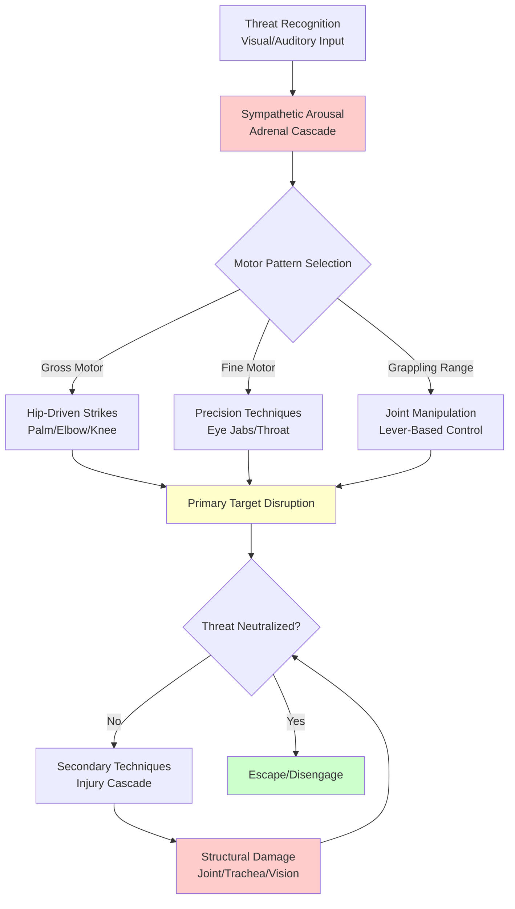

# Lesson 3: Human Biomechanics, Vulnerable Anatomical Targets, Kinetic Efficiency

## 1. First-Principles Intuition & Invariants

Self-defense is fundamentally an applied biomechanics problem constrained by the physics of levers, the neuromuscular limitations of stress physiology, and the structural vulnerabilities inherent to human anatomy. Unlike sport martial arts, which operate within rulesets that prohibit strikes to fragile targets and reward technical complexity, defensive encounters demand radical economy of motion and exploitation of anatomical weak points that bypass muscular strength differentials. The governing invariant is that defensive success does not require superior athletic ability or years of intricate kata practice; it requires understanding which anatomical structures fail under minimal force application and how to generate that force through gross motor patterns that survive sympathetic nervous system arousal.

When the human body enters acute threat response—the colloquial "fight or flight" state mediated by adrenal catecholamine release—several predictable physiological constraints emerge. Fine motor control deteriorates as blood shunts from extremities to core muscle groups. Visual field narrows through vasoconstriction of peripheral retinal vessels. Auditory exclusion occurs as the brainstem filters non-critical sensory input. Heart rate climbs above 145 beats per minute, at which point complex motor sequences requiring proprioceptive feedback become unreliable. These are not psychological failures or training deficits; they are hardwired survival adaptations that prioritize explosive power generation and cardiovascular oxygen delivery over dexterity. Defensive technique must therefore be designed around large muscle recruitment, minimal decision trees, and targets that produce immediate functional disruption rather than cumulative point scoring.

The human skeletal system presents a hierarchy of vulnerability determined by joint anatomy, nerve plexus density, and the distance between surface tissue and critical structures. Ball-and-socket joints like the shoulder provide mobility at the cost of inherent instability; their capsular ligaments resist compression well but tear under rotational torque or levering forces that separate the humeral head from the glenoid fossa. Hinge joints such as the elbow and knee are constrained to single-plane motion, making them catastrophically vulnerable to perpendicular force application. Hyperextension past the anatomical zero point stretches collateral ligaments beyond their elastic limit, producing immediate structural failure and loss of load-bearing capacity. The spine, while protected by thick paraspinal musculature posteriorly, presents anterior cervical vulnerability where the trachea, carotid arteries, and vagus nerve lie beneath only skin and thin platysma muscle. A trained defender does not strike randomly or rely on conditioning-dependent power; they apply precise force vectors to these predetermined failure points.

Leverage mechanics govern all physical confrontations. Force multiplication through lever arm extension allows a smaller individual to generate joint-destroying torque that exceeds an opponent's muscular strength capacity. When applying an armbar, the defender's entire body mass acts through the long lever of the opponent's extended arm, rotating around the fulcrum of the elbow joint. The opponent's bicep and brachialis muscles, attempting to resist hyperextension, are mechanically disadvantaged because they insert close to the elbow's axis of rotation. The defender's force arm is three to four times longer, creating a mechanical advantage that renders raw strength comparison irrelevant. This is not metaphorical leverage; it is Newtonian physics expressed through anatomical geometry.

Pain compliance techniques, which depend on activating nociceptors through pressure or joint strain, are fundamentally unreliable in defensive contexts. Pain tolerance varies dramatically between individuals and is further suppressed during high sympathetic arousal when endogenous opioid peptides flood the central nervous system. An intoxicated, psychotic, or sufficiently enraged attacker may not register pain signals that would incapacitate a cooperative training partner. Structural damage techniques bypass this variability by creating mechanical failure independent of pain perception. A hyperextended elbow cannot bear load regardless of whether the recipient feels pain. A collapsed trachea cannot pass air regardless of consciousness state. Defensive training must therefore distinguish between techniques that request compliance through discomfort and techniques that impose compliance through biomechanical destruction.

The principle of kinetic efficiency states that effective defense minimizes energy expenditure per unit of defensive effect. Gross motor movements—large, simple patterns involving major muscle groups and minimal coordination—are preferentially retained under stress compared to fine motor skills requiring precise hand positioning or complex sequential timing. A palm-heel strike to the chin, driven by hip rotation and tricep extension, is grossly motor; it tolerates imperfect accuracy and recruits the powerful posterior chain. A finger jab to the eye is grossly motor in approach vector but fine motor in terminal accuracy, yet its target is so vulnerable that near-misses still achieve defensive effect through flinch response and visual disruption. Conversely, wrist locks that require specific grip configurations and precise angle manipulation are fine motor techniques that frequently fail under adrenal stress when proprioceptive feedback degrades.

Injury cascades represent the compounding effect of sequential trauma. Striking the common peroneal nerve on the lateral thigh produces temporary lower limb dysfunction, which compromises balance and stance stability, which enables follow-up strikes to the head that would otherwise be defended. Disrupting vision through eye strikes eliminates the opponent's ability to track defensive movement, creating openings for structural attacks to joints or the throat. Each technique in a defensive sequence should either end the encounter immediately or degrade the opponent's capacity to continue, creating exponentially favorable conditions for subsequent action. This is the conceptual inverse of point-fighting sport martial arts, where techniques are discrete scoring events; in defense, techniques are links in a causal chain driving toward total incapacitation.

## 2. Core Architecture & Mechanics

The human body's mechanical architecture can be modeled as a kinetic chain of articulated levers, with force generation originating in the hips and core musculature, transmitted through the trunk, and expressed at distal segments. Maximum power output in strikes occurs when the entire kinetic chain operates synchronously: the gluteus maximus and hip extensors initiate rotation, the oblique abdominals transmit torque through spinal rotation, the pectoralis major and deltoid accelerate the arm, and the tricep extends the elbow at impact. This sequential summation of velocities means that a properly executed strike derives less than thirty percent of its force from arm musculature; the majority comes from hip drive and trunk rotation. Defensive training that emphasizes arm strength or focuses on isolated upper-body striking power fundamentally misunderstands force generation biomechanics.

The diagram illustrates the decision tree from threat perception through sympathetic arousal, technique selection based on range and motor complexity, target engagement, and iterative assessment. The feedback loop from secondary techniques back to threat assessment represents the injury cascade principle: each action either terminates the encounter or degrades opponent capacity, improving conditions for subsequent techniques. The color coding distinguishes physiological state changes (red), decision points (yellow), and successful outcomes (green).

Vulnerable anatomical targets divide into three functional categories: sensory disruption, respiratory compromise, and structural failure. Sensory disruption targets include the eyes, ears, and nose. The eye is mechanically fragile; the cornea is only half a millimeter thick, and even glancing strikes produce reflexive lid closure, lacrimation, and temporary visual impairment. The defender need not blind the opponent permanently—though that remains possible—only interrupt visual tracking long enough to create openings for structural techniques. The ears, specifically the tympanic membrane, rupture under sudden pressure differentials created by cupped-hand strikes. A ruptured eardrum produces immediate vertigo through vestibular disruption, compromising balance and spatial orientation. The nose, while not immediately incapacitating, contains rich nerve plexuses; strikes produce intense lacrimation and pain signals that dominate conscious attention even in highly aroused states.

Respiratory compromise targets center on the trachea and diaphragm. The trachea is a semi-rigid cartilaginous tube supported by incomplete C-shaped rings anteriorly and a membranous wall posteriorly. Anterior strikes compress the trachea against the cervical spine, but the cartilage provides some resistance. However, the trachea is vulnerable to collapsing under gripping pressure or strikes that buckle the cartilage rings inward. Complete tracheal collapse is immediately life-threatening; partial collapse produces respiratory distress, panic, and loss of combative capacity. The diaphragm, a dome-shaped muscle separating thoracic and abdominal cavities, can be temporarily paralyzed through solar plexus strikes. The celiac plexus nerve bundle lies just anterior to the aorta at the T12-L1 level. Strikes to the epigastric region transmit shock through the abdominal contents to this nerve cluster, producing diaphragmatic spasm and temporary inability to inhale. The physiological mechanism involves vagal nerve stimulation and celiac plexus disruption, with diaphragmatic inhibition occurring through autonomic pathways rather than direct phrenic nerve disruption.

Structural failure targets include joints, the spine, and load-bearing bones. The knee, designed for sagittal plane flexion and extension, catastrophically fails under mediolateral force. The medial and lateral collateral ligaments resist valgus and varus stress respectively, but their tensile strength is finite. A forceful kick to the lateral knee while the foot is planted drives the distal femur medially while the tibia remains fixed, stretching the MCL beyond its elastic limit. Grade III ligament tears involve complete rupture, immediate joint instability, and total loss of weight-bearing capacity. The opponent cannot stand, let alone continue aggression. The elbow similarly fails under hyperextension; an armbar applies rotational torque around the elbow's hinge axis while trapping the wrist and shoulder. The bicep and brachialis cannot generate sufficient force at their mechanical disadvantage to resist. The ulnar collateral ligament tears, the joint capsule ruptures, and the elbow hyperextends beyond its anatomical limit of approximately 5 to 10 degrees past neutral.

The cervical spine, while protected posteriorly by musculature, is vulnerable to rotational injury when the head is used as a lever. Neck cranks apply torque by controlling the head and rotating it while the shoulders are immobilized. The atlantoaxial joint (C1-C2) is particularly vulnerable; it accounts for fifty percent of cervical rotation and is stabilized primarily by ligaments rather than bony structure. Excessive rotation stretches the alar ligaments and risks subluxation or fracture of the dens (odontoid process). This is an irreversibly destructive technique appropriate only in life-threatening scenarios; the legal and ethical threshold for techniques causing permanent neurological damage is extreme.

Economy of motion principles dictate that defensive movement should be minimal, direct, and mechanically efficient. Chambering a punch—drawing the fist to the hip before extending—wastes time and telegraphs intent. A straight punch from guard position covers less distance and provides no preparatory cue. Circular strikes like hooks and roundhouse kicks travel longer arcs and require rotational setup; they are appropriate when power generation justifies the time cost, but straight-line attacks dominate in surprise defensive scenarios. Footwork should maintain stable weight distribution and avoid crossing feet, which creates momentary single-leg balance vulnerability. Lateral movement and angular repositioning are preferable to retreating directly backward, which maintains the opponent's forward vector and risks tripping over unseen obstacles.

Grappling range presents unique biomechanical challenges. Once an opponent has closed to clinch distance, striking loses mechanical advantage due to insufficient space for acceleration. Defensive strategy shifts to balance disruption, joint manipulation, and creating space for knee and elbow strikes. Hip throws and foot sweeps exploit the opponent's forward momentum and high center of gravity. The human body is inherently unstable; bipedal stance requires constant neuromuscular correction. Disrupting an opponent's base by attacking their stance leg during weight transfer creates a falling dynamic that requires no strength, only timing. Once the opponent is falling or grounded, positional control becomes paramount. The mount position, with the defender straddling the opponent's torso, provides gravitational advantage and access to strikes while minimizing the opponent's offensive options.

## 3. High-Performance Optimization & Failure Modes

Optimizing defensive capacity under real-world constraints requires training protocols that replicate stress physiology and environmental unpredictability. Traditional martial arts training in controlled dojo environments with cooperative partners produces skill sets that degrade catastrophically under adrenal arousal. The psychological phenomenon of "inoculation" demands exposure to simulated high-stress scenarios: training with protective gear at high intensity, scenario-based drills with non-compliant partners, and environmental variability such as low light, confined spaces, and unstable footing. The objective is not to eliminate stress response but to habituate the nervous system so that gross motor defensive patterns remain accessible despite elevated heart rate and sympathetic dominance.

Repetition alone does not guarantee skill retention under stress; the training context must approximate defensive reality. Drilling a technique one thousand times against a stationary opponent who resets to neutral stance after each repetition creates a motor pattern that depends on predictable setup conditions. When the opponent is moving unpredictably, actively resisting, and does not politely return to ready position, the trained technique often fails to manifest. Progressive resistance training addresses this by gradually increasing opponent non-compliance. Early repetitions allow technique refinement with cooperative partners; intermediate training introduces controlled resistance where the opponent defends but allows successful execution; advanced training involves near-full resistance where technique success depends on genuine execution quality rather than partner cooperation.

Failure modes in defensive execution typically stem from three sources: technique selection errors, biomechanical execution flaws, and psychological paralysis. Technique selection errors occur when defenders choose inappropriate techniques for the range, threat level, or their own physical capabilities. Attempting a complex wrist lock against a larger, stronger opponent in a dynamic situation prioritizes fine motor skill under conditions that guarantee its failure. Biomechanical execution flaws include insufficient hip engagement, which produces arm-powered strikes lacking stopping power; poor weight distribution, which compromises balance and limits force generation; and incomplete follow-through, which dissipates impact force rather than transferring it into the target. Psychological paralysis—freezing under threat—stems from inadequate stress inoculation and lack of pre-rehearsed response options. Decision paralysis occurs when too many technique choices exist; limiting defensive vocabulary to five to seven gross motor techniques reduces cognitive load during crisis.

Environmental factors introduce boundary conditions that invalidate gym-trained assumptions. Footwear dramatically affects kick mechanics; high heels prohibit chambered kicks but enable short, devastating stomp kicks to the opponent's instep or knee. Wet or icy surfaces compromise balance and make sweeps more effective but pivoting strikes more dangerous. Confined spaces such as hallways or vehicles eliminate spinning techniques and favor linear attacks and short-range elbow and knee strikes. Clothing impacts grappling; thick coats and jackets provide grips but also insulate against some strikes. Defensive training must periodically incorporate these variables to avoid brittleness in technique selection.

Legal and ethical constraints overlay all defensive decision-making. Use of force doctrine in most jurisdictions requires reasonable perception of imminent threat, proportional response, and termination of force once the threat ceases. Techniques causing permanent disfigurement, disability, or death cross legal thresholds that trigger severe criminal liability unless the threat itself was lethal. A defender who continues striking an unconscious opponent, or who escalates to neck cranks when lesser techniques would suffice, transitions from lawful self-defense to criminal assault. This is not merely legal abstraction; it fundamentally shapes technique selection. Defensive training must emphasize controlled escalation, continuous threat assessment, and the discipline to disengage once safety is achieved rather than continuing from adrenaline-fueled rage.

Physical conditioning for defense differs from sport conditioning. Defensive encounters are brief, high-intensity events rarely exceeding thirty seconds of active engagement. Aerobic endurance is less relevant than anaerobic power and the ability to generate explosive force repeatedly with minimal rest. Alactic power—the ATP-phosphocreatine energy system—fuels maximal effort for approximately ten seconds before depletion. Defensive training should emphasize short, intense drills with full recovery between sets to develop this energy system. Grip strength and core stability are disproportionately valuable; grip strength determines the ability to maintain control during joint manipulations, while core stability enables force transfer from hips to striking limbs. Heavy compound lifts—deadlifts, squats, and loaded carries—build functional strength that translates to defensive contexts better than isolated bodybuilding movements.

Target focus drills train precision under gross motor constraints. Rather than aiming for center mass, defenders practice striking small, specific targets such as the mastoid process behind the ear, the philtrum below the nose, or the floating ribs. These drills develop spatial awareness and striking accuracy despite physiological arousal. Likewise, sensitivity drills in grappling range develop tactile awareness of opponent positioning when visual confirmation is impaired. By maintaining light contact with the opponent's arms or torso, the defender receives proprioceptive feedback about weight shifts, reaching movements, and balance changes, enabling preemptive responses to attacks that have not yet fully developed.

The injury cascade concept extends to psychological domination. An opponent who suffers immediate, shocking pain from an eye strike or groin strike experiences not only physical impairment but psychological demoralization. The expectation of easy victory collapses; uncertainty and fear replace aggression. This psychological dimension is not peripheral; it often determines encounter outcomes as much as physical damage. Conversely, a defender who executes techniques with visible confidence and immediate effect intimidates opponents into disengagement. This is why first-strike decisiveness matters; a tentative, apologetic defensive action emboldens attackers, while a committed, damaging response often ends encounters before escalation.

## 4. Summary & Verification Matrix

| **Invariant / Principle** | **Biomechanical Mechanism** | **Diagnostic Criteria / Application Context** | **Failure Mode & Mitigation** |
|---|---|---|---|
| **Gross motor techniques survive stress physiology; fine motor techniques fail above 145 BPM heart rate** | Sympathetic arousal shunts blood from extremities, degrading proprioceptive feedback and hand dexterity; brainstem prioritizes core muscle activation over precision coordination | Select techniques requiring large muscle groups, minimal steps, and coarse targeting; palm-heel strikes, elbow strikes, knee strikes, gross directional eye jabs | Fine motor techniques (wrist locks, finger manipulation) fail under adrenal arousal; mitigation requires stress inoculation training and technique vocabulary limited to gross motor patterns |
| **Leverage multiplication through joint manipulation overcomes strength differentials** | Rotational torque = force × lever arm distance; defender's body mass acting through extended opponent limb creates mechanical advantage of 3:1 to 4:1 over opponent's flexor muscles inserting near joint axis | Apply armbars, leg locks, and neck cranks by controlling distal limb segment, establishing fulcrum at target joint, and applying force perpendicular to joint's anatomical plane of motion | Incomplete control of opponent's limb allows escape; improper fulcrum placement dissipates force; mitigation requires positional dominance and precise angle alignment before force application |
| **Structural damage techniques bypass pain tolerance variability; pain compliance techniques are unreliable** | Structural techniques produce mechanical failure (ligament rupture, tracheal collapse, joint dislocation) independent of nociceptor activation; pain compliance depends on subjective tolerance and endogenous opioid suppression under stress | Prioritize hyperextension attacks on knees and elbows, tracheal compression, and vision disruption; reserve pain compliance (pressure points, joint locks requiring opponent yield) for cooperative or low-threat scenarios | Pain compliance fails against intoxicated, psychotic, or highly aroused opponents; structural techniques risk excessive injury and legal liability; mitigation requires situational threat assessment and controlled escalation |
| **Injury cascades compound defensive advantage through sequential capacity degradation** | Initial strike to vision or balance disrupts opponent's defensive tracking and stability, enabling follow-up strikes to structural targets that would otherwise be defended; each technique either ends encounter or improves conditions for next technique | Begin with sensory disruption (eye strike, ear slap) to create openings, follow with respiratory compromise (solar plexus, throat) or structural attack (knee kick, elbow hyperextension); chain techniques in causal sequence rather than isolated attempts | Single-technique fixation allows opponent recovery; excessive escalation violates proportional force doctrine; mitigation requires continuous threat assessment and willingness to disengage once threat is neutralized |
| **Kinetic efficiency demands hip-driven force generation and minimal telegraphing** | Power originates in hip rotation and gluteal extension, transmitted through core and expressed at distal striking surface; chambering or wind-up movements waste time and signal intent | Initiate strikes from guard position without preparatory movements; drive force from hip rotation rather than arm extension; maintain compact stance to enable rapid engagement without setup time | Arm-powered strikes lack stopping power; telegraphed movements allow opponent countermeasures; mitigation requires repetition of hip-driven mechanics until unconscious competence and video analysis to eliminate preparatory cues |
| **Environmental and legal constraints override theoretical technique effectiveness** | Legal threshold for justifiable force depends on reasonable threat perception and proportional response; environments impose biomechanical constraints (footwear, surface friction, spatial confinement) that invalidate gym-trained techniques | Assess surface stability, available space, and legal proportionality before technique selection; favor techniques appropriate to attire and environment; terminate force immediately upon threat cessation | Techniques optimized for controlled training environments fail in real contexts; excessive force triggers criminal liability; mitigation requires scenario-based training incorporating environmental variability and legal use-of-force education |
