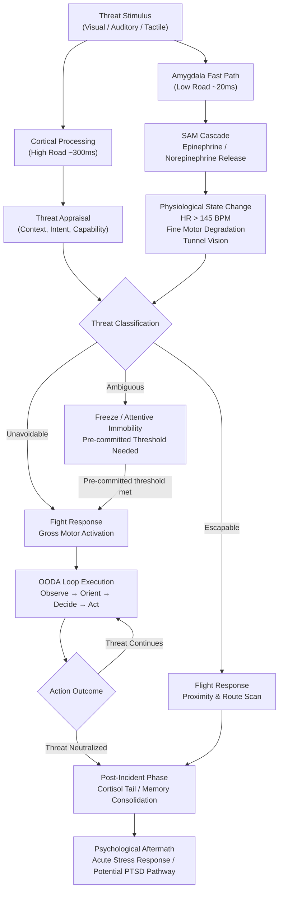

# Lesson 4: Combat Stress Psychology, Decision-Making Under Threat, Post-Incident Trauma

## 1. First-Principles Intuition & Invariants

The human nervous system did not evolve for the specific demands of modern self-defence. It evolved to keep our ancestors alive in an environment where the difference between a predator and a shadow was measured in milliseconds, and where the cost of a false negative—failing to treat a threat as real—was death. Understanding this evolutionary inheritance is not academic throat-clearing. It is the foundational invariant that governs every technical decision a self-defence practitioner must make: what techniques to train, how to train them, what to expect from your own body and mind when violence arrives, and how to survive the psychological aftermath when it passes.

At the center of this architecture is the hypothalamic-pituitary-adrenal (HPA) axis and its faster sibling, the sympathetic-adrenal-medullary (SAM) system. When the brain's threat-detection circuit—anchored in the amygdala—registers a stimulus as potentially lethal, it fires before the prefrontal cortex has had time to deliberate. This is not a malfunction. It is the system working exactly as designed. The amygdala receives sensory input along two pathways simultaneously: a fast, low-resolution subcortical route that bypasses conscious processing entirely, and a slower, cortical route that provides context and nuance. Joseph LeDoux's landmark research characterized this as the "low road" and "high road" of threat processing, and the practical implication for practitioners is profound—your body will begin responding to a credible threat before you are consciously aware that you have perceived it.

The SAM cascade triggers within 300 to 500 milliseconds of threat recognition. Epinephrine and norepinephrine flood the bloodstream, producing the constellation of physiological changes practitioners must recognize as normal and inevitable rather than as signs of weakness: heart rate climbs toward and often past 150 BPM, peripheral blood vessels constrict as perfusion redirects to large locomotor muscles, bronchial dilation increases oxygen throughput, and the liver dumps glycogen into circulation as glucose. Simultaneously, non-essential systems are suppressed—digestion halts, fine motor control degrades, and the immune response is temporarily depressed. At heart rates sustained above approximately 145 BPM, complex fine motor skills requiring independent finger movement become unreliable. Above 175 BPM, practitioners frequently report tunnel vision, auditory exclusion, and a subjective distortion of time—phenomena documented extensively in research by Dave Grossman and Bruce Siddle through retrospective analysis of law enforcement after-action reports.

The invariant that experienced practitioners must internalize is this: the stress response is not your enemy during a threat, but it will betray you if your training has not accounted for its perceptual and motor consequences. Techniques trained exclusively in a calm, cooperative environment will degrade catastrophically under full adrenal load. The hands that can execute a precise wrist lock in a dojo at 60 BPM will not reliably do the same at 170 BPM against a resisting, violent opponent. This is why gross motor techniques—hip throws, clinch work, palm strikes driven by full-body rotation—survive the adrenal state far better than intricate joint manipulation. The practitioner's training methodology must deliberately induce stress inoculation: elevated heart rate through physical exertion before drilling, role-playing with verbal aggression, scenario work that generates genuine psychological arousal, so that the nervous system learns to execute under conditions that approximate its true operational environment.

Freezing is a third threat response that receives insufficient attention in most self-defence curricula, which tend to focus almost exclusively on fight and flight. The freeze state—tonic immobility or attentive immobility—is not a failure of willpower. It is a phylogenetically ancient survival strategy. When the threat assessment circuit cannot categorize a stimulus as either safely escapable or successfully confrontable, the system defaults to stillness, since movement attracts predator attention and stillness sometimes allows re-evaluation. For practitioners, the freeze is most dangerous during the ambiguous, pre-contact phase of an encounter, when an assailant is in mid-approach and the target has not yet made a committed threat assessment. The antidote is not simply "don't freeze." It is building pre-committed decision thresholds through scenario training—establishing clear, pre-planned triggers that convert ambiguous input into decisive action, so that the deliberative cortex does not have to build a decision from scratch under conditions that are actively suppressing its function.

---

## 2. Core Architecture & Mechanics

The practitioner's internal processing architecture during a threat encounter can be understood as a series of sequential and parallel stages, each with its own latency, failure modes, and training leverage points.

John Boyd's OODA loop—Observe, Orient, Decide, Act—was developed from analysis of fighter pilot engagements, but its mechanics translate directly to close-quarters confrontation. What practitioners often miss is that Boyd considered Orientation to be the loop's dominant node, not the action phase. Orientation is the cumulative product of everything the practitioner brings to the encounter: their training history, their threat models, their cultural programming, their previous experience with violence. A person with years of full-contact sparring has an Orientation database that allows them to pattern-match an incoming attack within the same perceptual window that a novice is still trying to identify what they are seeing. This is not mystical intuition; it is recognition-primed decision-making, the same mechanism Gary Klein documented in firefighters and emergency room physicians who appear to make instant decisions in complex environments.

The practical engineering implication is that the goal of advanced self-defence training is not to make the Decide phase faster—it is to collapse the Decide phase almost entirely by making Orientation so rich and automatic that action follows recognition without deliberation. This is precisely what scenario-based training with stress inoculation accomplishes. Each iteration of a pressure-tested scenario adds a data point to the Orientation layer, reducing the cognitive distance between perception and response.

Perceptual distortion under threat is not random. It follows predictable patterns that practitioners can anticipate and compensate for. Tunnel vision—the collapse of effective visual field toward the central 30 to 40 degrees—means that peripheral threats, weapons in the off-hand, and third-party actors will frequently go unregistered during the engagement's peak intensity. Auditory exclusion is so common in lethal-force encounters that the majority of law enforcement officers involved in gunfire report not hearing their own shots fire. Time distortion cuts in both directions: some practitioners report tachypsychia, the subjective slowing of events that accompanies extreme sympathetic arousal, while others report encountering a gap in conscious experience, finding themselves already in a physical response with no clear memory of initiating it. Both phenomena are consistent with what is known about how the brain prioritizes processing under extreme load—non-essential autobiographical encoding is suppressed, and the system runs on procedural memory instead.

This procedural memory point is architecturally critical. Declarative memory—the kind that stores facts and explicit instructions—and procedural memory—the kind that stores well-practiced movement patterns—are encoded and retrieved through fundamentally different neural pathways. Under extreme sympathetic arousal, declarative retrieval is significantly impaired. A practitioner who learned a technique primarily through verbal instruction and consciously-guided repetition is relying on a system that becomes unreliable precisely when it matters most. A practitioner who has drilled the same gross motor pattern thousands of times under variable conditions has encoded it procedurally, in a system that remains far more accessible under stress. This is not a minor technical distinction—it is the reason that pressure testing, aliveness training, and high-repetition drilling of a small library of robust techniques produce more reliable outcomes than a broad repertoire of techniques practiced without resistance.

---

## 3. High-Performance Optimization & Failure Modes

Optimizing the practitioner's stress architecture is a long-term project that operates on three timescales: immediate session-level stress inoculation, medium-term scenario training that builds Orientation depth, and long-term resilience cultivation that shapes how the nervous system recovers from and integrates high-stress experiences.

At the session level, the most direct intervention is to ensure that technique drilling occurs at functional heart rates. Any session that trains self-defence responses in a fully rested, calm physiological state without any stress inoculation component is producing a capability that will be only partially transferable to a real encounter. A practical protocol is to precede defensive drilling with two to three minutes of maximal-intensity work—heavy bag combinations, sprint intervals, or burpee pyramids—sufficient to elevate heart rate above 150 BPM, then immediately enter the drilling component. The technique will initially degrade noticeably. The practitioner should log which elements survive intact and which collapse, because that inventory represents their actual operational capability as opposed to their theoretical capability. Over weeks, the gap narrows as the nervous system adapts.

Scenario training is the medium-term lever, and its design requires care. Effective scenarios share four characteristics: they are ambiguous in their opening state so that the practitioner must actually process a threat assessment rather than respond to an obvious cue; they are conducted at sufficient psychological realism to produce genuine arousal, using verbal aggression, unexpected timing, and physical pressure from a compliant but active training partner; they include a decision point where de-escalation, escape, or compliance might be appropriate responses alongside physical defense; and they are debriefed immediately afterward with specific attention to what was perceived, what was missed, and what the practitioner chose. The debrief is not a critique session. Its purpose is to build Orientation by making implicit processing explicit, examining the decision architecture retrospectively so that it becomes richer and faster on the next iteration.

The failure modes in this domain are predictable. The first is overconfidence from non-adversarial training—practitioners who have trained extensively but only in cooperative environments develop a performance capability that has never been stress-tested and may hold catastrophic gaps invisible to them. The second failure mode is the opposite: stress exposure without recovery, which produces chronic dysregulation rather than inoculation. The nervous system adapts to stress by recovering from it; relentless high-intensity scenario work without adequate rest and psychological processing does not build resilience, it erodes it. The third failure mode is neglecting the post-incident psychology entirely, treating self-defence as a problem that ends when the physical threat ends.

The psychological aftermath of a genuine violent encounter follows a recognizable clinical arc. In the immediate minutes and hours, most people experience a cortisol-driven continuation of the stress response: trembling, nausea, emotional numbing or paradoxical laughter, hyper-vigilance, and intrusive replaying of the event. This is the acute stress response, and its presence is physiologically normal. The practitioner who has been prepared for this phase—who understands that their body is running a standard post-threat protocol—is significantly less likely to interpret these symptoms catastrophically, which matters because the catastrophic interpretation of normal acute stress symptoms is itself a risk factor for the development of post-traumatic stress disorder.

Memory encoding during violence is not like recording a video. It is reconstructive, emotionally modulated, and often fragmentary. High threat salience causes the amygdala to potentiate hippocampal encoding, meaning that emotionally intense elements of the experience are encoded with unusual vividness—the assailant's face, a specific sensory detail, the sound of the encounter—while peripheral or temporally adjacent details may be absent entirely. This is not a failure of reliability; it is what accurate encoding looks like under extreme arousal. Practitioners who understand this architecture are less likely to be destabilized by the experience of remembering an event incompletely or non-linearly, and are better positioned to provide useful accounts to authorities afterward without self-undermining because their memory does not feel cinematically complete.

Resilience following a violent encounter depends on a cluster of factors that practitioners can deliberately cultivate before an encounter occurs. Social support is the most robust predictor in the literature: people who have existing relationships in which they can speak openly about difficult experiences show significantly better outcomes than those who process in isolation. Prior exposure to controlled stress through training creates a neurological context in which the experience, while intense, is not entirely novel. Cognitive frameworks for understanding the encounter—including understanding why the physiological and perceptual events that occurred were normal and adaptive—reduce the gap between expectation and experience that tends to drive post-traumatic pathology. And timely access to a qualified trauma-informed mental health practitioner, ideally one familiar with operational stress responses, should be part of every serious practitioner's post-incident plan rather than a resource of last resort.

The practical protocol for the immediate post-incident window is structured in three phases. During the first 30 to 60 minutes, the practitioner should focus only on physical stabilization: controlled diaphragmatic breathing to begin down-regulating the sympathetic state, warmth, hydration, and removal from the threat environment. Tactical breathing—a four-count inhale, four-count hold, four-count exhale—mechanically activates the parasympathetic system through vagal stimulation and is one of the few direct interventions available in this window. During the first 24 to 72 hours, the practitioner should seek social contact, maintain sleep as much as possible (since memory consolidation and emotional processing occur during sleep), and resist the urge to replay and analyze the event compulsively. After 72 hours, if intrusive symptoms are persistent, disruptive, or intensifying rather than gradually fading, professional consultation is the appropriate next step.

---

## 4. Summary & Verification Matrix

| Domain | Governing Invariant | Mechanism | Diagnostic Criterion | Failure Mode |
|---|---|---|---|---|
| **Adrenal Stress Response** | SAM cascade initiates before conscious awareness; HR > 145 BPM degrades fine motor control | Amygdala fast-path fires within ~300ms; epinephrine/norepinephrine redirect perfusion to locomotor muscles | Tunnel vision, auditory exclusion, and time distortion confirm full sympathetic activation | Training only at calm physiological baseline produces techniques that collapse under operational arousal |
| **OODA Loop & Decision Speed** | Orientation is the dominant node; action speed is a product of Orientation depth, not Decide phase acceleration | Recognition-primed decision-making collapses deliberation by pattern-matching threat to pre-built scenario database | Practitioner executes appropriate response before conscious reasoning completes | Shallow Orientation database from low-realism training creates latency gaps exploitable by a faster-acting threat |
| **Freeze Response** | Tonic immobility is a phylogenetically ancient response to ambiguous, unclassifiable threat, not a willpower failure | Insufficient threat classification at the appraisal stage defaults to stillness; pre-committed thresholds bypass this | Freeze presents as paralysis during pre-contact ambiguous phase, not mid-combat | Absence of pre-committed decision triggers leaves practitioner dependent on deliberative cortex during its period of maximum suppression |
| **Memory Encoding Under Violence** | Violent encounters produce fragmentary, emotionally modulated encoding, not complete sequential recall | Amygdala potentiates hippocampal encoding for high-salience threat elements; peripheral details are frequently absent | Vivid encoding of emotionally intense elements alongside gaps in peripheral or temporal detail is normal | Practitioners without prior education interpret incomplete memory as pathological, compounding post-incident distress |
| **Post-Incident Acute Stress** | Cortisol-driven continuation of the threat response in the minutes and hours after is physiologically normal | HPA axis maintains elevated cortisol output after threat resolution; down-regulation requires parasympathetic activation through controlled breathing | Trembling, emotional numbing, hyper-vigilance, and intrusive replay within 72 hours constitute normal acute stress response | Catastrophic misinterpretation of normal acute symptoms is itself a primary risk factor for PTSD pathway activation |
| **Long-Term Resilience** | Resilience is a cultivated pre-incident capacity, not an innate trait activated post-hoc | Social support, prior controlled stress exposure, accurate cognitive frameworks, and access to trauma-informed practitioners all independently reduce post-traumatic pathology | Gradual symptom reduction over days to weeks, with maintained social function, indicates normal recovery arc | Isolation, compulsive event replay without structured debrief, and absence of professional support increase chronification risk |
