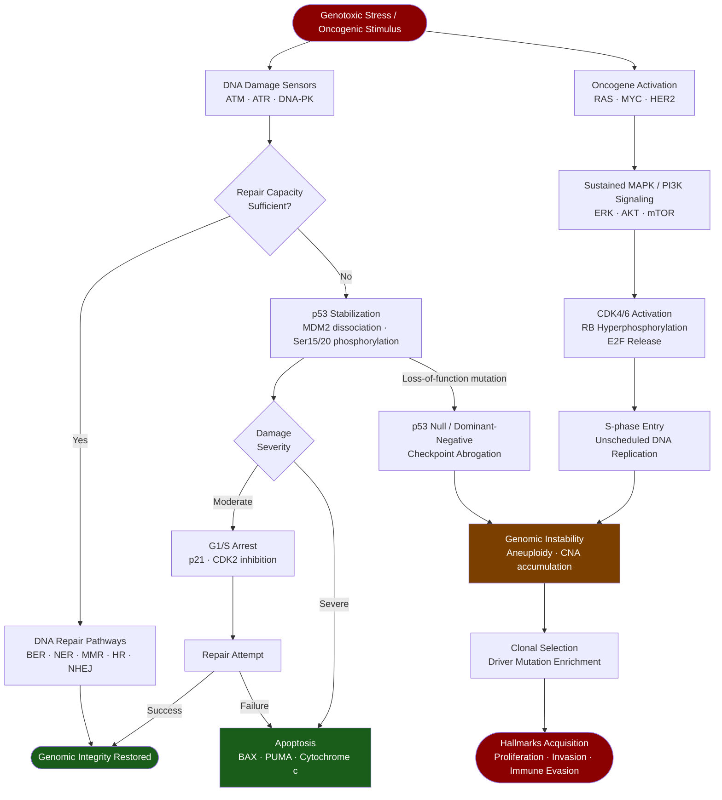

# Lesson 1: Molecular Basis of Carcinogenesis

## 1. First-Principles Intuition & Invariants

Cancer is not a single disease. It is a family of diseases unified by one governing principle: the progressive, heritable subversion of cellular identity. Where a normal cell receives, integrates, and obeys the biochemical governance of its tissue community, a cancer cell edits its own instruction set until it no longer recognizes authority. Understanding carcinogenesis at the molecular level means understanding how that editing happens, what it corrupts, and why the cell's elaborate self-correction machinery so often fails to catch it in time.

The intuition that every practitioner must internalize first is the distinction between driver events and passenger events. Within any tumor, the genome accumulates thousands of mutations over years or decades, but only a small fraction of those mutations actually confer selective growth advantage. These are driver mutations: alterations in proto-oncogenes, tumor suppressor genes, or DNA repair genes whose functional consequence shifts the cell's fate trajectory. Passenger mutations, by contrast, are neutral bystanders, copied faithfully from one daughter cell to the next but carrying no phenotypic weight. Modern genomic sequencing of tumor biopsies is powerful precisely because it separates these two populations, and clinical decision-making in targeted oncology depends entirely on correctly identifying which mutations in a given tumor are driving proliferation versus which are simply accrued noise.

The classical framework for understanding driver events is Hanahan and Weinberg's hallmarks of cancer, originally proposed in 2000 and substantially extended in 2011 and 2022. The hallmarks are not a checklist but a convergent description of the capabilities that every successful malignancy must acquire, regardless of tissue of origin. A cell must sustain proliferative signaling without depending on exogenous growth factors. It must evade the growth-suppressive signals that neighboring cells and the stroma continuously broadcast. It must resist programmed cell death, replicate without hitting the replicative senescence checkpoint, induce vascularization of its local niche, and ultimately invade adjacent tissue and seed distant metastases. More recent extensions add reprogramming of cellular metabolism toward aerobic glycolysis, active evasion of immune surveillance, tumor-promoting inflammation, and genomic instability as both a hallmark and an enabling characteristic that accelerates acquisition of all the others.

The invariant that structures this entire lesson is the two-hit model, formalized by Alfred Knudson in 1971 through his statistical analysis of retinoblastoma incidence. Knudson observed that familial retinoblastoma presented earlier and bilaterally, while sporadic cases presented later and unilaterally. His inference was elegant: inherited cases arrive with one defective copy of a tumor suppressor gene already present in every cell, so only one additional somatic mutation is required to eliminate all functional protein. Sporadic cases require two independent somatic hits in the same cell, a far less probable event. This model extends to virtually every classical tumor suppressor: TP53, APC, BRCA1, BRCA2, RB1 all conform to it, though we now understand that haploinsufficiency, dominant-negative effects, and epigenetic silencing can complicate the binary framing.

Genetic alterations are the most visible layer of carcinogenic change, but epigenetic alterations are equally consequential and often precede overt mutation in the timeline of malignant progression. Where genetic mutations alter the nucleotide sequence, epigenetic alterations modify how that sequence is read without changing its letters. Promoter hypermethylation of CpG islands silences tumor suppressor genes with the same functional result as a loss-of-function point mutation but without leaving a trace detectable by conventional sequencing. Histone deacetylation compacts chromatin around critical regulatory loci, rendering them transcriptionally inert. Conversely, global genomic hypomethylation destabilizes repetitive elements, promotes chromosomal rearrangements, and reactivates normally silenced oncogenes. The practical consequence for the clinical practitioner is significant: epigenetic silencing is chemically reversible. DNMT inhibitors like azacitidine and HDAC inhibitors like vorinostat represent an entire therapeutic class built on this reversibility, and liquid biopsy assays that detect methylation signatures in cell-free DNA are becoming a primary early-detection tool.

## 2. Core Architecture & Mechanics

The molecular circuitry of carcinogenesis can be understood as a signal transduction network with three layers of regulatory logic: accelerators, brakes, and the genome maintenance system that repairs damage to both. When accelerators are constitutively activated through mutation or amplification, when brakes are inactivated through deletion or silencing, and when the maintenance system is itself disabled, the cell acquires the capacity to evolve under Darwinian selection within the tissue microenvironment.

Proto-oncogenes are the cellular accelerators. Under normal conditions, they encode components of growth-factor signaling cascades: receptor tyrosine kinases like EGFR and HER2, intracellular signal transducers like RAS and RAF, transcription factors like MYC and FOS. Their activity is tightly gated, proportional to external ligand concentration, and subject to rapid degradation. Oncogenic conversion occurs through several distinct mechanisms. Point mutations in KRAS at codon 12 or 13 lock the protein in its GTP-bound active conformation, making it insensitive to GTPase-activating proteins and sustaining downstream MAPK and PI3K signaling without any upstream stimulus. Gene amplification in HER2-positive breast cancer produces massive receptor overexpression such that receptor dimerization and autophosphorylation occur at background ligand concentrations. Chromosomal translocations, as in the BCR-ABL fusion created by the Philadelphia chromosome t(9;22) in chronic myelogenous leukemia, produce chimeric kinases with constitutive, deregulated catalytic activity. Imatinib's mechanism of action is predicated entirely on this structural specificity: the drug occupies the ATP-binding pocket of BCR-ABL and competitively inhibits its kinase function, which is why resistance mutations at the gatekeeper residue T315I, which remodels the binding pocket, are the dominant imatinib-resistance mechanism seen clinically.

Tumor suppressor genes are the brakes. Their protein products function as checkpoint guardians, differentiation inducers, apoptotic triggers, or negative regulators of proliferative signaling. TP53 is the most frequently mutated gene in human cancer, altered in roughly 50% of all tumors. Under genotoxic stress, wild-type p53 protein is stabilized through MDM2 dissociation and phosphorylation at Ser15 and Ser20 by ATM and CHK2 kinases. Activated p53 then acts as a sequence-specific transcription factor, inducing CDKN1A (which encodes p21, a CDK inhibitor that arrests the cell in G1), BAX (a pro-apoptotic BCL-2 family member), and GADD45 (a nucleotide excision repair facilitator). Most cancer-associated TP53 mutations are missense mutations in the DNA-binding domain, clustered at six hotspot codons (175, 245, 248, 249, 273, 282), producing a protein that cannot bind its target promoters but whose extended half-life due to impaired MDM2-mediated degradation makes it detectable by IHC as diffuse strong nuclear staining, a diagnostically useful signature.

The DNA repair machinery constitutes the third layer of this regulatory architecture. The cell deploys at least six distinct repair pathways, each matched to a category of DNA lesion. Base excision repair (BER) corrects small, non-helix-distorting lesions such as oxidized guanine (8-oxoG). Nucleotide excision repair (NER) removes bulky adducts like those formed by UV-induced cyclobutane pyrimidine dimers or benzo[a]pyrene-DNA adducts from tobacco smoke. Mismatch repair (MMR) corrects replication errors that escape polymerase proofreading, and its deficiency, whether through germline MLH1/MSH2 mutation in Lynch syndrome or somatic hypermethylation of MLH1, produces the microsatellite instability (MSI-high) phenotype that predicts response to immune checkpoint inhibitors. Homologous recombination (HR) repairs double-strand breaks in S and G2 phases with high fidelity using the sister chromatid as template; BRCA1 and BRCA2 are essential HR mediators, which explains why their loss creates exquisite sensitivity to PARP inhibitors through synthetic lethality. When HR is disabled, the cell shifts to non-homologous end joining (NHEJ), an error-prone alternative that frequently introduces small insertions or deletions at break sites, accelerating genomic instability.

The diagram below maps the signal architecture from initial genotoxic or oncogenic stimulus through the regulatory network to the phenotypic outcomes of malignant transformation.

The diagram makes visible a critical architectural feature of carcinogenesis: the pathways to malignancy are not linear but convergent. Oncogene activation and tumor suppressor loss each independently drive the system toward genomic instability and clonal selection, and their combination is synergistic because the DNA damage that constitutively active RAS induces through replication stress is precisely the kind of damage that functional p53 would normally detect and act upon. When both lesions co-occur, the accelerator is floored and the emergency brake has been cut.

## 3. High-Performance Optimization & Failure Modes

For the advanced practitioner, the transition from molecular understanding to clinical execution requires mastery of how these mechanisms are interrogated, interpreted, and exploited therapeutically. The workflow begins with tissue acquisition and molecular profiling, proceeds through biomarker-guided treatment selection, and must account for the most common failure modes: intrinsic resistance, acquired resistance, and clonal evolution under selective pressure.

Next-generation sequencing (NGS) of tumor tissue has become standard of care for most solid tumors at diagnosis. A comprehensive genomic profile from a platform such as FoundationOne CDx or MSK-IMPACT interrogates hundreds of cancer-relevant genes for point mutations, insertions and deletions, copy number alterations, and structural rearrangements simultaneously. The practitioner must understand what the report does and does not capture. Tumor mutational burden (TMB), expressed in mutations per megabase (mut/Mb), is calculated from the synonymous and non-synonymous mutation count across the sequenced panel; a TMB ≥ 10 mut/Mb is the FDA-approved threshold for pembrolizumab eligibility across tumor types, though tissue-specific calibration remains clinically important. Microsatellite instability status is determined by the presence of frameshift mutations at mononucleotide repeat tracts (BAT25, BAT26, and others) and serves as the companion diagnostic for all MSI-high solid tumor immunotherapy approvals.

Liquid biopsy through cell-free DNA (cfDNA) analysis adds a temporal and spatial dimension that tissue biopsy cannot provide. Circulating tumor DNA (ctDNA) reflects current tumor burden and evolutionary heterogeneity from multiple metastatic sites simultaneously. Serial ctDNA monitoring allows the clinician to detect molecular residual disease after curative-intent surgery weeks before radiographic recurrence, to track the emergence of resistance mutations in real time, and to assess treatment response within days of initiating therapy rather than waiting for the 8-to-12-week imaging interval. The analytical challenge is sensitivity: in early-stage disease, ctDNA may constitute less than 0.1% of total cfDNA, requiring error-corrected sequencing approaches such as unique molecular identifiers (UMIs) to discriminate true low-frequency variants from sequencing artifacts.

The most consequential failure mode in targeted oncology is acquired resistance, and understanding its molecular basis is inseparable from understanding the initial mechanism of action. With EGFR-mutant non-small cell lung cancer treated with first- or second-generation TKIs, the T790M gatekeeper mutation accounts for approximately 60% of acquired resistance cases by sterically excluding erlotinib or gefitinib from the ATP-binding pocket. Osimertinib, a third-generation irreversible inhibitor designed to covalently bond to Cys797 and accommodate the T790M conformation, initially overcomes this resistance, but C797S mutations at the covalent bonding site then emerge as the dominant osimertinib resistance mechanism. This sequential mutation pressure is not a clinical accident; it is Darwinian selection operating on pre-existing rare clones within the heterogeneous tumor population. Any clone harboring the resistance mutation at a frequency below the sequencing detection threshold at treatment initiation will be selectively amplified as drug eliminates competing drug-sensitive clones.

This clonal dynamics perspective reshapes how practitioners should interpret treatment response. Radiographic partial response, defined as a ≥30% reduction in sum of target lesion diameters by RECIST criteria, represents tumor debulking, not tumor elimination. The residual disease is likely enriched for less sensitive subclones. The clinical implication is that combination strategies, whether concurrent dual targeting, immunotherapy consolidation, or adaptive dosing approaches guided by serial ctDNA, are mechanistically superior to sequential monotherapy for eliminating residual populations before resistance clones expand to detectable size.

The failure mode of epigenetic plasticity deserves specific attention because it is frequently underappreciated. Under targeted therapy, cancer cells can undergo reversible phenotypic state transitions, shifting between epithelial and mesenchymal states, between luminal and basal identities in breast cancer, or between differentiated and stem-like states in multiple tumor types, that are not driven by any new mutation but instead reflect the transcriptional reprogramming capacity inherent to epigenetic flexibility. These drug-tolerant persister cells survive therapy at reduced proliferative rates, then re-expand and re-diversify when drug pressure is removed or when new genetic events restore growth. Detecting this plasticity requires single-cell RNA sequencing or chromatin accessibility profiling (ATAC-seq) rather than bulk DNA sequencing, and targeting it requires epigenetic modulators in combination with the primary targeted agent.

A final operational invariant for clinical oncology practice: pathological staging and molecular profiling are complementary, not interchangeable. A stage III colon cancer with MSI-high status has a different adjuvant chemotherapy recommendation (omit fluorouracil monotherapy, as MSI-high tumors have impaired response to 5-FU) and a different immunotherapy eligibility than a stage III microsatellite-stable tumor. A stage IB–IIIA lung adenocarcinoma with EGFR exon 19 deletion receives three years of adjuvant osimertinib, a decision driven entirely by molecular profiling, not stage alone. The molecular invariants govern treatment architecture; staging governs intensity and sequencing.

## 4. Summary & Verification Matrix

| Domain | Governing Invariant | Mechanistic Basis | Clinical/Diagnostic Marker | Key Failure Mode |
|---|---|---|---|---|
| Oncogene Activation | Constitutive proliferative signaling independent of exogenous growth factors | Gain-of-function mutation (KRAS G12C), amplification (HER2), or translocation (BCR-ABL) locks signal transducers in active state | FISH for amplification; NGS hotspot panel; IHC for protein overexpression | Acquired gatekeeper or covalent-site resistance mutation under selective TKI pressure |
| Tumor Suppressor Loss | Elimination of checkpoint, apoptotic, or differentiation governance | Two-hit inactivation via LOH, point mutation, or promoter methylation; dominant-negative p53 hotspot mutations at codons 175, 248, 273 | IHC diffuse p53 nuclear staining (missense); complete absence (null); LOH by SNP array | Haploinsufficiency or dominant-negative effect may functionally inactivate with only one allele hit |
| DNA Repair Deficiency | Accelerated mutation accumulation and genomic instability | MMR loss produces MSI-high phenotype; HR loss (BRCA1/2) creates HRD and PARP inhibitor synthetic lethality; NER defect drives UV-signature mutational spectrum | MSI PCR or NGS; HRD score (LOH + TAI + LST); TMB ≥ 10 mut/Mb; COSMIC mutational signatures | Reversion mutations restore HR function (BRCA reversion) and re-establish PARP inhibitor resistance |
| Epigenetic Silencing | Transcriptional inactivation of tumor suppressors without DNA sequence change | CpG island promoter hypermethylation (MLH1, CDKN2A, BRCA1); histone deacetylation compacts chromatin at regulatory loci | Methylation-specific PCR; EPIC array; cfDNA methylation liquid biopsy panels | Reversible phenotypic plasticity (drug-tolerant persisters) survives targeted therapy without new mutations |
| Clonal Evolution & Resistance | Pre-existing rare resistant clones are selected and expanded by therapy | Intratumoral heterogeneity ensures that drug-sensitive majority and drug-resistant minority co-exist at diagnosis; therapy eliminates sensitive clones | Serial ctDNA monitoring for resistance allele fraction rise; single-cell sequencing for subclonal architecture | Below-detection-limit clones at baseline become dominant resistance mechanism; sequential monotherapy drives stepwise resistance accumulation |
| Hallmarks Integration | All malignancies must acquire a convergent set of biological capabilities regardless of tissue of origin | Proliferative, anti-apoptotic, angiogenic, invasive, metabolic, and immune-evasive capabilities arise through the driver mutation landscape described above | Comprehensive molecular profiling (NGS + IHC + FISH) maps hallmark acquisition; PD-L1 IHC and TMB map immune evasion | No single hallmark-targeting intervention is curative; combination strategies addressing multiple hallmarks simultaneously are required for durable response |
