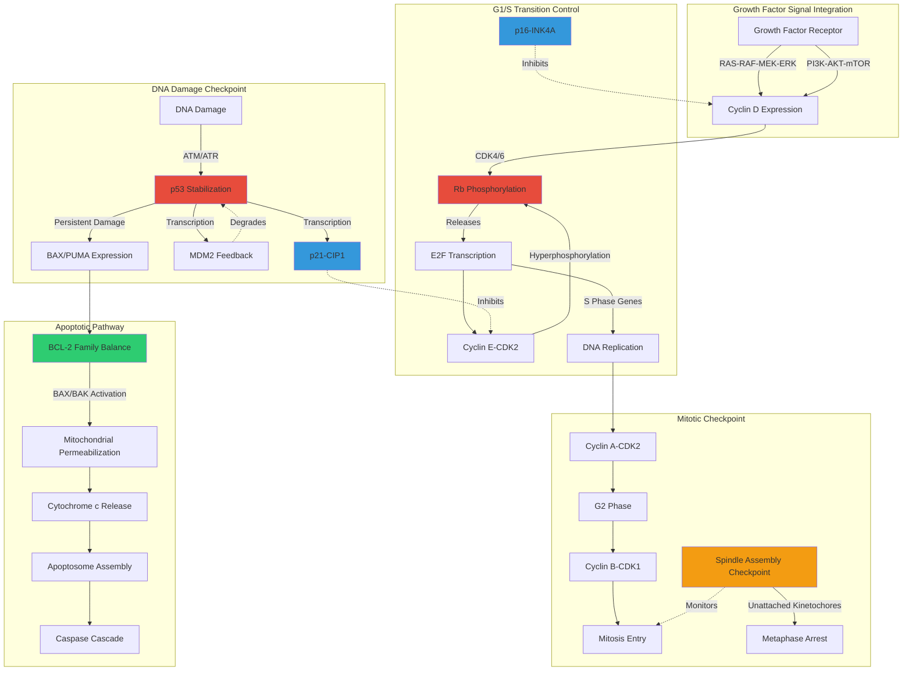

# Lesson 2: Cell Cycle Dysregulation in Malignancy

## 1. First-Principles Intuition & Invariants

The eukaryotic cell cycle represents one of biology's most exquisitely regulated processes, a molecular choreography refined across billions of years of evolution to ensure genomic fidelity during replication and division. Under homeostatic conditions, somatic cells progress through the G1 growth phase, commit to DNA synthesis at the restriction point, execute S phase replication with high-fidelity polymerases and mismatch repair machinery, undergo G2 preparation, and finally execute mitosis with spindle assembly checkpoint surveillance. Each transition depends on sequential activation of cyclin-dependent kinases—serine/threonine kinases that phosphorylate substrate proteins only when bound to their cognate cyclin regulatory subunits. The canonical progression follows a strict temporal order: Cyclin D-CDK4/6 complexes drive early G1 progression, Cyclin E-CDK2 executes the G1/S transition, Cyclin A-CDK2 governs S phase, and Cyclin B-CDK1 triggers mitotic entry. This cascade functions as a unidirectional ratchet mechanism, with each kinase activity creating the substrate conditions necessary for the next phase while simultaneously blocking regression to prior states.

Cancer fundamentally represents a disease of cell cycle checkpoint failure. The transformation from normal epithelium to invasive carcinoma requires systematic dismantling of the redundant surveillance systems that normally prevent uncontrolled proliferation. Two master tumor suppressor pathways—the p53 network and the retinoblastoma (Rb) pathway—serve as the primary guardians against oncogenic transformation. The p53 protein functions as a transcription factor activated by diverse cellular stresses: DNA double-strand breaks sensed by ATM and ATR kinases, telomere attrition, ribosomal stress, and oncogene-induced replicative stress. Upon activation, p53 induces expression of the CDK inhibitor p21^CIP1^, which broadly inhibits Cyclin E-CDK2 and Cyclin A-CDK2 complexes, triggering G1 or G2 arrest and allowing time for DNA repair machinery to resolve genomic lesions. If damage exceeds repair capacity, p53 initiates transcription of pro-apoptotic BCL-2 family members including PUMA, NOXA, and BAX, triggering mitochondrial outer membrane permeabilization and caspase cascade activation. The retinoblastoma protein operates in parallel, serving as the ultimate gatekeeper of the G1/S transition. In its hypophosphorylated state, Rb sequesters E2F transcription factors, preventing expression of S phase genes including DNA polymerase alpha, thymidine kinase, and dihydrofolate reductase. Only when Cyclin D-CDK4/6 complexes hyperphosphorylate Rb does E2F become liberated to drive S phase entry.

Malignant transformation demands functional inactivation of both pathways. The statistics are stark: TP53 mutations occur in approximately 50% of all human cancers, with functional p53 pathway disruption approaching 100% when accounting for upstream regulatory inactivation via MDM2 amplification or ARF deletion. Similarly, the Rb pathway suffers disruption in the vast majority of tumors through direct RB1 mutation, CDKN2A deletion eliminating p16^INK4A^ CDK inhibitor expression, or Cyclin D/CDK4 amplification overwhelming Rb repressive capacity. These genetic lesions create cells insensitive to anti-proliferative signals, capable of traversing checkpoints despite carrying genomic damage that would normally trigger permanent arrest or apoptotic elimination. The clinical oncologist must understand these molecular derangements not as abstract biochemistry but as targetable vulnerabilities that dictate therapeutic strategy and predict resistance mechanisms.

Beyond checkpoint loss, malignant cells must overcome additional proliferative barriers including replicative senescence and mitotic catastrophe. The Hayflick limit—the observation that normal human fibroblasts undergo approximately fifty population doublings before entering permanent growth arrest—reflects progressive telomere attrition with each replication cycle. Critically short telomeres trigger a DNA damage response identical to double-strand breaks, activating p53-dependent senescence characterized by senescence-associated beta-galactosidase expression and senescence-associated secretory phenotype (SASP) cytokine production. Cancer cells bypass this barrier through telomerase reactivation, upregulating the TERT catalytic subunit to maintain telomere length indefinitely. Approximately 85-90% of cancers achieve this through TERT promoter mutations creating novel ETS transcription factor binding sites, while 10-15% utilize alternative lengthening of telomeres (ALT) mechanisms involving homologous recombination between telomeric repeats. Mitotic catastrophe represents a final fail-safe, triggered when cells attempt mitosis with unrepaired DNA damage or spindle assembly defects. Normally, the spindle assembly checkpoint (SAC) employs MAD2 and BUBR1 proteins to sense unattached kinetochores, blocking anaphase onset until all chromosomes achieve proper bipolar attachment. Defects in SAC components or overwhelming checkpoint signaling through excessive genomic instability lead to aberrant mitotic progression, generating multinucleated cells, micronuclei, and ultimately triggering caspase-independent cell death. Yet malignant cells frequently exhibit attenuated apoptotic responses, allowing survival despite severe aneuploidy and chromothripsis—catastrophic chromosomal shattering events that paradoxically accelerate oncogenic evolution.

## 2. Core Architecture & Mechanics

The molecular architecture governing cell cycle progression and checkpoint enforcement can be understood as a hierarchical regulatory network with three structural tiers: growth factor signal integration at the membrane and cytoplasm, cyclin-CDK oscillator circuits in the nucleoplasm, and transcriptional effector programs that execute phase-specific gene expression. Growth factor signaling through receptor tyrosine kinases activates the RAS-RAF-MEK-ERK cascade and PI3K-AKT-mTOR axis, both of which converge on induction of Cyclin D gene transcription and protein stabilization. Cyclin D levels therefore function as a rheostat reflecting mitogenic input intensity. Upon association with CDK4 or CDK6, Cyclin D-CDK complexes initiate Rb phosphorylation at specific serine and threonine residues within the C-terminal pocket domain. This initial phosphorylation is self-reinforcing: partially phosphorylated Rb exhibits reduced affinity for E2F, allowing transcription of Cyclin E, which associates with CDK2 to complete Rb hyperphosphorylation through additional phosphorylation sites. Once Rb is fully phosphorylated, E2F drives a transcriptional wave encompassing not only S phase machinery but also Cyclin A and Cyclin B, establishing a feed-forward loop that becomes independent of external mitogenic signals—the cell has passed the restriction point and is committed to completing the division cycle.

The p53 pathway intersects this cyclin-CDK network through multiple negative feedback mechanisms. DNA damage sensed by ATM kinase (activated by double-strand breaks) or ATR kinase (activated by single-strand DNA and stalled replication forks) triggers phosphorylation of p53 at serine 15 and serine 20, which disrupts the interaction between p53 and its negative regulator MDM2. Normally, MDM2 functions as an E3 ubiquitin ligase that targets p53 for proteasomal degradation, maintaining p53 at low steady-state levels. Phosphorylation-mediated disruption of the MDM2-p53 interaction allows p53 protein accumulation, enhanced DNA binding affinity, and transactivation of target genes. The p21^CIP1^ protein induced by p53 contains separate binding domains for Cyclin E-CDK2, Cyclin A-CDK2, and PCNA (proliferating cell nuclear antigen, the replicative polymerase sliding clamp), creating a broad-spectrum cell cycle arrest. Simultaneously, p53 activates expression of GADD45 (growth arrest and DNA damage-inducible protein), which promotes nucleotide excision repair, and 14-3-3-sigma, which sequesters Cyclin B-CDK1 complexes in the cytoplasm to prevent premature mitotic entry. If repair proves successful, p53 induces MDM2 expression to re-establish the negative feedback loop, allowing p53 degradation and cell cycle re-entry. If damage persists beyond approximately 24 hours, p53 shifts toward pro-apoptotic target gene activation, upregulating BAX and PUMA while repressing the anti-apoptotic BCL-2 and BCL-XL genes.

In malignancy, systematic disruption of these control circuits occurs through both genetic and epigenetic mechanisms. Loss-of-function TP53 mutations cluster in the DNA-binding domain (residues 102-292), with hotspot mutations at R175, G245, R248, R273, and R282 observed across diverse tumor types. These mutations not only ablate wild-type p53 function but frequently confer dominant-negative activity—mutant p53 proteins oligomerize with remaining wild-type p53 from the intact allele, poisoning tetramer function. Even more insidiously, certain mutant p53 proteins acquire neomorphic gain-of-function properties, binding alternative transcription factors like NF-Y and promoting expression of genes involved in cell migration, invasion, and metabolic reprogramming. Rb pathway disruption follows stereotyped patterns: squamous cell carcinomas and small cell lung cancers frequently harbor homozygous RB1 deletions, while melanomas and pancreatic cancers preferentially delete CDKN2A encoding both p16^INK4A^ (which inhibits Cyclin D-CDK4/6) and p14^ARF^ (which stabilizes p53 by inhibiting MDM2). Breast cancers and glioblastomas alternatively amplify CDK4 or Cyclin D genes, creating stoichiometric imbalance that overwhelms p16^INK4A^ inhibitory capacity. These genetic configurations create functionally equivalent phenotypes: constitutive Rb hyperphosphorylation, unrestrained E2F activity, and loss of G1 checkpoint control.

Apoptotic resistance in cancer reflects disruption of the BCL-2 family rheostat that governs mitochondrial outer membrane permeabilization. The intrinsic apoptotic pathway depends on shifting the balance between anti-apoptotic guardians (BCL-2, BCL-XL, MCL-1) localized to the mitochondrial membrane and pro-apoptotic effectors (BAX, BAK) that oligomerize to form membrane pores releasing cytochrome c into the cytosol. BH3-only proteins including BID, BIM, PUMA, and NOXA function as sentinels, activated by diverse death stimuli and directly inhibiting anti-apoptotic family members. Once cytochrome c enters the cytosol, it binds APAF-1 to form the apoptosome, which recruits and activates caspase-9, initiating the caspase cascade that executes apoptosis through cleavage of hundreds of cellular substrates. Cancer cells evade this pathway through multiple mechanisms: BCL-2 translocation in follicular lymphoma places BCL-2 under control of the immunoglobulin heavy chain enhancer, driving massive overexpression; deletion or epigenetic silencing of pro-apoptotic genes including APAF-1, caspase-8, and BIM; and upregulation of IAP (inhibitor of apoptosis) proteins that directly bind and inhibit effector caspases. The dependency of different tumor types on specific anti-apoptotic proteins has enabled development of BH3 mimetic drugs: venetoclax selectively inhibits BCL-2 and demonstrates remarkable efficacy in chronic lymphocytic leukemia, while MCL-1 inhibitors show promise in triple-negative breast cancer and acute myeloid leukemia where MCL-1 dependency predominates.

## 3. High-Performance Optimization & Failure Modes

Clinical oncology practice requires translating molecular checkpoint dysregulation into actionable therapeutic strategies and resistance prediction. The discovery that CDK4/6 inhibitors could restore Rb-mediated G1 arrest even in the absence of functional p53 fundamentally altered treatment paradigms for hormone receptor-positive breast cancer. Palbociclib, ribociclib, and abemaciclib function as ATP-competitive inhibitors that prevent Cyclin D-CDK4/6 from phosphorylating Rb, artificially reinstating the G1 checkpoint despite persistent mitogenic signaling through estrogen receptor pathways. In the PALOMA-2 trial, combining palbociclib with the aromatase inhibitor letrozole extended median progression-free survival from 14.5 to 24.8 months compared to letrozole alone in first-line metastatic breast cancer—a clinically meaningful 10-month improvement. The key mechanistic insight enabling this success: these tumors retained functional Rb and therefore remained vulnerable to CDK4/6 blockade despite p53 pathway defects. Predictably, resistance mechanisms center on Rb pathway bypass: acquired RB1 loss-of-function mutations emerge in approximately 40% of resistant cases, while others amplify Cyclin E, upregulate CDK2 activity, or activate alternative mitogenic pathways through FGFR or HER2 amplification that overwhelm G1 arrest capacity.

The differential dependency of tumor types on specific anti-apoptotic proteins creates therapeutic windows for BH3 mimetics. Venetoclax demonstrates extraordinary single-agent activity in chronic lymphocytic leukemia carrying the 17p deletion eliminating TP53, achieving complete remission rates exceeding 20% in patients who had failed multiple prior therapies. The mechanistic basis: CLL cells exhibit profound BCL-2 dependency, with BCL-2 levels 100-1000 fold higher than normal B cells, creating an addiction that venetoclax exploits through high-affinity BCL-2 binding (Ki < 0.01 nM). However, the same drug shows minimal activity in solid tumors where MCL-1 or BCL-XL predominate as survival factors. Combination strategies rationally designed around these dependencies show enhanced efficacy: pairing venetoclax with hypomethylating agents (azacitidine) in acute myeloid leukemia targets both BCL-2-dependent survival and aberrant DNA methylation patterns, producing complete remission rates of 67% in newly diagnosed elderly patients ineligible for intensive chemotherapy. The critical failure mode: tumor lysis syndrome during venetoclax initiation in high-burden CLL, where rapid malignant cell death releases intracellular contents causing hyperkalemia, hyperphosphatemia, and acute kidney injury. This necessitates careful dose ramp-up protocols (starting at 20 mg daily, escalating weekly to 400 mg) with aggressive hydration and allopurinol prophylaxis.

Exploiting mitotic checkpoint defects represents an alternative therapeutic approach, though one fraught with narrow therapeutic windows. Spindle assembly checkpoint inhibition through drugs targeting MPS1 kinase or TTK kinase forces premature anaphase onset before proper chromosome attachment, generating lethal aneuploidy. The rationale: cancer cells already carry elevated chromosomal instability and weakened checkpoint signaling, making them more vulnerable than normal tissues to further checkpoint erosion. However, phase I trials with MPS1 inhibitors revealed dose-limiting neutropenia and thrombocytopenia, reflecting insufficient therapeutic index between tumor kill and bone marrow toxicity. Conversely, exploiting checkpoint addiction shows more promise: PARP inhibitors in BRCA-mutant cancers leverage synthetic lethality—the concept that disruption of two parallel DNA repair pathways proves lethal while either alone remains tolerable. BRCA1/2-deficient cells cannot execute homologous recombination repair of DNA double-strand breaks and therefore depend absolutely on base excision repair mediated by PARP enzymes. Olaparib, rucaparib, and niraparib trap PARP on DNA, creating stalled replication forks that collapse into double-strand breaks, which BRCA-deficient cells cannot repair, triggering mitotic catastrophe and apoptosis. The FDA approval of olaparib as maintenance therapy for platinum-sensitive ovarian cancer carrying BRCA mutations reflects this mechanistic precision: median progression-free survival of 19.1 months versus 5.5 months with placebo represents a 70% reduction in progression risk.

Resistance to targeted checkpoint inhibition follows predictable evolutionary trajectories that clinicians must anticipate. Secondary mutations restoring pathway function dominate: BRCA-mutant tumors developing PARP inhibitor resistance frequently acquire secondary BRCA mutations that restore the reading frame, regenerating functional BRCA protein and homologous recombination capacity. Similarly, CDK4/6 inhibitor resistance through RB1 loss can be detected in circulating tumor DNA months before clinical progression becomes evident, creating opportunities for preemptive therapeutic switching. Alternative bypass pathway activation represents a second major mechanism: KRAS amplification or BRAF mutation can drive Rb hyperphosphorylation despite CDK4/6 blockade by activating parallel kinase circuits. The clinical implication: serial circulating tumor DNA monitoring enables real-time tracking of emerging resistance clones, informing rational combinations or sequence strategies. Combining CDK4/6 inhibitors with PI3K inhibitors in PIK3CA-mutant breast cancer, or with mTOR inhibitors in RAS-mutant settings, prevents bypass signaling—though at the cost of increased toxicity requiring careful dose optimization. The oncologist operating at the frontier of precision medicine must synthesize genomic profiling results, understand the mechanistic basis of observed mutations, predict likely resistance pathways, and design rational therapeutic sequences that maximize depth and duration of response while managing cumulative toxicities across treatment lines.

## 4. Summary & Verification Matrix

| **Regulatory Mechanism** | **Molecular Components** | **Cancer-Associated Defects** | **Clinical Biomarkers & Therapeutic Targets** |
|---|---|---|---|
| **G1/S Checkpoint (Rb Pathway)** | Cyclin D-CDK4/6 → Rb phosphorylation → E2F release; p16^INK4A^ negative regulation | RB1 deletion/mutation (40% SCLC, 30% TNBC); CDKN2A deletion (>80% pancreatic cancer); Cyclin D/CDK4 amplification (15% breast cancer, 10% glioblastoma) | IHC: Rb phosphorylation status, p16 expression; NGS: RB1, CDKN2A, CCND1, CDK4 alterations; **Therapeutics:** CDK4/6 inhibitors (palbociclib, ribociclib, abemaciclib) restore G1 arrest in Rb-intact tumors |
| **DNA Damage Checkpoint (p53 Pathway)** | ATM/ATR → p53 stabilization → p21^CIP1^ + GADD45 (arrest) or BAX/PUMA (apoptosis); MDM2 negative feedback | TP53 mutation (50% all cancers, >90% high-grade serous ovarian cancer); MDM2 amplification (10% sarcomas); CDKN1A silencing; hotspot mutations R175H, R248W, R273H | NGS: TP53 mutation status; IHC: p53 accumulation (missense) vs. absence (nonsense); **Resistance predictor:** TP53 mutation predicts platinum and anthracycline resistance; **Therapeutics:** MDM2 inhibitors (idasanutlin) in MDM2-amplified wild-type TP53 tumors |
| **Apoptotic Regulation (BCL-2 Family)** | Pro-apoptotic (BAX, BAK, BIM, PUMA) vs. anti-apoptotic (BCL-2, BCL-XL, MCL-1); BH3-only sentinels; cytochrome c → apoptosome → caspase cascade | BCL2 translocation (85% follicular lymphoma); MCL1 amplification (20% TNBC, 30% AML); BIM deletion polymorphism (12% Asian populations); caspase-8 silencing | IHC: BCL-2, MCL-1 expression; FISH: BCL2 t(14;18); **BH3 profiling:** ex vivo mitochondrial response to BH3 peptides predicts drug sensitivity; **Therapeutics:** venetoclax (BCL-2 selective) in CLL; ongoing MCL-1 inhibitor trials in AML |
| **Replicative Senescence Bypass** | Telomere attrition → DNA damage response → p53/p21 permanent arrest; telomerase (TERT + TERC) or ALT pathway | TERT promoter mutations C228T/C250T (70% melanoma, 80% glioblastoma, 50% bladder cancer); TERT amplification; ATRX/DAXX loss enables ALT (40% pancreatic neuroendocrine, 15% pediatric glioblastoma) | NGS: TERT promoter sequencing; IHC: ATRX loss; **ALT detection:** C-circle assay, telomeric ultrabright foci; **Therapeutics:** G-quadruplex stabilizers (CX-5461) and telomerase inhibitors (imetelstat) under investigation; ATR inhibitors synthetic lethal with ALT |
| **Mitotic Checkpoint & Catastrophe** | Spindle assembly checkpoint: MAD2/BUBR1 sense unattached kinetochores → block anaphase-promoting complex; proper chromosome segregation prevents aneuploidy | BUB1B mutation (mosaic variegated aneuploidy syndrome); MAD2 haploinsufficiency; TP53 loss permits survival despite mitotic errors; chromosome instability (CIN) phenotype | Karyotyping: aneuploidy score; **CIN signature:** NGS-derived chromosomal instability index; micronuclei and multinucleation on cytology; **Therapeutics:** paradoxical benefit of further destabilizing mitosis with low-dose taxanes or aurora kinase inhibitors in CIN-high tumors; PARP inhibitors exploit synthetic lethality with defective homologous recombination |
| **Senescence-Associated Secretory Phenotype (SASP)** | Persistent DNA damage → p53/p16 dual activation → permanent arrest with pro-inflammatory cytokine secretion (IL-6, IL-8, MMPs); oncogene-induced senescence as tumor suppressor barrier | Loss of p53 or p16 permits senescence bypass; paradoxically, SASP cytokines can promote tumor progression via paracrine effects on neighboring cells; therapy-induced senescence (TIS) after chemotherapy or radiation | SA-β-gal staining; IHC: p16^INK4A^, p21^CIP1^ co-expression; serum cytokine profiling (IL-6, IL-8); **Therapeutics:** senolytic drugs (dasatinib + quercetin, BCL-2/BCL-XL inhibitors) clear senescent cells to prevent SASP-driven tumor microenvironment remodeling; under clinical investigation for post-therapy residual disease |
