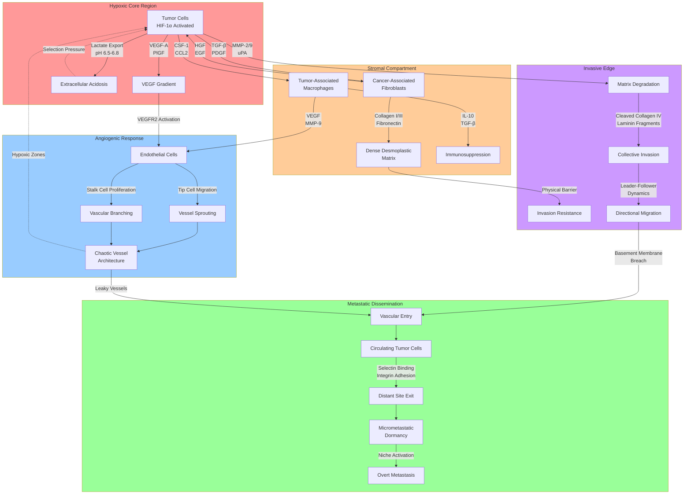

# Lesson 3: Tumor Microenvironment Architecture

## 1. First-Principles Intuition & Invariants

The oncology paradigm has undergone a fundamental conceptual revolution over the past three decades. Where classical cancer biology focused almost exclusively on the intrinsic genetic and epigenetic alterations within malignant cells themselves—the mutations in oncogenes and tumor suppressors, the chromosomal instabilities, the disrupted cell cycle checkpoints—contemporary understanding recognizes that a tumor is not merely a clonal expansion of transformed cells but rather a complex organ-like ecosystem. This ecosystem, termed the tumor microenvironment, comprises a heterogeneous assemblage of non-malignant stromal cells, extracellular matrix scaffolding, soluble signaling factors, and dynamically remodeled vasculature. The malignant cells and their microenvironmental collaborators engage in continuous bidirectional crosstalk, co-evolving in a process that fundamentally shapes tumor progression, therapeutic resistance, and metastatic dissemination.

The tumor microenvironment exhibits several governing invariants that underpin its clinical relevance. First, solid tumors cannot expand beyond approximately one to two millimeters in diameter without recruiting a dedicated blood supply through angiogenesis. This constraint arises from the diffusion limits of oxygen and nutrients across tissue compartments; beyond this critical radius, hypoxic gradients emerge that trigger adaptive transcriptional programs or lead to necrotic cell death. Second, the stromal compartment is not a passive bystander but an active participant in tumorigenesis. Cancer-associated fibroblasts, tumor-associated macrophages, and other infiltrating immune populations secrete growth factors, cytokines, and matrix-remodeling enzymes that can either restrain or promote malignant expansion depending on context and timing. Third, the extracellular matrix serves dual functions as both a physical barrier to invasion and a reservoir of bioactive signaling molecules that become liberated through proteolytic cleavage. The balance between matrix deposition and degradation determines whether tumor cells remain locally confined or acquire the invasive phenotype necessary for metastatic escape.

Understanding tumor microenvironment architecture requires integrating multiple spatial scales and temporal dynamics. At the molecular level, hypoxia-inducible transcription factors sense oxygen tension and orchestrate adaptive responses including metabolic reprogramming and pro-angiogenic signaling. At the cellular level, endothelial cells respond to vascular endothelial growth factor gradients by sprouting new capillaries through coordinated migration and proliferation. At the tissue level, collective invasion fronts advance through stroma via leader-follower dynamics, with specialized cells at the invasive edge secreting matrix metalloproteinases that cleave collagen and laminin barriers. At the organismal level, circulating tumor cells navigate the bloodstream, extravasate at distant sites, and either succumb to anoikis or establish micrometastatic niches that may remain dormant for years before emerging as overt metastases.

The clinical practitioner must appreciate that virtually every therapeutic modality interacts profoundly with microenvironmental elements. Radiation therapy not only damages tumor cell DNA but also induces endothelial apoptosis and triggers inflammatory cascades that recruit immunosuppressive myeloid populations. Chemotherapeutic agents penetrate poorly through dense desmoplastic stroma, creating pharmacokinetic sanctuaries where residual disease persists. Anti-angiogenic therapies initially reduce tumor vascularity but can paradoxically induce compensatory hypoxia that selects for more aggressive, invasive phenotypes. Immune checkpoint inhibitors aim to reverse T cell exhaustion but their efficacy depends critically on pre-existing immune infiltration, which varies dramatically across tumor types and individual patients. A mechanistic understanding of microenvironment architecture therefore provides the foundation for rational combination therapy design, biomarker development, and personalized treatment selection.

## 2. Core Architecture & Mechanics

The tumor microenvironment comprises six major functional compartments that operate as interconnected modules within the larger system. These compartments include the vasculature and angiogenic machinery, the hypoxic niche and adaptive signaling networks, the stromal cellular populations, the extracellular matrix scaffold, the invasion machinery at the tumor-stroma interface, and the metastatic cascade from primary site to distant organs. Each compartment exhibits characteristic molecular signatures, spatial organization patterns, and temporal evolution trajectories that can be measured and manipulated in clinical practice.

Angiogenesis represents the most clinically validated microenvironmental process, with multiple FDA-approved therapies targeting this pathway. Normal physiologic angiogenesis during development and wound healing is tightly regulated through balanced production of pro-angiogenic factors such as vascular endothelial growth factor A and anti-angiogenic factors such as thrombospondin-1 and endostatin. Tumors subvert this balance by constitutively producing VEGF-A through multiple mechanisms including oncogene activation, tumor suppressor loss, and hypoxia-induced transcription. The resulting tumor vasculature exhibits profoundly abnormal architecture characterized by tortuous vessels with irregular diameter, excessive branching, blind-ending sprouts, and deficient pericyte coverage. These structural abnormalities create regions of acute and chronic hypoxia despite overall increased vascular density, a paradox that reflects chaotic vessel formation outpacing functional maturation.

Hypoxia serves as a master regulator of tumor microenvironment evolution through activation of hypoxia-inducible factor transcription factors. Under normoxic conditions, HIF-1α and HIF-2α protein subunits are continuously synthesized but rapidly hydroxylated on specific proline residues by prolyl hydroxylase enzymes that require molecular oxygen as a substrate. This hydroxylation marks HIF-α for recognition by the von Hippel-Lindau E3 ubiquitin ligase complex and subsequent proteasomal degradation, maintaining low steady-state levels. When oxygen tension drops below approximately ten millimeters of mercury, prolyl hydroxylase activity declines, HIF-α escapes degradation, translocates to the nucleus, and heterodimerizes with constitutively expressed HIF-1β to form an active transcription factor complex. This complex binds hypoxia response elements in the promoters and enhancers of hundreds of target genes encoding proteins involved in glycolytic metabolism, angiogenesis, invasion, metastasis, and stem cell maintenance.

The stromal compartment harbors diverse cellular populations whose functions span the spectrum from tumor-suppressing to tumor-promoting. Cancer-associated fibroblasts represent the predominant stromal cell type in many solid tumors, arising through activation and transdifferentiation of resident tissue fibroblasts, recruitment of bone marrow-derived mesenchymal stem cells, or endothelial-to-mesenchymal transition. These activated fibroblasts secrete abundant extracellular matrix proteins including collagens, fibronectin, and hyaluronan, creating the dense desmoplastic stroma characteristic of pancreatic, breast, and lung adenocarcinomas. They also produce growth factors such as hepatocyte growth factor and epidermal growth factor that stimulate tumor cell proliferation, and chemokines such as CXCL12 that recruit additional stromal and immune cells. Tumor-associated macrophages typically exhibit an M2-like alternatively activated phenotype characterized by expression of arginase-1, CD163, and CD204, promoting angiogenesis through VEGF secretion, suppressing adaptive immunity through production of interleukin-10 and transforming growth factor-beta, and facilitating invasion through matrix metalloproteinase release.

The extracellular matrix undergoes profound remodeling during tumor progression through combined effects of increased deposition, altered composition, and enzymatic degradation. Normal basement membrane architecture features a thin planar array of laminin-511 and collagen IV that separates epithelial cells from underlying stroma and restricts cellular movement. Invasive carcinomas breach this barrier through secretion of matrix metalloproteinases, particularly MMP-2 and MMP-9 which cleave collagen IV, and through expression of integrins such as α6β4 and αvβ3 that mediate adhesion to laminin and vitronectin fragments. The interstitial matrix becomes enriched in fibrillar collagens, particularly collagen I, which assembles into thick aligned fibers that can serve as tracks for directional migration. Lysyl oxidase enzymes catalyze covalent crosslinking of collagen and elastin, increasing matrix stiffness and tensile strength. This mechanical remodeling activates mechanotransduction pathways in both tumor and stromal cells through integrin clustering, focal adhesion assembly, and cytoskeletal tension, creating positive feedback loops that amplify invasive behavior.

The invasion cascade initiates at the boundary between tumor epithelium and adjacent stroma where specialized leader cells exhibit mesenchymal characteristics including expression of vimentin, N-cadherin, and transcription factors such as Snail and Twist. These leader cells extend filopodia and lamellipodia protrusions that sense chemotactic gradients and mechanically probe the surrounding matrix. They secrete membrane-tethered and soluble matrix metalloproteinases that cleave collagen, fibronectin, and laminin, generating migration tracks through which follower cells advance in single-file or collective streams. This leader-follower dynamic represents a form of cooperative invasion where specialized subpopulations divide labor rather than each cell acquiring full invasive capacity independently. Clinically, this architecture has profound implications because therapeutic elimination of leader cells could theoretically disrupt invasion even without killing the bulk tumor mass, while strategies targeting only proliferating cells might miss quiescent leader populations.

Metastatic dissemination proceeds through a multi-step cascade where only a minute fraction of cells that escape the primary tumor successfully establish macroscopic distant lesions. Cells must first breach the basement membrane and invade through stroma to reach blood or lymphatic vessels, a process termed intravasation. The abnormal tumor vasculature facilitates this step through discontinuous endothelial barriers and deficient pericyte coverage. Once in circulation, tumor cells face mechanical shear stress, anoikis from loss of matrix attachment, and immune surveillance by natural killer cells and cytotoxic T lymphocytes. Most circulating tumor cells die within minutes to hours, but rare survivors arrest in capillary beds either through physical trapping or active adhesion mediated by selectins and integrins. Extravasation into the target organ parenchyma may occur rapidly or after intravascular growth. Disseminated cells then face the challenge of surviving in a foreign tissue microenvironment that often lacks the appropriate growth factors and matrix signals present at the primary site. Many enter a dormant state characterized by cell cycle arrest in G0, maintained through checkpoint kinase signaling and reduced mTOR activity. Reactivation from dormancy can occur years or decades later in response to inflammatory stimuli, angiogenic activation, or deposition of permissive extracellular matrix, explaining the clinical phenomenon of late recurrence in breast cancer, melanoma, and other malignancies.

## 3. High-Performance Optimization & Failure Modes

Clinical exploitation of tumor microenvironment vulnerabilities requires sophisticated patient selection strategies, rational combination therapy design, and dynamic response monitoring to prevent adaptive resistance. The microenvironment simultaneously presents therapeutic opportunities and obstacles that must be navigated through precision oncology approaches informed by molecular profiling and functional imaging.

Anti-angiogenic therapy with VEGF pathway inhibitors such as bevacizumab, ramucirumab, and small molecule tyrosine kinase inhibitors represents the most mature microenvironment-directed strategy with regulatory approval across multiple tumor types including colorectal, lung, renal, and ovarian cancer. These agents reduce vascular density, decrease vascular permeability, and transiently normalize the chaotic tumor vasculature through selective pruning of immature vessels. This normalization window, typically lasting several days to weeks after treatment initiation, improves tumor oxygenation and drug delivery, providing a rational basis for combination with cytotoxic chemotherapy or radiation. However, anti-angiogenic monotherapy rarely produces durable responses because tumors deploy multiple resistance mechanisms. Hypoxia induced by vessel regression selects for more aggressive clones that upregulate alternative pro-angiogenic factors such as basic fibroblast growth factor and interleukin-8, recruit pro-angiogenic myeloid cells that restore vascularity through VEGF-independent mechanisms, and activate invasion programs that allow tumor cells to co-opt pre-existing normal vessels rather than requiring new angiogenesis. Optimal deployment therefore requires dynamic imaging with perfusion MRI or PET-CT to identify the normalization window and schedule cytotoxic therapy accordingly, sequential biopsies to monitor evolving resistance mechanisms, and rational combinations with agents targeting compensatory pathways.

Stromal targeting strategies aim to deplete or reprogram the cancer-associated fibroblast population to improve drug penetration and reverse immunosuppression. Preclinical studies using genetic ablation of fibroblast activation protein-positive fibroblasts or enzymatic degradation of hyaluronan with pegylated hyaluronidase demonstrated improved chemotherapy delivery and reduced metastasis in pancreatic cancer models. Clinical translation with pegvorhyaluronidase alfa showed promising early results but ultimately failed to improve survival in phase III trials, highlighting the complexity of stromal biology. Subsequent research revealed that complete fibroblast depletion can paradoxically accelerate tumor progression by removing restraining influences, and that cancer-associated fibroblasts exhibit functional heterogeneity with subpopulations exhibiting tumor-suppressing versus tumor-promoting phenotypes. More nuanced approaches now focus on reprogramming fibroblasts from pro-tumorigenic to tumor-restraining states using vitamin D receptor agonists or blocking specific fibroblast-derived factors such as interleukin-6 while preserving the stromal architecture. Patient selection for stromal-targeted therapy requires quantitative assessment of desmoplasia through collagen-sensitive imaging modalities or tissue-based proteomics, and dynamic monitoring for compensatory activation of alternative stromal populations.

Matrix remodeling inhibition through broad-spectrum matrix metalloproteinase inhibitors was extensively pursued in clinical trials during the 1990s and early 2000s but universally failed to improve outcomes and frequently produced musculoskeletal toxicity. These failures stemmed from inadequate understanding of MMP biology, including the recognition that some family members such as MMP-8 exhibit anti-tumor activity through cleavage of pro-angiogenic factors and generation of anti-angiogenic collagen fragments. Contemporary approaches employ selective inhibition of specific MMP family members implicated in invasion such as MMP-9, blockade of MMP activators such as MT1-MMP, or targeting the downstream integrin receptors that mediate adhesion to cleaved matrix fragments. Lysyl oxidase inhibition to prevent collagen crosslinking and reduce matrix stiffness represents an alternative strategy currently in early clinical development. Combination with immune checkpoint inhibitors may prove particularly synergistic because dense matrix serves as a physical barrier excluding T cells from the tumor core, and matrix stiffness activates mechanotransduction pathways that upregulate PD-L1 expression on tumor cells. Optimal deployment requires baseline assessment of matrix architecture through second harmonic generation microscopy or shear wave elastography, and post-treatment monitoring for changes in tumor stiffness and immune infiltration.

Metastasis prevention through targeting of the invasion-metastasis cascade remains an unmet clinical need despite being arguably the most important cause of cancer mortality. Challenges include the transient nature of circulating tumor cells that exist only briefly in accessible blood compartments, the heterogeneity of invasion mechanisms across tumor types and even within individual tumors, and the lack of validated biomarkers for invasion and metastatic potential that could identify high-risk patients who would benefit from preventive therapy. Emerging strategies include inhibition of epithelial-to-mesenchymal transition through blocking of TGF-β signaling, targeting of invasion leader cells through CSF-1 receptor inhibition that depletes tumor-associated macrophages which guide collective invasion, disruption of circulating tumor cell clusters through inhibition of cell-cell adhesion molecules such as plakoglobin, and blockade of pre-metastatic niche formation through targeting of bone marrow-derived progenitor cell recruitment. The adjuvant setting following primary tumor resection represents the most tractable opportunity for metastasis prevention, as patients at high risk can be identified through staging and molecular profiling, and treatment duration can extend over months to years. Circulating tumor DNA monitoring provides a dynamic biomarker to detect minimal residual disease and guide treatment intensification or de-escalation based on molecular response.

Failure modes in microenvironment-directed therapy arise through tumor adaptation, patient heterogeneity, and inadequate understanding of complex systems biology. Vascular normalization can transition to excessive pruning and hypoxia if anti-angiogenic therapy continues too long or at excessive dose intensity. Stromal depletion can unleash latent invasion programs by removing physical barriers. Matrix remodeling inhibition can trap tumor cells in the primary site while simultaneously preventing immune cell infiltration. These failure modes mandate adaptive trial designs with frequent on-treatment biopsies, functional imaging to assess pharmacodynamic response, and predetermined decision rules for dose modification or regimen switching based on emerging resistance signatures. Patient stratification remains primitive compared to the genomic precision achieved in oncogene-driven cancer subtypes, relying primarily on immunohistochemical surrogates such as CD31 vessel density, alpha-smooth muscle actin fibroblast content, or trichrome collagen staining rather than comprehensive molecular profiling of microenvironmental cell populations through single-cell transcriptomics or spatial proteomics. As these technologies mature and enter clinical laboratories, microenvironment-directed therapy will transition from empiric application to precision deployment guided by individual tumor ecosystem architecture.

## 4. Summary & Verification Matrix

| **Microenvironment Component** | **Core Mechanism** | **Clinical Biomarker** | **Therapeutic Target** | **Failure Mode** |
|-------------------------------|-------------------|----------------------|----------------------|-----------------|
| **Angiogenic Vasculature** | VEGF-A gradient drives endothelial tip cell sprouting and stalk cell proliferation creating chaotic vessel architecture with hypoxic zones despite increased density. Vessel normalization window transiently improves perfusion. | Perfusion MRI Ktrans parameter, plasma VEGF-A, circulating endothelial cells, CD31 immunohistochemistry vessel density | Bevacizumab, ramucirumab, sunitinib, pazopanib targeting VEGF/VEGFR2 pathway during normalization window combined with chemotherapy | Hypoxia-induced upregulation of alternative pro-angiogenic factors (bFGF, IL-8), recruitment of VEGF-independent myeloid angiogenesis, vessel co-option bypassing angiogenesis requirement |
| **Hypoxic Signaling Network** | Oxygen depletion below 10 mmHg stabilizes HIF-1α and HIF-2α through reduced prolyl hydroxylase activity. HIF heterodimers transactivate genes governing glycolysis, angiogenesis, invasion, and stem cell maintenance. | Pimonidazole or EF5 hypoxia PET imaging, carbonic anhydrase IX immunohistochemistry, plasma lactate dehydrogenase, HIF-1α nuclear staining | HIF-2α selective inhibitors (belzutifan) for VHL-deficient renal cancer, indirect targeting through VEGF inhibition and vascular normalization | Selection for HIF-independent survival through p53 loss, metabolic adaptation to oxidative phosphorylation using alternative fuels, enhanced invasion and metastasis under hypoxic selection pressure |
| **Stromal Cellular Populations** | Cancer-associated fibroblasts activated by TGF-β and PDGF secrete ECM proteins, growth factors (HGF, EGF), and matrix remodeling enzymes. Tumor-associated macrophages recruited by CSF-1 exhibit M2 phenotype promoting angiogenesis, immunosuppression, and invasion. | Alpha-smooth muscle actin fibroblast marker, FAP expression, CD163+ or CD204+ M2 macrophage infiltration by IHC, serum cytokines (IL-6, IL-10) | Pegvorhyaluronidase alfa for hyaluronan depletion, CSF-1R inhibitors for macrophage depletion, TGF-β pathway blockade, vitamin D receptor agonists for CAF reprogramming | Functional heterogeneity with tumor-restraining subpopulations whose depletion accelerates progression, compensatory recruitment of alternative stromal cells, fibroblast reprogramming to more aggressive phenotypes |
| **Extracellular Matrix Remodeling** | Matrix metalloproteinases cleave collagen IV basement membrane and interstitial collagen I, generating invasion tracks and releasing matrix-bound growth factors. Lysyl oxidase crosslinks collagen increasing stiffness and activating mechanotransduction through integrin clustering. | Second harmonic generation collagen imaging, shear wave elastography stiffness measurement, plasma LOXL2, MMP-9 serum levels, integrin expression profiling | Selective MMP-9 inhibitors, lysyl oxidase blocking antibodies (simtuzumab), integrin αvβ3 and α5β1 antagonists, collagenase delivery to reduce matrix density | Functional redundancy among MMP family members, anti-tumor activity of certain MMPs creating paradoxical acceleration, immune exclusion from dense matrix persisting despite MMP inhibition |
| **Invasion-Metastasis Cascade** | Leader cells with mesenchymal phenotype (Snail/Twist activation, N-cadherin expression) guide collective invasion through MMP-mediated matrix degradation. Circulating tumor cells face anoikis and immune attack. Extravasated cells enter dormancy maintained by p38 and checkpoint kinase signaling. | Circulating tumor cell enumeration by CellSearch, circulating tumor DNA liquid biopsy, epithelial-mesenchymal transition gene signatures, disseminated tumor cells in bone marrow aspirates | TGF-β receptor kinase inhibitors blocking EMT, integrin inhibitors disrupting adhesion, immune checkpoint blockade eliminating disseminated cells, agents targeting dormancy exit signals | Invasion heterogeneity with multiple parallel mechanisms, transient nature of EMT with rapid plasticity, immune editing selecting for non-immunogenic metastatic clones, unpredictable timing of dormancy exit |
| **Metastatic Niche Architecture** | Pre-metastatic niche formation through VEGFR1+ progenitor recruitment and fibronectin deposition precedes arrival of disseminated cells. Organ-specific microenvironments favor specific primary tumor types through chemokine gradients and matrix composition. | Organ-specific imaging (bone scan, brain MRI, liver CT), plasma exosomal profiling for niche-priming factors, tissue-specific markers (osteocalcin for bone metastasis) | CXCR4 antagonists blocking marrow homing, bisphosphonates or denosumab preventing bone niche, anti-VEGFR1 antibodies inhibiting progenitor recruitment | Organotropism determined by multiple redundant mechanisms, niche adaptation overcoming initial incompatibility, prolonged dormancy periods (5-20 years) exceeding feasible prevention therapy duration |
