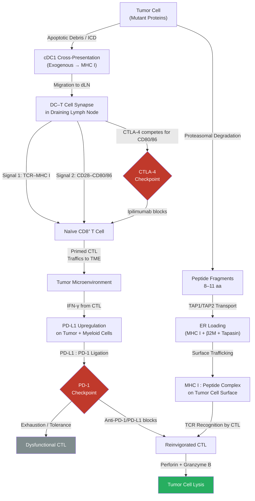

# Lesson 4: Immune Surveillance Mechanisms

## 1. First-Principles Intuition & Invariants

The immune system did not evolve primarily to fight cancer, yet it performs cancer surveillance as a continuous, mostly silent function that runs in parallel with its infectious defense mandate. Understanding why this works, and why it fails, requires stepping back to the most fundamental question in cancer immunology: how does a cell that was once "self" become "other" in a way that is both detectable and actionable?

Every nucleated cell in the body exposes a sampled peptide inventory on its surface through MHC class I molecules. This display is not decorative. It is a continuous broadcast of intracellular protein composition, a molecular census that cytotoxic T lymphocytes (CTLs) read in a constant surveillance sweep. Under homeostatic conditions, self-peptides occupy these grooves, and the T-cell repertoire has been purged, through thymic negative selection, of clones that respond strongly to them. The contract is elegant: normal cells broadcasting normal peptides are ignored. A cell that has undergone malignant transformation, however, begins synthesizing aberrant proteins, the products of driver mutations, frameshift neoantigens, viral oncoproteins, or reactivated cancer-germline antigens, and these novel peptides load onto MHC I and can trigger a CTL response. This is the theoretical foundation of immune surveillance, articulated most rigorously by Burnet and Thomas in the 1950s and later formalized mechanistically by Schreiber, Old, and colleagues as the **cancer immunoediting** framework.

The immunoediting framework is built on three phases, commonly abbreviated the Three Es: **Elimination, Equilibrium, and Escape**. These are not discrete clinical events separated by clean temporal boundaries. They are dynamic population-level processes occurring simultaneously across spatially heterogeneous tumor microenvironments (TMEs), and understanding their mechanics is the practitioner's first cognitive tool.

**Elimination** is the phase that most resembles the textbook immune response. Innate sentinels, particularly natural killer (NK) cells and dendritic cells (DCs), detect danger-associated molecular patterns (DAMPs) released by genomically stressed cells. NK cells read the downregulation of MHC I, a common early evasion attempt by pre-malignant cells, as "missing self" and license a cytotoxic response through perforin and granzyme B delivery. DCs engulf dead or dying aberrant cells, process their peptide cargo, and migrate to tumor-draining lymph nodes where they prime naïve CD8⁺ T cells against tumor-associated antigens (TAAs). If elimination is complete, the nascent tumor is extinguished before clinical detectability.

**Equilibrium** is the phase oncologists rarely discuss but which may account for the long latency between oncogenic insult and clinical presentation. Here, the immune system does not destroy the tumor outright, but it exerts sufficient selective pressure to hold tumor cell population growth in check while simultaneously, inadvertently, selecting for immunoresistant subclones. Tumor cells that downregulate antigen presentation machinery, mutate immunogenic epitopes, or upregulate immune inhibitory ligands gain a competitive advantage. The equilibrium phase is effectively a Darwinian crucible, and it ends when a subclone emerges with the machinery to suppress or evade immune recognition at scale.

**Escape** is what clinicians diagnose as cancer. The emerging tumor mass has evolved one or more durable immune evasion strategies: antigen loss, MHC I downregulation, immunosuppressive cytokine secretion (TGF-β, IL-10), recruitment of regulatory T cells (Tregs) and myeloid-derived suppressor cells (MDSCs), or constitutive upregulation of immune checkpoint ligands such as PD-L1. The tumor microenvironment in this phase is not immunologically inert; it is actively hostile to effector immune function. This is the operational theater in which modern immunotherapy intervenes.

The core invariants that govern all of these phases are worth stating plainly. First, immunogenicity is a prerequisite for surveillance: a tumor with no neoantigens or TAAs is effectively invisible. Second, antigen presentation integrity governs whether a CTL response can be primed or executed. Third, the balance between co-stimulatory and co-inhibitory signals at the T-cell synapse determines whether a primed T cell becomes a functional killer or a tolerized bystander. Every therapeutic strategy in cancer immunology, from checkpoint inhibitors to adoptive cell transfer, is an attempt to shift one or more of these invariants in favor of immune elimination.

---

## 2. Core Architecture & Mechanics

### Antigen Presentation and T-Cell Priming

The machinery that converts intracellular tumor protein into a T-cell activating signal is proteasomal in origin. Cytosolic proteins, including mutant oncoproteins, are polyubiquitinated and degraded by the 26S proteasome into peptide fragments, typically 8–11 amino acids in length. These fragments are translocated into the endoplasmic reticulum by the TAP1/TAP2 heterodimeric transporter, loaded onto nascent MHC class I molecules in a chaperone-assisted assembly process involving tapasin, ERp57, and calreticulin, and trafficked to the cell surface for display. This pathway is the mechanistic substrate of CTL surveillance, and its integrity is non-negotiable. Any tumor-acquired defect in TAP expression, beta-2 microglobulin (β2M) synthesis, or MHC I heavy chain transcription collapses the entire presentation axis, rendering a mutational landscape invisible to CD8⁺ T cells regardless of neoantigen load.

Cross-presentation, executed primarily by conventional type 1 dendritic cells (cDC1s), extends this architecture to exogenous antigens. cDC1s engulf apoptotic tumor cells or debris and route exogenous peptides into the MHC I loading pathway, an unconventional trafficking event that allows CD8⁺ T-cell priming against antigens the DC itself does not express. This is the mechanistic basis for why immunogenic cell death (ICD), induced by certain chemotherapeutics like anthracyclines, synergizes with immunotherapy: ICD generates a rich DAMP environment (calreticulin exposure, HMGB1 release, ATP secretion) that activates cDC1s and amplifies cross-priming.

For CD4⁺ helper T cells, the presentation pathway runs through MHC class II, expressed on professional antigen-presenting cells (APCs). CD4⁺ T-cell help is not peripheral to CTL function; it is mechanistically required for the generation of durable, high-avidity CD8⁺ memory and for sustained effector function in the tumor. CD4⁺ T cells license DCs through CD40L-CD40 interaction, amplify CTL responses through IL-2 provision, and can themselves directly kill MHC II-expressing tumor cells through Fas/FasL and perforin pathways.

### Checkpoint Biology and Inhibitory Architecture

The two-signal model of T-cell activation establishes that TCR engagement (signal 1) is insufficient for full activation without co-stimulation through CD28-CD80/CD86 ligation (signal 2). Immune checkpoints are co-inhibitory counterweights to this model, evolved to prevent immunopathology and autoimmunity. In the tumor microenvironment, they are co-opted to terminate anti-tumor responses prematurely.

**CTLA-4** (cytotoxic T-lymphocyte antigen 4) competes with CD28 for the shared ligands CD80 and CD86. Because CTLA-4 has a significantly higher affinity for both ligands than CD28, its surface upregulation on activated T cells outcompetes co-stimulation and attenuates the priming response in lymph nodes. Ipilimumab, the first checkpoint inhibitor approved by the FDA (2011, metastatic melanoma), blocks CTLA-4 and effectively releases the brake on T-cell priming. Its mechanism of action is therefore primarily lymph-node-centric rather than TME-centric.

**PD-1/PD-L1** operates at a different anatomical and functional register. PD-1 is upregulated on T cells following TCR activation and sustained antigen exposure. Its ligands, PD-L1 (B7-H1) and PD-L2, are expressed broadly on tumor cells, stromal cells, and myeloid cells within the TME, often driven by IFN-γ secretion from the very T cells attempting to execute anti-tumor killing. This creates a negative feedback loop of remarkable self-reinforcing suppression: infiltrating T cells release IFN-γ, which induces PD-L1 on tumor cells and myeloid cells, which engages PD-1 on the T cells, which terminates TCL effector function. Anti-PD-1 agents (nivolumab, pembrolizumab) and anti-PD-L1 agents (atezolizumab, durvalumab) intercept this axis within the tumor itself.

The signaling diagram below captures the topology of antigen presentation, T-cell activation, and checkpoint inhibition, tracing the signal paths from proteasomal processing through to effector CTL cytotoxic delivery or tolerization.

### CAR-T Cell Architecture and Engineering Logic

Chimeric antigen receptor T-cell therapy represents the most architecturally complex intervention in clinical cancer immunology because it bypasses the MHC-presentation requirement entirely. A CAR construct is a synthetic single-chain transmembrane protein assembled from four functional domains. The extracellular **antigen-binding domain** is derived from the variable regions of an antibody (scFv), conferring recognition of a surface antigen in a conformation-dependent, MHC-independent manner. This domain is connected through a **hinge and transmembrane region** to intracellular **signaling domains** that substitute for natural TCR/co-receptor complex function. First-generation CARs contained only CD3ζ for signal 1 and showed limited clinical efficacy due to insufficient T-cell persistence. Second-generation CARs, which form the backbone of all currently approved products (tisagenlecleucel, axicabtagene ciloleucel, lisocabtagene maraleucel), added a single co-stimulatory domain, either CD28 or 4-1BB (CD137). The choice between them is not arbitrary: CD28-based CARs drive faster, more vigorous expansion but shorter persistence and greater exhaustion risk; 4-1BB-based CARs promote a central memory phenotype with superior long-term persistence.

The manufacturing workflow begins with leukapheresis, isolation of the patient's T cells, and retroviral or lentiviral transduction of the CAR transgene. The T cells are expanded ex vivo, formulated, and infused back into the patient following lymphodepleting chemotherapy (typically fludarabine/cyclophosphamide) to create cytokine and homeostatic space for CAR-T engraftment. The antigen target selection is the critical oncological decision. CD19 is the paradigm target in B-cell malignancies because it is uniformly expressed, immunologically non-essential, and tolerably lost (B-cell aplasia is manageable). BCMA targeting in multiple myeloma, GD2 in neuroblastoma, and EGFR variant III in glioblastoma follow similar logic, though with important differences in target heterogeneity and on-target off-tumor toxicity risk.

---

## 3. High-Performance Optimization & Failure Modes

### Identifying and Expanding the Actionable Neoantigen Landscape

For practitioners designing or selecting immunotherapy regimens, the tumor's mutational landscape is an operational input, not merely background biology. Tumors with high tumor mutational burden (TMB-H), defined by FDA guidance as ≥10 mutations per megabase, generate a larger neoantigen repertoire and are systematically more likely to respond to checkpoint inhibition. Mismatch repair-deficient (dMMR) tumors, the diagnostic target of pembrolizumab's tissue-agnostic approval, carry this property as a mechanistic certainty rather than a probabilistic association, because defective mismatch repair generates thousands of frameshift-derived neoantigens per tumor. Whole-exome sequencing of paired tumor-normal samples remains the gold standard for neoantigen calling, with pipeline tools like pVACseq used to predict MHC binding affinity of candidate peptides through NetMHCpan and related algorithms.

The clinical implication is that TMB and dMMR status should be assayed early in the workup of any patient being considered for second-line systemic therapy or whose tumor histology suggests elevated mutation rates (colorectal with MLH1 silencing, endometrial, microsatellite-unstable gastric). PD-L1 immunohistochemistry, expressed as tumor proportion score (TPS) or combined positive score (CPS), remains the companion diagnostic for pembrolizumab in multiple indications, though it is a noisy predictor at the individual patient level, partly because PD-L1 expression is spatially heterogeneous and biopsy sampling introduces systematic underestimation risk.

### Failure Mode: Antigen Loss and MHC Downregulation

The most clinically consequential failure mode of T-cell-based immunotherapy is antigen loss. In CD19-targeted CAR-T therapy for B-ALL, CD19-negative relapse occurs in roughly 15–30% of patients who initially respond, driven by clonal selection of CD19-low or CD19-null subpopulations present at low frequency before therapy. The engineering mitigation is dual-targeting: bivalent CARs recognizing CD19 and CD22 simultaneously raise the mutational barrier for complete antigen escape, because a cell must silence both antigens independently to evade killing. Analogous strategies using tandem scFvs or pooled CAR-T products are in clinical development for myeloid malignancies.

MHC I downregulation is the structural escape mechanism for checkpoint inhibitor failure in solid tumors. Loss of β2M function through mutation or epigenetic silencing collapses surface MHC I expression and renders the tumor invisible to CTLs regardless of neoantigen load or PD-1 axis blockade. These tumors are, paradoxically, potentially more susceptible to NK cell killing through "missing self" detection, providing a mechanistic rationale for NK cell-based therapies or bispecific NK-cell engagers as salvage approaches in checkpoint inhibitor-refractory patients with confirmed MHC loss.

### Failure Mode: Immunosuppressive TME Architecture

The tumor microenvironment in immune-excluded or immune-desert tumors represents a systems-level failure of effector trafficking and function that single-agent checkpoint inhibition cannot reliably correct. MDSCs suppress T-cell proliferation through arginase-1-mediated arginine depletion and reactive oxygen species production. Tregs maintain a high-IL-10, high-TGF-β cytokine milieu that blunts DC maturation and CTL effector function simultaneously. Tumor-associated macrophages (TAMs) polarized to an M2-like phenotype secrete VEGF, IL-6, and CCL22, promoting angiogenesis, stromal remodeling, and Treg recruitment in a self-reinforcing circuit.

Clinically, this architecture mandates combination strategies. The rationale for adding anti-VEGF agents (bevacizumab) to checkpoint inhibitors is partly vascular normalization: pathologically dysregulated tumor vasculature with high interstitial pressure physically impedes T-cell extravasation, and VEGF blockade normalizes vessel architecture, reduces interstitial pressure, and restores T-cell infiltration capacity. CXCR4 antagonism addresses stromal sequestration. IDO1 inhibition targets the tryptophan-to-kynurenine conversion axis by which myeloid cells create a local metabolic environment toxic to T cells. While IDO1 inhibitors have not yet demonstrated survival benefit in Phase III combination trials, the mechanistic target remains valid, and patient selection by IDO pathway activity may be the corrective.

### Cytokine Release Syndrome and Immune Effector Cell-Associated Neurotoxicity

The most dangerous acute failure modes of CAR-T and checkpoint inhibitor therapy are iatrogenic hyperactivation syndromes. Cytokine release syndrome (CRS) results from the rapid, synchronized activation of large numbers of CAR-T cells and bystander immune cells, releasing IL-6, IL-1, IFN-γ, and TNF-α in quantities that exceed physiological buffer capacity. Grading follows the ASTCT consensus criteria, with Grade 1 representing fever alone (≥38°C), Grade 2 adding hypotension or hypoxia responsive to low-intensity intervention, Grade 3 requiring IV vasopressors or high-flow oxygen, and Grade 4 representing life-threatening cardiovascular or respiratory failure. Tocilizumab (anti-IL-6R) is the primary intervention for Grade 2+ CRS, dosed at 8 mg/kg IV with a second dose available if no response within 12 hours. Dexamethasone is added for Grade 3+ or when neurological symptoms co-occur.

Immune effector cell-associated neurotoxicity syndrome (ICANS) is mechanistically distinct, involving disruption of the blood-brain barrier by cytokine-driven endothelial activation rather than direct CNS immune infiltration in most cases. The ICE (Immune Effector Cell-Associated Encephalopathy) score assesses orientation, naming, following commands, writing, and attention across a 10-point scale, with Grade 1 representing ICE score 7–9, Grade 2 representing 3–6, Grade 3 representing 0–2, and Grade 4 representing unarousable depressed level of consciousness. Dexamethasone is the backbone treatment for ICANS; tocilizumab is not recommended as monotherapy because IL-6 receptor blockade in the periphery may paradoxically increase CNS IL-6 penetration by preventing peripheral consumption.

---

## 4. Summary & Verification Matrix

| Domain | Governing Invariant | Mechanism | Diagnostic Criterion | Key Failure Mode |
|---|---|---|---|---|
| **Immunoediting** | Tumors evolve under immune selective pressure through three sequential phases | Elimination (NK/CTL killing), Equilibrium (clonal selection of resistant variants), Escape (immunosuppressive TME establishment) | TMB, MSI/dMMR status, CD8⁺ TIL density by IHC; immune phenotype classification (inflamed, excluded, desert) | Equilibrium silently selects for antigen-loss and MHC-downregulated subclones before clinical detection |
| **Antigen Presentation** | CTL activation requires intact proteasomal processing, TAP transport, and surface MHC I display | 26S proteasome → TAP1/TAP2 → ER loading with β2M + tapasin → MHC I surface expression; cDC1 cross-presentation licenses CD8⁺ priming | β2M IHC or sequencing for loss-of-function mutations; TAP1/TAP2 expression by RNA-seq in resistant tumors | β2M or TAP loss renders neoantigen-rich tumors invisible to CTLs; switches vulnerability to NK-mediated "missing self" killing |
| **Checkpoint Inhibition** | CTLA-4 and PD-1 are co-inhibitory receptors co-opted by tumors to terminate effector T-cell responses | CTLA-4 outcompetes CD28 for CD80/CD86 (priming phase); PD-1:PD-L1 ligation terminates effector function in TME via IFN-γ-driven feedback | PD-L1 TPS/CPS by IHC (companion Dx for pembrolizumab); TMB-H (≥10 mut/Mb) as pan-tumor biomarker | Primary resistance via immune desert phenotype or STK11/KEAP1 mutations; acquired resistance via antigen loss or secondary MHC defect |
| **CAR-T Design** | Bypassing MHC restriction requires synthetic co-stimulation to maintain T-cell persistence and avoid exhaustion | scFv antigen-binding domain + CD28 or 4-1BB co-stimulatory domain + CD3ζ signaling; lymphodepletion creates homeostatic space for engraftment | CRS graded by ASTCT criteria; ICANS graded by ICE score; CAR-T persistence by peripheral blood flow cytometry | CD19-negative antigen-loss relapse (15–30% in B-ALL); CRS (tocilizumab 8 mg/kg IV); ICANS (dexamethasone; avoid tocilizumab monotherapy) |
| **TME Suppression** | Immunosuppressive microenvironments actively exclude and silence effector T cells through multiple redundant mechanisms | Tregs (IL-10/TGF-β), MDSCs (arginase-1, ROS), M2 TAMs (VEGF, CCL22), IDO1 (tryptophan depletion), dysregulated vasculature (impedes T-cell extravasation) | Multiplex IHC or CyTOF for Treg/MDSC/TAM frequency; CXCL13 and IDO pathway gene signatures; CD8⁺ spatial distribution (peritumoral vs. intratumoral) | Single-agent checkpoint inhibition insufficient for immune-excluded/desert tumors; combination strategies (anti-VEGF, CXCR4 antagonism) required to restore T-cell access |
| **Resistance Mechanisms** | Resistance emerges through convergent genetic, epigenetic, and microenvironmental adaptations operating in parallel | Antigen downregulation, MHC I loss, constitutive immunosuppressive ligand expression, stromal exclusion barrier formation | Serial liquid biopsy for ctDNA evolution; rebiopsy for MHC/antigen expression changes at progression; IFN-γ pathway integrity (JAK1/JAK2 mutation screening) | Loss of IFN-γ responsiveness (JAK1/JAK2 LOF mutations) prevents IFN-γ-mediated upregulation of antigen presentation and renders TME refractory to all T-cell-based therapies |
